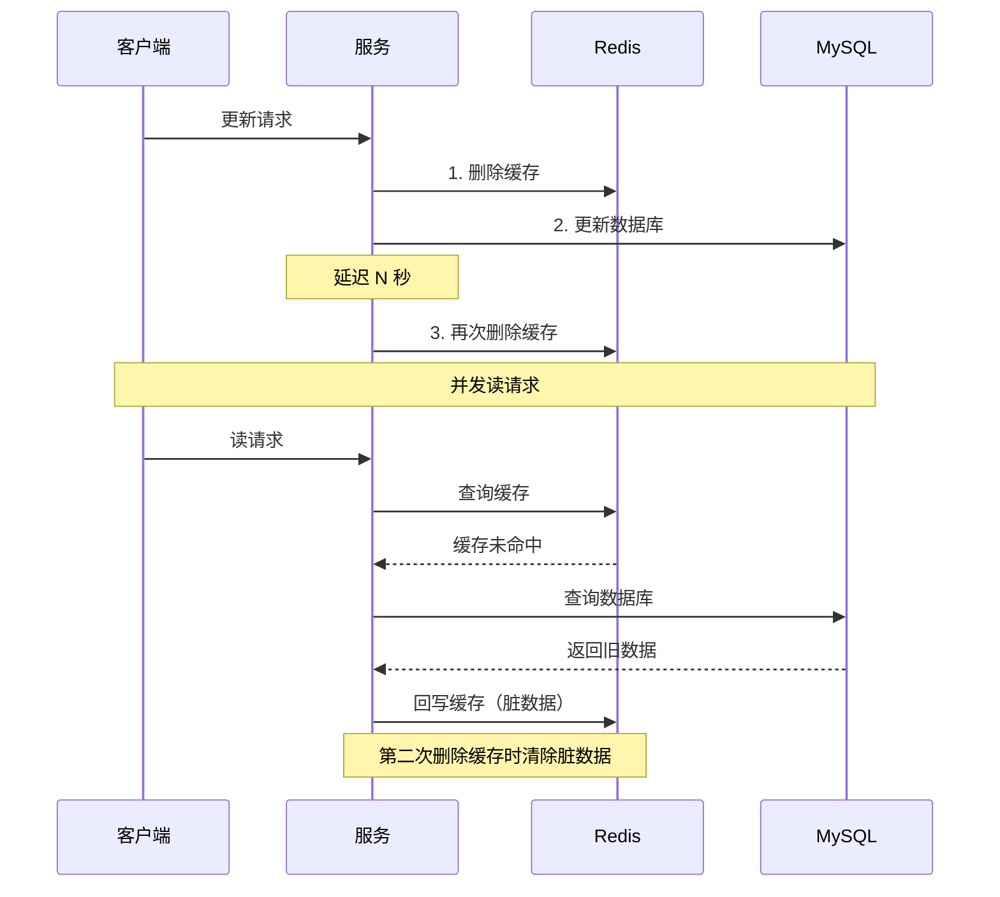
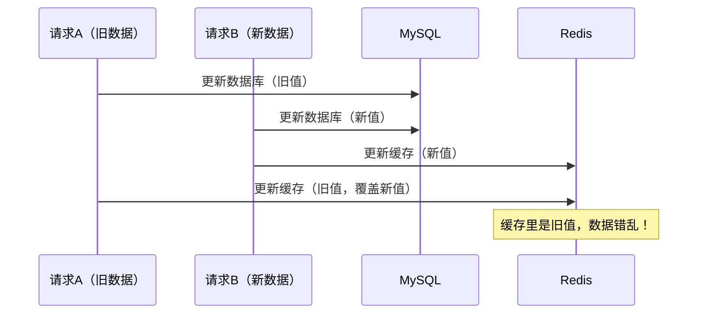
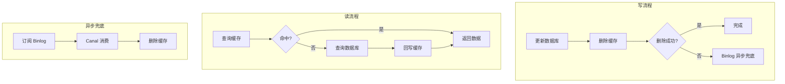
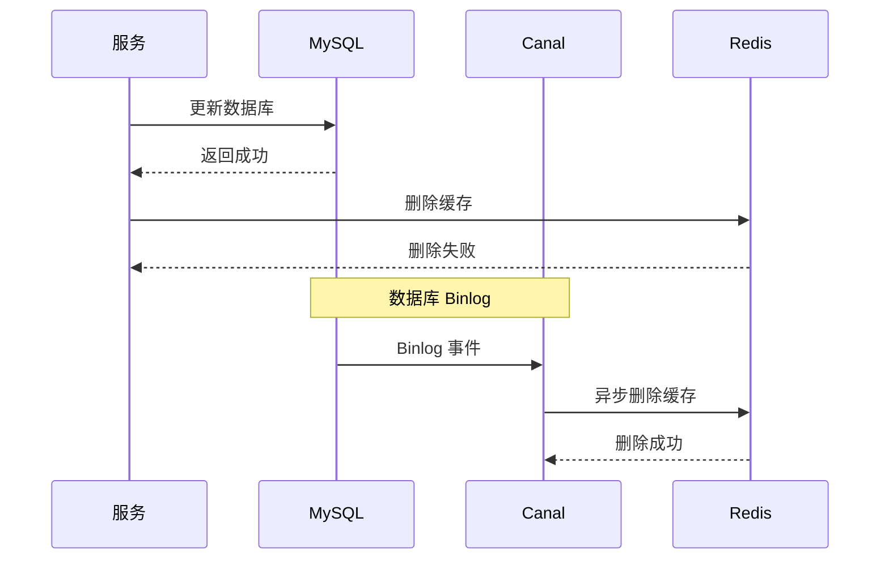
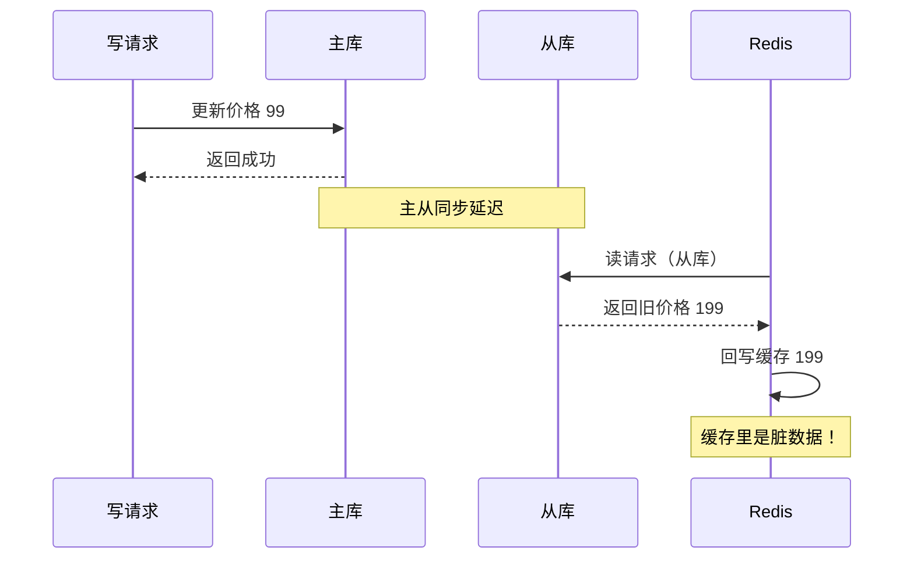
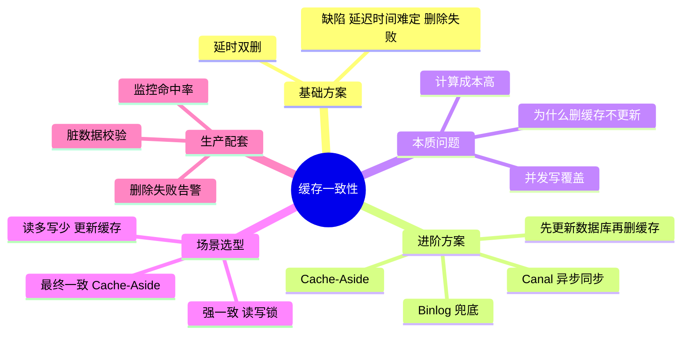

# 缓存一致性方案

> **场景**：Redis 缓存设计
> **核心设计要点**：延时双删、Cache-Aside、Binlog 异步同步、一致性等级选型

---

## 🎯 场景引入

**缓存一致性方案解决什么问题？**
```
一句话：Redis 缓存和 MySQL 数据库的数据怎么保持一致？
```

**生活化比喻**：
就像你和朋友共用一个笔记本：
- 你改了笔记本上的内容（更新数据库）
- 朋友手里的复印件（缓存）还是旧的
- 怎么让朋友的复印件也更新？有三种方案

**核心特点**：没有绝对的缓存一致性，只有一致性和性能的权衡。追求强一致就等于放弃了缓存的高性能优势。

---

## 💎 核心要点速览

### 核心要点（3 个层次）

**1. 基础方案：延时双删（有缺陷）**
```
步骤：
1. 先删除缓存
2. 更新数据库
3. 延迟 N 秒再删除缓存

缺陷：
- 延迟时间难定（理论值 = 读请求耗时 + 主从同步延迟）
- 第二次删除失败 → 脏数据长期存在
- 本质是最终一致性，做不到强一致
```

**2. 进阶方案：Cache-Aside + Binlog 兜底**
```
Cache-Aside 模式：
1. 先更新数据库
2. 再删除缓存
3. 读请求缓存未命中时查库回填

Binlog 兜底：
- 订阅数据库 binlog（用 Canal 工具）
- 异步消费 binlog 事件删除缓存
- 只要数据库提交成功，缓存最终一定会被删除
```

**3. 场景化选型**
```
强一致场景：读写锁/分布式锁（性能退化为数据库）
最终一致场景：Cache-Aside + Binlog 兜底（适合 99% 业务）
读多写少场景：更新缓存（必须解决并发写覆盖问题）
```

---

## 🚀 一句话精华（如果只能记住一句）

> **缓存一致性 = Cache-Aside（先更新数据库再删缓存）+ Binlog 兜底（Canal 异步同步）+ 场景化选型（强一致 vs 最终一致）**

---

## 一、延时双删方案（基础但有缺陷）

### 📊 方案原理

**生活化比喻**：
```
延时双删就像：
1. 先擦掉黑板上的旧答案（删除缓存）
2. 老师在黑板上写新答案（更新数据库）
3. 等几秒钟，再擦一次黑板（再次删除缓存）

目的：防止在写数据库期间，有读请求把旧数据写回缓存
```



### ⚠️ 核心缺陷

| 缺陷 | 原因 | 生活化比喻 |
|------|------|-----------|
| **延迟时间难定** | 理论值 = 读请求耗时 + 主从同步延迟 | 不知道等多久合适 |
| **第二次删除失败** | 网络抖动、Redis 故障 | 第二次擦黑板时黑板擦坏了 |
| **脏数据长期存在** | 删除失败后脏数据一直留在缓存 | 黑板上的错误答案一直没擦 |

### 技术解析

> 延时双删本质是最终一致性方案，根本做不到强一致。延迟时间不是随便设的，理论值等于读请求平均耗时加数据库主从同步延迟。更关键的是延时双删没有重试机制，删缓存一旦失败，脏数据就会长期留在缓存里，这是生产环境的隐形事故。

---

## 二、为什么是删缓存而不是更新缓存？

### 📊 两个核心原因

**生活化比喻**：
```
为什么是删缓存而不是更新缓存？
就像：
- 删缓存：把旧名片扔掉，需要时再印新的（懒加载）
- 更新缓存：直接改名片上的信息（主动更新）

删缓存更好的原因：
1. 并发写场景下更新缓存会出现覆盖问题
2. 复杂缓存值的计算成本很高，删缓存是懒加载，性价比更高
```

### 原因 1：并发写覆盖问题



### 原因 2：计算成本高

```
场景：商品详情页缓存
包含：商品信息 + 库存 + 优惠券 + 评价 + 推荐商品...

更新缓存：每次都要重新计算所有数据（成本高）
删除缓存：下次读请求时再计算（懒加载，成本低）
```

---

## 三、Cache-Aside + Binlog 兜底（工业级方案）

### 📊 Cache-Aside 模式

**生活化比喻**：
```
Cache-Aside 就像：
1. 先改账本（更新数据库）
2. 再撕掉旧名片（删除缓存）
3. 有人要名片时，再印新的（读请求缓存未命中时查库回填）

好处：
- 数据库更新成功才删缓存
- 删缓存失败了，缓存里还是旧数据，不会出现脏数据
```



### 代码示例

```go
// Cache-Aside 模式实现
type CacheAside struct {
    redis *redis.Client
    db    *gorm.DB
}

func (c *CacheAside) Update(key string, value interface{}) error {
    // 1. 先更新数据库
    err := c.db.Model(&Product{}).
        Where("id = ?", key).
        Update("price", value).Error
    if err != nil {
        return err
    }

    // 2. 再删除缓存
    err = c.redis.Del(key).Err()
    if err != nil {
        // 删除失败，依赖 Binlog 兜底
        log.Errorf("delete cache failed: %v", err)
    }

    return nil
}

func (c *CacheAside) Get(key string) (interface{}, error) {
    // 1. 查询缓存
    val, err := c.redis.Get(key).Result()
    if err == nil {
        return val, nil
    }

    // 2. 缓存未命中，查询数据库
    var product Product
    err = c.db.Where("id = ?", key).First(&product).Error
    if err != nil {
        return nil, err
    }

    // 3. 回写缓存
    c.redis.Set(key, product.Price, 1*time.Hour)

    return product.Price, nil
}
```

### 📊 Binlog 异步兜底

**生活化比喻**：
```
Binlog 兜底就像：
请了一个专门的助手（Canal），盯着账本（数据库）
每次账本有变化，助手就同步更新名片（缓存）

好处：
- 只要数据库提交成功，缓存最终一定会被删除
- 天然自带重试和可靠性
- 不用业务代码侵入
```



---

## 四、场景化选型

### 📊 三种一致性等级

| 场景 | 方案 | 代价 | 生活化比喻 |
|------|------|------|-----------|
| **强一致** | 读写锁/分布式锁 | 性能退化为数据库 | 银行转账，必须同时到账 |
| **最终一致** | Cache-Aside + Binlog | 秒级延迟 | 微博粉丝数，晚几秒无所谓 |
| **读多写少** | 更新缓存 | 必须解决并发写覆盖 | 热门商品价格更新 |

### 技术选型建议

> 没有绝对的缓存一致性，只有一致性和性能的权衡。追求强一致就等于放弃了缓存的高性能优势，绝大多数业务场景秒级的最终一致性完全可以接受。生产环境还要配套监控缓存命中率、脏数据周期校验、删缓存失败告警，而不是配完方案就不管了。

---

## 五、主从延迟导致的一致性问题

### 📊 问题场景

**生活化比喻**：
```
主从延迟就像：
主数据库 = 总店
从数据库 = 分店
总店改了价格，分店还没同步
顾客在分店看到旧价格

问题：
更新主库后从库还没同步
读请求走从库读到旧数据又回写缓存
导致缓存里是脏数据
```



### 解决方案

**方案 1：绑定同步完成节点**
```
把缓存删除的时机绑定数据库同步完成的节点
从根源上避免旧数据回写
```

**方案 2：强制读主库**
```
活动高峰期核心链路直接读主库
牺牲一点性能换绝对一致
```

---

## 六、技术要点深入探讨

```mermaid
graph TB
    subgraph Q1["Q1: 延时双删的缺陷?"]
        A1[延迟时间难定] --> A2[第二次删除失败]
        A2 --> A3[脏数据长期存在]
    end

    subgraph Q2["Q2: 为什么删缓存而不是更新?"]
        B1[并发写覆盖] --> B2[计算成本高]
    end

    subgraph Q3["Q3: 工业级方案?"]
        C1[Cache-Aside] --> C2[Binlog 兜底]
        C2 --> C3[Canal 异步同步]
    end

    subgraph Q4["Q4: 主从延迟怎么办?"]
        D1[绑定同步节点] --> D2[强制读主库]
    end

    subgraph Q5["Q5: 场景化选型?"]
        E1[强一致 读写锁] --> E2[最终一致 Cache-Aside]
        E2 --> E3[读多写少 更新缓存]
    end

    style Q1 fill:#FFE4E1
    style Q2 fill:#E0FFFF
    style Q3 fill:#F0E68C
    style Q4 fill:#DDA0DD
    style Q5 fill:#90EE90
```



### 技术解析

**Q1: 延时双删有什么缺陷？**
> 延时双删本质是最终一致性方案，根本做不到强一致。延迟时间不是随便设的，理论值等于读请求平均耗时加数据库主从同步延迟。更关键的是延时双删没有重试机制，删缓存一旦失败，脏数据就会长期留在缓存里。

**Q2: 为什么是删缓存而不是更新缓存？**
> 两个核心原因：一是并发写场景下更新缓存会出现后到的旧请求覆盖新数据的错乱问题；二是复杂缓存值的计算成本很高，删缓存是懒加载，需要的时候再查询构建，性价比远高于主动更新。

**Q3: 工业级方案是什么？**
> Cache-Aside 模式加 Binlog 兜底。先更新数据库再删除缓存，删缓存失败后通过 Canal 订阅数据库 Binlog，异步消费 Binlog 事件来删除对应缓存。只要数据库提交成功，缓存最终一定会被删除，天然自带重试和可靠性。

**Q4: 主从延迟导致的一致性问题怎么处理？**
> 把缓存删除的时机绑定数据库同步完成的节点，从根源上避免旧数据回写。活动高峰期核心链路可以强制读主库，牺牲一点性能换绝对一致。

**Q5: 不同场景怎么选型？**
> 强一致场景用读写锁或分布式锁，代价是缓存性能基本退化为数据库。最终一致场景用 Cache-Aside 加 Binlog 兜底，适合 99% 的业务场景。读多写少且命中率要求极高的场景才考虑更新缓存，但必须解决并发写的覆盖问题。

---

## 七、方案总结



---

## 八、生产环境 Checklist

| 类别 | 检查项 | 状态 | 生活化比喻 |
|------|--------|------|-----------|
| **方案选型** | Cache-Aside 模式 | ⬜ | 先改账本再撕名片 |
| | Binlog 异步同步 | ⬜ | 助手盯账本 |
| **异常处理** | 删缓存失败重试 | ⬜ | 失败再试 |
| | Canal 兜底 | ⬜ | 助手兜底 |
| | 过期时间兜底 | ⬜ | 自动失效 |
| **主从延迟** | 绑定同步节点 | ⬜ | 同步完成再删 |
| | 强制读主库 | ⬜ | 高峰期读主库 |
| **监控告警** | 缓存命中率 | ⬜ | 命中率监控 |
| | 脏数据周期校验 | ⬜ | 定期体检 |
| | 删缓存失败告警 | ⬜ | 失败报警 |

---

## 九、总结（一句话带走）

### 🎯 一句话总结

> **缓存一致性 = Cache-Aside（先更新数据库再删缓存）+ Binlog 兜底（Canal 异步同步）+ 场景化选型（强一致 vs 最终一致）**

### 🧠 核心记忆点

1. **延时双删有缺陷**：延迟时间难定、第二次删除失败、脏数据长期存在
2. **为什么删缓存**：并发写覆盖问题 + 计算成本高（懒加载）
3. **工业级方案**：Cache-Aside + Binlog 兜底（Canal 异步同步）
4. **主从延迟**：绑定同步节点 + 强制读主库
5. **场景选型**：强一致用读写锁，最终一致用 Cache-Aside，读多写少才更新缓存
6. **核心认知**：没有绝对的缓存一致性，只有一致性和性能的权衡
