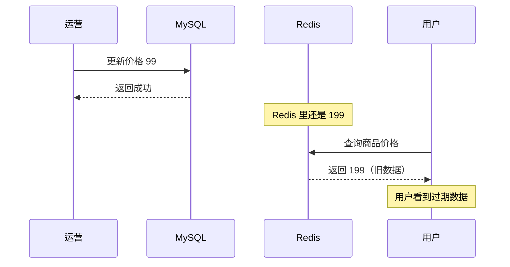
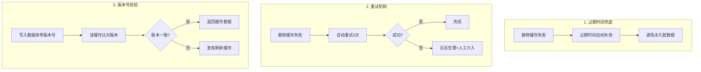
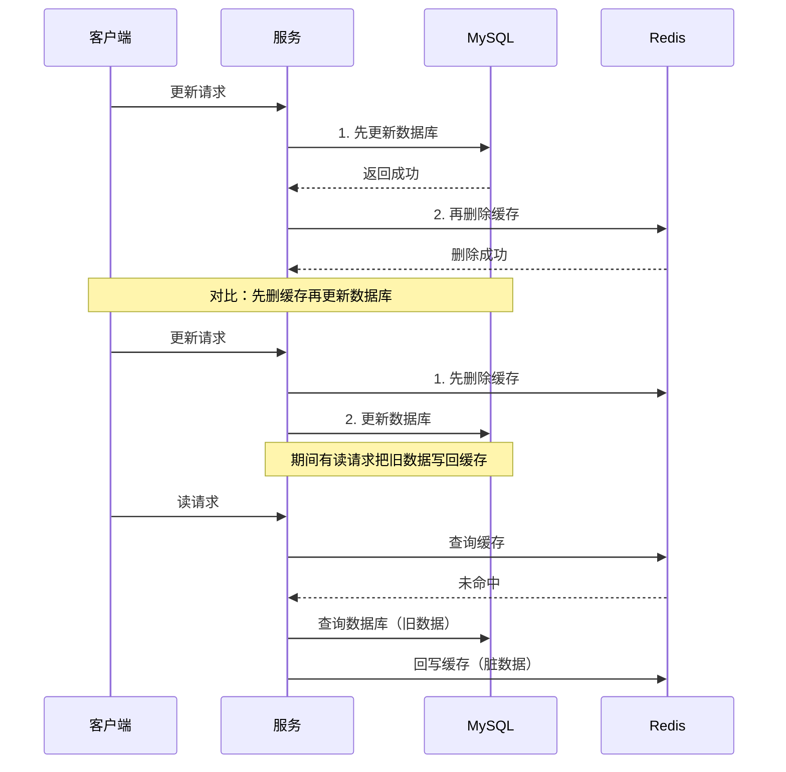
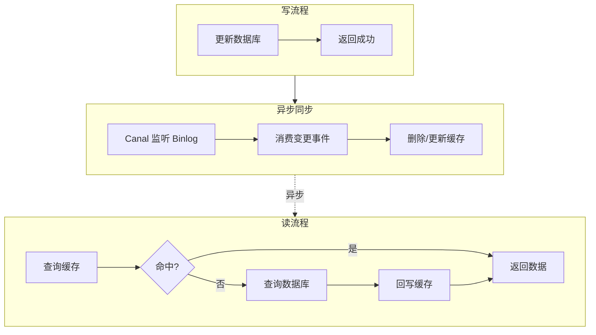
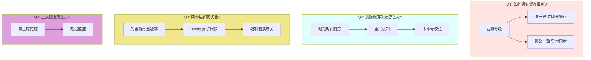
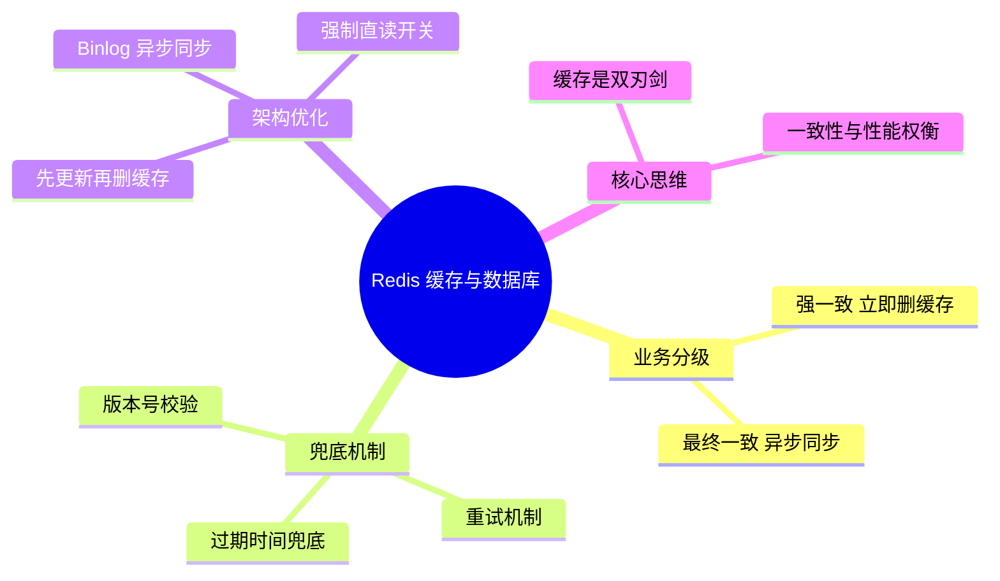

# Redis 缓存与数据库配合

---

## 🎯 一句话定位

**Redis 缓存与数据库配合解决什么问题？**
```
一句话：更新数据库后，怎么保证缓存也是最新的？
```

**生活化比喻**：
就像商品标价——运营后台把价格从 199 改成 99，前端用户刷新页面还是显示 199，转头就去投诉价格欺诈。数据库里价格早就更新了，可 Redis 里躺着的还是旧的 199。

**核心特点**：缓存是一把双刃剑，用得好能抗住读流量，用不好会让用户看到过期数据。

---

## 💎 核心观点（5 分钟速览版）

> **核心要点速览**

### 核心观点（三层防护）

**1. 业务分级：区分一致性等级**
```
强一致性场景：
- 商品价格、订单状态等核心数据
- 更新数据库后立即删除缓存
- 下次查询主动查库并回填
- 绝对不允许缓存旧值

最终一致性场景：
- 商品销量、用户积分等非核心数据
- 定时异步同步缓存
- 延迟十几秒也不影响业务
```

**2. 兜底机制与异常校验**
```
缓存过期时间兜底：
- 就算删除缓存失败，也靠过期时间自动失效
- 避免永久脏数据

更新重试机制：
- 删除缓存失败时自动重试三次
- 还失败就打日志告警，人工介入

读写版本号校验：
- 写入数据库时带版本号
- 读缓存时比对版本
- 缓存版本落后就主动查库刷新
```

**3. 架构层优化：缩小不一致窗口**
```
先更新数据库再删缓存：
- 避开先删缓存再更新数据库的并发脏读问题

异步订阅 binlog 同步：
- 用 Canal 监听数据库 binlog
- 异步消费更新缓存
- 解耦业务代码和缓存逻辑

强制直读开关：
- 活动高峰期核心链路直接读数据库
- 牺牲一点性能换绝对一致
```

---

## 🚀 一句话精华（如果只能记住一句）

> **Redis 缓存与数据库配合 = 业务分级（强一致/最终一致）+ 三层防护（兜底/重试/版本号）+ 架构优化（先更新再删/异步同步/直读开关）**

---

## 一、问题场景：缓存与数据库不一致

### 📊 典型事故

**生活化比喻**：
```
场景：商品详情页
运营后台：把价格从 199 改成 99
数据库：价格已更新为 99
Redis：还是旧的 199
前端用户：刷新三次都是 199
结果：投诉价格欺诈

问题出在哪？
更新数据库后缓存没有及时同步
```



---

## 二、第一层防护：业务分级

### 📊 区分一致性等级

**生活化比喻**：
```
就像医院分诊：
强一致性：急诊（必须立刻处理）
- 商品价格、订单状态
- 更新数据库后立即删除缓存
- 绝对不允许缓存旧值

最终一致性：普通门诊（可以等一等）
- 商品销量、用户积分
- 定时异步同步缓存
- 延迟十几秒也不影响业务
```

| 场景 | 一致性要求 | 方案 | 生活化比喻 |
|------|-----------|------|-----------|
| **商品价格** | 强一致 | 更新后立即删缓存 | 急诊，立刻处理 |
| **订单状态** | 强一致 | 更新后立即删缓存 | 急诊，立刻处理 |
| **商品销量** | 最终一致 | 定时异步同步 | 普通门诊，可以等 |
| **用户积分** | 最终一致 | 定时异步同步 | 普通门诊，可以等 |

### 代码示例

```go
// 强一致性场景：更新后立即删除缓存
func (s *ProductService) UpdatePrice(productID int64, price int64) error {
    // 1. 更新数据库
    err := s.db.Model(&Product{}).
        Where("id = ?", productID).
        Update("price", price).Error
    if err != nil {
        return err
    }

    // 2. 立即删除缓存
    cacheKey := fmt.Sprintf("product:%d", productID)
    err = s.redis.Del(cacheKey).Err()
    if err != nil {
        log.Errorf("delete cache failed: %v", err)
        // 依赖兜底机制处理
    }

    return nil
}

// 最终一致性场景：定时异步同步
func (s *ProductService) UpdateSales(productID int64, sales int64) error {
    // 1. 更新数据库
    err := s.db.Model(&Product{}).
        Where("id = ?", productID).
        Update("sales", sales).Error
    if err != nil {
        return err
    }

    // 2. 异步同步缓存（延迟可接受）
    go func() {
        time.Sleep(5 * time.Second) // 延迟 5 秒
        cacheKey := fmt.Sprintf("product:sales:%d", productID)
        s.redis.Set(cacheKey, sales, 10*time.Minute)
    }()

    return nil
}
```

---

## 三、第二层防护：兜底机制与异常校验

### 📊 三种兜底机制

**生活化比喻**：
```
兜底机制就像安全网：
1. 缓存过期时间：安全网的第一层（自动失效）
2. 更新重试机制：安全网的第二层（失败再试）
3. 读写版本号校验：安全网的第三层（版本比对）
```



### 代码示例：重试机制

```go
// 带重试的缓存删除
func (s *ProductService) DeleteCacheWithRetry(key string, maxRetries int) error {
    for i := 0; i < maxRetries; i++ {
        err := s.redis.Del(key).Err()
        if err == nil {
            return nil // 删除成功
        }

        log.Warnf("delete cache failed, retry %d/%d: %v", i+1, maxRetries, err)
        time.Sleep(100 * time.Millisecond) // 等待后重试
    }

    // 重试失败，记录日志告警
    log.Errorf("delete cache failed after %d retries, key: %s", maxRetries, key)
    // 发送告警通知
    s.alertService.SendAlert(fmt.Sprintf("缓存删除失败: %s", key))

    return errors.New("delete cache failed")
}
```

### 代码示例：版本号校验

```go
// 版本号校验
type ProductCache struct {
    Data    interface{} `json:"data"`
    Version int64       `json:"version"`
}

func (s *ProductService) GetProduct(productID int64) (*Product, error) {
    cacheKey := fmt.Sprintf("product:%d", productID)

    // 1. 查询缓存
    val, err := s.redis.Get(cacheKey).Result()
    if err == nil {
        var cache ProductCache
        json.Unmarshal([]byte(val), &cache)

        // 2. 查询数据库获取最新版本号
        var product Product
        s.db.Where("id = ?", productID).First(&product)

        // 3. 比对版本号
        if cache.Version == product.Version {
            // 版本一致，返回缓存数据
            return &product, nil
        }

        // 版本不一致，查库刷新缓存
        log.Infof("cache version mismatch, refresh cache")
    }

    // 4. 缓存未命中或版本不一致，查询数据库
    var product Product
    err = s.db.Where("id = ?", productID).First(&product).Error
    if err != nil {
        return nil, err
    }

    // 5. 回写缓存
    cache := ProductCache{
        Data:    product,
        Version: product.Version,
    }
    cacheJSON, _ := json.Marshal(cache)
    s.redis.Set(cacheKey, cacheJSON, 1*time.Hour)

    return &product, nil
}
```

---

## 四、第三层防护：架构层优化

### 📊 三种架构优化

**生活化比喻**：
```
架构优化就像修路：
1. 先更新数据库再删缓存：修一条不堵车的路
2. 异步订阅 binlog：请一个专门的助手同步数据
3. 强制直读开关：高峰期直接走高速（读数据库）
```

### 优化 1：先更新数据库再删缓存



### 优化 2：异步订阅 Binlog



### 优化 3：强制直读开关

```go
// 强制直读开关
type ReadSwitch struct {
    redis  *redis.Client
    db     *gorm.DB
    direct bool // true: 直接读数据库，false: 读缓存
}

func (s *ReadSwitch) GetProduct(productID int64) (*Product, error) {
    // 高峰期强制直读数据库
    if s.direct {
        var product Product
        err := s.db.Where("id = ?", productID).First(&product).Error
        return &product, err
    }

    // 正常情况读缓存
    cacheKey := fmt.Sprintf("product:%d", productID)
    val, err := s.redis.Get(cacheKey).Result()
    if err == nil {
        var product Product
        json.Unmarshal([]byte(val), &product)
        return &product, nil
    }

    // 缓存未命中，查数据库
    var product Product
    err = s.db.Where("id = ?", productID).First(&product).Error
    if err != nil {
        return nil, err
    }

    // 回写缓存
    cacheJSON, _ := json.Marshal(product)
    s.redis.Set(cacheKey, cacheJSON, 1*time.Hour)

    return &product, nil
}
```

---

## 五、技术深入



### 技术方案分析

**Q1: 如何保证缓存是最新的？**
> "三层防护：第一层业务分级，核心数据（商品价格、订单状态）走强一致，更新数据库后立即删除缓存；非核心数据（商品销量、用户积分）走最终一致，定时异步同步。第二层兜底机制，缓存过期时间兜底避免永久脏数据，删除失败自动重试三次，读写版本号校验发现版本落后主动刷新。第三层架构优化，先更新数据库再删缓存，用 Canal 异步订阅 Binlog 同步，活动高峰期核心链路强制直读数据库。"

**Q2: 删除缓存失败怎么办？**
> "三种兜底：一是缓存过期时间兜底，就算删除失败也会自动失效；二是更新重试机制，删除失败自动重试三次，还失败就打日志告警人工介入；三是读写版本号校验，写入数据库时带版本号，读缓存时比对版本，版本落后主动查库刷新。"

**Q3: 架构层如何优化？**
> "三种优化：先更新数据库再删缓存，避开先删缓存再更新数据库的并发脏读问题；异步订阅 Binlog 同步，用 Canal 监听数据库变更，异步消费更新缓存，解耦业务代码和缓存逻辑；强制直读开关，活动高峰期核心链路直接读数据库，牺牲一点性能换绝对一致。"

---

## 六、方案总结



---

## 七、生产环境 Checklist

| 类别 | 检查项 | 状态 | 生活化比喻 |
|------|--------|------|-----------|
| **业务分级** | 核心数据强一致 | ⬜ | 急诊 |
| | 非核心数据最终一致 | ⬜ | 普通门诊 |
| **兜底机制** | 缓存过期时间 | ⬜ | 安全网第一层 |
| | 删除失败重试 | ⬜ | 安全网第二层 |
| | 版本号校验 | ⬜ | 安全网第三层 |
| **架构优化** | 先更新再删缓存 | ⬜ | 不堵车的路 |
| | Binlog 异步同步 | ⬜ | 专门助手 |
| | 强制直读开关 | ⬜ | 高峰期走高速 |
| **监控告警** | 缓存命中率 | ⬜ | 命中率监控 |
| | 删除失败告警 | ⬜ | 失败报警 |
| | 主从延迟监控 | ⬜ | 延迟监控 |

---

## 八、总结（一句话带走）

### 🎯 一句话总结

> **Redis 缓存与数据库配合 = 业务分级（强一致/最终一致）+ 三层防护（兜底/重试/版本号）+ 架构优化（先更新再删/异步同步/直读开关）**

### 🧠 核心要点

1. **业务分级**：核心数据（价格、订单）强一致，非核心数据（销量、积分）最终一致
2. **兜底机制**：过期时间兜底 + 重试机制 + 版本号校验
3. **架构优化**：先更新数据库再删缓存 + Binlog 异步同步 + 强制直读开关
4. **核心思维**：缓存是一把双刃剑，一致性和性能要权衡
5. **生产配套**：监控缓存命中率、脏数据校验、删除失败告警

### 💡 架构思维

> **普通开发以为缓存就是加个 Redis 提速，而高级工程师知道，在数据一致性面前缓存是一把双刃剑。从"会用缓存"升级为"会设计缓存一致性方案"，这就是系统思维的体现。**

---

