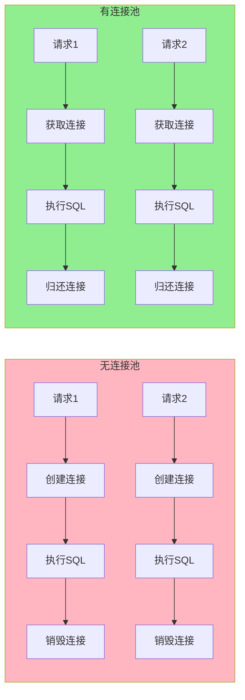
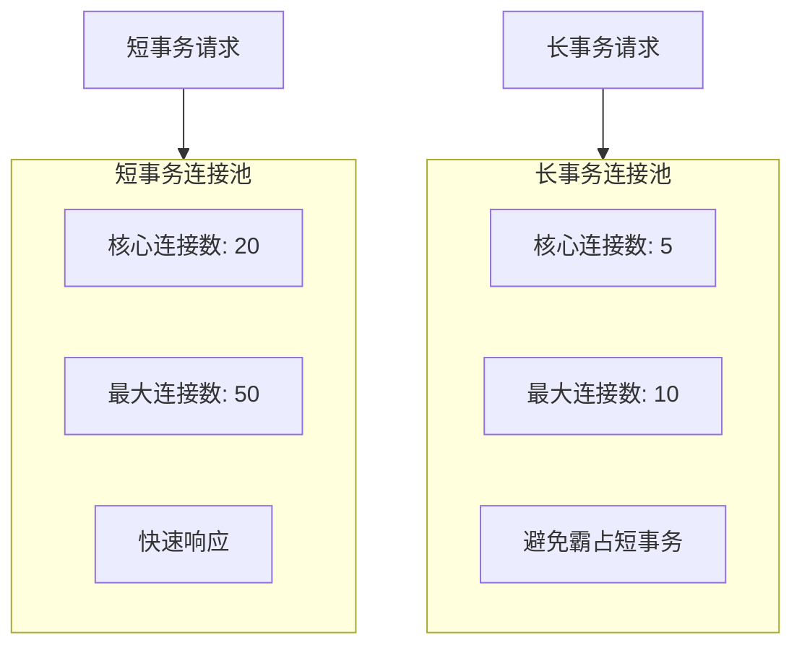
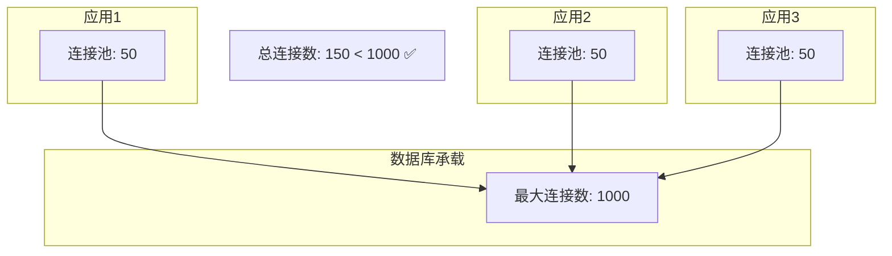
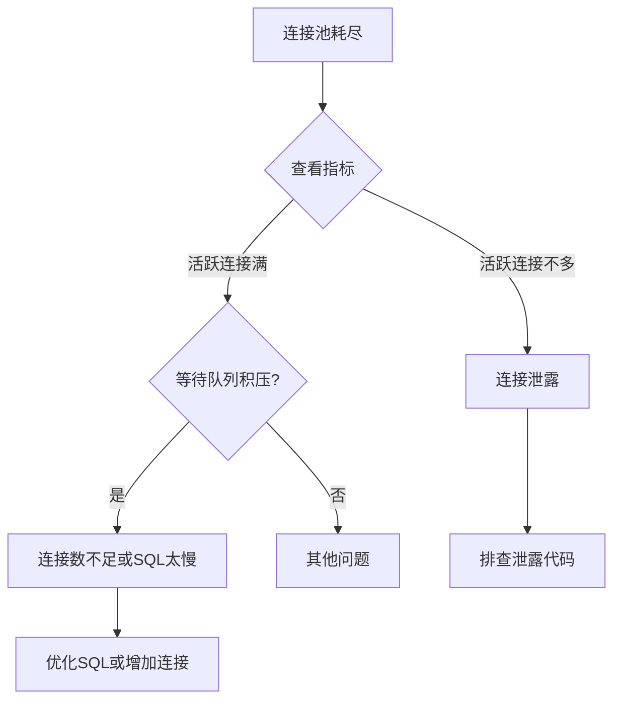
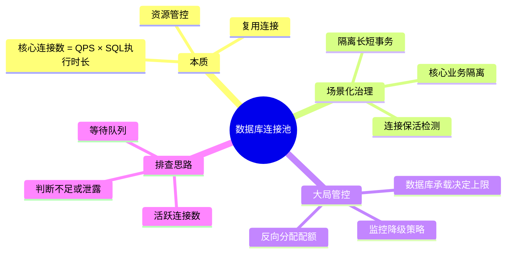

# 数据库连接池设计

---

## 🎯 一句话定位

**数据库连接池解决什么问题？**
```
一句话：复用数据库连接，管控数据库连接资源，而不是越大越好
```

**生活化比喻**：
就像共享单车：
- 没有连接池：每次骑车都要买一辆新车（创建连接），骑完就扔（销毁连接）
- 有连接池：用完车放回停车点（归还连接），下个人继续骑（复用连接）

**核心特点**：连接池的本质是资源管控，核心连接数不是拍脑袋设的，而是取决于业务的平均 SQL 执行时长和 QPS。

---

## 💎 核心观点（5 分钟速览版）

> **核心要点速览**

### 核心观点（三个层次）

**1. 本质：连接池是资源管控**
```
核心作用：复用连接，管控数据库连接资源
核心连接数：取决于业务平均 SQL 执行时长和 QPS
核心逻辑：让连接刚好够用不闲置
参数设计：不是越大越好，设大了频繁创建销毁反而增加开销
```

**2. 进阶：场景化治理**
```
隔离长短事务：
- 长事务单独用小连接池
- 避免霸占短事务的连接

核心业务隔离：
- 核心业务优先分配连接
- 非核心业务高峰期主动降级

连接保活与检测：
- 设置连接最大存活时间
- 配置空闲心跳检测
- 开启连接泄露检测
```

**3. 大局管控：数据库承载反向管控**
```
核心认知：
- 连接池上限不是由应用决定
- 是由数据库承载能力决定
- 盲目调大应用端连接池只会压垮数据库

排查思路：
- 先看活跃连接数和等待队列长度
- 活跃连接满 + 队列积压 → 连接数不足或 SQL 太慢
- 活跃连接不多但拿不到连接 → 连接泄露
```

---

## 🚀 一句话精华（如果只能记住一句）

> **数据库连接池 = 资源管控（复用连接）+ 场景化治理（隔离长短事务/核心非核心）+ 大局管控（数据库承载反向管控）**

---

## 一、连接池的本质：资源管控

### 📊 为什么需要连接池？

**生活化比喻**：
```
没有连接池：
就像每次打电话都要买一部新手机
打完电话就把手机扔掉
下次打电话再买一部

有连接池：
就像手机是租的
用完放回停车点（归还连接）
下个人继续骑（复用连接）

好处：
- 避免频繁创建销毁的开销
- 控制并发连接数
- 提高系统性能
```



### 📊 核心连接数怎么定？

**生活化比喻**：
```
核心连接数就像：
餐厅的服务员数量
- 设少了：高峰期客人等位（频繁创建连接）
- 设多了：低峰期服务员闲着（空闲连接占用资源）

理论最优值：
取决于业务的平均 SQL 执行时长和 QPS
核心逻辑：让连接刚好够用不闲置
```

**公式参考**：
```
核心连接数 = QPS × 平均 SQL 执行时长（秒）

例如：
- QPS = 1000
- 平均 SQL 执行时长 = 10ms = 0.01s
- 核心连接数 = 1000 × 0.01 = 10
```

### ⚠️ 隐形坑：死连接

**生活化比喻**：
```
死连接就像：
你租了一辆车，但车坏了
你还车的时候，租车公司不知道车坏了
下一个人租到这辆坏车，就会出问题

技术原因：
- 数据库端有超时断开机制
- 网络波动也会导致连接失效
- 连接池没有有效的心跳检测和淘汰机制
- 就会出现大量死连接

后果：
业务拿到死连接执行 SQL 就会报错
很多线上偶发的连接异常，根源都在这里
```

---

## 二、场景化治理：从配参数到分层设计

### 📊 隔离长短事务

**生活化比喻**：
```
长短事务隔离就像：
银行分窗口办理业务
- 快速窗口：存取款（短事务）
- 复杂窗口：贷款业务（长事务）

如果不隔离：
长事务霸占窗口
短事务一直排队等
整个系统被拖慢
```



### 📊 核心业务隔离

**生活化比喻**：
```
核心业务隔离就像：
医院的急诊和普通门诊
- 急诊：优先分配资源（核心业务）
- 普通门诊：高峰期主动降级（非核心业务）

好处：
保证核心链路可用
非核心业务高峰期可以牺牲
```

```go
// 连接池配置示例
type PoolConfig struct {
    CoreBusiness    *ConnectionPool // 核心业务连接池
    NonCoreBusiness *ConnectionPool // 非核心业务连接池
}

// 核心业务连接池：优先分配
corePool := NewConnectionPool(ConnectionPoolConfig{
    CoreConnections: 50,
    MaxConnections:  100,
    WaitTimeout:     100 * time.Millisecond,
})

// 非核心业务连接池：高峰期主动降级
nonCorePool := NewConnectionPool(ConnectionPoolConfig{
    CoreConnections: 10,
    MaxConnections:  20,
    WaitTimeout:     500 * time.Millisecond, // 更长的等待时间
})
```

### 📊 连接保活与检测

**生活化比喻**：
```
连接保活就像：
定期体检
- 设置连接最大存活时间：超过时间强制回收
- 配置空闲心跳检测：定期验证连接有效期
- 开启连接泄露检测：连接超过最大使用时间未归还就强制回收

好处：
避免死连接累积
快速定位泄露的代码点
```

| 机制 | 作用 | 生活化比喻 |
|------|------|-----------|
| **最大存活时间** | 超过时间强制回收 | 定期体检 |
| **空闲心跳检测** | 定期验证连接有效期 | 定期检查 |
| **连接泄露检测** | 超时未归还强制回收 | 追踪丢失物品 |

### 代码示例

```go
// HikariCP 配置示例（Go 语言类似）
type HikariConfig struct {
    // 核心参数
    CoreConnections   int           // 核心连接数
    MaxConnections    int           // 最大连接数
    WaitTimeout       time.Duration // 等待超时

    // 连接保活
    MaxLifetime       time.Duration // 连接最大存活时间
    IdleTimeout       time.Duration // 空闲超时
    KeepaliveTime     time.Duration // 心跳检测间隔

    // 泄露检测
    LeakDetectionTime time.Duration // 泄露检测时间
}

// 推荐配置
config := &HikariConfig{
    CoreConnections:   10,
    MaxConnections:    50,
    WaitTimeout:       30 * time.Second,
    MaxLifetime:       30 * time.Minute, // 连接最大存活 30 分钟
    IdleTimeout:       10 * time.Minute, // 空闲 10 分钟回收
    KeepaliveTime:     5 * time.Minute,  // 每 5 分钟心跳检测
    LeakDetectionTime: 2 * time.Minute,  // 2 分钟未归还视为泄露
}
```

---

## 三、大局管控：数据库承载反向管控

### 📊 核心认知

**生活化比喻**：
```
连接池上限就像：
餐厅的桌子数量
- 不是你想摆多少桌子就摆多少
- 而是餐厅面积决定最多能摆多少
- 盲目调大应用端的连接池只会压垮数据库

核心认知：
连接池的上限不是由应用决定的
是由数据库的承载能力决定的
数据库能支撑的并发连接数是有限的
```



### 📊 排查思路

**生活化比喻**：
```
排查连接池耗尽就像：
医生看病
- 先看两个核心指标：活跃连接数、等待队列长度
- 活跃连接满 + 队列积压 → 连接数不足或 SQL 太慢
- 活跃连接不多但拿不到连接 → 连接泄露
```



### 排查命令

```bash
# MySQL 查看连接数
SHOW STATUS LIKE 'Threads_%';
SHOW PROCESSLIST;

# 查看连接池状态（HikariCP）
GET /actuator/metrics/hikaricp.connections.active
GET /actuator/metrics/hikaricp.connections.pending

# 查看慢查询
SHOW VARIABLES LIKE 'slow_query_log';
SHOW GLOBAL STATUS LIKE 'Slow_queries';
```

---

## 四、技术深入

```mermaid
graph TB
    subgraph Q1["Q1: 核心连接数怎么定?"]
        A1[QPS × 平均SQL执行时长] --> A2[刚好够用不闲置]
    end

    subgraph Q2["Q2: 长短事务混合怎么办?"]
        B1[隔离连接池] --> B2[长事务单独小池]
    end

    subgraph Q3["Q3: 死连接怎么处理?"]
        C1[心跳检测] --> C2[最大存活时间]
        C2 --> C3[泄露检测]
    end

    subgraph Q4["Q4: 连接池耗尽怎么排查?"]
        D1[看活跃连接数] --> D2[看等待队列]
        D2 --> D3[判断是不足还是泄露]
    end

    subgraph Q5["Q5: 连接池上限由谁决定?"]
        E1[数据库承载能力] --> E2[反向分配配额]
    end

    style Q1 fill:#FFE4E1
    style Q2 fill:#E0FFFF
    style Q3 fill:#F0E68C
    style Q4 fill:#DDA0DD
    style Q5 fill:#90EE90
```



### 技术方案分析

**Q1: 核心连接数怎么定？**
> "核心连接数不是拍脑袋设的，它的理论最优值取决于业务的平均 SQL 执行时长和 QPS。公式：核心连接数 = QPS × 平均 SQL 执行时长。核心逻辑是让连接刚好够用不闲置，设大了频繁创建销毁反而增加开销。"

**Q2: 长短事务混合怎么办？**
> "隔离长短事务。长事务单独用小连接池，避免霸占短事务的连接，拖垮整个接口。核心业务和非核心业务也要隔离，核心业务优先分配连接，非核心业务在高峰期主动降级，保证核心链路可用。"

**Q3: 死连接怎么处理？**
> "配套完整的治理机制：设置合理的连接最大存活时间，超过时间强制回收，避免长连接累积问题。配置空闲心跳检测或连接前校验，定期验证连接有效期，淘汰死连接。开启连接泄露检测，连接超过最大使用时间未归还就强制回收，并输出日志快速定位泄露的代码点。"

**Q4: 连接池耗尽怎么排查？**
> "先看两个核心指标：活跃连接数和等待队列长度。活跃连接数满，等待队列持续积压，要么是连接数配置不足，要么是 SQL 太慢导致连接占用时间太长。如果活跃连接数不多，但还是拿不到连接，大概率是连接泄露。"

**Q5: 连接池上限由谁决定？**
> "连接池的上限不是由应用决定的，是由数据库的承载能力决定的。数据库能支撑的并发连接数是有限的，盲目调大应用端的连接池只会把数据库压垮。高级后端做连接池设计，会先评估数据库的最大承载，再反向分配各个业务的连接配额，配合监控和降级策略。"

---

## 五、方案总结



---

## 六、生产环境 Checklist

| 类别 | 检查项 | 状态 | 生活化比喻 |
|------|--------|------|-----------|
| **参数设计** | 核心连接数合理 | ⬜ | 服务员数量 |
| | 最大连接数合理 | ⬜ | 餐厅桌子 |
| | 等待超时合理 | ⬜ | 等位时间 |
| **场景化治理** | 长短事务隔离 | ⬜ | 分窗口办理 |
| | 核心业务隔离 | ⬜ | 急诊优先 |
| | 连接保活检测 | ⬜ | 定期体检 |
| **大局管控** | 评估数据库承载 | ⬜ | 餐厅面积 |
| | 反向分配配额 | ⬜ | 合理分配 |
| | 监控降级策略 | ⬜ | 高峰期降级 |
| **问题排查** | 活跃连接数监控 | ⬜ | 在用餐人数 |
| | 等待队列监控 | ⬜ | 等位人数 |
| | 泄露检测 | ⬜ | 追踪丢失物品 |

---

## 七、总结（一句话带走）

### 🎯 一句话总结

> **数据库连接池 = 资源管控（复用连接）+ 场景化治理（隔离长短事务/核心非核心）+ 大局管控（数据库承载反向管控）**

### 🧠 核心要点

1. **本质**：连接池是资源管控，核心连接数 = QPS × 平均 SQL 执行时长
2. **场景化治理**：隔离长短事务、核心业务隔离、连接保活检测
3. **大局管控**：连接池上限由数据库承载能力决定，反向分配配额
4. **排查思路**：看活跃连接数和等待队列，判断是不足还是泄露
5. **隐形坑**：死连接、连接泄露、数据库承载超限

### 💡 架构思维

> **高级后端在进行连接池设计时，会优先评估数据库的最大承载能力，反向分配各业务的连接配额，并配合监控与降级策略，而非盲目调大参数。**

---

