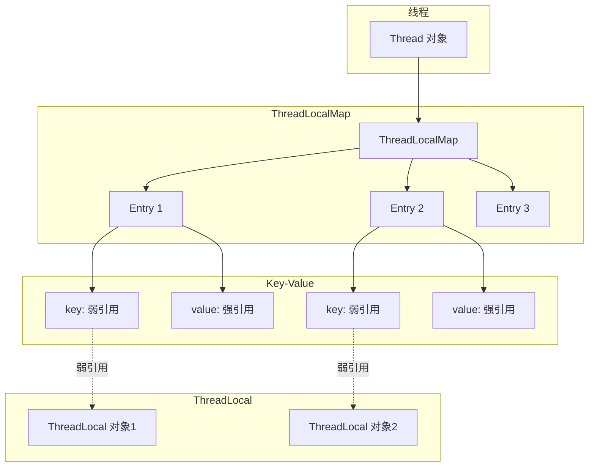
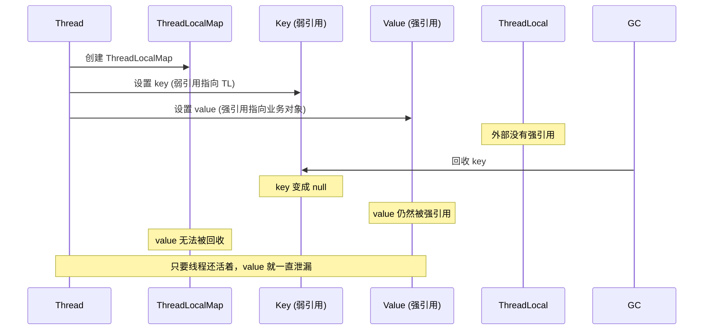
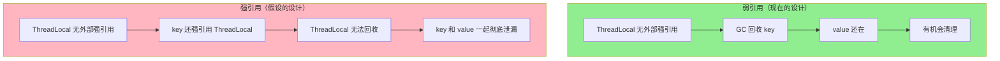
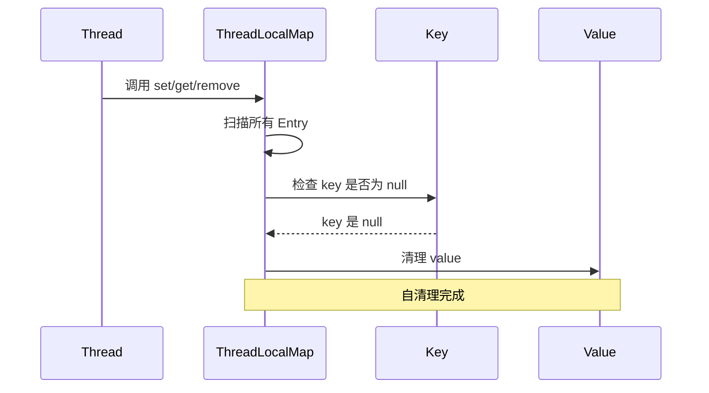
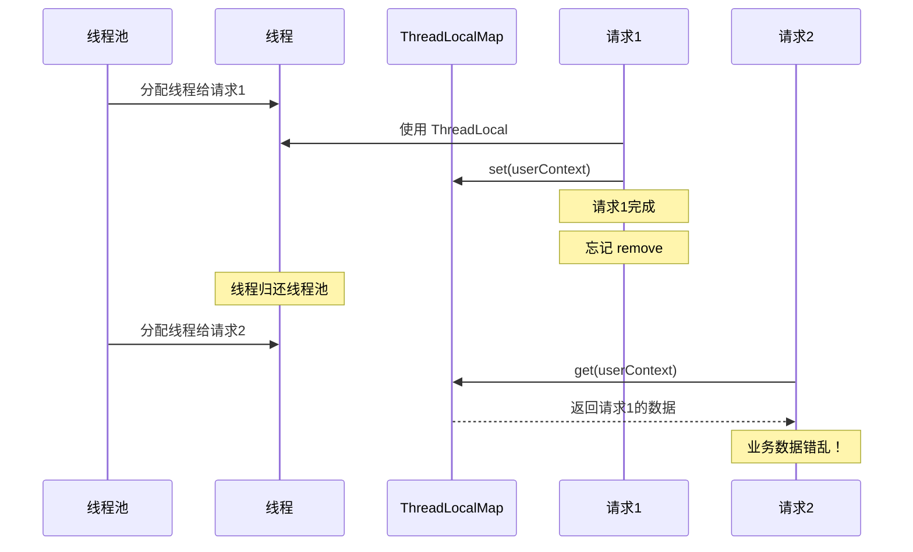
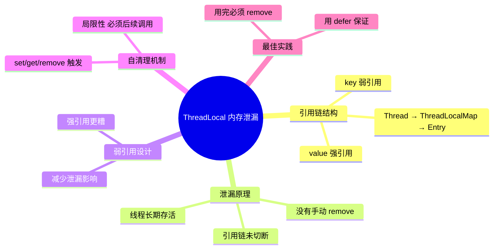

# ThreadLocal 内存泄漏

---

## 🎯 一句话定位

**ThreadLocal 内存泄漏解决什么问题？**
```
一句话：ThreadLocal 的 key 设计成弱引用，恰恰是为了减少内存泄漏，而不是造成泄漏的根源
```

**生活化比喻**：
就像酒店衣柜：
- 每个房间（线程）都有自己的衣柜（ThreadLocalMap）
- 衣柜里的东西（value）是你的（强引用）
- 但衣柜的标签（key）是临时的（弱引用）
- 你退房时（线程结束）如果不拿走东西，东西就永远留在衣柜里

**核心特点**：内存泄漏的本质是线程长期存活 + 没有手动清理 value，而不是弱引用的锅。

---

## 💎 核心观点（5 分钟速览版）

> **核心要点速览**

### 核心观点（4 个关键点）

**1. 引用链结构**
```
Thread → ThreadLocalMap → Entry（key-value）
- key：弱引用指向 ThreadLocal 对象
- value：强引用指向业务对象

生活化比喻：
每个线程都有一个衣柜（ThreadLocalMap）
衣柜的标签（key）是临时的（弱引用）
衣柜里的东西（value）是你的（强引用）
```

**2. 泄漏原理**
```
ThreadLocal 没有外部强引用
→ 下次 GC 时 key 被回收（弱引用）
→ 但 value 是强引用，只要线程还活着
→ value 的引用链就一直通着
→ value 永远不会被回收
→ 形成内存泄漏
```

**3. 弱引用设计的目的**
```
如果把 key 设计成强引用：
- 就算外部把 ThreadLocal 置为 null
- map 里的 key 还强引用着它
- ThreadLocal 实例永远回收不了
- 连 key 带 value 一起彻底泄漏
- 问题反而更严重

弱引用的好处：
- 至少能保证 key 不会一起彻底泄漏
- 问题还有机会被清理
```

**4. 自清理机制与局限性**
```
ThreadLocalMap 的 set/get/remove 方法
会自动扫描 key 已经变成 null 的 entry
把对应的 value 也一并清掉

局限性：
- 必须后续再调用这些方法才能触发清理
- 如果用完再也不调用了
- value 就一直泄露在里面
```

---

## 🚀 一句话精华（如果只能记住一句）

> **ThreadLocal 内存泄漏 = 线程长期存活 + 没有手动 remove，弱引用设计恰恰是为了减少泄漏，而不是造成泄漏**

---

## 一、引用链结构详解

### 📊 ThreadLocalMap 结构

**生活化比喻**：
```
ThreadLocalMap 就像：
每个线程都有一个专属衣柜
衣柜里有很多格子（Entry）
每个格子有一个标签（key）和东西（value）

标签（key）：
- 指向 ThreadLocal 对象
- 弱引用（随时可能被收走）

东西（value）：
- 指向业务对象
- 强引用（不会被收走）
```



### 代码示例

```go
// ThreadLocal 结构（Go 语言没有 ThreadLocal，这里用伪代码展示）
type Thread struct {
    threadLocalMap *ThreadLocalMap
}

type ThreadLocalMap struct {
    entries []*Entry
}

type Entry struct {
    key   *ThreadLocal // 弱引用
    value interface{}  // 强引用
}

type ThreadLocal struct {
    // ThreadLocal 对象
}
```

---

## 二、内存泄漏原理

### 📊 泄漏过程

**生活化比喻**：
```
泄漏过程就像：
1. 你住进酒店，把东西放在衣柜里
2. 你把衣柜标签（ThreadLocal）扔了（没有外部强引用）
3. 酒店清理标签（GC 回收 key）
4. 但你的东西（value）还在衣柜里
5. 只要你不退房（线程还活着）
6. 东西就永远留在衣柜里（内存泄漏）
```



### 关键代码

```java
// ThreadLocalMap 的 Entry 定义
static class Entry extends WeakReference<ThreadLocal<?>> {
    Object value; // 业务对象（强引用）

    Entry(ThreadLocal<?> k, Object v) {
        super(k); // key 是弱引用
        value = v; // value 是强引用
    }
}
```

---

## 三、弱引用设计的目的

### 📊 对比强引用

**生活化比喻**：
```
对比：
弱引用（现在的设计）：
- 标签（key）随时可能被收走
- 但东西（value）还在
- 至少标签可以被清理
- 问题还有救

强引用（假设的设计）：
- 标签（key）永远不会被收走
- 东西（value）也永远不会被收走
- 连标签带东西一起彻底泄漏
- 问题更严重
```



### 技术方案分析

> "很多人搞反了因果。设计成弱引用恰恰是为了减少内存泄漏，而不是造成泄漏的根源。反过来想，如果把 key 设计成强引用，就算外部把 ThreadLocal 的引用置为 null 了，map 里的 key 还强引用着它，ThreadLocal 实例永远回收不了，连 key 带 value 一起彻底泄漏，问题反而更严重。而弱引用至少能保证 key 不会一起彻底泄漏，问题还有机会被清理。"

---

## 四、自清理机制与局限性

### 📊 自清理机制

**生活化比喻**：
```
自清理机制就像：
酒店服务员每次整理衣柜时
会顺便检查有没有空标签的格子
如果有，就把格子里的东西也清理掉

触发时机：
- 调用 set 方法时
- 调用 get 方法时
- 调用 remove 方法时
```



### ⚠️ 局限性

**生活化比喻**：
```
局限性：
- 必须后续再调用 set/get/remove 才能触发清理
- 如果用完再也不调用了
- value 就一直泄露在里面

就像：
- 服务员只有在你使用衣柜时才会整理
- 如果你再也不使用衣柜
- 服务员永远不会来整理
- 东西就一直留在衣柜里
```

---

## 五、真实项目场景：线程池

### 📊 线程池场景的坑

**生活化比喻**：
```
线程池场景就像：
酒店房间不退房（线程复用）
一个客人用完衣柜没拿走东西
下一个客人进来还能看到上一个客人残留的东西

问题：
- 线程池中的线程是复用的，不会销毁
- 一个请求用完 ThreadLocal 没手动 remove
- 下一个请求过来还能读到上一个线程残留的值
- 轻则业务数据错乱，重则泄漏累积最后撑爆 OOM
```



### 代码示例

```go
// ❌ 错误示例：线程池中使用 ThreadLocal 未清理
type UserContext struct {
    UserID int64
}

var userContextTL = &ThreadLocal{}

func handleRequest1() {
    userContextTL.Set(&UserContext{UserID: 1001})
    // 处理业务逻辑...
    // 忘记 remove，数据残留
}

func handleRequest2() {
    ctx := userContextTL.Get()
    // ctx 可能是请求1的数据，业务错乱！
}

// ✅ 正确示例：用完必须 remove
func handleRequest1Correct() {
    userContextTL.Set(&UserContext{UserID: 1001})
    defer userContextTL.Remove() // 用完必须清理
    // 处理业务逻辑...
}
```

---

## 六、最佳实践

### 📊 使用规范

**生活化比喻**：
```
最佳实践就像：
退房时必须拿走所有东西
- 用完 ThreadLocal 必须手动 remove
- 最好用 defer 保证一定执行
- 避免泄漏和数据错乱
```

```go
// ✅ 最佳实践：使用 defer 保证清理
func handleRequest() {
    // 设置 ThreadLocal
    userContextTL.Set(&UserContext{UserID: 1001})

    // 保证清理
    defer userContextTL.Remove()

    // 处理业务逻辑
    processBusiness()
}

// ✅ 封装成装饰器模式
func withUserContext(userID int64, handler func()) {
    userContextTL.Set(&UserContext{UserID: userID})
    defer userContextTL.Remove()
    handler()
}

// 使用
func handleRequest() {
    withUserContext(1001, func() {
        // 处理业务逻辑
        processBusiness()
    })
}
```

---

## 七、技术深入

```mermaid
graph TB
    subgraph Q1["Q1: ThreadLocal 会内存泄漏吗?"]
        A1[会] --> A2[线程长期存活]
        A2 --> A3[没有手动 remove]
    end

    subgraph Q2["Q2: 为什么用弱引用?"]
        B1[减少泄漏影响] --> B2[强引用更糟]
    end

    subgraph Q3["Q3: 有自清理机制吗?"]
        C1[set/get/remove 触发] --> C2[但必须后续调用]
        C2 --> C3[局限性]
    end

    subgraph Q4["Q4: 线程池场景怎么办?"]
        D1[用完必须 remove] --> D2[用 defer 保证]
    end

    subgraph Q5["Q5: 泄漏的本质?"]
        E1[线程长期存活] --> E2[引用链未切断]
    end

    style Q1 fill:#FFE4E1
    style Q2 fill:#E0FFFF
    style Q3 fill:#F0E68C
    style Q4 fill:#DDA0DD
    style Q5 fill:#90EE90
```



### 技术方案分析

**Q1: ThreadLocal 会造成内存泄漏吗？**
> "会。因为 key 是弱引用，value 是强引用。当 ThreadLocal 没有外部强引用时，下次 GC 会回收 key，但 value 的引用链还在，只要线程还活着，value 就永远不会被回收，形成内存泄漏。"

**Q2: 为什么非得设计成弱引用？**
> "很多人搞反了因果。设计成弱引用恰恰是为了减少内存泄漏，而不是造成泄漏的根源。如果把 key 设计成强引用，就算外部把 ThreadLocal 的引用置为 null 了，map 里的 key 还强引用着它，ThreadLocal 实例永远回收不了，连 key 带 value 一起彻底泄漏，问题反而更严重。"

**Q3: 有自清理机制吗？**
> "有。ThreadLocalMap 在调用 set、get、remove 方法的时候，会自动扫描那些 key 已经变成 null 的 entry，把对应的 value 也一并清掉。但这个保护机制有个大前提，就是后续得再调用这些方法触发清理。如果用完再也不调用了，那 value 就一直泄露在里面。"

**Q4: 线程池场景怎么办？**
> "线程池中的线程是复用的，不会销毁。一个请求用完 ThreadLocal 没手动 remove，下一个请求过来还能读到上一个线程残留的值，轻则业务数据错乱，重则泄漏累积最后撑爆 OOM。所以开发规范强制要求 ThreadLocal 用完必须手动 remove，最好用 defer 保证一定执行。"

**Q5: 泄漏的本质是什么？**
> "泄漏的本质不是弱引用的锅，而是线程长期存活加上你没有手动清理，共同导致的坑。判断会不会泄露的本质是看线程生命周期加上 value 的引用链有没有被切断。"

---

## 八、方案总结



---

## 九、生产环境 Checklist

| 类别 | 检查项 | 状态 | 生活化比喻 |
|------|--------|------|-----------|
| **使用规范** | 用完必须 remove | ⬜ | 退房拿东西 |
| | 用 defer 保证 | ⬜ | 自动清理 |
| **线程池场景** | 避免数据残留 | ⬜ | 清理衣柜 |
| | 监控泄漏情况 | ⬜ | 检查遗留物品 |
| **监控告警** | 内存使用监控 | ⬜ | 衣柜占用率 |
| | OOM 告警 | ⬜ | 溢出报警 |

---

## 十、总结（一句话带走）

### 🎯 一句话总结

> **ThreadLocal 内存泄漏 = 线程长期存活 + 没有手动 remove，弱引用设计恰恰是为了减少泄漏，而不是造成泄漏**

### 🧠 核心要点

1. **引用链结构**：Thread → ThreadLocalMap → Entry（key 弱引用，value 强引用）
2. **泄漏原理**：线程长期存活 + 没有手动 remove → value 引用链未切断
3. **弱引用设计**：恰恰是为了减少泄漏，强引用会更糟
4. **自清理机制**：set/get/remove 触发，但必须后续调用
5. **线程池场景**：用完必须 remove，否则数据残留和泄漏
6. **最佳实践**：用完必须手动 remove，最好用 defer 保证

### 💡 架构思维

> **会不会泄露不是弱引用的锅，而是线程长期存活加上你没手动清理，共同导致的坑。判断会不会泄露的本质是看线程生命周期加上 value 的引用链有没有被切断。**

---

