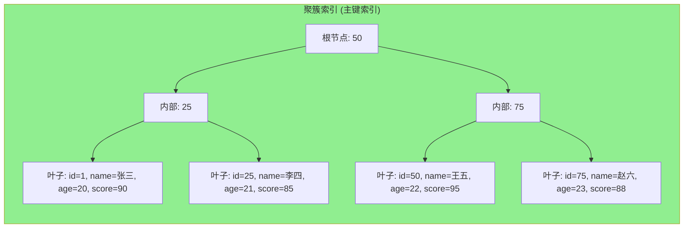
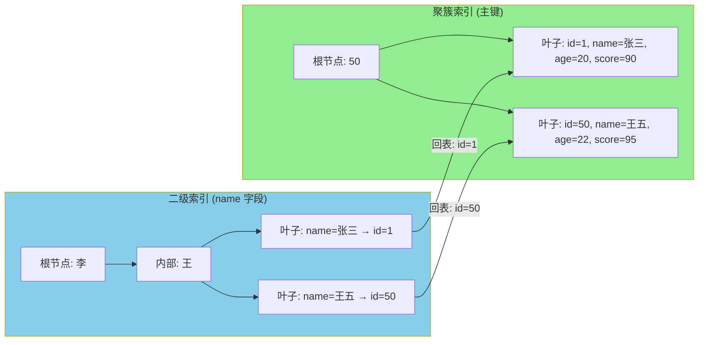
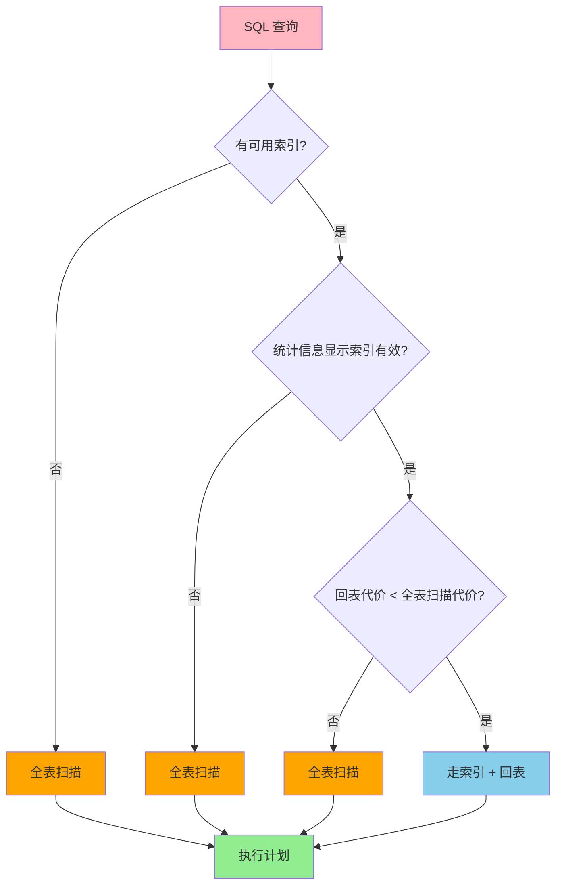
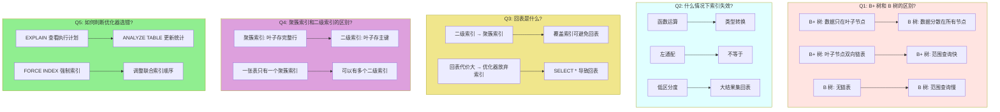
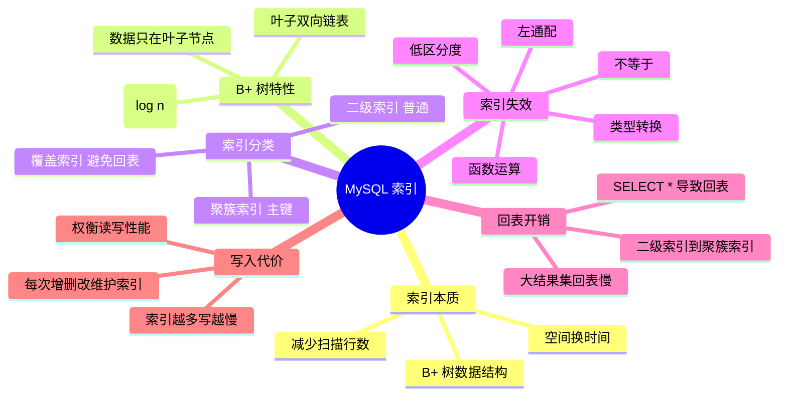
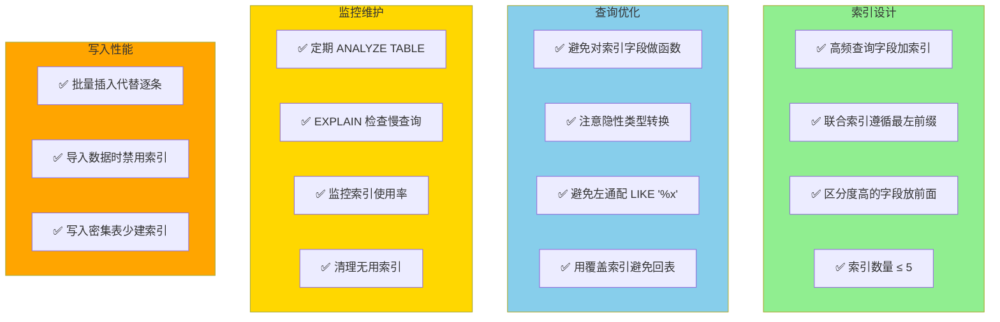
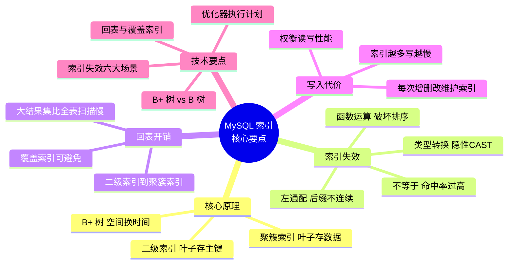

# MySQL 索引原理与失效

---

## 🎯 一句话定位

**MySQL 索引解决什么问题？**
```
不用索引：SELECT * FROM users WHERE name = '张三';
→ 全表扫描 100 万行，逐行比对，耗时 3 秒

加了索引：同样的 SQL
→ 沿 B+ 树查找，只需 3-4 次磁盘 IO，耗时 0.001 秒
```

**生活化比喻**：
索引就像**字典的目录**。你要查"龘"这个字，如果没有目录，你得从第一页翻到最后一页（全表扫描）。有了目录，直接翻到拼音"D"所在的页码（索引查找），效率提升 1000 倍。

**核心特点**：索引是数据库**用空间换时间**的数据结构，通过减少扫描行数提升检索效率。但——加了索引不一定更快，就像给一本 10 页的小册子建目录，反而多此一举。

---

## 💎 核心观点（5 分钟速览版）

> **核心要点速览**

### 核心观点（5 个关键点）

**1. 索引本质：B+ 树数据结构**
```
❌ 不是哈希表（不支持范围查询）
❌ 不是二叉搜索树（可能退化成链表）
✅ InnoDB 默认用 B+ 树组织索引
   - 所有数据在叶子节点，查询稳定 O(log n)
   - 叶子节点用双向链表连接，支持范围查询
   - 非叶子节点只存键值，每层能存更多分支
```

**2. 加了索引不一定快：三种反效果场景**
```
场景1：小表（< 1000 行）
→ 全表扫描比走索引还快（索引也要 IO）

场景2：低区分度字段（如性别、状态）
→ SELECT * FROM users WHERE gender = '男'
→ 50% 的人都是男性，索引没意义

场景3：大结果集回表
→ 索引命中 10 万行，每行都要回主键索引查完整行
→ 优化器直接放弃索引，走全表扫描
```

**3. 索引失效：四种常见操作让索引变废纸**
```
1. 对索引字段做函数运算：WHERE YEAR(create_time) = 2024
2. 隐性类型转换：WHERE phone = 13800138000（phone 是 VARCHAR）
3. 左通配模糊查询：WHERE name LIKE '%张'
4. 不等于判断：WHERE status != 0
```

**4. 回表开销：非覆盖索引的代价**
```
生活化比喻：
索引是"目录"，数据是"正文"。
查到目录（索引命中），还要翻到正文（回表）才能拿到完整信息。

每命中一条索引记录 → 回到主键索引查完整行
命中 100 条 → 回表 100 次
命中 10 万条 → 回表 10 万次（比全表扫描还慢）
```

**5. 索引的写入代价：每次增删改都要维护索引树**
```
无索引：INSERT 一条记录 = 写一次磁盘
有 3 个索引：INSERT 一条记录 = 写 4 次磁盘（1 次数据 + 3 次索引树更新）

索引越多，写入越慢。
就像一本书，每加一个索引，出版商都要重新排版目录。
```

---

## 🚀 一句话精华（如果只能记住一句）

> **MySQL 索引 = B+ 树（空间换时间） + 回表（目录→正文） + 失效场景（函数/类型/通配/不等于） + 写入代价（索引越多写越慢）**

---

## 一、索引本质：用空间换时间的数据结构

### 1.1 什么是索引？

**生活化比喻**：
```
索引就像字典的目录、图书馆的检索系统、微信通讯录的搜索框。

没有索引：
SELECT * FROM users WHERE name = '张三';
→ 数据库从第 1 行扫到第 100 万行，逐行比对 name 字段
→ 就像没有目录，从字典第一页翻到最后一页找"龘"字

有索引：
同样的 SQL
→ 数据库沿 B+ 树查找，3-4 次磁盘 IO 就定位到目标行
→ 就像翻开字典目录，直接跳到目标页码
```

**技术定义**：
```
索引（Index）是数据库为了加速查询而维护的一种数据结构。
InnoDB 默认使用 B+ 树（B+ Tree）组织索引。
索引文件存储在磁盘上，和表数据一样需要磁盘 IO。
```

### 1.2 InnoDB 为什么选择 B+ 树？

**生活化比喻**：
```
想象你要在一本 100 万页的书里找某一页：

方案1：线性扫描（全表扫描）
→ 从第 1 页翻到第 100 万页，耗时 O(n)
→ 就像没有目录，逐页翻找

方案2：二分查找（需要有序，但不适合磁盘）
→ 需要随机访问，磁盘随机 IO 太慢
→ 就像每次都要跳到书的中间，但翻书很慢

方案3：B+ 树（InnoDB 的选择）
→ 多叉平衡树，树高只有 3-4 层
→ 从根节点到叶子节点，最多 3-4 次磁盘 IO
→ 就像一本只有 4 层目录的字典，最快找到目标
```

**B+ 树 vs 其他数据结构对比**：

| 数据结构 | 查询复杂度 | 范围查询 | 适合磁盘 | InnoDB 采用 |
|---------|-----------|---------|---------|------------|
| **B+ 树** | O(log n) | ✅ 支持（叶子链表） | ✅ 适合 | ✅ 默认 |
| 哈希表 | O(1) | ❌ 不支持 | ❌ 不适合 | ❌（Memory 引擎支持） |
| 二叉搜索树 | O(log n) | ✅ 支持 | ❌ 树太深 | ❌ |
| 红黑树 | O(log n) | ✅ 支持 | ❌ 树太深 | ❌ |
| B 树 | O(log n) | ⚠️ 不便（数据分散） | ✅ 适合 | ❌ |

### 1.3 B+ 树结构详解

```mermaid
graph TB
    subgraph Root["根节点 (非叶子)"]
        R[17 | 35 | 52]
    end
    
    subgraph Internal["内部节点 (非叶子)"]
        I1[5 | 11 | 14]
        I2[22 | 28 | 31]
        I3[40 | 45 | 48]
        I4[58 | 63 | 68]
    end
    
    subgraph Leaf["叶子节点 (存数据)"]
        L1[1→3→5→7→9→11→13→14]
        L2[17→19→21→22→25→28→30→31]
        L3[35→37→39→40→42→45→47→48]
        L4[52→55→57→58→60→63→65→68]
    end
    
    R --> I1
    R --> I2
    R --> I3
    R --> I4
    
    I1 --> L1
    I2 --> L2
    I3 --> L3
    I4 --> L4
    
    L1 <-->|双向链表| L2
    L2 <-->|双向链表| L3
    L3 <-->|双向链表| L4
    
    style Root fill:#FFB6C1
    style Internal fill:#87CEEB
    style Leaf fill:#90EE90
```

**B+ 树三大核心特性**：

```
1. 所有数据都在叶子节点
   → 非叶子节点只存键值（索引号），不存数据
   → 每个节点能存更多分支，树更矮胖
   → 1000 万行数据，树高只有 3-4 层

2. 叶子节点用双向链表连接
   → 支持范围查询：WHERE id BETWEEN 10 AND 50
   → 找到 10 后，沿链表直接找到 11、12...50
   → 就像字典目录，找到"安"后，后面就是"按""暗""岸"

3. 查询稳定 O(log n)
   → 无论查哪个键，都要从根走到叶子
   → 最坏情况和最好情况一样快
   → 就像查字典，不管查哪个字，都要翻 3-4 次目录
```

**数据量与树高关系**：
| 数据量 | 树高 | 磁盘 IO 次数 | 生活化比喻 |
|-------|------|-------------|------------|
| 1 万行 | 2 层 | 2 次 | 两层目录，翻 2 次 |
| 100 万行 | 3 层 | 3 次 | 三层目录，翻 3 次 |
| 1000 万行 | 4 层 | 4 次 | 四层目录，翻 4 次 |
| 10 亿行 | 5 层 | 5 次 | 五层目录，翻 5 次 |

---

## 二、聚簇索引 vs 二级索引（回表的前世今生）

### 2.1 聚簇索引（主键索引）

**生活化比喻**：
```
聚簇索引 = 按学号排列的学生档案柜。
学号就是主键，档案柜里的每一格存放学生的完整信息（姓名、年龄、成绩...）。

特点：
- 叶子节点直接存完整行数据
- 表数据本身就是按主键顺序排列的
- 一张表只有一个聚簇索引
```



### 2.2 二级索引（普通索引）

**生活化比喻**：
```
二级索引 = 按姓名排列的通讯录。
通讯录里只存姓名和学号（主键），不存完整信息。

查找过程：
1. 在通讯录里找到"张三"→ 得到学号 id=1（索引查找）
2. 拿着学号 id=1 去学生档案柜查完整信息（回表）

回表：从二级索引回到聚簇索引查完整行数据。
```



### 2.3 回表开销：索引失效的隐形杀手

**生活化比喻**：
```
回表就像：
你在字典目录里查到"龘"字在第 800 页（索引命中）。
但你还要翻到第 800 页才能看到"龘"的完整解释（回表取数据）。

如果只查 1 个字，回表 1 次，很快。
如果要查 10 万个字，回表 10 万次，比没有目录还慢！
```

**覆盖索引 vs 非覆盖索引**：
```
覆盖索引：查询的字段全部在索引里，不需要回表。
SELECT id, name FROM users WHERE name = '张三';
→ 二级索引里有 id 和 name，直接返回，不用回表。

非覆盖索引：查询的字段不在索引里，必须回表。
SELECT * FROM users WHERE name = '张三';
→ 二级索引里只有 name 和 id，但 SELECT * 要所有字段
→ 必须拿着 id 回到聚簇索引查完整行（回表）
```

**回表次数与性能关系**：
| 场景 | 索引命中行数 | 回表次数 | 性能 | 优化器选择 |
|------|------------|---------|------|-----------|
| 精确查询 | 1 行 | 1 次 | ✅ 极快 | 走索引 |
| 少量数据 | 10 行 | 10 次 | ✅ 快 | 走索引 |
| 中等数据 | 1000 行 | 1000 次 | ⚠️ 一般 | 可能走索引 |
| 大量数据 | 10 万行 | 10 万次 | ❌ 比全表扫描还慢 | 放弃索引，全表扫描 |

**Go 代码示例：回表开销模拟**
```go
package main

import (
    "fmt"
    "time"
)

// 模拟回表操作
func simulateLookup() {
    // 模拟一次磁盘 IO（约 0.1ms）
    time.Sleep(100 * time.Microsecond)
}

func main() {
    // 场景1：精确查询，回表 1 次
    start := time.Now()
    for i := 0; i < 1; i++ {
        simulateLookup() // 索引查找
        simulateLookup() // 回表
    }
    fmt.Printf("回表 1 次: %v\n", time.Since(start)) // ~0.2ms

    // 场景2：大量回表
    start = time.Now()
    for i := 0; i < 100000; i++ {
        simulateLookup() // 索引查找
        simulateLookup() // 回表
    }
    fmt.Printf("回表 10 万次: %v\n", time.Since(start)) // ~20s

    // 场景3：全表扫描（顺序 IO，比随机回表快）
    start = time.Now()
    // 顺序扫描 100 万行，每次 0.01ms（顺序 IO 比随机 IO 快）
    for i := 0; i < 1000000; i++ {
        time.Sleep(10 * time.Microsecond) // 顺序 IO
    }
    fmt.Printf("全表扫描 100 万行: %v\n", time.Since(start)) // ~10s
    // 全表扫描（10s）比回表 10 万次（20s）还快！
}
```

---

## 三、加了索引不一定快：三种反效果场景

### 3.1 场景一：小表全表扫描更快

**生活化比喻**：
```
小表（< 1000 行）加索引，就像给一本 10 页的小册子建目录。
有了目录，你还要先翻目录，再翻到目标页。
没有目录，你直接 10 页翻完，反而更快。

技术原因：
- 索引本身也占磁盘空间，也要 IO
- 小表全表扫描是顺序 IO，速度快
- 走索引是随机 IO（从索引节点跳到数据节点），速度慢
- 顺序 IO 比随机 IO 快 10-100 倍
```

**SQL 示例**：
```sql
-- 小表（100 行），加索引反而慢
CREATE TABLE small_table (
    id INT PRIMARY KEY,
    name VARCHAR(50),
    INDEX idx_name (name)
);

-- 优化器会选择全表扫描，而不是走索引
SELECT * FROM small_table WHERE name = '张三';
-- EXPLAIN 结果：type = ALL（全表扫描），而不是 ref（索引查找）
```

### 3.2 场景二：低区分度字段（选择性差）

**生活化比喻**：
```
低区分度字段 = 目录里大量重复的条目。

比如一本字典，"的"字出现了 10 万次。
目录告诉你"的"在第 1-10 万页，等于没说。
你还是得翻 10 万页才能找到所有"的"。

性别字段：
SELECT * FROM users WHERE gender = '男';
→ 50% 的人都是男性，索引命中 50 万行
→ 回表 50 万次，比全表扫描还慢

状态字段：
SELECT * FROM orders WHERE status = '已完成';
→ 90% 的订单都已完成，索引命中 90 万行
→ 优化器直接放弃索引
```

**区分度计算公式**：
```
区分度 = COUNT(DISTINCT column) / COUNT(*)

区分度越接近 1，索引越有效
区分度越接近 0，索引越无效

示例：
- 身份证号：区分度 ≈ 1（几乎不重复）→ 索引极有效
- 姓名：区分度 ≈ 0.01（大量重名）→ 索引一般
- 性别：区分度 ≈ 0.5（只有男女）→ 索引无效
- 状态：区分度 ≈ 0.1（大部分已完成）→ 索引无效
```

**表格对比：字段区分度与索引效果**：
| 字段 | 区分度 | 索引效果 | 生活化比喻 |
|------|-------|---------|------------|
| 身份证号 | ≈ 1.0 | ⭐⭐⭐⭐⭐ 极有效 | 每人一个，一查一个准 |
| 手机号 | ≈ 0.99 | ⭐⭐⭐⭐⭐ 极有效 | 几乎不重复 |
| 姓名 | ≈ 0.01 | ⭐⭐⭐ 一般 | 大量重名，还要进一步筛选 |
| 性别 | ≈ 0.5 | ⭐ 无效 | 男女各半，索引没意义 |
| 状态 | ≈ 0.1 | ⭐ 无效 | 90% 已完成，索引形同虚设 |

### 3.3 场景三：大结果集回表

**生活化比喻**：
```
大结果集回表 = 目录告诉你目标在 10 万页，你要翻 10 万次。

SELECT * FROM orders WHERE status = '已完成';
→ 假设有 90 万条已完成订单
→ 二级索引命中 90 万条记录
→ 每条记录都要回表（拿着 id 去聚簇索引查完整行）
→ 回表 90 万次（随机 IO）

vs 全表扫描：
→ 顺序扫描 100 万行（顺序 IO）
→ 顺序 IO 比随机 IO 快 10-100 倍

结论：回表 90 万次（随机 IO）比全表扫描 100 万次（顺序 IO）还慢！
优化器直接放弃索引，走全表扫描。
```

**Go 代码示例：模拟优化器决策**
```go
package main

import "fmt"

// 模拟优化器决策
func optimizerDecision(totalRows, indexHitRows int) string {
    // 回表代价：每次回表约 0.1ms（随机 IO）
    lookupCost := float64(indexHitRows) * 0.1
    
    // 全表扫描代价：每行约 0.01ms（顺序 IO）
    scanCost := float64(totalRows) * 0.01
    
    if lookupCost < scanCost {
        return "走索引（回表代价 < 全表扫描代价）"
    }
    return "全表扫描（回表代价 > 全表扫描代价）"
}

func main() {
    // 场景1：小结果集
    fmt.Println(optimizerDecision(1000000, 100))
    // 输出：走索引（回表代价 10ms < 全表扫描代价 10000ms）

    // 场景2：中等结果集
    fmt.Println(optimizerDecision(1000000, 10000))
    // 输出：走索引（回表代价 1000ms < 全表扫描代价 10000ms）

    // 场景3：大结果集
    fmt.Println(optimizerDecision(1000000, 500000))
    // 输出：全表扫描（回表代价 50000ms > 全表扫描代价 10000ms）
}
```

---

## 四、索引失效场景：四种常见操作让索引变废纸

### 4.1 失效场景一：对索引字段做函数运算

**生活化比喻**：
```
对索引字段做函数运算 = 把字典目录里的字都改写一遍再查。

字典目录是按拼音排序的：安(an)、巴(ba)、擦(ca)...
你非要查 YEAR(create_time) = 2024
→ 数据库要把每个 create_time 都取出来，做 YEAR() 运算，再比对
→ 无法使用索引，因为索引是按原始值排序的，不是按 YEAR() 后的值排序的
```

**SQL 示例**：
```sql
-- ❌ 索引失效：对字段做函数运算
SELECT * FROM orders WHERE YEAR(create_time) = 2024;
-- EXPLAIN: type = ALL（全表扫描）

-- ✅ 索引生效：改为范围查询
SELECT * FROM orders 
WHERE create_time >= '2024-01-01' 
  AND create_time < '2025-01-01';
-- EXPLAIN: type = range（索引范围查询）
```

**常见函数运算导致索引失效**：
| 失效写法 | 正确写法 | 原因 |
|---------|---------|------|
| `WHERE YEAR(date) = 2024` | `WHERE date >= '2024-01-01' AND date < '2025-01-01'` | 函数运算破坏排序 |
| `WHERE UPPER(name) = 'ZHANG'` | `WHERE name = 'Zhang'`（应用层转大写） | 函数运算破坏排序 |
| `WHERE id + 1 = 10` | `WHERE id = 9` | 等式变换到右边 |
| `WHERE DATE_FORMAT(date, '%Y') = '2024'` | `WHERE date >= '2024-01-01' AND date < '2025-01-01'` | 函数运算破坏排序 |

### 4.2 失效场景二：隐性类型转换

**生活化比喻**：
```
隐性类型转换 = 用错误的钥匙开锁。

phone 字段是 VARCHAR 类型（字符串），索引按字符串排序。
你写 WHERE phone = 13800138000（数字）
→ MySQL 会把 phone 字段的每一行都转成数字，再比对
→ 相当于对每行做了隐性的 CAST() 函数运算
→ 索引失效，全表扫描

就像：字典目录是按字母排序的，你非要用数字去查。
```

**SQL 示例**：
```sql
-- phone 字段定义为 VARCHAR(20)
CREATE TABLE users (
    id INT PRIMARY KEY,
    phone VARCHAR(20),
    INDEX idx_phone (phone)
);

-- ❌ 索引失效：隐性类型转换（数字 → 字符串）
SELECT * FROM users WHERE phone = 13800138000;
-- MySQL 执行：CAST(phone AS SIGNED) = 13800138000
-- EXPLAIN: type = ALL

-- ✅ 索引生效：使用正确的类型
SELECT * FROM users WHERE phone = '13800138000';
-- EXPLAIN: type = ref
```

### 4.3 失效场景三：左通配模糊查询

**生活化比喻**：
```
左通配 = 字典目录里查"包含'龘'的字"。

字典目录是按拼音排序的：安(an)、巴(ba)、擦(ca)...
WHERE name LIKE '%张'
→ 你要找所有以"张"结尾的名字
→ 目录是按开头排序的，不是按结尾排序的
→ 无法使用索引，必须全表扫描

WHERE name LIKE '张%'
→ 找所有以"张"开头的名字
→ 目录里"张"是连续的（张三、张四、张五...）
→ 可以使用索引
```

**SQL 示例**：
```sql
-- ❌ 索引失效：左通配
SELECT * FROM users WHERE name LIKE '%张';
-- EXPLAIN: type = ALL

-- ❌ 索引失效：左右都通配
SELECT * FROM users WHERE name LIKE '%张%';
-- EXPLAIN: type = ALL

-- ✅ 索引生效：右通配
SELECT * FROM users WHERE name LIKE '张%';
-- EXPLAIN: type = range
```

**左通配 vs 右通配**：
| 写法 | 索引是否生效 | 原因 | 生活化比喻 |
|------|------------|------|------------|
| `LIKE '张%'` | ✅ 生效 | 前缀匹配，目录连续 | 查"张"开头的字，目录里有 |
| `LIKE '%张'` | ❌ 失效 | 后缀匹配，目录不连续 | 查以"张"结尾的字，目录里分散 |
| `LIKE '%张%'` | ❌ 失效 | 包含匹配，目录不连续 | 查包含"张"的字，目录里分散 |

### 4.4 失效场景四：不等于判断

**生活化比喻**：
```
不等于 = 字典目录里查"不是'的'的字"。

目录里只有一个是"的"，但"不是'的'"的字有 9999 个。
WHERE status != 0
→ 假设有 90% 的数据 status != 0
→ 索引命中 90 万行，回表 90 万次
→ 比全表扫描还慢，优化器直接放弃索引

就像：让你在一本书里找"不是第 100 页的所有页"，你还是一页页翻吧。
```

**SQL 示例**：
```sql
-- ❌ 索引可能失效：不等于判断
SELECT * FROM orders WHERE status != 0;
-- 如果 status != 0 的数据占 90%，优化器选择全表扫描
-- EXPLAIN: type = ALL

-- ⚠️ 视数据分布而定：
-- 如果 status != 0 的数据只占 5%，索引可能生效
-- 优化器会根据统计信息判断

-- ✅ 替代方案：用 IN 代替 !=
SELECT * FROM orders WHERE status IN (1, 2, 3);
-- IN 列表较短时，优化器可能选择索引
```

### 4.5 索引失效全家福（总结表）

| 失效场景 | 示例 | 原因 | 解决方案 |
|---------|------|------|---------|
| **函数运算** | `WHERE YEAR(date) = 2024` | 破坏索引排序 | 改为范围查询 |
| **类型转换** | `WHERE phone = 13800138000`（phone 是 VARCHAR） | 隐性 CAST | 使用正确类型 |
| **左通配** | `WHERE name LIKE '%张'` | 后缀不连续 | 改用右通配 |
| **不等于** | `WHERE status != 0` | 命中率过高 | 用 IN 替代 |
| **OR 条件** | `WHERE a = 1 OR b = 2`（a、b 都有索引） | 无法同时用两个索引 | 改为 UNION |
| **NOT IN** | `WHERE id NOT IN (1,2,3)` | 优化器选择全表扫描 | 用 LEFT JOIN 替代 |

---

## 五、优化器选错执行计划

### 5.1 统计信息更新不及时

**生活化比喻**：
```
优化器 = 快递公司的调度员。
调度员根据"经验"（统计信息）决定走哪条路线。

如果统计信息过时：
→ 调度员以为 A 路线快（实际已经堵车）
→ 选了 A 路线，结果比 B 路线还慢

MySQL 同理：
→ 优化器根据统计信息（表行数、索引区分度、数据分布）选择执行计划
→ 如果统计信息过时，优化器可能选错
→ 明明该走索引，却选了全表扫描（或反过来）
```

**SQL 示例**：
```sql
-- 查看统计信息
SELECT 
    table_name, 
    table_rows, 
    data_length, 
    index_length
FROM information_schema.tables
WHERE table_schema = 'mydb' AND table_name = 'orders';

-- 手动更新统计信息
ANALYZE TABLE orders;
-- 相当于告诉调度员："最新路况已更新，请重新规划路线"
```

### 5.2 多个可选索引导致优化器误判

**生活化比喻**：
```
多个可选索引 = 有多条路线可选，调度员选错了。

表上有 idx_status 和 idx_create_time 两个索引。
WHERE status = 1 AND create_time > '2024-01-01'

优化器可能选择 idx_status（因为 status 区分度更高）
但实际数据分布：status = 1 的数据占 80%，create_time > '2024-01-01' 只占 10%

正确选择应该是 idx_create_time（过滤性更好）
但优化器根据统计信息选错了
```

**SQL 示例**：
```sql
-- 查看执行计划
EXPLAIN SELECT * FROM orders 
WHERE status = 1 AND create_time > '2024-01-01';

-- 如果优化器选错，可以强制指定索引
SELECT * FROM orders 
FORCE INDEX (idx_create_time)
WHERE status = 1 AND create_time > '2024-01-01';

-- 或者调整索引顺序（把区分度高的放前面）
-- 联合索引：(create_time, status) 比 (status, create_time) 更好
```

### 5.3 优化器决策流程图



---

## 六、索引的写入代价

### 6.1 每次增删改都要维护索引树

**生活化比喻**：
```
索引 = 书的目录。
每次书的内容变化（增删改），目录都要同步更新。

无索引：INSERT 一条记录 = 写一次磁盘（只写数据）
有 3 个索引：INSERT 一条记录 = 写 4 次磁盘（1 次数据 + 3 次索引树更新）

索引越多，写入越慢。
就像一本书，每加一个索引，出版商都要重新排版目录。
```

**写入操作与索引维护**：
| 操作 | 数据写入 | 索引维护 | 总 IO 次数 | 生活化比喻 |
|------|---------|---------|-----------|------------|
| INSERT | 1 次 | N 次（N = 索引数） | 1 + N | 写正文 + 更新 N 个目录 |
| UPDATE | 1 次 | 2N 次（删旧 + 插新） | 1 + 2N | 改正文 + 更新 N 个目录 |
| DELETE | 1 次 | N 次（删除索引项） | 1 + N | 删正文 + 删除 N 个目录项 |

**Go 代码示例：模拟写入代价**
```go
package main

import (
    "fmt"
    "time"
)

// 模拟磁盘 IO
func diskIO() {
    time.Sleep(1 * time.Millisecond)
}

// 模拟无索引写入
func insertWithoutIndex() time.Duration {
    start := time.Now()
    diskIO() // 写数据
    return time.Since(start)
}

// 模拟有索引写入
func insertWithIndexes(indexCount int) time.Duration {
    start := time.Now()
    diskIO() // 写数据
    for i := 0; i < indexCount; i++ {
        diskIO() // 更新每个索引
    }
    return time.Since(start)
}

func main() {
    fmt.Printf("无索引写入: %v\n", insertWithoutIndex())        // ~1ms
    fmt.Printf("3 个索引写入: %v\n", insertWithIndexes(3))      // ~4ms
    fmt.Printf("5 个索引写入: %v\n", insertWithIndexes(5))      // ~6ms
    // 索引越多，写入越慢
}
```

### 6.2 索引数量的权衡

**经验法则**：
```
一张表的索引数量不要超过 5 个。

每多一个索引：
- 写入性能下降 20-30%
- 磁盘空间增加 10-20%
- 查询性能提升（视场景而定）

权衡原则：
- 高频查询字段 → 加索引
- 低频查询字段 → 不加索引
- 写入密集型表 → 少加索引
- 读取密集型表 → 多加索引
```

---

## 七、技术深入



### 技术方案分析

**Q1: B+ 树和 B 树的区别？**  
**答**：核心区别是数据存储位置：
1. **B+ 树**：所有数据都在叶子节点，非叶子节点只存键值。叶子节点用双向链表连接，支持范围查询。InnoDB 默认采用。
2. **B 树**：数据分散在所有节点（包括非叶子节点）。每个节点都存数据，树高相同时能存更多数据，但范围查询需要中序遍历，效率低。
3. **为什么 InnoDB 选 B+ 树**：范围查询快（叶子链表）、查询稳定（都要走到叶子）、树更矮胖（非叶子节点只存键值，能存更多分支）。

**Q2: 什么情况下索引会失效？**  
**答**：六种常见场景：
1. **函数运算**：`WHERE YEAR(date) = 2024` → 改为范围查询
2. **类型转换**：`WHERE phone = 13800138000`（phone 是 VARCHAR）→ 使用正确类型
3. **左通配**：`WHERE name LIKE '%张'` → 改用右通配
4. **不等于**：`WHERE status != 0` → 用 IN 替代
5. **低区分度**：性别、状态字段 → 不加索引
6. **大结果集回表**：索引命中数据太多 → 优化器直接放弃索引

**Q3: 什么是回表？为什么会导致索引失效？**  
**答**：回表是从二级索引回到聚簇索引查完整行数据的过程。二级索引的叶子节点只存主键，要拿到完整行数据，必须拿着主键去聚簇索引查。
- **覆盖索引**：查询的字段全在索引里，不需要回表（`SELECT id, name FROM users WHERE name = '张三'`）
- **非覆盖索引**：`SELECT *` 要所有字段，必须回表
- **回表代价大**：索引命中 10 万行 → 回表 10 万次（随机 IO）→ 比全表扫描（顺序 IO）还慢 → 优化器放弃索引

**Q4: 聚簇索引和二级索引的区别？**  
**答**：
- **聚簇索引**：叶子节点存完整行数据。InnoDB 按主键组织数据，一张表只有一个聚簇索引。
- **二级索引**：叶子节点存主键值。查找过程：先在二级索引找到主键，再回表到聚簇索引查完整行。可以有多个二级索引。

**Q5: 如何判断优化器选错执行计划？**  
**答**：
1. **EXPLAIN 查看执行计划**：看 type 字段（ALL = 全表扫描，ref = 索引查找，range = 范围查询）
2. **ANALYZE TABLE 更新统计信息**：统计信息过时会导致优化器误判
3. **FORCE INDEX 强制索引**：验证走索引是否真的更快
4. **调整联合索引顺序**：把区分度高的字段放前面，遵循最左前缀原则

---

## 八、方案总结



**方案要点**：

> **索引本质**：B+ 树数据结构，用空间换时间，通过减少扫描行数提升查询效率。
> 
> **B+ 树特性**：所有数据在叶子节点，叶子用双向链表连接，查询稳定 O(log n)。1000 万行数据，树高只有 3-4 层，最多 4 次磁盘 IO。
> 
> **索引失效**：六种场景——函数运算、类型转换、左通配、不等于、低区分度、大结果集回表。
> 
> **回表开销**：二级索引查到主键后，要回到聚簇索引查完整行。大结果集回表次数多，随机 IO 比全表扫描的顺序 IO 还慢，优化器直接放弃索引。
> 
> **写入代价**：每次增删改都要维护索引树，索引越多写入越慢。一张表索引不要超过 5 个。

---

## 九、生产环境 Checklist（部署检查清单）



**部署检查清单**：

| 类别 | 检查项 | 状态 | 生活化比喻 |
|------|--------|------|------------|
| **索引设计** | 高频查询字段加索引 | ⬜ | 常用字加书签 |
| | 联合索引遵循最左前缀 | ⬜ | 目录按字母排序 |
| | 区分度高的字段放前面 | ⬜ | 常用筛选条件优先 |
| | 索引数量 ≤ 5 | ⬜ | 目录不要太厚 |
| **查询优化** | 避免对索引字段做函数 | ⬜ | 不破坏目录排序 |
| | 注意隐性类型转换 | ⬜ | 用对钥匙开锁 |
| | 避免左通配 LIKE '%x' | ⬜ | 后缀查不了目录 |
| | 用覆盖索引避免回表 | ⬜ | 目录里直接拿答案 |
| **监控维护** | 定期 ANALYZE TABLE | ⬜ | 更新调度员路况 |
| | EXPLAIN 检查慢查询 | ⬜ | 检查执行计划 |
| | 监控索引使用率 | ⬜ | 看目录是否被翻阅 |
| | 清理无用索引 | ⬜ | 删除没人看的目录 |
| **写入性能** | 批量插入代替逐条 | ⬜ | 批量写正文 |
| | 导入数据时禁用索引 | ⬜ | 先写正文再建目录 |
| | 写入密集表少建索引 | ⬜ | 频繁改的书少建目录 |

---

## 十、总结（一句话带走）



### 🎯 一句话总结

> **MySQL 索引 = B+ 树（空间换时间） + 回表（目录→正文） + 失效场景（函数/类型/通配/不等于） + 写入代价（索引越多写越慢）**

### 🧠 核心要点

1. **为什么用 B+ 树？** 所有数据在叶子节点（树矮胖），叶子用双向链表（范围查询快），查询稳定 O(log n)。
2. **加了索引一定快吗？** 不一定。小表、低区分度字段、大结果集回表场景，索引反而更慢。
3. **什么是回表？** 从二级索引回到聚簇索引查完整行。回表次数太多（随机 IO），比全表扫描（顺序 IO）还慢。
4. **索引失效六大场景？** 函数运算、类型转换、左通配、不等于、低区分度、大结果集回表。
5. **索引的代价？** 每次增删改都要维护索引树，索引越多写入越慢。一张表索引不要超过 5 个。

---
