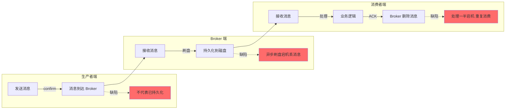
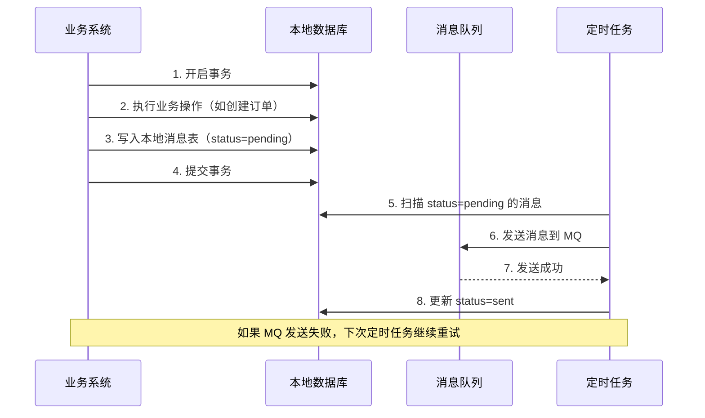
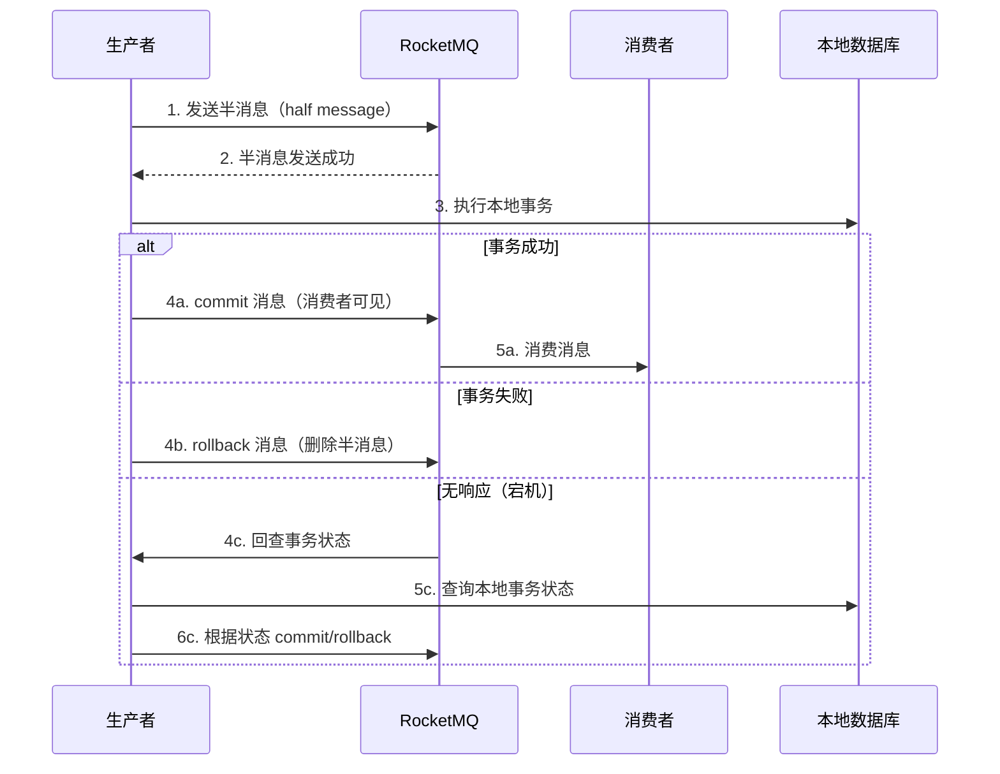
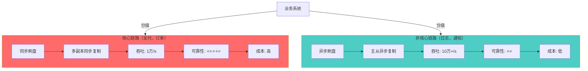
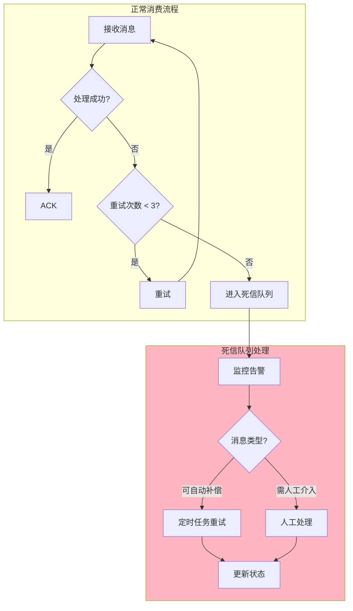
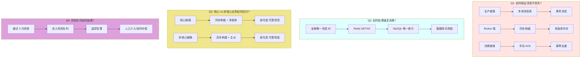
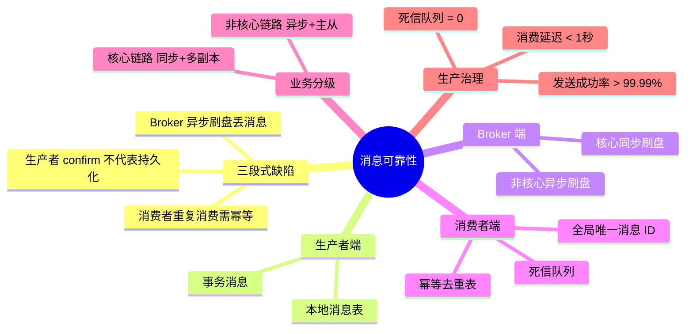
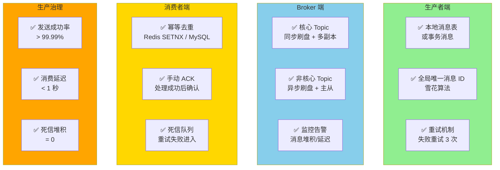
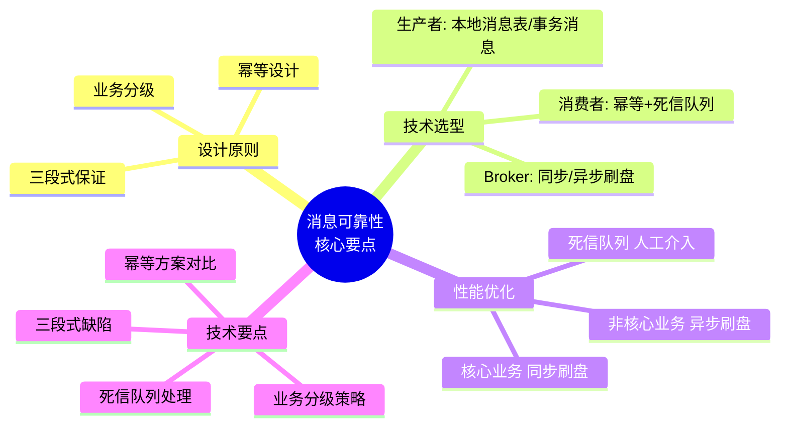

# 消息队列消息可靠性保证

---

## 🎯 一句话定位

**消息队列可靠性解决什么问题？**
```
确保消息从生产者发出 → Broker 存储 → 消费者处理，整个链路不丢消息
就像快递从寄件人 → 快递公司 → 收件人，全程可追踪、不丢件
```

**生活化比喻**：
就像寄挂号信 vs 寄平信——
- **平信**：扔进邮筒就完事了，丢不丢看运气（不可靠）
- **挂号信**：有单号、有签收、有回执，全程可追踪（可靠）

消息队列的可靠性保证，就是把"平信"升级成"挂号信"的过程。

**核心特点**：三段式保证（生产者 → Broker → 消费者），每个环节都有丢失风险，需要逐个击破。

---

## 💎 核心观点（5 分钟速览版）

> **核心要点速览**

### 核心观点（5 个关键点）

**1. 三段式保证的缺陷**
```
❌ 生产者 confirm：只代表消息到达 Broker，不代表已持久化到磁盘
❌ Broker 持久化：异步刷盘（默认）宕机丢消息，同步刷盘吞吐降 10 倍
❌ 消费者手动 ACK：业务处理一半宕机，重试会重复消费，需要幂等
```

**2. 生产者端：本地消息表 + 事务消息**
```
✅ 本地消息表：业务操作 + 写消息记录 同一事务，定时任务扫描补发
✅ 事务消息（RocketMQ）：半消息 + 回查机制，终极兜底
✅ 好处：即使 MQ 挂了，消息也不会丢（数据库兜底）
```

**3. Broker 端：按业务分级配置**
```
核心链路（支付、订单）：
  - 同步刷盘 + 多副本同步复制
  - 吞吐降 10 倍，但绝不丢消息

非核心链路（日志、通知）：
  - 异步刷盘 + 主从异步复制
  - 吞吐高，允许小概率丢失
```

**4. 消费者端：幂等 + 死信队列**
```
✅ 全局唯一消息 ID（雪花算法）
✅ 幂等去重表（Redis SETNX / MySQL 唯一索引）
✅ 业务操作 + 去重操作 同一事务
✅ 重试机制：失败重试 3 次，进死信队列
✅ 死信队列：人工介入或定时补偿
```

**5. 生产治理：监控三大指标**
```
📊 生产发送成功率：目标 > 99.99%
📊 消费延迟时长：目标 < 1 秒
📊 死信队列堆积量：目标 = 0（有堆积立即告警）
```

---

## 🚀 一句话精华（如果只能记住一句）

> **消息可靠性 = 生产者本地消息表（兜底） + Broker 分级配置（核心同步/非核心异步） + 消费者幂等去重（全局 ID + 去重表） + 死信队列（最后防线）**

---

## 一、三段式保证的缺陷（为什么还会丢消息？）

### ❌ 三段式保证的"三段"是什么？

**生活化比喻**：
```
就像寄快递的三个阶段：
1. 生产者 → Broker：你把包裹交给快递公司（生产者 confirm）
2. Broker 持久化：快递公司把包裹登记入库（刷盘到磁盘）
3. Broker → 消费者：快递公司把包裹送到收件人手中（消费者 ACK）

问题：每个环节都可能出问题！
```



### 1.1 生产者端的缺陷：confirm 的"假承诺"

**生活化比喻**：
```
就像你把包裹交给快递员，快递员说"收到了"（confirm）。
但你不知道的是：
- 快递员只是把包裹扔在电动车上（内存）
- 还没回网点登记入库（持久化到磁盘）
- 如果电动车被偷了（宕机），你的包裹就丢了！

技术真相：
生产者 confirm = 消息到达 Broker 内存
≠ 消息已持久化到磁盘
```

**技术细节**：
```go
// RabbitMQ 生产者 confirm 示例
channel.Confirm(false) // 开启 confirm 模式

// 发送消息
err := channel.Publish(
    "exchange_name",
    "routing_key",
    false,
    false,
    amqp.Publishing{
        ContentType: "application/json",
        Body:        []byte(`{"order_id": 12345}`),
    },
)

// 等待 confirm
confirm := <-channel.GetConfirmation()
if confirm.Ack {
    log.Println("消息到达 Broker（但不代表已持久化！）")
}
```

**问题**：
- ✅ confirm 成功：只代表消息到达 Broker 内存
- ❌ 不代表：消息已刷到磁盘
- ❌ 如果此时 Broker 宕机：消息丢失

### 1.2 Broker 端的缺陷：刷盘策略的两难

**生活化比喻**：
```
刷盘策略就像你写作业：

方案 1：异步刷盘（默认）
- 写完一页直接交给下一位同学（高吞吐）
- 但还没抄到作业本上（未持久化）
- 如果老师突然来了（宕机），这页就丢了

方案 2：同步刷盘
- 写完一页立刻抄到作业本上（低吞吐）
- 确保万无一失（不丢消息）
- 但速度降 10 倍（性能差）
```

**刷盘策略对比**：

| 刷盘方式 | 原理 | 吞吐量 | 可靠性 | 适用场景 | 生活化比喻 |
|---------|------|--------|--------|---------|------------|
| **异步刷盘**（默认） | 先写内存，定时批量刷盘 | ⭐⭐⭐⭐⭐（10 万+/s） | ⭐⭐（宕机丢消息） | 非核心链路 | 写完一页直接交，快但可能丢 |
| **同步刷盘** | 写磁盘成功后返回 | ⭐⭐（1 万/s） | ⭐⭐⭐⭐⭐（不丢） | 核心链路 | 写完立刻抄作业本，慢但稳 |

**主从集群的缺陷**：
```
生活化比喻：
就像你把作业抄给同桌（主节点同步到从节点）。
但如果还没抄完，同桌就请假了（主节点宕机）。
那这份作业就丢了（消息丢失）。

技术真相：
主从异步复制：主节点写入成功就返回，还没同步到从节点就宕机 → 消息丢失
主从同步复制：等从节点确认才返回，但性能降一半
```

### 1.3 消费者端的缺陷：手动 ACK 的"半吊子"

**生活化比喻**：
```
就像你收到快递后：
1. 拆开包裹（接收消息）
2. 开始使用商品（处理业务逻辑）
3. 用了一半，突然停电了（宕机）
4. 快递公司以为你没收到，又送了一个（重试）
5. 你收到了两个同样的商品（重复消费）

技术真相：
消费者处理业务逻辑 → 宕机 → 未 ACK → Broker 重发
结果：业务逻辑执行了两次（重复消费）
解决方案：幂等设计（第一次和第二次结果一样）
```

```go
// 消费者手动 ACK 示例
msgs, _ := channel.Consume(
    "queue_name",
    "",
    false, // 手动 ACK
    false,
    false,
    false,
    nil,
)

for msg := range msgs {
    // 1. 处理业务逻辑
    err := processOrder(msg.Body)
    
    // 2. 如果这里宕机，msg 未 ACK，Broker 会重发
    
    // 3. 业务成功后 ACK
    if err == nil {
        msg.Ack(false)
    } else {
        msg.Nack(false, true) // 重试
    }
}
```

**问题**：
- ❌ 业务处理一半宕机：消息未 ACK，Broker 重发
- ❌ 重试会导致：业务逻辑执行两次（重复消费）
- ✅ 解决方案：幂等设计（第一次和第二次结果一样）

---

## 二、生产者端方案：本地消息表 + 事务消息

### ✅ 方案 1：本地消息表（终极兜底）

**生活化比喻**：
```
就像你寄快递时：
1. 把包裹交给快递公司（业务操作）
2. 同时在笔记本上记下：X 月 X 日，寄出包裹一个（写本地消息表）
3. 如果快递公司丢了（MQ 挂了），你还有笔记本记录（数据库兜底）
4. 定时任务扫描笔记本，重新寄出（补偿机制）
```



**代码示例**（Go 语言版）：
```go
// 本地消息表方案
type Message struct {
    ID        string    `json:"id"`         // 全局唯一消息 ID
    BizType   string    `json:"biz_type"`   // 业务类型（如 order_created）
    Payload   string    `json:"payload"`    // 消息内容（JSON）
    Status    int       `json:"status"`     // 0:pending 1:sent 2:failed
    RetryCount int      `json:"retry_count"` // 重试次数
    CreatedAt time.Time `json:"created_at"`
    UpdatedAt time.Time `json:"updated_at"`
}

// 业务流程：业务操作 + 写消息表 同一事务
func CreateOrder(db *gorm.DB, order *Order) error {
    // 1. 开启事务
    tx := db.Begin()
    defer func() {
        if r := recover(); r != nil {
            tx.Rollback()
        }
    }()
    
    // 2. 执行业务操作（创建订单）
    if err := tx.Create(order).Error; err != nil {
        tx.Rollback()
        return err
    }
    
    // 3. 写入本地消息表（同一事务）
    msg := &Message{
        ID:        generateSnowflakeID(), // 雪花算法生成唯一 ID
        BizType:   "order_created",
        Payload:   fmt.Sprintf(`{"order_id": %d}`, order.ID),
        Status:    0, // pending
        CreatedAt: time.Now(),
    }
    if err := tx.Create(msg).Error; err != nil {
        tx.Rollback()
        return err
    }
    
    // 4. 提交事务
    return tx.Commit().Error
}

// 定时任务：扫描 pending 消息，发送到 MQ
func SendPendingMessages(db *gorm.DB, mq *mq.Producer) {
    for {
        // 1. 扫描 pending 消息（每次 100 条）
        var messages []Message
        db.Where("status = ? AND retry_count < ?", 0, 3).
            Order("created_at ASC").
            Limit(100).
            Find(&messages)
        
        // 2. 逐条发送
        for _, msg := range messages {
            err := mq.Publish(msg.BizType, msg.Payload)
            if err != nil {
                // 发送失败，重试次数 +1
                db.Model(&msg).Updates(map[string]interface{}{
                    "retry_count": msg.RetryCount + 1,
                    "updated_at":  time.Now(),
                })
                log.Printf("发送消息失败: %v", err)
                continue
            }
            
            // 3. 发送成功，更新状态
            db.Model(&msg).Update("status", 1)
            log.Printf("发送消息成功: %s", msg.ID)
        }
        
        // 4. 休眠 5 秒
        time.Sleep(5 * time.Second)
    }
}
```

**优势**：
- ✅ **不丢消息**：业务操作 + 消息记录同一事务，即使 MQ 挂了，数据库有记录
- ✅ **可重试**：定时任务扫描 pending 消息，自动补偿
- ✅ **可追踪**：消息状态可查（pending/sent/failed）

**劣势**：
- ❌ **依赖数据库**：数据库压力大（每次业务操作都要写消息表）
- ❌ **延迟较高**：定时任务扫描有延迟（秒级）

### ✅ 方案 2：事务消息（RocketMQ 专属）

**生活化比喻**：
```
就像你在淘宝买东西：
1. 下单（发送半消息，Broker 暂存）
2. 支付（执行本地事务）
3. 支付成功 → 通知淘宝发货（commit 消息）
4. 支付失败 → 通知淘宝取消订单（rollback 消息）
5. 如果你一直不支付 → 淘宝主动问你"还买不买？"（回查机制）
```



**代码示例**（Go 语言版，RocketMQ）：
```go
// RocketMQ 事务消息示例
type OrderTransactionListener struct {
    db *gorm.DB
}

// 执行本地事务
func (l *OrderTransactionListener) ExecuteLocalTransaction(msg *primitive.Message) primitive.LocalTransactionState {
    // 1. 解析消息
    var order Order
    json.Unmarshal(msg.Body, &order)
    
    // 2. 执行本地事务
    tx := l.db.Begin()
    defer func() {
        if r := recover(); r != nil {
            tx.Rollback()
        }
    }()
    
    if err := tx.Create(&order).Error; err != nil {
        tx.Rollback()
        return primitive.RollbackTransactionState // 回滚消息
    }
    
    if err := tx.Commit().Error; err != nil {
        tx.Rollback()
        return primitive.RollbackTransactionState
    }
    
    return primitive.CommitTransactionState // 提交消息
}

// 回查事务状态（Broker 主动问：这个事务到底成功了没？）
func (l *OrderTransactionListener) CheckLocalTransaction(msg *primitive.Message) primitive.LocalTransactionState {
    var order Order
    json.Unmarshal(msg.Body, &order)
    
    // 查询本地事务状态
    var count int64
    l.db.Model(&Order{}).Where("id = ?", order.ID).Count(&count)
    
    if count > 0 {
        return primitive.CommitTransactionState // 事务成功，commit
    }
    return primitive.UnknowTransactionState // 未知状态
}

// 发送事务消息
func SendTransactionMessage(producer *rocketmq.TransactionProducer, order *Order) error {
    msg := &primitive.Message{
        Topic: "ORDER_TOPIC",
        Body:  marshal(order),
    }
    
    // 发送事务消息（半消息）
    return producer.SendMessageInTransaction(msg, nil)
}
```

**优势**：
- ✅ **不丢消息**：半消息 + 回查机制，保证最终一致性
- ✅ **无延迟**：事务提交后立即发送消息，无需定时任务
- ✅ **无数据库压力**：不需要写本地消息表

**劣势**：
- ❌ **依赖 RocketMQ**：只有 RocketMQ 支持事务消息（Kafka/RabbitMQ 不支持）
- ❌ **实现复杂**：需要实现回查逻辑

---

## 三、Broker 端方案：按业务分级配置

### ✅ 核心思路：分级配置（好钢用在刀刃上）

**生活化比喻**：
```
就像银行的安保措施：
- 金库（核心业务）：防弹玻璃 + 红外线 + 保安，成本 100 万（同步刷盘 + 多副本）
- 普通柜台（非核心）：普通玻璃 + 监控，成本 1 万（异步刷盘 + 主从）

不能所有业务都用最高配置（成本太高），也不能所有业务都用最低配置（风险太大）
```



**配置示例**（RocketMQ）：
```bash
# 核心 Topic：支付、订单（同步刷盘 + 多副本同步）
# broker.conf
brokerRole=SYNC_MASTER              # 同步 Master
flushDiskType=SYNC_FLUSH            # 同步刷盘

# 创建 Topic 时指定
mqadmin updateTopic -n localhost:9876 -c DefaultCluster -t PAYMENT_TOPIC

# 非核心 Topic：日志、通知（异步刷盘 + 主从异步）
# broker.conf
brokerRole=ASYNC_MASTER             # 异步 Master
flushDiskType=ASYNC_FLUSH           # 异步刷盘

# 创建 Topic 时指定
mqadmin updateTopic -n localhost:9876 -c DefaultCluster -t LOG_TOPIC
```

**分级策略**：

| 业务类型 | 刷盘方式 | 复制方式 | 吞吐量 | 可靠性 | 适用场景 |
|---------|---------|---------|--------|--------|---------|
| **核心链路** | 同步刷盘 | 多副本同步 | 1 万/s | ⭐⭐⭐⭐⭐ | 支付、订单、库存 |
| **非核心链路** | 异步刷盘 | 主从异步 | 10 万+/s | ⭐⭐ | 日志、通知、埋点 |
| **混合方案** | 异步刷盘 | 多副本同步 | 5 万/s | ⭐⭐⭐⭐ | 推荐系统、搜索 |

**权衡思维**：
```
核心问题：非核心消息允许小概率丢失吗？

✅ 允许：
  - 日志消息：丢了就丢了，不影响业务
  - 通知消息：短信通知丢了，用户可以刷新页面
  - 埋点消息：统计数据少几条，不影响大局

❌ 不允许：
  - 支付消息：丢了就亏钱了
  - 订单消息：丢了用户就收不到货了
  - 库存消息：丢了就超卖了

结论：核心业务才需要全套可靠机制，非核心业务允许小概率丢失
```

---

## 四、消费者端方案：幂等 + 死信队列

### ✅ 幂等设计：第一次和第二次结果一样

**生活化比喻**：
```
就像你收到快递：
- 第一次签收：在快递单上写"已签收"
- 第二次签收：再写一次"已签收"（结果一样）

如果快递单上没有"已签收"这个字段，你就会写两次名字（重复消费）
```

**幂等方案对比**：

| 方案 | 原理 | 优点 | 缺点 | 适用场景 |
|------|------|------|------|---------|
| **全局唯一消息 ID** | 雪花算法生成唯一 ID | 天然唯一、高性能 | 需要存储 ID | 所有场景 ⭐⭐⭐⭐⭐ |
| **Redis SETNX** | `SETNX msg_id 1`，成功则处理 | 高性能（10 万+/s） | Redis 挂了失效 | 高并发场景 ⭐⭐⭐⭐ |
| **MySQL 唯一索引** | `INSERT INTO consume_log (msg_id) VALUES (?)` | 强一致 | 性能差（1000/s） | 低并发场景 ⭐⭐⭐ |
| **数据库乐观锁** | `UPDATE account SET balance = balance - 100 WHERE version = ?` | 无额外存储 | 实现复杂 | 扣款场景 ⭐⭐⭐⭐ |

**代码示例**（Go 语言版）：
```go
// 方案 1：Redis SETNX 幂等
func ConsumeWithRedis(msg *Message) error {
    // 1. 尝试设置消息 ID（SETNX）
    key := fmt.Sprintf("consume:msg:%s", msg.ID)
    ok, err := redis.SetNX(key, "1", 24*time.Hour).Result()
    if err != nil {
        return err
    }
    
    // 2. 如果设置失败，说明已消费（幂等）
    if !ok {
        log.Printf("消息已消费: %s", msg.ID)
        return nil // 直接返回，不重复处理
    }
    
    // 3. 执行业务逻辑
    if err := processOrder(msg); err != nil {
        // 业务失败，删除标记，允许重试
        redis.Del(key)
        return err
    }
    
    return nil
}

// 方案 2：MySQL 唯一索引幂等
func ConsumeWithMySQL(db *gorm.DB, msg *Message) error {
    // 1. 开启事务
    tx := db.Begin()
    defer func() {
        if r := recover(); r != nil {
            tx.Rollback()
        }
    }()
    
    // 2. 插入消费日志（唯一索引）
    log := &ConsumeLog{
        MsgID:     msg.ID,
        Status:    1,
        CreatedAt: time.Now(),
    }
    if err := tx.Create(log).Error; err != nil {
        // 唯一索引冲突，说明已消费（幂等）
        if mysql.IsDuplicateKeyError(err) {
            tx.Rollback()
            log.Printf("消息已消费: %s", msg.ID)
            return nil
        }
        tx.Rollback()
        return err
    }
    
    // 3. 执行业务逻辑（同一事务）
    if err := processOrder(tx, msg); err != nil {
        tx.Rollback()
        return err
    }
    
    // 4. 提交事务
    return tx.Commit().Error
}

// 方案 3：数据库乐观锁（扣款场景）
type Account struct {
    ID      int64   `json:"id"`
    Balance float64 `json:"balance"`
    Version int     `json:"version"` // 乐观锁版本号
}

func DeductBalance(db *gorm.DB, accountID int64, amount float64) error {
    for i := 0; i < 3; i++ { // 最多重试 3 次
        // 1. 查询账户（包含版本号）
        var account Account
        if err := db.First(&account, accountID).Error; err != nil {
            return err
        }
        
        // 2. 检查余额
        if account.Balance < amount {
            return errors.New("余额不足")
        }
        
        // 3. 更新余额（带版本号条件）
        result := db.Model(&Account{}).
            Where("id = ? AND version = ?", accountID, account.Version).
            Updates(map[string]interface{}{
                "balance": gorm.Expr("balance - ?", amount),
                "version": gorm.Expr("version + 1"),
            })
        
        if result.RowsAffected == 0 {
            // 版本号不匹配，重试
            log.Printf("乐观锁冲突，重试第 %d 次", i+1)
            continue
        }
        
        return nil
    }
    return errors.New("乐观锁冲突，重试失败")
}
```

### ✅ 死信队列：最后防线

**生活化比喻**：
```
就像快递送不到的情况：
1. 第一次送：家里没人（业务失败）
2. 第二次送：家里还是没人（重试失败）
3. 第三次送：家里依然没人（重试失败）
4. 放入"死信柜"（死信队列）
5. 快递员通知你："请自行到死信柜领取"（告警）
6. 你手动去领取（人工介入 / 定时补偿）
```



**代码示例**（Go 语言版）：
```go
// 死信队列处理
func HandleDeadLetterQueue(mq *mq.Consumer) {
    // 1. 监听死信队列
    dlqMsgs, _ := mq.Consume("DEAD_LETTER_QUEUE")
    
    for msg := range dlqMsgs {
        log.Printf("收到死信消息: %s", msg.ID)
        
        // 2. 告警通知
        sendAlert(fmt.Sprintf("死信队列堆积消息: %s", msg.ID))
        
        // 3. 根据业务类型处理
        switch msg.BizType {
        case "payment_failed":
            // 支付失败：人工介入
            handlePaymentFailure(msg)
        case "notification_failed":
            // 通知失败：定时重试
            scheduleRetry(msg, 1*time.Hour)
        case "log_failed":
            // 日志失败：直接丢弃
            log.Printf("丢弃日志消息: %s", msg.ID)
        }
        
        // 4. ACK
        msg.Ack()
    }
}

// 定时重试任务
func RetryDeadLetterMessages(db *gorm.DB, mq *mq.Producer) {
    for {
        // 1. 查询待重试的死信消息
        var messages []DeadLetterMessage
        db.Where("retry_time < ? AND retry_count < ?", 
            time.Now(), 10).
            Find(&messages)
        
        // 2. 重新发送到原 Topic
        for _, msg := range messages {
            err := mq.Publish(msg.OriginalTopic, msg.Payload)
            if err != nil {
                log.Printf("重试失败: %v", err)
                continue
            }
            
            // 3. 更新重试次数
            db.Model(&msg).Updates(map[string]interface{}{
                "retry_count": msg.RetryCount + 1,
                "retry_time":  time.Now().Add(1 * time.Hour),
            })
        }
        
        // 4. 休眠 1 分钟
        time.Sleep(1 * time.Minute)
    }
}
```

---

## 五、技术深入（mermaid 图表 + 方案分析）



### 技术方案分析

**Q1: 如何保证消息不丢失？**  
**答**：消息不丢失需要三段式保证：
1. **生产者端**：用本地消息表或事务消息，保证业务操作 + 消息发送的原子性。即使 MQ 挂了，数据库有记录，定时任务可以补偿。
2. **Broker 端**：核心业务用同步刷盘 + 多副本同步复制，非核心业务用异步刷盘 + 主从异步复制。分级配置，平衡性能和可靠性。
3. **消费者端**：手动 ACK + 幂等去重。处理成功后才 ACK，重复消费通过全局唯一消息 ID + Redis SETNX / MySQL 唯一索引保证幂等。

**Q2: 如何处理重复消费？**  
**答**：重复消费的原因是：消费者处理业务逻辑一半宕机，未 ACK，Broker 重发。解决方案是幂等设计：
- **全局唯一消息 ID**：雪花算法生成唯一 ID，保证每条消息都有唯一标识。
- **Redis SETNX**：`SETNX msg_id 1`，成功则处理业务，失败说明已消费（高性能，10 万+/s）。
- **MySQL 唯一索引**：插入消费日志表，唯一索引冲突说明已消费（强一致，性能差，1000/s）。
- **数据库乐观锁**：`UPDATE account SET balance = balance - 100 WHERE version = ?`，版本号不匹配则重试（适合扣款场景）。

**Q3: 核心业务和非核心业务如何区分？**  
**答**：按业务重要性分级配置：
- **核心链路**（支付、订单、库存）：同步刷盘 + 多副本同步复制。吞吐降 10 倍（1 万/s），但绝不丢消息。
- **非核心链路**（日志、通知、埋点）：异步刷盘 + 主从异步复制。吞吐高（10 万+/s），允许小概率丢失。
- **权衡思维**：不能所有业务都用最高配置（成本太高），也不能所有业务都用最低配置（风险太大）。核心业务才需要全套可靠机制。

**Q4: 死信队列如何处理？**  
**答**：死信队列是最后防线：
1. **进入条件**：消息重试 3 次仍失败，进入死信队列。
2. **监控告警**：死信队列堆积立即告警（目标 = 0）。
3. **处理方式**：
   - **可自动补偿**（如通知失败）：定时任务重试（1 小时后重试，最多 10 次）。
   - **需人工介入**（如支付失败）：人工处理（客服介入、手动补单）。
   - **可丢弃**（如日志失败）：直接丢弃（日志丢了不影响业务）。

---

## 六、方案总结



**方案要点**：

> **问题**：如何保证消息队列的可靠性？
> 
> **回答**：消息可靠性需要三段式保证：
> 
> **生产者端**：用**本地消息表**或**事务消息**，保证业务操作 + 消息发送的原子性。即使 MQ 挂了，数据库有记录，定时任务可以补偿。
> 
> **Broker 端**：按业务分级配置。核心业务（支付、订单）用**同步刷盘 + 多副本同步复制**，非核心业务（日志、通知）用**异步刷盘 + 主从异步复制**。
> 
> **消费者端**：手动 ACK + **幂等去重**。通过**全局唯一消息 ID + Redis SETNX / MySQL 唯一索引**保证幂等，失败重试 3 次进**死信队列**。
> 
> **生产治理**：监控三大指标——发送成功率 > 99.99%、消费延迟 < 1 秒、死信队列堆积 = 0。

---

## 七、生产环境 Checklist（部署检查清单）



**部署检查清单**：

| 类别 | 检查项 | 状态 | 生活化比喻 |
|------|--------|------|------------|
| **生产者端** | 本地消息表 / 事务消息 | ⬜ | 笔记本记录 |
| | 全局唯一消息 ID（雪花算法） | ⬜ | 身份证号 |
| | 重试机制（失败重试 3 次） | ⬜ | 再试一次 |
| **Broker 端** | 核心 Topic 同步刷盘 + 多副本 | ⬜ | 金库安保 |
| | 非核心 Topic 异步刷盘 + 主从 | ⬜ | 普通柜台 |
| | 监控告警（消息堆积/延迟） | ⬜ | 保安巡逻 |
| **消费者端** | 幂等去重（Redis / MySQL） | ⬜ | 签收两次结果一样 |
| | 手动 ACK（处理成功后确认） | ⬜ | 用完再签收 |
| | 死信队列（重试失败进入） | ⬜ | 死信柜 |
| **生产治理** | 发送成功率 > 99.99% | ⬜ | 100 次最多失败 1 次 |
| | 消费延迟 < 1 秒 | ⬜ | 秒级响应 |
| | 死信堆积 = 0 | ⬜ | 无堆积 |

---

## 八、总结（一句话带走）



### 🎯 一句话总结

> **消息可靠性 = 生产者本地消息表（兜底） + Broker 分级配置（核心同步/非核心异步） + 消费者幂等去重（全局 ID + 去重表） + 死信队列（最后防线）**

### 🧠 核心要点

1. **三段式缺陷**：生产者 confirm 不代表持久化（像快递员说"收到了"但还没入库），Broker 异步刷盘宕机丢消息（像写完作业还没抄就停电了），消费者重复消费需幂等（像收到两个同样的快递）。

2. **生产者方案**：本地消息表（数据库兜底，定时任务补偿） + 事务消息（RocketMQ 专属，半消息 + 回查）。就像寄快递时记在笔记本上，快递公司丢了还有记录。

3. **Broker 方案**：核心业务同步刷盘 + 多副本同步（像金库安保，成本高但安全），非核心业务异步刷盘 + 主从异步（像普通柜台，成本低但有风险）。不能所有业务都用最高配置（成本太高）。

4. **消费者方案**：全局唯一消息 ID + Redis SETNX / MySQL 唯一索引（像签收两次结果一样），失败重试 3 次进死信队列（像快递送不到放死信柜）。

5. **生产治理**：监控三大指标——发送成功率 > 99.99%、消费延迟 < 1 秒、死信队列堆积 = 0。就像保安巡逻，发现问题立即告警。

---
