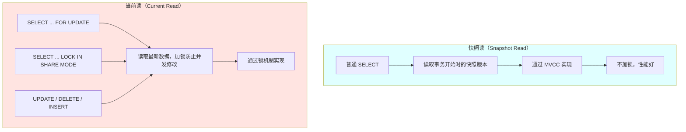
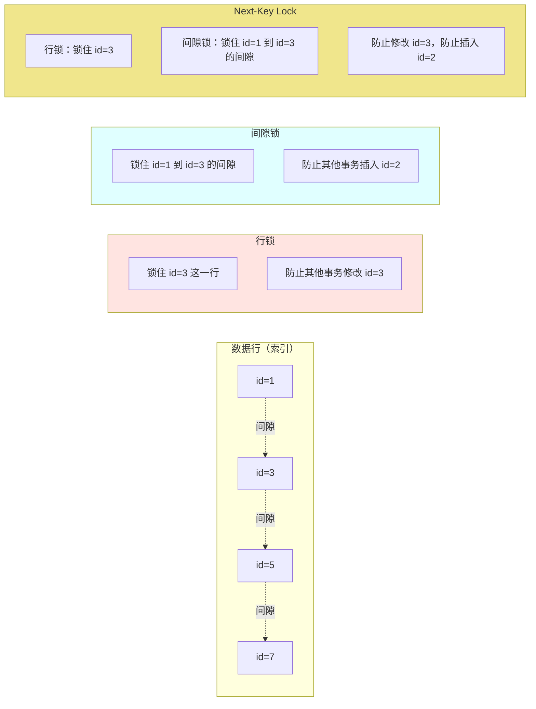
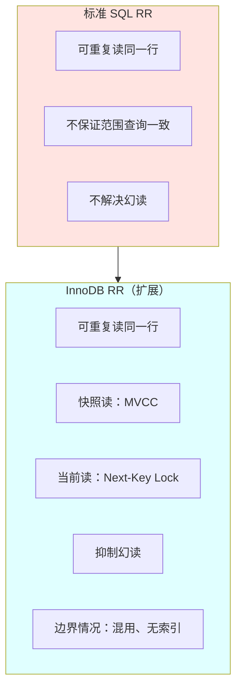
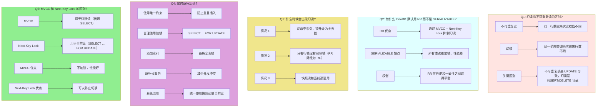
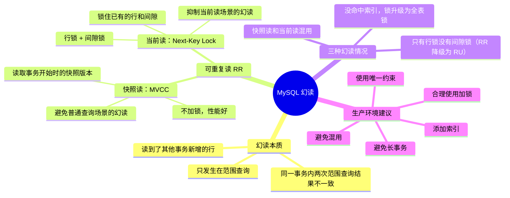
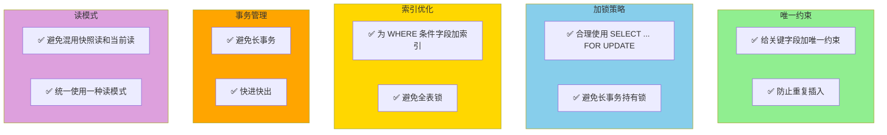
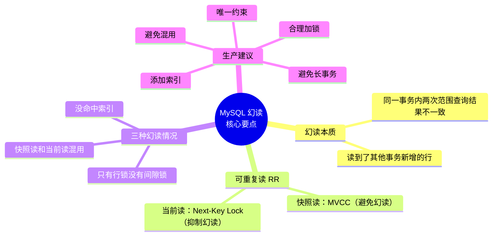

# MySQL 幻读原理与可重复读隔离级别

---

## 🎯 一句话定位

**幻读是什么问题？**
```
同一事务内，两次相同的范围查询，第二次读到了其他事务新增的行
就像：你点名时发现多了个人，但名单上没他名字
```

**生活化比喻**：
就像你在教室里数人数，第一次数是 30 人，第二次数变成了 31 人——但奇怪的是，你两次看的都是同一个教室，而且中间没人进出。那个"多出来的人"就是"幻影"。

**核心特点**：幻读只在"范围查询"时出现，单行查询不会出现（单行查询用行锁就能解决）。

---

## 💎 核心观点（5 分钟速览版）

> **核心要点速览**

### 核心观点（5 个关键点）

**1. 幻读的本质：范围查询结果不一致**
```
❌ 非幻读：同一行数据两次读取值不同（这是不可重复读）
✅ 幻读：同一范围查询，第二次读到了新增的行

例子：
事务 A：SELECT * FROM orders WHERE status = 'pending'
  → 返回 10 行

事务 B：INSERT INTO orders (id, status) VALUES (11, 'pending')
         COMMIT

事务 A：SELECT * FROM orders WHERE status = 'pending'
  → 返回 11 行（多了 id=11 的行）
  
这就是幻读：id=11 的行就是"幻影"
```

**2. 可重复读（RR）的快照读可以避免普通幻读**
```
✅ 快照读（普通 SELECT）：通过 MVCC 机制，读的是事务开始时的快照版本
   - 事务 A 开始时的数据版本：10 行
   - 即使事务 B 插入了新行，事务 A 看到的还是 10 行
   - 这就是"可重复读"的含义：同一事务内多次读取结果一致

❌ 但快照读无法解决"当前读"场景的幻读
```

**3. 当前读场景依赖 next-key lock 抑制幻读**
```
当前读场景：
- SELECT ... FOR UPDATE（加锁查询）
- SELECT ... LOCK IN SHARE MODE（加锁查询）
- UPDATE（修改数据）
- DELETE（删除数据）
- INSERT（插入数据，唯一性校验）

当前读会读取最新数据，并通过加锁防止其他事务修改

Next-key lock = 行锁 + 间隙锁
- 行锁：锁住已有的行
- 间隙锁：锁住索引之间的"间隙"，防止其他事务插入新行
```

**4. 三种仍会出现幻读的情况**
```
情况 1：没命中索引，锁升级为表锁
  - 如果 WHERE 条件没有索引，InnoDB 会锁全表
  - 性能极差，但不会幻读（因为全表都被锁了）

情况 2：只有行锁没有间隙锁
  - 某些特殊场景（如 RR 降级为 RU）
  - 间隙锁失效，其他事务可以插入新行

情况 3：快照读和当前读混用
  - 事务 A 先快照读（看到 10 行）
  - 事务 B 插入新行并提交
  - 事务 A 再当前读（看到 11 行）
  - 这就是"混用"导致的幻读
```

**5. 标准 SQL 的 RR 本身不解决幻读**
```
标准 SQL 定义：
- 可重复读（Repeatable Read）：保证同一事务内多次读取同一行数据一致
- 不保证范围查询结果一致（即不解决幻读）

InnoDB 的扩展：
- 通过 next-key lock 在"当前读"场景抑制幻读
- 通过 MVCC 在"快照读"场景避免幻读
- 但仍有边界情况（如混用场景）

生产环境建议：
- 使用唯一约束防止重复插入
- 合理使用加锁（FOR UPDATE）
- 避免长事务，减少并发冲突
```

---

## 🚀 一句话精华（如果只能记住一句）

> **幻读 = 同一事务内两次范围查询结果不一致；InnoDB 通过 MVCC（快照读）+ next-key lock（当前读）抑制幻读，但仍有边界情况（混用、无索引等）。**

---

## 一、幻读的本质：什么是"幻影行"？

### 幻读 vs 不可重复读

**生活化比喻**：
```
不可重复读：
你打开一本书，第一页写的是"张三"，翻到最后一页再回来，第一页变成了"李四"。
问题：同一行数据，两次读取值不同。

幻读：
你打开一本书，第一次数有 100 页，第二次数变成了 101 页。
问题：同一范围查询，两次读取行数不同。

关键区别：
- 不可重复读：关注"单行数据"的变化（UPDATE）
- 幻读：关注"范围查询"的变化（INSERT/DELETE）
```

### 幻读的典型场景

**示例代码**（SQL）：
```sql
-- 事务 A
START TRANSACTION;
SELECT * FROM orders WHERE status = 'pending';
-- 返回 10 行

-- 事务 B（在事务 A 执行期间）
START TRANSACTION;
INSERT INTO orders (id, status) VALUES (11, 'pending');
COMMIT;

-- 事务 A（继续执行）
SELECT * FROM orders WHERE status = 'pending';
-- 如果返回 11 行，就是幻读
```

**生活化比喻**：
```
想象你在教室数人数：
第一次：1, 2, 3, ..., 30（共 30 人）
第二次：1, 2, 3, ..., 30, 31（共 31 人）

问题：你两次数的都是同一个教室，为什么人数变了？
答案：有个人"幻影"一样出现了（事务 B 插入的新行）
```

### 幻读的技术定义

```
幻读条件：
1. 同一事务内
2. 两次相同的范围查询（WHERE 条件相同）
3. 第二次查询结果包含第一次没有的行
4. 这些行是其他事务在两次查询之间插入的

注意：
- 如果第二次查询结果少了行（其他事务删除），也是幻读
- 幻读只发生在"范围查询"，单行查询不会出现
```

---

## 二、可重复读（RR）如何解决幻读？

### InnoDB 的两种读方式

**生活化比喻**：
```
快照读（Snapshot Read）：
就像拍照：你拍了一张照片，照片里的内容是当时的状态。
即使后来场景变了，照片里的内容不会变。
普通 SELECT 就是快照读。

当前读（Current Read）：
就像实时监控：你看到的是当前的实时状态。
SELECT ... FOR UPDATE 就是当前读，会加锁防止其他事务修改。
```



### 快照读如何通过 MVCC 避免幻读

**MVCC（Multi-Version Concurrency Control）原理**：
```
核心思想：
- 每行数据有多个版本（历史版本）
- 每个事务看到的是"事务开始时"的数据版本
- 通过 undo log 维护历史版本

例子：
时间线：
T0：事务 A 开始，看到数据版本 V0（10 行）
T1：事务 B 插入新行，生成版本 V1（11 行）
T2：事务 B 提交
T3：事务 A 再次查询，看到的还是 V0（10 行）

结果：事务 A 两次查询结果一致，没有幻读
```

**生活化比喻**：
```
MVCC 就像图书馆的"历史档案室"：
- 每本书都有多个版本（第 1 版、第 2 版、第 3 版...）
- 你借书时，图书管理员会记录你借的是哪个版本
- 即使后来出了新版，你看到的还是你借的那个版本

好处：
- 你不用和其他人抢书（不用加锁）
- 你看到的永远是同一版本（可重复读）
```

### 快照读避免幻读的示例

```sql
-- 事务 A（快照读场景）
START TRANSACTION;
SELECT * FROM orders WHERE status = 'pending';
-- 返回 10 行（版本 V0）

-- 事务 B（在事务 A 执行期间）
START TRANSACTION;
INSERT INTO orders (id, status) VALUES (11, 'pending');
COMMIT;
-- 生成新版本 V1（11 行）

-- 事务 A（继续执行，快照读）
SELECT * FROM orders WHERE status = 'pending';
-- 仍然返回 10 行（还是版本 V0）
-- 没有幻读！
```

**关键点**：
- ✅ 普通 SELECT 是快照读，通过 MVCC 避免幻读
- ✅ 事务 A 看到的是"事务开始时"的快照，不受其他事务影响
- ❌ 但快照读无法解决"当前读"场景的幻读

---

## 三、当前读场景：Next-Key Lock 抑制幻读

### 当前读为什么需要加锁？

**生活化比喻**：
```
快照读 = 拍照（不加锁，性能好）
当前读 = 实时监控（加锁，防止并发修改）

为什么当前读要加锁？
因为当前读要读取"最新数据"，而且要"修改数据"。
如果不加锁，其他事务可能同时修改同一行数据，导致数据不一致。

例子：
事务 A：SELECT * FROM accounts WHERE id = 1 FOR UPDATE;
事务 B：UPDATE accounts SET balance = balance - 100 WHERE id = 1;

如果不加锁：
- 事务 A 读到 balance = 1000
- 事务 B 把 balance 改为 900
- 事务 A 基于 1000 做计算，结果错误

加锁后：
- 事务 A 加锁，读到 balance = 1000
- 事务 B 被阻塞，等待事务 A 释放锁
- 事务 A 完成并提交
- 事务 B 才能继续
```

### Next-Key Lock 的原理

**Next-Key Lock = 行锁 + 间隙锁**

```
行锁（Record Lock）：
- 锁住已有的行
- 防止其他事务修改这一行
- 例如：锁住 id=1 的行

间隙锁（Gap Lock）：
- 锁住索引之间的"间隙"
- 防止其他事务在间隙中插入新行
- 例如：锁住 id=1 和 id=3 之间的间隙，防止插入 id=2 的行

Next-Key Lock = 行锁 + 左侧间隙锁
- 锁住 id=1 的行
- 锁住 id=1 左侧的间隙（id=0 到 id=1 之间）
- 防止其他事务插入 id=0 或 id=1 的行
```

**生活化比喻**：
```
行锁 = 锁住房子
- 你锁住了"门牌号 1 号"的房子
- 其他不能进入这个房子

间隙锁 = 锁住房子之间的空地
- 你锁住了"门牌号 1 号和 3 号之间的空地"
- 其他人不能在这块空地上建新房子

Next-Key Lock = 行锁 + 间隙锁
- 你锁住了"门牌号 1 号的房子"和"1 号左侧的空地"
- 其他人不能进入 1 号房子，也不能在 1 号左侧建新房子

好处：防止幻读（其他人不能插入新行）
```



### Next-Key Lock 抑制幻读的示例

```sql
-- 事务 A（当前读场景）
START TRANSACTION;
SELECT * FROM orders WHERE status = 'pending' FOR UPDATE;
-- 返回 10 行，同时加上 Next-Key Lock
-- 锁住这 10 行的索引，以及索引之间的间隙

-- 事务 B（尝试插入新行）
START TRANSACTION;
INSERT INTO orders (id, status) VALUES (11, 'pending');
-- 被阻塞！因为事务 A 的间隙锁锁住了插入位置
-- 等待事务 A 释放锁...

-- 事务 A（继续执行）
SELECT * FROM orders WHERE status = 'pending' FOR UPDATE;
-- 仍然返回 10 行
-- 没有幻读！

-- 事务 A 提交
COMMIT;
-- 释放所有锁

-- 事务 B 继续执行
INSERT INTO orders (id, status) VALUES (11, 'pending');
-- 插入成功
COMMIT;
```

**关键点**：
- ✅ SELECT ... FOR UPDATE 是当前读，会加 Next-Key Lock
- ✅ Next-Key Lock 锁住已有的行和索引间隙，防止其他事务插入新行
- ✅ 因此，事务 A 两次查询结果一致，没有幻读

---

## 四、三种仍会出现幻读的情况

### 情况 1：没命中索引，锁升级为表锁

**生活化比喻**：
```
有索引时：
- 就像按"门牌号"锁房子
- 只锁住相关的几栋房子和间隙
- 其他房子不受影响

没有索引时：
- 就像按"小区"锁房子
- 整个小区都被锁住（全表锁）
- 其他事务不能插入任何新行

性能对比：
- 有索引：锁住 10 行，其他事务可以插入其他行
- 没有索引：锁住 1000 行，其他事务不能插入任何行
```

**示例**：
```sql
-- 假设 status 字段没有索引

-- 事务 A
START TRANSACTION;
SELECT * FROM orders WHERE status = 'pending' FOR UPDATE;
-- 没有索引，InnoDB 会锁全表（所有行）

-- 事务 B
START TRANSACTION;
INSERT INTO orders (id, status) VALUES (11, 'pending');
-- 被阻塞！因为事务 A 锁住了全表
-- 等待事务 A 释放锁...

问题：
- 性能极差（全表被锁）
- 但不会幻读（因为全表都被锁了）

解决方案：
- 为 WHERE 条件字段添加索引
- 让锁只作用于相关行，而不是全表
```

**表格对比**：
| 场景 | 是否有索引 | 锁范围 | 性能 | 是否幻读 |
|------|-----------|--------|------|---------|
| 有索引 | ✅ | 相关行 + 间隙 | ⭐⭐⭐⭐⭐ | ❌ 不幻读 |
| 无索引 | ❌ | 全表 | ⭐ | ❌ 不幻读（但性能差） |

### 情况 2：只有行锁没有间隙锁

**生活化比喻**：
```
正常情况（RR 隔离级别）：
- Next-Key Lock = 行锁 + 间隙锁
- 锁住已有的行，也锁住间隙
- 其他事务不能插入新行

异常情况（RR 降级为 RU）：
- 只有行锁，没有间隙锁
- 只锁住已有的行，不锁间隙
- 其他事务可以在间隙中插入新行
- 导致幻读
```

**示例**：
```sql
-- 假设隔离级别为 Read Uncommitted（RU）

-- 事务 A
START TRANSACTION;
SELECT * FROM orders WHERE status = 'pending' FOR UPDATE;
-- 返回 10 行，只加上行锁（没有间隙锁）

-- 事务 B
START TRANSACTION;
INSERT INTO orders (id, status) VALUES (11, 'pending');
COMMIT;
-- 插入成功！因为没有间隙锁阻止插入

-- 事务 A
SELECT * FROM orders WHERE status = 'pending' FOR UPDATE;
-- 返回 11 行（多了 id=11 的行）
-- 幻读！
```

**关键点**：
- ❌ 只有行锁没有间隙锁时，其他事务可以插入新行
- ❌ 导致幻读
- ✅ InnoDB 默认使用 RR 隔离级别，有 Next-Key Lock，不会幻读

### 情况 3：快照读和当前读混用

**生活化比喻**：
```
快照读 = 拍照（看到事务开始时的版本）
当前读 = 实时监控（看到最新数据）

混用场景：
第一次：拍照（看到 10 行）
其他事务插入新行
第二次：实时监控（看到 11 行）

结果：两次看到的不一样，幻读！
```

**示例**：
```sql
-- 事务 A
START TRANSACTION;
SELECT * FROM orders WHERE status = 'pending';
-- 快照读，返回 10 行（版本 V0）

-- 事务 B
START TRANSACTION;
INSERT INTO orders (id, status) VALUES (11, 'pending');
COMMIT;
-- 生成新版本 V1（11 行）

-- 事务 A（继续执行）
SELECT * FROM orders WHERE status = 'pending' FOR UPDATE;
-- 当前读，返回 11 行（最新版本 V1）

结果：
- 第一次快照读：10 行
- 第二次当前读：11 行
- 幻读！
```

**关键点**：
- ❌ 快照读和当前读混用会导致幻读
- ❌ 因为快照读看到旧版本，当前读看到最新版本
- ✅ 建议：同一事务内，要么都用快照读，要么都用当前读

---

## 五、标准 SQL 的 RR vs InnoDB 的 RR

### 标准 SQL 定义

**生活化比喻**：
```
标准 SQL 的 RR：
- 就像"同一本书的同一页，多次阅读内容一致"
- 保证：同一事务内，多次读取同一行数据一致
- 不保证：范围查询结果一致（即不解决幻读）

InnoDB 的 RR：
- 在标准 SQL 基础上扩展
- 通过 MVCC + Next-Key Lock 抑制幻读
- 但仍有边界情况（混用、无索引等）
```

**表格对比**：
| 特性 | 标准 SQL RR | InnoDB RR |
|------|------------|-----------|
| 可重复读（单行） | ✅ 保证 | ✅ 保证 |
| 避免幻读（范围查询） | ❌ 不保证 | ✅ 通过 MVCC + Next-Key Lock 抑制 |
| 实现机制 | 未定义 | MVCC（快照读）+ Next-Key Lock（当前读） |
| 边界情况 | - | 混用、无索引时仍可能幻读 |

### InnoDB 的扩展实现



**InnoDB 实现细节**：
```
快照读（普通 SELECT）：
- 通过 MVCC 读取事务开始时的快照版本
- 不受其他事务影响
- 避免幻读

当前读（SELECT ... FOR UPDATE, UPDATE, DELETE, INSERT）：
- 读取最新数据
- 通过 Next-Key Lock 锁住已有的行和间隙
- 防止其他事务插入新行
- 抑制幻读

边界情况：
- 快照读和当前读混用：看到不同版本，幻读
- 没有索引：锁升级为全表锁，性能差但不幻读
- RR 降级为 RU：只有行锁没有间隙锁，幻读
```

---

## 六、生产环境最佳实践

### 避免幻读的 Checklist

**生活化比喻**：
```
避免幻读就像"防止教室里出现幽灵"：
1. 锁好门窗（加锁）
2. 登记进出人员（唯一约束）
3. 不要频繁切换观察方式（避免混用）
4. 保持教室整洁（合理索引）
```

**Checklist**：
| 措施 | 说明 | 生活化比喻 |
|------|------|------------|
| ✅ 使用唯一约束 | 防止重复插入 | 给每个人发唯一身份证号 |
| ✅ 合理使用加锁 | SELECT ... FOR UPDATE | 锁住房子，防止其他人进入 |
| ✅ 添加索引 | 避免全表锁 | 按门牌号锁房子，而不是按小区 |
| ✅ 避免长事务 | 减少并发冲突 | 快进快出，不占座 |
| ✅ 避免混用 | 同一事务内，要么都用快照读，要么都用当前读 | 要么都拍照，要么都实时监控 |
| ✅ 选择合适的隔离级别 | RR 或 RU，根据业务需求 | 选择观察方式 |

### 唯一约束的重要性

**生活化比喻**：
```
唯一约束 = 给每个人发唯一身份证号

作用：
- 防止重复插入（即使有幻读，唯一约束也能防止重复）
- 提高查询性能（索引加速）
- 保证数据一致性

例子：
给 orders 表的 order_no 字段加唯一约束：
ALTER TABLE orders ADD UNIQUE INDEX uk_order_no (order_no);

即使出现幻读，唯一约束也能防止重复插入相同订单号
```

**示例**：
```sql
-- 创建唯一约束
ALTER TABLE orders ADD UNIQUE INDEX uk_order_no (order_no);

-- 事务 A
START TRANSACTION;
SELECT * FROM orders WHERE order_no = 'ORD001';
-- 返回空

-- 事务 B
START TRANSACTION;
SELECT * FROM orders WHERE order_no = 'ORD001';
-- 返回空

-- 事务 A
INSERT INTO orders (order_no, status) VALUES ('ORD001', 'pending');
COMMIT;

-- 事务 B
INSERT INTO orders (order_no, status) VALUES ('ORD001', 'pending');
-- 失败！唯一约束冲突

结果：即使出现幻读，唯一约束也能防止重复插入
```

### Go 代码示例：合理使用加锁和索引

```go
package main

import (
    "database/sql"
    "fmt"
    "log"
    
    _ "github.com/go-sql-driver/mysql"
)

// 避免幻读的最佳实践
func AvoidPhantomRead(db *sql.DB) error {
    // 1. 开启事务
    tx, err := db.Begin()
    if err != nil {
        return err
    }
    defer tx.Rollback() // 失败时回滚
    
    // 2. 使用索引字段查询（避免全表锁）
    // 假设 order_no 字段有索引
    query := "SELECT * FROM orders WHERE order_no = ? FOR UPDATE"
    rows, err := tx.Query(query, "ORD001")
    if err != nil {
        return err
    }
    defer rows.Close()
    
    // 3. 处理查询结果
    var count int
    for rows.Next() {
        count++
    }
    
    // 4. 根据查询结果决定操作
    if count == 0 {
        // 订单不存在，插入新订单
        insertQuery := "INSERT INTO orders (order_no, status) VALUES (?, ?)"
        _, err = tx.Exec(insertQuery, "ORD001", "pending")
        if err != nil {
            return err
        }
    } else {
        // 订单存在，更新订单
        updateQuery := "UPDATE orders SET status = ? WHERE order_no = ?"
        _, err = tx.Exec(updateQuery, "completed", "ORD001")
        if err != nil {
            return err
        }
    }
    
    // 5. 提交事务
    return tx.Commit()
}

// 避免混用快照读和当前读
func AvoidMixedRead(db *sql.DB) error {
    tx, err := db.Begin()
    if err != nil {
        return err
    }
    defer tx.Rollback()
    
    // ❌ 错误示例：混用快照读和当前读
    // query1 := "SELECT * FROM orders WHERE status = ?"  // 快照读
    // query2 := "SELECT * FROM orders WHERE status = ? FOR UPDATE"  // 当前读
    
    // ✅ 正确示例：统一使用当前读
    query := "SELECT * FROM orders WHERE status = ? FOR UPDATE"
    rows, err := tx.Query(query, "pending")
    if err != nil {
        return err
    }
    defer rows.Close()
    
    // 处理结果...
    
    return tx.Commit()
}

func main() {
    db, err := sql.Open("mysql", "user:password@tcp(localhost:3306)/testdb")
    if err != nil {
        log.Fatal(err)
    }
    defer db.Close()
    
    err = AvoidPhantomRead(db)
    if err != nil {
        log.Fatal(err)
    }
    
    fmt.Println("避免幻读成功！")
}
```

---

## 七、技术深入



### 技术方案分析

**Q1: 幻读和不可重复读的区别？**  
**答**：
- **不可重复读**：同一行数据，两次读取值不同。原因是其他事务 UPDATE 了这一行。例如：第一次读 balance=1000，第二次读 balance=900。
- **幻读**：同一范围查询，两次结果行数不同。原因是其他事务 INSERT 或 DELETE 了行。例如：第一次查询返回 10 行，第二次返回 11 行。
- **关键区别**：不可重复读是 UPDATE 导致，幻读是 INSERT/DELETE 导致。

**Q2: 为什么 InnoDB 默认用 RR 而不是 SERIALIZABLE？**  
**答**：
- **RR 优点**：通过 MVCC（快照读）+ Next-Key Lock（当前读）抑制幻读，性能较好。
- **SERIALIZABLE 缺点**：所有查询都加锁（包括普通 SELECT），性能极差。
- **权衡**：RR 在性能和一致性之间取得平衡，既能抑制幻读，又不会像 SERIALIZABLE 那样性能差。

**Q3: 什么时候会出现幻读？**  
**答**：三种情况：
1. **没命中索引**：锁升级为全表锁，性能差但不幻读（因为全表被锁）。
2. **只有行锁没有间隙锁**：RR 降级为 RU 时，其他事务可以插入新行，导致幻读。
3. **快照读和当前读混用**：快照读看到旧版本，当前读看到最新版本，导致幻读。

**Q4: 如何避免幻读？**  
**答**：
- **使用唯一约束**：防止重复插入，即使有幻读也能保证数据唯一。
- **合理使用加锁**：SELECT ... FOR UPDATE 加 Next-Key Lock，防止其他事务插入。
- **添加索引**：避免全表锁，提高性能。
- **避免长事务**：减少并发冲突，快进快出。
- **避免混用**：同一事务内，要么都用快照读，要么都用当前读。

**Q5: MVCC 和 Next-Key Lock 的区别？**  
**答**：
- **MVCC**：用于快照读（普通 SELECT），通过读取事务开始时的快照版本，不加锁，性能好。
- **Next-Key Lock**：用于当前读（SELECT ... FOR UPDATE），通过锁住已有的行和间隙，防止其他事务插入，可以防止幻读。
- **优点对比**：MVCC 性能好（不加锁），Next-Key Lock 可以防止幻读（加锁）。

---

## 八、方案总结



**方案要点**：

> **幻读本质**：同一事务内两次相同范围查询结果不一致，读到了其他事务新增的行。
> 
> **可重复读（RR）**：
> - **快照读**（普通 SELECT）：通过 MVCC 读取事务开始时的快照版本，避免普通查询场景的幻读。
> - **当前读**（SELECT ... FOR UPDATE）：通过 Next-Key Lock（行锁 + 间隙锁）锁住已有的行和间隙，抑制当前读场景的幻读。
> 
> **三种幻读情况**：
> 1. **没命中索引**：锁升级为全表锁，性能差但不幻读。
> 2. **只有行锁没有间隙锁**：RR 降级为 RU，其他事务可以插入新行，幻读。
> 3. **快照读和当前读混用**：看到不同版本，幻读。
> 
> **生产建议**：使用唯一约束、合理加锁、添加索引、避免长事务、避免混用。

---

## 九、生产环境 Checklist（部署检查清单）



**部署检查清单**：

| 类别 | 检查项 | 状态 | 生活化比喻 |
|------|--------|------|------------|
| **唯一约束** | 给关键字段加唯一约束 | ⬜ | 发唯一身份证号 |
| | 防止重复插入 | ⬜ | 防止重复登记 |
| **加锁策略** | 合理使用 SELECT ... FOR UPDATE | ⬜ | 锁住房子 |
| | 避免长事务持有锁 | ⬜ | 快进快出 |
| **索引优化** | 为 WHERE 条件字段加索引 | ⬜ | 按门牌号锁房子 |
| | 避免全表锁 | ⬜ | 避免按小区锁房子 |
| **事务管理** | 避免长事务 | ⬜ | 减少并发冲突 |
| | 快进快出 | ⬜ | 不占座 |
| **读模式** | 避免混用快照读和当前读 | ⬜ | 统一观察方式 |
| | 统一使用一种读模式 | ⬜ | 要么都拍照，要么都实时监控 |

---

## 十、总结（一句话带走）



### 🎯 一句话总结

> **幻读 = 同一事务内两次范围查询结果不一致；InnoDB 通过 MVCC（快照读）+ Next-Key Lock（当前读）抑制幻读，但仍有边界情况（混用、无索引、降级）。**

### 🧠 核心要点

1. **幻读是什么？** 同一事务内两次范围查询结果不一致，读到了"幻影行"。
2. **RR 如何解决幻读？** 快照读通过 MVCC，当前读通过 Next-Key Lock。
3. **三种幻读情况？** 没命中索引、只有行锁没有间隙锁、快照读和当前读混用。
4. **如何避免幻读？** 唯一约束、合理加锁、添加索引、避免长事务、避免混用。
5. **MVCC vs Next-Key Lock？** MVCC 用于快照读（不加锁），Next-Key Lock 用于当前读（加锁）。

---
