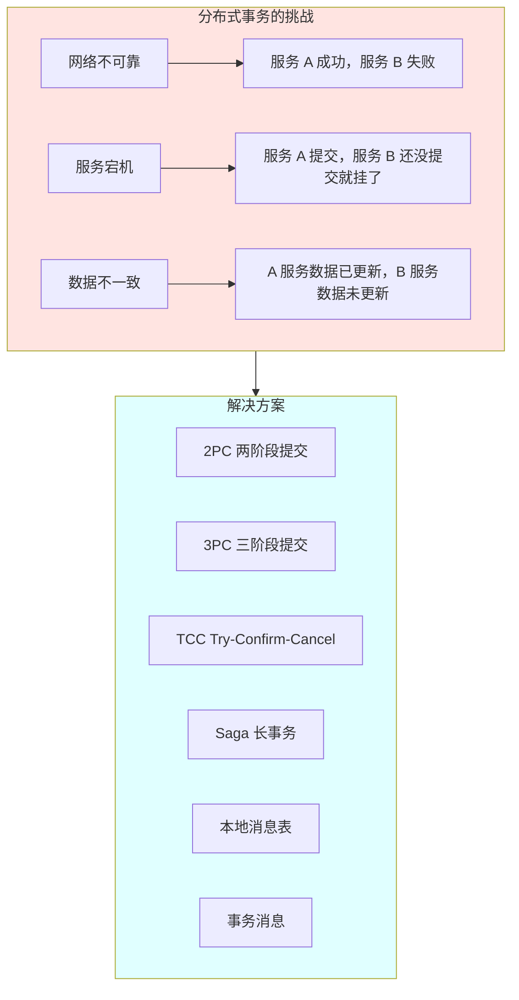
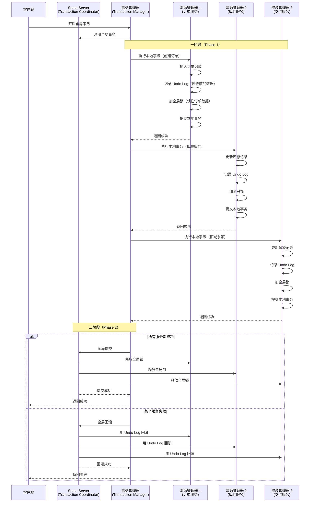
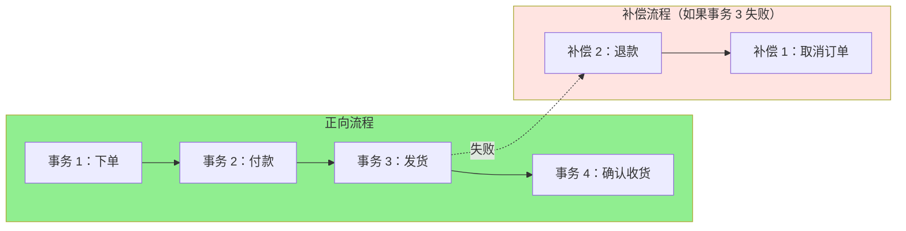
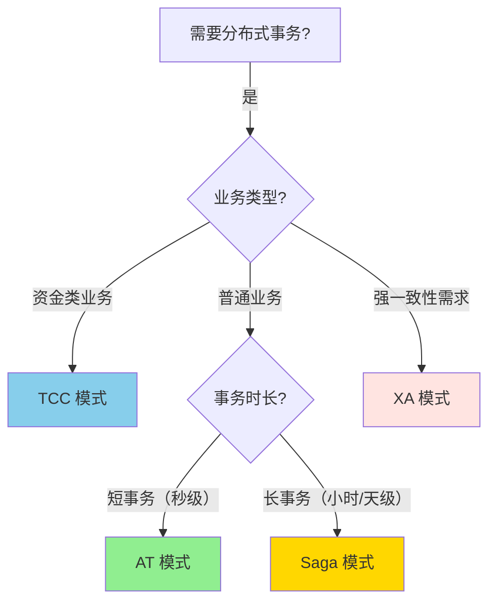
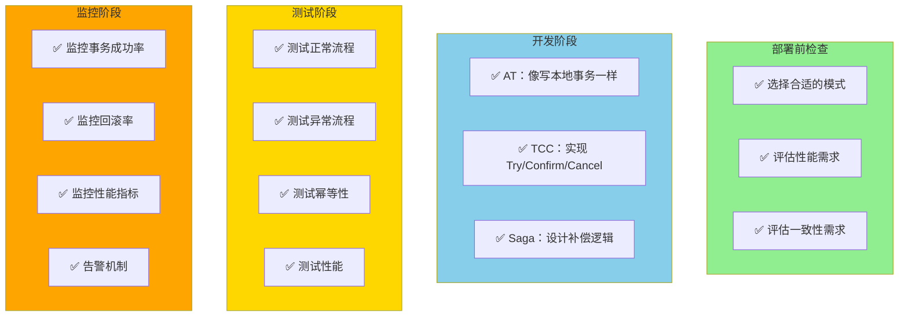
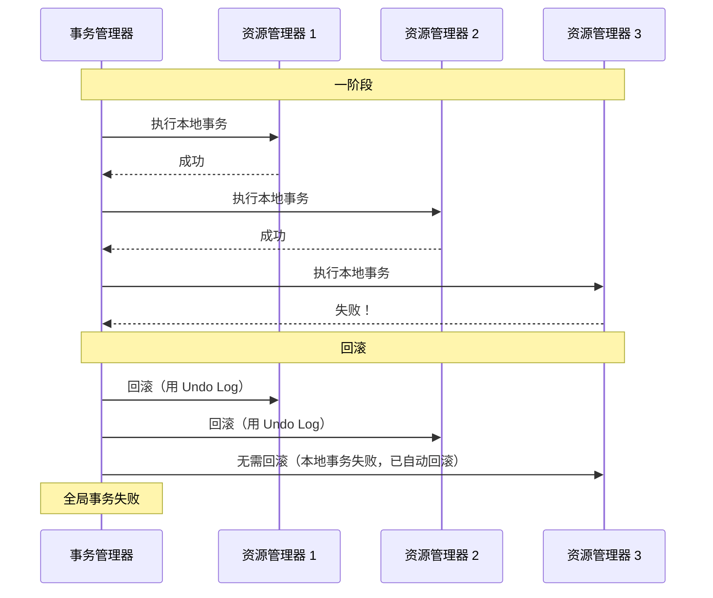
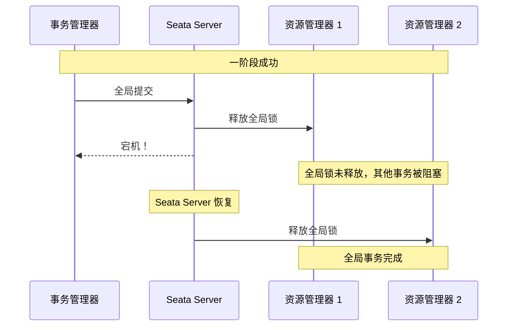
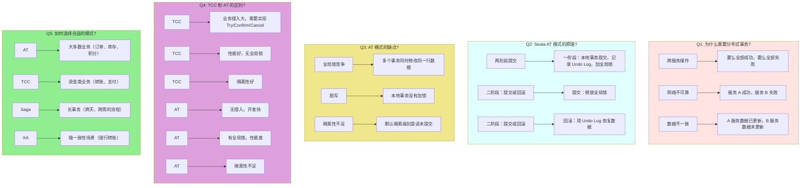
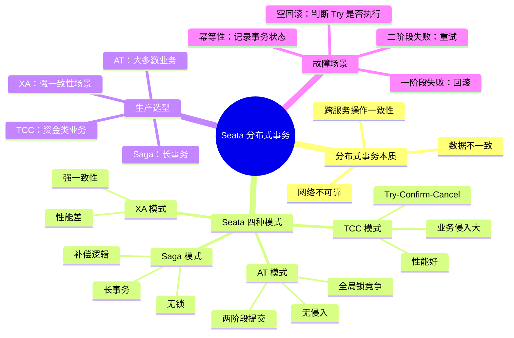
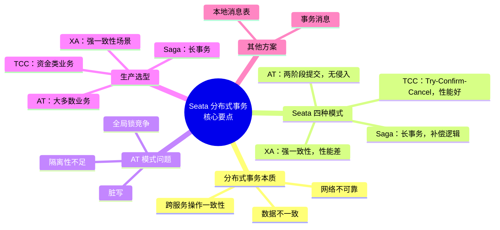

# Seata 分布式事务方案对比

---

## 🎯 一句话定位

**分布式事务解决什么问题？**
```
跨多个服务/数据库的操作，要么全部成功，要么全部失败
就像：转账操作，A 账户扣钱和 B 账户加钱必须同时成功或失败
```

**生活化比喻**：
就像你在网上买东西：
1. 下单成功（订单服务）
2. 库存扣减（库存服务）
3. 余额扣款（支付服务）
4. 积分增加（积分服务）

这四个操作必须"要么全部成功，要么全部失败"。如果下单成功但扣款失败，你就"白嫖"了——这肯定不行！

**核心特点**：分布式事务的本质是"跨服务的数据一致性"，就像"多人协同完成一个任务，要么都完成，要么都不完成"。

---

## 💎 核心观点（5 分钟速览版）

> **核心要点速览**

### 核心观点（5 个关键点）

**1. Seata AT 模式：两阶段提交，自动补偿**
```
核心思想：
- 一阶段：本地事务提交，但数据被"全局锁"锁住
- 二阶段：如果所有服务都成功，提交；否则回滚

生活化比喻：
就像网购的"七天无理由退货"：
- 一阶段：你下单付款（钱被冻结）
- 二阶段：七天内没退货，商家收到钱；退货了，钱退给你

技术实现：
- 全局锁：锁住数据，防止其他事务修改
- Undo Log：记录修改前的数据，用于回滚
- 优点：业务代码无侵入，像写本地事务一样
- 缺点：全局锁竞争、隔离性不足
```

**2. Seata 四种模式对比**
```
AT 模式：
- 适用：大多数业务（订单、库存、积分）
- 优点：无侵入，自动补偿
- 缺点：全局锁竞争，隔离性不足

TCC 模式：
- 适用：资金类业务（转账、支付）
- 优点：性能好（无全局锁），隔离性好
- 缺点：业务侵入大，需要实现 Try/Confirm/Cancel

Saga 模式：
- 适用：长事务（跨天、跨周的流程）
- 优点：无锁，性能好
- 缺点：隔离性差，需要设计补偿逻辑

XA 模式：
- 适用：强一致性场景（银行转账）
- 优点：强一致性
- 缺点：性能差（同步阻塞）
```

**3. AT 模式的问题**
```
问题 1：全局锁竞争
- 多个事务同时修改同一行数据，只有一个能拿到全局锁
- 其他事务等待，性能下降
- 解决：TCC 模式（无全局锁）

问题 2：脏写
- 如果本地事务没有加锁，其他事务可能修改数据
- 回滚时数据已经被修改，导致"脏写"
- 解决：本地事务必须加锁（SELECT ... FOR UPDATE）

问题 3：隔离性不足
- AT 模式默认隔离级别是"读未提交"
- 其他事务可能读到未提交的数据
- 解决：使用 TCC 模式（隔离性更好）
```

**4. 生产环境选型**
```
AT 模式：
- 适合：大多数业务（订单、库存、积分）
- 优点：无侵入，开发快
- 缺点：全局锁竞争，隔离性不足

TCC 模式：
- 适合：资金类业务（转账、支付）
- 优点：性能好，隔离性好
- 缺点：业务侵入大

Saga 模式：
- 适合：长事务（跨天、跨周的流程）
- 优点：无锁，性能好
- 缺点：隔离性差

XA 模式：
- 适合：强一致性场景（银行转账）
- 优点：强一致性
- 缺点：性能差
```

**5. 与其他方案对比**
```
本地消息表：
- 优点：简单，不依赖中间件
- 缺点：需要手动实现，消息表和业务表耦合

事务消息（RocketMQ）：
- 优点：自动重试，可靠性高
- 缺点：依赖 RocketMQ，不适合跨数据库

Seata：
- 优点：多种模式可选，支持回滚
- 缺点：依赖 Seata Server，运维成本高
```

---

## 🚀 一句话精华（如果只能记住一句）

> **Seata = 分布式事务框架；AT 模式（两阶段提交，无侵入，但有全局锁竞争）；TCC（性能好，隔离性好，但业务侵入大）；Saga（适合长事务）；XA（强一致性，性能差）。生产选型：AT 适合大多数，TCC 适合资金类，Saga 适合长事务。**

---

## 一、分布式事务的本质

### 为什么需要分布式事务？

**生活化比喻**：
```
本地事务：
就像你在一个商店买东西，付钱和拿货在同一个商店完成。
要么都成功（付钱拿货），要么都失败（没付钱没拿货）。

分布式事务：
就像你在淘宝买东西：
- 下单（订单服务）
- 扣库存（库存服务）
- 扣款（支付服务）
- 加积分（积分服务）

这四个操作在不同的服务/数据库，必须"要么都成功，要么都失败"。
如果下单成功但扣款失败，你就"白嫖"了——这肯定不行！
```

### 分布式事务的挑战



**核心挑战**：
1. **网络不可靠**：服务 A 成功，服务 B 失败，怎么办？
2. **服务宕机**：服务 A 提交，服务 B 还没提交就挂了，怎么办？
3. **数据不一致**：A 服务数据已更新，B 服务数据未更新，怎么办？

### CAP 理论与分布式事务

**生活化比喻**：
```
CAP 理论：
- C（Consistency）：一致性，所有节点数据一致
- A（Availability）：可用性，每个请求都能得到响应
- P（Partition tolerance）：分区容错性，网络分区时系统仍能运行

CAP 定理：三者最多只能满足两个。

分布式事务的选择：
- 强一致性（CP）：XA 模式（同步阻塞，性能差）
- 最终一致性（AP）：AT/TCC/Saga 模式（异步，性能好）

生产环境：
- 大多数场景选择"最终一致性"（AP）
- 只有资金类业务选择"强一致性"（CP）
```

---

## 二、Seata AT 模式：两阶段提交

### AT 模式原理

**生活化比喻**：
```
AT 模式就像"网购的七天无理由退货"：

一阶段（下单付款）：
- 你下单付款，钱被冻结（本地事务提交，数据被全局锁锁住）
- 商家看到订单，准备发货

二阶段（确认收货/退货）：
- 七天内没退货：商家收到钱，交易完成（全局提交）
- 退货了：钱退给你，交易取消（全局回滚）

技术实现：
- 一阶段：本地事务提交，记录 Undo Log（修改前的数据），加全局锁
- 二阶段：如果所有服务都成功，提交（释放全局锁）；否则回滚（用 Undo Log 恢复数据）
```



### 关键技术点

**1. 全局锁**
```
作用：
- 锁住数据，防止其他事务修改
- 保证隔离性（避免脏写）

例子：
事务 A 修改订单 id=1 的状态
- 一阶段：加全局锁，锁住订单 id=1
- 事务 B 也想修改订单 id=1
- 事务 B 被阻塞，等待事务 A 释放全局锁

问题：
- 全局锁竞争导致性能下降
- 解决：TCC 模式（无全局锁）
```

**2. Undo Log**
```
作用：
- 记录修改前的数据
- 用于回滚时恢复数据

例子：
修改前：balance = 1000
修改后：balance = 900
Undo Log：记录 balance = 1000

回滚时：
- 读取 Undo Log，得到 balance = 1000
- 恢复数据：UPDATE accounts SET balance = 1000 WHERE id = 1

注意：
- Undo Log 必须和业务数据在同一个数据库
- Undo Log 不能删除，直到事务提交或回滚完成
```

**3. 两阶段提交流程**
```
一阶段（Phase 1）：
1. 执行本地事务（插入、更新、删除）
2. 记录 Undo Log（修改前的数据）
3. 加全局锁（锁住数据）
4. 提交本地事务（数据已持久化）
5. 返回成功给事务管理器

二阶段（Phase 2）：
- 如果所有服务都成功：
  1. 事务管理器通知 Seata Server 提交
  2. Seata Server 通知所有资源管理器释放全局锁
  3. 事务完成

- 如果某个服务失败：
  1. 事务管理器通知 Seata Server 回滚
  2. Seata Server 通知所有资源管理器用 Undo Log 回滚
  3. 释放全局锁
  4. 事务取消
```

### Go 代码示例：AT 模式

```go
package main

import (
    "context"
    "fmt"
    "log"
    
    "github.com/seata/seata-go/pkg/tm"
    "github.com/seata/seata-go/pkg/rm"
)

// 订单服务
type OrderService struct {
    db *gorm.DB
}

// 创建订单（一阶段）
func (s *OrderService) CreateOrder(ctx context.Context, order *Order) error {
    // 1. 执行本地事务
    err := s.db.Transaction(func(tx *gorm.DB) error {
        // 插入订单记录
        if err := tx.Create(order).Error; err != nil {
            return err
        }
        
        // 2. 记录 Undo Log（Seata 自动完成）
        // Seata 会自动记录修改前的数据
        
        // 3. 加全局锁（Seata 自动完成）
        // Seata 会自动锁住订单数据
        
        return nil
    })
    
    if err != nil {
        return err
    }
    
    // 4. 提交本地事务（Seata 自动完成）
    return nil
}

// 库存服务
type InventoryService struct {
    db *gorm.DB
}

// 扣减库存（一阶段）
func (s *InventoryService) DeductInventory(ctx context.Context, productID string, quantity int) error {
    err := s.db.Transaction(func(tx *gorm.DB) error {
        // 更新库存
        result := tx.Model(&Product{}).
            Where("id = ? AND stock >= ?", productID, quantity).
            Update("stock", gorm.Expr("stock - ?", quantity))
        
        if result.RowsAffected == 0 {
            return fmt.Errorf("库存不足")
        }
        
        return result.Error
    })
    
    return err
}

// 支付服务
type PaymentService struct {
    db *gorm.DB
}

// 扣减余额（一阶段）
func (s *PaymentService) DeductBalance(ctx context.Context, userID string, amount decimal.Decimal) error {
    err := s.db.Transaction(func(tx *gorm.DB) error {
        // 更新余额
        result := tx.Model(&Account{}).
            Where("id = ? AND balance >= ?", userID, amount).
            Update("balance", gorm.Expr("balance - ?", amount))
        
        if result.RowsAffected == 0 {
            return fmt.Errorf("余额不足")
        }
        
        return result.Error
    })
    
    return err
}

// 事务管理器
type TransactionManager struct {
    orderService     *OrderService
    inventoryService *InventoryService
    paymentService   *PaymentService
}

// 创建订单（分布式事务）
func (tm *TransactionManager) CreateOrder(ctx context.Context, order *Order) error {
    // 开启全局事务
    globalTx, err := tm.Begin(ctx, "CreateOrder")
    if err != nil {
        return err
    }
    defer globalTx.Rollback()
    
    // 一阶段：执行各个服务的本地事务
    
    // 1. 创建订单
    if err := tm.orderService.CreateOrder(ctx, order); err != nil {
        return err
    }
    
    // 2. 扣减库存
    if err := tm.inventoryService.DeductInventory(ctx, order.ProductID, order.Quantity); err != nil {
        return err
    }
    
    // 3. 扣减余额
    if err := tm.paymentService.DeductBalance(ctx, order.UserID, order.Amount); err != nil {
        return err
    }
    
    // 二阶段：全局提交
    if err := globalTx.Commit(); err != nil {
        return err
    }
    
    return nil
}

func main() {
    tm := &TransactionManager{
        orderService:     &OrderService{},
        inventoryService: &InventoryService{},
        paymentService:   &PaymentService{},
    }
    
    order := &Order{
        ID:        "ORD001",
        UserID:    "USER001",
        ProductID: "PROD001",
        Quantity:  2,
        Amount:    decimal.NewFromFloat(100.0),
    }
    
    err := tm.CreateOrder(context.Background(), order)
    if err != nil {
        log.Fatal(err)
    }
    
    fmt.Println("订单创建成功！")
}
```

---

## 三、Seata 四种模式对比

### 模式对比表

**生活化比喻**：
```
AT 模式 = 网购七天无理由退货（简单，但有限制）
TCC 模式 = 银行转账（安全，但复杂）
Saga 模式 = 分期付款（灵活，但风险高）
XA 模式 = 现金交易（安全，但慢）
```

| 特性 | AT 模式 | TCC 模式 | Saga 模式 | XA 模式 |
|------|---------|----------|-----------|---------|
| **一致性** | 最终一致性 | 最终一致性 | 最终一致性 | 强一致性 |
| **隔离性** | 读未提交 | 较好 | 差 | 好 |
| **性能** | ⭐⭐⭐⭐ | ⭐⭐⭐⭐⭐ | ⭐⭐⭐⭐⭐ | ⭐⭐ |
| **业务侵入** | 无侵入 | 高侵入 | 中等侵入 | 无侵入 |
| **适用场景** | 大多数业务 | 资金类业务 | 长事务 | 强一致性场景 |
| **实现复杂度** | 低 | 高 | 中等 | 低 |
| **全局锁** | 有 | 无 | 无 | 有 |
| **回滚方式** | Undo Log | Cancel 方法 | 补偿方法 | 数据库回滚 |
| **优点** | 无侵入，开发快 | 性能好，隔离性好 | 无锁，性能好 | 强一致性 |
| **缺点** | 全局锁竞争，隔离性不足 | 业务侵入大 | 隔离性差，需设计补偿 | 性能差，同步阻塞 |

### AT 模式详解

**适用场景**：大多数业务（订单、库存、积分）

**优点**：
- ✅ **无侵入**：业务代码像写本地事务一样
- ✅ **自动补偿**：Seata 自动记录 Undo Log，自动回滚
- ✅ **开发快**：不需要手动实现补偿逻辑

**缺点**：
- ❌ **全局锁竞争**：多个事务同时修改同一行数据，性能下降
- ❌ **隔离性不足**：默认隔离级别是"读未提交"，可能读到未提交的数据

**生活化比喻**：
```
AT 模式就像"网购七天无理由退货"：
- 优点：简单，用户不需要知道后台逻辑
- 缺点：如果很多人同时买同一件商品，需要排队（全局锁竞争）
```

### TCC 模式详解

**适用场景**：资金类业务（转账、支付）

**核心思想**：Try-Confirm-Cancel

```
Try 阶段：
- 预留资源（冻结资金）
- 不实际扣款

Confirm 阶段：
- 确认操作（实际扣款）
- 不可取消

Cancel 阶段：
- 取消操作（解冻资金）
- 释放资源
```

**生活化比喻**：
```
TCC 模式就像"银行转账"：

Try（冻结资金）：
- A 账户冻结 1000 元（可用余额减少 1000，冻结余额增加 1000）
- B 账户冻结 1000 元（准备接收）

Confirm（确认转账）：
- A 账户实际扣款 1000 元（冻结余额减少 1000）
- B 账户实际加款 1000 元（冻结余额减少 1000，可用余额增加 1000）

Cancel（取消转账）：
- A 账户解冻 1000 元（冻结余额减少 1000，可用余额增加 1000）
- B 账户解冻 1000 元（冻结余额减少 1000）
```

**Go 代码示例：TCC 模式**

```go
package main

import (
    "context"
    "fmt"
)

// TCC 接口
type TCCInterface interface {
    Try(ctx context.Context, businessActionContext *BusinessActionContext) (bool, error)
    Confirm(ctx context.Context, businessActionContext *BusinessActionContext) (bool, error)
    Cancel(ctx context.Context, businessActionContext *BusinessActionContext) (bool, error)
}

// 转账 TCC 实现
type TransferTCC struct {
    db *gorm.DB
}

// Try：冻结资金
func (t *TransferTCC) Try(ctx context.Context, actionContext *BusinessActionContext) (bool, error) {
    fromUserID := actionContext.GetParam("fromUserID").(string)
    toUserID := actionContext.GetParam("toUserID").(string)
    amount := actionContext.GetParam("amount").(decimal.Decimal)
    
    err := t.db.Transaction(func(tx *gorm.DB) error {
        // 冻结 A 账户资金
        result := tx.Model(&Account{}).
            Where("id = ? AND balance >= ?", fromUserID, amount).
            Updates(map[string]interface{}{
                "balance":  gorm.Expr("balance - ?", amount),
                "frozen":   gorm.Expr("frozen + ?", amount),
            })
        
        if result.RowsAffected == 0 {
            return fmt.Errorf("余额不足")
        }
        
        // 冻结 B 账户资金（准备接收）
        result = tx.Model(&Account{}).
            Where("id = ?", toUserID).
            Updates(map[string]interface{}{
                "frozen": gorm.Expr("frozen + ?", amount),
            })
        
        return result.Error
    })
    
    return err == nil, err
}

// Confirm：确认转账
func (t *TransferTCC) Confirm(ctx context.Context, actionContext *BusinessActionContext) (bool, error) {
    fromUserID := actionContext.GetParam("fromUserID").(string)
    toUserID := actionContext.GetParam("toUserID").(string)
    amount := actionContext.GetParam("amount").(decimal.Decimal)
    
    err := t.db.Transaction(func(tx *gorm.DB) error {
        // A 账户：冻结余额减少
        tx.Model(&Account{}).
            Where("id = ?", fromUserID).
            Update("frozen", gorm.Expr("frozen - ?", amount))
        
        // B 账户：冻结余额减少，可用余额增加
        tx.Model(&Account{}).
            Where("id = ?", toUserID).
            Updates(map[string]interface{}{
                "frozen":  gorm.Expr("frozen - ?", amount),
                "balance": gorm.Expr("balance + ?", amount),
            })
        
        return nil
    })
    
    return err == nil, err
}

// Cancel：取消转账
func (t *TransferTCC) Cancel(ctx context.Context, actionContext *BusinessActionContext) (bool, error) {
    fromUserID := actionContext.GetParam("fromUserID").(string)
    toUserID := actionContext.GetParam("toUserID").(string)
    amount := actionContext.GetParam("amount").(decimal.Decimal)
    
    err := t.db.Transaction(func(tx *gorm.DB) error {
        // A 账户：解冻资金
        tx.Model(&Account{}).
            Where("id = ?", fromUserID).
            Updates(map[string]interface{}{
                "balance": gorm.Expr("balance + ?", amount),
                "frozen":  gorm.Expr("frozen - ?", amount),
            })
        
        // B 账户：解冻资金
        tx.Model(&Account{}).
            Where("id = ?", toUserID).
            Update("frozen", gorm.Expr("frozen - ?", amount))
        
        return nil
    })
    
    return err == nil, err
}
```

**优点**：
- ✅ **性能好**：无全局锁，不会阻塞其他事务
- ✅ **隔离性好**：通过 Try 阶段预留资源，避免脏写

**缺点**：
- ❌ **业务侵入大**：需要实现 Try/Confirm/Cancel 三个方法
- ❌ **开发复杂度高**：需要考虑幂等性、空回滚、悬挂等问题

### Saga 模式详解

**适用场景**：长事务（跨天、跨周的流程）

**核心思想**：
- 把长事务拆分成多个本地事务
- 每个本地事务都有对应的补偿操作
- 如果某个事务失败，依次执行前面事务的补偿操作

**生活化比喻**：
```
Saga 模式就像"分期付款"：
- 第一步：下单（补偿：取消订单）
- 第二步：付款（补偿：退款）
- 第三步：发货（补偿：退货）
- 第四步：确认收货（补偿：退货退款）

如果第三步失败：
- 执行第二步的补偿：退款
- 执行第一步的补偿：取消订单
```



**Go 代码示例：Saga 模式**

```go
package main

import (
    "context"
    "fmt"
)

// Saga 事务接口
type SagaAction interface {
    Execute(ctx context.Context) error
    Compensate(ctx context.Context) error
}

// 下单动作
type PlaceOrderAction struct {
    orderService *OrderService
}

func (a *PlaceOrderAction) Execute(ctx context.Context) error {
    return a.orderService.PlaceOrder(ctx)
}

func (a *PlaceOrderAction) Compensate(ctx context.Context) error {
    return a.orderService.CancelOrder(ctx)
}

// 付款动作
type PaymentAction struct {
    paymentService *PaymentService
}

func (a *PaymentAction) Execute(ctx context.Context) error {
    return a.paymentService.Pay(ctx)
}

func (a *PaymentAction) Compensate(ctx context.Context) error {
    return a.paymentService.Refund(ctx)
}

// 发货动作
type ShippingAction struct {
    shippingService *ShippingService
}

func (a *ShippingAction) Execute(ctx context.Context) error {
    return a.shippingService.Ship(ctx)
}

func (a *ShippingAction) Compensate(ctx context.Context) error {
    return a.shippingService.ReturnGoods(ctx)
}

// Saga 编排器
type SagaOrchestrator struct {
    actions []SagaAction
}

func (o *SagaOrchestrator) AddAction(action SagaAction) {
    o.actions = append(o.actions, action)
}

func (o *SagaOrchestrator) Execute(ctx context.Context) error {
    // 正向执行
    for i, action := range o.actions {
        if err := action.Execute(ctx); err != nil {
            // 失败：反向补偿
            for j := i - 1; j >= 0; j-- {
                if err := o.actions[j].Compensate(ctx); err != nil {
                    // 补偿失败，记录日志，人工介入
                    fmt.Printf("补偿失败: %v\n", err)
                }
            }
            return err
        }
    }
    return nil
}

func main() {
    orchestrator := &SagaOrchestrator{}
    
    // 添加动作
    orchestrator.AddAction(&PlaceOrderAction{orderService: &OrderService{}})
    orchestrator.AddAction(&PaymentAction{paymentService: &PaymentService{}})
    orchestrator.AddAction(&ShippingAction{shippingService: &ShippingService{}})
    
    // 执行 Saga
    if err := orchestrator.Execute(context.Background()); err != nil {
        fmt.Printf("执行失败: %v\n", err)
    } else {
        fmt.Println("执行成功！")
    }
}
```

**优点**：
- ✅ **无锁**：性能好，不会阻塞其他事务
- ✅ **适合长事务**：可以跨天、跨周

**缺点**：
- ❌ **隔离性差**：没有全局锁，可能读到未提交的数据
- ❌ **需要设计补偿逻辑**：每个事务都需要对应的补偿操作

### XA 模式详解

**适用场景**：强一致性场景（银行转账）

**核心思想**：
- 标准的两阶段提交协议（2PC）
- 由数据库实现，不需要业务代码参与

**生活化比喻**：
```
XA 模式就像"现金交易"：
- 一阶段：准备（检查余额，锁住数据）
- 二阶段：提交（实际扣款）或回滚（释放锁）

特点：
- 强一致性（要么都成功，要么都失败）
- 性能差（同步阻塞，所有参与者都必须就绪）
```

**优点**：
- ✅ **强一致性**：数据绝对一致
- ✅ **无侵入**：数据库实现，不需要业务代码参与

**缺点**：
- ❌ **性能差**：同步阻塞，所有参与者都必须就绪
- ❌ **单点故障**：协调者挂了，所有参与者都被阻塞

---

## 四、AT 模式的问题与解决方案

### 问题 1：全局锁竞争

**生活化比喻**：
```
全局锁竞争就像"厕所排队"：
- 只有一个厕所（全局锁）
- 很多人排队等待
- 性能下降

例子：
事务 A：修改订单 id=1（拿到全局锁）
事务 B：修改订单 id=1（等待全局锁）
事务 C：修改订单 id=1（等待全局锁）

结果：事务 B 和 C 都被阻塞，性能下降
```

**解决方案**：
```
方案 1：使用 TCC 模式（无全局锁）
- Try 阶段：预留资源（冻结资金）
- Confirm 阶段：确认操作
- Cancel 阶段：取消操作
- 优点：无全局锁，性能好
- 缺点：业务侵入大

方案 2：减少锁粒度
- 按业务维度拆分（如按用户 ID 拆分）
- 减少锁竞争

方案 3：异步处理
- 把同步操作改为异步（消息队列）
- 减少锁等待时间
```

### 问题 2：脏写

**生活化比喻**：
```
脏写就像"两个人同时修改同一个文件"：
- 事务 A：读取文件，准备修改
- 事务 B：读取文件，修改并提交
- 事务 A：基于旧版本修改，覆盖了事务 B 的修改
- 结果：事务 B 的修改丢失了

AT 模式的脏写场景：
- 事务 A：一阶段提交，数据被全局锁锁住
- 事务 B：本地事务没有加锁，修改了数据
- 事务 A：回滚，用 Undo Log 恢复数据
- 结果：事务 B 的修改被覆盖了
```

**解决方案**：
```
方案：本地事务必须加锁
- SELECT ... FOR UPDATE（加锁查询）
- 防止其他事务修改数据

例子：
事务 A：SELECT * FROM accounts WHERE id = 1 FOR UPDATE（加锁）
事务 B：SELECT * FROM accounts WHERE id = 1 FOR UPDATE（等待锁）
事务 A：UPDATE accounts SET balance = balance - 100 WHERE id = 1
事务 A：提交（释放锁）
事务 B：继续执行

结果：不会脏写
```

**Go 代码示例：避免脏写**

```go
package main

import (
    "context"
    "fmt"
)

// 避免脏写：使用 SELECT ... FOR UPDATE
func (s *AccountService) DeductBalance(ctx context.Context, accountID string, amount decimal.Decimal) error {
    err := s.db.Transaction(func(tx *gorm.DB) error {
        // ✅ 正确：使用 FOR UPDATE 加锁
        var account Account
        if err := tx.Set("gorm:query_option", "FOR UPDATE").
            First(&account, "id = ?", accountID).Error; err != nil {
            return err
        }
        
        if account.Balance.LessThan(amount) {
            return fmt.Errorf("余额不足")
        }
        
        // 更新余额
        if err := tx.Model(&account).
            Update("balance", gorm.Expr("balance - ?", amount)).Error; err != nil {
            return err
        }
        
        return nil
    })
    
    return err
}

// ❌ 错误：没有加锁，可能脏写
func (s *AccountService) DeductBalanceWrong(ctx context.Context, accountID string, amount decimal.Decimal) error {
    err := s.db.Transaction(func(tx *gorm.DB) error {
        // 没有加锁，其他事务可能修改数据
        var account Account
        if err := tx.First(&account, "id = ?", accountID).Error; err != nil {
            return err
        }
        
        if account.Balance.LessThan(amount) {
            return fmt.Errorf("余额不足")
        }
        
        // 更新余额（可能覆盖其他事务的修改）
        if err := tx.Model(&account).
            Update("balance", gorm.Expr("balance - ?", amount)).Error; err != nil {
            return err
        }
        
        return nil
    })
    
    return err
}
```

### 问题 3：隔离性不足

**生活化比喻**：
```
AT 模式的隔离性 = 读未提交
- 事务 A：一阶段提交，数据已更新（但未最终提交）
- 事务 B：读取到事务 A 的数据（未提交的数据）
- 事务 A：回滚（数据恢复）
- 事务 B：基于错误的数据做决策

例子：
事务 A：余额从 1000 改为 900（一阶段提交）
事务 B：读取余额 = 900（读到了未提交的数据）
事务 A：回滚（余额恢复为 1000）
事务 B：基于余额 900 做决策（错误！）

这就是"脏读"：读到了未提交的数据
```

**解决方案**：
```
方案 1：使用 TCC 模式（隔离性更好）
- Try 阶段：预留资源（冻结资金）
- 其他事务看到的是"冻结后的余额"，而不是"修改后的余额"
- 隔离性更好

方案 2：业务层面处理
- 在业务代码中检查数据状态
- 如果发现数据不一致，重新查询

方案 3：使用 SERIALIZABLE 隔离级别
- 数据库层面的隔离级别
- 性能差，但隔离性好
```

---

## 五、生产环境选型

### 选型决策树

**生活化比喻**：
```
选择分布式事务方案就像"选择交通工具"：
- AT 模式 = 汽车（适合大多数场景）
- TCC 模式 = 高铁（适合资金类业务）
- Saga 模式 = 飞机（适合长事务）
- XA 模式 = 步行（强一致性，但慢）
```



### 选型建议

| 场景 | 推荐方案 | 理由 | 生活化比喻 |
|------|----------|------|------------|
| **电商订单** | AT 模式 | 无侵入，开发快 | 网购七天无理由退货 |
| **库存扣减** | AT 模式 | 无侵入，开发快 | 网购七天无理由退货 |
| **积分增加** | AT 模式 | 无侵入，开发快 | 网购七天无理由退货 |
| **银行转账** | TCC 模式 | 隔离性好，性能高 | 银行转账 |
| **支付扣款** | TCC 模式 | 隔离性好，性能高 | 银行转账 |
| **跨天流程** | Saga 模式 | 适合长事务 | 分期付款 |
| **对账系统** | Saga 模式 | 适合长事务 | 分期付款 |
| **核心账务** | XA 模式 | 强一致性 | 现金交易 |

### 生产环境 Checklist



**部署检查清单**：

| 类别 | 检查项 | 状态 | 生活化比喻 |
|------|--------|------|------------|
| **部署前** | 选择合适的模式（AT/TCC/Saga/XA） | ⬜ | 选择交通工具 |
| | 评估性能需求 | ⬜ | 评估速度需求 |
| | 评估一致性需求 | ⬜ | 评估安全需求 |
| **开发** | AT：像写本地事务一样 | ⬜ | 简单模式 |
| | TCC：实现 Try/Confirm/Cancel | ⬜ | 复杂模式 |
| | Saga：设计补偿逻辑 | ⬜ | 灵活模式 |
| **测试** | 测试正常流程 | ⬜ | 测试正常情况 |
| | 测试异常流程（回滚） | ⬜ | 测试异常情况 |
| | 测试幂等性 | ⬜ | 防止重复操作 |
| | 测试性能 | ⬜ | 压力测试 |
| **监控** | 监控事务成功率 | ⬜ | 监控成功率 |
| | 监控回滚率 | ⬜ | 监控失败率 |
| | 监控性能指标 | ⬜ | 监控速度 |
| | 告警机制 | ⬜ | 异常报警 |

---

## 六、与其他方案对比

### 本地消息表

**生活化比喻**：
```
本地消息表 = "手动记账"
- 在业务数据库中创建一张"消息表"
- 业务操作和消息写入在同一个本地事务
- 定时任务扫描消息表，发送消息给其他服务
- 其他服务消费消息，执行操作

优点：
- 简单，不依赖中间件
- 可靠性高（本地事务保证）

缺点：
- 需要手动实现
- 消息表和业务表耦合
- 性能差（定时任务扫描）
```

**Go 代码示例：本地消息表**

```go
package main

import (
    "context"
    "time"
)

// 本地消息表
type LocalMessage struct {
    ID        string    `gorm:"primaryKey"`
    BusinessType string `gorm:"index"`
    Payload   string
    Status    string    `gorm:"index"` // pending, success, failed
    CreatedAt time.Time
    UpdatedAt time.Time
}

// 创建订单（带本地消息表）
func (s *OrderService) CreateOrderWithMessage(ctx context.Context, order *Order) error {
    return s.db.Transaction(func(tx *gorm.DB) error {
        // 1. 创建订单
        if err := tx.Create(order).Error; err != nil {
            return err
        }
        
        // 2. 写入本地消息表（同一个事务）
        message := &LocalMessage{
            ID:           generateUUID(),
            BusinessType: "CREATE_ORDER",
            Payload:      toJSON(order),
            Status:       "pending",
        }
        
        if err := tx.Create(message).Error; err != nil {
            return err
        }
        
        return nil
    })
}

// 定时任务：发送消息
func (s *MessageSender) SendPendingMessages(ctx context.Context) {
    var messages []LocalMessage
    s.db.Where("status = ?", "pending").Find(&messages)
    
    for _, msg := range messages {
        // 发送消息到 MQ
        if err := s.mq.Publish(msg.BusinessType, msg.Payload); err != nil {
            // 发送失败，标记为 failed
            s.db.Model(&msg).Update("status", "failed")
            continue
        }
        
        // 发送成功，标记为 success
        s.db.Model(&msg).Update("status", "success")
    }
}
```

### 事务消息（RocketMQ）

**生活化比喻**：
```
事务消息 = "快递代收款"
- 发送方：发送半消息（half message）到 MQ
- 执行本地事务
- 根据本地事务结果，提交或回滚消息
- 接收方：消费消息，执行操作

优点：
- 自动重试，可靠性高
- 不需要本地消息表

缺点：
- 依赖 RocketMQ
- 不适合跨数据库
```

### 方案对比表

| 方案 | 优点 | 缺点 | 适用场景 | 生活化比喻 |
|------|------|------|----------|------------|
| **本地消息表** | 简单，不依赖中间件 | 需要手动实现，性能差 | 简单场景 | 手动记账 |
| **事务消息** | 自动重试，可靠性高 | 依赖 RocketMQ | RocketMQ 用户 | 快递代收款 |
| **Seata AT** | 无侵入，开发快 | 全局锁竞争，隔离性不足 | 大多数业务 | 网购七天无理由退货 |
| **Seata TCC** | 性能好，隔离性好 | 业务侵入大 | 资金类业务 | 银行转账 |
| **Seata Saga** | 无锁，性能好 | 隔离性差 | 长事务 | 分期付款 |
| **Seata XA** | 强一致性 | 性能差 | 核心账务 | 现金交易 |

---

## 七、故障场景分析

### 场景 1：一阶段某个服务失败



**处理方式**：
- RM1 和 RM2 用 Undo Log 回滚
- RM3 本地事务失败，已自动回滚
- 全局事务失败

### 场景 2：二阶段 Seata Server 宕机



**处理方式**：
- Seata Server 恢复后，继续释放全局锁
- 全局事务最终完成
- 其他事务在 Seata Server 宕机期间被阻塞

### 场景 3：TCC 模式的空回滚

**生活化比喻**：
```
空回滚 = "取消订单时，订单还没创建"
- Try 阶段：还没执行（订单还没创建）
- Cancel 阶段：被调用（取消订单）
- 结果：Cancel 发现订单不存在，直接返回成功

处理方式：
- Cancel 方法需要判断 Try 是否执行过
- 如果 Try 没执行，Cancel 直接返回成功
```

**Go 代码示例：TCC 空回滚处理**

```go
package main

// TCC 转账：处理空回滚
func (t *TransferTCC) Cancel(ctx context.Context, actionContext *BusinessActionContext) (bool, error) {
    fromUserID := actionContext.GetParam("fromUserID").(string)
    amount := actionContext.GetParam("amount").(decimal.Decimal)
    
    err := t.db.Transaction(func(tx *gorm.DB) error {
        // 查询冻结记录
        var frozenRecord FrozenRecord
        err := tx.Where("user_id = ? AND amount = ?", fromUserID, amount).
            First(&frozenRecord).Error
        
        if err == gorm.ErrRecordNotFound {
            // 空回滚：Try 没执行，直接返回成功
            return nil
        }
        
        if err != nil {
            return err
        }
        
        // 解冻资金
        tx.Model(&Account{}).
            Where("id = ?", fromUserID).
            Updates(map[string]interface{}{
                "balance": gorm.Expr("balance + ?", amount),
                "frozen":  gorm.Expr("frozen - ?", amount),
            })
        
        // 删除冻结记录
        tx.Delete(&frozenRecord)
        
        return nil
    })
    
    return err == nil, err
}
```

### 场景 4：TCC 模式的幂等性

**生活化比喻**：
```
幂等性 = "同一个请求执行多次，结果一样"
- Confirm 可能被调用多次（网络重试）
- 必须保证多次调用结果一样

例子：
Confirm：确认转账
- 第一次调用：扣款 1000 元
- 第二次调用：不能再次扣款（已经扣过了）

处理方式：
- 记录事务状态（已确认/已取消）
- 根据状态判断是否需要执行
```

**Go 代码示例：TCC 幂等性处理**

```go
package main

// TCC 转账：处理幂等性
func (t *TransferTCC) Confirm(ctx context.Context, actionContext *BusinessActionContext) (bool, error) {
    txID := actionContext.GetTxID() // 全局事务 ID
    
    err := t.db.Transaction(func(tx *gorm.DB) error {
        // 查询事务状态
        var txRecord TransactionRecord
        err := tx.Where("tx_id = ?", txID).First(&txRecord).Error
        
        if err == nil {
            // 已确认，直接返回成功（幂等）
            if txRecord.Status == "confirmed" {
                return nil
            }
        }
        
        // 执行 Confirm 逻辑
        fromUserID := actionContext.GetParam("fromUserID").(string)
        toUserID := actionContext.GetParam("toUserID").(string)
        amount := actionContext.GetParam("amount").(decimal.Decimal)
        
        // A 账户：冻结余额减少
        tx.Model(&Account{}).
            Where("id = ?", fromUserID).
            Update("frozen", gorm.Expr("frozen - ?", amount))
        
        // B 账户：冻结余额减少，可用余额增加
        tx.Model(&Account{}).
            Where("id = ?", toUserID).
            Updates(map[string]interface{}{
                "frozen":  gorm.Expr("frozen - ?", amount),
                "balance": gorm.Expr("balance + ?", amount),
            })
        
        // 记录事务状态
        txRecord = TransactionRecord{
            TxID:   txID,
            Status: "confirmed",
        }
        tx.Create(&txRecord)
        
        return nil
    })
    
    return err == nil, err
}
```

---

## 八、技术深入



### 技术方案分析

**Q1: 为什么需要分布式事务？**  
**答**：
- **跨服务操作**：一个业务操作涉及多个服务（订单、库存、支付），必须"要么全部成功，要么全部失败"。
- **网络不可靠**：服务 A 成功，服务 B 失败，导致数据不一致。
- **数据不一致**：A 服务数据已更新，B 服务数据未更新，导致业务逻辑错误。

**Q2: Seata AT 模式的原理？**  
**答**：
- **两阶段提交**：
  - **一阶段**：执行本地事务，记录 Undo Log（修改前的数据），加全局锁（锁住数据），提交本地事务。
  - **二阶段**：如果所有服务都成功，提交（释放全局锁）；否则回滚（用 Undo Log 恢复数据）。
- **优点**：无侵入，开发快。
- **缺点**：全局锁竞争，隔离性不足。

**Q3: AT 模式的缺点？**  
**答**：
- **全局锁竞争**：多个事务同时修改同一行数据，只有一个能拿到全局锁，其他事务等待，性能下降。
- **脏写**：如果本地事务没有加锁，其他事务可能修改数据，回滚时数据已经被修改，导致"脏写"。解决：本地事务必须加锁（SELECT ... FOR UPDATE）。
- **隔离性不足**：AT 模式默认隔离级别是"读未提交"，其他事务可能读到未提交的数据。解决：使用 TCC 模式。

**Q4: TCC 和 AT 的区别？**  
**答**：
- **TCC**：
  - **业务侵入大**：需要实现 Try/Confirm/Cancel 三个方法。
  - **性能好**：无全局锁，不会阻塞其他事务。
  - **隔离性好**：通过 Try 阶段预留资源，避免脏写。
- **AT**：
  - **无侵入**：业务代码像写本地事务一样。
  - **有全局锁**：多个事务同时修改同一行数据，性能差。
  - **隔离性不足**：默认隔离级别是"读未提交"。

**Q5: 如何选择合适的模式？**  
**答**：
- **AT 模式**：适合大多数业务（订单、库存、积分），无侵入，开发快。
- **TCC 模式**：适合资金类业务（转账、支付），性能好，隔离性好。
- **Saga 模式**：适合长事务（跨天、跨周的流程），无锁，性能好。
- **XA 模式**：适合强一致性场景（银行转账），性能差。

---

## 九、方案总结



**方案要点**：

> **分布式事务本质**：跨服务操作必须"要么全部成功，要么全部失败"，否则数据不一致。
> 
> **Seata 四种模式**：
> - **AT 模式**：两阶段提交，无侵入，但有全局锁竞争。适合大多数业务（订单、库存、积分）。
> - **TCC 模式**：Try-Confirm-Cancel，性能好，隔离性好，但业务侵入大。适合资金类业务（转账、支付）。
> - **Saga 模式**：长事务，补偿逻辑，无锁，性能好，但隔离性差。适合跨天、跨周的流程。
> - **XA 模式**：强一致性，性能差。适合核心账务。
> 
> **生产选型**：AT 适合大多数，TCC 适合资金类，Saga 适合长事务，XA 适合强一致性场景。
> 
> **故障场景**：一阶段失败回滚，二阶段失败重试，TCC 需要处理空回滚和幂等性。

---

## 十、总结（一句话带走）



### 🎯 一句话总结

> **Seata = 分布式事务框架；AT 模式（两阶段提交，无侵入，但有全局锁竞争）；TCC（性能好，隔离性好，但业务侵入大）；Saga（适合长事务）；XA（强一致性，性能差）。生产选型：AT 适合大多数，TCC 适合资金类，Saga 适合长事务。**

### 🧠 核心要点

1. **为什么需要分布式事务？** 跨服务操作必须"要么全部成功，要么全部失败"，否则数据不一致。
2. **AT 模式的原理？** 两阶段提交：一阶段本地事务提交，记录 Undo Log，加全局锁；二阶段提交或回滚。
3. **AT 模式的缺点？** 全局锁竞争、脏写、隔离性不足。
4. **TCC 和 AT 的区别？** TCC 性能好、隔离性好，但业务侵入大；AT 无侵入，但有全局锁竞争。
5. **如何选择合适的模式？** AT 适合大多数业务，TCC 适合资金类，Saga 适合长事务，XA 适合强一致性场景。

---
