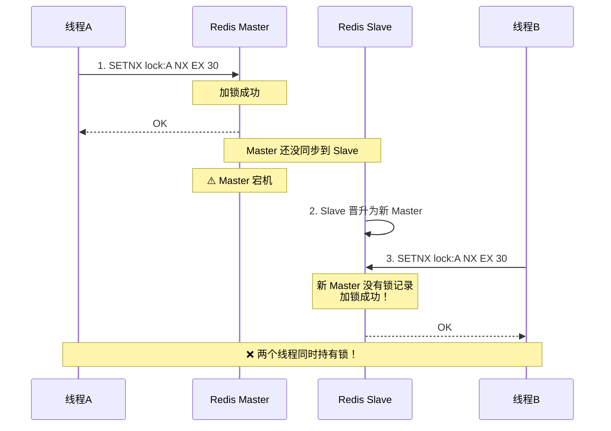
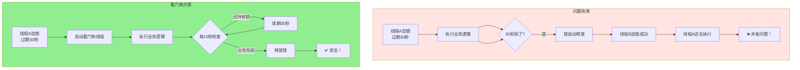
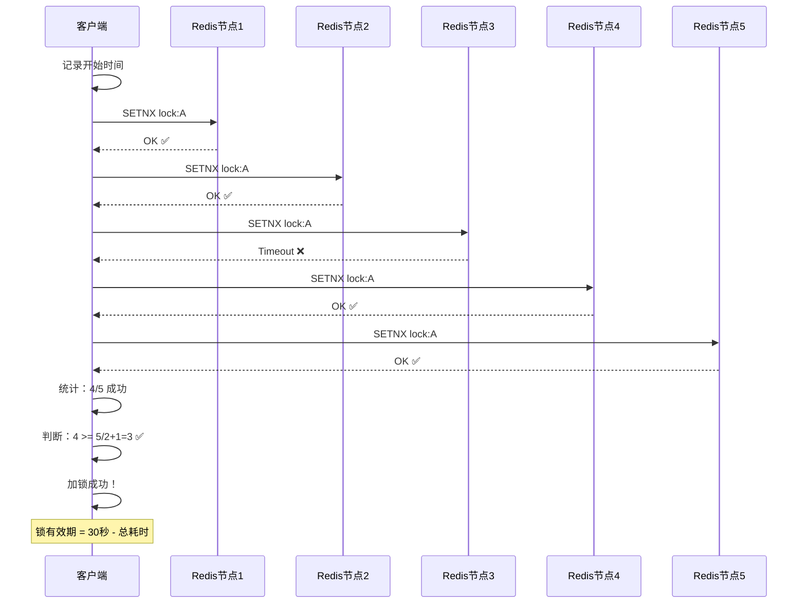
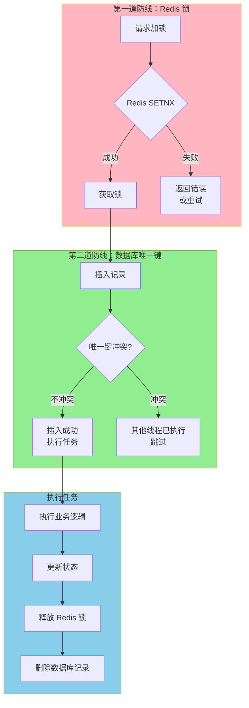
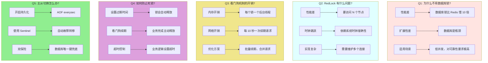
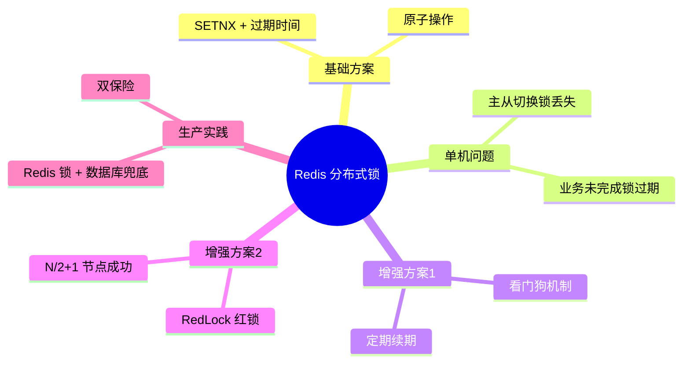
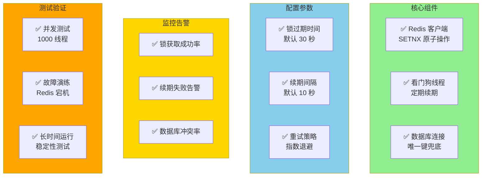
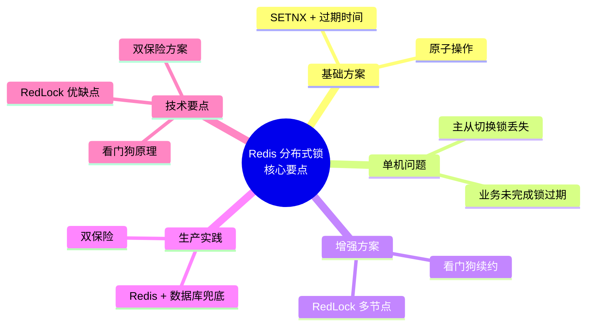

# Redis 分布式锁

---

## 🎯 一句话定位

**Redis 分布式锁解决什么问题？**
```
多台服务器同时执行同一个任务时，如何保证"同一时刻只有一台机器能执行"？
就像公共厕所的门锁——进去一个人就锁门，后面的人排队等着。
```

**生活化比喻**：
想象一个共享充电宝柜机，只有 1 个充电宝。第一个人扫码开锁取走充电宝，柜门自动锁上；第二个人来扫，发现柜门已锁，只能等第一个人还回来。Redis 分布式锁就是这个"柜门锁"。

**核心特点**：
- 单机 Redis 锁**不能 100% 可靠**，但大厂依然在用（因为有兜底方案）
- 主从切换、节点宕机时锁可能"消失"（就像柜门坏了，锁不住）
- 生产实践：**看门狗 Redis 锁 + 数据库唯一键兜底**（双保险）

---

## 💎 核心观点（5 分钟速览版）

> **核心要点速览**

### 核心观点（5 个关键点）

**1. 基础方案：SETNX + 过期时间**
```
❌ 问题1：SETNX 成功但设置过期时间前宕机 → 锁永远不释放（死锁）
❌ 问题2：SETNX + EXPIRE 非原子操作 → 中间宕机同样死锁
✅ 正确做法：SET key value NX EX 30（原子操作）
```

**2. 单机 Redis 锁的致命缺陷**
```
场景：Master 节点加锁成功，还没同步到 Slave，Master 宕机
结果：Slave 晋升为新 Master，锁"消失"了
后果：另一个线程在新 Master 上加锁成功 → 两个线程同时持有锁
生活化比喻：A 拿了钥匙进厕所锁门，但门锁还没装好，A 突然晕倒，
           门锁厂把门锁发给 B，B 也进去了 → 厕所里两个人
```

**3. 增强方案1：看门狗机制（锁续约）**
```
问题：业务没执行完，锁过期了 → 别人拿到锁 → 并发问题
解决：后台线程每隔 10 秒检查，如果还持有锁，就续期 30 秒
生活化比喻：你在图书馆占座，每 30 分钟放一本书续期，
           只要人还在，书就一直放着，不会被别人抢走
```

**4. 增强方案2：RedLock 红锁算法**
```
原理：向 N 个独立的 Redis 节点同时加锁，超过半数成功才算成功
公式：N/2 + 1 个节点加锁成功
优势：避免单点故障，一个节点挂了不影响整体
缺点：性能下降（要访问 N 个节点），实现复杂
```

**5. 生产实践：双保险方案**
```
第一道防线：Redis 分布式锁（快速、高性能）
第二道防线：数据库唯一键兜底（绝对可靠）
生活化比喻：
  进小区先刷门禁卡（Redis 锁，快但有风险坏掉）
  进家门还要再开一次防盗门（数据库唯一键，绝对可靠）
```

---

## 🚀 一句话精华（如果只能记住一句）

> **Redis 分布式锁 = SETNX + 过期时间 + 看门狗续约 + 数据库唯一键兜底**

---

## 一、为什么单机 Redis 锁不能绝对可靠？

### 1.1 基础方案：SETNX + 过期时间

**生活化比喻**：
```
SETNX = "Set if Not eXists"（如果不存在就设置）
就像：
  你看到厕所门开着（key 不存在），就进去把门锁上（SETNX 成功）
  如果门已经锁着（key 存在），你就在外面排队等待（加锁失败）

过期时间 = 自动释放锁
  就像：厕所门锁了 30 分钟还没开，保洁员自动开门（防止死锁）
```

**代码示例（Go 语言）**：
```go
// ❌ 错误示范：非原子操作
func LockWrong(redis *redis.Client, key string, value string, expire int) bool {
    // 第一步：SETNX
    ok, _ := redis.SetNX(key, value, 0).Result()
    if !ok {
        return false // 加锁失败
    }
    
    // ⚠️ 致命问题：如果这里宕机，锁永远不会过期
    // 第二步：设置过期时间
    redis.Expire(key, time.Duration(expire)*time.Second)
    return true
}

// ✅ 正确做法：原子操作
func LockCorrect(redis *redis.Client, key string, value string, expire int) bool {
    // 原子操作：设置值 + 设置过期时间，一步到位
    ok, _ := redis.SetNX(key, value, time.Duration(expire)*time.Second).Result()
    return ok
}
```

**问题分析**：
| 场景 | 结果 | 生活化比喻 |
|------|------|------------|
| SETNX 成功，EXPIRE 前宕机 | ❌ 锁永不过期（死锁） | 你进了厕所锁上门，但忘了设置自动开门时间，你晕倒了，后面的人永远进不来 |
| SETNX + EXPIRE 原子操作 | ✅ 锁会自动过期 | 你进了厕所锁上门，设置了 30 分钟自动开门，即使你晕倒，30 分钟后门也会自动开 |

### 1.2 主从切换的致命问题

**生活化比喻**：
```
Redis 主从架构：
  Master（主节点）= 厕所管理员，负责发钥匙
  Slave（从节点）= 备用管理员，复制管理员的钥匙清单

问题场景：
1. 你去管理员 A 那里拿了钥匙（加锁成功）
2. 管理员 A 还没把"钥匙已发"这件事告诉备用管理员 B
3. 管理员 A 突然晕倒（Master 宕机）
4. 备用管理员 B 上岗，他不知道钥匙已发，又发了一把同样的钥匙给别人
5. 现在有两个人拿着同一把钥匙 → 并发问题
```



**技术细节**：
```
时间线分析：
T0: 线程 A 在 Master 上加锁成功
T1: Master 开始异步复制到 Slave（还没完成）
T2: Master 宕机（复制未完成）
T3: Slave 晋升为新 Master（没有锁记录）
T4: 线程 B 在新 Master 上加锁成功
结果：线程 A 和 B 同时认为自己是锁的持有者
```

### 1.3 为什么大厂还在用？

**生活化比喻**：
```
虽然单机 Redis 锁有风险，但大厂依然在用，因为：
1. 风险可控：主从切换概率极低（就像飞机失事概率）
2. 有兜底方案：数据库唯一键（绝对可靠）
3. 性能优先：Redis 锁比数据库锁快 10 倍以上

就像：
  你出门会锁门（Redis 锁），虽然锁可能被撬开
  但你还会买保险（数据库唯一键），即使锁被撬，也有赔偿
  双重保障，风险可控
```

**大厂实践**：
| 方案 | 可靠性 | 性能 | 适用场景 |
|------|--------|------|----------|
| 单机 Redis 锁 | ⭐⭐⭐ | ⭐⭐⭐⭐⭐ | 高并发、允许极小概率失败 |
| RedLock | ⭐⭐⭐⭐ | ⭐⭐⭐ | 对可靠性要求高 |
| Redis + 数据库兜底 | ⭐⭐⭐⭐⭐ | ⭐⭐⭐⭐ | **生产推荐** ⭐⭐⭐⭐⭐ |

---

## 二、增强方案1：看门狗机制（锁续约）

### 2.1 问题：业务没执行完，锁过期了

**生活化比喻**：
```
场景：
  你去图书馆自习，借了一个座位（加锁），约定 30 分钟后让座
  但你学习太投入，30 分钟过去了还没学完
  管理员以为你走了，把座位给别人（锁过期，别人加锁成功）
  你回来发现有人坐你的位置 → 冲突！

技术问题：
  线程 A 加锁，设置过期时间 30 秒
  但业务执行了 50 秒还没完成
  30 秒时锁自动释放
  线程 B 加锁成功
  40 秒时，线程 A 和 B 同时执行 → 并发问题
```



### 2.2 看门狗机制原理

**生活化比喻**：
```
看门狗 = 你的助手
  你在图书馆学习，派一个助手在旁边看着
  每 10 分钟检查一次：你还没学完？好的，再帮你续期 30 分钟
  只要你还在学，助手就一直续期，座位永远是你的
  你学完了，告诉助手"我走了"，助手就不续期了
```

**工作原理**：
```
1. 加锁时启动一个后台线程（看门狗）
2. 每隔 lockWatchdogTimeout / 3 秒（默认 10 秒）检查：
   - 当前线程是否还持有锁？
   - 如果持有，续期 lockWatchdogTimeout（默认 30 秒）
   - 如果没持有（业务已完成），停止续期
3. 业务完成后，主动释放锁，看门狗线程退出
```

**代码示例（Go 语言）**：
```go
// 看门狗机制实现
type RedisLock struct {
    client      *redis.Client
    key         string
    value       string
    expire      time.Duration
    stopWatchdog chan struct{}
}

func NewRedisLock(client *redis.Client, key, value string, expire time.Duration) *RedisLock {
    return &RedisLock{
        client: client,
        key:    key,
        value:  value,
        expire: expire,
    }
}

// 加锁（带看门狗）
func (l *RedisLock) Lock() bool {
    ok, _ := l.client.SetNX(l.key, l.value, l.expire).Result()
    if !ok {
        return false
    }
    
    // 启动看门狗线程
    l.stopWatchdog = make(chan struct{})
    go l.watchdog()
    
    return true
}

// 看门狗：定期续期
func (l *RedisLock) watchdog() {
    ticker := time.NewTicker(l.expire / 3) // 每 10 秒检查一次
    defer ticker.Stop()
    
    for {
        select {
        case <-ticker.C:
            // 检查是否还持有锁
            val, _ := l.client.Get(l.key).Result()
            if val == l.value {
                // 还持有锁，续期
                l.client.Expire(l.key, l.expire)
                fmt.Printf("🐕 看门狗续期：%s\n", l.key)
            } else {
                // 没持有锁，停止
                return
            }
        case <-l.stopWatchdog:
            // 业务完成，停止看门狗
            fmt.Printf("🐕 看门狗退出：%s\n", l.key)
            return
        }
    }
}

// 释放锁
func (l *RedisLock) Unlock() {
    close(l.stopWatchdog) // 停止看门狗
    l.client.Del(l.key)   // 释放锁
}

// 使用示例
func doBusiness() {
    lock := NewRedisLock(redisClient, "order:123", "thread-1", 30*time.Second)
    
    if lock.Lock() {
        defer lock.Unlock()
        
        // 执行业务逻辑（即使超过 30 秒也安全）
        time.Sleep(50 * time.Second)
        fmt.Println("业务执行完成")
    }
}
```

**关键点**：
- ✅ **续期间隔**：lockWatchdogTimeout / 3（默认 10 秒），避免频繁续期
- ✅ **自动停止**：业务完成后主动释放锁，看门狗自动退出
- ✅ **防止误删**：释放锁时检查 value 是否是自己（避免删别人的锁）

---

## 三、增强方案2：RedLock 红锁算法

### 3.1 RedLock 原理

**生活化比喻**：
```
RedLock = 多节点投票机制

想象一个重要的保险箱，有 5 把不同的锁，分布在 5 个不同的房间：
  你要打开保险箱，必须至少拿到 3 把锁（N/2 + 1 = 5/2 + 1 = 3）
  
  即使 1-2 个房间出问题（节点宕机），你仍然能拿到足够的锁
  因为 5 - 2 = 3，刚好满足最低要求
```

**算法步骤**：
```
1. 获取当前时间戳（毫秒）
2. 依次向 N 个 Redis 节点请求加锁
3. 计算总耗时：total_time = 当前时间 - 开始时间
4. 统计加锁成功的节点数 success_count
5. 判断是否成功：
   - success_count >= N/2 + 1 且 total_time < lock_expiry
   - 加锁成功
   - 否则，加锁失败，释放所有节点的锁
6. 锁的实际有效期 = 原始过期时间 - total_time
```



### 3.2 RedLock 代码实现（Go 语言）

```go
// RedLock 实现
type RedLock struct {
    clients  []*redis.Client // N 个独立的 Redis 节点
    quorum   int             // N/2 + 1
    key      string
    value    string
    expire   time.Duration
}

func NewRedLock(clients []*redis.Client, key, value string, expire time.Duration) *RedLock {
    n := len(clients)
    return &RedLock{
        clients: clients,
        quorum:  n/2 + 1,
        key:     key,
        value:   value,
        expire:  expire,
    }
}

// 加锁
func (l *RedLock) Lock() bool {
    start := time.Now()
    successCount := 0
    
    // 依次向所有节点请求加锁
    for _, client := range l.clients {
        ok, _ := client.SetNX(l.key, l.value, l.expire).Result()
        if ok {
            successCount++
        }
    }
    
    // 计算总耗时
    elapsed := time.Since(start)
    
    // 判断是否成功
    if successCount >= l.quorum && elapsed < l.expire {
        fmt.Printf("✅ RedLock 加锁成功：%d/%d\n", successCount, len(l.clients))
        return true
    }
    
    // 失败，释放所有节点的锁
    l.Unlock()
    return false
}

// 释放锁
func (l *RedLock) Unlock() {
    for _, client := range l.clients {
        client.Del(l.key)
    }
    fmt.Printf("🔓 RedLock 释放锁\n")
}

// 使用示例
func useRedLock() {
    // 5 个独立的 Redis 节点
    clients := []*redis.Client{
        redis.NewClient(&redis.Options{Addr: "localhost:6379"}),
        redis.NewClient(&redis.Options{Addr: "localhost:6380"}),
        redis.NewClient(&redis.Options{Addr: "localhost:6381"}),
        redis.NewClient(&redis.Options{Addr: "localhost:6382"}),
        redis.NewClient(&redis.Options{Addr: "localhost:6383"}),
    }
    
    lock := NewRedLock(clients, "order:123", "thread-1", 30*time.Second)
    
    if lock.Lock() {
        defer lock.Unlock()
        
        // 执行业务逻辑
        fmt.Println("执行业务逻辑...")
        time.Sleep(5 * time.Second)
    } else {
        fmt.Println("❌ 加锁失败，请稍后重试")
    }
}
```

### 3.3 RedLock 优缺点分析

| 优点 | 缺点 |
|------|------|
| ✅ 避免单点故障（一个节点挂了不影响） | ❌ 性能下降（要访问 N 个节点） |
| ✅ 可靠性高（多数派原则） | ❌ 实现复杂（需要维护多个连接） |
| ✅ 适合对可靠性要求高的场景 | ❌ 资源消耗大（N 倍内存和网络） |
| | ❌ 时钟跳跃问题（依赖系统时钟） |

**生产建议**：
```
✅ 推荐使用：看门狗 Redis 锁 + 数据库唯一键兜底
❌ 不推荐：RedLock（除非对可靠性要求极高，且能接受性能损失）

原因：
  RedLock 虽然理论上更可靠，但实现复杂、性能差
  而且如果 Redis 节点都挂了，数据库兜底也照样能工作
  所以大多数大厂选择：Redis 锁（快速）+ 数据库兜底（可靠）
```

---

## 四、生产实践：双保险方案

### 4.1 架构设计

**生活化比喻**：
```
双保险 = 两道门

第一道门：Redis 分布式锁
  像小区门禁，刷卡就进，快但有风险（门禁可能坏）

第二道门：数据库唯一键
  像你家门锁，绝对可靠，但慢（要掏出钥匙慢慢开）

流程：
  先刷门禁（Redis 锁）→ 成功进入小区
  再开家门锁（数据库唯一键）→ 成功进入家门
  两道门都过了，才能开始干活
```



### 4.2 代码实现（Go 语言）

```go
// 双保险方案：Redis 锁 + 数据库唯一键
type TaskExecutor struct {
    redis *redis.Client
    db    *gorm.DB
}

type Task struct {
    ID        uint   `gorm:"primaryKey"`
    TaskKey   string `gorm:"uniqueIndex"` // 唯一键
    Status    int    // 0:未执行 1:执行中 2:已完成
    CreatedAt time.Time
}

func NewTaskExecutor(redis *redis.Client, db *gorm.DB) *TaskExecutor {
    return &TaskExecutor{redis: redis, db: db}
}

// 执行任务（双保险）
func (e *TaskExecutor) ExecuteTask(taskKey string, taskFunc func() error) error {
    // 第一道防线：Redis 锁
    lockKey := fmt.Sprintf("lock:%s", taskKey)
    lockValue := fmt.Sprintf("thread-%d", time.Now().UnixNano())
    
    ok, _ := e.redis.SetNX(lockKey, lockValue, 30*time.Second).Result()
    if !ok {
        return fmt.Errorf("❌ 获取 Redis 锁失败，其他线程正在执行")
    }
    defer e.redis.Del(lockKey) // 释放 Redis 锁
    
    fmt.Println("✅ 第一道防线：Redis 锁获取成功")
    
    // 第二道防线：数据库唯一键
    task := &Task{
        TaskKey:   taskKey,
        Status:    1, // 执行中
        CreatedAt: time.Now(),
    }
    
    err := e.db.Create(task).Error
    if err != nil {
        if strings.Contains(err.Error(), "Duplicate") {
            return fmt.Errorf("❌ 数据库唯一键冲突，其他线程已执行")
        }
        return err
    }
    defer e.db.Where("task_key = ?", taskKey).Delete(&Task{}) // 清理记录
    
    fmt.Println("✅ 第二道防线：数据库唯一键校验通过")
    
    // 执行任务
    return taskFunc()
}

// 使用示例
func main() {
    executor := NewTaskExecutor(redisClient, dbClient)
    
    taskKey := "order:123:process"
    
    err := executor.ExecuteTask(taskKey, func() error {
        fmt.Println("🚀 开始执行任务...")
        time.Sleep(5 * time.Second)
        fmt.Println("✅ 任务执行完成")
        return nil
    })
    
    if err != nil {
        fmt.Printf("❌ 任务执行失败：%v\n", err)
    }
}
```

### 4.3 双保险方案对比

| 方案 | 可靠性 | 性能 | 复杂度 | 推荐度 |
|------|--------|------|--------|--------|
| 单机 Redis 锁 | ⭐⭐⭐ | ⭐⭐⭐⭐⭐ | ⭐ | ⭐⭐⭐ |
| Redis + 看门狗 | ⭐⭐⭐⭐ | ⭐⭐⭐⭐ | ⭐⭐⭐ | ⭐⭐⭐⭐ |
| RedLock | ⭐⭐⭐⭐⭐ | ⭐⭐⭐ | ⭐⭐⭐⭐⭐ | ⭐⭐⭐ |
| **Redis + 数据库兜底** | ⭐⭐⭐⭐⭐ | ⭐⭐⭐⭐ | ⭐⭐ | ⭐⭐⭐⭐⭐ |

**为什么推荐双保险？**
```
1. Redis 锁：快速拦截大部分并发（99% 的请求在这里就被挡住了）
2. 数据库唯一键：兜底，绝对可靠（即使 Redis 出问题，数据库也能挡住）
3. 性能：Redis 锁挡住 99%，只有 1% 的请求会到数据库，性能影响小
4. 可靠性：两道防线，即使一道失效，另一道还能工作
```

---

## 五、技术深入



### 技术方案分析

**Q1: 为什么不用数据库锁，非要用 Redis 锁？**  
**答**：
- **性能**：Redis 锁比数据库锁快 10 倍以上（内存 vs 磁盘）
- **扩展性**：Redis 容易水平扩展，数据库是瓶颈
- **适用场景**：高并发用 Redis 锁，低并发且对可靠性要求极高可以用数据库锁

**Q2: RedLock 有什么缺点？**  
**答**：
- **性能差**：要访问 N 个节点，网络开销大
- **时钟跳跃**：依赖系统时钟准确性，如果某个节点时钟跳跃，可能导致锁提前失效
- **实现复杂**：需要维护多个 Redis 连接，故障处理复杂
- **生产建议**：大多数场景用看门狗 Redis 锁 + 数据库兜底就够了，RedLock 适合对可靠性要求极高的金融场景

**Q3: 看门狗机制的开销大吗？**  
**答**：
- **内存开销**：每个锁一个后台线程，内存占用小
- **网络开销**：每 10 秒一次续期请求，网络开销可接受
- **优化方案**：可以批量续期（多个锁一起续期），或者合并请求（减少网络往返）

**Q4: 如何防止死锁？**  
**答**：
- **设置过期时间**：锁会自动释放，不会永远持有
- **看门狗续期**：业务完成主动释放，看门狗自动停止
- **超时控制**：业务逻辑设置超时，避免无限等待

**Q5: Redis 主从切换时锁丢失怎么办？**  
**答**：
- **开启持久化**：AOF 模式 everysec，减少数据丢失
- **使用 Sentinel**：自动故障转移，快速恢复
- **双保险**：数据库唯一键兜底，即使 Redis 出问题，数据库也能挡住

---

## 六、方案总结



**方案要点**：

> **基础方案**：SETNX + 过期时间，原子操作避免死锁。
> 
> **单机问题**：主从切换时锁可能丢失，业务未完成锁过期导致并发。
> 
> **增强方案1**：看门狗机制，后台线程定期续期，防止业务未完成锁过期。
> 
> **增强方案2**：RedLock 红锁算法，向 N 个节点加锁，N/2+1 成功才算成功，避免单点故障。
> 
> **生产实践**：Redis 锁（快速）+ 数据库唯一键兜底（可靠），双保险方案。

---

## 七、生产环境 Checklist（部署检查清单）



**部署检查清单**：

| 类别 | 检查项 | 状态 | 生活化比喻 |
|------|--------|------|------------|
| **核心组件** | Redis 客户端（SETNX 原子操作） | ⬜ | 门锁 |
| | 看门狗线程（定期续期） | ⬜ | 助手 |
| | 数据库连接（唯一键兜底） | ⬜ | 防盗门 |
| **配置参数** | 锁过期时间（默认 30 秒） | ⬜ | 自动开门时间 |
| | 续期间隔（默认 10 秒） | ⬜ | 助手检查间隔 |
| | 重试策略（指数退避） | ⬜ | 失败后等待 |
| **监控告警** | 锁获取成功率 | ⬜ | 成功率监控 |
| | 续期失败告警 | ⬜ | 异常告警 |
| | 数据库冲突率 | ⬜ | 兜底触发率 |
| **测试验证** | 并发测试（1000 线程） | ⬜ | 压力测试 |
| | 故障演练（Redis 宕机） | ⬜ | 容灾演练 |
| | 长时间运行（稳定性测试） | ⬜ | 7x24 测试 |

---

## 八、总结（一句话带走）



### 🎯 一句话总结

> **Redis 分布式锁 = SETNX + 过期时间 + 看门狗续约 + 数据库唯一键兜底**

### 🧠 核心要点

1. **为什么单机 Redis 锁不可靠？** 主从切换时锁可能丢失，就像管理员晕倒，备用管理员不知道钥匙已发。
2. **看门狗机制是什么？** 后台线程定期续期，防止业务未完成锁过期，就像助手帮你续期座位。
3. **RedLock 原理？** 向 N 个节点加锁，N/2+1 成功才算成功，避免单点故障。
4. **生产推荐方案？** Redis 锁（快速）+ 数据库唯一键兜底（可靠），双保险方案。

---
