# 分布式定时任务可靠性

---

## 🎯 一句话定位

**分布式定时任务解决什么问题？**
```
多台服务器同时运行时，如何保证"同一个定时任务在同一时刻只被一台机器执行"？
就像工厂的流水线，只有一个工位能处理某个工序，其他工位要等着。
```

**生活化比喻**：
想象一个共享打印机，公司有 100 个员工，但只有 1 台打印机。每个员工都想打印文件，如何保证"同一时刻只有 1 个人在打印"？答案：排队 + 互斥锁。分布式定时任务就是这个"排队系统 + 互斥锁"。

**核心挑战**：
- **多节点重复执行**：10 台机器同时执行"每日结算"，数据就乱了
- **故障转移**：执行任务的机器突然宕机，任务怎么办？
- **执行超时**：任务卡住了，一直不释放锁，其他机器怎么办？

---

## 💎 核心观点（5 分钟速览版）

> **核心要点速览**

### 核心观点（5 个关键点）

**1. 分布式定时任务的三大挑战**
```
挑战1：多节点重复执行
  ❌ 10 台机器同时执行"每日结算" → 数据重复、账目混乱
  ✅ 解决：分布式锁（Redis/Zookeeper），保证只有一台执行

挑战2：故障转移
  ❌ 执行任务的机器宕机 → 任务没人执行
  ✅ 解决：故障检测 + 自动转移（其他机器接管）

挑战3：执行超时
  ❌ 任务卡住，锁不释放 → 其他机器永远等不到
  ✅ 解决：超时控制 + 看门狗机制
```

**2. 常见方案对比**
```
方案1：数据库锁（悲观锁/乐观锁）
  ✅ 实现简单、可靠性高
  ❌ 性能差、数据库是瓶颈
  适用：低并发、对可靠性要求极高

方案2：Redis 分布式锁
  ✅ 性能好、扩展性强
  ❌ 主从切换可能丢锁
  适用：高并发、允许极小概率失败

方案3：Zookeeper 分布式锁
  ✅ 强一致性、可靠性高
  ❌ 性能不如 Redis
  适用：对可靠性要求高

方案4：MQ 延迟消息
  ✅ 天然支持延迟、解耦
  ❌ 实现复杂
  适用：延迟任务、异步处理
```

**3. 调度框架选型**
```
XXL-JOB：
  ✅ 轻量级、易部署、可视化界面
  ✅ 支持分片广播、故障转移
  适用：中小型项目

Elastic-Job：
  ✅ 分布式、弹性伸缩
  ✅ 支持作业分片
  适用：大规模分布式系统
```

**4. 可靠性保障三要素**
```
要素1：幂等执行
  同一任务执行多次，结果和执行一次一样
  实现：唯一键、状态机、去重表

要素2：故障转移
  执行节点宕机，其他节点自动接管
  实现：心跳检测、分布式锁续约

要素3：失败重试
  任务失败后自动重试，最多 N 次
  实现：重试队列、指数退避
```

**5. 生产实践：XXL-JOB + Redis 锁 + 幂等设计**
```
架构：XXL-JOB 调度中心 + 执行器集群 + Redis 锁 + 数据库兜底
流程：
  1. 调度中心触发任务
  2. 执行器集群竞争 Redis 锁
  3. 获取锁的执行器执行任务
  4. 执行前检查幂等性（避免重复执行）
  5. 执行失败自动重试（最多 3 次）
  6. 执行节点宕机，其他节点接管
```

---

## 🚀 一句话精华（如果只能记住一句）

> **分布式定时任务 = 调度框架（XXL-JOB） + 分布式锁（Redis） + 幂等设计（防重复）**

---

## 一、分布式定时任务的三大挑战

### 1.1 挑战1：多节点重复执行

**生活化比喻**：
```
场景：
  公司有 10 个财务人员，每天凌晨 2 点要执行"每日结算"
  如果没有协调机制，10 个人同时打开电脑，同时点击"结算"按钮
  结果：同一笔订单被结算 10 次，账目完全混乱

技术问题：
  10 台服务器同时运行，每台都在凌晨 2 点触发"每日结算"任务
  如果没有分布式锁，10 台机器同时执行
  数据重复、账目混乱、用户投诉
```

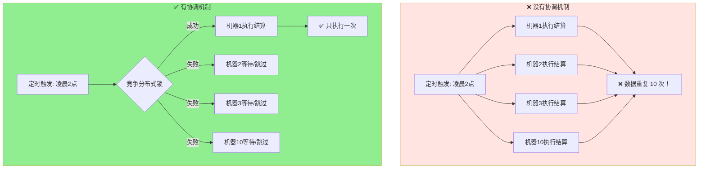

### 1.2 挑战2：故障转移

**生活化比喻**：
```
场景：
  财务小王（机器A）拿到了锁，开始执行"每日结算"
  突然，小王电脑死机了（机器A宕机）
  如果没有故障转移机制，结算任务就没人执行了
  老板第二天发现账目没结算，大发雷霆

技术问题：
  执行任务的机器突然宕机（网络故障、OOM、硬件故障）
  锁没有释放，其他机器永远等不到锁
  任务没人执行，业务停滞
```

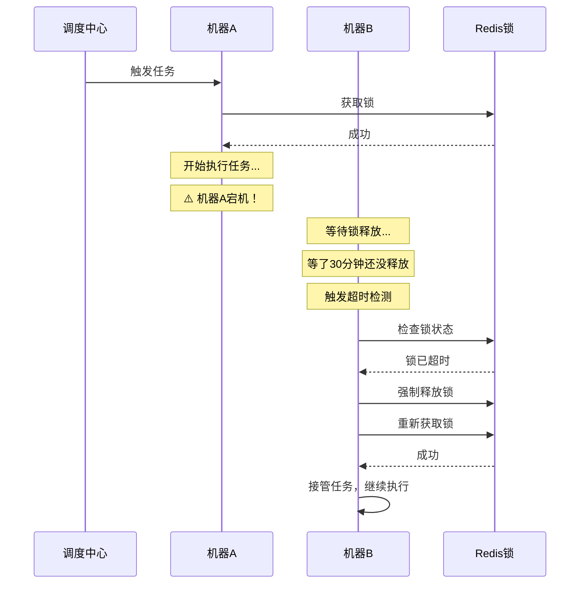

### 1.3 挑战3：执行超时

**生活化比喻**：
```
场景：
  财务小王（机器A）拿到了锁，开始执行"每日结算"
  正常情况下 10 分钟完成，但这次数据量太大，卡住了
  1 小时过去了，还没执行完
  锁早就过期了（设置了 30 分钟），但小王还在执行
  其他机器看到锁过期，以为任务完成了，也开始执行
  结果：重复执行

技术问题：
  任务执行时间超过预期（数据量大、网络延迟、数据库慢查询）
  锁过期了，但任务还没完成
  其他机器获取锁，重复执行
  数据混乱
```

**解决方案对比**：
| 方案 | 原理 | 优点 | 缺点 | 推荐度 |
|------|------|------|------|--------|
| **看门狗机制** | 后台线程定期续期 | 自动续期、防止误判 | 实现复杂 | ⭐⭐⭐⭐ |
| **超时控制** | 业务逻辑设置超时 | 简单直接 | 可能误杀 | ⭐⭐⭐ |
| **状态机** | 任务执行前检查状态 | 防止重复执行 | 需要状态表 | ⭐⭐⭐⭐⭐ |

---

## 二、常见方案对比

### 2.1 方案1：数据库锁（悲观锁/乐观锁）

**生活化比喻**：
```
悲观锁：
  就像公共厕所，进去就把门反锁，其他人只能等着
  SELECT ... FOR UPDATE（查询时加锁，其他人无法修改）

乐观锁：
  就像你在文档上写"我正在编辑"，其他人看到就不编辑了
  但有人不管，直接覆盖了你的修改
  解决方案：版本号机制（version 字段），每次更新检查版本号
```

**代码示例（Go 语言）**：
```go
// 悲观锁：SELECT ... FOR UPDATE
func executeWithPessimisticLock(db *gorm.DB, taskKey string) error {
    return db.Transaction(func(tx *gorm.DB) error {
        // 加锁查询
        var task Task
        err := tx.Set("gorm:query_option", "FOR UPDATE").
            First(&task, "task_key = ?", taskKey).Error
        if err != nil {
            return err
        }
        
        // 检查是否已执行
        if task.Status == 2 {
            fmt.Println("任务已执行，跳过")
            return nil
        }
        
        // 执行任务
        fmt.Println("执行任务...")
        time.Sleep(5 * time.Second)
        
        // 更新状态
        task.Status = 2
        return tx.Save(&task).Error
    })
}

// 乐观锁：版本号机制
type Task struct {
    ID        uint   `gorm:"primaryKey"`
    TaskKey   string `gorm:"uniqueIndex"`
    Status    int
    Version   int    // 乐观锁版本号
    CreatedAt time.Time
}

func executeWithOptimisticLock(db *gorm.DB, taskKey string) error {
    var task Task
    err := db.First(&task, "task_key = ?", taskKey).Error
    if err != nil {
        return err
    }
    
    // 检查是否已执行
    if task.Status == 2 {
        fmt.Println("任务已执行，跳过")
        return nil
    }
    
    // 执行任务
    fmt.Println("执行任务...")
    time.Sleep(5 * time.Second)
    
    // 更新时检查版本号
    result := db.Model(&Task{}).
        Where("id = ? AND version = ?", task.ID, task.Version).
        Updates(map[string]interface{}{
            "status":  2,
            "version": gorm.Expr("version + 1"),
        })
    
    if result.RowsAffected == 0 {
        return fmt.Errorf("❌ 版本号冲突，其他线程已修改")
    }
    
    return nil
}
```

**优缺点分析**：
| 优点 | 缺点 |
|------|------|
| ✅ 实现简单 | ❌ 性能差（数据库是瓶颈） |
| ✅ 可靠性高 | ❌ 扩展性差（数据库难扩展） |
| ✅ 事务支持 | ❌ 高并发下性能急剧下降 |

**适用场景**：低并发、对可靠性要求极高（如金融系统）

### 2.2 方案2：Redis 分布式锁

**生活化比喻**：
```
Redis 锁：
  就像公共厕所的电子锁，刷卡进入，自动上锁
  SETNX key value NX EX 30（原子操作）
  
  优点：快（内存操作），扩展性强
  缺点：主从切换可能丢锁（电子锁可能坏）
```

**代码示例（Go 语言）**：
```go
// Redis 分布式锁
type RedisLock struct {
    client *redis.Client
    key    string
    value  string
    expire time.Duration
}

func NewRedisLock(client *redis.Client, key, value string, expire time.Duration) *RedisLock {
    return &RedisLock{
        client: client,
        key:    key,
        value:  value,
        expire: expire,
    }
}

func (l *RedisLock) Lock() bool {
    ok, _ := l.client.SetNX(l.key, l.value, l.expire).Result()
    return ok
}

func (l *RedisLock) Unlock() {
    l.client.Del(l.key)
}

// 定时任务执行
func executeTaskWithRedisLock(redis *redis.Client, taskKey string, taskFunc func() error) error {
    lockKey := fmt.Sprintf("lock:%s", taskKey)
    lockValue := fmt.Sprintf("node-%d", time.Now().UnixNano())
    
    lock := NewRedisLock(redis, lockKey, lockValue, 30*time.Minute)
    
    if !lock.Lock() {
        fmt.Println("❌ 获取锁失败，其他节点正在执行")
        return nil
    }
    defer lock.Unlock()
    
    fmt.Println("✅ 获取锁成功，开始执行任务")
    return taskFunc()
}
```

**优缺点分析**：
| 优点 | 缺点 |
|------|------|
| ✅ 性能高（内存操作） | ❌ 主从切换可能丢锁 |
| ✅ 扩展性强 | ❌ 需要维护 Redis 集群 |
| ✅ 支持高并发 | ❌ 需要看门狗机制续约 |

**适用场景**：高并发、允许极小概率失败

### 2.3 方案3：Zookeeper 分布式锁

**生活化比喻**：
```
Zookeeper 锁：
  就像公共厕所的排队系统，每个人拿一个号，按顺序进入
  创建临时顺序节点，号最小的获得锁
  
  优点：强一致性、可靠性高
  缺点：性能不如 Redis
```

**代码示例（Go 语言）**：
```go
// Zookeeper 分布式锁（简化版）
type ZkLock struct {
    conn  *zk.Conn
    path  string
    node  string
}

func NewZkLock(conn *zk.Conn, path string) *ZkLock {
    return &ZkLock{
        conn: conn,
        path: path,
    }
}

func (l *ZkLock) Lock() error {
    // 创建临时顺序节点
    node, err := l.conn.CreateProtectedEphemeralSequential(
        l.path+"/lock-",
        []byte{},
        zk.WorldACL(zk.PermAll),
    )
    if err != nil {
        return err
    }
    l.node = node
    
    // 获取所有子节点
    children, _, err := l.conn.Children(l.path)
    if err != nil {
        return err
    }
    
    // 排序，判断自己是否最小
    sort.Strings(children)
    
    for i, child := range children {
        if l.path+"/"+child == node {
            if i == 0 {
                // 自己是最小的，获得锁
                return nil
            }
            // 否则，监听前一个节点
            _, _, ch, err := l.conn.Get(l.path + "/" + children[i-1])
            if err != nil {
                return err
            }
            <-ch // 等待前一个节点删除
            return nil
        }
    }
    
    return fmt.Errorf("未找到自己的节点")
}

func (l *ZkLock) Unlock() error {
    return l.conn.Delete(l.node, -1)
}

// 使用示例
func executeTaskWithZkLock(conn *zk.Conn, taskKey string, taskFunc func() error) error {
    lock := NewZkLock(conn, "/locks/"+taskKey)
    
    if err := lock.Lock(); err != nil {
        return err
    }
    defer lock.Unlock()
    
    fmt.Println("✅ 获取锁成功，开始执行任务")
    return taskFunc()
}
```

**优缺点分析**：
| 优点 | 缺点 |
|------|------|
| ✅ 强一致性 | ❌ 性能不如 Redis |
| ✅ 可靠性高 | ❌ 实现复杂 |
| ✅ 自动释放（临时节点） | ❌ 需要维护 ZK 集群 |

**适用场景**：对可靠性要求高、大规模分布式系统

### 2.4 方案4：MQ 延迟消息

**生活化比喻**：
```
MQ 延迟消息：
  就像定时闹钟，设置 30 分钟后提醒
  发送延迟消息到 MQ，30 分钟后消费者收到消息
  
  优点：天然支持延迟、解耦
  缺点：实现复杂、需要 MQ 支持
```

**代码示例（Go 语言）**：
```go
// RabbitMQ 延迟消息（简化版）
func sendDelayedMessage(ch *amqp.Channel, queue string, delay time.Duration, body string) error {
    // 设置延迟时间（需要 delay 插件）
    args := amqp.Table{
        "x-delay": int(delay.Milliseconds()),
    }
    
    return ch.Publish(
        "delayed_exchange", // 交换机
        queue,              // 路由键
        false,              // 强制
        false,              // 立即
        amqp.Publishing{
            Headers:    args,
            Body:       []byte(body),
            DeliveryMode: amqp.Persistent,
        },
    )
}

// 消费者
func consumeDelayedMessage(ch *amqp.Channel, queue string) {
    msgs, _ := ch.Consume(queue, "", false, false, false, false, nil)
    
    go func() {
        for msg := range msgs {
            fmt.Printf("收到延迟消息：%s\n", msg.Body)
            
            // 执行任务
            executeTask(string(msg.Body))
            
            msg.Ack(false)
        }
    }()
}
```

**优缺点分析**：
| 优点 | 缺点 |
|------|------|
| ✅ 天然支持延迟 | ❌ 实现复杂 |
| ✅ 解耦 | ❌ 需要 MQ 支持延迟消息 |
| ✅ 可靠性高 | ❌ 调试困难 |

**适用场景**：延迟任务、异步处理

### 2.5 方案对比总结

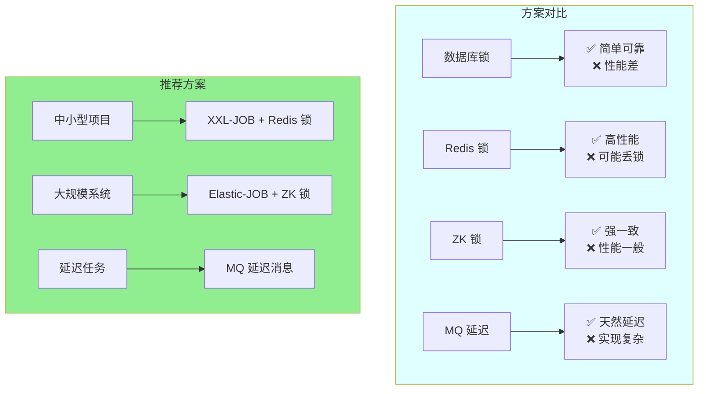

**选型建议**：
| 场景 | 推荐方案 | 理由 |
|------|----------|------|
| 中小型项目 | XXL-JOB + Redis 锁 | 轻量、易部署、性能好 |
| 大规模分布式系统 | Elastic-JOB + ZK 锁 | 强一致、可靠性高 |
| 延迟任务 | MQ 延迟消息 | 天然支持延迟、解耦 |
| 金融系统 | 数据库锁 + Redis 兜底 | 绝对可靠 |

---

## 三、调度框架：XXL-JOB 与 Elastic-JOB

### 3.1 XXL-JOB

**生活化比喻**：
```
XXL-JOB：
  就像工厂的调度中心，有一个中央调度室，指挥各个车间干活
  调度中心：触发任务、监控状态
  执行器：接收任务、执行任务、返回结果
  
  优点：轻量级、可视化界面、易部署
  适用：中小型项目
```

**核心功能**：
```
1. 定时触发：支持 CRON 表达式
2. 路由策略：轮询、随机、故障转移
3. 分片广播：大任务拆分成小任务，并行执行
4. 失败重试：自动重试，最多 N 次
5. 可视化：Web 界面查看任务状态、日志
```

**代码示例（Go 语言执行器）**：
```go
// XXL-JOB Go 执行器（简化版）
type XXLJobExecutor struct {
    adminAddr string
    appName   string
    port      int
}

func NewXXLJobExecutor(adminAddr, appName string, port int) *XXLJobExecutor {
    return &XXLJobExecutor{
        adminAddr: adminAddr,
        appName:   appName,
        port:      port,
    }
}

// 注册任务处理器
func (e *XXLJobExecutor) RegisterHandler(jobName string, handler func(ctx context.Context, param string) error) {
    // 注册到任务映射表
    jobHandlers[jobName] = handler
    fmt.Printf("注册任务：%s\n", jobName)
}

// 执行任务
func (e *XXLJobExecutor) ExecuteJob(jobName, param string) error {
    handler, ok := jobHandlers[jobName]
    if !ok {
        return fmt.Errorf("任务 %s 未注册", jobName)
    }
    
    ctx := context.Background()
    return handler(ctx, param)
}

// 使用示例
func main() {
    executor := NewXXLJobExecutor("http://localhost:8080", "my-app", 9999)
    
    // 注册任务
    executor.RegisterHandler("daily-settlement", func(ctx context.Context, param string) error {
        fmt.Println("执行每日结算任务...")
        time.Sleep(5 * time.Second)
        fmt.Println("每日结算完成")
        return nil
    })
    
    // 启动执行器
    executor.Start()
}
```

**架构设计**：
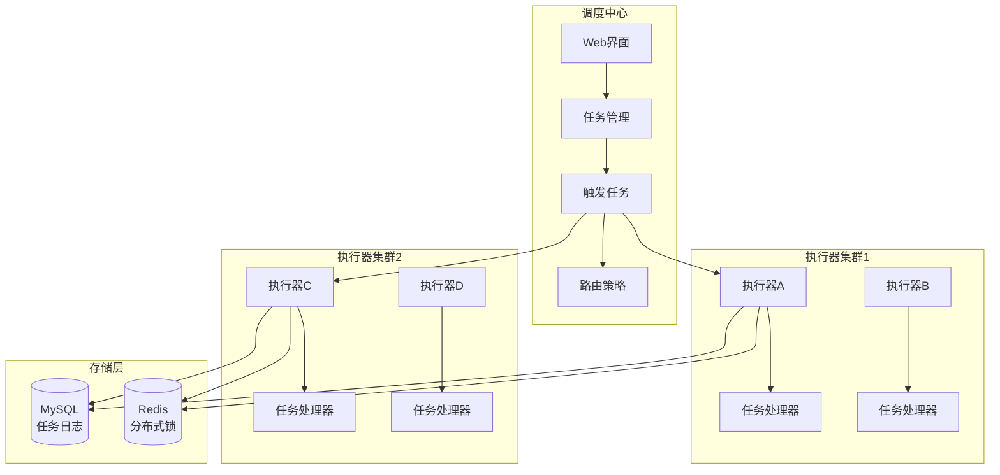

### 3.2 Elastic-JOB

**生活化比喻**：
```
Elastic-JOB：
  就像弹性伸缩的工厂，订单多时增加工人，订单少时减少工人
  自动分片：大任务拆分成多个小任务
  弹性伸缩：根据负载动态调整执行器数量
  
  优点：分布式、弹性伸缩、支持作业分片
  适用：大规模分布式系统
```

**核心功能**：
```
1. 分布式：多节点协同执行
2. 弹性伸缩：动态增加/减少执行器
3. 作业分片：大任务拆分成多个小任务，并行执行
4. 失效转移：执行器宕机，自动转移
5. 错过重执行：如果错过触发时间，自动补执行
```

**代码示例（Java 版，Elastic-JOB 主要是 Java）**：
```java
// Elastic-JOB 作业分片示例
public class MyJob implements SimpleJob {
    
    @Override
    public void execute(ShardingContext context) {
        // 获取分片信息
        int shardingTotal = context.getShardingTotal(); // 总分片数
        int shardingItem = context.getShardingItem();   // 当前分片
        
        System.out.printf("分片 %d/%d 开始执行\n", shardingItem, shardingTotal);
        
        // 根据分片处理数据
        List<Data> dataList = getDataBySharding(shardingItem, shardingTotal);
        for (Data data : dataList) {
            processData(data);
        }
        
        System.out.printf("分片 %d/%d 执行完成\n", shardingItem, shardingTotal);
    }
    
    private List<Data> getDataBySharding(int shardingItem, int shardingTotal) {
        // 根据分片规则获取数据
        // 例如：id % shardingTotal == shardingItem
        return dataRepository.findByIdMod(shardingItem, shardingTotal);
    }
}
```

**架构设计**：
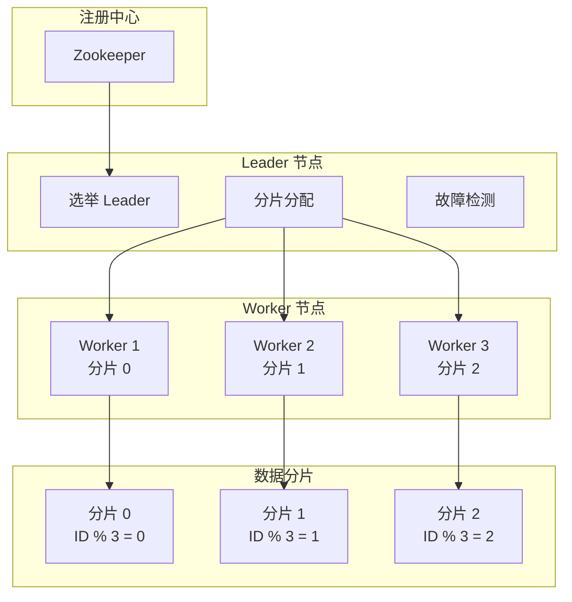

### 3.3 XXL-JOB vs Elastic-JOB 对比

| 特性 | XXL-JOB | Elastic-JOB |
|------|---------|-------------|
| **部署复杂度** | ⭐⭐⭐⭐⭐（轻量） | ⭐⭐⭐（需要 ZK） |
| **可视化界面** | ✅ 有 | ❌ 无 |
| **分布式** | ❌ 单点调度 | ✅ 完全分布式 |
| **弹性伸缩** | ❌ 手动 | ✅ 自动 |
| **作业分片** | ✅ 支持 | ✅ 支持 |
| **故障转移** | ✅ 支持 | ✅ 支持 |
| **适用规模** | 中小型 | 大规模 |
| **语言支持** | 多语言（HTTP） | 主要是 Java |

**选型建议**：
```
中小型项目 → XXL-JOB
  理由：轻量、易部署、可视化、功能够用

大规模分布式系统 → Elastic-JOB
  理由：完全分布式、弹性伸缩、高可用

多语言环境 → XXL-JOB
  理由：支持 HTTP 调用，语言无关

纯 Java 项目 → 都可以，看团队偏好
```

---

## 四、可靠性保障三要素

### 4.1 幂等执行

**生活化比喻**：
```
幂等执行：
  就像电梯按钮，按一次和按多次，结果一样（电梯只会来一次）
  同一任务执行多次，结果和执行一次一样
  
  实现方案：
  1. 唯一键：数据库唯一索引，重复插入会报错
  2. 状态机：任务执行前检查状态，已执行就跳过
  3. 去重表：记录已执行的任务 ID，重复就跳过
```

**代码示例（Go 语言）**：
```go
// 幂等执行方案1：唯一键
func executeWithUniqueKey(db *gorm.DB, taskID uint) error {
    // 插入执行记录（唯一键约束）
    record := &ExecutionRecord{
        TaskID:    taskID,
        Status:    1,
        ExecutedAt: time.Now(),
    }
    
    err := db.Create(record).Error
    if err != nil {
        if strings.Contains(err.Error(), "Duplicate") {
            fmt.Println("任务已执行，跳过（唯一键冲突）")
            return nil
        }
        return err
    }
    
    defer db.Where("task_id = ?", taskID).Delete(&ExecutionRecord{})
    
    // 执行任务
    return executeTask(taskID)
}

// 幂等执行方案2：状态机
type Task struct {
    ID     uint `gorm:"primaryKey"`
    Status int  // 0:未执行 1:执行中 2:已完成
}

func executeWithStateMachine(db *gorm.DB, taskID uint) error {
    var task Task
    err := db.First(&task, taskID).Error
    if err != nil {
        return err
    }
    
    // 检查状态
    if task.Status == 2 {
        fmt.Println("任务已完成，跳过")
        return nil
    }
    
    if task.Status == 1 {
        fmt.Println("任务执行中，跳过")
        return nil
    }
    
    // 更新状态为执行中
    result := db.Model(&Task{}).
        Where("id = ? AND status = 0", taskID).
        Update("status", 1)
    
    if result.RowsAffected == 0 {
        fmt.Println("状态已变更，跳过")
        return nil
    }
    
    defer db.Model(&Task{}).Where("id = ?", taskID).Update("status", 2)
    
    // 执行任务
    return executeTask(taskID)
}

// 幂等执行方案3：去重表
func executeWithDedupTable(db *gorm.DB, taskID uint) error {
    // 检查是否已执行
    var count int64
    db.Model(&DedupRecord{}).Where("task_id = ?", taskID).Count(&count)
    
    if count > 0 {
        fmt.Println("任务已执行，跳过（去重表）")
        return nil
    }
    
    // 插入去重记录
    record := &DedupRecord{
        TaskID:    taskID,
        CreatedAt: time.Now(),
    }
    db.Create(record)
    
    defer db.Where("task_id = ?", taskID).Delete(&DedupRecord{})
    
    // 执行任务
    return executeTask(taskID)
}
```

### 4.2 故障转移

**生活化比喻**：
```
故障转移：
  就像接力赛跑，一个选手跑不动了，另一个选手接棒继续跑
  执行节点宕机，其他节点自动接管
  
  实现方案：
  1. 心跳检测：定期发送心跳，超时认为宕机
  2. 分布式锁续约：锁过期后，其他节点可以获取
  3. 任务状态：检查任务状态，未完成的重新执行
```

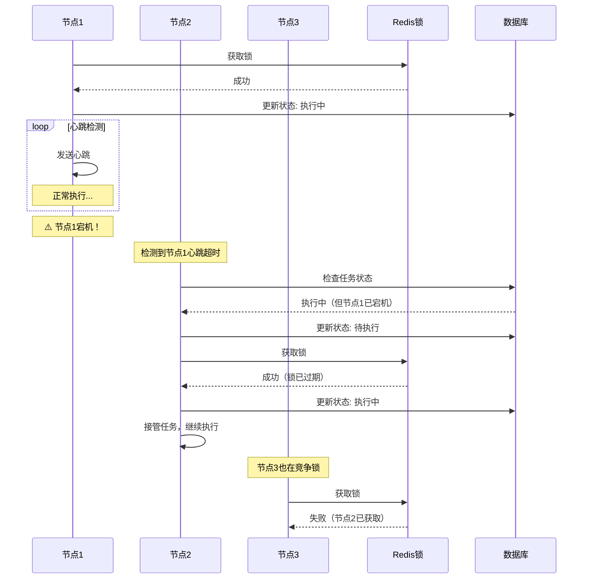

**代码示例（Go 语言）**：
```go
// 故障转移实现
type TaskScheduler struct {
    redis    *redis.Client
    db       *gorm.DB
    nodeID   string
}

func NewTaskScheduler(redis *redis.Client, db *gorm.DB) *TaskScheduler {
    return &TaskScheduler{
        redis:  redis,
        db:     db,
        nodeID: fmt.Sprintf("node-%d", time.Now().UnixNano()),
    }
}

// 心跳检测
func (s *TaskScheduler) StartHeartbeat() {
    go func() {
        ticker := time.NewTicker(10 * time.Second)
        defer ticker.Stop()
        
        for range ticker.C {
            // 发送心跳
            s.redis.Set("heartbeat:"+s.nodeID, "alive", 30*time.Second)
        }
    }()
}

// 故障转移
func (s *TaskScheduler) Failover() {
    go func() {
        ticker := time.NewTicker(1 * time.Minute)
        defer ticker.Stop()
        
        for range ticker.C {
            // 获取所有节点
            nodes, _ := s.redis.Keys("heartbeat:*").Result()
            
            for _, node := range nodes {
                // 检查心跳
                val, _ := s.redis.Get(node).Result()
                if val == "" {
                    // 心跳超时，节点可能宕机
                    nodeID := strings.TrimPrefix(node, "heartbeat:")
                    fmt.Printf("检测到节点 %s 宕机，开始故障转移\n", nodeID)
                    
                    // 重置该节点的任务
                    s.resetNodeTasks(nodeID)
                }
            }
        }
    }()
}

func (s *TaskScheduler) resetNodeTasks(nodeID string) {
    // 查找该节点正在执行的任务
    var tasks []Task
    s.db.Where("executing_node = ? AND status = 1", nodeID).Find(&tasks)
    
    for _, task := range tasks {
        // 重置任务状态
        s.db.Model(&Task{}).Where("id = ?", task.ID).Updates(map[string]interface{}{
            "status":         0, // 待执行
            "executing_node": "",
        })
        fmt.Printf("重置任务 %d 状态\n", task.ID)
    }
}
```

### 4.3 失败重试

**生活化比喻**：
```
失败重试：
  就像考试，第一次没考过，可以再考一次
  任务失败后自动重试，最多 N 次
  
  实现方案：
  1. 重试队列：失败的任务放入重试队列
  2. 指数退避：重试间隔越来越长（1s, 2s, 4s, 8s...）
  3. 最大重试次数：避免无限重试
```

**代码示例（Go 语言）**：
```go
// 失败重试实现
type RetryTask struct {
    ID          uint
    TaskID      uint
    RetryCount  int
    MaxRetries  int
    NextRetryAt time.Time
}

func (s *TaskScheduler) ExecuteWithRetry(taskID uint, maxRetries int) error {
    var lastErr error
    
    for i := 0; i <= maxRetries; i++ {
        err := executeTask(taskID)
        if err == nil {
            fmt.Printf("任务 %d 执行成功（第 %d 次尝试）\n", taskID, i+1)
            return nil
        }
        
        lastErr = err
        fmt.Printf("任务 %d 执行失败（第 %d 次尝试）：%v\n", taskID, i+1, err)
        
        if i < maxRetries {
            // 指数退避：1s, 2s, 4s, 8s...
            delay := time.Duration(1<<uint(i)) * time.Second
            fmt.Printf("等待 %v 后重试...\n", delay)
            time.Sleep(delay)
        }
    }
    
    return fmt.Errorf("任务 %d 重试 %d 次后仍然失败：%w", taskID, maxRetries, lastErr)
}

// 异步重试队列
func (s *TaskScheduler) StartRetryQueue() {
    go func() {
        ticker := time.NewTicker(10 * time.Second)
        defer ticker.Stop()
        
        for range ticker.C {
            // 查找待重试的任务
            var retries []RetryTask
            s.db.Where("next_retry_at <= ?", time.Now()).Find(&retries)
            
            for _, retry := range retries {
                go func(r RetryTask) {
                    err := executeTask(r.TaskID)
                    if err == nil {
                        // 成功，删除重试记录
                        s.db.Delete(&r)
                        fmt.Printf("任务 %d 重试成功\n", r.TaskID)
                    } else {
                        // 失败，更新重试次数
                        r.RetryCount++
                        if r.RetryCount >= r.MaxRetries {
                            // 达到最大重试次数，标记为失败
                            s.db.Model(&Task{}).Where("id = ?", r.TaskID).Update("status", 3)
                            s.db.Delete(&r)
                            fmt.Printf("任务 %d 达到最大重试次数，标记为失败\n", r.TaskID)
                        } else {
                            // 继续重试
                            delay := time.Duration(1<<uint(r.RetryCount)) * time.Second
                            r.NextRetryAt = time.Now().Add(delay)
                            s.db.Save(&r)
                            fmt.Printf("任务 %d 第 %d 次重试失败，等待 %v\n", r.TaskID, r.RetryCount, delay)
                        }
                    }
                }(retry)
            }
        }
    }()
}
```

---

## 五、生产实践：XXL-JOB + Redis 锁 + 幂等设计

### 5.1 架构设计

**生活化比喻**：
```
生产架构：
  就像工厂的生产线
  调度中心（XXL-JOB）= 生产计划部，决定什么时候生产什么
  执行器集群 = 各个车间，负责实际生产
  Redis 锁 = 车间门禁，保证同一时刻只有一个车间生产某个产品
  幂等设计 = 质量检查，保证产品不会重复生产
  
  流程：
  1. 生产计划部下发生产指令
  2. 各车间竞争门禁权限
  3. 获得权限的车间开始生产
  4. 生产前检查是否已生产过
  5. 生产完成后记录结果
  6. 如果某个车间出问题，其他车间可以接管
```

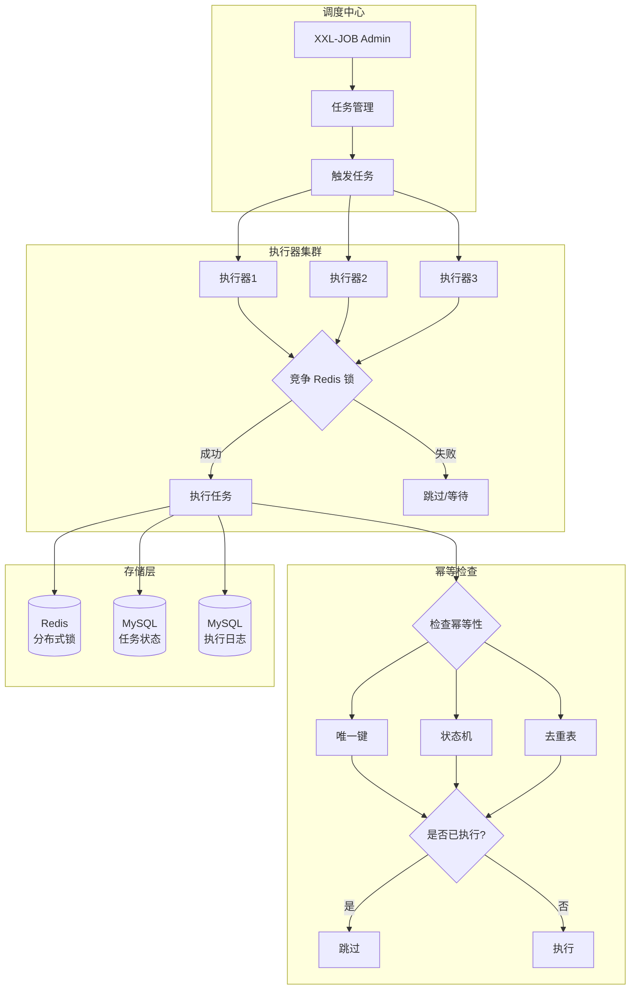

### 5.2 完整代码示例（Go 语言）

```go
// 生产级定时任务执行器
type TaskExecutor struct {
    redis    *redis.Client
    db       *gorm.DB
    nodeID   string
}

func NewTaskExecutor(redis *redis.Client, db *gorm.DB) *TaskExecutor {
    return &TaskExecutor{
        redis:  redis,
        db:     db,
        nodeID: fmt.Sprintf("node-%d", time.Now().UnixNano()),
    }
}

// 执行定时任务（完整流程）
func (e *TaskExecutor) ExecuteTask(taskID uint, taskFunc func() error) error {
    fmt.Printf("[%s] 开始执行任务 %d\n", e.nodeID, taskID)
    
    // 第一步：获取 Redis 锁
    lockKey := fmt.Sprintf("lock:task:%d", taskID)
    lockValue := e.nodeID
    
    ok, _ := e.redis.SetNX(lockKey, lockValue, 30*time.Minute).Result()
    if !ok {
        fmt.Printf("[%s] ❌ 获取 Redis 锁失败，其他节点正在执行\n", e.nodeID)
        return nil
    }
    defer e.redis.Del(lockKey)
    
    fmt.Printf("[%s] ✅ 第一步：Redis 锁获取成功\n", e.nodeID)
    
    // 第二步：幂等检查（状态机）
    var task Task
    err := e.db.First(&task, taskID).Error
    if err != nil {
        return err
    }
    
    if task.Status == 2 {
        fmt.Printf("[%s] ✅ 任务已完成，跳过\n", e.nodeID)
        return nil
    }
    
    if task.Status == 1 {
        fmt.Printf("[%s] ⚠️ 任务执行中，可能被其他节点占用\n", e.nodeID)
        return nil
    }
    
    // 第三步：更新状态为执行中
    result := e.db.Model(&Task{}).
        Where("id = ? AND status = 0", taskID).
        Updates(map[string]interface{}{
            "status":         1,
            "executing_node": e.nodeID,
            "started_at":     time.Now(),
        })
    
    if result.RowsAffected == 0 {
        fmt.Printf("[%s] ❌ 状态已变更，跳过\n", e.nodeID)
        return nil
    }
    
    fmt.Printf("[%s] ✅ 第二步：幂等检查通过\n", e.nodeID)
    
    // 第四步：执行任务（带重试）
    maxRetries := 3
    var lastErr error
    
    for i := 0; i < maxRetries; i++ {
        err = taskFunc()
        if err == nil {
            fmt.Printf("[%s] ✅ 任务执行成功（第 %d 次尝试）\n", e.nodeID, i+1)
            
            // 更新状态为已完成
            e.db.Model(&Task{}).Where("id = ?", taskID).Updates(map[string]interface{}{
                "status":       2,
                "completed_at": time.Now(),
            })
            
            // 记录执行日志
            log := &ExecutionLog{
                TaskID:    taskID,
                NodeID:    e.nodeID,
                Status:    "success",
                ExecutedAt: time.Now(),
            }
            e.db.Create(log)
            
            return nil
        }
        
        lastErr = err
        fmt.Printf("[%s] ❌ 任务执行失败（第 %d 次尝试）：%v\n", e.nodeID, i+1, err)
        
        if i < maxRetries-1 {
            delay := time.Duration(1<<uint(i)) * time.Second
            fmt.Printf("[%s] 等待 %v 后重试...\n", e.nodeID, delay)
            time.Sleep(delay)
        }
    }
    
    // 第五步：执行失败，更新状态
    e.db.Model(&Task{}).Where("id = ?", taskID).Updates(map[string]interface{}{
        "status":       3, // 失败
        "error_message": lastErr.Error(),
        "completed_at": time.Now(),
    })
    
    // 记录失败日志
    log := &ExecutionLog{
        TaskID:    taskID,
        NodeID:    e.nodeID,
        Status:    "failed",
        Error:     lastErr.Error(),
        ExecutedAt: time.Now(),
    }
    e.db.Create(log)
    
    fmt.Printf("[%s] ❌ 任务重试 %d 次后仍然失败\n", e.nodeID, maxRetries)
    
    return lastErr
}

// 使用示例
func main() {
    redisClient := redis.NewClient(&redis.Options{Addr: "localhost:6379"})
    dbClient, _ := gorm.Open(mysql.Open("..."), &gorm.Config{})
    
    executor := NewTaskExecutor(redisClient, dbClient)
    
    // 模拟定时任务触发
    go func() {
        for {
            // 查找待执行的任务
            var tasks []Task
            dbClient.Where("status = 0").Find(&tasks)
            
            for _, task := range tasks {
                go func(t Task) {
                    executor.ExecuteTask(t.ID, func() error {
                        fmt.Printf("执行任务逻辑：%d\n", t.ID)
                        time.Sleep(5 * time.Second)
                        return nil
                    })
                }(task)
            }
            
            time.Sleep(10 * time.Second)
        }
    }()
    
    // 启动故障转移
    executor.StartFailover()
    
    // 保持运行
    select {}
}
```

### 5.3 生产 Checklist

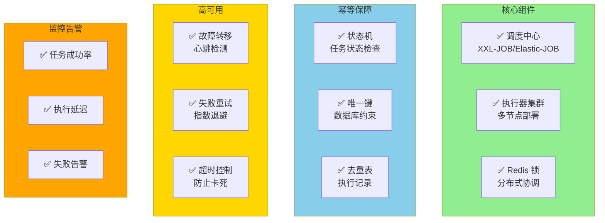

**部署检查清单**：

| 类别 | 检查项 | 状态 | 生活化比喻 |
|------|--------|------|------------|
| **核心组件** | 调度中心（XXL-JOB/Elastic-JOB） | ⬜ | 生产计划部 |
| | 执行器集群（多节点部署） | ⬜ | 多个车间 |
| | Redis 锁（分布式协调） | ⬜ | 车间门禁 |
| **幂等保障** | 状态机（任务状态检查） | ⬜ | 质量检查 |
| | 唯一键（数据库约束） | ⬜ | 产品编号 |
| | 去重表（执行记录） | ⬜ | 生产日志 |
| **高可用** | 故障转移（心跳检测） | ⬜ | 备用车间 |
| | 失败重试（指数退避） | ⬜ | 补考机制 |
| | 超时控制（防止卡死） | ⬜ | 考试时间 |
| **监控告警** | 任务成功率 | ⬜ | 合格率 |
| | 执行延迟 | ⬜ | 生产效率 |
| | 失败告警 | ⬜ | 异常报警 |

---

## 六、技术深入

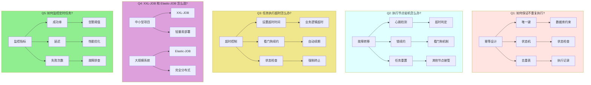

### 技术方案分析

**Q1: 如何保证定时任务不重复执行？**  
**答**：通过幂等设计保证。三种方案：
- **唯一键**：数据库唯一索引，重复插入会报错（就像身份证号唯一）
- **状态机**：任务执行前检查状态，已执行就跳过（就像电梯按钮，按一次和按多次一样）
- **去重表**：记录已执行的任务 ID，重复就跳过（就像签到表，签过就跳过）

**Q2: 执行节点宕机怎么办？**  
**答**：通过故障转移机制解决。三种手段：
- **心跳检测**：定期发送心跳，超时认为宕机（就像保安巡逻，发现有人晕倒就呼叫救援）
- **锁续约**：看门狗机制定期续期，宕机后锁自动过期（就像自动开门，人走了门自动开）
- **任务重置**：其他节点检测到宕机，重置任务状态，重新执行（就像接力赛，有人跑不动了，其他人接棒）

**Q3: 任务执行超时怎么办？**  
**答**：通过超时控制解决。三种手段：
- **设置超时时间**：业务逻辑设置超时，避免无限等待（就像考试，到时间就交卷）
- **看门狗续约**：后台线程定期续期，防止锁过期（就像助手帮你续期座位）
- **状态检查**：定期检查任务状态，卡住的任务强制终止（就像保安检查，发现有人睡着了就叫醒）

**Q4: XXL-JOB 和 Elastic-JOB 怎么选？**  
**答**：根据项目规模选择。
- **中小型项目**：XXL-JOB，轻量级、易部署、可视化界面、功能够用
- **大规模分布式系统**：Elastic-JOB，完全分布式、弹性伸缩、高可用
- **多语言环境**：XXL-JOB，支持 HTTP 调用，语言无关

**Q5: 如何监控定时任务？**  
**答**：监控三个核心指标。
- **成功率**：任务执行成功次数 / 总次数，低于 99% 告警
- **延迟**：任务执行时间，超过阈值告警（如正常 10 分钟，实际 30 分钟）
- **失败次数**：连续失败 N 次告警，需要人工介入

---

## 七、方案总结

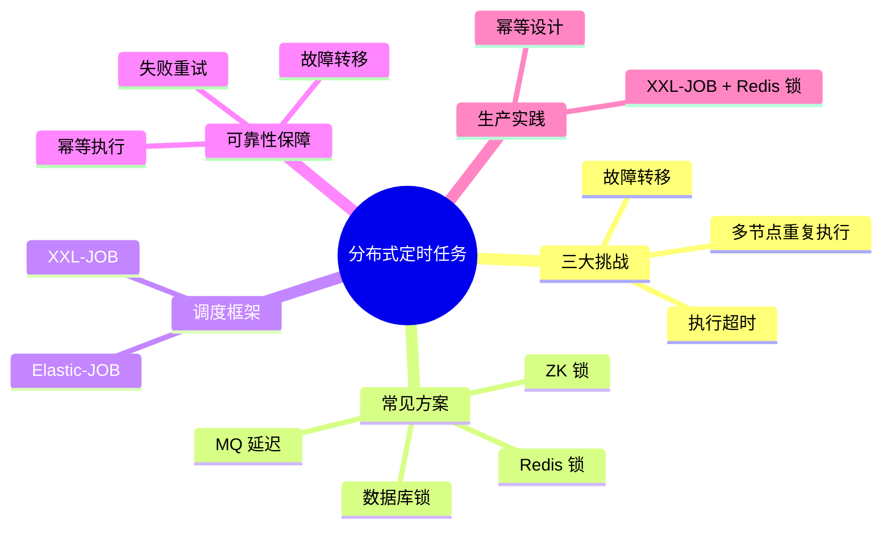

**方案要点**：

> **三大挑战**：多节点重复执行、故障转移、执行超时。
> 
> **常见方案**：数据库锁（简单可靠但慢）、Redis 锁（快但可能丢锁）、ZK 锁（强一致）、MQ 延迟（天然延迟）。
> 
> **调度框架**：中小型用 XXL-JOB（轻量易部署），大规模用 Elastic-JOB（完全分布式）。
> 
> **可靠性保障**：幂等执行（防重复）、故障转移（自动接管）、失败重试（指数退避）。
> 
> **生产实践**：XXL-JOB + Redis 锁 + 幂等设计，保证任务只执行一次、故障自动转移、失败自动重试。

---

## 八、总结（一句话带走）

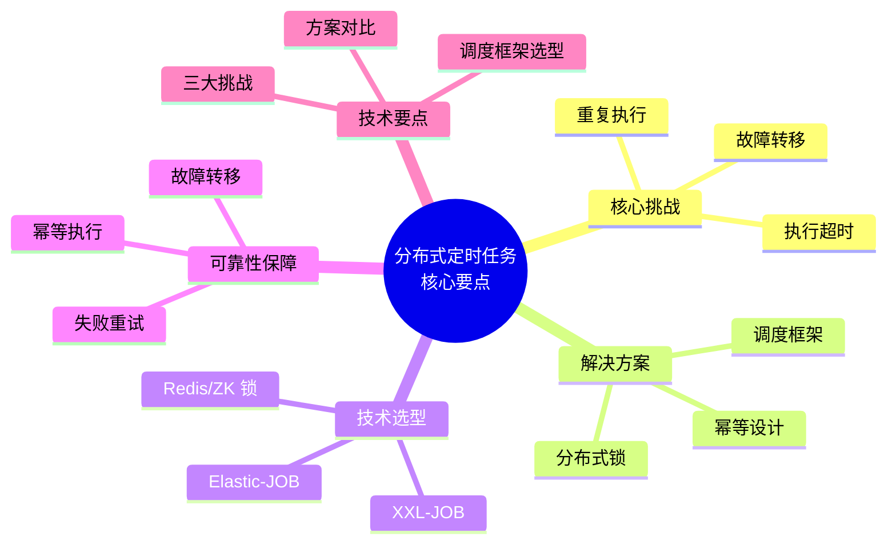

### 🎯 一句话总结

> **分布式定时任务 = 调度框架（XXL-JOB） + 分布式锁（Redis） + 幂等设计（防重复）**

### 🧠 核心要点

1. **三大挑战**：多节点重复执行（需要锁）、故障转移（需要心跳）、执行超时（需要看门狗）。
2. **常见方案**：数据库锁（慢但可靠）、Redis 锁（快但可能丢）、ZK 锁（强一致）、MQ 延迟（天然延迟）。
3. **调度框架**：XXL-JOB（轻量易部署）、Elastic-JOB（完全分布式）。
4. **可靠性保障**：幂等执行（防重复）、故障转移（自动接管）、失败重试（指数退避）。

---
