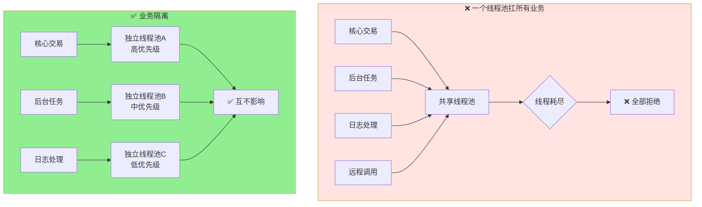
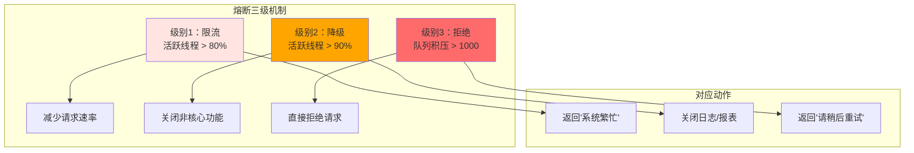
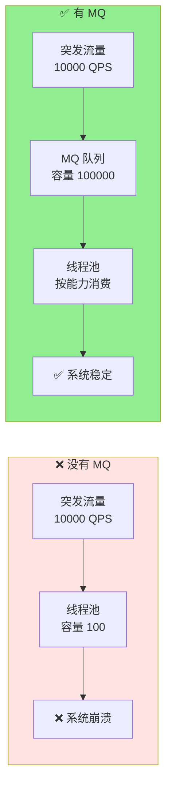
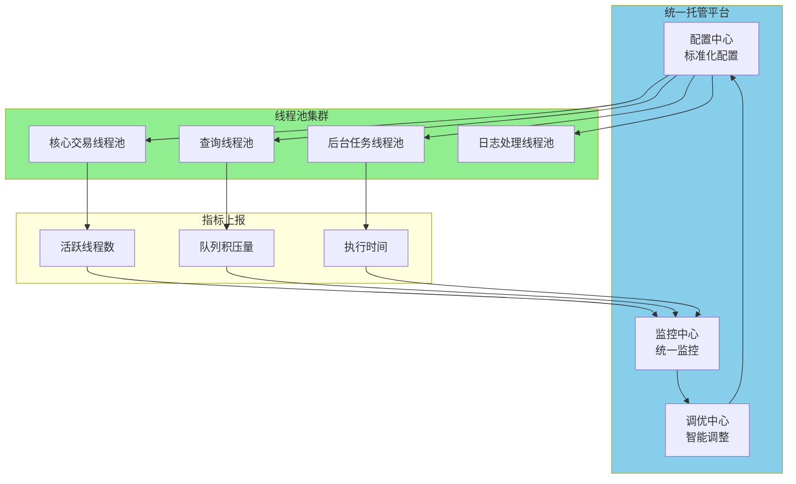
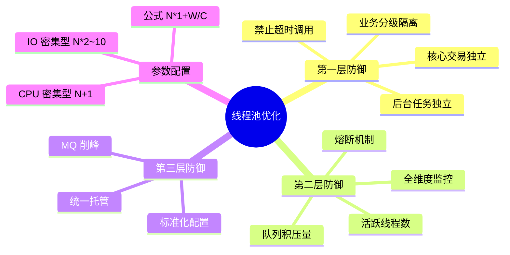
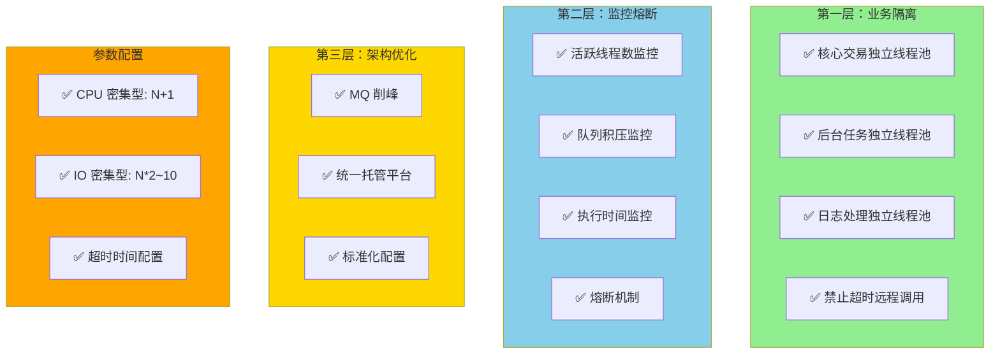
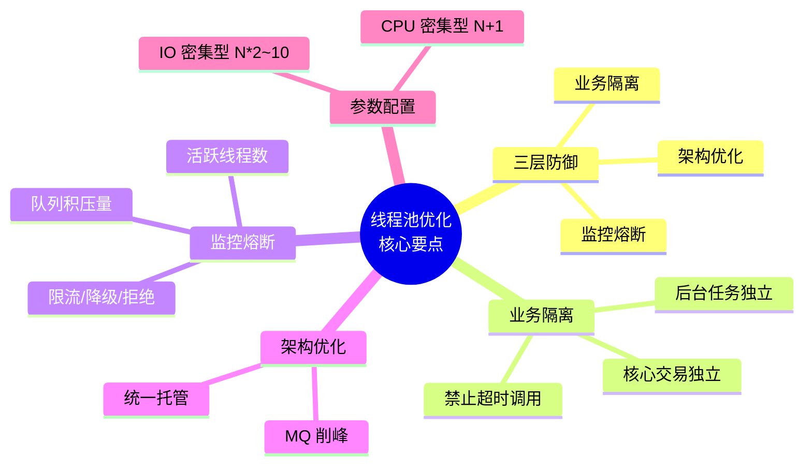

# 线程池配置优化

---

## 🎯 一句话定位

**线程池优化解决什么问题？**
```
一个线程池扛所有业务 → 某个慢任务占满线程 → 整个系统瘫痪
就像一条车道跑所有车：救护车、货车、小轿车全挤在一起，
救护车被堵在路上，病人在车上等死。
```

**生活化比喻**：
想象一家餐厅只有一张桌子：
- VIP 客人来了要等（核心交易被阻塞）
- 外卖小哥来了要等（后台任务被阻塞）
- 有人坐着聊天不走（超时远程调用占着线程）
- 最终所有人都进不来，餐厅倒闭（线程池耗尽，系统崩溃）

**核心思路**：**三层防御**
```
第一层：业务分级隔离（VIP 包间 / 外卖窗口 / 堂食区）
第二层：监控熔断（保安巡逻 / 自动清场 / 强制送客）
第三层：架构优化（增加外卖柜 / 统一管家服务 / 标准化套餐）
```

---

## 💎 核心观点（5 分钟速览版）

> **核心要点速览**

### 核心观点（5 个关键点）

**1. 第一层防御：业务分级隔离**
```
❌ 错误：一个线程池扛所有业务
✅ 正确：核心交易 / 后台任务 / 日志处理 拆分独立线程池

生活化比喻：
  医院急诊室分三区：
  - 急救区（核心交易）：心梗、车祸，优先处理
  - 门诊区（后台任务）：感冒发烧，排队等
  - 后勤区（日志处理）：打扫卫生，不急
  
  如果只有一个区，感冒的人占了急救床位，心梗病人就没床位了
```

**2. 禁止超时远程调用**
```
❌ 错误：线程池里调用外部 API，对方 30 秒不返回，线程被卡死
✅ 正确：设置超时时间（如 500ms），超时直接失败

生活化比喻：
  点外卖超过 2 小时没到？直接取消订单，别让骑手一直等
  远程调用超过 500ms 没返回？直接超时，别让线程一直卡着
```

**3. 第二层防御：全维度监控 + 熔断**
```
监控维度：
  - 活跃线程数 / 队列积压量 / 拒绝次数
  - 任务执行时间分布（P50/P90/P99）
  - 线程池 CPU 使用率

熔断机制：
  - 活跃线程 > 80% → 告警
  - 活跃线程 > 90% → 限流
  - 队列积压 > 1000 → 拒绝新请求
  - 长任务执行 > 30s → 强制中断

生活化比喻：
  餐厅满座率监控：
  - 80% 满 → 门口挂"即将满座"牌子
  - 90% 满 → 停止接新客人
  - 100% 满 → 排队等位
  - 有人吃了 3 小时不走 → 服务员礼貌催促
```

**4. 第三层防御：MQ 削峰 + 统一托管**
```
MQ 削峰：
  请求先进 MQ 队列，线程池按能力消费
  就像水库蓄水，洪水来了先存着，慢慢放
  
统一托管：
  引入统一的线程池管理平台
  标准化配置（核心线程数 / 最大线程数 / 队列大小）
  就像酒店统一管理，标准化服务
```

**5. 线程池参数配置公式**
```
CPU 密集型：核心线程数 = CPU 核数 + 1
IO 密集型：核心线程数 = CPU 核数 * 2（或更多）

公式推导：
  假设 CPU 核数 N，任务等待时间占比 W
  最佳线程数 = N * (1 + W/C)
  C = 计算时间，W = 等待时间
  
  IO 密集型：W >> C，所以线程数 = N * 2~N * 10
  CPU 密集型：W ≈ 0，所以线程数 = N + 1
```

---

## 🚀 一句话精华（如果只能记住一句）

> **线程池优化 = 业务分级隔离（第一层） + 监控熔断（第二层） + MQ 削峰/统一托管（第三层）**

---

## 一、第一层防御：业务分级隔离

### 1.1 问题：一个线程池扛所有业务

**生活化比喻**：
```
一家餐厅只有一张桌子：
  - VIP 客人来了要等（核心交易被阻塞）
  - 外卖小哥来了要等（后台任务被阻塞）
  - 有人坐着聊天不走（超时远程调用占着线程）
  
  结果：所有人都进不来，餐厅倒闭

一个线程池扛所有业务：
  - 核心交易（支付、下单）需要快速响应
  - 后台任务（报表生成、数据同步）可以慢慢来
  - 日志处理（写日志、审计）更不急
  
  结果：慢任务占满线程，快任务被拒绝，系统崩溃
```



### 1.2 解决方案：按业务类型拆分

**拆分原则**：
| 业务类型 | 优先级 | 超时时间 | 线程池大小 | 生活化比喻 |
|----------|--------|----------|------------|------------|
| 核心交易（支付/下单） | 🔴 高 | 500ms | CPU*2 | 急救室 |
| 查询接口 | 🟡 中 | 1s | CPU*4 | 门诊室 |
| 后台任务（报表） | 🟢 低 | 5min | CPU | 后勤区 |
| 日志处理 | ⚪ 最低 | 10s | CPU | 清洁工 |
| 远程调用 | 🔴 高 | 200ms | CPU*2 | 急诊通道 |

**代码示例（Go 语言）**：
```go
// 线程池管理器（业务隔离）
type PoolManager struct {
    coreTradePool  *WorkerPool // 核心交易线程池
    queryPool      *WorkerPool // 查询接口线程池
    backgroundPool *WorkerPool // 后台任务线程池
    logPool        *WorkerPool // 日志处理线程池
}

func NewPoolManager(cpuCores int) *PoolManager {
    return &PoolManager{
        // 核心交易：高优先级，快速响应
        coreTradePool: NewWorkerPool(cpuCores*2, cpuCores*4, 100, "core-trade"),
        
        // 查询接口：中优先级
        queryPool: NewWorkerPool(cpuCores*4, cpuCores*8, 500, "query"),
        
        // 后台任务：低优先级，可以慢慢处理
        backgroundPool: NewWorkerPool(cpuCores, cpuCores*2, 1000, "background"),
        
        // 日志处理：最低优先级
        logPool: NewWorkerPool(cpuCores, cpuCores*2, 2000, "log"),
    }
}

// 提交核心交易任务
func (pm *PoolManager) SubmitCoreTrade(task func()) error {
    return pm.coreTradePool.Submit(task)
}

// 提交查询任务
func (pm *PoolManager) SubmitQuery(task func()) error {
    return pm.queryPool.Submit(task)
}

// 提交后台任务
func (pm *PoolManager) SubmitBackground(task func()) error {
    return pm.backgroundPool.Submit(task)
}

// 提交日志任务
func (pm *PoolManager) SubmitLog(task func()) error {
    return pm.logPool.Submit(task)
}

// WorkerPool 实现
type WorkerPool struct {
    name        string
    coreSize    int
    maxSize     int
    queueSize   int
    taskQueue   chan func()
    activeCount int32
    mu          sync.Mutex
}

func NewWorkerPool(coreSize, maxSize, queueSize int, name string) *WorkerPool {
    wp := &WorkerPool{
        name:      name,
        coreSize:  coreSize,
        maxSize:   maxSize,
        queueSize: queueSize,
        taskQueue: make(chan func(), queueSize),
    }
    
    // 启动核心线程
    for i := 0; i < coreSize; i++ {
        go wp.worker()
    }
    
    return wp
}

func (wp *WorkerPool) worker() {
    for task := range wp.taskQueue {
        atomic.AddInt32(&wp.activeCount, 1)
        task()
        atomic.AddInt32(&wp.activeCount, -1)
    }
}

func (wp *WorkerPool) Submit(task func()) error {
    select {
    case wp.taskQueue <- task:
        return nil
    default:
        return fmt.Errorf("线程池 %s 队列已满", wp.name)
    }
}

// 使用示例
func main() {
    pm := NewPoolManager(runtime.NumCPU())
    
    // 核心交易：快速响应
    pm.SubmitCoreTrade(func() {
        processPayment()
    })
    
    // 后台任务：慢慢处理
    pm.SubmitBackground(func() {
        generateReport()
    })
}
```

### 1.3 禁止超时远程调用

**生活化比喻**：
```
点外卖超过 2 小时没到？直接取消订单！

为什么？
  - 如果骑手卡在路上，你不取消，他可能永远不回来
  - 你的钱被占用了，不能重新点
  - 你饿着肚子等，最后可能连饭都吃不上

线程池里的远程调用也一样：
  - 调用外部 API，对方 30 秒不返回
  - 你的线程被卡住了，不能处理其他任务
  - 线程池被耗尽，整个系统崩溃
```

**错误示范 vs 正确做法**：
```go
// ❌ 错误：不设超时，可能卡死
func processOrder() {
    // 调用支付 API，如果对方挂了，这里会一直等
    result, _ := http.Get("https://payment-api.com/pay")
    // 处理结果...
}

// ✅ 正确：设置超时，超时直接失败
func processOrder() {
    client := &http.Client{
        Timeout: 500 * time.Millisecond, // 500ms 超时
    }
    
    ctx, cancel := context.WithTimeout(context.Background(), 500*time.Millisecond)
    defer cancel()
    
    req, _ := http.NewRequestWithContext(ctx, "GET", "https://payment-api.com/pay", nil)
    result, err := client.Do(req)
    
    if err != nil {
        if ctx.Err() == context.DeadlineExceeded {
            log.Error("支付 API 超时，直接失败")
            return // 超时直接失败，别让线程卡住
        }
        log.Error("支付失败：", err)
        return
    }
    
    // 处理结果...
}
```

**超时配置建议**：
| 调用类型 | 建议超时 | 原因 |
|----------|----------|------|
| 核心支付 API | 200-500ms | 支付必须快速响应 |
| 查询接口 | 500ms-1s | 查询可以稍慢 |
| 内部 RPC | 100-200ms | 内部服务应该很快 |
| 第三方 API | 1-3s | 外部服务不可控 |
| 数据库查询 | 50-100ms | 数据库应该很快 |

---

## 二、第二层防御：全维度监控 + 熔断机制

### 2.1 全维度监控

**生活化比喻**：
```
监控就像餐厅的经理：
  - 看满座率（活跃线程数 / 最大线程数）
  - 看排队人数（队列积压量）
  - 看翻台率（任务完成速度）
  - 看客人等待时间（任务执行时间分布）
  
  80% 满 → 准备加座
  90% 满 → 停止接客
  100% 满 → 排队等位
  有人吃了 3 小时不走 → 礼貌催促
```

**监控指标**：
| 指标 | 含义 | 告警阈值 | 生活化比喻 |
|------|------|----------|------------|
| 活跃线程数 | 正在干活的线程 | > 80% 最大线程数 | 餐厅满座率 |
| 队列积压量 | 排队等待的任务 | > 1000 | 排队人数 |
| 拒绝次数 | 被拒绝的任务数 | > 0 | 被拒之门外的客人 |
| P50 执行时间 | 50% 的任务执行时间 | > 100ms | 一半客人的用餐时间 |
| P99 执行时间 | 99% 的任务执行时间 | > 1s | 最慢客人的用餐时间 |
| CPU 使用率 | 线程池占用 CPU | > 80% | 厨房负荷 |

**代码示例（Go 语言）**：
```go
// 线程池监控
type PoolMonitor struct {
    pool *WorkerPool
}

func NewPoolMonitor(pool *WorkerPool) *PoolMonitor {
    return &PoolMonitor{pool: pool}
}

// 获取监控指标
func (m *PoolMonitor) GetMetrics() PoolMetrics {
    active := atomic.LoadInt32(&m.pool.activeCount)
    queueLen := len(m.pool.taskQueue)
    
    return PoolMetrics{
        PoolName:     m.pool.name,
        ActiveCount:  int(active),
        MaxSize:      m.pool.maxSize,
        QueueSize:    queueLen,
        QueueCap:     m.pool.queueSize,
        ActiveRatio:  float64(active) / float64(m.pool.maxSize) * 100,
        QueueRatio:   float64(queueLen) / float64(m.pool.queueSize) * 100,
    }
}

type PoolMetrics struct {
    PoolName    string
    ActiveCount int
    MaxSize     int
    QueueSize   int
    QueueCap    int
    ActiveRatio float64 // 活跃线程占比
    QueueRatio  float64 // 队列积压占比
}

// 定期检查
func StartMonitor(pm *PoolManager) {
    ticker := time.NewTicker(10 * time.Second)
    defer ticker.Stop()
    
    for range ticker.C {
        metrics := []PoolMetrics{
            NewPoolMonitor(pm.coreTradePool).GetMetrics(),
            NewPoolMonitor(pm.queryPool).GetMetrics(),
            NewPoolMonitor(pm.backgroundPool).GetMetrics(),
            NewPoolMonitor(pm.logPool).GetMetrics(),
        }
        
        for _, m := range metrics {
            fmt.Printf("[%s] 活跃：%d/%d (%.1f%%) | 队列：%d/%d (%.1f%%)\n",
                m.PoolName, m.ActiveCount, m.MaxSize, m.ActiveRatio,
                m.QueueSize, m.QueueCap, m.QueueRatio)
            
            // 告警
            if m.ActiveRatio > 80 {
                log.Warnf("⚠️ [%s] 活跃线程超过 80%%！", m.PoolName)
            }
            if m.QueueRatio > 50 {
                log.Warnf("⚠️ [%s] 队列积压超过 50%%！", m.PoolName)
            }
        }
    }
}
```

### 2.2 熔断机制

**生活化比喻**：
```
熔断 = 自动保护机制

电路过载 → 保险丝熔断 → 保护电器
线程池过载 → 触发熔断 → 保护系统

级别1：限流（减少请求）
  像餐厅限流：门口挂"当前客流较大，请稍后再来"

级别2：降级（关闭非核心功能）
  像餐厅降级：停止供应甜品，优先保证主食

级别3：拒绝（直接拒绝请求）
  像餐厅拒绝：门口挂"已满座，请改天再来"
```



**代码示例（Go 语言）**：
```go
// 熔断器
type CircuitBreaker struct {
    pool         *WorkerPool
    rejectCount  int64
    degradeMode  bool
}

func NewCircuitBreaker(pool *WorkerPool) *CircuitBreaker {
    return &CircuitBreaker{pool: pool}
}

// 提交任务（带熔断）
func (cb *CircuitBreaker) Submit(task func()) error {
    metrics := NewPoolMonitor(cb.pool).GetMetrics()
    
    // 级别3：拒绝
    if metrics.QueueSize > 1000 {
        atomic.AddInt64(&cb.rejectCount, 1)
        return fmt.Errorf("❌ 队列已满，拒绝请求")
    }
    
    // 级别2：降级
    if metrics.ActiveRatio > 90 {
        cb.degradeMode = true
        log.Warn("⚠️ 进入降级模式，关闭非核心功能")
    }
    
    // 级别1：限流
    if metrics.ActiveRatio > 80 {
        log.Warn("⚠️ 线程池繁忙，限制请求速率")
        time.Sleep(10 * time.Millisecond) // 人为延迟
    }
    
    return cb.pool.Submit(task)
}

// 长任务强制中断
type LongTaskKiller struct {
    timeout time.Duration
}

func NewLongTaskKiller(timeout time.Duration) *LongTaskKiller {
    return &LongTaskKiller{timeout: timeout}
}

// 包装任务，超时强制中断
func (k *LongTaskKiller) Wrap(task func()) func() {
    return func() {
        done := make(chan struct{})
        
        go func() {
            task()
            close(done)
        }()
        
        select {
        case <-done:
            // 正常完成
        case <-time.After(k.timeout):
            log.Errorf("❌ 任务执行超过 %v，强制中断", k.timeout)
            // 强制中断（实际生产中可以记录日志、告警）
        }
    }
}
```

### 2.3 任务执行时间监控

**生活化比喻**：
```
监控任务执行时间分布：
  - P50：50% 的任务在 X 时间内完成
  - P90：90% 的任务在 X 时间内完成
  - P99：99% 的任务在 X 时间内完成

就像餐厅统计用餐时间：
  - P50 = 30 分钟（一半客人 30 分钟内吃完）
  - P90 = 60 分钟（90% 客人 60 分钟内吃完）
  - P99 = 120 分钟（最慢的客人 120 分钟）

如果 P99 > 30 分钟，说明有人吃了太久，需要"礼貌催促"
```

**代码示例（Go 语言）**：
```go
// 任务执行时间监控
type TaskTimer struct {
    name string
}

func NewTaskTimer(name string) *TaskTimer {
    return &TaskTimer{name: name}
}

func (t *TaskTimer) TimeIt(task func()) {
    start := time.Now()
    task()
    duration := time.Since(start)
    
    // 记录到 Prometheus/指标系统
    fmt.Printf("[%s] 执行时间：%v\n", t.name, duration)
    
    if duration > 30*time.Second {
        log.Errorf("❌ [%s] 执行时间过长：%v", t.name, duration)
    }
}

// 包装任务
func WrapWithTimer(name string, task func()) func() {
    return func() {
        timer := NewTaskTimer(name)
        timer.TimeIt(task)
    }
}
```

---

## 三、第三层防御：架构优化

### 3.1 引入 MQ 削峰

**生活化比喻**：
```
MQ 削峰 = 水库蓄水

洪水来了（突发流量）→ 先存到水库（MQ 队列）→ 慢慢放（按能力消费）

如果没有水库：
  洪水直接冲下来 → 下游城市被淹（系统崩溃）

如果没有 MQ：
  突发流量直接打到线程池 → 线程池被压垮（系统崩溃）
```



**代码示例（Go 语言）**：
```go
// MQ 削峰实现
type MQConsumer struct {
    queue    chan Task
    pool     *WorkerPool
}

func NewMQConsumer(queueSize int, pool *WorkerPool) *MQConsumer {
    return &MQConsumer{
        queue: make(chan Task, queueSize),
        pool:  pool,
    }
}

// 生产者：请求进入 MQ
func (c *MQConsumer) Produce(task Task) {
    select {
    case c.queue <- task:
        // 入队成功
    default:
        log.Error("MQ 队列已满，拒绝请求")
    }
}

// 消费者：按能力消费
func (c *MQConsumer) Consume() {
    for task := range c.queue {
        c.pool.Submit(func() {
            task.Execute()
        })
    }
}

// 启动多个消费者
func (c *MQConsumer) Start(workers int) {
    for i := 0; i < workers; i++ {
        go c.Consume()
    }
}

type Task struct {
    ID       uint
    Data     string
    Execute  func()
}
```

### 3.2 统一托管平台

**生活化比喻**：
```
统一托管 = 酒店管理模式

每个线程池自己管理 = 每个餐厅自己管自己的
  - 配置不统一（有的线程池 10 个线程，有的 100 个）
  - 监控不统一（有的有监控，有的没有）
  - 出问题难排查

统一托管平台 = 酒店管理公司统一管理
  - 标准化配置（核心线程数 / 最大线程数 / 队列大小）
  - 统一监控（所有线程池一个界面看）
  - 智能调优（根据负载自动调整）
```

**统一托管架构**：


**配置标准化模板**：
```yaml
# 线程池配置模板
pools:
  core-trade:
    core_size: 16          # CPU 核数 * 2
    max_size: 32           # CPU 核数 * 4
    queue_size: 100        # 队列大小
    keep_alive: 60s        # 线程空闲超时
    timeout: 500ms         # 任务超时
    priority: high         # 优先级
    
  query:
    core_size: 32          # CPU 核数 * 4
    max_size: 64           # CPU 核数 * 8
    queue_size: 500
    keep_alive: 60s
    timeout: 1s
    priority: medium
    
  background:
    core_size: 8           # CPU 核数
    max_size: 16           # CPU 核数 * 2
    queue_size: 1000
    keep_alive: 120s
    timeout: 5m
    priority: low
    
  log:
    core_size: 8
    max_size: 16
    queue_size: 2000
    keep_alive: 120s
    timeout: 10s
    priority: lowest
```

### 3.3 线程池参数配置公式

**生活化比喻**：
```
配置线程池就像配置餐厅服务员：

CPU 密集型（做菜）：
  一个厨师对应一个灶台
  核心线程数 = CPU 核数（灶台数）
  多一个厨师也没灶台用

IO 密集型（等外卖）：
  一个服务员可以同时等多个外卖
  核心线程数 = CPU 核数 * 2~10
  因为大部分时间在等，不在用 CPU
```

**公式推导**：
```
最佳线程数 = N * (1 + W/C)

其中：
  N = CPU 核数
  W = 等待时间（IO 等待、网络等待）
  C = 计算时间（CPU 计算）

场景1：CPU 密集型
  W ≈ 0（几乎不等待）
  最佳线程数 ≈ N * (1 + 0) = N
  实际配置：N + 1（多一个备用）

场景2：IO 密集型
  W >> C（大部分时间在等）
  比如 W = 9C
  最佳线程数 = N * (1 + 9) = 10N
  实际配置：N * 2 ~ N * 10
```

**配置建议表**：
| 任务类型 | 公式 | 8 核 CPU 示例 | 生活化比喻 |
|----------|------|---------------|------------|
| CPU 密集型 | N + 1 | 9 | 一个厨师一个灶台 |
| IO 密集型（轻） | N * 2 | 16 | 一个服务员等 2 个外卖 |
| IO 密集型（中） | N * 4 | 32 | 一个服务员等 4 个外卖 |
| IO 密集型（重） | N * 8 | 64 | 一个服务员等 8 个外卖 |

**代码示例（Go 语言）**：
```go
// 线程池参数自动计算
type PoolConfig struct {
    CoreSize  int
    MaxSize   int
    QueueSize int
}

// 根据任务类型自动计算
func AutoConfig(taskType string, cpuCores int) PoolConfig {
    switch taskType {
    case "cpu-bound":
        // CPU 密集型
        return PoolConfig{
            CoreSize:  cpuCores + 1,
            MaxSize:   cpuCores + 1,
            QueueSize: 100,
        }
    
    case "io-bound-light":
        // IO 密集型（轻）
        return PoolConfig{
            CoreSize:  cpuCores * 2,
            MaxSize:   cpuCores * 4,
            QueueSize: 500,
        }
    
    case "io-bound-medium":
        // IO 密集型（中）
        return PoolConfig{
            CoreSize:  cpuCores * 4,
            MaxSize:   cpuCores * 8,
            QueueSize: 1000,
        }
    
    case "io-bound-heavy":
        // IO 密集型（重）
        return PoolConfig{
            CoreSize:  cpuCores * 8,
            MaxSize:   cpuCores * 16,
            QueueSize: 2000,
        }
    
    default:
        return PoolConfig{
            CoreSize:  cpuCores * 2,
            MaxSize:   cpuCores * 4,
            QueueSize: 500,
        }
    }
}

// 使用示例
func main() {
    cpuCores := runtime.NumCPU()
    
    // 核心交易（IO 密集型）
    config := AutoConfig("io-bound-medium", cpuCores)
    pool := NewWorkerPool(config.CoreSize, config.MaxSize, config.QueueSize, "core-trade")
    
    fmt.Printf("核心交易线程池：核心 %d，最大 %d，队列 %d\n",
        config.CoreSize, config.MaxSize, config.QueueSize)
}
```

---

## 四、技术深入

```mermaid
graph TB
    subgraph Q1["Q1: 为什么不共享线程池?"]
        A1[业务隔离] --> A2[核心交易不被阻塞]
        A3[优先级] --> A4[不同业务不同优先级]
        A5[资源控制] --> A6[限制每个业务的资源使用]
    end
    
    subgraph Q2["Q2: 如何确定线程数?"]
        B1[CPU 密集型] --> B2[N + 1]
        B3[IO 密集型] --> B4[N * 2~10]
        B5[公式] --> B6[N * (1 + W/C)]
    end
    
    subgraph Q3["Q3: 队列满了怎么办?"]
        C1[拒绝策略] --> C2[CallerRunsPolicy]
        C1 --> C3[AbortPolicy]
        C1 --> C4[自定义策略]
    end
    
    subgraph Q4["Q4: 如何监控线程池?"]
        D1[活跃线程数] --> D2[80% 告警]
        D3[队列积压] --> D4[50% 告警]
        D5[执行时间] --> D6[P99 > 1s 告警]
    end
    
    subgraph Q5["Q5: 为什么用 MQ 削峰?"]
        E1[突发流量] --> E2[MQ 缓冲]
        E3[按能力消费] --> E4[保护下游]
        E5[解耦] --> E6[生产者消费者解耦]
    end
    
    style Q1 fill:#FFE4E1
    style Q2 fill:#E0FFFF
    style Q3 fill:#F0E68C
    style Q4 fill:#DDA0DD
    style Q5 fill:#90EE90
```

### 技术方案分析

**Q1: 为什么不共享一个线程池？**  
**答**：
- **业务隔离**：核心交易不能被后台任务阻塞（就像急救室不能被感冒病人占满）
- **优先级**：不同业务有不同优先级，核心交易优先（就像医院先救心梗病人）
- **资源控制**：限制每个业务的资源使用，防止一个业务占满所有资源

**Q2: 如何确定线程数？**  
**答**：根据任务类型选择公式。
- **CPU 密集型**：N + 1（N 是 CPU 核数），就像一个厨师一个灶台
- **IO 密集型**：N * 2~10，因为大部分时间在等 IO，可以多分配线程
- **公式**：N * (1 + W/C)，W 是等待时间，C 是计算时间

**Q3: 队列满了怎么办？**  
**答**：四种拒绝策略。
- **AbortPolicy**（默认）：直接抛异常，告诉调用者"满了"
- **CallerRunsPolicy**：让调用者自己执行（降级处理）
- **DiscardPolicy**：默默丢弃，不告诉调用者
- **DiscardOldestPolicy**：丢弃最老的任务，执行新的

**Q4: 如何监控线程池？**  
**答**：监控三个核心指标。
- **活跃线程数**：超过 80% 告警，超过 90% 限流
- **队列积压量**：超过 50% 告警，超过 80% 拒绝
- **执行时间分布**：P99 > 1s 告警，说明有慢任务

**Q5: 为什么用 MQ 削峰？**  
**答**：
- **突发流量**：10000 QPS 直接打到线程池（容量 100），系统崩溃
- **MQ 缓冲**：请求先进 MQ，线程池按能力消费，保护下游
- **解耦**：生产者和消费者解耦，各干各的，互不影响

---

## 五、方案总结



**方案要点**：

> **第一层防御**：业务分级隔离，核心交易/后台任务/日志处理拆分独立线程池，禁止超时远程调用。
> 
> **第二层防御**：全维度监控（活跃线程数、队列积压、执行时间）+ 熔断机制（限流、降级、拒绝）。
> 
> **第三层防御**：引入 MQ 削峰（突发流量先存着）+ 统一托管平台（标准化配置、智能调优）。
> 
> **参数配置**：CPU 密集型 N+1，IO 密集型 N*2~10，公式 N*(1+W/C)。

---

## 六、生产环境 Checklist（部署检查清单）



**部署检查清单**：

| 类别 | 检查项 | 状态 | 生活化比喻 |
|------|--------|------|------------|
| **第一层：业务隔离** | 核心交易独立线程池 | ⬜ | 急救室 |
| | 后台任务独立线程池 | ⬜ | 后勤区 |
| | 日志处理独立线程池 | ⬜ | 清洁工 |
| | 禁止超时远程调用 | ⬜ | 2 小时外卖取消 |
| **第二层：监控熔断** | 活跃线程数监控（80% 告警） | ⬜ | 满座率 |
| | 队列积压监控（50% 告警） | ⬜ | 排队人数 |
| | 执行时间监控（P99 > 1s 告警） | ⬜ | 用餐时间 |
| | 熔断机制（限流/降级/拒绝） | ⬜ | 保险丝 |
| **第三层：架构优化** | MQ 削峰 | ⬜ | 水库蓄水 |
| | 统一托管平台 | ⬜ | 酒店管理 |
| | 标准化配置 | ⬜ | 标准化套餐 |
| **参数配置** | CPU 密集型：N+1 | ⬜ | 一个厨师一个灶台 |
| | IO 密集型：N*2~10 | ⬜ | 一个服务员多个外卖 |
| | 超时时间配置 | ⬜ | 2 小时取消 |

---

## 七、总结（一句话带走）



### 🎯 一句话总结

> **线程池优化 = 业务分级隔离（第一层） + 监控熔断（第二层） + MQ 削峰/统一托管（第三层）**

### 🧠 核心要点

1. **为什么要隔离？** 一个线程池扛所有业务，慢任务会卡死快任务（就像医院只有一个区，感冒病人占了急救床位）。
2. **三层防御是什么？** 业务隔离（分而治之）、监控熔断（自动保护）、架构优化（MQ 削峰/统一托管）。
3. **如何确定线程数？** CPU 密集型 N+1，IO 密集型 N*2~10，公式 N*(1+W/C)。
4. **为什么用 MQ 削峰？** 突发流量直接打到线程池会崩溃，MQ 先存着，按能力消费。

---
