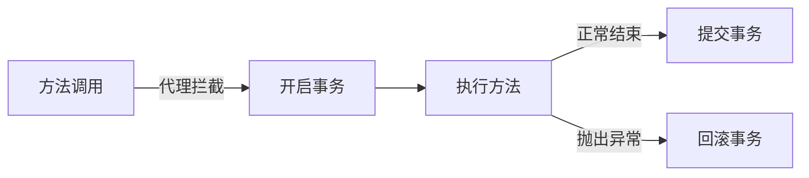
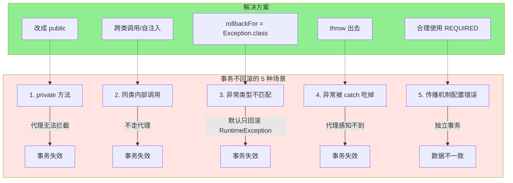
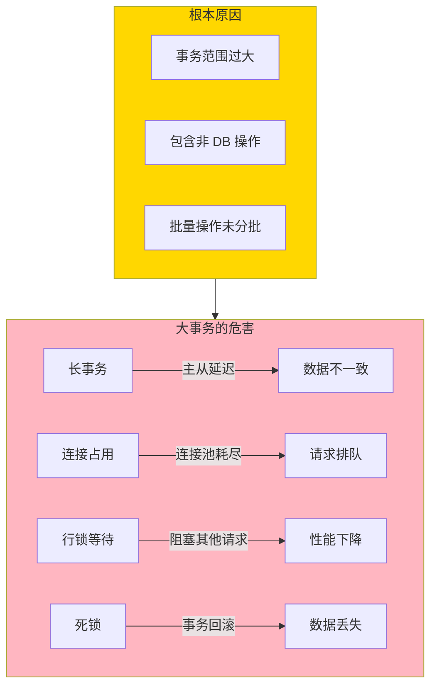
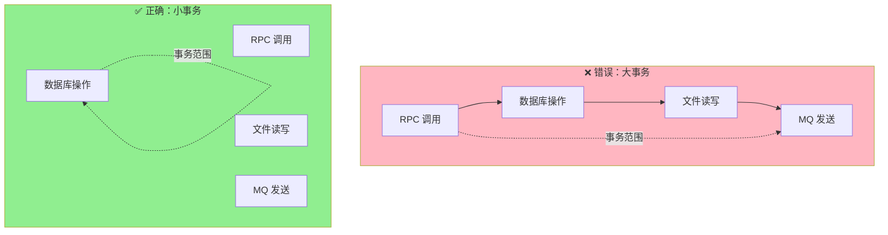
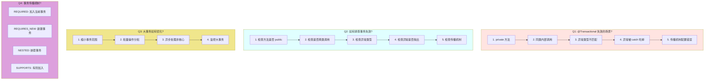
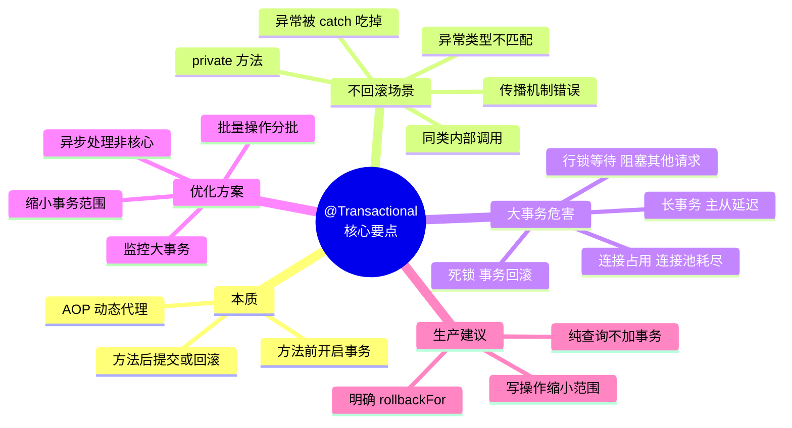
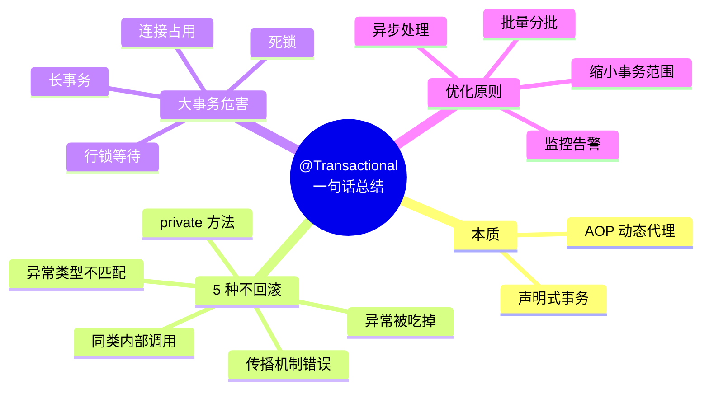

# @Transactional 事务注解深度解析

> **核心主题**：Spring 声明式事务的 AOP 动态代理机制、事务失效场景与生产环境最佳实践

---

## 🎯 一句话定位

**@Transactional 是什么？**
```
Spring 的声明式事务管理注解，让方法里的多个数据库操作要么全部成功，要么全部失败回滚。
```

**生活化比喻**：
就像银行转账——你转出 1000 元，对方账户必须收到 1000 元。如果中途系统崩溃，你的 1000 元必须退回来，不能"钱没了对方也没收到"。@Transactional 就是保证这个"要么全做，要么全不做"的机制。

**核心特点**：通过 AOP 动态代理实现，方法执行前开启事务，执行后根据异常类型决定是否回滚。

---

## 💎 核心要点速览

> **快速掌握核心设计要点**

### 核心观点（5 个关键点）

**1. @Transactional 本质：AOP 动态代理**
```
❌ 不是直接在方法里写 begin transaction / commit / rollback
✅ Spring 在编译后给方法套一层代理：
   - 方法执行前：开启事务
   - 方法正常结束：提交事务
   - 方法抛出异常：回滚事务
   
生活化比喻：
就像快递发货流程：
1. 打包前：拍照记录（开启事务）
2. 打包完成：发货（提交事务）
3. 打包出错：恢复原样（回滚事务）
```

**2. 事务不回滚场景 1：private 方法**
```
❌ @Transactional 加在 private 方法上 → 事务失效
原因：Spring AOP 默认使用 JDK 动态代理（基于接口）或 CGLIB（基于类），
      代理无法拦截 private 方法（就像隔音房间，外面听不到里面说话）

解决方案：改成 public 方法
```

**3. 事务不回滚场景 2：同类内部调用**
```
❌ 同一个类中，方法 A 调用方法 B（B 有 @Transactional）→ 事务失效
原因：内部调用不走代理，直接调用原始方法（就像自己给自己打电话，不经交换机）

解决方案：
1. 把方法 B 移到另一个 Service 类
2. 注入自己（@Lazy 自注入）
3. 用 AopContext.currentProxy() 获取代理对象
```

**4. 事务不回滚场景 3：异常类型不匹配**
```
❌ @Transactional 默认只回滚 RuntimeException 和 Error
✅ 如果抛出 checked exception（如 Exception），不会回滚！

解决方案：
@Transactional(rollbackFor = Exception.class)  // 明确指定回滚异常
```

**5. 事务不回滚场景 4：异常被 try-catch 吃掉**
```
❌ 方法内部 try-catch 捕获异常，没抛出去 → 事务不回滚
原因：Spring 代理感知不到异常，以为方法正常执行（就像考试作弊被抓但藏好了，老师没看见）

解决方案：
try {
    // 业务代码
} catch (Exception e) {
    log.error("错误", e);
    throw e;  // 必须抛出去，让代理感知
}
```

---

## 🚀 一句话精华（如果只能记住一句）

> **@Transactional 通过 AOP 代理实现事务，不回滚的 5 种场景：private 方法、同类内部调用、异常类型不匹配、异常被 catch 吃掉、传播机制配置错误。生产环境慎用大事务，避免长事务、连接占用、行锁等待、死锁。**

---

## 一、@Transactional 本质：AOP 动态代理

### ✅ 核心思路

```
生活化比喻：
想象一个快递发货流程：
1. 打包前：拍照记录当前状态（开启事务）
2. 打包过程：执行多个操作（扣库存、生成订单、写物流单）
3. 打包完成：全部成功，发货（提交事务）
4. 打包出错：恢复原样，所有操作作废（回滚事务）

技术流程：
方法调用 → 代理拦截 → 开启事务 → 执行方法 → 提交/回滚
```



### 1.1 Spring AOP 代理机制

**生活化比喻**：
```
AOP 代理就像给方法套了一层"监控摄像头"：
- 方法执行前：录像（开启事务）
- 方法执行中：监控（执行业务）
- 方法执行后：保存录像（提交）或销毁录像（回滚）

Spring 有两种代理方式：
1. JDK 动态代理：基于接口（类实现了接口）
2. CGLIB 代理：基于继承（类没实现接口）
```

| 代理方式 | 适用场景 | 原理 | 生活化比喻 |
|---------|---------|------|-----------|
| **JDK 动态代理** | 类实现了接口 | 基于接口，生成接口的实现类 | 像替身演员，演主角的戏 |
| **CGLIB 代理** | 类没实现接口 | 基于继承，生成目标类的子类 | 像儿子继承父亲，但能改行为 |

**代码示例**（Go 语言版，模拟 AOP 代理）：
```go
// 模拟 Spring AOP 代理机制
type TransactionManager struct {
    db *sql.DB
}

func (tm *TransactionManager) Begin() (*sql.Tx, error) {
    return tm.db.Begin()
}

func (tm *TransactionManager) Commit(tx *sql.Tx) error {
    return tx.Commit()
}

func (tm *TransactionManager) Rollback(tx *sql.Tx) error {
    return tx.Rollback()
}

// 模拟代理拦截
func WithTransaction(tm *TransactionManager, fn func(tx *sql.Tx) error) error {
    // 方法执行前：开启事务
    tx, err := tm.Begin()
    if err != nil {
        return err
    }
    
    // 执行方法
    err = fn(tx)
    
    // 方法执行后：根据异常决定是否回滚
    if err != nil {
        // 抛出异常：回滚事务
        tm.Rollback(tx)
        return err
    }
    
    // 正常结束：提交事务
    return tm.Commit(tx)
}

// 使用示例
func TransferMoney(tm *TransactionManager, fromID, toID int, amount float64) error {
    return WithTransaction(tm, func(tx *sql.Tx) error {
        // 扣款
        _, err := tx.Exec("UPDATE accounts SET balance = balance - ? WHERE id = ?", amount, fromID)
        if err != nil {
            return err
        }
        
        // 入账
        _, err = tx.Exec("UPDATE accounts SET balance = balance + ? WHERE id = ?", amount, toID)
        if err != nil {
            return err
        }
        
        return nil
    })
}
```

---

## 二、事务不回滚的 5 种场景

### 场景 1：private 方法

**❌ 错误示例**：
```java
@Service
public class OrderService {
    
    @Transactional
    private void createOrder(Order order) {  // ❌ private 方法，事务失效
        orderMapper.insert(order);
        orderItemMapper.insert(order.getItems());
    }
}
```

**生活化比喻**：
```
private 方法就像隔音房间：
- Spring AOP 代理在外面（房间外）
- private 方法在里面（房间内）
- 代理听不到里面的声音（无法拦截）
- 事务注解失效（就像在隔音房间里喊"开始"，外面听不到）
```

**✅ 正确做法**：
```java
@Service
public class OrderService {
    
    @Transactional
    public void createOrder(Order order) {  // ✅ 改成 public
        orderMapper.insert(order);
        orderItemMapper.insert(order.getItems());
    }
}
```

---

### 场景 2：同类内部调用

**❌ 错误示例**：
```java
@Service
public class OrderService {
    
    public void placeOrder(Order order) {
        // 内部调用 createOrder，事务失效
        this.createOrder(order);  // ❌ 不走代理
    }
    
    @Transactional
    public void createOrder(Order order) {
        orderMapper.insert(order);
        orderItemMapper.insert(order.getItems());
    }
}
```

**生活化比喻**：
```
同类内部调用就像自己给自己打电话：
- 你（方法 A）打电话给自己（方法 B）
- 不经过交换机（代理）
- 直接通话（直接调用原始方法）
- 事务注解失效（交换机没记录这次通话）
```

```mermaid
graph TB
    subgraph Wrong["❌ 错误方式：同类内部调用"]
        A1[placeOrder] -->|直接调用| A2[createOrder<br/>@Transactional]
        A2 -.->|不走代理| A3[事务失效]
    end
    
    subgraph Right["✅ 正确方式：跨类调用"]
        B1[OrderController] -->|调用代理| B2[OrderService<br/>createOrder]
        B2 -->|代理拦截| B3[开启事务]
        B3 --> B4[执行方法]
        B4 --> B5[提交事务]
    end
```

**✅ 正确做法**：

**方案 1：移到另一个 Service**
```java
@Service
public class OrderService {
    @Autowired
    private OrderItemService orderItemService;
    
    public void placeOrder(Order order) {
        orderItemService.createOrder(order);  // ✅ 跨类调用，走代理
    }
}

@Service
public class OrderItemService {
    @Transactional
    public void createOrder(Order order) {
        orderMapper.insert(order);
        orderItemMapper.insert(order.getItems());
    }
}
```

**方案 2：自注入（@Lazy）**
```java
@Service
public class OrderService {
    @Autowired
    @Lazy
    private OrderService self;  // ✅ 注入自己
    
    public void placeOrder(Order order) {
        self.createOrder(order);  // ✅ 通过代理调用
    }
    
    @Transactional
    public void createOrder(Order order) {
        orderMapper.insert(order);
        orderItemMapper.insert(order.getItems());
    }
}
```

**方案 3：AopContext.currentProxy()**
```java
@Service
public class OrderService {
    public void placeOrder(Order order) {
        OrderService proxy = (OrderService) AopContext.currentProxy();
        proxy.createOrder(order);  // ✅ 通过代理调用
    }
    
    @Transactional
    public void createOrder(Order order) {
        orderMapper.insert(order);
        orderItemMapper.insert(order.getItems());
    }
}
```

---

### 场景 3：异常类型不匹配

**❌ 错误示例**：
```java
@Service
public class OrderService {
    
    @Transactional
    public void createOrder(Order order) throws Exception {
        orderMapper.insert(order);
        
        // 抛出 checked exception
        throw new Exception("创建订单失败");  // ❌ 不会回滚
    }
}
```

**生活化比喻**：
```
异常类型不匹配就像火灾报警器只检测烟雾：
- 默认只检测 RuntimeException（烟雾）
- 如果发生火灾但没有烟雾（checked exception）
- 报警器不响（事务不回滚）
- 损失惨重（数据不一致）
```

| 异常类型 | 是否回滚 | 说明 |
|---------|---------|------|
| **RuntimeException** | ✅ 回滚 | 运行时异常（空指针、数组越界） |
| **Error** | ✅ 回滚 | 严重错误（内存溢出） |
| **Exception（checked）** | ❌ 不回滚 | 编译时异常（IOException、SQLException） |

**✅ 正确做法**：
```java
@Service
public class OrderService {
    
    @Transactional(rollbackFor = Exception.class)  // ✅ 明确指定
    public void createOrder(Order order) throws Exception {
        orderMapper.insert(order);
        throw new Exception("创建订单失败");  // ✅ 会回滚
    }
}
```

---

### 场景 4：异常被 try-catch 吃掉

**❌ 错误示例**：
```java
@Service
public class OrderService {
    
    @Transactional
    public void createOrder(Order order) {
        try {
            orderMapper.insert(order);
            orderItemMapper.insert(order.getItems());
        } catch (Exception e) {
            log.error("创建订单失败", e);
            // ❌ 异常被吃掉，事务不回滚
        }
    }
}
```

**生活化比喻**：
```
异常被 catch 吃掉就像考试作弊被抓但藏好了：
- 你作弊（抛出异常）
- 老师走过来（代理拦截）
- 你把小抄藏好了（catch 吃掉异常）
- 老师没发现（代理感知不到异常）
- 以为你正常考试（事务提交）
- 成绩无效（数据不一致）
```

**✅ 正确做法**：
```java
@Service
public class OrderService {
    
    @Transactional
    public void createOrder(Order order) {
        try {
            orderMapper.insert(order);
            orderItemMapper.insert(order.getItems());
        } catch (Exception e) {
            log.error("创建订单失败", e);
            throw e;  // ✅ 必须抛出去，让代理感知
        }
    }
}
```

---

### 场景 5：传播机制配置错误

**❌ 错误示例**：
```java
@Service
public class OrderService {
    
    @Transactional(propagation = Propagation.REQUIRES_NEW)
    public void createOrder(Order order) {
        // 每次调用都开启新事务
        orderMapper.insert(order);
        paymentService.createPayment(order);  // 也是 REQUIRES_NEW
    }
}

@Service
public class PaymentService {
    
    @Transactional(propagation = Propagation.REQUIRES_NEW)
    public void createPayment(Order order) {
        paymentMapper.insert(order.getPayment());
    }
}
```

**生活化比喻**：
```
传播机制配置错误就像公司审批流程：
- REQUIRED：加入领导的审批流程（共用事务）
- REQUIRES_NEW：每次都自己开一个新的审批流程（独立事务）
- 结果：订单创建成功，但支付失败，订单和支付不在同一个事务
- 数据不一致（订单有了，但支付记录没有）
```

| 传播机制 | 行为 | 适用场景 | 生活化比喻 |
|---------|------|---------|-----------|
| **REQUIRED** | 加入当前事务，没有则新建 | 默认，大多数场景 | 加入领导的审批流程 |
| **REQUIRES_NEW** | 总是新建事务，挂起当前事务 | 独立操作（如日志记录） | 自己开新的审批流程 |
| **NESTED** | 嵌套事务，回滚时只回滚子事务 | 部分回滚场景 | 子公司独立核算 |
| **SUPPORTS** | 有事务则加入，无事务则非事务 | 查询操作 | 有流程就加入，没有就正常办 |
| **NOT_SUPPORTED** | 以非事务方式执行 | 不需要事务的操作 | 完全不参与流程 |

**✅ 正确做法**：
```java
@Service
public class OrderService {
    
    @Transactional  // 默认 REQUIRED
    public void createOrder(Order order) {
        orderMapper.insert(order);
        paymentService.createPayment(order);  // 加入同一事务
    }
}

@Service
public class PaymentService {
    
    @Transactional  // 默认 REQUIRED，加入调用者的事务
    public void createPayment(Order order) {
        paymentMapper.insert(order.getPayment());
    }
}
```

---

## 三、事务不回滚全景图



---

## 四、大事务问题：滥用 @Transactional 的危害

### 4.1 什么是大事务？

**生活化比喻**：
```
大事务就像长时间占用洗手间：
- 你进去洗澡（开启事务）
- 洗了 30 分钟（执行时间长）
- 外面的人排队等（其他请求阻塞）
- 洗手间资源浪费（数据库连接占用）
- 甚至导致洗手间瘫痪（数据库连接池耗尽）
```

**大事务的特征**：
- ✅ 事务执行时间长（> 1 秒）
- ✅ 涉及大量数据操作（> 1000 条记录）
- ✅ 包含非数据库操作（RPC 调用、文件读写）

### 4.2 大事务的 4 大危害

| 危害 | 原因 | 后果 | 生活化比喻 |
|------|------|------|-----------|
| **长事务** | 事务执行时间长 | 主从延迟增大 | 快递发货慢，收件人等很久 |
| **连接占用** | 事务持有数据库连接 | 连接池耗尽，请求排队 | 洗手间被占用，外面排队 |
| **行锁等待** | 事务持有行锁 | 其他请求阻塞 | 你在洗手间，别人进不来 |
| **死锁** | 多个事务互相等待锁 | 事务回滚，性能下降 | 两个人在门口互相让路，谁都进不去 |



### 4.3 大事务优化方案

**❌ 错误示例**：
```java
@Service
public class OrderService {
    
    @Autowired
    private RpcService rpcService;
    
    @Transactional
    public void createOrder(Order order) {
        // 1. RPC 调用（耗时 500ms）
        UserInfo user = rpcService.getUserInfo(order.getUserId());
        
        // 2. 数据库操作（耗时 10ms）
        orderMapper.insert(order);
        
        // 3. 文件读写（耗时 200ms）
        fileService.writeLog(order);
        
        // 4. 批量操作（耗时 1000ms）
        for (OrderItem item : order.getItems()) {
            orderItemMapper.insert(item);
        }
        
        // 总耗时：1710ms，事务持有连接 1.7 秒
    }
}
```

**✅ 优化方案 1：缩小事务范围**
```java
@Service
public class OrderService {
    
    @Autowired
    private RpcService rpcService;
    
    @Autowired
    private FileService fileService;
    
    public void createOrder(Order order) {
        // 1. RPC 调用（事务外）
        UserInfo user = rpcService.getUserInfo(order.getUserId());
        
        // 2. 文件读写（事务外）
        fileService.writeLog(order);
        
        // 3. 只把数据库操作放在事务里
        doCreateOrder(order);
    }
    
    @Transactional
    private void doCreateOrder(Order order) {
        orderMapper.insert(order);
        for (OrderItem item : order.getItems()) {
            orderItemMapper.insert(item);
        }
    }
}
```

**✅ 优化方案 2：批量操作分批**
```java
@Service
public class OrderService {
    
    @Transactional
    public void createOrder(Order order) {
        orderMapper.insert(order);
        
        // 分批插入，每批 100 条
        List<OrderItem> items = order.getItems();
        for (int i = 0; i < items.size(); i += 100) {
            int end = Math.min(i + 100, items.size());
            orderItemMapper.batchInsert(items.subList(i, end));
        }
    }
}
```

**✅ 优化方案 3：异步处理**
```java
@Service
public class OrderService {
    
    @Autowired
    private AsyncService asyncService;
    
    @Transactional
    public void createOrder(Order order) {
        orderMapper.insert(order);
        
        // 异步处理非核心操作
        asyncService.writeLog(order);
        asyncService.sendNotification(order);
    }
}
```

---

## 五、生产环境建议

### 5.1 纯查询无需加事务

**❌ 错误示例**：
```java
@Service
public class OrderService {
    
    @Transactional  // ❌ 纯查询，不需要事务
    public Order getOrder(Long orderId) {
        return orderMapper.selectById(orderId);
    }
}
```

**生活化比喻**：
```
纯查询加事务就像：
- 你去图书馆查资料（查询）
- 图书管理员给你办了个借书证（开启事务）
- 你查完资料，还了借书证（提交事务）
- 浪费：办证、还证的时间（事务开销）
- 正确做法：直接查，不用办证（不加事务）
```

**✅ 正确做法**：
```java
@Service
public class OrderService {
    
    // ✅ 纯查询，不加事务
    public Order getOrder(Long orderId) {
        return orderMapper.selectById(orderId);
    }
    
    // ✅ 多个查询，可以加只读的事务（优化性能）
    @Transactional(readOnly = true)
    public OrderDetail getOrderDetail(Long orderId) {
        Order order = orderMapper.selectById(orderId);
        List<OrderItem> items = orderItemMapper.selectByOrderId(orderId);
        return new OrderDetail(order, items);
    }
}
```

### 5.2 写操作缩小事务范围

**原则**：
- ✅ 只把数据库操作放在事务里
- ✅ 非数据库操作（RPC、文件、MQ）放在事务外
- ✅ 批量操作分批执行
- ✅ 异步处理非核心操作



### 5.3 生产 Checklist

| 检查项 | 状态 | 说明 |
|--------|------|------|
| **避免 private 方法加 @Transactional** | ⬜ | 改成 public |
| **避免同类内部调用** | ⬜ | 跨类调用或自注入 |
| **明确 rollbackFor** | ⬜ | rollbackFor = Exception.class |
| **异常必须抛出** | ⬜ | 不要 catch 吃掉 |
| **纯查询不加事务** | ⬜ | 或加 readOnly = true |
| **缩小事务范围** | ⬜ | 只包含数据库操作 |
| **批量操作分批** | ⬜ | 每批 100-1000 条 |
| **异步处理非核心操作** | ⬜ | RPC、MQ、文件读写 |
| **监控大事务** | ⬜ | 事务执行时间 > 1 秒告警 |
| **合理设置传播机制** | ⬜ | 默认 REQUIRED 即可 |

---

## 六、技术深度追问



### 详细分析

**Q1: @Transactional 在什么情况下会失效？**  
5 种场景会导致事务失效：
1. **private 方法**：代理无法拦截 private 方法，改成 public
2. **同类内部调用**：不走代理，需要跨类调用或自注入
3. **异常类型不匹配**：默认只回滚 RuntimeException，需要加 rollbackFor = Exception.class
4. **异常被 catch 吃掉**：必须 throw 出去，让代理感知
5. **传播机制配置错误**：如 REQUIRES_NEW 导致独立事务

**Q2: 如何排查事务失效问题？**  
5 步排查法：
1. 检查方法是否 public
2. 检查是否跨类调用（或自注入）
3. 检查异常类型（是否 checked exception）
4. 检查异常是否抛出（不要 catch 吃掉）
5. 检查传播机制（默认 REQUIRED 即可）

**Q3: 大事务如何优化？**  
4 个优化方案：
1. **缩小事务范围**：只把数据库操作放在事务里，RPC、文件、MQ 放在事务外
2. **批量操作分批**：每批 100-1000 条，避免长时间持有锁
3. **异步处理非核心操作**：用 @Async 或 MQ 异步处理
4. **监控大事务**：事务执行时间 > 1 秒告警

**Q4: 事务传播机制有哪些？**  
7 种传播机制，常用 3 种：
- **REQUIRED**（默认）：加入当前事务，没有则新建，适用于大多数场景
- **REQUIRES_NEW**：总是新建事务，挂起当前事务，适用于独立操作（如日志记录）
- **NESTED**：嵌套事务，回滚时只回滚子事务，适用于部分回滚场景

---

## 七、核心要点总结



**方案总结**：

> **本质**：@Transactional 通过 **AOP 动态代理** 实现事务，方法执行前开启事务，执行后根据异常类型决定是否回滚。
> 
> **不回滚场景**：5 种场景会导致事务失效——**private 方法、同类内部调用、异常类型不匹配（默认只回滚 RuntimeException）、异常被 catch 吃掉、传播机制配置错误**。
> 
> **大事务危害**：长事务（主从延迟）、连接占用（连接池耗尽）、行锁等待（阻塞其他请求）、死锁（事务回滚）。
> 
> **优化方案**：缩小事务范围（只包含 DB 操作）、批量操作分批、异步处理非核心操作、监控大事务。
> 
> **生产建议**：纯查询不加事务，写操作缩小事务范围，明确 rollbackFor = Exception.class。

---

## 八、总结



### 🎯 一句话总结

> **@Transactional 通过 AOP 代理实现事务，不回滚的 5 种场景：private、内部调用、异常类型、catch 吃掉、传播错误。生产环境慎用大事务，避免长事务、连接占用、行锁等待、死锁。纯查询不加事务，写操作缩小范围。**

### 🧠 核心记忆点

1. **@Transactional 本质**：AOP 动态代理，方法前开启事务，方法后提交/回滚。
2. **5 种不回滚**：private、内部调用、异常类型、catch 吃掉、传播错误。
3. **大事务危害**：长事务、连接占用、行锁等待、死锁。
4. **优化原则**：缩小事务范围，批量分批，异步处理，监控告警。
5. **生产建议**：纯查询不加事务，写操作缩小范围，明确 rollbackFor。
