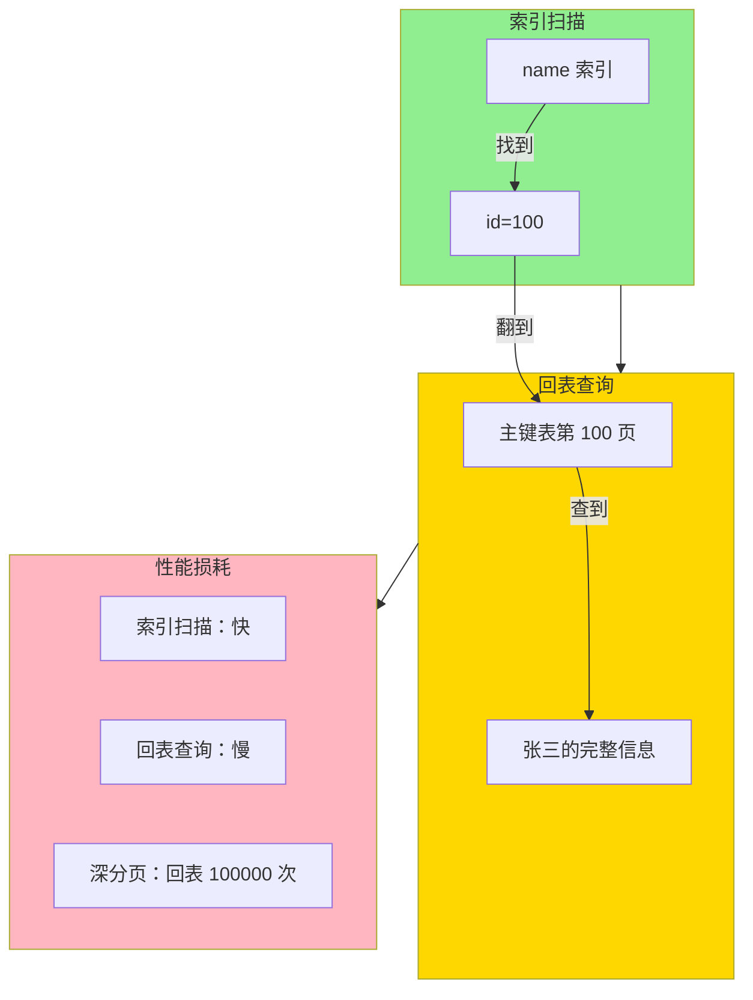
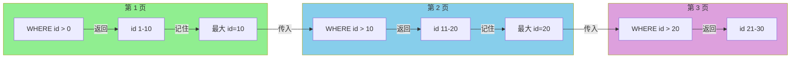
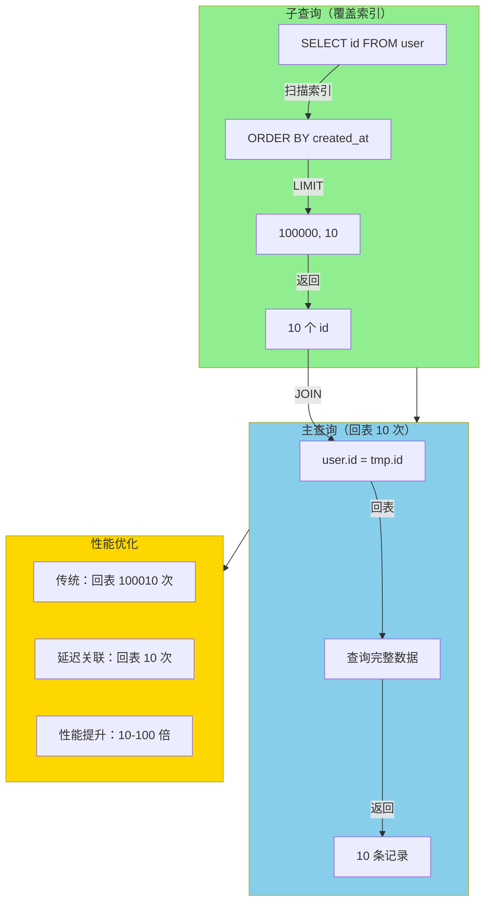
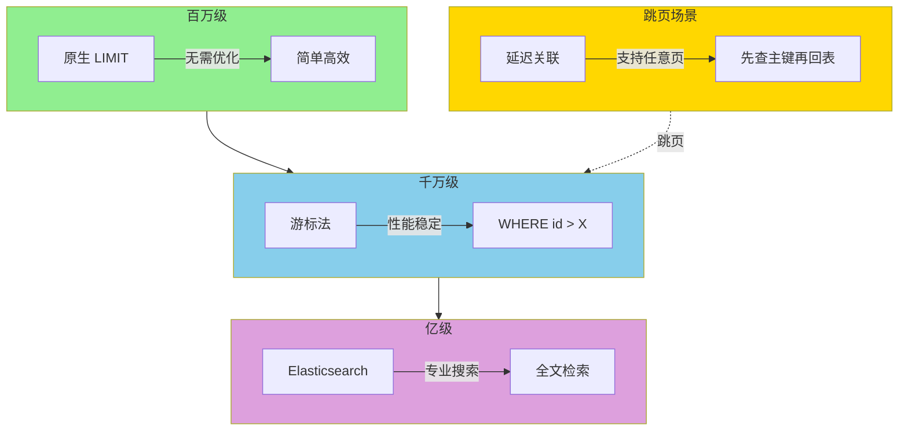
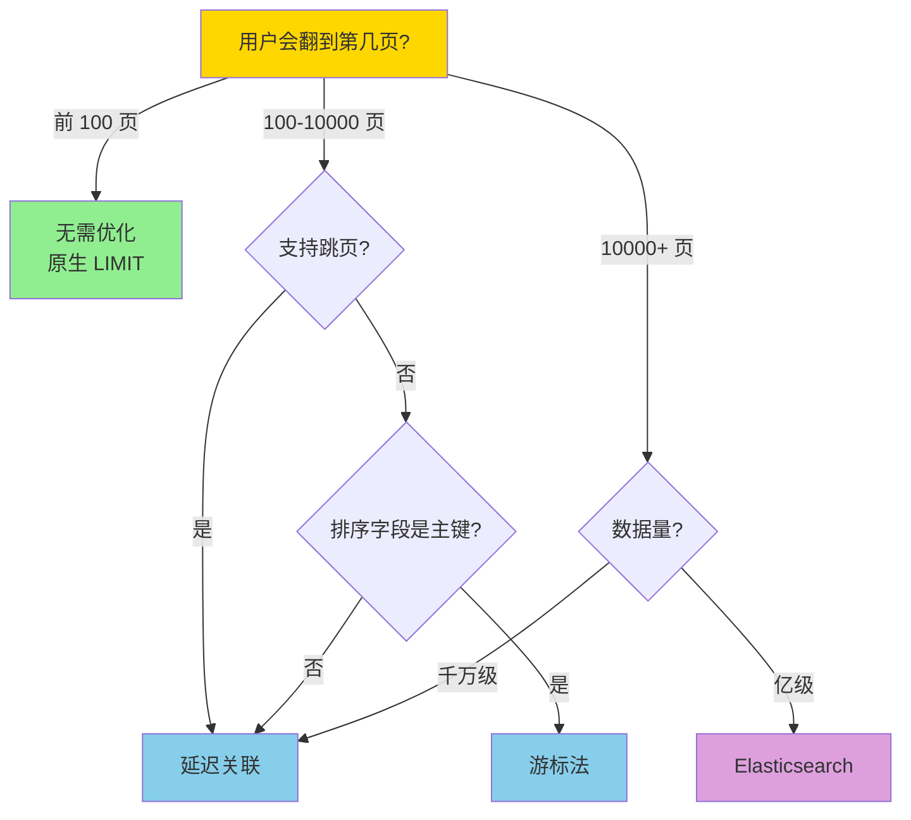
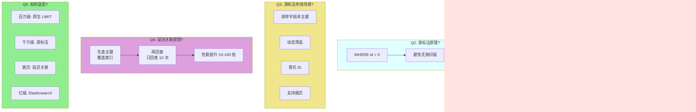
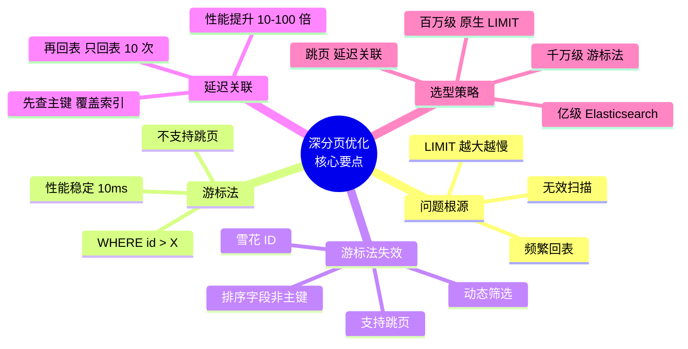
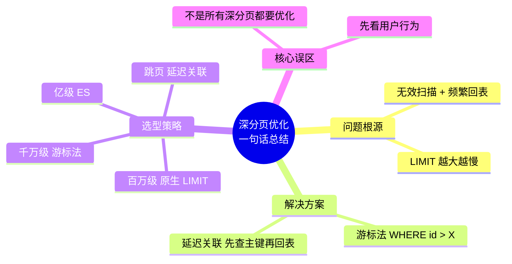

# MySQL 深分页优化全攻略

> **核心主题**：深分页性能瓶颈分析与游标法、延迟关联、覆盖索引等优化方案的选型实践

---

## 🎯 一句话定位

**深分页解决什么问题？**
```
当用户翻到第 10000 页时，查询变得非常慢（从 10ms 变成 500ms+）。
深分页优化就是让"翻到第 10000 页"和"翻到第 1 页"一样快。
```

**生活化比喻**：
就像翻一本 1000 页的书：
- 翻到第 10 页：很快，直接翻过去（LIMIT 0, 10）
- 翻到第 500 页：需要先翻过前 499 页，才能看到第 500 页（LIMIT 4990, 10）
- 翻到第 1000 页：需要先翻过前 999 页，慢得要命（LIMIT 9990, 10）

**核心特点**：LIMIT 值越大，扫描的无效行越多，回表次数越多，查询越慢。

---

## 💎 核心要点速览

> **快速掌握核心设计要点**

### 核心观点（5 个关键点）

**1. 深分页慢的根源：无效扫描 + 频繁回表**
```
❌ LIMIT 100000, 10 的执行过程：
1. 扫描前 100010 行（无效扫描 100000 行）
2. 对每一行回表查询完整数据（频繁回表）
3. 丢弃前 100000 行，返回最后 10 行

生活化比喻：
就像数豆子：
- 你需要第 100001-100010 颗豆子
- 但你必须从第 1 颗开始数（无效扫描）
- 每数一颗都要拿起来看看（频繁回表）
- 数到第 100000 颗才扔掉（丢弃无效行）
- 效率极低！
```

**2. 主键游标法：记住上次的位置**
```
✅ 核心思路：
SELECT * FROM user WHERE id > 100000 ORDER BY id LIMIT 10

生活化比喻：
就像翻书：
- 第 1 次翻到第 10 页，记住页码（id=100）
- 第 2 次直接从第 101 页开始翻（id > 100）
- 不用从第 1 页重新翻（避免无效扫描）

优势：
- 性能稳定：无论翻到第几页，都是 10ms
- 简单高效：只需一个索引
```

**3. 游标法失效场景：4 种情况不适用**
```
❌ 游标法失效场景：
1. 排序字段非主键：按 created_at 排序，无法用 id 做游标
2. 动态筛选：用户搜索"张三"，无法用 id 做游标
3. 雪花 ID：ID 无序，无法用 id > 做游标
4. 支持跳页：用户直接输入页码 100，无法知道第 99 页的 id

解决方案：延迟关联 + 覆盖索引
```

**4. 进阶方案：延迟关联 + 覆盖索引**
```
✅ 核心思路：
SELECT * FROM user 
INNER JOIN (
    SELECT id FROM user ORDER BY created_at LIMIT 100000, 10
) AS tmp ON user.id = tmp.id

生活化比喻：
就像查字典：
1. 先查目录，找到页码（SELECT id，覆盖索引）
2. 再翻到对应页码查详细内容（回表查询）
3. 避免翻遍整本字典（减少回表）

优势：
- 只回表 10 次（而不是 100010 次）
- 性能提升 10-100 倍
```

**5. 选型策略：不同规模用不同方案**
```
百万级：原生 LIMIT（无需优化）
千万级：游标法（性能稳定）
跳页场景：延迟关联（支持任意页）
亿级：Elasticsearch（专业搜索引擎）
```

---

## 🚀 一句话精华（如果只能记住一句）

> **深分页慢的根源是无效扫描 + 频繁回表。百万级用原生 LIMIT，千万级用游标法（WHERE id > X LIMIT N），跳页用延迟关联（先查主键再回表），亿级用 ES。不是所有深分页都要优化，先确认用户是否真的会翻到第 10000 页。**

---

## 一、深分页慢的根源：无效扫描 + 频繁回表

### ✅ 核心思路

```
生活化比喻：
想象你在数一堆豆子：
- 你需要第 100001-100010 颗豆子
- 但你必须从第 1 颗开始数（无效扫描）
- 每数一颗都要拿起来看看是不是你要的（频繁回表）
- 数到第 100000 颗才扔掉（丢弃无效行）
- 效率极低！

技术流程：
LIMIT 100000, 10 
→ 扫描 100010 行（无效扫描 100000 行）
→ 每行回表查询完整数据（频繁回表）
→ 丢弃前 100000 行
→ 返回最后 10 行
```


### 1.1 为什么深分页慢？

**实验对比**：
```sql
-- 第 1 页：10ms
SELECT * FROM user ORDER BY created_at LIMIT 0, 10;

-- 第 100 页：50ms
SELECT * FROM user ORDER BY created_at LIMIT 990, 10;

-- 第 10000 页：500ms+
SELECT * FROM user ORDER BY created_at LIMIT 99990, 10;
```

**性能对比表**：
| 页码 | LIMIT 偏移量 | 扫描行数 | 回表次数 | 查询耗时 | 生活化比喻 |
|------|------------|---------|---------|---------|-----------|
| 第 1 页 | 0 | 10 | 10 | 10ms | 翻到第 1 页，很快 |
| 第 100 页 | 990 | 1000 | 1000 | 50ms | 翻过 99 页，有点慢 |
| 第 1000 页 | 9990 | 10000 | 10000 | 200ms | 翻过 999 页，很慢 |
| 第 10000 页 | 99990 | 100000 | 100000 | 500ms+ | 翻过 9999 页，慢得要命 |

**生活化比喻**：
```
深分页就像翻一本 1000 页的书：
- 翻到第 10 页：很快，直接翻过去
- 翻到第 500 页：需要先翻过前 499 页，才能看到第 500 页
- 翻到第 1000 页：需要先翻过前 999 页，慢得要命

问题：
1. 无效扫描：翻过前 999 页（但你不需要）
2. 频繁回表：每页都要拿起来看看（但你只需要第 1000 页）
```

### 1.2 回表是什么？

**生活化比喻**：
```
回表就像查字典：
1. 先查目录，找到页码（索引扫描）
2. 再翻到对应页码查详细内容（回表查询）

例如：查询 SELECT * FROM user WHERE name = '张三'
1. 在 name 索引中找到"张三"的页码（id=100）
2. 翻到第 100 页，查到张三的完整信息（回表）
```



**为什么回表慢？**
- ✅ 索引扫描：在 B+ 树中查找，O(log N)，很快
- ❌ 回表查询：随机 IO，每次都要从磁盘读取数据页，很慢
- ❌ 深分页：回表 100000 次，随机 IO 100000 次，极慢

---

## 二、主键游标法：记住上次的位置

### ✅ 核心思路

```
生活化比喻：
就像翻书：
- 第 1 次翻到第 10 页，记住页码（id=100）
- 第 2 次直接从第 101 页开始翻（id > 100）
- 不用从第 1 页重新翻（避免无效扫描）

技术流程：
第 1 页：SELECT * FROM user WHERE id > 0 ORDER BY id LIMIT 10
第 2 页：SELECT * FROM user WHERE id > 100 ORDER BY id LIMIT 10
第 3 页：SELECT * FROM user WHERE id > 200 ORDER BY id LIMIT 10
```



### 2.1 代码示例（Go 语言版）

```go
// 主键游标法分页
type User struct {
    ID        int64  `json:"id"`
    Name      string `json:"name"`
    Email     string `json:"email"`
    CreatedAt int64  `json:"created_at"`
}

type UserRepo struct {
    db *sql.DB
}

// 传统分页（慢）
func (r *UserRepo) ListByOffset(offset, limit int) ([]User, error) {
    // ❌ 深分页慢：LIMIT 100000, 10
    query := "SELECT * FROM user ORDER BY id LIMIT ?, ?"
    rows, err := r.db.Query(query, offset, limit)
    if err != nil {
        return nil, err
    }
    defer rows.Close()
    
    var users []User
    for rows.Next() {
        var u User
        if err := rows.Scan(&u.ID, &u.Name, &u.Email, &u.CreatedAt); err != nil {
            return nil, err
        }
        users = append(users, u)
    }
    return users, nil
}

// 游标法分页（快）
func (r *UserRepo) ListByCursor(lastID int64, limit int) ([]User, error) {
    // ✅ 性能稳定：WHERE id > ? ORDER BY id LIMIT ?
    query := "SELECT * FROM user WHERE id > ? ORDER BY id LIMIT ?"
    rows, err := r.db.Query(query, lastID, limit)
    if err != nil {
        return nil, err
    }
    defer rows.Close()
    
    var users []User
    for rows.Next() {
        var u User
        if err := rows.Scan(&u.ID, &u.Name, &u.Email, &u.CreatedAt); err != nil {
            return nil, err
        }
        users = append(users, u)
    }
    return users, nil
}

// 使用示例
func main() {
    repo := &UserRepo{db: db}
    
    // 第 1 页
    users, _ := repo.ListByCursor(0, 10)
    lastID := users[len(users)-1].ID  // 记住最后一个 id
    
    // 第 2 页
    users, _ = repo.ListByCursor(lastID, 10)
    lastID = users[len(users)-1].ID
    
    // 第 3 页
    users, _ = repo.ListByCursor(lastID, 10)
}
```

### 2.2 性能对比

| 分页方式 | 第 1 页 | 第 100 页 | 第 10000 页 | 生活化比喻 |
|---------|--------|----------|------------|-----------|
| **传统 LIMIT** | 10ms | 50ms | 500ms+ | 每次从第 1 页翻起 |
| **游标法** | 10ms | 10ms | 10ms | 记住上次页码，直接翻 |

**优势**：
- ✅ 性能稳定：无论翻到第几页，都是 10ms
- ✅ 简单高效：只需一个主键索引
- ✅ 无无效扫描：直接从上次位置开始

---

## 三、游标法失效场景：4 种情况不适用

### ❌ 场景 1：排序字段非主键

**问题**：
```sql
-- 按 created_at 排序，无法用 id 做游标
SELECT * FROM user ORDER BY created_at LIMIT 100000, 10;

-- 游标法失效：
SELECT * FROM user WHERE id > 100000 ORDER BY created_at LIMIT 10;
-- ❌ 结果错误：id > 100000 不等于 created_at 最大的 10 条
```

**生活化比喻**：
```
就像按身高排队：
- 你需要第 100001-100010 高的人
- 但游标法是按学号（id）筛选
- 学号 > 100000 的人，不一定是最高的 10 个
- 结果错误！
```

**解决方案**：延迟关联（见第四章）

---

### ❌ 场景 2：动态筛选

**问题**：
```sql
-- 用户搜索"张三"
SELECT * FROM user WHERE name LIKE '%张三%' ORDER BY created_at LIMIT 100000, 10;

-- 游标法失效：
SELECT * FROM user WHERE name LIKE '%张三%' AND id > 100000 ORDER BY created_at LIMIT 10;
-- ❌ 结果错误：id > 100000 不等于搜索结果的第 100001-100010 条
```

**生活化比喻**：
```
就像在图书馆找"张三"的书：
- 你需要第 100001-100010 本"张三"的书
- 但游标法是按书架编号（id）筛选
- 书架编号 > 100000 的书，不一定是"张三"的书
- 结果错误！
```

**解决方案**：延迟关联（见第四章）

---

### ❌ 场景 3：雪花 ID

**问题**：
```sql
-- 雪花 ID 无序，无法用 id > 做游标
-- id: 1734567890123456789, 1734567890123456790, ...
SELECT * FROM user WHERE id > 1734567890123456789 ORDER BY created_at LIMIT 10;
-- ❌ 结果错误：id > X 不等于 created_at 最大的 10 条
```

**生活化比喻**：
```
就像用随机数做学号：
- 学号：173456789, 987654321, 456789123, ...
- 学号 > 100000000 的学生，不一定是最早入学的
- 结果错误！
```

**解决方案**：延迟关联（见第四章）

---

### ❌ 场景 4：支持跳页

**问题**：
```
用户直接输入页码 100，无法知道第 99 页的最后一个 id。
游标法需要上一个游标，但跳页没有"上一个"。
```

**生活化比喻**：
```
就像翻书：
- 游标法：必须从第 1 页翻到第 2 页，再到第 3 页...（不能跳页）
- 用户需求：直接翻到第 100 页（跳页）
- 游标法失效！
```

**解决方案**：延迟关联（见第四章）

---

## 四、进阶方案：延迟关联 + 覆盖索引

### ✅ 核心思路

```
生活化比喻：
就像查字典：
1. 先查目录，找到页码（SELECT id，覆盖索引）
2. 再翻到对应页码查详细内容（回表查询）
3. 避免翻遍整本字典（减少回表）

技术流程：
SELECT * FROM user 
INNER JOIN (
    SELECT id FROM user ORDER BY created_at LIMIT 100000, 10
) AS tmp ON user.id = tmp.id

优势：
- 子查询只扫描索引（覆盖索引，不回表）
- 主查询只回表 10 次（而不是 100010 次）
- 性能提升 10-100 倍
```



### 4.1 代码示例（Go 语言版）

```go
// 延迟关联 + 覆盖索引
func (r *UserRepo) ListByDelayedJoin(offset, limit int) ([]User, error) {
    // ✅ 延迟关联：先查主键，再回表
    query := `
        SELECT u.* FROM user u
        INNER JOIN (
            SELECT id FROM user ORDER BY created_at DESC LIMIT ?, ?
        ) AS tmp ON u.id = tmp.id
        ORDER BY u.created_at DESC
    `
    rows, err := r.db.Query(query, offset, limit)
    if err != nil {
        return nil, err
    }
    defer rows.Close()
    
    var users []User
    for rows.Next() {
        var u User
        if err := rows.Scan(&u.ID, &u.Name, &u.Email, &u.CreatedAt); err != nil {
            return nil, err
        }
        users = append(users, u)
    }
    return users, nil
}

// 使用示例
func main() {
    repo := &UserRepo{db: db}
    
    // 第 10000 页（每页 10 条）
    offset := 99990
    limit := 10
    
    users, _ := repo.ListByDelayedJoin(offset, limit)
    fmt.Println(users)
}
```

### 4.2 为什么延迟关联快？

**传统分页**：
```sql
SELECT * FROM user ORDER BY created_at LIMIT 100000, 10;
-- 执行过程：
-- 1. 扫描 created_at 索引，找到 100010 个 id
-- 2. 对每个 id 回表查询完整数据（回表 100010 次）
-- 3. 丢弃前 100000 条，返回最后 10 条
-- 耗时：500ms+
```

**延迟关联**：
```sql
SELECT * FROM user 
INNER JOIN (
    SELECT id FROM user ORDER BY created_at LIMIT 100000, 10
) AS tmp ON user.id = tmp.id;
-- 执行过程：
-- 1. 子查询：扫描 created_at 索引，找到 100010 个 id（覆盖索引，不回表）
-- 2. 子查询：丢弃前 100000 个 id，返回最后 10 个 id
-- 3. 主查询：对这 10 个 id 回表查询完整数据（回表 10 次）
-- 耗时：50ms
```

**性能对比**：
| 分页方式 | 回表次数 | 查询耗时 | 性能提升 |
|---------|---------|---------|---------|
| **传统 LIMIT** | 100010 次 | 500ms+ | - |
| **延迟关联** | 10 次 | 50ms | 10 倍 |

---

## 五、选型策略：不同规模用不同方案

### ✅ 选型指南

```
生活化比喻：
就像出行：
- 短距离（1 公里）：步行（原生 LIMIT）
- 中距离（10 公里）：骑车（游标法）
- 长距离（100 公里）：开车（延迟关联）
- 超长距离（1000 公里）：飞机（Elasticsearch）
```



### 5.1 选型对比表

| 数据规模 | 推荐方案 | 优点 | 缺点 | 适用场景 | 生活化比喻 |
|---------|---------|------|------|---------|-----------|
| **百万级** | 原生 LIMIT | 简单、无需优化 | 深分页慢 | 用户不会翻到第 1000 页 | 步行（短距离） |
| **千万级** | 游标法 | 性能稳定、简单 | 不支持跳页 | 瀑布流、滚动加载 | 骑车（中距离） |
| **跳页场景** | 延迟关联 | 支持任意页 | 性能略差于游标 | 传统分页（页码导航） | 开车（长距离） |
| **亿级** | Elasticsearch | 全文检索、高性能 | 需要额外组件 | 复杂搜索、大数据量 | 飞机（超长距离） |

### 5.2 选型决策树

```
用户会翻到第几页？
├─ 第 1-100 页：原生 LIMIT（无需优化）
├─ 第 100-10000 页：
│  ├─ 支持跳页：延迟关联
│  └─ 不支持跳页：游标法
└─ 第 10000+ 页：
   ├─ 数据量 < 千万：延迟关联
   └─ 数据量 > 千万：Elasticsearch
```

---

## 六、核心误区：不是所有深分页都要优化

### ✅ 正确认知

```
生活化比喻：
就像装修房子：
- 不是所有房子都要豪华装修
- 出租屋：简单装修即可（原生 LIMIT）
- 自住房：精装修（游标法/延迟关联）
- 别墅：豪华装修（Elasticsearch）

技术决策：
- 用户不会翻到第 1000 页：不需要优化
- 用户会翻到第 10000 页：必须优化
- 先确认需求，再决定方案
```

### 6.1 常见误区

| 误区 | 真相 | 生活化比喻 |
|------|------|-----------|
| **所有深分页都要优化** | 先看用户行为，90% 的用户只翻前 10 页 | 不是所有房子都要豪华装修 |
| **游标法万能** | 游标法不支持跳页、排序字段非主键时失效 | 骑车不能上高速 |
| **延迟关联最快** | 延迟关联性能略差于游标法，但支持跳页 | 开车比骑车快，但不能走小路 |
| **ES 是银弹** | ES 需要额外组件，维护成本高 | 飞机快，但机场建设成本高 |

### 6.2 正确决策流程



---

## 七、技术深度追问



### 详细分析

**Q1: 深分页为什么慢？**  
深分页慢的根源是**无效扫描 + 频繁回表**。
- **无效扫描**：LIMIT 100000, 10 需要扫描前 100010 行，但只需要最后 10 行，前 100000 行都是无效扫描。
- **频繁回表**：每扫描一行都要回表查询完整数据，回表 100010 次，随机 IO 极慢。
- 结果：从 10ms 变成 500ms+。

**Q2: 游标法的原理是什么？**  
游标法通过**记住上次的位置**，避免无效扫描。
- 第 1 页：WHERE id > 0 ORDER BY id LIMIT 10，记住最后一个 id=100
- 第 2 页：WHERE id > 100 ORDER BY id LIMIT 10，直接从 101 开始
- 优势：性能稳定，无论翻到第几页，都是 10ms。

**Q3: 游标法在什么情况下会失效？**  
4 种场景会导致游标法失效：
1. **排序字段非主键**：按 created_at 排序，无法用 id 做游标
2. **动态筛选**：用户搜索"张三"，无法用 id 做游标
3. **雪花 ID**：ID 无序，无法用 id > 做游标
4. **支持跳页**：用户直接输入页码 100，无法知道第 99 页的 id

**Q4: 延迟关联的原理是什么？**  
延迟关联通过**先查主键再回表**，减少回表次数。
- 子查询：SELECT id FROM user ORDER BY created_at LIMIT 100000, 10（覆盖索引，不回表）
- 主查询：对这 10 个 id 回表查询完整数据（只回表 10 次）
- 优势：性能提升 10-100 倍。

**Q5: 如何选择深分页方案？**  
根据数据规模和业务场景选择：
- **百万级**：原生 LIMIT（无需优化），用户不会翻到第 1000 页
- **千万级**：游标法（性能稳定），不支持跳页
- **跳页场景**：延迟关联（支持任意页），性能略差于游标
- **亿级**：Elasticsearch（专业搜索），需要额外组件

---

## 八、核心要点总结



**方案总结**：

> **问题根源**：深分页慢的根源是**无效扫描 + 频繁回表**。LIMIT 100000, 10 需要扫描 100010 行，回表 100010 次，从 10ms 变成 500ms+。
> 
> **游标法**：通过 WHERE id > X 记住上次位置，避免无效扫描，性能稳定 10ms。但不支持跳页、排序字段非主键、动态筛选、雪花 ID 时失效。
> 
> **延迟关联**：先查主键（覆盖索引），再回表（只回表 10 次），性能提升 10-100 倍，支持跳页。
> 
> **选型策略**：百万级用原生 LIMIT，千万级用游标法，跳页用延迟关联，亿级用 Elasticsearch。
> 
> **核心误区**：不是所有深分页都要优化，先看用户行为，90% 的用户只翻前 10 页。

---

## 九、生产 Checklist

| 检查项 | 状态 | 说明 |
|--------|------|------|
| **确认用户行为** | ⬜ | 90% 用户只翻前 10 页，无需优化 |
| **评估数据规模** | ⬜ | 百万级、千万级、亿级 |
| **选择合适方案** | ⬜ | 游标法、延迟关联、ES |
| **测试深分页性能** | ⬜ | LIMIT 100000, 10 是否 < 100ms |
| **监控慢查询** | ⬜ | 深分页查询是否进入慢查询日志 |
| **优化索引** | ⬜ | 排序字段是否有索引 |
| **避免 SELECT *** | ⬜ | 只查询需要的字段，减少回表 |
| **考虑缓存** | ⬜ | 热点数据缓存到 Redis |

---

## 十、总结



### 🎯 一句话总结

> **深分页慢的根源是无效扫描 + 频繁回表。百万级用原生 LIMIT，千万级用游标法（WHERE id > X LIMIT N），跳页用延迟关联（先查主键再回表），亿级用 ES。不是所有深分页都要优化，先确认用户是否真的会翻到第 10000 页。**

### 🧠 核心记忆点

1. **深分页为什么慢？** 无效扫描 + 频繁回表，LIMIT 越大越慢。
2. **游标法原理**：WHERE id > X，记住上次位置，避免无效扫描，性能稳定 10ms。
3. **游标法失效**：排序字段非主键、动态筛选、雪花 ID、支持跳页。
4. **延迟关联**：先查主键（覆盖索引），再回表（只回表 10 次），性能提升 10-100 倍。
5. **选型策略**：百万级原生 LIMIT，千万级游标法，跳页延迟关联，亿级 ES。
