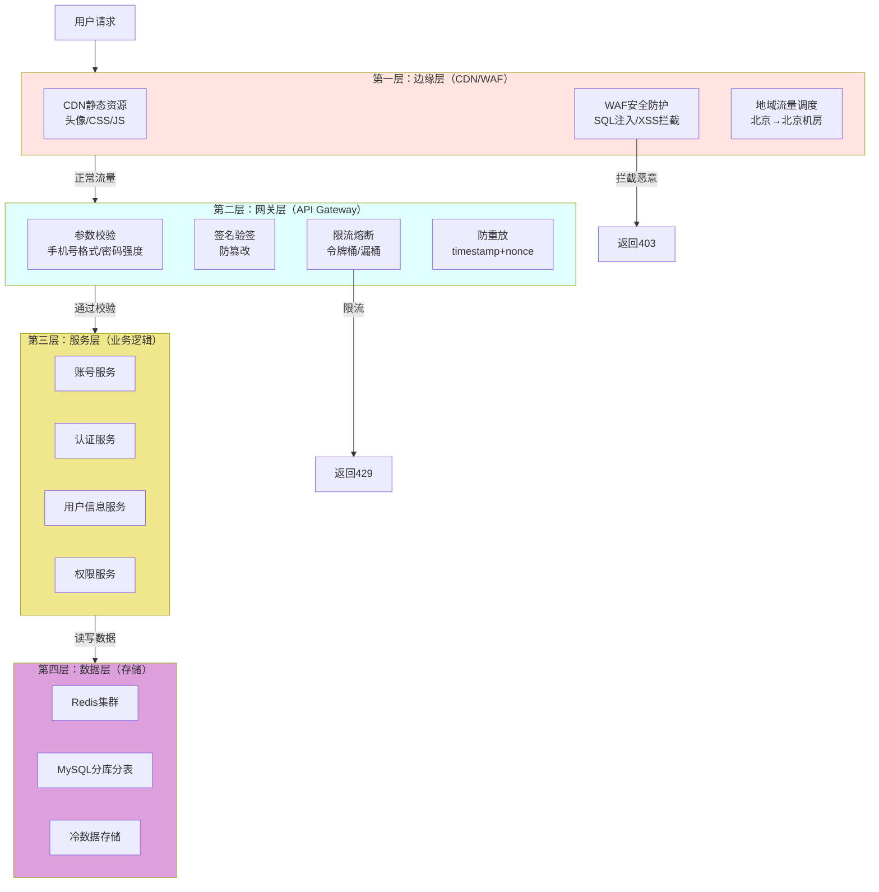
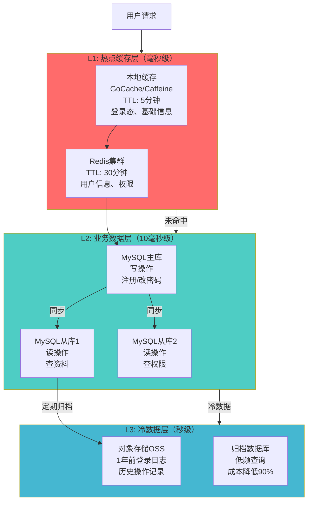
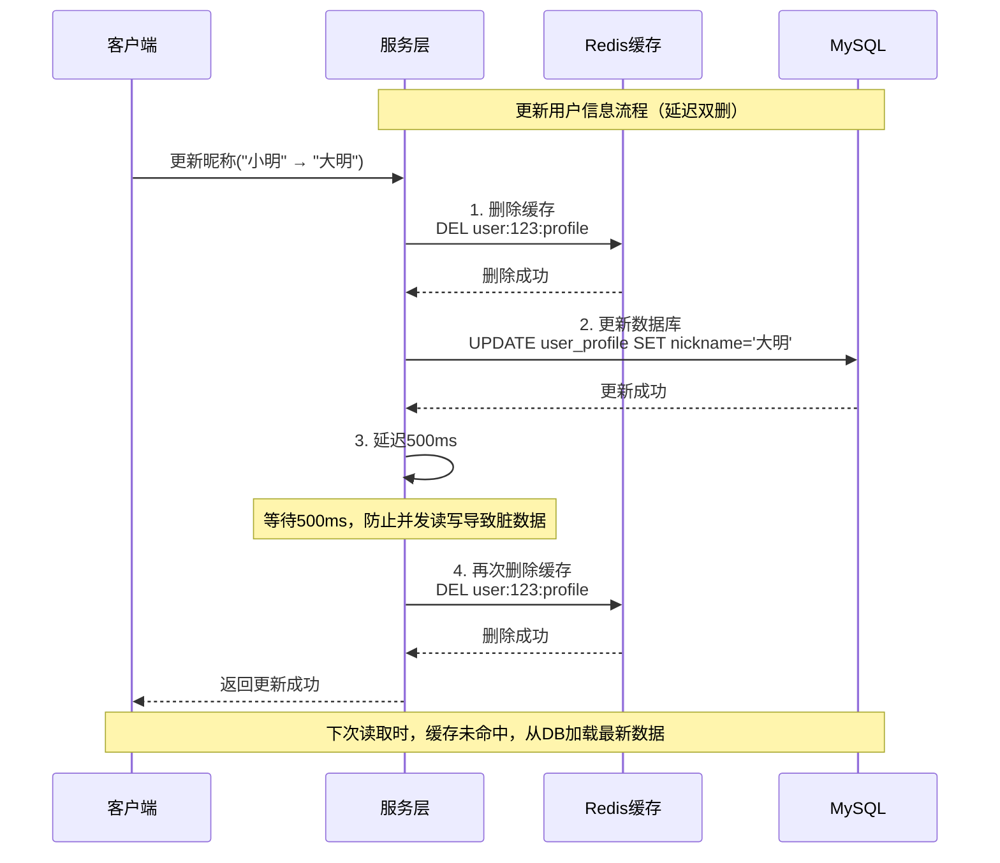
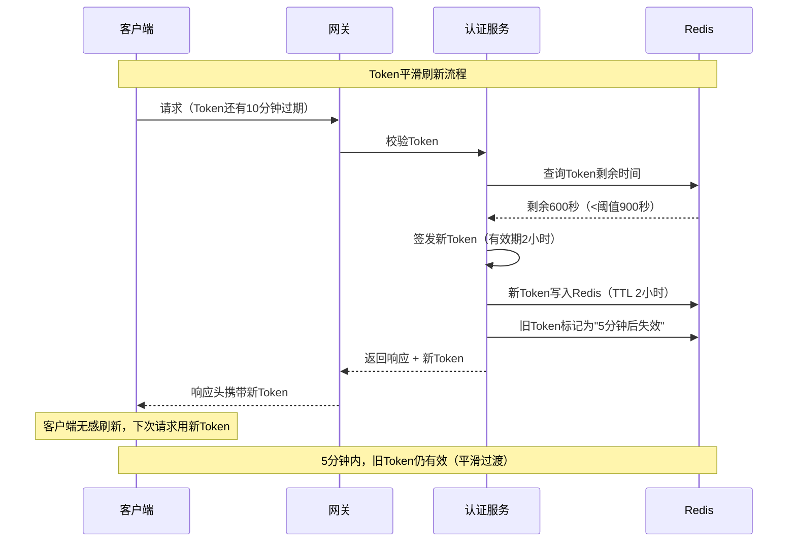
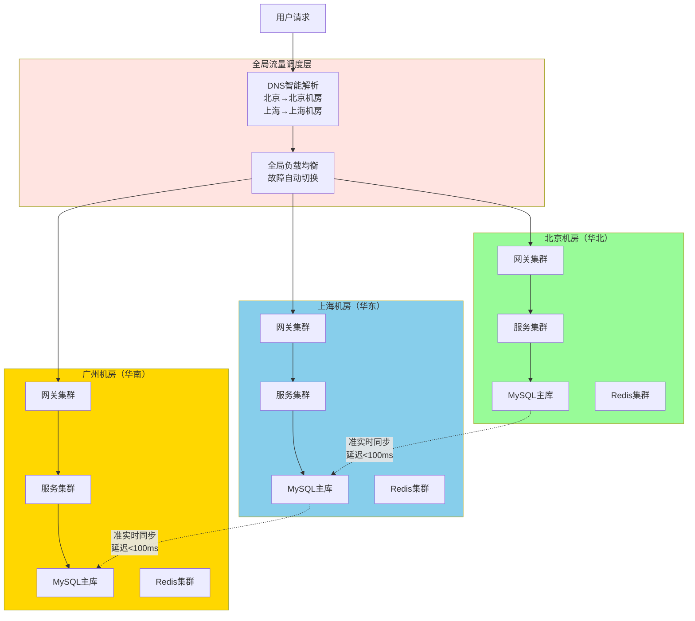
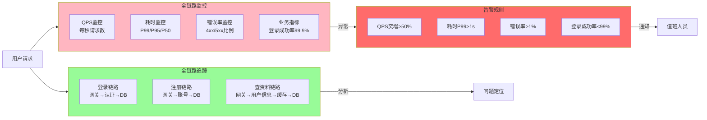
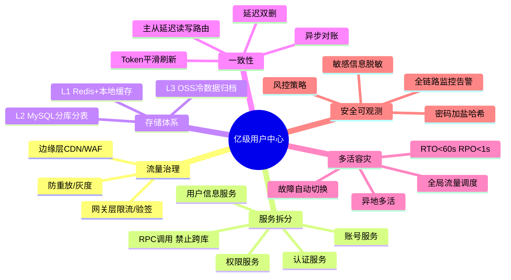
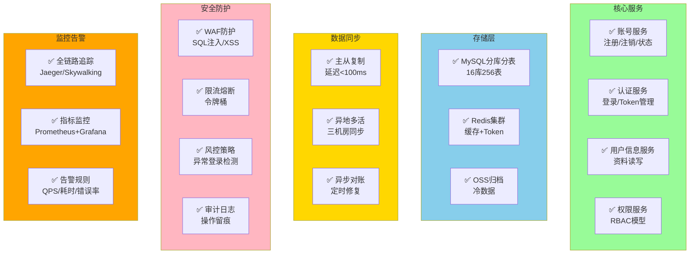
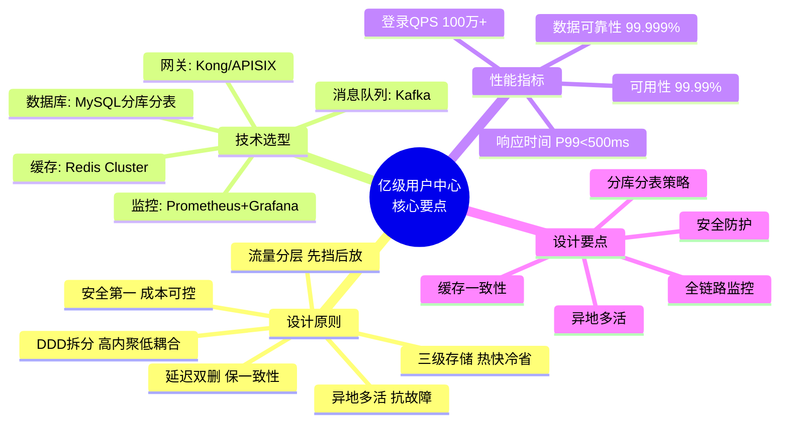

# 亿级用户体量用户中心系统设计

> **核心主题**：亿级用户中心系统设计——服务拆分、分库分表、缓存一致性、多活容灾、安全合规

---

## 🎯 一句话定位

**用户中心系统解决什么问题？**
```
管理亿级用户的"生老病死"：
注册（出生）→ 登录（活着）→ 改资料（体检）→ 注销（死亡）
全程保障：安全、高性能、不丢数据
```

**生活化比喻**：
用户中心就像**小区的物业管理系统**：
- 业主登记（注册）→ 门禁卡（登录态）→ 信息变更（换车位）→ 搬走注销（注销）
- 物业要高效（高并发）、安全（防冒领）、稳定（不能断网）、合规（隐私保护）
- 亿级用户 = 超大型小区，100万户业主，每天10万人进出大门

**核心挑战**：用户量大（10亿+）、并发高（百万QPS）、安全要求高（密码不能丢）、可用性要求高（不能断网）。

---

## 💎 核心要点速览

> **快速掌握核心设计要点**

### 核心观点（6 个关键点）

**1. 流量分层与入口治理：先过滤，再放行**
```
边缘层：CDN静态资源 + WAF防攻击 + 地域调度（北京用户访问北京机房）
网关层：参数校验 + 签名验签 + 限流熔断 + 防重放（像小区保安，先验身份再放行）
目标：把99%的恶意流量挡在门外，只让1%的正常流量进入服务层
```

**2. 服务拆分与领域设计（DDD）：一个服务只干一件事**
```
账号服务：注册/注销/状态管理（管"出生证明"）
认证服务：登录/token签发校验（管"门禁卡"）
用户信息服务：资料读写（管"业主档案"）
权限服务：角色/权限管理（管"谁能进哪个房间"）
服务间RPC调用，禁止跨库直连（像部门间走公文，不能直接翻别人抽屉）
```

**3. 存储体系（三级）：热快冷省**
```
热点缓存层：Redis集群+本地缓存（登录态、基础信息，TTL 30分钟）
业务数据层：MySQL分库分表（按用户ID哈希分库，按注册时间分表），读写分离
冷数据层：归档存储（历史登录日志、操作记录，1年前数据归档到OSS）
```

**4. 一致性保障：先更库再删缓存**
```
核心原则：先更新数据库，再删除缓存（延迟双删防脏数据）
token刷新：平滑过渡，旧token继续有效5分钟
主从延迟：核心写后读走主库（刚改完密码，刷新页面必须看到新密码）
异步对账：定时任务自动修复缓存与DB不一致
```

**5. 多集群协同与容灾：异地多活**
```
全局流量调度：北京用户访问北京机房，上海用户访问上海机房
异地多活：每个机房都能独立处理读写，数据准实时同步
故障切换：北京机房挂了，流量自动切到上海（用户无感知，就像双11备份）
同步延迟：控制在100ms以内，用户刚改的密码，上海机房100ms后也能登录
```

**6. 安全成本与可观测性：安全第一，成本可控**
```
安全：密码加盐哈希（bcrypt）+ 敏感信息脱敏 + 风控策略（异常设备/异地登录）
成本：冷数据归档（省90%存储）+ 弹性扩缩容（大促时扩容，平时缩容）
可观测：全链路埋点（登录成功率99.9%）+ 告警（登录耗时>500ms立即报警）
```

---

## 🚀 一句话精华（如果只能记住一句）

> **亿级用户中心 = 流量分层治理（挡恶意） + DDD服务拆分（高内聚） + 三级存储（热快冷省） + 延迟双删（保一致） + 异地多活（抗故障） + 安全可观测（守底线）**

---

## 一、流量分层与入口治理

### 1.1 为什么要分层？

**生活化比喻**：
```
就像大型活动的安检流程：
第一道：外围保安（CDN/WAF）→ 拦住没有门票的（恶意流量）
第二道：入口安检（网关）→ 检查身份证（签名验签）、限制人数（限流）
第三道：内场服务（业务层）→ 只服务已安检的观众（正常用户）

如果不分层：
10万黄牛党（恶意请求）直接冲到内场，把工作人员（服务）累死，
真正买了票的观众（正常用户）反而进不去。
```

### 1.2 四层流量治理架构



### 1.3 网关层核心能力

**生活化比喻**：
```
网关就像小区保安亭：
1. 参数校验：检查你带的东西是否合规（手机号格式对吗？密码够复杂吗？）
2. 签名验签：检查你的快递是否被拆过（请求参数是否被篡改？）
3. 限流熔断：限制进入人数（每秒最多1000人，防止踩踏）
4. 防重放：防止别人用你的旧门禁卡（timestamp+nonce，一次性有效）
```

| 能力 | 实现方案 | 作用 | 生活化比喻 |
|------|---------|------|------------|
| **参数校验** | JSON Schema / Validator | 拦截不合法请求 | 检查身份证是否过期 |
| **签名验签** | HMAC-SHA256 | 防篡改 | 检查快递封条是否完好 |
| **限流熔断** | 令牌桶 + Sentinel | 防雪崩 | 限制电梯人数 |
| **防重放** | timestamp + nonce（5分钟有效） | 防重放攻击 | 门禁卡只能用一次 |
| **灰度发布** | 请求头路由 | 新版本小流量测试 | VIP通道先体验 |

**Go 代码示例：签名验签**
```go
// 签名验签：防止请求参数被篡改
type SignVerifier struct {
    secretKey string
}

func (s *SignVerifier) VerifySign(req *http.Request) bool {
    // 1. 从请求头获取签名和时间戳
    sign := req.Header.Get("X-Sign")
    timestamp := req.Header.Get("X-Timestamp")
    nonce := req.Header.Get("X-Nonce")
    
    // 2. 检查时间戳（防重放，5分钟有效）
    ts, _ := strconv.ParseInt(timestamp, 10, 64)
    if time.Now().Unix()-ts > 300 {
        return false // 超过5分钟，拒绝
    }
    
    // 3. 检查nonce是否已使用（防重放）
    if redis.Exists("nonce:" + nonce) {
        return false // nonce已使用，拒绝
    }
    
    // 4. 计算签名：HMAC-SHA256(参数 + timestamp + nonce)
    params := req.URL.Query().Encode()
    expectedSign := hmacSHA256(params+timestamp+nonce, s.secretKey)
    
    // 5. 比对签名
    if sign != expectedSign {
        return false // 签名不一致，参数被篡改
    }
    
    // 6. 标记nonce为已使用（TTL 5分钟）
    redis.Set("nonce:"+nonce, "1", 5*time.Minute)
    
    return true
}

func hmacSHA256(data, key string) string {
    h := hmac.New(sha256.New, []byte(key))
    h.Write([]byte(data))
    return hex.EncodeToString(h.Sum(nil))
}
```

---

## 二、服务拆分与领域设计（DDD）

### 2.1 为什么要拆分？

**生活化比喻**：
```
不拆分就像一个大杂烩部门：
一个人又要管户口（注册）、又要管门禁（登录）、还要管档案（资料）、还要管权限（谁能进哪个房间）。
结果：
- 忙不过来（性能瓶颈）
- 容易出错（代码耦合）
- 升级困难（改一个功能，整个部门停摆）

拆分后：
每个部门只干一件事，各司其职，高效协作。
```

### 2.2 四大核心服务

```mermaid
graph TB
    subgraph UserCenter["用户中心（DDD领域驱动）"]
        subgraph Account["账号服务（管"出生证明"）"]
            A1[注册<br/>创建账号]
            A2[注销<br/>删除账号]
            A3[状态管理<br/>正常/冻结/注销]
        end
        
        subgraph Auth["认证服务（管"门禁卡"）"]
            B1[登录<br/>密码/短信/第三方]
            B2[Token签发<br/>JWT/Session]
            B3[Token校验<br/>刷新/失效]
        end
        
        subgraph Profile["用户信息服务（管"业主档案"）"]
            C1[资料读写<br/>昵称/头像/简介]
            C2[实名认证<br/>身份证/手机号]
            C3[隐私设置<br/>可见性控制]
        end
        
        subgraph Permission["权限服务（管"谁能进哪个房间"）"]
            D1[角色管理<br/>普通用户/VIP/管理员]
            D2[权限分配<br/>读写/删除/管理]
            D3[权限校验<br/>RBAC模型]
        end
    end
    
    Client[客户端] --> Account
    Client --> Auth
    Client --> Profile
    Client --> Permission
    
    Account -.->|RPC调用| Auth
    Auth -.->|RPC调用| Profile
    Profile -.->|RPC调用| Permission
    
    style Account fill:#FFB6C1
    style Auth fill:#98FB98
    style Profile fill:#87CEEB
    style Permission fill:#FFD700
```

### 2.3 服务间通信规范

**生活化比喻**：
```
服务间调用就像部门间协作：
✅ 正确方式：走公文流程（RPC调用），有记录、可追溯
❌ 错误方式：直接翻别人抽屉（跨库直连），容易出错、难以追踪

例如：
认证服务需要查用户信息，不能直接连用户信息库
必须调用用户信息服务的接口（走公文），由用户信息服务查库返回
```

| 原则 | 正确做法 | 错误做法 | 生活化比喻 |
|------|---------|---------|------------|
| **服务自治** | 每个服务独立数据库 | 多个服务共用数据库 | 每个部门有自己的档案柜 |
| **接口调用** | RPC/HTTP接口调用 | 跨库直连 | 走公文流程，不翻别人抽屉 |
| **数据一致性** | 最终一致性（MQ异步） | 强一致性（分布式事务） | 先办事，后补手续 |
| **失败处理** | 降级 + 重试 + 熔断 | 直接报错 | 保安不在就等一会，别硬闯 |

---

## 三、存储体系（三级）

### 3.1 为什么要三级存储？

**生活化比喻**：
```
三级存储就像找信息的三个层次：
L1 本地缓存：你的手机通讯录（最快，但容量小，只存常用联系人）
L2 Redis缓存：公司通讯录（快，容量中等，存全体员工）
L3 MySQL：户籍中心（慢，但容量大，永久保存所有人）
L4 OSS归档：历史档案室（更慢，但便宜，存10年前的老数据）

好处：
- 热点数据（登录态）放Redis，1毫秒响应
- 温数据（用户资料）放MySQL，10毫秒响应
- 冷数据（1年前登录日志）放OSS，1秒响应，但省钱
```

### 3.2 三级存储架构



### 3.3 分库分表策略

**生活化比喻**：
```
分库分表就像把一本大花名册分成多本小册子：
按用户ID分库：userID % 16 = 分片号（保证同一用户的操作在同一库，避免跨库事务）
按注册时间分表：2024年注册的用户在表1，2025年在表2（方便归档老数据）

好处：
- 查询快：不用翻10亿条记录，只翻对应的库和表
- 扩容容易：加库加表就行，不用改代码
- 归档方便：老表直接归档到OSS
```

**分片规则**：
| 维度 | 规则 | 适用场景 | 生活化比喻 |
|------|------|----------|------------|
| **用户ID哈希** | `userID % 16` | 按用户查询（登录、改密码） | 按身份证尾号分档案柜 |
| **注册时间** | 按月分表 | 按时间查询（注册统计） | 按年份分档案室 |
| **手机号哈希** | `hash(phone) % 8` | 按手机号查询（找回密码） | 按姓氏首字母分目录 |

**表结构设计**：
```sql
-- 用户账号表（按userID分16库，每库16表，共256表）
CREATE TABLE user_account_0 (
    user_id BIGINT PRIMARY KEY,
    phone VARCHAR(20) UNIQUE,
    email VARCHAR(100),
    password_hash VARCHAR(255) NOT NULL,  -- bcrypt加盐哈希
    status TINYINT DEFAULT 1,             -- 1:正常 2:冻结 3:注销
    created_at TIMESTAMP DEFAULT CURRENT_TIMESTAMP,
    updated_at TIMESTAMP DEFAULT CURRENT_TIMESTAMP ON UPDATE CURRENT_TIMESTAMP,
    INDEX idx_phone (phone),
    INDEX idx_email (email),
    INDEX idx_created (created_at)
) ENGINE=InnoDB DEFAULT CHARSET=utf8mb4;

-- 用户信息表（按userID分16库，每库16表）
CREATE TABLE user_profile_0 (
    user_id BIGINT PRIMARY KEY,
    nickname VARCHAR(50),
    avatar_url VARCHAR(500),
    gender TINYINT,                       -- 0:未知 1:男 2:女
    birthday DATE,
    bio VARCHAR(500),
    privacy_setting JSON,                 -- 隐私设置
    created_at TIMESTAMP DEFAULT CURRENT_TIMESTAMP,
    updated_at TIMESTAMP DEFAULT CURRENT_TIMESTAMP ON UPDATE CURRENT_TIMESTAMP
) ENGINE=InnoDB DEFAULT CHARSET=utf8mb4;

-- 登录日志表（按月分表，1年前归档到OSS）
CREATE TABLE login_log_202410 (
    id BIGINT PRIMARY KEY AUTO_INCREMENT,
    user_id BIGINT NOT NULL,
    login_time TIMESTAMP DEFAULT CURRENT_TIMESTAMP,
    ip VARCHAR(50),
    device_info VARCHAR(500),
    login_type TINYINT,                   -- 1:密码 2:短信 3:第三方
    INDEX idx_user_time (user_id, login_time)
) ENGINE=InnoDB DEFAULT CHARSET=utf8mb4;
```

---

## 四、一致性保障

### 4.1 缓存与DB一致性

**生活化比喻**：
```
缓存和DB就像：
DB是户籍中心（权威、准确、但慢）
缓存是手机通讯录（快、但可能过期）

问题：
你在户籍中心改了手机号（更新DB），但手机通讯录还是旧号码（缓存未更新）。
下次打电话，打的是旧号码（读到脏数据）。

解决方案：延迟双删
1. 先删除缓存（把手机通讯录里的旧号码删了）
2. 更新数据库（在户籍中心改号码）
3. 延迟500ms再删除缓存（防止更新期间有人把旧号码又写回缓存）
```



**Go 代码示例：延迟双删**
```go
// 延迟双删：保证缓存与DB一致性
func (s *UserService) UpdateProfile(userID int64, newProfile *UserProfile) error {
    // 1. 先删除缓存（防止读到旧数据）
    cacheKey := fmt.Sprintf("user:%d:profile", userID)
    redis.Del(cacheKey)
    
    // 2. 更新数据库
    err := s.db.Model(&UserProfile{}).
        Where("user_id = ?", userID).
        Updates(newProfile).Error
    if err != nil {
        return err
    }
    
    // 3. 延迟500ms再删除缓存（防止并发读写导致脏数据）
    go func() {
        time.Sleep(500 * time.Millisecond)
        redis.Del(cacheKey)
    }()
    
    return nil
}

// 读取用户信息：缓存未命中时从DB加载
func (s *UserService) GetProfile(userID int64) (*UserProfile, error) {
    cacheKey := fmt.Sprintf("user:%d:profile", userID)
    
    // 1. 先查缓存
    profile, err := redis.Get(cacheKey)
    if err == nil {
        return profile.(*UserProfile), nil
    }
    
    // 2. 缓存未命中，查DB
    profile = &UserProfile{}
    err = s.db.Where("user_id = ?", userID).First(profile).Error
    if err != nil {
        return nil, err
    }
    
    // 3. 写入缓存（TTL 30分钟）
    redis.Set(cacheKey, profile, 30*time.Minute)
    
    return profile, nil
}
```

### 4.2 Token 平滑刷新

**生活化比喻**：
```
Token刷新就像：
你的门禁卡快过期了（Token即将过期），物业给你发一张新卡（新Token）。
但旧卡在5分钟内还能用（平滑过渡），防止你刚出门就进不去了。

场景：
用户正在APP上操作，Token还有10分钟过期。
后台无感刷新Token，新Token签发，旧Token继续有效5分钟。
用户无感知，体验流畅。
```



### 4.3 主从延迟与读写路由

**生活化比喻**：
```
主从延迟就像：
主库是老板（写操作），从库是员工（读操作）。
老板刚决定改政策（更新数据），还没通知到员工（主从同步中）。
这时你问员工"新政策是什么？"，员工说"还是旧政策"（读到脏数据）。

解决方案：
核心操作（改密码、改手机号）后，强制走主库读取（5秒内）。
非核心操作（查资料），走从库（允许短暂延迟）。
```

| 场景 | 读路由 | 原因 | 生活化比喻 |
|------|--------|------|------------|
| **改密码后立即读取** | 主库 | 必须看到最新数据 | 刚改完政策，必须问老板 |
| **查用户资料** | 从库 | 允许短暂延迟 | 查公司规章，问员工就行 |
| **查权限列表** | 从库 | 权限变更低频 | 查门禁规则，问保安就行 |
| **支付相关读取** | 主库 | 数据必须准确 | 查账户余额，必须问银行 |

---

## 五、多集群协同与容灾

### 5.1 异地多活架构

**生活化比喻**：
```
异地多活就像：
在北京、上海、广州各开一家分店（机房），每家店都能独立服务当地客户。
北京客户去北京店，上海客户去上海店（就近接入）。
如果北京店停电了（故障），北京客户自动切换到上海店（故障转移）。
三家店的数据准实时同步（100ms延迟），保证客户在任何店都能看到最新信息。
```



### 5.2 故障切换流程

**生活化比喻**：
```
故障切换就像：
北京店停电了（机房故障），系统自动：
1. 检测到北京店没响应（健康检查失败）
2. 把北京客户的流量切到上海店（DNS切换，TTL 60秒）
3. 上海店承担额外流量（自动扩容）
4. 北京店恢复后，流量切回（DNS恢复）

用户感受：
"咦，刚才网卡了一下，现在好了"（无感知切换，RTO < 60秒）
```

| 阶段 | 动作 | 耗时 | 用户感受 |
|------|------|------|----------|
| **故障检测** | 健康检查失败（连续3次） | 10秒 | 无明显感知 |
| **流量切换** | DNS切换（TTL 60秒） | 60秒 | 部分用户卡顿 |
| **服务恢复** | 上海机房扩容 | 30秒 | 正常访问 |
| **数据同步** | 北京机房追赶数据 | 5分钟 | 无感知 |
| **流量回切** | DNS恢复 | 60秒 | 无感知 |

**RTO（恢复时间目标）< 60秒，RPO（恢复点目标）< 1秒**

---

## 六、安全成本与可观测性

### 6.1 安全：守住底线

**生活化比喻**：
```
安全就像小区安保：
1. 密码加盐哈希：就像把门禁卡加密，即使丢了也复制不了
2. 敏感信息脱敏：手机号显示138****1234，防止偷窥
3. 风控策略：异常设备/异地登录要验证（像银行异地登录要短信验证）
4. 防刷防暴力破解：密码错5次锁定30分钟（像ATM，输错3次吞卡）
5. 审计日志：所有操作留痕，出事能查监控
```

| 安全措施 | 实现方案 | 作用 | 生活化比喻 |
|---------|---------|------|------------|
| **密码存储** | bcrypt加盐哈希 | 防泄露 | 门禁卡加密，丢了也复制不了 |
| **信息脱敏** | 手机号138****1234 | 防偷窥 | 快递单隐藏手机号 |
| **风控策略** | 异地登录→短信验证 | 防盗号 | 银行异地登录要验证 |
| **防暴力破解** | 密码错5次锁定30分钟 | 防爆破 | ATM输错3次吞卡 |
| **审计日志** | 所有操作记录 | 可追溯 | 小区监控，出事能查 |

**密码存储示例**：
```go
// 密码加盐哈希：防止彩虹表攻击
func HashPassword(password string) (string, error) {
    // bcrypt自动生成盐值，并哈希
    // cost=10，表示计算量，越大越慢（防暴力破解）
    hash, err := bcrypt.GenerateFromPassword([]byte(password), 10)
    if err != nil {
        return "", err
    }
    return string(hash), nil
}

func VerifyPassword(password, hash string) bool {
    // 比对密码和哈希
    err := bcrypt.CompareHashAndPassword([]byte(hash), []byte(password))
    return err == nil
}

// 使用示例
hash, _ := HashPassword("MyPassword123")
// 存储: $2a$10$N9qo8uLOickgx2ZMRZoMyeIjZAgcfl7p92ldGxad68LJZdL17lhWy
VerifyPassword("MyPassword123", hash) // true
```

### 6.2 成本：省钱不省质量

**生活化比喻**：
```
成本控制就像：
1. 冷数据归档：1年前的登录日志移到OSS，存储成本降低90%
2. 弹性扩缩容：双11扩容10倍，平时缩容（像打车，高峰期加价，平时正常）
3. 高配数据库只给核心链路：注册/登录用高配库，查资料用低配库（像VIP通道和普通通道）
```

| 优化手段 | 节省成本 | 实现方式 | 生活化比喻 |
|---------|---------|---------|------------|
| **冷数据归档** | 90%存储成本 | 1年前数据移到OSS | 老档案移到仓库，办公室腾地方 |
| **弹性扩缩容** | 60%计算成本 | K8s HPA自动扩缩容 | 打车高峰期加价，平时正常 |
| **读写分离** | 30%数据库成本 | 从库承担80%读流量 | VIP通道和普通通道分流 |
| **缓存命中率提升** | 50%DB压力 | 热点数据放Redis | 常用物品放桌面，不用翻抽屉 |

### 6.3 可观测性：全链路监控

**生活化比喻**：
```
可观测性就像：
1. 全链路埋点：每个环节都有监控摄像头（注册→登录→查资料，全程可追溯）
2. 告警：登录耗时>500ms立即报警（像烟感，检测到异常立即响）
3. 全链路追踪：用户登录失败，能看到是网关超时、还是DB慢查询（像GPS，看到全程轨迹）
```



| 监控维度 | 指标 | 告警阈值 | 生活化比喻 |
|---------|------|---------|------------|
| **QPS** | 每秒请求数 | 突增>50% | 人流量突然暴增，可能出事了 |
| **耗时** | P99/P95/P50 | P99>1s | 99%的请求超过1秒，系统卡了 |
| **错误率** | 5xx比例 | >1% | 100个请求有1个失败，该查了 |
| **业务指标** | 登录成功率 | <99% | 100人登录有1个失败，用户体验差 |
| **资源利用率** | CPU/内存/磁盘 | CPU>80% | 服务器快满了，该扩容了 |

---

## 七、技术深度追问

```mermaid
graph TB
    subgraph Q1["Q1: 如何保证10亿用户的数据不丢？"]
        A1[主从复制<br/>MySQL主从] --> A2[异地多活<br/>北京/上海/广州]
        A2 --> A3[准实时同步<br/>延迟<100ms]
        A3 --> A4[异步对账<br/>定时修复不一致]
    end
    
    subgraph Q2["Q2: 登录QPS 100万，如何扛住？"]
        B1[读写分离<br/>80%读走从库] --> B2[三级缓存<br/>Redis+本地缓存]
        B2 --> B3[分库分表<br/>16库256表]
        B3 --> B4[限流熔断<br/>保护后端]
    end
    
    subgraph Q3["Q3: 用户改密码后，其他设备如何踢下线？"]
        C1[修改密码时<br/>删除Redis中所有Token] --> C2[其他设备请求时<br/>Token失效]
        C2 --> C3[强制重新登录]
    end
    
    subgraph Q4["Q4: 如何防止恶意注册？"]
        D1[图形验证码<br/>防机器注册] --> D2[手机号验证<br/>防批量注册]
        D2 --> D3[IP限流<br/>同IP每分钟最多10次]
        D3 --> D4[设备指纹<br/>同设备每天最多3次]
    end
    
    subgraph Q5["Q5: 北京机房故障，如何切到上海？"]
        E1[健康检查失败<br/>连续3次] --> E2[DNS切换<br/>TTL 60秒]
        E2 --> E3[上海机房扩容<br/>承担额外流量]
        E3 --> E4[数据追赶<br/>北京恢复后回切]
    end
    
    style Q1 fill:#FFE4E1
    style Q2 fill:#E0FFFF
    style Q3 fill:#F0E68C
    style Q4 fill:#DDA0DD
    style Q5 fill:#90EE90
```



### 详细分析

**Q1: 如何保证 10 亿用户的数据不丢？**  
**答**：三级保障：
1. **主从复制**：MySQL 主从，数据实时同步到从库（主库挂了，从库顶上）。
2. **异地多活**：北京/上海/广州三个机房，数据准实时同步（延迟 < 100ms），北京机房挂了，流量切到上海。
3. **异步对账**：定时任务比对主库和从库数据，发现不一致自动修复（像财务对账，每天核对）。

**Q2: 登录 QPS 100 万，如何扛住？**  
**答**：四板斧：
1. **读写分离**：80% 的读请求走从库，主库只承担写请求（注册、改密码）。
2. **三级缓存**：登录态放 Redis（命中率 95%），热点用户放本地缓存（命中率 5%），只有 1% 请求到 MySQL。
3. **分库分表**：16 库 256 表，单表数据量 < 500 万，查询毫秒级。
4. **限流熔断**：网关层限流，超过 100 万 QPS 直接返回 429，保护后端不被打垮。

**Q3: 用户改密码后，其他设备如何踢下线？**  
**答**：修改密码时，删除 Redis 中该用户的所有 Token（包括其他设备的），其他设备下次请求时 Token 失效，强制重新登录。就像你改了门禁卡密码，旧卡全部失效，必须重新办卡。

**Q4: 如何防止恶意注册？**  
**答**：四层防护：
1. **图形验证码**：防机器注册（像门禁，先验身份）。
2. **手机号验证**：一手机号一天最多注册 3 次（防批量注册）。
3. **IP 限流**：同 IP 每分钟最多 10 次注册（防脚本）。
4. **设备指纹**：同设备每天最多 3 次注册（防模拟器）。

**Q5: 北京机房故障，如何切到上海？**  
**答**：自动切换流程：
1. **故障检测**：健康检查连续 3 次失败（10 秒内）。
2. **DNS 切换**：全局 DNS 将北京流量切到上海（TTL 60 秒，即 60 秒内全部切换）。
3. **上海扩容**：上海机房自动扩容（K8s HPA），承担额外流量。
4. **数据追赶**：北京恢复后，追赶同步数据（5 分钟内），然后流量回切。
用户感受：卡了一下（60 秒内），然后恢复正常。RTO < 60 秒，RPO < 1 秒。

---

## 八、核心要点总结



**方案总结**：

> **流量治理**：边缘层 CDN/WAF 挡恶意流量，网关层限流/验签/防重放，只让 1% 正常流量进入服务层。
> 
> **服务拆分**：按 DDD 拆分为账号/认证/用户信息/权限四大服务，服务间 RPC 调用，禁止跨库直连。
> 
> **存储体系**：三级存储——热点缓存（Redis + 本地）、业务数据（MySQL 分库分表，按 userID 哈希分 16 库 256 表）、冷数据归档（OSS，省 90% 成本）。
> 
> **一致性**：延迟双删（先删缓存→更DB→延迟 500ms 再删缓存），Token 平滑刷新（旧 token 继续有效 5 分钟），主从延迟读写路由（核心写后读走主库）。
> 
> **多活容灾**：北京/上海/广州异地多活，全局流量调度，故障自动切换（RTO < 60 秒，RPO < 1 秒）。
> 
> **安全可观测**：密码 bcrypt 加盐哈希，敏感信息脱敏，风控策略（异常设备/异地登录），全链路监控告警（登录成功率 99.9%）。

---

## 九、生产环境 Checklist（部署检查清单）



**部署检查清单**：

| 类别 | 检查项 | 状态 | 生活化比喻 |
|------|--------|------|------------|
| **核心服务** | 账号服务（注册/注销/状态） | ⬜ | 户口登记处 |
| | 认证服务（登录/Token） | ⬜ | 门禁管理处 |
| | 用户信息服务（资料） | ⬜ | 档案室 |
| | 权限服务（RBAC） | ⬜ | 门禁规则制定 |
| **存储层** | MySQL 分库分表（16 库 256 表） | ⬜ | 分本花名册 |
| | Redis 集群（缓存 + Token） | ⬜ | 快速查询表 |
| | OSS 归档（冷数据） | ⬜ | 历史档案室 |
| **数据同步** | 主从复制（延迟 < 100ms） | ⬜ | 老板与员工同步 |
| | 异地多活（三机房同步） | ⬜ | 三家分店同步 |
| | 异步对账（定时修复） | ⬜ | 财务对账 |
| **安全防护** | WAF 防护（SQL 注入/XSS） | ⬜ | 安检门 |
| | 限流熔断（令牌桶） | ⬜ | 限流阀 |
| | 风控策略（异常登录检测） | ⬜ | 安保巡逻 |
| | 审计日志（操作留痕） | ⬜ | 监控摄像头 |
| **监控告警** | 全链路追踪（Jaeger） | ⬜ | GPS 追踪 |
| | 指标监控（Prometheus） | ⬜ | 仪表盘 |
| | 告警规则（QPS/耗时/错误率） | ⬜ | 烟感报警器 |

---

## 十、总结



### 🎯 一句话总结

> **亿级用户中心 = 流量分层治理（挡恶意） + DDD 服务拆分（高内聚） + 三级存储（热快冷省） + 延迟双删（保一致） + 异地多活（抗故障） + 安全可观测（守底线）**

### 🧠 核心记忆点

1. **为什么要流量分层？** 像活动安检，先挡黄牛（恶意流量），再服务观众（正常用户），否则服务会被打垮。
2. **为什么要 DDD 拆分？** 像公司部门，各司其职（账号/认证/信息/权限），不拆分就像一个人干所有事，忙不过来还容易出错。
3. **为什么要三级存储？** 像找信息，手机通讯录（Redis）→ 公司通讯录（MySQL）→ 历史档案室（OSS），热点数据放快的地方，冷数据放便宜的地方。
4. **为什么要延迟双删？** 像改手机号，先删旧号码（缓存）→ 改户籍中心（DB）→ 延迟 500ms 再删一次（防止有人又把旧号码写回去）。
5. **为什么要异地多活？** 像三家分店，北京店停电了，客户自动去上海店（故障切换），三家店数据准实时同步（100ms 延迟），用户无感知。
6. **为什么要安全可观测？** 像小区安保，密码加密（防复制）、信息脱敏（防偷窥）、风控策略（防异常）、全链路监控（出问题能查监控）。

---
