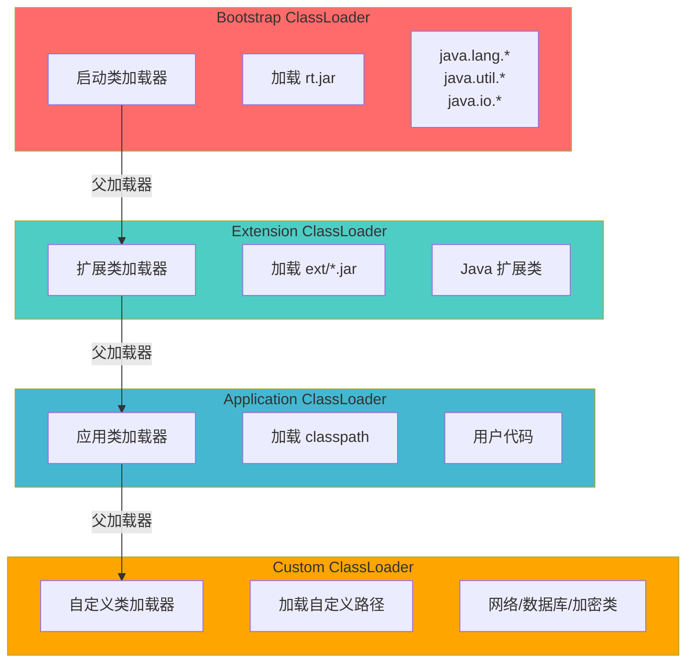
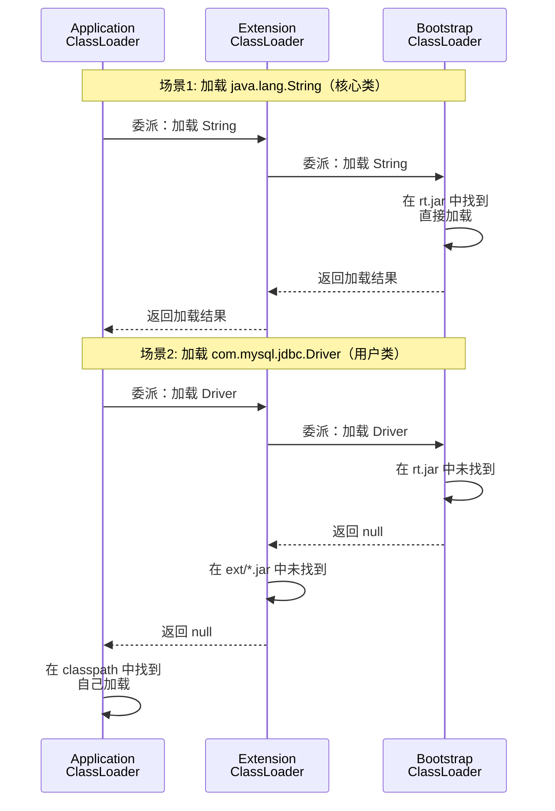
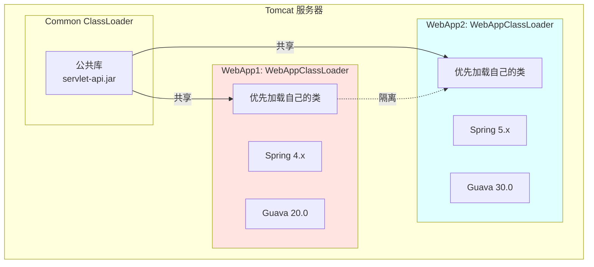
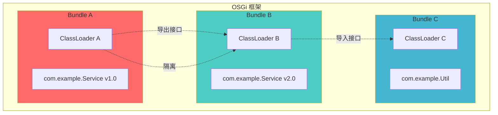
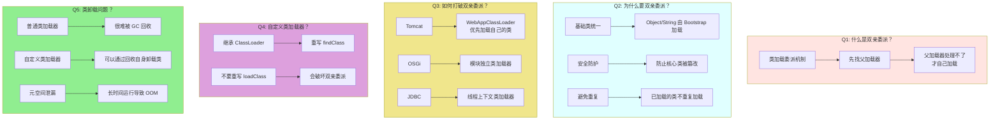
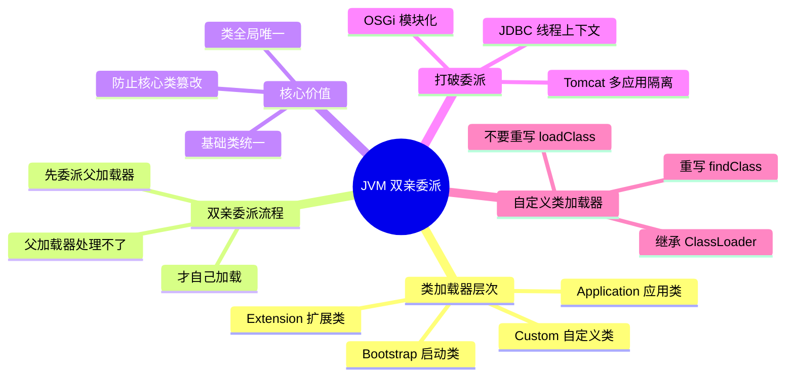
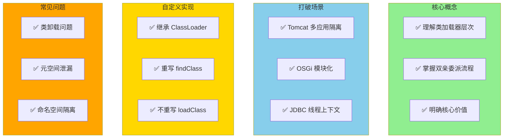
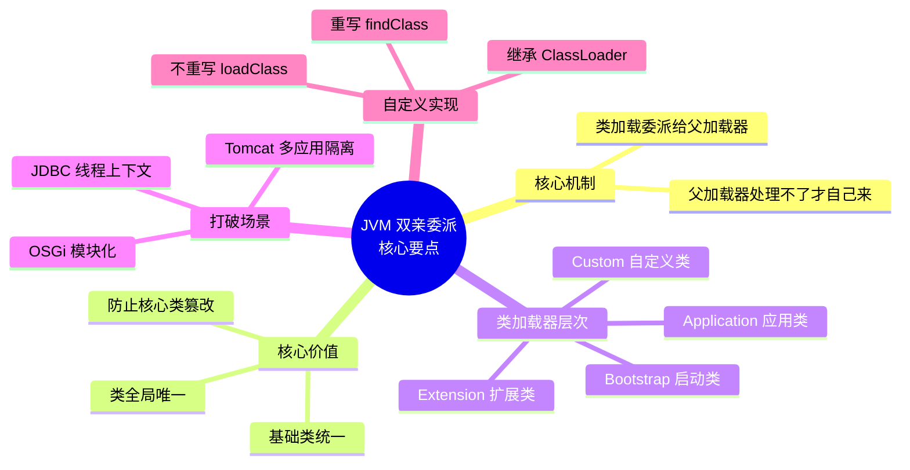

# JVM 双亲委派机制深度解析

> **核心主题**：JVM 类加载器层次结构、双亲委派原理、打破双亲委派场景与自定义类加载器实践

---

## 🎯 一句话定位

**JVM 双亲委派解决什么问题？**
```
当一个类需要被加载时，JVM 不是随便找个类加载器就加载，
而是像"公司层级审批"一样，先交给上级，上级处理不了才自己来。
```

**生活化比喻**：
就像公司报销审批流程：
- 员工（Application ClassLoader）先找经理（Extension ClassLoader）审批
- 经理找总监（Bootstrap ClassLoader）审批
- 总监处理不了（没找到类），再退回给经理
- 经理处理不了，最后退回给员工自己处理

**核心价值**：基础类统一 + 安全防护（避免重复加载只是表象）

---

## 💎 核心要点速览

> **快速掌握核心设计要点**

### 核心观点（4 个关键点）

**1. 类加载器层次：四级结构**
```
Bootstrap ClassLoader（启动类加载器）
    ↑ 加载 rt.jar（java.lang.*, java.util.* 等核心类）
    
Extension ClassLoader（扩展类加载器）
    ↑ 加载 ext/*.jar（Java 扩展类）
    
Application ClassLoader（应用类加载器）
    ↑ 加载 classpath（用户代码）
    
Custom ClassLoader（自定义类加载器）
    ↑ 加载自定义路径（网络、数据库等）
```

**2. 双亲委派工作流程**
```
加载请求 → 委派给父加载器 → 父加载器委派给爷爷加载器
    ↓
爷爷加载器处理不了 → 退回给父加载器
    ↓
父加载器处理不了 → 退回给自己加载
```

**3. 核心价值：基础类统一与安全**
```
✅ 基础类统一：Object/String 等核心类由 Bootstrap 加载
   → 所有应用类加载器用到的基础类都是同一份
   → 保证 Java 程序基础行为一致

✅ 类的全局唯一性：同一全限定名的类在 JVM 只会被加载一次
   → 不会出现多版本共存导致类型转换异常

✅ 防止核心类被篡改：用户自定义同名类无法替换核心类
   → 安全性保障
```

**4. 打破双亲委派的场景**
```
✅ Tomcat：多应用隔离，不同 Web 应用使用不同版本的库
✅ OSGi：模块化热部署，每个模块独立类加载器
✅ JDBC：DriverManager 通过线程上下文类加载器反向加载
```

---

## 🚀 一句话精华（如果只能记住一句）

> **JVM 双亲委派 = 类加载的层级委派机制（先找上级，上级处理不了再自己来） = 基础类统一 + 安全防护**

---

## 一、类加载器层次结构

### 1.1 四级类加载器

**生活化比喻**：
```
想象一个公司的组织架构：

Bootstrap ClassLoader（CEO）
    ↓ 负责：公司核心制度（rt.jar 核心类）
    
Extension ClassLoader（总监）
    ↓ 负责：扩展业务（ext/*.jar 扩展类）
    
Application ClassLoader（经理）
    ↓ 负责：日常业务（classpath 用户代码）
    
Custom ClassLoader（员工）
    ↓ 负责：特殊任务（自定义加载路径）
```



**各级加载器职责对比**：

| 类加载器 | 加载位置 | 加载内容 | 生活化比喻 |
|---------|---------|---------|------------|
| **Bootstrap** | rt.jar | Java 核心类（Object/String/ArrayList 等） | CEO 负责公司核心制度 |
| **Extension** | ext/*.jar | Java 扩展类 | 总监负责扩展业务 |
| **Application** | classpath | 用户代码（.class 文件） | 经理负责日常业务 |
| **Custom** | 自定义路径 | 网络/数据库/加密类 | 员工负责特殊任务 |

### 1.2 代码示例：获取类加载器

```java
public class ClassLoaderDemo {
    public static void main(String[] args) {
        // 1. 查看核心类的类加载器
        System.out.println(String.class.getClassLoader());
        // 输出：null（Bootstrap 加载器，C++ 实现，没有 Java 对象）
        
        // 2. 查看扩展类的类加载器
        System.out.println(javax.sql.DataSource.class.getClassLoader());
        // 输出：sun.misc.Launcher$ExtClassLoader@xxx
        
        // 3. 查看用户类的类加载器
        System.out.println(ClassLoaderDemo.class.getClassLoader());
        // 输出：sun.misc.Launcher$AppClassLoader@xxx
        
        // 4. 查看类加载器层次
        ClassLoader appClassLoader = ClassLoaderDemo.class.getClassLoader();
        System.out.println("App ClassLoader: " + appClassLoader);
        System.out.println("Parent: " + appClassLoader.getParent());
        System.out.println("Grandparent: " + appClassLoader.getParent().getParent());
        // 输出：Bootstrap 加载器（null）
    }
}
```

**Go 语言对比**：
```go
// Go 没有类加载器概念，编译时静态链接
// 但可以通过 plugin 机制实现动态加载

package main

import (
    "plugin"
    "fmt"
)

func main() {
    // 动态加载插件（类似 Java 类加载）
    p, err := plugin.Open("myplugin.so")
    if err != nil {
        panic(err)
    }
    
    // 查找符号（函数/变量）
    sym, err := p.Lookup("MyFunction")
    if err != nil {
        panic(err)
    }
    
    // 类型断言并调用
    myFunc, ok := sym.(func())
    if !ok {
        panic("invalid function signature")
    }
    myFunc()
}
```

---

## 二、双亲委派工作流程

### 2.1 工作流程详解

**生活化比喻**：
```
想象公司报销审批流程：

员工（App ClassLoader）收到报销申请（加载类请求）
    ↓
先找经理（Ext ClassLoader）审批
    ↓
经理找总监（Bootstrap ClassLoader）审批
    ↓
总监看：这个报销属于核心业务（rt.jar 中的类）吗？
    ├─ 是 → 总监直接处理（加载核心类）
    └─ 否 → 退回给经理
    
经理看：这个报销属于扩展业务（ext/*.jar）吗？
    ├─ 是 → 经理直接处理（加载扩展类）
    └─ 否 → 退回给员工
    
员工自己处理（加载用户代码）
```



### 2.2 源码解析：ClassLoader.loadClass()

```java
// ClassLoader.java 核心逻辑
public Class<?> loadClass(String name) throws ClassNotFoundException {
    return loadClass(name, false);
}

protected Class<?> loadClass(String name, boolean resolve)
    throws ClassNotFoundException {
    
    // 1. 检查类是否已经加载过（避免重复加载）
    Class<?> c = findLoadedClass(name);
    if (c == null) {
        try {
            // 2. 如果有父加载器，委派给父加载器
            if (parent != null) {
                c = parent.loadClass(name);
            } else {
                // 3. 如果没有父加载器（Bootstrap），尝试自己加载
                c = findBootstrapClassOrNull(name);
            }
        } catch (ClassNotFoundException e) {
            // 4. 父加载器加载失败，调用自己的 findClass 方法
            c = findClass(name);
        }
    }
    
    // 5. 解析类（如果需要）
    if (resolve) {
        defineClass(name, c);
    }
    return c;
}
```

**关键点**：
- ✅ **双亲委派是委派，不是委托**：子加载器先问父加载器能不能加载
- ✅ **父加载器加载失败，子加载器才自己加载**：通过 `findClass()` 方法
- ✅ **核心类由 Bootstrap 加载**：保证基础类统一

---

## 三、双亲委派的核心价值

### 3.1 基础类统一（最重要）

**生活化比喻**：
```
想象全国的学校都使用统一的教材：

Bootstrap 加载器 = 教育部
    ↓ 统一编写核心教材（rt.jar）
    
所有学校（App ClassLoader）
    ↓ 都使用教育部编写的教材
    
结果：
✅ 全国学生学习的内容一致
✅ 不会出现"张三学的 Java 是 A 版本，李四学的是 B 版本"
✅ 保证 Java 程序基础行为一致
```

**技术实现**：
```
java.lang.Object → Bootstrap 加载 → 全局唯一
java.lang.String → Bootstrap 加载 → 全局唯一
java.util.ArrayList → Bootstrap 加载 → 全局唯一

所有应用类加载器用到的基础类都是同一份！
```

### 3.2 类的全局唯一性

**生活化比喻**：
```
想象身份证系统：

每个人（类）都有唯一身份证号（全限定类名）
    ↓
户籍中心（JVM）保证：
    ✅ 同一个身份证号只能对应一个人
    ✅ 不会出现"两个张三，身份证号一样，但是不同的人"
    
技术实现：
✅ 同一个全限定名的类在 JVM 只会被加载一次
✅ 不会出现多版本共存导致类型转换异常
```

**反例：如果没有双亲委派**：
```java
// 假设用户自定义了一个 java.lang.String 类
package java.lang;

public class String {
    // 自定义实现
}

// 如果没有双亲委派：
// App ClassLoader 可能加载用户自定义的 String
// 导致 java.lang.String 被替换，整个系统崩溃！

// 有了双亲委派：
// Bootstrap 优先加载 rt.jar 中的 String
// 用户的自定义 String 永远不会被加载
```

### 3.3 防止核心类被篡改

**生活化比喻**：
```
想象公司印章管理：

CEO 的印章（核心类）由 CEO 办公室（Bootstrap）统一管理
    ↓
员工不能私刻 CEO 的印章（用户不能替换核心类）
    ↓
保证公司公章的权威性和安全性
```

**安全机制**：
```
用户代码中定义：
package java.lang;
public class Object { ... }

双亲委派机制：
1. App ClassLoader 委派给 Ext ClassLoader
2. Ext ClassLoader 委派给 Bootstrap ClassLoader
3. Bootstrap 在 rt.jar 中找到 java.lang.Object
4. 直接加载，返回
5. 用户的自定义 Object 永远不会被加载

✅ 核心类安全，无法被篡改
```

### 3.4 避免重复加载（次要价值）

**生活化比喻**：
```
想象公司采购：

经理要买办公用品（加载类）
    ↓
先问总监有没有（委派给父加载器）
    ↓
总监说：仓库里有（已加载），直接拿去用
    ↓
✅ 避免重复采购（重复加载）
```

**技术实现**：
```java
// ClassLoader 内部维护一个缓存
Map<String, Class<?>> loadedClasses = new HashMap<>();

// 加载类时先检查缓存
Class<?> c = findLoadedClass(name);
if (c != null) {
    return c; // 已加载，直接返回
}
```

---

## 四、打破双亲委派的场景

### 4.1 Tomcat：多应用隔离

**生活化比喻**：
```
想象一栋写字楼里有多个公司：

Tomcat = 写字楼物业
    ↓
每个公司（Web 应用）有自己的前台（WebAppClassLoader）
    ↓
公司 A 用 Spring 4.x
公司 B 用 Spring 5.x
    ↓
如果按双亲委派：
    Spring 类由上级加载器加载 → 两个公司共用同一个 Spring 版本
    ❌ 版本冲突！

打破双亲委派：
    每个公司的前台优先加载自己的类
    ✅ 公司 A 用 Spring 4.x，公司 B 用 Spring 5.x
    ✅ 互不干扰
```



**Tomcat 类加载器实现**：
```java
// Tomcat 自定义 WebAppClassLoader
public class WebAppClassLoader extends ClassLoader {
    
    @Override
    protected Class<?> loadClass(String name, boolean resolve) 
        throws ClassNotFoundException {
        
        // 1. 检查类是否已加载
        Class<?> clazz = findLoadedClass(name);
        
        if (clazz == null) {
            // 2. 打破双亲委派：优先加载自己应用目录下的类
            try {
                clazz = findClass(name); // 先加载 WEB-INF/classes
            } catch (ClassNotFoundException e) {
                // 3. 找不到才委派给父加载器
                clazz = super.loadClass(name);
            }
        }
        
        return clazz;
    }
    
    @Override
    protected Class<?> findClass(String name) throws ClassNotFoundException {
        // 从 WEB-INF/classes 和 WEB-INF/lib 中查找
        String path = name.replace('.', '/') + ".class";
        byte[] classData = loadClassData(path);
        return defineClass(name, classData, 0, classData.length);
    }
}
```

### 4.2 OSGi：模块化热部署

**生活化比喻**：
```
想象乐高积木：

OSGi = 乐高底板
    ↓
每个模块（Bundle）是一个独立的积木块
    ↓
每个积木块有自己的类加载器
    ↓
✅ 可以动态添加/移除积木块（热部署）
✅ 积木块之间互相隔离
```



**OSGi 特点**：
- ✅ **模块隔离**：每个 Bundle 独立类加载器
- ✅ **热部署**：动态安装/卸载模块，不需要重启
- ✅ **版本管理**：同一个包的不同版本可以共存

### 4.3 JDBC：线程上下文类加载器

**生活化比喻**：
```
想象公司审批流程的特殊情况：

CEO（Bootstrap）需要审批一个文件
    ↓
但文件在员工（App ClassLoader）手里
    ↓
正常流程：员工 → 经理 → 总监 → CEO（双亲委派）
    ↓
特殊情况：CEO 主动找员工要文件（反向委派）
    ↓
这就是"线程上下文类加载器"
```

**JDBC 场景**：
```java
// JDBC DriverManager 由 Bootstrap 加载
// 但 MySQL Driver 由 App ClassLoader 加载

// 问题：Bootstrap 如何加载 App ClassLoader 的类？
// 解决：使用线程上下文类加载器

public class DriverManager {
    // 静态代码块，Bootstrap 加载时执行
    static {
        // 使用线程上下文类加载器（默认是 App ClassLoader）
        ClassLoader contextClassLoader = 
            Thread.currentThread().getContextClassLoader();
        
        // 通过 SPI 机制加载驱动
        ServiceLoader<Driver> loader = 
            ServiceLoader.load(Driver.class, contextClassLoader);
        
        for (Driver driver : loader) {
            // 注册驱动
            registerDriver(driver);
        }
    }
}
```

**代码示例**：
```java
// 设置线程上下文类加载器
public void processRequest() {
    ClassLoader originalClassLoader = 
        Thread.currentThread().getContextClassLoader();
    
    try {
        // 设置为当前类加载器
        Thread.currentThread().setContextClassLoader(
            this.getClass().getClassLoader()
        );
        
        // 执行需要特殊类加载器的逻辑
        doSomething();
    } finally {
        // 恢复原始类加载器
        Thread.currentThread().setContextClassLoader(originalClassLoader);
    }
}
```

---

## 五、自定义类加载器

### 5.1 正确实现方式

**生活化比喻**：
```
想象你要开一家特色餐厅：

❌ 错误做法：自己重新设计整个审批流程（重写 loadClass）
    → 破坏了公司标准流程（双亲委派）

✅ 正确做法：在标准流程基础上扩展（重写 findClass）
    → 遵守公司流程（双亲委派）
    → 只修改自己负责的部分（查找逻辑）
```

```java
// ❌ 错误示范：重写 loadClass
public class BadClassLoader extends ClassLoader {
    @Override
    protected Class<?> loadClass(String name, boolean resolve) 
        throws ClassNotFoundException {
        // 完全重写了双亲委派逻辑
        // 破坏了标准流程
        return findClass(name);
    }
}

// ✅ 正确示范：重写 findClass
public class GoodClassLoader extends ClassLoader {
    @Override
    protected Class<?> findClass(String name) throws ClassNotFoundException {
        // 1. 自定义查找逻辑（从网络/数据库/加密文件加载）
        byte[] classData = loadClassData(name);
        if (classData == null) {
            throw new ClassNotFoundException(name);
        }
        
        // 2. 调用 defineClass 将字节码转换为 Class 对象
        return defineClass(name, classData, 0, classData.length);
    }
    
    private byte[] loadClassData(String className) {
        // 从自定义路径加载类文件
        String path = "custom/" + className.replace('.', '/') + ".class";
        try (InputStream is = new FileInputStream(path)) {
            ByteArrayOutputStream baos = new ByteArrayOutputStream();
            byte[] buffer = new byte[1024];
            int len;
            while ((len = is.read(buffer)) != -1) {
                baos.write(buffer, 0, len);
            }
            return baos.toByteArray();
        } catch (IOException e) {
            return null;
        }
    }
}
```

### 5.2 loadClass vs findClass

**核心区别**：

| 方法 | 作用 | 是否应该重写 | 生活化比喻 |
|------|------|-------------|------------|
| **loadClass** | 双亲委派逻辑入口 | ❌ 不应该（破坏委派规则） | 公司审批流程 |
| **findClass** | 查找并加载类的具体实现 | ✅ 应该（扩展自定义加载路径） | 员工具体执行任务 |

**工作流程**：
```
loadClass() {
    // 1. 检查类是否已加载
    Class c = findLoadedClass(name);
    
    // 2. 委派给父加载器（双亲委派核心逻辑）
    if (c == null && parent != null) {
        c = parent.loadClass(name);
    }
    
    // 3. 父加载器加载失败，调用 findClass
    if (c == null) {
        c = findClass(name); // ← 这里调用你的自定义逻辑
    }
    
    return c;
}
```

### 5.3 类卸载问题

**生活化比喻**：
```
想象公司仓库管理：

普通类加载器加载的类 = 长期库存
    ↓
一旦入库，很难出库（很难被 GC 回收）
    ↓
长时间运行，仓库越来越满（元空间泄漏）
    ↓
最终仓库爆满，系统崩溃（OutOfMemoryError: Metaspace）
```

**类卸载条件**：
```
类要被 GC 回收，必须满足三个条件：
1. 该类所有实例都已被回收
2. 加载该类的 ClassLoader 已回收
3. 该类的 java.lang.Class 对象没有引用

❌ 普通类加载器加载的类很难满足条件
✅ 自定义类加载器可以通过回收自身来卸载类
```

**代码示例**：
```java
// 自定义类加载器支持类卸载
public class CustomClassLoader extends ClassLoader {
    // 持有加载的类引用
    private Map<String, Class<?>> loadedClasses = new HashMap<>();
    
    @Override
    protected Class<?> findClass(String name) throws ClassNotFoundException {
        byte[] classData = loadClassData(name);
        Class<?> clazz = defineClass(name, classData, 0, classData.length);
        loadedClasses.put(name, clazz);
        return clazz;
    }
    
    // 卸载类
    public void unloadClass(String name) {
        loadedClasses.remove(name);
        // 清除引用，允许 GC 回收
    }
    
    // 卸载所有类
    public void unloadAll() {
        loadedClasses.clear();
    }
}
```

### 5.4 命名空间问题

**生活化比喻**：
```
想象两个平行宇宙：

宇宙 A（ClassLoader A）
    ↓
有一个叫"张三"的人
    
宇宙 B（ClassLoader B）
    ↓
也有一个叫"张三"的人

问题：宇宙 A 的张三和宇宙 B 的张三是同一个人吗？
答案：❌ 不是！他们来自不同宇宙
```

**技术实现**：
```java
// 同一个类被不同类加载器加载，是完全不同的类型
ClassLoader loader1 = new CustomClassLoader();
ClassLoader loader2 = new CustomClassLoader();

Class<?> class1 = loader1.loadClass("com.example.User");
Class<?> class2 = loader2.loadClass("com.example.User");

// ❌ 类型转换异常
User user1 = (User) class1.newInstance();
User user2 = (User) class2.newInstance();

// 即使全限定名相同，也不能互相转换
// class1 != class2
// class1 和 class2 是完全不同的类型！
```

---

## 六、技术深度追问



### 详细分析

**Q1: 什么是双亲委派机制？**  
**答**：JVM 类加载采用委派模型，当一个类需要被加载时，当前类加载器不是立即加载，而是先委派给父加载器。父加载器继续委派给爷爷加载器，直到 Bootstrap ClassLoader。如果父加载器无法加载（找不到类），再退回给子加载器自己加载。

**生活化比喻**：就像公司审批流程，员工先找经理，经理找总监，总监处理不了再退回给经理，经理处理不了再退回给员工。

**Q2: 为什么要设计双亲委派？**  
**答**：核心价值是基础类统一和安全防护。

1. **基础类统一**：Object/String 等核心类由 Bootstrap 加载，所有应用类加载器用到的基础类都是同一份，保证 Java 程序基础行为一致。
2. **类的全局唯一性**：同一全限定名的类在 JVM 只会被加载一次，不会出现多版本共存导致类型转换异常。
3. **防止核心类被篡改**：用户自定义同名 java.lang.String 永远不会被加载，因为 Bootstrap 优先加载 rt.jar 中的 String。

**Q3: 有哪些打破双亲委派的场景？**  
**答**：主要有三种场景：

1. **Tomcat**：多应用隔离。每个 Web 应用有自己的 WebAppClassLoader，优先加载自己应用目录下的类。这样不同应用可以使用不同版本的库（如 Spring 4.x vs Spring 5.x），互不干扰。

2. **OSGi**：模块化热部署。每个 Bundle（模块）有独立的类加载器，实现类隔离与动态卸载。可以动态安装/卸载模块，不需要重启应用。

3. **JDBC**：线程上下文类加载器。DriverManager 由 Bootstrap 加载，但 MySQL Driver 由 App ClassLoader 加载。Bootstrap 通过线程上下文类加载器反向加载 App ClassLoader 的类。

**Q4: 如何自定义类加载器？**  
**答**：继承 ClassLoader，重写 findClass 方法（不是 loadClass）。

- **loadClass** 是双亲委派逻辑入口，重写会破坏委派规则。
- **findClass** 是查找并加载类的具体实现，在遵守双亲委派前提下扩展自定义加载路径。

生活化比喻：loadClass 是公司审批流程，findClass 是员工具体执行任务。不要修改公司流程，只需要实现自己的任务执行逻辑。

**Q5: 类卸载有什么问题？**  
**答**：普通类加载器加载的类很难被 GC 回收，长时间运行会导致元空间泄漏（Metaspace Leak），最终 OOM。

类卸载需要满足三个条件：该类所有实例都已回收、加载该类的 ClassLoader 已回收、该类的 Class 对象没有引用。普通类加载器很难满足这些条件。

解决方案：自定义类加载器可以通过回收自身来卸载类，或者使用 JVM 参数 `-XX:+CMSClassUnloadingEnabled` 启用类卸载。

---

## 七、核心要点总结



**方案总结**：

> **类加载器层次**：Bootstrap（核心类）→ Extension（扩展类）→ Application（用户代码）→ Custom（自定义）。
> 
> **双亲委派流程**：加载类时先委派给父加载器，父加载器处理不了才自己加载。
> 
> **核心价值**：基础类统一（Object/String 由 Bootstrap 加载）+ 安全防护（防止核心类被篡改）。
> 
> **打破场景**：Tomcat（多应用隔离）、OSGi（模块化热部署）、JDBC（线程上下文类加载器）。
> 
> **自定义实现**：继承 ClassLoader，重写 findClass（不是 loadClass）。

---

## 八、生产环境 Checklist（部署检查清单）



**检查清单**：

| 类别 | 检查项 | 状态 | 生活化比喻 |
|------|--------|------|------------|
| **核心概念** | 理解类加载器层次（4 级） | ⬜ | 公司组织架构 |
| | 掌握双亲委派流程 | ⬜ | 公司审批流程 |
| | 明确核心价值（基础类统一 + 安全） | ⬜ | 统一教材 + 印章管理 |
| **打破场景** | Tomcat 多应用隔离 | ⬜ | 写字楼多公司 |
| | OSGi 模块化热部署 | ⬜ | 乐高积木 |
| | JDBC 线程上下文类加载器 | ⬜ | CEO 反向找员工 |
| **自定义实现** | 继承 ClassLoader | ⬜ | 开特色餐厅 |
| | 重写 findClass（不是 loadClass） | ⬜ | 遵守公司流程 |
| | 不重写 loadClass（保护委派规则） | ⬜ | 不修改审批流程 |
| **常见问题** | 类卸载问题（普通类加载器难回收） | ⬜ | 长期库存 |
| | 元空间泄漏（长时间运行 OOM） | ⬜ | 仓库爆满 |
| | 命名空间隔离（不同加载器的同名类不同） | ⬜ | 平行宇宙 |

---

## 九、总结



### 🎯 一句话总结

> **JVM 双亲委派 = 类加载的层级委派机制（先找上级，上级处理不了再自己来） = 基础类统一 + 安全防护**

### 🧠 核心记忆点

1. **为什么要双亲委派？** 基础类统一（Object/String 由 Bootstrap 加载）+ 安全防护（防止核心类被篡改）。
2. **类加载器层次？** Bootstrap → Extension → Application → Custom，就像公司组织架构。
3. **如何打破双亲委派？** Tomcat（多应用隔离）、OSGi（模块化热部署）、JDBC（线程上下文类加载器）。
4. **自定义类加载器？** 继承 ClassLoader，重写 findClass（不是 loadClass），就像员工执行任务但不修改公司流程。
5. **类卸载问题？** 普通类加载器加载的类很难被 GC 回收，长时间运行导致元空间泄漏。

---

**参考视频**：[内卷的琪某人 - JVM 双亲委派机制深度解析](https://v.douyin.com/xxx)

---
