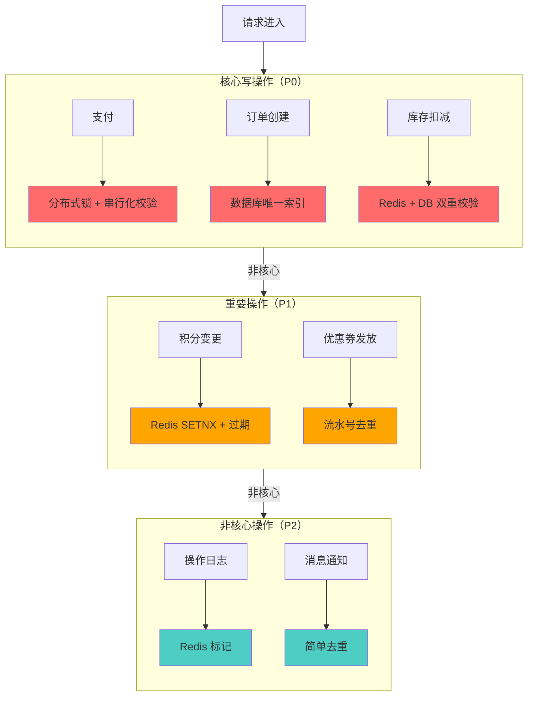
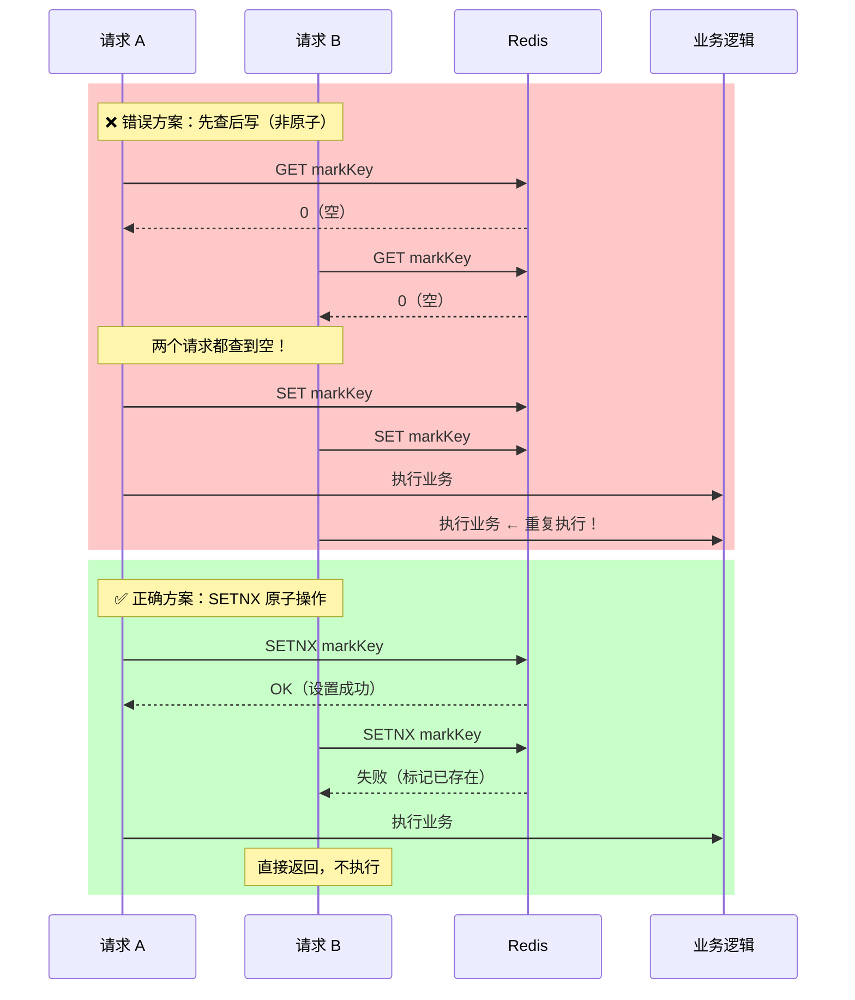
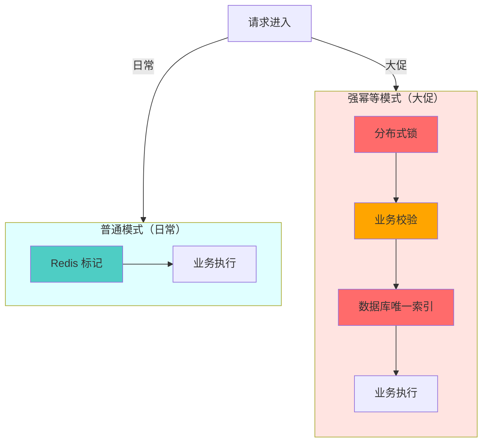
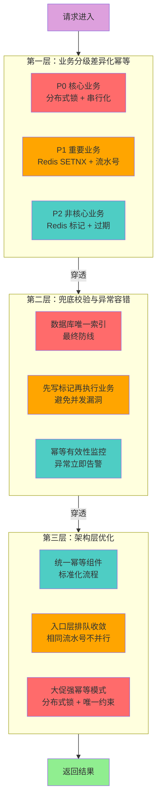
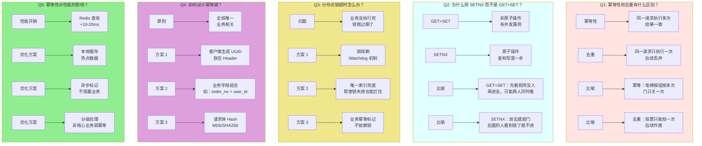
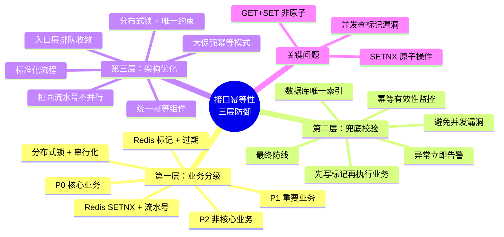
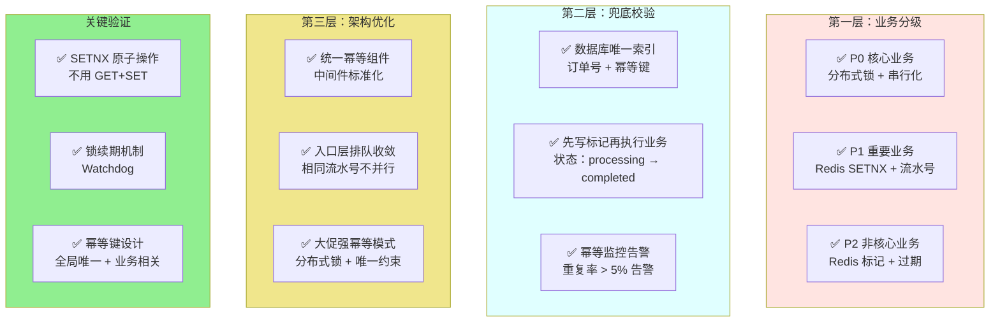
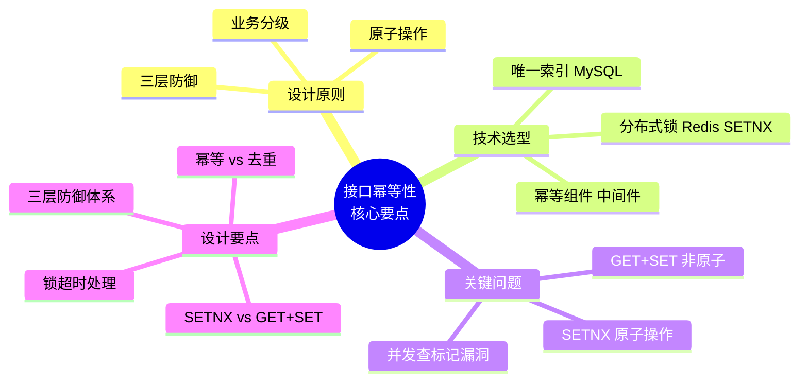

# 接口幂等性设计：三层防御体系

> **核心主题**：接口幂等性三层防御体系——业务分级差异化、原子操作、兜底校验与架构层优化

---

## 🎯 一句话定位

**接口幂等性解决什么问题？**
```
同一个请求发一次和发一百次，结果完全一样
就像电梯的"关门"按钮，按一次和狂按十次，门只会关一次
```

**生活化比喻**：
你去 ATM 取钱，输入"取 100 元"，按下确认键。突然网络卡顿，你又按了一次。如果没有幂等性保护，ATM 可能吐出 200 元——银行可不乐意看到这种情况。

**核心特点**：不是"不能重复调用"，而是"重复调用结果一致"。就像投票系统，一个人投一次和投一百次，最终只算一票。

---

## 💎 核心要点速览

> **快速掌握核心设计要点**

### 核心观点（3 层防御体系）

**1. 第一层：业务分级差异化幂等**
```
❌ 所有接口用同一套幂等方案（过度设计 or 保护不足）
✅ 按业务重要性分级处理：
   - 核心写操作（支付、订单、库存）：分布式锁 + 串行化校验
   - 非核心操作（积分、日志）：Redis 标记 + 过期时间
   - 拆分幂等粒度，按业务场景独立流水号
   
生活化比喻：
银行金库（核心业务）：指纹+密码+人脸三道验证
普通办公室（非核心）：刷卡就能进
```

**2. 第二层：兜底校验与异常容错**
```
- 数据库唯一索引作为最终防线（就像最后一道保险）
- 幂等有效性监控（发现失效立即告警）
- 先写标记再执行业务（避免并发漏洞）

生活化比喻：
消防系统：
- 烟感器（Redis 标记）→ 自动灭火（业务执行）
- 消防栓（数据库唯一索引）→ 最后一道防线
- 监控摄像头（幂等监控）→ 发现异常立即报警
```

**3. 第三层：架构层优化**
```
- 统一幂等组件：标准化 加锁 → 校验 → 标记 → 过期
- 入口层排队收敛：相同流水号不并行（像排队取号）
- 大促强幂等模式：分布式锁 + 唯一约束双重生效

生活化比喻：
地铁进站：
- 统一闸机（幂等组件）→ 刷卡 → 验证 → 放行
- 限流栅栏（排队收敛）→ 相同目的地不并行
- 高峰期双倍安检（强幂等）→ 分布式锁 + 唯一约束
```

**4. 关键问题：并发查标记的原子性漏洞**
```
❌ 先查 Redis 标记，发现为空，再写入标记（查和写非原子）
   并发场景：两个请求同时查到空，都执行了业务
   
✅ SETNX 原子操作 + 分布式锁
   SETNX = SET if Not eXists（原子操作，查和写是一步）
   
生活化比喻：
❌ 错误方案：先看看厕所有没有人（查），没人就进去（写）
   问题：两个人同时看，都看到没人，都进去了
   
✅ 正确方案：进去就锁门（SETNX），后来的人看到锁了就不进
```

**5. 幂等 vs 去重：别搞混了**
```
幂等性：同一请求执行多次，结果一致（允许执行多次，但结果相同）
去重：同一请求只执行一次（后续直接丢弃）

生活化比喻：
幂等性：电梯关门按钮，按多次门只关一次（结果一致）
去重：投票系统，一个人只能投一次（后续丢弃）
```

---

## 🚀 一句话精华（如果只能记住一句）

> **接口幂等性 = 业务分级（核心/非核心）+ 三层防御（Redis 标记 + 分布式锁 + 唯一索引）+ 原子操作（SETNX）**

---

## 一、为什么需要幂等性？

### 🎯 问题场景（30 秒版）

**生活化比喻**：
```
场景 1：网络抖动导致重复提交
你在淘宝下单，点击"支付"按钮，网络卡顿，你又点了一次。
如果没有幂等性，可能扣款两次，发货两份——你就"被消费"了。

场景 2：消息队列重复消费
支付系统发送 MQ 消息"扣款成功"，消费者收到两次。
如果没有幂等性，可能给用户加两次积分——用户乐了，公司亏了。

场景 3：分布式系统重试
RPC 调用超时，自动重试一次。
如果没有幂等性，可能创建两个订单——库存就乱了。
```

**技术问题**：
- ✅ **网络不可靠**：超时、重试、丢包
- ✅ **用户行为**：狂点按钮、刷新页面
- ✅ **系统容错**：MQ 重复投递、RPC 重试
- ✅ **分布式事务**：跨服务调用，部分失败重试

### ❌ 没有幂等性的后果

| 场景 | 后果 | 生活化比喻 | 严重程度 |
|------|------|------------|----------|
| **重复支付** | 扣款多次 | ATM 吐两次钱 | 🔴 致命 |
| **重复下单** | 创建多个订单 | 点一份菜上了三份 | 🔴 致命 |
| **重复扣库存** | 库存变负数 | 仓库里只有 10 个苹果，卖了 20 个 | 🔴 致命 |
| **重复发积分** | 用户薅羊毛 | 签到一次得 10 倍积分 | 🟡 严重 |
| **重复发短信** | 用户被骚扰 | 验证码发了 10 条 | 🟡 严重 |

---

## 二、第一层防御：业务分级差异化幂等

### ✅ 核心思路（30 秒版）

**生活化比喻**：
```
就像公司安全管理：
- 金库（核心业务）：指纹 + 密码 + 人脸三道验证（分布式锁 + 串行化）
- 普通办公室（非核心）：刷卡就能进（Redis 标记 + 过期）
- 会议室（中等级别）：预约系统（流水号控制）

不按业务重要性分级，要么过度设计（会议室也用金库标准），要么保护不足（金库用办公室标准）。
```

### 2.1 业务分级策略



**分级标准**：

| 业务等级 | 典型场景 | 幂等方案 | 性能要求 | 生活化比喻 |
|---------|---------|---------|---------|------------|
| **P0（核心）** | 支付、订单、库存 | 分布式锁 + 串行化 + 唯一索引 | 高（<50ms） | 金库三道验证 |
| **P1（重要）** | 积分、优惠券 | Redis SETNX + 流水号 | 中（<100ms） | 办公室刷卡 |
| **P2（非核心）** | 日志、通知 | Redis 标记 + 过期 | 低（<200ms） | 会议室预约 |

### 2.2 分布式锁实现（P0 核心业务）

**生活化比喻**：
```
分布式锁就像公共厕所的门锁：
1. 进去就锁门（加锁）
2. 其他人看到锁了，在外面等（阻塞）
3. 你上完厕所出来（释放锁）
4. 下一个人进去（获取锁）

关键：不能让两个人同时进去（互斥）
```

**Go 代码示例**：
```go
package idempotency

import (
    "context"
    "errors"
    "fmt"
    "time"

    "github.com/go-redis/redis/v8"
)

// IdempotencyService 幂等性服务
type IdempotencyService struct {
    redisClient *redis.Client
}

// NewIdempotencyService 创建幂等性服务
func NewIdempotencyService(redisClient *redis.Client) *IdempotencyService {
    return &IdempotencyService{
        redisClient: redisClient,
    }
}

// ExecuteWithLock 使用分布式锁执行幂等操作（P0 核心业务）
// 生活化比喻：金库操作流程——先锁门，再操作，最后开门
func (s *IdempotencyService) ExecuteWithLock(
    ctx context.Context,
    idempotencyKey string, // 幂等键（流水号）
    ttl time.Duration,     // 锁的过期时间
    businessFunc func() error, // 业务逻辑
) error {
    // 1. 加分布式锁（SETNX 原子操作）
    // 生活化比喻：进厕所就锁门
    lockKey := fmt.Sprintf("idempotency:lock:%s", idempotencyKey)
    
    // SETNX = SET if Not eXists（原子操作，查和写是一步）
    // 关键：不能用 GET + SET（非原子，有并发漏洞）
    ok, err := s.redisClient.SetNX(ctx, lockKey, "1", ttl).Result()
    if err != nil {
        return fmt.Errorf("加锁失败: %w", err)
    }
    
    if !ok {
        // 锁已存在，说明有请求正在处理
        // 生活化比喻：看到门锁了，等一会儿再来
        return errors.New("请求正在处理中，请勿重复提交")
    }
    
    // 2. 执行业务逻辑
    // 生活化比喻：锁门后安心上厕所
    defer func() {
        // 3. 释放锁（业务完成后）
        // 生活化比喻：上完厕所开门
        s.redisClient.Del(ctx, lockKey)
    }()
    
    return businessFunc()
}
```

### 2.3 Redis SETNX 标记（P1 重要业务）

**生活化比喻**：
```
Redis SETNX 就像签到表：
1. 第一次签到：签到表是空的，写上名字（SETNX 成功）
2. 第二次签到：看到名字已经在上面了，不重复签（SETNX 失败）
3. 第二天：签到表清空，重新签到（过期时间）

关键：签到是原子操作（看一眼 + 写名字是一步）
```

**Go 代码示例**：
```go
// ExecuteWithRedisMark 使用 Redis 标记执行幂等操作（P1 重要业务）
// 生活化比喻：签到表流程——看一眼，没签名就签上
func (s *IdempotencyService) ExecuteWithRedisMark(
    ctx context.Context,
    idempotencyKey string, // 幂等键（如：order_12345）
    ttl time.Duration,     // 标记过期时间
    businessFunc func() error, // 业务逻辑
) error {
    // 1. 检查是否已处理（SETNX 原子操作）
    // 生活化比喻：看看签到表上有没有你的名字
    markKey := fmt.Sprintf("idempotency:mark:%s", idempotencyKey)
    
    ok, err := s.redisClient.SetNX(ctx, markKey, "1", ttl).Result()
    if err != nil {
        return fmt.Errorf("设置标记失败: %w", err)
    }
    
    if !ok {
        // 标记已存在，说明已经处理过
        // 生活化比喻：签到表上已经有你的名字了，不用重复签
        return nil // 幂等返回，不报错
    }
    
    // 2. 执行业务逻辑
    // 生活化比喻：签到成功后开始干活
    err = businessFunc()
    if err != nil {
        // 业务失败，删除标记，允许重试
        // 生活化比喻：活没干成，把名字擦掉，下次重新来
        s.redisClient.Del(ctx, markKey)
        return err
    }
    
    return nil
}
```

### 2.4 关键问题：并发查标记的原子性漏洞

**❌ 错误方案（非原子操作）**：
```go
// 错误示范：先查后写，有并发漏洞
func (s *IdempotencyService) WrongApproach(
    ctx context.Context,
    idempotencyKey string,
    businessFunc func() error,
) error {
    markKey := fmt.Sprintf("idempotency:mark:%s", idempotencyKey)
    
    // ❌ 步骤 1：先查标记（GET）
    exists, err := s.redisClient.Exists(ctx, markKey).Result()
    if err != nil {
        return err
    }
    
    if exists > 0 {
        return nil // 已处理，幂等返回
    }
    
    // ❌ 问题：并发场景下，两个请求可能同时查到 exists=0
    // 生活化比喻：两个人同时看厕所，都看到没人
    
    // ❌ 步骤 2：再写标记（SET）
    s.redisClient.Set(ctx, markKey, "1", 24*time.Hour)
    
    return businessFunc()
}

// 并发问题分析：
// 请求 A：GET markKey → 0（空）
// 请求 B：GET markKey → 0（空）  ← 此时 A 还没来得及 SET
// 请求 A：SET markKey
// 请求 B：SET markKey  ← 两个请求都执行了业务！
```

**✅ 正确方案（SETNX 原子操作）**：
```go
// 正确方案：SETNX 原子操作（查和写是一步）
func (s *IdempotencyService) CorrectApproach(
    ctx context.Context,
    idempotencyKey string,
    businessFunc func() error,
) error {
    markKey := fmt.Sprintf("idempotency:mark:%s", idempotencyKey)
    
    // ✅ SETNX = SET if Not eXists（原子操作）
    // 生活化比喻：进厕所就锁门，后面的人看到锁了就不进
    ok, err := s.redisClient.SetNX(ctx, markKey, "1", 24*time.Hour).Result()
    if err != nil {
        return err
    }
    
    if !ok {
        // 标记已存在，幂等返回
        return nil
    }
    
    // 只有第一个请求能执行到这里
    return businessFunc()
}

// 并发问题分析（正确方案）：
// 请求 A：SETNX markKey → 成功（返回 true）
// 请求 B：SETNX markKey → 失败（返回 false，标记已存在）
// 请求 A：执行业务逻辑
// 请求 B：直接返回（不执行业务）
```



---

## 三、第二层防御：兜底校验与异常容错

### ✅ 核心思路（30 秒版）

**生活化比喻**：
```
第二层防御就像消防系统：
- 烟感器（Redis 标记）→ 自动灭火（业务执行）
- 消防栓（数据库唯一索引）→ 最后一道防线
- 监控摄像头（幂等监控）→ 发现异常立即报警

即使第一层防御失效（Redis 挂了、锁超时），第二层也能兜底。
```

### 3.1 数据库唯一索引（最终防线）

**生活化比喻**：
```
数据库唯一索引就像身份证系统：
- 每个人只能有一个身份证号（唯一约束）
- 即使有人试图重复办理，系统会拒绝（抛出异常）
- 这是最后一道防线，即使前端没校验，数据库也能拦住

关键：唯一索引是"数据库级别"的，不依赖应用代码。
```

**Go 代码示例**：
```go
package repository

import (
    "context"
    "database/sql"
    "errors"
    "fmt"

    "gorm.io/gorm"
)

// OrderRepository 订单仓库
type OrderRepository struct {
    db *gorm.DB
}

// CreateOrder 创建订单（使用唯一索引兜底）
// 生活化比喻：办理身份证——每个人只能办一次
func (r *OrderRepository) CreateOrder(
    ctx context.Context,
    order *Order,
) error {
    // 1. 尝试插入订单
    // 生活化比喻：去派出所办理身份证
    err := r.db.WithContext(ctx).Create(order).Error
    if err != nil {
        // 2. 检查是否是唯一索引冲突
        // 生活化比喻：警察说"你已经办过了"
        if errors.Is(err, gorm.ErrDuplicatedKey) {
            // 订单已存在，幂等返回
            return nil
        }
        return fmt.Errorf("创建订单失败: %w", err)
    }
    
    return nil
}

// Order 订单模型
type Order struct {
    gorm.Model
    OrderNo      string  `gorm:"uniqueIndex:idx_order_no"` // 订单号（唯一索引）
    UserID       uint    `gorm:"index"`
    Amount       float64
    Status       int
    IdempotentKey string `gorm:"uniqueIndex:idx_idempotent_key"` // 幂等键（唯一索引）
}
```

**SQL 示例**：
```sql
-- 订单表（带唯一索引）
CREATE TABLE orders (
    id BIGINT PRIMARY KEY AUTO_INCREMENT,
    order_no VARCHAR(64) NOT NULL,
    user_id BIGINT NOT NULL,
    amount DECIMAL(10, 2) NOT NULL,
    status TINYINT DEFAULT 0,
    idempotent_key VARCHAR(128) NOT NULL,  -- 幂等键
    created_at TIMESTAMP DEFAULT CURRENT_TIMESTAMP,
    updated_at TIMESTAMP DEFAULT CURRENT_TIMESTAMP ON UPDATE CURRENT_TIMESTAMP,
    
    -- 唯一索引（最终防线）
    UNIQUE INDEX idx_order_no (order_no),           -- 订单号唯一
    UNIQUE INDEX idx_idempotent_key (idempotent_key) -- 幂等键唯一
) ENGINE=InnoDB DEFAULT CHARSET=utf8mb4;

-- 即使应用层没校验，数据库也能拦住重复插入
-- 生活化比喻：即使你没带身份证，警察也能查出你是否办过
```

### 3.2 先写标记再执行业务

**生活化比喻**：
```
错误方案：先干活，再标记
- 你开始写作业，写完在作业本上写"已完成"
- 问题：写到一半断电了，下次不知道写没写完

正确方案：先标记，再干活
- 先在作业本上写"正在写"，然后开始写
- 写完改成"已完成"
- 问题：如果断电了，下次看到"正在写"，知道没写完，可以重来
```

**Go 代码示例**：
```go
// ProcessPayment 处理支付（先写标记再执行业务）
// 生活化比喻：先在作业本上写"正在写"，再开始写
func (s *PaymentService) ProcessPayment(
    ctx context.Context,
    payment *Payment,
) error {
    idempotencyKey := fmt.Sprintf("payment:%s", payment.OrderNo)
    
    // 1. 先写标记（状态：处理中）
    // 生活化比喻：在作业本上写"正在写"
    markKey := fmt.Sprintf("idempotency:mark:%s", idempotencyKey)
    ok, err := s.redisClient.SetNX(ctx, markKey, "processing", 24*time.Hour).Result()
    if err != nil {
        return fmt.Errorf("设置标记失败: %w", err)
    }
    
    if !ok {
        // 标记已存在，检查状态
        status, _ := s.redisClient.Get(ctx, markKey).Result()
        if status == "completed" {
            return nil // 已完成，幂等返回
        }
        if status == "processing" {
            return errors.New("支付处理中，请勿重复提交")
        }
    }
    
    // 2. 执行业务逻辑
    // 生活化比喻：开始写作业
    err = s.executePayment(ctx, payment)
    if err != nil {
        // 业务失败，删除标记，允许重试
        s.redisClient.Del(ctx, markKey)
        return err
    }
    
    // 3. 更新标记（状态：已完成）
    // 生活化比喻：作业写完，改成"已完成"
    s.redisClient.Set(ctx, markKey, "completed", 24*time.Hour)
    
    return nil
}
```

### 3.3 幂等有效性监控

**生活化比喻**：
```
幂等监控就像保安巡逻：
- 定期检查监控摄像头（统计幂等命中率）
- 发现异常立即报警（幂等失效率 > 0.1%）
- 记录异常情况（重复请求次数、原因）
```

**Go 代码示例**：
```go
package monitor

import (
    "context"
    "fmt"
    "time"

    "github.com/go-redis/redis/v8"
)

// IdempotencyMonitor 幂等性监控
type IdempotencyMonitor struct {
    redisClient *redis.Client
}

// RecordIdempotencyCheck 记录幂等检查
// 生活化比喻：保安记录每次检查的结果
func (m *IdempotencyMonitor) RecordIdempotencyCheck(
    ctx context.Context,
    idempotencyKey string,
    isDuplicate bool, // 是否重复请求
) {
    // 1. 统计总请求数
    totalKey := fmt.Sprintf("idempotency:total:%s", time.Now().Format("2006-01-02"))
    m.redisClient.Incr(ctx, totalKey)
    m.redisClient.Expire(ctx, totalKey, 7*24*time.Hour)
    
    // 2. 统计重复请求数
    if isDuplicate {
        duplicateKey := fmt.Sprintf("idempotency:duplicate:%s", time.Now().Format("2006-01-02"))
        m.redisClient.Incr(ctx, duplicateKey)
        m.redisClient.Expire(ctx, duplicateKey, 7*24*time.Hour)
    }
}

// CheckIdempotencyHealth 检查幂等性健康状况
// 生活化比喻：保安队长检查今天的巡逻记录
func (m *IdempotencyMonitor) CheckIdempotencyHealth(ctx context.Context) error {
    today := time.Now().Format("2006-01-02")
    
    // 1. 获取统计数据
    totalKey := fmt.Sprintf("idempotency:total:%s", today)
    duplicateKey := fmt.Sprintf("idempotency:duplicate:%s", today)
    
    total, _ := m.redisClient.Get(ctx, totalKey).Int64()
    duplicate, _ := m.redisClient.Get(ctx, duplicateKey).Int64()
    
    if total == 0 {
        return nil
    }
    
    // 2. 计算重复率
    duplicateRate := float64(duplicate) / float64(total) * 100
    
    // 3. 告警阈值
    if duplicateRate > 5 {
        // 重复率 > 5%，告警
        return fmt.Errorf("幂等性告警：重复率 %.2f%% 超过阈值 5%%", duplicateRate)
    }
    
    return nil
}
```

---

## 四、第三层防御：架构层优化

### ✅ 核心思路（30 秒版）

**生活化比喻**：
```
架构层优化就像地铁系统：
- 统一闸机（幂等组件）→ 所有乘客都要刷卡
- 限流栅栏（排队收敛）→ 相同目的地不并行
- 高峰期双倍安检（强幂等）→ 分布式锁 + 唯一约束双重生效
```

### 4.1 统一幂等组件

**生活化比喻**：
```
统一幂等组件就像标准化的闸机：
- 所有乘客都要刷卡（标准化流程）
- 刷卡流程：加锁 → 校验 → 标记 → 过期
- 不同业务场景复用同一套组件

好处：
- 代码复用（不用每个接口都写一遍）
- 易于维护（修改一处，全局生效）
- 降低出错（统一逻辑，减少 bug）
```

**Go 代码示例**：
```go
package middleware

import (
    "context"
    "net/http"
    "time"

    "github.com/gin-gonic/gin"
    "github.com/go-redis/redis/v8"
)

// IdempotencyMiddleware 幂等性中间件（统一组件）
// 生活化比喻：地铁闸机——所有乘客都要刷卡
type IdempotencyMiddleware struct {
    redisClient *redis.Client
}

// NewIdempotencyMiddleware 创建幂等中间件
func NewIdempotencyMiddleware(redisClient *redis.Client) *IdempotencyMiddleware {
    return &IdempotencyMiddleware{
        redisClient: redisClient,
    }
}

// IdempotencyCheck 幂等性检查（标准化流程）
// 生活化比喻：刷卡流程——加锁 → 校验 → 标记 → 过期
func (m *IdempotencyMiddleware) IdempotencyCheck() gin.HandlerFunc {
    return func(c *gin.Context) {
        // 1. 获取幂等键（从 Header 或 Body）
        // 生活化比喻：乘客刷卡
        idempotencyKey := c.GetHeader("X-Idempotency-Key")
        if idempotencyKey == "" {
            // 没有幂等键，跳过检查
            c.Next()
            return
        }
        
        // 2. 加锁（SETNX 原子操作）
        // 生活化比喻：闸机锁定
        lockKey := "idempotency:lock:" + idempotencyKey
        ok, err := m.redisClient.SetNX(
            c.Request.Context(),
            lockKey,
            "1",
            24*time.Hour,
        ).Result()
        
        if err != nil {
            c.JSON(http.StatusInternalServerError, gin.H{
                "error": "系统错误",
            })
            c.Abort()
            return
        }
        
        if !ok {
            // 锁已存在，重复请求
            // 生活化比喻：闸机已锁定，请等待
            c.JSON(http.StatusConflict, gin.H{
                "error": "请求正在处理中，请勿重复提交",
            })
            c.Abort()
            return
        }
        
        // 3. 继续处理请求
        // 生活化比喻：闸机打开，乘客进站
        c.Next()
        
        // 4. 请求完成后，释放锁
        // 生活化比喻：乘客出站，闸机解锁
        defer m.redisClient.Del(c.Request.Context(), lockKey)
    }
}
```

### 4.2 入口层排队收敛

**生活化比喻**：
```
排队收敛就像医院挂号：
- 同一个病人（相同流水号）不能同时看多个医生（不并行）
- 先挂号（排队），按顺序就诊（串行执行）
- 避免同一个请求被多个线程同时处理
```

**Go 代码示例**：
```go
package queue

import (
    "context"
    "sync"
    "time"

    "github.com/go-redis/redis/v8"
)

// RequestQueue 请求排队组件
// 生活化比喻：医院挂号系统——同一个病人不能同时看多个医生
type RequestQueue struct {
    redisClient *redis.Client
    localLocks  sync.Map // 本地锁（单机优化）
}

// Acquire 获取执行权限（排队）
// 生活化比喻：挂号——拿到号才能看病
func (q *RequestQueue) Acquire(
    ctx context.Context,
    idempotencyKey string,
    timeout time.Duration, // 等待超时
) (bool, error) {
    // 1. 先尝试本地锁（单机优化，快）
    // 生活化比喻：先在社区医院看看
    lock, _ := q.localLocks.LoadOrStore(idempotencyKey, &sync.Mutex{})
    mu := lock.(*sync.Mutex)
    
    if mu.TryLock() {
        return true, nil // 获取成功
    }
    
    // 2. 本地锁失败，尝试分布式锁（跨机器）
    // 生活化比喻：社区医院满了，去大医院
    lockKey := "queue:lock:" + idempotencyKey
    
    deadline := time.Now().Add(timeout)
    for time.Now().Before(deadline) {
        ok, err := q.redisClient.SetNX(
            ctx,
            lockKey,
            "1",
            timeout,
        ).Result()
        
        if err != nil {
            return false, err
        }
        
        if ok {
            return true, nil // 获取成功
        }
        
        // 等待一段时间重试
        time.Sleep(100 * time.Millisecond)
    }
    
    return false, nil // 超时，获取失败
}

// Release 释放执行权限
// 生活化比喻：看完病，退号
func (q *RequestQueue) Release(
    ctx context.Context,
    idempotencyKey string,
) {
    // 1. 释放本地锁
    if lock, ok := q.localLocks.Load(idempotencyKey); ok {
        mu := lock.(*sync.Mutex)
        mu.Unlock()
        q.localLocks.Delete(idempotencyKey)
    }
    
    // 2. 释放分布式锁
    lockKey := "queue:lock:" + idempotencyKey
    q.redisClient.Del(ctx, lockKey)
}
```

### 4.3 大促强幂等模式

**生活化比喻**：
```
大促强幂等就像双十一安检：
- 平时：刷身份证进站（普通幂等）
- 双十一：身份证 + 人脸识别 + 安检（强幂等）
- 分布式锁 + 唯一约束双重生效

好处：即使一层失效，另一层也能兜底。
```

**Go 代码示例**：
```go
// StrongIdempotency 强幂等模式（大促场景）
// 生活化比喻：双十一安检——身份证 + 人脸 + 安检三重验证
func (s *OrderService) CreateOrderStrong(
    ctx context.Context,
    order *Order,
) error {
    idempotencyKey := order.IdempotentKey
    
    // 第一层：分布式锁
    // 生活化比喻：刷身份证
    lockKey := "idempotency:lock:" + idempotencyKey
    ok, err := s.redisClient.SetNX(ctx, lockKey, "1", 24*time.Hour).Result()
    if err != nil {
        return err
    }
    if !ok {
        return errors.New("请求正在处理中")
    }
    defer s.redisClient.Del(ctx, lockKey)
    
    // 第二层：业务校验
    // 生活化比喻：人脸识别
    exists, err := s.orderRepo.ExistsByIdempotentKey(ctx, idempotencyKey)
    if err != nil {
        return err
    }
    if exists {
        return nil // 订单已存在，幂等返回
    }
    
    // 第三层：数据库唯一索引
    // 生活化比喻：安检
    err = s.orderRepo.Create(ctx, order)
    if err != nil {
        if errors.Is(err, gorm.ErrDuplicatedKey) {
            return nil // 唯一索引冲突，幂等返回
        }
        return err
    }
    
    return nil
}
```



---

## 五、三层防御体系全景图



---

## 六、技术深度追问



### 详细分析

**Q1: 幂等性和去重有什么区别？**  
**答**：
- **幂等性**：同一请求执行多次，结果一致。允许执行多次，但最终状态相同。就像电梯关门按钮，按一次和按十次，门只会关一次（结果一致）。
- **去重**：同一请求只执行一次，后续直接丢弃。就像投票系统，一个人只能投一次，第二次投的直接作废（不执行）。

**关键区别**：幂等性关注"结果一致"，去重关注"只执行一次"。

**Q2: 为什么用 SETNX 而不是 GET+SET？**  
**答**：因为 GET+SET 是非原子操作，有并发漏洞。

- **GET+SET（错误方案）**：先查标记（GET），发现为空，再写标记（SET）。并发场景下，两个请求可能同时查到空，都执行了业务。就像两个人同时看厕所，都看到没人，都进去了。
- **SETNX（正确方案）**：SET if Not eXists，原子操作，查和写是一步。第一个请求 SETNX 成功，第二个请求 SETNX 失败（标记已存在），直接返回。就像进去就锁门，后面的人看到锁了就不进。

**Q3: 分布式锁超时怎么办？**  
**答**：分布式锁超时是个经典问题，有三种方案：
1. **锁续期（Watchdog 机制）**：后台线程定期给锁续期，只要业务没执行完，锁就不会过期。就像上厕所快完了，自动延长冲水时间。
2. **唯一索引兜底**：即使锁失效，数据库唯一索引也能拦住重复插入。就像即使门锁坏了，身份证系统也能查出你是否办过。
3. **业务幂等标记**：不依赖锁，用业务字段（如订单号）做幂等标记。就像用身份证号做唯一标识，不依赖门锁。

**Q4: 如何设计幂等键？**  
**答**：幂等键设计有三个原则：全局唯一、业务相关、易于生成。
1. **客户端生成 UUID**：放在 Header（X-Idempotency-Key），每次请求携带。就像给每个请求发一个唯一身份证号。
2. **业务字段组合**：如 order_no + user_id，适合有明确业务标识的场景。就像用"姓名 + 身份证号"做唯一标识。
3. **请求体 Hash**：MD5/SHA256 请求体，适合请求体固定的场景。就像给请求内容生成一个"指纹"。

**Q5: 幂等性对性能的影响？**  
**答**：幂等性会带来一定性能开销，但可以通过优化降低影响：
- **性能开销**：Redis 查询增加 10-20ms 延迟。
- **优化方案 1**：本地缓存热点数据（如最近 5 分钟的幂等标记），减少 Redis 查询。
- **优化方案 2**：异步标记，业务执行完再异步更新幂等标记，不阻塞主流程。
- **优化方案 3**：分级处理，核心业务强幂等（分布式锁 + 唯一索引），非核心业务弱幂等（Redis 标记 + 过期）。

---

## 七、核心要点总结



**方案总结**：

> **接口幂等性设计采用三层防御体系**：
> 
> **第一层：业务分级差异化幂等**。P0 核心业务（支付、订单）用分布式锁 + 串行化校验；P1 重要业务（积分、优惠券）用 Redis SETNX + 流水号；P2 非核心业务（日志、通知）用 Redis 标记 + 过期时间。
> 
> **第二层：兜底校验与异常容错**。数据库唯一索引作为最终防线，即使 Redis 挂了也能拦住重复插入；先写标记再执行业务，避免并发漏洞；幂等有效性监控，发现失效立即告警。
> 
> **第三层：架构层优化**。统一幂等组件，标准化加锁→校验→标记→过期流程；入口层排队收敛，相同流水号不并行执行；大促强幂等模式，分布式锁 + 唯一约束双重生效。
> 
> **关键问题**：并发查标记时，GET+SET 非原子操作会导致两个请求同时查到空。解决方案是用 SETNX 原子操作（查和写是一步）+ 分布式锁。

---

## 八、生产环境 Checklist（部署检查清单）



**部署检查清单**：

| 类别 | 检查项 | 状态 | 生活化比喻 |
|------|--------|------|------------|
| **第一层：业务分级** | P0 核心业务：分布式锁 + 串行化 | ⬜ | 金库三道验证 |
| | P1 重要业务：Redis SETNX + 流水号 | ⬜ | 办公室刷卡 |
| | P2 非核心业务：Redis 标记 + 过期 | ⬜ | 会议室预约 |
| **第二层：兜底校验** | 数据库唯一索引（订单号 + 幂等键） | ⬜ | 身份证系统 |
| | 先写标记再执行业务（状态流转） | ⬜ | 先写"正在写"再写作业 |
| | 幂等监控告警（重复率 > 5%） | ⬜ | 保安巡逻 |
| **第三层：架构优化** | 统一幂等组件（中间件标准化） | ⬜ | 地铁闸机 |
| | 入口层排队收敛（相同流水号不并行） | ⬜ | 医院挂号 |
| | 大促强幂等模式（分布式锁 + 唯一约束） | ⬜ | 双十一安检 |
| **关键验证** | SETNX 原子操作（不用 GET+SET） | ⬜ | 进去就锁门 |
| | 锁续期机制（Watchdog） | ⬜ | 自动延长冲水时间 |
| | 幂等键设计（全局唯一 + 业务相关） | ⬜ | 身份证号 |

---

## 九、总结



### 🎯 一句话总结

> **接口幂等性 = 业务分级（P0/P1/P2）+ 三层防御（Redis 标记 + 分布式锁 + 唯一索引）+ 原子操作（SETNX）**

### 🧠 核心记忆点

1. **为什么要分三层？** 不同业务重要性不同，核心业务（支付）用金库标准，非核心业务（日志）用办公室标准。
2. **为什么用 SETNX？** 因为 GET+SET 非原子，有并发漏洞（两个人同时看厕所都看到没人）；SETNX 原子操作（进去就锁门）。
3. **三层防御的关系？** 第一层是业务分级，第二层是兜底校验（唯一索引），第三层是架构优化（统一组件）。
4. **幂等 vs 去重？** 幂等关注"结果一致"（电梯按钮按多次门只关一次），去重关注"只执行一次"（投票只能投一次）。

---

**参考视频**：[内卷的琪某人 - 面试经典：接口幂等性设计](https://v.douyin.com/)

---
