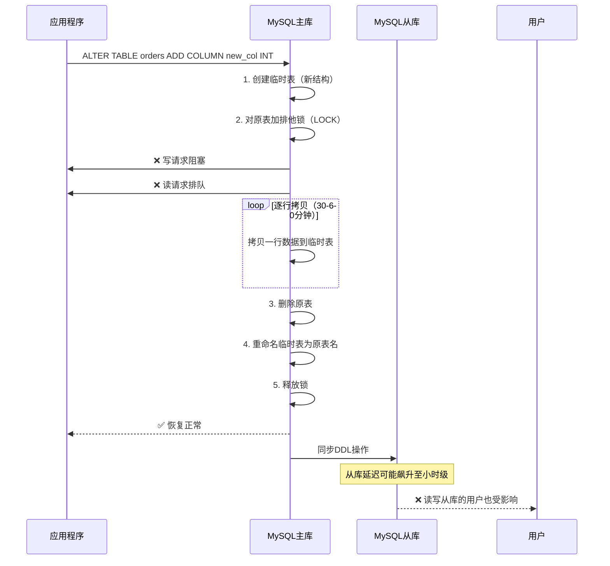
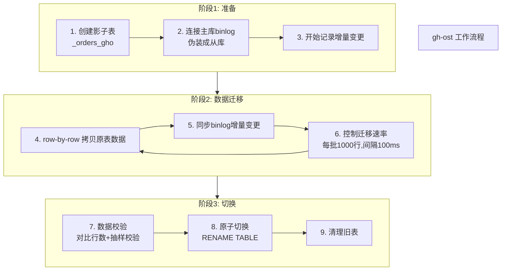
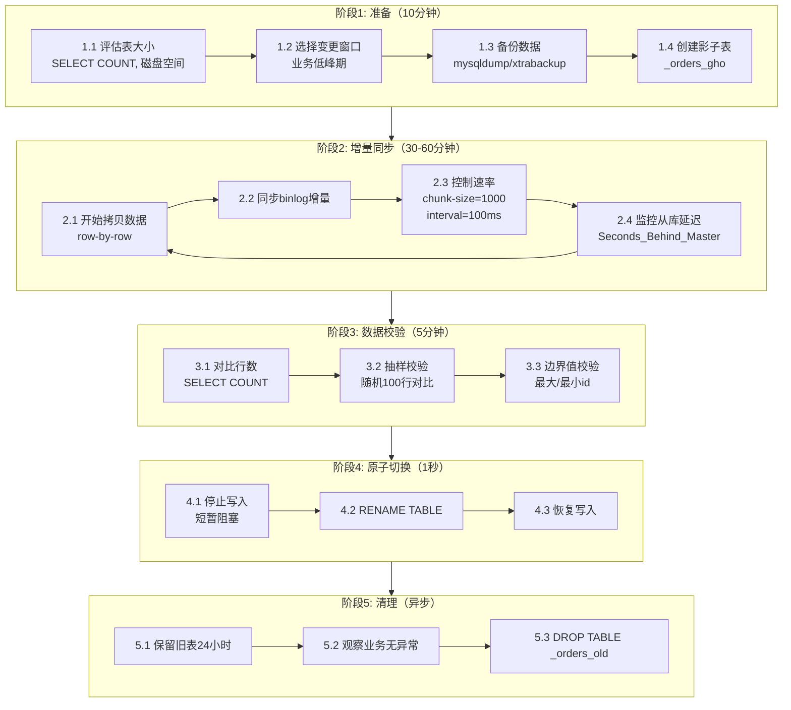
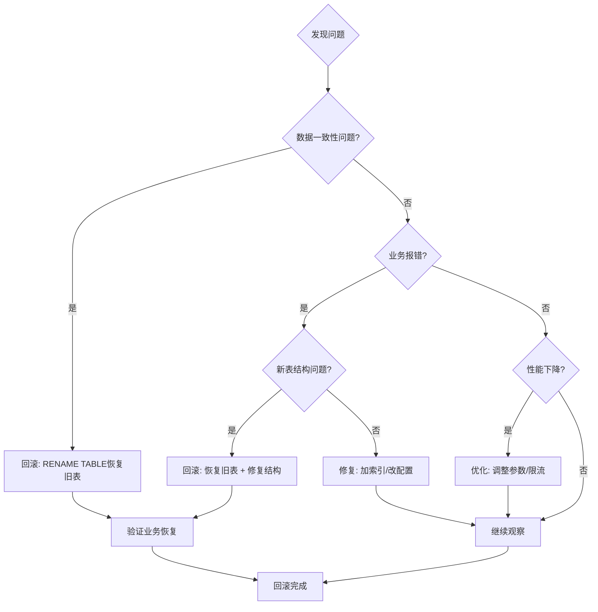
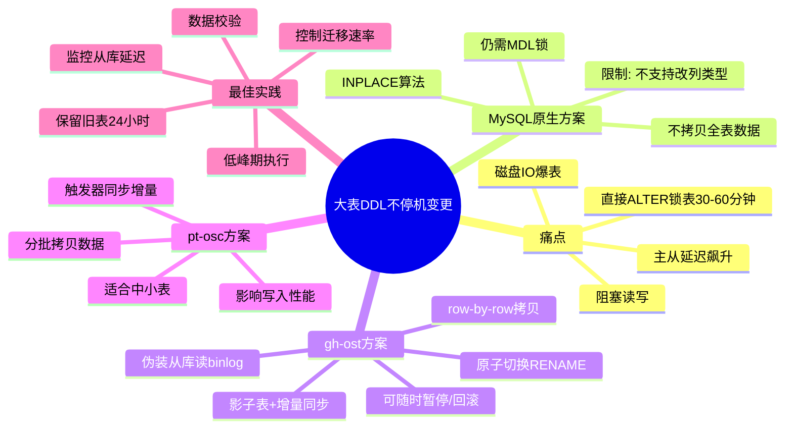
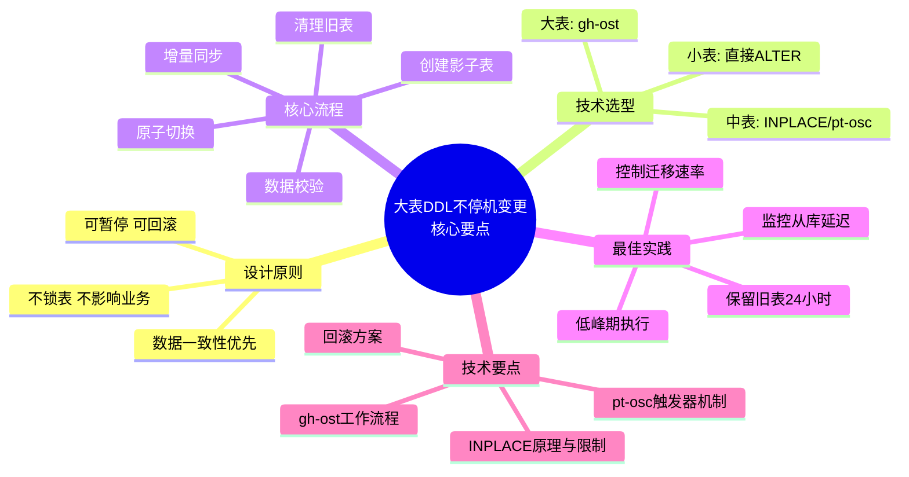

# 大表 DDL 不停机变更

> **核心主题**：大表 DDL 不停机变更——Online DDL 原理、gh-ost/pt-osc 影子表方案、锁表机制与回滚策略

---

## 🎯 一句话定位

**大表 DDL 不停机变更解决什么问题？**
```
线上有一张 5000 万行的订单表，你要加一个字段。
直接 ALTER TABLE？恭喜，你的数据库将进入"冻结"状态——
读写阻塞、主从延迟飙升、用户疯狂投诉。
这个问题就是：如何在不锁表、不影响业务的情况下，给大表做 DDL 变更？
```

**生活化比喻**：
就像给一栋正在营业的商场加装电梯——你不能先把商场关门三个月再施工，你得一边营业一边施工，顾客完全感知不到。

**核心特点**：大表 DDL 的痛点是**锁表时间长、阻塞读写、引发主从延迟**，就像给高速行驶的汽车换轮子。

---

## 💎 核心要点速览

> **快速掌握核心设计要点**

### 核心观点（5 个关键点）

**1. 大表直接 ALTER 为什么可怕？**
```
MySQL 默认 DDL 流程：
1. 创建临时表（新结构）
2. 锁住原表，不允许读写
3. 逐行拷贝数据到临时表
4. 删除原表，重命名临时表

5000 万行 ≈ 锁表 30-60 分钟
这段时间内：写请求超时、读请求排队、用户疯狂刷页面
```

**2. MySQL 原生 Online DDL（ALGORITHM=INPLACE）**
```
MySQL 5.6+ 支持：
ALTER TABLE t ADD COLUMN c INT, ALGORITHM=INPLACE;

优势：不需要拷贝全表数据，只修改元数据 + 增量日志
限制：
- 只支持部分操作（加列、加索引）
- 仍需 MDL 锁（Metadata Lock），阻塞其他 DDL
- 大表仍可能产生较长锁定期
```

**3. gh-ost：GitHub 的开源神器**
```
核心思路：
1. 创建影子表（ghost 表，新结构）
2. 伪装成从库，读 binlog 获取增量变更
3. row-by-row 拷贝原表数据到影子表
4. 数据校验一致后，原子切换（RENAME TABLE）

优势：不锁原表、可随时暂停/回滚、可控制迁移速度
```

**4. pt-osc（Percona Toolkit）方案**
```
核心思路：
1. 创建影子表
2. 拷贝数据（分批，每次 1000 行）
3. 用触发器同步增量数据
4. 完成后交换表名

优势：成熟稳定
缺点：触发器影响写入性能
```

**5. 生产最佳实践：分阶段变更**
```
创建影子表 → 增量同步 → 数据校验 → 原子切换 → 清理旧表

关键：
- 低峰期执行
- 控制拷贝速率（限流）
- 双写验证（新旧表同时写，对比结果）
- 保留旧表 24 小时（回滚用）
```

---

## 🚀 一句话精华（如果只能记住一句）

> **大表 DDL 不停机 = 影子表（新结构） + 增量同步（binlog/触发器） + 原子切换（RENAME TABLE） + 可回滚（保留旧表）**

---

## 一、大表直接 ALTER TABLE 的痛点

### ❌ 为什么 5000 万行表不能直接 ALTER？

**生活化比喻**：
```
直接 ALTER TABLE 就像：
你要给图书馆的所有书架换一个新的编号系统。
图书管理员说："所有人出去，我要关门三天重新整理。"
这三天里：
- 没人能借书（写阻塞）
- 没人能查书（读阻塞）
- 其他图书馆的分馆还在同步你的操作（主从延迟）

读者（用户）的反应：投诉！
```

**MySQL 默认 DDL 流程（Copy 算法）**：



**痛点量化**：

| 痛点 | 影响 | 严重程度 | 生活化比喻 |
|------|------|----------|------------|
| **锁表** | 5000 万行 ≈ 30-60 分钟不可写 | 🔴 致命 | 商场关门装修 |
| **阻塞读** | 部分引擎允许读，但性能骤降 | 🟠 严重 | 商场虽然开门但电梯停用 |
| **主从延迟** | DDL 在从库重放更慢，延迟飙升 | 🔴 致命 | 总店装修，分店也要跟着装 |
| **磁盘 IO 爆表** | 全表拷贝，IO 打满 | 🟠 严重 | 搬家时所有东西都搬到地上再捡起来 |
| **binlog 暴涨** | 产生大量 binlog | 🟡 中等 | 装修垃圾堆满楼道 |

### MySQL Online DDL（ALGORITHM=INPLACE）

**MySQL 5.6+ 支持的优化方案**：

```sql
-- 推荐方式
ALTER TABLE orders 
ADD COLUMN new_column INT, 
ALGORITHM=INPLACE, LOCK=NONE;

-- 参数说明
-- ALGORITHM=INPLACE: 不拷贝全表数据，只修改元数据
-- LOCK=NONE: 不加表级锁（允许并发读写）
```

**INPLACE 原理**：
```
传统 Copy 算法：
原表 → 逐行拷贝 → 临时表 → 替换原表
耗时：O(n)，n = 数据行数

INPLACE 算法：
原表 → 修改元数据 + 重建索引
耗时：O(1) ~ O(log n)
```

**生活化比喻**：
```
Copy 算法：把图书馆所有书搬到新书架，重新贴标签
INPLACE 算法：只改图书管理系统里的编号规则，书不动

哪个快？显然是 INPLACE！
```

**限制**：

| 操作类型 | INPLACE 支持 | 说明 |
|----------|-------------|------|
| 加列 | ✅ | 只修改元数据 |
| 加索引 | ✅ | 重建索引树 |
| 删列 | ✅ | 只修改元数据 |
| 修改列类型 | ❌ | 需要重建表 |
| 修改字符集 | ❌ | 需要重建表 |
| 加主键 | ❌ | 需要重建表 |

**关键限制：MDL 锁（Metadata Lock）**
```
即使 ALGORITHM=INPLACE, LOCK=NONE，
MySQL 仍需短暂获取 MDL 锁（元数据锁），用于：
- 开始阶段：获取 MDL 锁，创建临时结构
- 结束阶段：获取 MDL 锁，提交变更

如果此时有长事务持有 MDL 锁，DDL 会等待，
并且阻塞后续所有查询（因为 MDL 锁是队列化的）。

这就是为什么即使 INPLACE 也可能"卡住"的原因。
```

---

## 二、gh-ost：GitHub 开源的在线迁移工具

### ✅ 核心思路（30 秒版）

**生活化比喻**：
```
gh-ost 就像给正在营业的商场悄悄加装电梯：
1. 先建一个"影子商场"（影子表，新结构）
2. 派一个人站在原商场门口，记录每个进出的顾客（读 binlog）
3. 把这些顾客也引导到影子商场（增量同步）
4. 等所有人都到齐了，一瞬间把原商场的招牌换到影子商场上（原子切换）
5. 原商场拆除（清理旧表）

顾客（用户）全程无感知！
```



### 2.1 gh-ost 核心原理

**伪装从库读 binlog**：
```
gh-ost 的精妙之处：
1. 伪装成 MySQL 从库，向主库请求 binlog
2. 主库以为它是个普通从库，正常发送 binlog
3. gh-ost 解析 binlog，获得所有增量变更（INSERT/UPDATE/DELETE）
4. 将这些变更应用到影子表

好处：
- 不需要在原表上加触发器（触发器影响性能）
- 不需要修改原表任何数据
- 随时可以暂停/恢复
```

**影子表设计**：
```sql
-- gh-ost 自动创建
CREATE TABLE _orders_gho (
    -- 和原表 orders 结构一致，加上新字段
    id BIGINT PRIMARY KEY,
    user_id BIGINT,
    amount DECIMAL(10,2),
    new_column INT,  -- 你要加的新字段
    ...
);
```

**row-by-row 拷贝**：
```
原表：
id | user_id | amount
1  | 100     | 99.9
2  | 101     | 199.9
3  | 102     | 299.9

影子表（拷贝中）：
id | user_id | amount | new_column
1  | 100     | 99.9   | 0
2  | 101     | 199.9  | 0
（正在拷贝...）
```

**原子切换**：
```sql
-- gh-ost 最终执行的魔法
RENAME TABLE 
    orders TO _orders_old,
    _orders_gho TO orders;

-- 这个操作是原子的！
-- 在 MySQL 内部，只是一次元数据修改
-- 耗时 < 1 秒，对应用透明
```

**生活化比喻**：
```
原子切换就像：
你把旧房子的招牌"张记饭店"摘下来，
一瞬间挂到新房子上。
路人（用户）只看到招牌换了一下，
根本不知道房子已经换了。
```

### 2.2 gh-ost 使用示例

```bash
# 安装 gh-ost
go get github.com/github/gh-ost

# 执行迁移：给 orders 表加一个字段
gh-ost \
  --host=127.0.0.1 \
  --port=3306 \
  --user=ghost_user \
  --password=xxx \
  --database=mydb \
  --table=orders \
  --alter="ADD COLUMN new_column INT DEFAULT 0" \
  --allow-on-master \
  --max-load=Threads_running:50 \
  --chunk-size=1000 \
  --throttle-control-replicas="slave1:3306,slave2:3306" \
  --cut-over=atomic \
  --execute
```

**关键参数解释**：

| 参数 | 含义 | 生活化比喻 |
|------|------|------------|
| `--allow-on-master` | 允许在主库执行 | 直接在总部施工 |
| `--max-load` | 负载过高时暂停 | 商场人多时暂停施工 |
| `--chunk-size` | 每批拷贝行数 | 每次搬 1000 箱货 |
| `--throttle-control-replicas` | 监控从库延迟 | 看分店跟不跟得上 |
| `--cut-over=atomic` | 原子切换方式 | 一瞬间换招牌 |

---

## 三、pt-osc：Percona Toolkit 方案

### 3.1 核心原理

**pt-osc（Percona Toolkit Online Schema Change）** 是另一个成熟的方案：

```
pt-osc 流程：
1. 创建影子表 _orders_new
2. 修改影子表结构（加字段、加索引等）
3. 在原表上创建 3 个触发器（INSERT/UPDATE/DELETE）
4. 分批拷贝数据（每次 1000 行）
5. 触发器自动同步增量数据
6. 完成后交换表名
7. 删除触发器 + 旧表
```

**触发器同步**：
```sql
-- pt-osc 自动创建的触发器
CREATE TRIGGER pt_osc_mydb_orders_ins AFTER INSERT ON orders
FOR EACH ROW
BEGIN
    REPLACE INTO _orders_new (id, user_id, amount, new_col)
    VALUES (NEW.id, NEW.user_id, NEW.amount, NEW.new_col);
END;

CREATE TRIGGER pt_osc_mydb_orders_upd AFTER UPDATE ON orders
FOR EACH ROW
BEGIN
    -- 删除旧数据，插入新数据
    DELETE IGNORE FROM _orders_new WHERE id = OLD.id;
    REPLACE INTO _orders_new (id, user_id, amount, new_col)
    VALUES (NEW.id, NEW.user_id, NEW.amount, NEW.new_col);
END;

CREATE TRIGGER pt_osc_mydb_orders_del AFTER DELETE ON orders
FOR EACH ROW
BEGIN
    DELETE IGNORE FROM _orders_new WHERE id = OLD.id;
END;
```

**生活化比喻**：
```
pt-osc 的触发器就像：
你在搬家，但每天都有新快递寄到旧地址。
你在旧地址放了一个"快递转发员"（触发器），
每到一个新快递，他就转发到新地址。

优点：简单直接
缺点：转发员要工资（触发器影响写入性能）
```

### 3.2 gh-ost vs pt-osc 对比

| 特性 | gh-ost | pt-osc |
|------|--------|--------|
| **同步方式** | 读 binlog | 触发器 |
| **对原表影响** | ✅ 无（不加触发器） | ❌ 加 3 个触发器 |
| **写入性能影响** | ✅ 几乎无 | ❌ 写入下降 10-30% |
| **依赖主从架构** | ✅ 需要 binlog | ❌ 单机可用 |
| **暂停/恢复** | ✅ 随时暂停 | ❌ 暂停复杂 |
| **回滚能力** | ✅ 简单（删影子表） | ❌ 复杂（删触发器） |
| **社区活跃度** | ✅ GitHub 维护 | ⚠️ Percona 维护 |
| **适用场景** | 大表、高并发 | 中小表、无主从 |

**推荐选择**：
```
✅ 优先 gh-ost：大表（>1000万行）、主从架构、高并发写入
✅ 选择 pt-osc：中小表、单机环境、快速变更
⚠️ 两者都不用：小表（<100万行），直接 ALTER 即可
```

---

## 四、分阶段变更流程详解

### 4.1 完整流程



### 4.2 Go 代码示例：模拟 gh-ost 核心逻辑

```go
// TableMigrator 模拟 gh-ost 的核心迁移逻辑
type TableMigrator struct {
    sourceDB    *sql.DB
    targetDB    *sql.DB
    sourceTable string
    targetTable string
    batchSize   int
    batchInterval time.Duration
    logger      *log.Logger
}

// NewTableMigrator 创建迁移器
func NewTableMigrator(sourceDB, targetDB *sql.DB, sourceTable, targetTable string) *TableMigrator {
    return &TableMigrator{
        sourceDB:      sourceDB,
        targetDB:      targetDB,
        sourceTable:   sourceTable,
        targetTable:   targetTable,
        batchSize:     1000,           // 每批1000行
        batchInterval: 100 * time.Millisecond, // 批次间隔
        logger:        log.New(os.Stdout, "[migrator] ", log.LstdFlags),
    }
}

// Migrate 执行迁移
func (m *TableMigrator) Migrate(ctx context.Context) error {
    m.logger.Println("开始迁移...")
    
    // 阶段1: 获取最大ID
    var maxID int64
    err := m.sourceDB.QueryRow(
        fmt.Sprintf("SELECT MAX(id) FROM %s", m.sourceTable),
    ).Scan(&maxID)
    if err != nil {
        return fmt.Errorf("获取max id失败: %w", err)
    }
    m.logger.Printf("源表最大ID: %d\n", maxID)
    
    // 阶段2: 分批拷贝
    var lastID int64 = 0
    for lastID < maxID {
        select {
        case <-ctx.Done():
            return ctx.Err() // 支持取消
        default:
        }
        
        // 拷贝一批数据
        copied, err := m.copyBatch(ctx, lastID)
        if err != nil {
            return fmt.Errorf("拷贝批次失败: %w", err)
        }
        lastID = copied
        
        m.logger.Printf("已拷贝到ID: %d / %d (%.2f%%)", 
            lastID, maxID, float64(lastID)/float64(maxID)*100)
        
        // 控制速率，避免打满IO
        time.Sleep(m.batchInterval)
    }
    
    // 阶段3: 原子切换
    return m.atomicSwap(ctx)
}

// copyBatch 拷贝一批数据
func (m *TableMigrator) copyBatch(ctx context.Context, lastID int64) (int64, error) {
    // INSERT INTO target_table SELECT * FROM source_table 
    // WHERE id > last_id ORDER BY id LIMIT batch_size
    query := fmt.Sprintf(`
        INSERT INTO %s 
        SELECT * FROM %s 
        WHERE id > ? 
        ORDER BY id 
        LIMIT ?
    `, m.targetTable, m.sourceTable)
    
    result, err := m.targetDB.ExecContext(ctx, query, lastID, m.batchSize)
    if err != nil {
        return lastID, err
    }
    
    affected, _ := result.RowsAffected()
    if affected == 0 {
        return lastID, nil
    }
    
    // 获取本批最大ID
    var newLastID int64
    m.sourceDB.QueryRow(
        fmt.Sprintf("SELECT MAX(id) FROM %s WHERE id > ? LIMIT %d", 
            m.sourceTable, m.batchSize),
        lastID,
    ).Scan(&newLastID)
    
    return newLastID, nil
}

// atomicSwap 原子切换表名
func (m *TableMigrator) atomicSwap(ctx context.Context) error {
    m.logger.Println("开始原子切换...")
    
    // RENAME TABLE 是原子操作
    // orders -> _orders_old, _orders_gho -> orders
    query := fmt.Sprintf(`
        RENAME TABLE 
            %s TO %s_old,
            %s TO %s
    `, m.sourceTable, m.sourceTable, m.targetTable, m.sourceTable)
    
    _, err := m.targetDB.ExecContext(ctx, query)
    if err != nil {
        return fmt.Errorf("原子切换失败: %w", err)
    }
    
    m.logger.Println("原子切换成功！")
    return nil
}
```

---

## 五、回滚方案与风险点

### 5.1 回滚方案

**生活化比喻**：
```
回滚就像：
你搬到了新家，发现新家有问题（漏水、噪音等）。
你的预案：
1. 旧家别拆，保留 24 小时（保留旧表）
2. 如果发现新家有问题，立刻搬回去（RENAME TABLE 换回来）
3. 搬家前备份重要物品（变更前备份）
```

**回滚步骤**：
```sql
-- 1. 发现问题，需要回滚
-- 2. 把新表改名，旧表恢复
RENAME TABLE 
    orders TO _orders_broken,      -- 新表改名
    _orders_old TO orders;         -- 旧表恢复

-- 3. 验证旧表数据
SELECT COUNT(*) FROM orders;

-- 4. 业务恢复正常后，删除新表
DROP TABLE _orders_broken;
```

**回滚决策树**：



### 5.2 常见风险点

| 风险 | 原因 | 预防措施 | 生活化比喻 |
|------|------|----------|------------|
| **切换失败** | RENAME TABLE 时有长事务 | 切换前等待事务结束 | 换招牌时有人还在吃饭 |
| **数据不一致** | binlog 丢失或解析错误 | 切换前对比行数 + 抽样校验 | 搬家后发现少了个箱子 |
| **从库延迟飙升** | DDL 在从库重放更慢 | 监控从库延迟，必要时暂停 | 总店装修，分店跟不上 |
| **磁盘空间不足** | 影子表 + 旧表同时存在 | 提前检查磁盘空间 | 新家旧家同时租房，钱不够 |
| **触发器性能下降** | pt-osc 的触发器影响写入 | 优先用 gh-ost | 快递转发员要工资 |
| **主键冲突** | 增量同步时有并发写入 | gh-ost 通过 binlog 保证一致 | 搬家时新地址有人抢门 |

---

## 六、生产环境最佳实践

### 6.1 变更检查清单

**变更前**：

| 检查项 | 具体操作 | 状态 |
|--------|----------|------|
| 表大小评估 | `SELECT COUNT(*), SUM(data_length) FROM information_schema.tables` | ⬜ |
| 磁盘空间 | 确保剩余空间 > 表大小 × 2 | ⬜ |
| 从库延迟 | `SHOW SLAVE STATUS`，确保延迟 < 10s | ⬜ |
| 备份数据 | mysqldump 或 xtrabackup 全量备份 | ⬜ |
| 变更窗口 | 选择业务低峰期（凌晨 2-5 点） | ⬜ |
| 回滚方案 | 准备回滚 SQL + 回滚流程文档 | ⬜ |
| 监控告警 | 配置从库延迟、慢查询、连接数告警 | ⬜ |

**变更中**：

| 检查项 | 具体操作 | 状态 |
|--------|----------|------|
| 控制速率 | chunk-size=1000，interval=100ms | ⬜ |
| 监控负载 | Threads_running < 50 | ⬜ |
| 监控从库 | Seconds_Behind_Master < 30 | ⬜ |
| 随时暂停 | 发现异常立即暂停（Ctrl+C） | ⬜ |

**变更后**：

| 检查项 | 具体操作 | 状态 |
|--------|----------|------|
| 数据校验 | 对比新旧表行数、抽样校验 | ⬜ |
| 业务验证 | 核心接口回归测试 | ⬜ |
| 保留旧表 | 保留 24 小时，观察无异常再删除 | ⬜ |
| 清理资源 | DROP TABLE 旧表 | ⬜ |

### 6.2 生产环境 Go 代码：监控从库延迟

```go
// ReplicaMonitor 监控从库延迟
type ReplicaMonitor struct {
    db             *sql.DB
    maxDelaySecond int
    onDelay        func(delay int)
}

// NewReplicaMonitor 创建监控器
func NewReplicaMonitor(db *sql.DB, maxDelaySecond int) *ReplicaMonitor {
    return &ReplicaMonitor{
        db:             db,
        maxDelaySecond: maxDelaySecond,
    }
}

// CheckDelay 检查从库延迟
func (m *ReplicaMonitor) CheckDelay(ctx context.Context) (int, error) {
    var delay int
    err := m.db.QueryRowContext(ctx, `
        SELECT COALESCE(MAX(Seconds_Behind_Master), 0)
        FROM information_schema.processlist
        WHERE command = 'Slave_SQL_Running'
    `).Scan(&delay)
    if err != nil {
        return 0, fmt.Errorf("查询从库延迟失败: %w", err)
    }
    return delay, nil
}

// ShouldThrottle 判断是否应该暂停迁移
func (m *ReplicaMonitor) ShouldThrottle(ctx context.Context) (bool, int, error) {
    delay, err := m.CheckDelay(ctx)
    if err != nil {
        return false, 0, err
    }
    
    // 从库延迟超过阈值，暂停迁移
    if delay > m.maxDelaySecond {
        return true, delay, nil
    }
    return false, delay, nil
}
```

### 6.3 双写验证方案

```go
// DualWriteValidator 双写验证器
// 在切换前，同时写入新旧表，对比结果
type DualWriteValidator struct {
    oldTable string
    newTable string
    db       *sql.DB
    sampleSize int
}

// Validate 执行数据校验
func (v *DualWriteValidator) Validate(ctx context.Context) error {
    // 1. 对比行数
    var oldCount, newCount int64
    v.db.QueryRow(fmt.Sprintf("SELECT COUNT(*) FROM %s", v.oldTable)).Scan(&oldCount)
    v.db.QueryRow(fmt.Sprintf("SELECT COUNT(*) FROM %s", v.newTable)).Scan(&newCount)
    
    if oldCount != newCount {
        return fmt.Errorf("行数不一致: 旧表=%d, 新表=%d", oldCount, newCount)
    }
    
    // 2. 抽样校验（随机100行）
    rows, err := v.db.QueryContext(ctx, fmt.Sprintf(`
        SELECT o.id, o.user_id, o.amount, n.id, n.user_id, n.amount
        FROM %s o
        JOIN %s n ON o.id = n.id
        ORDER BY RAND()
        LIMIT ?
    `, v.oldTable, v.newTable), v.sampleSize)
    if err != nil {
        return err
    }
    defer rows.Close()
    
    for rows.Next() {
        var oldID, newID int64
        var oldUserID, newUserID int64
        var oldAmount, newAmount float64
        
        if err := rows.Scan(&oldID, &oldUserID, &oldAmount, &newID, &newUserID, &newAmount); err != nil {
            return err
        }
        
        if oldUserID != newUserID || oldAmount != newAmount {
            return fmt.Errorf("数据不一致: id=%d, 旧=(%d,%.2f), 新=(%d,%.2f)",
                oldID, oldUserID, oldAmount, newUserID, newAmount)
        }
    }
    
    return nil
}
```

---

## 七、技术深度追问

```mermaid
graph TB
    subgraph Q1["Q1: INPLACE为什么还需要锁?"]
        A1[INPLACE只修改元数据] --> A2[但需要修改表结构定义]
        A2 --> A3[获取MDL锁防止并发DDL]
        A3 --> A4[长事务持有MDL会阻塞DDL]
        A4 --> A5[DDL等待MDL又阻塞后续查询]
    end
    
    subgraph Q2["Q2: gh-ost如何保证数据一致?"]
        B1[binlog是有序的] --> B2[按事务顺序重放]
        B2 --> B3[拷贝完成时检查binlog位点]
        B3 --> B4[位点追上主库=数据一致]
        B4 --> B5[切换前对比行数+抽样校验]
    end
    
    subgraph Q3["Q3: 切换时如何处理长事务?"]
        C1[等待所有活跃事务结束] --> C2[设置超时时间]
        C2 --> C3[超时则kill事务]
        C3 --> C4[kill后立刻切换]
        C4 --> C5[切换完成后恢复写入]
    end
    
    subgraph Q4["Q4: 主从架构如何选择方案?"]
        D1[有主从] --> D2[优先gh-ost]
        D1 --> D3[pt-osc也可以]
        D4[无从库] --> D5[pt-osc或INPLACE]
        D4 --> D6[gh-ost需要改造]
    end
    
    subgraph Q5["Q5: 回滚的最佳时机?"]
        E1[切换前发现问题] --> E2[直接停止,删影子表]
        E1 --> E3[切换后发现问题] --> E4[RENAME TABLE恢复旧表]
        E4 --> E5[保留旧表24小时]
        E5 --> E6[24小时后无法回滚]
    end
    
    style Q1 fill:#FFE4E1
    style Q2 fill:#E0FFFF
    style Q3 fill:#F0E68C
    style Q4 fill:#DDA0DD
    style Q5 fill:#90EE90
```



### 详细分析

**Q1: MySQL INPLACE 为什么还需要锁？**  
**答**：INPLACE 算法只修改元数据和索引树，不需要拷贝全表数据，所以锁的时间很短。但仍需获取 MDL（Metadata Lock）锁，原因是：
- **开始阶段**：需要修改表的元数据定义（比如新增字段的定义），必须阻止其他 DDL
- **结束阶段**：需要提交变更，必须短暂阻塞读写（通常 < 1 秒）

如果此时有长事务持有 MDL 锁，DDL 会等待，并且由于 MDL 锁是队列化的，后续所有查询都会被阻塞。这就是为什么即使 INPLACE 也可能"卡住"的原因。

**Q2: gh-ost 如何保证数据一致性？**  
**答**：gh-ost 通过以下机制保证一致性：
1. **binlog 有序性**：binlog 是按事务顺序写入的，gh-ost 按顺序重放，保证一致性
2. **位点追踪**：gh-ost 记录当前处理到的 binlog 位点，当位点追上主库时，说明增量已追平
3. **切换前校验**：对比新旧表行数 + 抽样校验（随机 100 行对比），确保数据一致
4. **原子切换**：RENAME TABLE 是原子操作，切换过程中不会有数据丢失

**Q3: 切换时如何处理长事务？**  
**答**：
1. **等待事务结束**：切换前检查活跃事务，等待它们自然结束
2. **设置超时**：如果事务长时间不结束（比如超过 10 秒），考虑 kill 掉
3. **Kill 策略**：优先 kill 只读事务，写事务谨慎处理
4. **切换完成后**：恢复写入，监控业务是否正常

**Q4: 主从架构如何选择方案？**  
**答**：
- **有主从架构**：优先 gh-ost，因为它利用 binlog 同步，不增加主库负担
- **无从库（单机）**：选择 pt-osc 或 MySQL INPLACE
- **小表（<100 万行）**：直接 ALTER，没必要用复杂工具

**Q5: 回滚的最佳时机？**  
**答**：
- **切换前发现问题**：直接停止迁移，删除影子表即可，对业务零影响
- **切换后发现问题**：立刻 RENAME TABLE 恢复旧表（旧表保留 24 小时）
- **24 小时后**：旧表已删除，无法回滚，只能通过备份恢复（代价大）

---

## 八、核心要点总结



**方案总结**：

> **痛点**：大表直接 ALTER TABLE 会锁表 30-60 分钟，阻塞读写，主从延迟飙升。
> 
> **MySQL 原生方案**：INPLACE 算法不拷贝全表数据，只修改元数据，但仍需短暂 MDL 锁，且不支持所有操作（如改列类型）。
> 
> **gh-ost 方案**：GitHub 开源工具，伪装成从库读 binlog，创建影子表，row-by-row 拷贝数据，增量同步 binlog 变更，最后原子切换（RENAME TABLE）。优势是不锁原表、可随时暂停/回滚。
> 
> **pt-osc 方案**：通过触发器同步增量数据，分批拷贝，适合中小表，但触发器影响写入性能。
> 
> **最佳实践**：低峰期执行，控制迁移速率，切换前数据校验，保留旧表 24 小时用于回滚。

---

## 九、生产环境 Checklist（部署检查清单）


**部署检查清单**：

| 阶段 | 类别 | 检查项 | 状态 | 生活化比喻 |
|------|------|--------|------|------------|
| **变更前** | 评估 | 表大小评估 | ⬜ | 量体裁衣 |
| | | 磁盘空间检查 | ⬜ | 确认新家够大 |
| | | 从库延迟检查 | ⬜ | 确认分店跟得上 |
| | 准备 | 数据备份 | ⬜ | 重要物品打包 |
| | | 选择低峰期 | ⬜ | 选择淡季搬家 |
| | | 回滚方案准备 | ⬜ | 旧家别拆 |
| **变更中** | 控制 | 控制迁移速率 | ⬜ | 慢慢搬，别着急 |
| | 监控 | 监控主库负载 | ⬜ | 看总部忙不忙 |
| | | 监控从库延迟 | ⬜ | 看分店跟不跟得上 |
| | 应急 | 随时可暂停 | ⬜ | 发现问题立刻停 |
| **变更后** | 验证 | 数据校验 | ⬜ | 清点物品 |
| | | 业务验证 | ⬜ | 试试新店能不能营业 |
| | 清理 | 保留旧表 24 小时 | ⬜ | 旧家保留一天 |
| | | 24 小时后删除旧表 | ⬜ | 确认没问题再拆旧家 |

---

## 十、总结



### 🎯 一句话总结

> **大表 DDL 不停机 = 影子表（新结构） + 增量同步（binlog/触发器） + 原子切换（RENAME TABLE） + 可回滚（保留旧表）**

### 🧠 核心记忆点

1. **为什么不能直接 ALTER？** 会锁表 30-60 分钟，阻塞读写，就像商场关门装修。
2. **INPLACE 为什么还要锁？** 需要短暂 MDL 锁修改元数据，但时间很短（<1 秒）。
3. **gh-ost 核心原理？** 伪装从库读 binlog，影子表增量同步，原子切换。
4. **pt-osc vs gh-ost？** pt-osc 用触发器同步，影响写入性能；gh-ost 读 binlog，几乎无影响。
5. **回滚最佳时机？** 切换前直接停止，切换后 RENAME TABLE 恢复旧表（保留 24 小时）。

---
