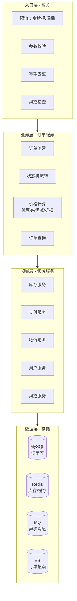
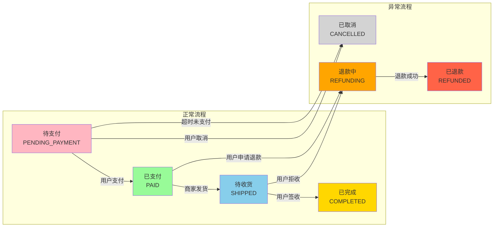
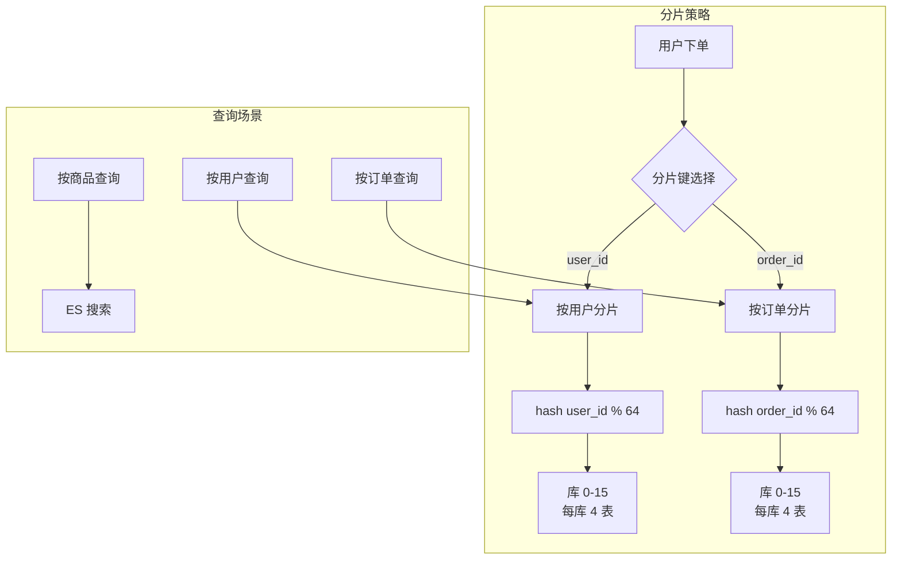
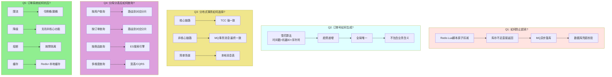
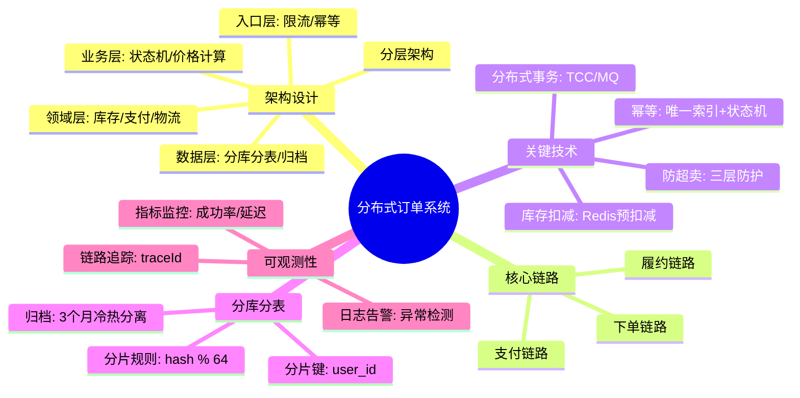
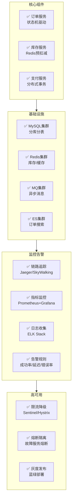
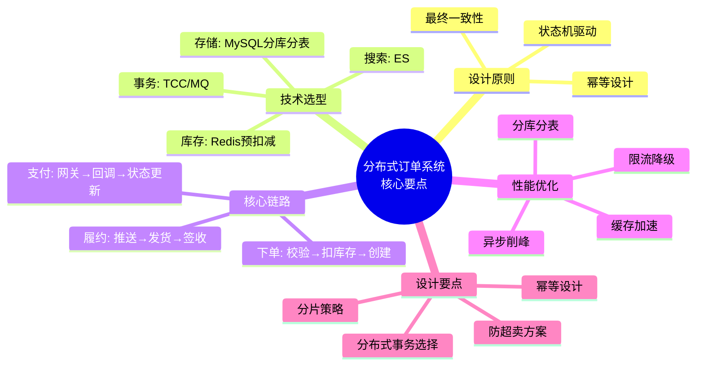

# 分布式订单系统

> **核心主题**：分布式订单系统——订单状态机、库存扣减与防超卖、分布式事务、幂等设计、分库分表

---

## 🎯 一句话定位

**分布式订单系统解决什么问题？**
```
用户点击"下单"按钮后，系统要在 200ms 内完成：
1. 校验库存够不够
2. 扣减库存（不能超卖）
3. 生成唯一订单号
4. 计算价格（优惠券、满减、折扣）
5. 创建订单记录
6. 通知下游系统（支付、物流、风控）

这就像在双 11 零点，100 万人同时抢 1000 台 iPhone——
既要快、又要准、还不能卖超。
```

**生活化比喻**：
就像开一家超级餐厅，高峰期要同时处理：
- 前台点单（下单）
- 厨房做菜（履约）
- 收银结账（支付）
- 外卖配送（物流）
- 会员管理（用户中心）

**核心特点**：高并发、强一致性、状态复杂、链路长，就像管理一个高效运转的生态系统。

---

## 💎 核心要点速览

> **快速掌握核心设计要点**

### 核心观点（6 个关键点）

**1. 订单系统分层架构**
```
入口层：网关限流、参数校验、幂等去重
业务层：订单创建、状态机流转、价格计算
领域层：库存、支付、物流、风控
数据层：分库分表、读写分离、归档
```

**2. 订单状态机设计**
```
核心状态：待支付 → 已支付 → 待发货 → 已发货 → 已完成
异常状态：已取消、已退款、已关闭

关键原则：
- 状态只能正向流转，不能逆向
- 每次状态变更记录流水（审计日志）
- 幂等：同一状态变更请求多次，结果一致
```

**3. 库存扣减：防超卖的三种方案**
```
方案1: 数据库悲观锁（SELECT ... FOR UPDATE）
方案2: Redis 预扣减 + MQ 异步落库
方案3: 分段锁（将库存分成 10 份，分散竞争）

推荐：Redis 预扣减 + MQ 异步（性能最高，抗 10 万+ QPS）
```

**4. 分布式事务保障**
```
强一致：TCC（Try-Confirm-Cancel）
最终一致：MQ 事务消息（RocketMQ）
最简方案：本地消息表 + 定时补偿

推荐：核心链路用 TCC，非核心用 MQ 事务消息
```

**5. 订单分库分表**
```
分片键：user_id（按用户分片）
分片规则：hash(user_id) % 64
单表数据量：< 500 万行

归档策略：
- 3 个月前订单归档到历史库
- 按月份分区，过期直接 DROP PARTITION
```

**6. 订单系统可观测性**
```
链路追踪：每个订单一个 traceId，贯穿全链路
指标监控：下单成功率、支付转化率、超时率
日志告警：状态变更异常、库存不足、支付失败
```

---

## 🚀 一句话精华（如果只能记住一句）

> **分布式订单系统 = 状态机驱动（状态只能正向流转） + Redis 预扣减（防超卖） + 分布式事务（保障一致性） + 分库分表（扛海量数据） + 全链路可观测（问题定位）**

---

## 一、订单系统架构设计

### 1.1 分层架构（全景视图）

**生活化比喻**：
```
订单系统就像一家大餐厅：
- 入口层（网关）：门口保安，检查你是否预约、限流
- 业务层（订单服务）：服务员，接单、下单、跟踪进度
- 领域层（库存/支付/物流）：厨房、收银、外卖员
- 数据层（MySQL/Redis/MQ）：仓库、账本、对讲机
```



### 1.2 核心链路

**下单链路**：
```
用户下单 → 参数校验 → 库存预扣（Redis） → 价格计算 → 创建订单 → MQ异步通知
           ↓              ↓                  ↓           ↓
         幂等去重      库存不足返回        优惠券核销    订单入库
```

**支付链路**：
```
用户支付 → 支付网关 → 第三方支付 → 回调通知 → 更新订单状态 → 扣减库存确认
           ↓                        ↓            ↓
         防重放                  验签         状态机流转
```

**履约链路**：
```
订单支付 → 推送仓库 → 拣货打包 → 发货 → 物流跟踪 → 签收确认
           ↓                        ↓              ↓
         库存确认               物流单号入库    状态更新
```

### 1.3 存储体系

| 存储组件 | 用途 | 数据结构 | 生活化比喻 |
|----------|------|----------|------------|
| **MySQL** | 订单持久化 | InnoDB 表 | 账本（永久保存） |
| **Redis** | 库存预扣、订单缓存 | String/Hash | 快速计数器 |
| **RocketMQ** | 异步通知、事务消息 | Topic/Queue | 对讲机（异步沟通） |
| **Elasticsearch** | 订单搜索、复杂查询 | 倒排索引 | 搜索引擎 |
| **TiDB** | 分布式订单库（大规模） | 分布式数据库 | 超级账本 |

---

## 二、订单状态机设计

### 2.1 状态机定义

**生活化比喻**：
```
订单状态就像人的成长过程：
婴儿（待支付） → 幼儿（已支付） → 学生（待发货） → 工作者（已发货） → 退休（已完成）

你不能从"退休"回到"婴儿"，
订单也不能从"已完成"回到"待支付"。
状态只能正向流转！
```



### 2.2 状态机代码实现（Go）

```go
// OrderStatus 订单状态
type OrderStatus int

const (
    StatusPendingPayment OrderStatus = iota // 待支付
    StatusPaid                              // 已支付
    StatusShipped                           // 待收货
    StatusCompleted                         // 已完成
    StatusCancelled                         // 已取消
    StatusRefunding                         // 退款中
    StatusRefunded                          // 已退款
)

// StateTransition 状态转换规则
var StateTransition = map[OrderStatus][]OrderStatus{
    StatusPendingPayment: {StatusPaid, StatusCancelled},
    StatusPaid:           {StatusShipped, StatusRefunding},
    StatusShipped:        {StatusCompleted, StatusRefunding},
    StatusCompleted:      {},  // 终态
    StatusCancelled:      {},  // 终态
    StatusRefunding:      {StatusRefunded},
    StatusRefunded:       {},  // 终态
}

// CanTransition 检查状态转换是否合法
func CanTransition(from, to OrderStatus) bool {
    allowed, exists := StateTransition[from]
    if !exists {
        return false
    }
    for _, status := range allowed {
        if status == to {
            return true
        }
    }
    return false
}

// TransitionOrder 执行状态转换
func TransitionOrder(order *Order, newStatus OrderStatus) error {
    // 1. 检查状态转换是否合法
    if !CanTransition(order.Status, newStatus) {
        return fmt.Errorf("非法状态转换: %d -> %d", order.Status, newStatus)
    }
    
    // 2. 记录状态变更流水（审计日志）
    flow := &OrderStatusFlow{
        OrderID:   order.ID,
        FromStatus: order.Status,
        ToStatus:   newStatus,
        Operator:  "system",
        CreatedAt: time.Now(),
    }
    if err := db.Create(flow).Error; err != nil {
        return fmt.Errorf("记录状态流水失败: %w", err)
    }
    
    // 3. 更新订单状态
    order.Status = newStatus
    return db.Save(order).Error
}
```

### 2.3 幂等设计

**为什么需要幂等？**
```
生活化比喻：
你在 ATM 取款，输入密码后机器吐钱。
如果网络抖动，你的请求被发送了两次，
ATM 不能吐出两份钱！

订单系统也一样：
支付回调可能被发送多次，
订单创建请求可能重复提交，
系统必须保证：同一请求多次执行，结果一致。
```

**幂等方案**：

| 方案 | 原理 | 适用场景 | 生活化比喻 |
|------|------|----------|------------|
| **唯一索引** | 数据库唯一约束，重复插入报错 | 订单创建 | 身份证唯一 |
| **状态机校验** | 只有合法状态转换才执行 | 状态变更 | 年龄只能增长 |
| **Token 机制** | 每次请求带唯一 token，服务端去重 | 支付回调 | 票据唯一 |
| **分布式锁** | Redis SETNX 加锁，防止并发 | 库存扣减 | 排队上厕所 |

```go
// IdempotentCreate 幂等创建订单
func IdempotentCreate(req *CreateOrderRequest) (*Order, error) {
    // 1. 生成幂等key（用户ID+商品ID+时间戳）
    idempotentKey := fmt.Sprintf("order:create:%d:%d:%s", 
        req.UserID, req.ProductID, req.RequestID)
    
    // 2. 尝试加分布式锁（30秒超时）
    locked, err := redis.SetNX(idempotentKey, "1", 30*time.Second).Result()
    if err != nil {
        return nil, fmt.Errorf("加锁失败: %w", err)
    }
    if !locked {
        // 已经处理过，返回已存在的订单
        return getExistingOrder(req.RequestID)
    }
    defer redis.Del(idempotentKey)
    
    // 3. 创建订单（数据库唯一索引兜底）
    order := &Order{
        RequestID: req.RequestID,  // 唯一索引
        UserID:    req.UserID,
        ProductID: req.ProductID,
        Status:    StatusPendingPayment,
    }
    
    if err := db.Create(order).Error; err != nil {
        if isDuplicateKeyError(err) {
            // 重复请求，返回已存在订单
            return getExistingOrder(req.RequestID)
        }
        return nil, err
    }
    
    return order, nil
}
```

---

## 三、高并发下单方案：库存扣减与防超卖

### 3.1 问题场景

**生活化比喻**：
```
双 11 零点，100 万人同时抢 1000 台 iPhone。
如果库存扣减不当，可能卖出 1001 台——这就是"超卖"。

超卖就像：
电影院只有 100 个座位，但卖出了 101 张票。
第 101 个人来了，发现没座位，投诉！
```

### 3.2 三种防超卖方案

#### 方案一：数据库悲观锁

```go
// DeductStockWithLock 悲观锁扣减库存
func DeductStockWithLock(productID int64, quantity int) error {
    return db.Transaction(func(tx *gorm.DB) error {
        // SELECT ... FOR UPDATE 加行锁
        var product Product
        if err := tx.Set("gorm:query_option", "FOR UPDATE").
            First(&product, productID).Error; err != nil {
            return err
        }
        
        // 检查库存
        if product.Stock < quantity {
            return errors.New("库存不足")
        }
        
        // 扣减库存
        return tx.Model(&product).
            Update("stock", product.Stock-quantity).Error
    })
}
```

**优点**：强一致，不会超卖  
**缺点**：性能差，1000 QPS 就会打满数据库  
**适用场景**：低并发场景（< 100 QPS）

#### 方案二：Redis 预扣减 + MQ 异步落库（推荐）

```go
// DeductStockWithRedis Redis 预扣减库存
func DeductStockWithRedis(ctx context.Context, productID int64, quantity int) error {
    stockKey := fmt.Sprintf("stock:product:%d", productID)
    
    // Lua 脚本：原子扣减库存
    luaScript := `
        local stock = tonumber(redis.call('GET', KEYS[1]))
        local quantity = tonumber(ARGV[1])
        
        if stock == nil then
            return -1  -- 库存不存在
        end
        
        if stock < quantity then
            return 0   -- 库存不足
        end
        
        redis.call('DECRBY', KEYS[1], quantity)
        return 1       -- 扣减成功
    `
    
    result, err := redis.Eval(luaScript, []string{stockKey}, quantity).Int()
    if err != nil {
        return fmt.Errorf("Redis扣减失败: %w", err)
    }
    
    switch result {
    case -1:
        return errors.New("库存不存在")
    case 0:
        return errors.New("库存不足")
    case 1:
        // 发送 MQ 消息，异步落库
        msg := &StockDeductMsg{
            ProductID: productID,
            Quantity:  quantity,
            Timestamp: time.Now().Unix(),
        }
        return mq.Send(ctx, "stock_deduct", msg)
    default:
        return errors.New("未知错误")
    }
}

// StockDeductConsumer MQ 消费者：异步扣减数据库库存
func StockDeductConsumer(ctx context.Context, msg *StockDeductMsg) error {
    return db.Transaction(func(tx *gorm.DB) error {
        var product Product
        if err := tx.First(&product, msg.ProductID).Error; err != nil {
            return err
        }
        
        // 再次检查库存（兜底）
        if product.Stock < msg.Quantity {
            return errors.New("数据库库存不足")
        }
        
        // 扣减数据库库存
        return tx.Model(&product).
            Update("stock", product.Stock-msg.Quantity).Error
    })
}
```

**优点**：性能高（抗 10 万+ QPS），不会超卖  
**缺点**：实现复杂，需要保证 MQ 消息可靠  
**适用场景**：高并发场景（双 11、秒杀）

#### 方案三：分段锁

```go
// SegmentedStock 分段库存
type SegmentedStock struct {
    ProductID int64
    Segments  []int  // 每段库存量
    // 比如 1000 库存分成 10 段，每段 100
}

// DeductSegmentedStock 分段扣减
func DeductSegmentedStock(productID int64, quantity int) error {
    // 1. 随机选择一段（分散竞争）
    segmentID := rand.Intn(10)
    stockKey := fmt.Sprintf("stock:product:%d:segment:%d", productID, segmentID)
    
    // 2. 尝试从该段扣减
    result, _ := redis.Decr(stockKey, quantity).Result()
    if result >= 0 {
        return nil // 扣减成功
    }
    
    // 3. 该段库存不足，尝试其他段
    for i := 0; i < 10; i++ {
        if i == segmentID {
            continue
        }
        stockKey := fmt.Sprintf("stock:product:%d:segment:%d", productID, i)
        result, _ := redis.Decr(stockKey, quantity).Result()
        if result >= 0 {
            return nil // 扣减成功
        }
    }
    
    return errors.New("库存不足")
}
```

**生活化比喻**：
```
分段库存就像：
电影院有 1000 个座位，分成 10 个区域，每区 100 座。
观众购票时，随机分配到一个区域，减少排队。
如果 A 区卖完了，自动分配到 B 区。

好处：减少竞争，提高并发
缺点：实现复杂，可能出现部分区域卖完
```

### 3.3 方案对比

| 方案 | 性能 | 一致性 | 复杂度 | 适用场景 | 生活化比喻 |
|------|------|--------|--------|----------|------------|
| **悲观锁** | ⭐⭐ | ⭐⭐⭐⭐⭐ | ⭐⭐ | 低并发 | 排队上厕所 |
| **Redis预扣减** | ⭐⭐⭐⭐⭐ | ⭐⭐⭐⭐ | ⭐⭐⭐⭐ | 高并发 | 网上预约 |
| **分段锁** | ⭐⭐⭐⭐⭐ | ⭐⭐⭐⭐ | ⭐⭐⭐⭐⭐ | 超高并发 | 多窗口购票 |

---

## 四、分布式事务保障

### 4.1 为什么需要分布式事务？

**生活化比喻**：
```
你在淘宝买东西，涉及：
1. 订单系统：创建订单
2. 库存系统：扣减库存
3. 支付系统：扣款
4. 积分系统：增加积分

如果订单创建成功，但库存扣减失败，怎么办？
数据不一致了！

分布式事务就是保证这些操作要么全部成功，要么全部失败。
就像你转账：你的账户扣款成功，对方账户必须到账。
不能你扣了钱，对方没收到。
```

### 4.2 三种分布式事务方案

#### 方案一：TCC（Try-Confirm-Cancel）

```go
// TCCTransaction TCC 事务示例
type InventoryService struct{}

// Try 尝试扣减库存（预扣）
func (s *InventoryService) Try(ctx context.Context, req *DeductRequest) error {
    // 1. 检查库存是否足够
    // 2. 冻结库存（不真正扣减）
    // 3. 记录冻结流水
    
    return db.Transaction(func(tx *gorm.DB) error {
        var stock Stock
        tx.First(&stock, req.ProductID)
        
        if stock.Available < req.Quantity {
            return errors.New("库存不足")
        }
        
        // 冻结库存
        frozen := &FrozenStock{
            ProductID: req.ProductID,
            Quantity:  req.Quantity,
            OrderID:   req.OrderID,
            Status:    "FROZEN",
        }
        tx.Create(frozen)
        
        return tx.Model(&stock).
            Update("available", stock.Available-req.Quantity).Error
    })
}

// Confirm 确认扣减（真正扣减）
func (s *InventoryService) Confirm(ctx context.Context, req *DeductRequest) error {
    // 1. 将冻结的库存真正扣减
    // 2. 删除冻结流水
    
    return db.Transaction(func(tx *gorm.DB) error {
        var frozen FrozenStock
        tx.Where("order_id = ?", req.OrderID).First(&frozen)
        
        // 更新实际库存
        var stock Stock
        tx.First(&stock, req.ProductID)
        tx.Model(&stock).Update("stock", stock.Stock-req.Quantity)
        
        // 删除冻结记录
        return tx.Delete(&frozen).Error
    })
}

// Cancel 取消扣减（释放冻结）
func (s *InventoryService) Cancel(ctx context.Context, req *DeductRequest) error {
    // 1. 释放冻结的库存
    // 2. 删除冻结流水
    
    return db.Transaction(func(tx *gorm.DB) error {
        var frozen FrozenStock
        tx.Where("order_id = ?", req.OrderID).First(&frozen)
        
        // 恢复可用库存
        var stock Stock
        tx.First(&stock, req.ProductID)
        tx.Model(&stock).Update("available", stock.Available+req.Quantity)
        
        // 删除冻结记录
        return tx.Delete(&frozen).Error
    })
}
```

**TCC 流程**：
```
Try: 尝试执行，预留资源（冻结库存）
Confirm: 确认执行，真正扣减（扣减库存）
Cancel: 取消执行，释放资源（恢复库存）

优点：强一致，性能较好
缺点：实现复杂，需要写三个接口
适用：核心链路（下单、支付）
```

#### 方案二：MQ 事务消息（RocketMQ）

```go
// TransactionalOrder 事务消息下单
func TransactionalOrder(ctx context.Context, req *CreateOrderRequest) error {
    // 1. 发送半消息（Half Message）
    halfMsg := &Message{
        Topic: "order_created",
        Body:  marshal(req),
    }
    msgID, err := mq.SendHalf(halfMsg)
    if err != nil {
        return err
    }
    
    // 2. 执行本地事务（创建订单）
    order := &Order{
        ID:      generateID(),
        UserID:  req.UserID,
        Status:  StatusPendingPayment,
    }
    if err := db.Create(order).Error; err != nil {
        // 本地事务失败，回滚半消息
        mq.Rollback(msgID)
        return err
    }
    
    // 3. 提交消息（对消费者可见）
    if err := mq.Commit(msgID); err != nil {
        // 提交失败，由 MQ 回查本地事务状态
        return err
    }
    
    return nil
}
```

**生活化比喻**：
```
MQ 事务消息就像：
你去银行转账，柜员先给你一个"转账凭证"（半消息）。
然后柜员去操作你的账户（本地事务）。
如果成功，柜员把凭证交给对方银行（提交消息）。
如果失败，柜员把凭证撕掉（回滚消息）。

如果柜员忘了交凭证，银行会定期问："这笔转账还有效吗？"（回查）
```

#### 方案三：本地消息表 + 定时补偿

```go
// LocalMessageTable 本地消息表
type OutboxMessage struct {
    ID          int64
    BusinessID  string    // 业务ID（订单号）
    Topic       string
    Body        string
    Status      string    // PENDING/SUCCESS/FAILED
    RetryCount  int
    CreatedAt   time.Time
}

// CreateOrderWithOutbox 本地消息表下单
func CreateOrderWithOutbox(ctx context.Context, req *CreateOrderRequest) error {
    return db.Transaction(func(tx *gorm.DB) error {
        // 1. 创建订单（本地事务）
        order := &Order{
            ID:     generateID(),
            UserID: req.UserID,
            Status: StatusPendingPayment,
        }
        if err := tx.Create(order).Error; err != nil {
            return err
        }
        
        // 2. 写入本地消息表（同一事务）
        msg := &OutboxMessage{
            BusinessID: order.ID,
            Topic:      "order_created",
            Body:       marshal(order),
            Status:     "PENDING",
        }
        return tx.Create(msg).Error
    })
}

// MessagePublisher 定时发布消息（独立协程）
func MessagePublisher(ctx context.Context) {
    ticker := time.NewTicker(1 * time.Second)
    for {
        select {
        case <-ctx.Done():
            return
        case <-ticker.C:
            // 查询未发送的消息
            var msgs []OutboxMessage
            db.Where("status = ? AND retry_count < ?", "PENDING", 3).
                Find(&msgs)
            
            for _, msg := range msgs {
                // 发送到 MQ
                if err := mq.Send(msg.Topic, msg.Body); err != nil {
                    // 发送失败，增加重试次数
                    db.Model(&msg).Updates(map[string]interface{}{
                        "retry_count": msg.RetryCount + 1,
                    })
                } else {
                    // 发送成功，标记为成功
                    db.Model(&msg).Update("status", "SUCCESS")
                }
            }
        }
    }
}
```

**生活化比喻**：
```
本地消息表就像：
你写了一封信（本地消息），放在门口的信箱里。
邮递员每小时来一次，把信取走 sent。
如果邮递员没来，信还在信箱里，下次再来取。
如果连续 3 次没来，你就自己去邮局 sent。
```

### 4.3 方案对比

| 方案 | 一致性 | 性能 | 复杂度 | 适用场景 | 生活化比喻 |
|------|--------|------|--------|----------|------------|
| **TCC** | 强一致 ⭐⭐⭐⭐⭐ | ⭐⭐⭐⭐ | ⭐⭐（高） | 核心链路 | 银行转账 |
| **MQ事务消息** | 最终一致 ⭐⭐⭐⭐ | ⭐⭐⭐⭐⭐ | ⭐⭐⭐ | 非核心链路 | 邮局寄信 |
| **本地消息表** | 最终一致 ⭐⭐⭐⭐ | ⭐⭐⭐ | ⭐⭐⭐⭐ | 简单场景 | 门口信箱 |

---

## 五、订单分库分表与归档

### 5.1 分库分表策略

**为什么要分库分表？**
```
单表数据量超过 500 万行后，查询性能急剧下降。
就像一本 1000 页的电话簿，找一个号码要翻很久。

分库分表后：
- 单表数据量 < 500 万
- 查询性能稳定
- 可以水平扩展
```

**分片策略**：



**分片代码示例**：

```go
// OrderSharder 订单分片器
type OrderSharder struct {
    dbCount   int  // 库数量
    tableCount int // 每库表数量
}

// ShardByUserID 按用户ID分片
func (s *OrderSharder) ShardByUserID(userID int64) (dbIndex, tableIndex int) {
    // hash(user_id) % (dbCount * tableCount)
    totalShards := s.dbCount * s.tableCount
    shardID := int(hash(userID)) % totalShards
    
    dbIndex = shardID / s.tableCount
    tableIndex = shardID % s.tableCount
    
    return dbIndex, tableIndex
}

// GetDBConnection 获取数据库连接
func (s *OrderSharder) GetDBConnection(dbIndex int) *gorm.DB {
    return databases[dbIndex]
}

// GetTableName 获取表名
func (s *OrderSharder) GetTableName(tableIndex int) string {
    return fmt.Sprintf("orders_%04d", tableIndex)
}
```

### 5.2 订单归档策略

**为什么要归档？**
```
订单数据有"冷热"特性：
- 热数据（近 3 个月）：频繁查询，需要快速响应
- 冷数据（3 个月前）：很少查询，可以放在便宜的地方

归档就像：
把衣柜里的衣服按季节整理：
- 当季衣服放衣柜（热数据）
- 过季衣服放储物箱（冷数据）
- 需要时再拿出来
```

```go
// OrderArchiver 订单归档器
type OrderArchiver struct {
    hotDB    *gorm.DB  // 热数据库（当前订单）
    coldDB   *gorm.DB  // 冷数据库（归档订单）
    retentionMonths int // 保留月数
}

// Archive 归档订单
func (a *OrderArchiver) Archive(ctx context.Context) error {
    // 1. 计算归档时间点（3个月前）
    archiveTime := time.Now().AddDate(0, -a.retentionMonths, 0)
    
    // 2. 分批查询待归档订单
    batchSize := 1000
    var lastID int64 = 0
    
    for {
        var orders []Order
        if err := a.hotDB.Where("created_at < ? AND id > ?", 
            archiveTime, lastID).
            Order("id ASC").
            Limit(batchSize).
            Find(&orders).Error; err != nil {
            return err
        }
        
		if len(orders) == 0 {
            break
        }
        
        // 3. 批量写入冷数据库
        if err := a.coldDB.Create(&orders).Error; err != nil {
            return err
        }
        
        // 4. 批量删除热数据库
        var ids []int64
        for _, o := range orders {
            ids = append(ids, o.ID)
            lastID = o.ID
        }
        if err := a.hotDB.Where("id IN ?", ids).Delete(&Order{}).Error; err != nil {
            return err
        }
        
        // 5. 控制速率，避免打满IO
        time.Sleep(100 * time.Millisecond)
    }
    
    return nil
}
```

**分区表方案（推荐）**：

```sql
-- 按月分区
CREATE TABLE orders (
    id BIGINT,
    user_id BIGINT,
    amount DECIMAL(10,2),
    created_at TIMESTAMP,
    ...
) PARTITION BY RANGE (TO_DAYS(created_at)) (
    PARTITION p202401 VALUES LESS THAN (TO_DAYS('2024-02-01')),
    PARTITION p202402 VALUES LESS THAN (TO_DAYS('2024-03-01')),
    PARTITION p202403 VALUES LESS THAN (TO_DAYS('2024-04-01')),
    ...
);

-- 归档：直接删除过期分区（秒级完成）
ALTER TABLE orders DROP PARTITION p202401;
```

**生活化比喻**：
```
分区表就像：
把一年的账单按月放在不同的文件夹里。
过期的文件夹直接扔掉（DROP PARTITION），
比一页一页撕快多了！
```

---

## 六、订单系统可观测性

### 6.1 链路追踪

**为什么需要链路追踪？**
```
订单系统链路长：
用户下单 → 网关 → 订单服务 → 库存服务 → 支付服务 → MQ → 消费者

如果订单创建失败，是哪个环节出了问题？
没有链路追踪，就像在黑屋子里找猫。

有了链路追踪，每个订单一个 traceId，贯穿全链路，
问题一目了然。
```

```go
// TracedOrderService 带链路追踪的订单服务
type TracedOrderService struct {
    tracer trace.Tracer
}

// CreateOrder 创建订单（带追踪）
func (s *TracedOrderService) CreateOrder(ctx context.Context, req *CreateOrderRequest) (*Order, error) {
    // 1. 开始新的 span
    ctx, span := s.tracer.Start(ctx, "CreateOrder")
    defer span.End()
    
    span.SetAttributes(
        attribute.Int64("user_id", req.UserID),
        attribute.Int64("product_id", req.ProductID),
    )
    
    // 2. 调用库存服务（传递 ctx）
    if err := s.inventoryService.DeductStock(ctx, req.ProductID, 1); err != nil {
        span.RecordError(err)
        return nil, fmt.Errorf("扣减库存失败: %w", err)
    }
    
    // 3. 创建订单
    order, err := s.orderRepo.Create(ctx, req)
    if err != nil {
        span.RecordError(err)
        return nil, fmt.Errorf("创建订单失败: %w", err)
    }
    
    span.SetAttributes(attribute.String("order_id", order.ID))
    return order, nil
}
```

### 6.2 指标监控

| 指标 | 含义 | 告警阈值 | 生活化比喻 |
|------|------|----------|------------|
| **下单成功率** | 成功订单 / 总请求 | < 99% | 餐厅翻台率 |
| **支付转化率** | 支付订单 / 创建订单 | < 80% | 点餐后付款比例 |
| **订单超时率** | 超时订单 / 总订单 | > 5% | 等太久离开的顾客 |
| **库存不足率** | 库存不足次数 / 总请求 | > 1% | 菜卖完了 |
| **P99 延迟** | 99% 请求的延迟 | > 500ms | 最慢的 1% 顾客等多久 |

```go
// OrderMetrics 订单指标
type OrderMetrics struct {
    createCounter prometheus.Counter
    createLatency prometheus.Histogram
    paymentRatio  prometheus.Gauge
}

// NewOrderMetrics 创建指标
func NewOrderMetrics() *OrderMetrics {
    return &OrderMetrics{
        createCounter: prometheus.NewCounter(prometheus.CounterOpts{
            Name: "order_create_total",
            Help: "Total number of orders created",
        }),
        createLatency: prometheus.NewHistogram(prometheus.HistogramOpts{
            Name:    "order_create_latency_seconds",
            Help:    "Latency of order creation",
            Buckets: prometheus.DefBuckets,
        }),
        paymentRatio: prometheus.NewGauge(prometheus.GaugeOpts{
            Name: "order_payment_ratio",
            Help: "Ratio of paid orders to created orders",
        }),
    }
}

// RecordOrderCreate 记录订单创建
func (m *OrderMetrics) RecordOrderCreate(duration time.Duration, err error) {
    m.createCounter.Inc()
    m.createLatency.Observe(duration.Seconds())
    if err != nil {
        // 记录失败
        m.createCounter.WithLabelValues("failed").Inc()
    }
}
```

### 6.3 日志与告警

**关键日志**：
```go
// OrderLogger 订单日志
func (s *OrderService) CreateOrder(ctx context.Context, req *CreateOrderRequest) {
    // 1. 请求日志
    logger.Info("创建订单开始",
        "user_id", req.UserID,
        "product_id", req.ProductID,
        "trace_id", trace.GetTraceID(ctx),
    )
    
    // 2. 关键节点日志
    logger.Info("库存扣减成功",
        "product_id", req.ProductID,
        "remaining_stock", stock,
    )
    
    // 3. 完成日志
    logger.Info("订单创建成功",
        "order_id", order.ID,
        "duration", time.Since(start),
    )
}
```

**告警规则**：

| 告警 | 条件 | 级别 | 处理方式 |
|------|------|------|----------|
| 下单成功率下降 | < 99% | P1 | 立即排查 |
| 库存不足 | 库存 < 100 | P2 | 补货提醒 |
| 支付超时 | 超时率 > 5% | P2 | 检查支付网关 |
| 订单积压 | MQ 堆积 > 10000 | P1 | 扩容消费者 |

---

## 七、技术深度追问



### 详细分析

**Q1: 如何防止超卖？**  
**答**：超卖是高并发下单系统的核心问题，我通常用三层防护：
1. **Redis 预扣减**：用 Lua 脚本原子扣减 Redis 库存，库存不足直接返回，抗 10 万+ QPS
2. **MQ 异步落库**：Redis 扣减成功后，发送 MQ 消息异步扣减数据库库存
3. **数据库兜底**：数据库层面再检查一次库存，确保不会超卖

这三层就像三道防线：Redis 挡住 99% 的请求，MQ 异步处理，数据库最后兜底。

**Q2: 订单号如何生成？**  
**答**：订单号生成需要满足：全局唯一、趋势递增、不包含业务含义。我推荐用雪花算法：
- **时间戳**（41 位）：毫秒级，可用 69 年
- **机器 ID**（10 位）：最多 1024 台机器
- **序列号**（12 位）：每毫秒 4096 个

雪花算法生成的订单号是 long 类型（19 位），趋势递增，适合作为数据库主键。

**Q3: 分布式事务如何选择？**  
**答**：根据业务重要性选择：
- **核心链路（下单、支付）**：用 TCC，强一致，但实现复杂
- **非核心链路（积分、通知）**：用 MQ 事务消息，最终一致，性能好
- **简单场景**：用本地消息表，实现简单，但需要定时补偿

**Q4: 分库分表后如何查询？**  
**答**：
- **按用户查询**：分片键是 user_id，直接路由到对应分片
- **按订单查询**：分片键是 order_id，直接路由到对应分片
- **按商品查询**：无法路由，用 ES 搜索引擎
- **多维度查询**：用宽表或 CQRS 模式（读写分离）

**Q5: 订单系统如何抗压？**  
**答**：
- **限流**：令牌桶/漏桶，限制每秒下单量
- **降级**：关闭非核心功能（如积分、推荐）
- **熔断**：故障服务自动熔断，防止雪崩
- **缓存**：Redis + 本地缓存，减少数据库压力
- **异步**：非核心链路用 MQ 异步，削峰填谷

---

## 八、核心要点总结



**方案总结**：

> **架构设计**：订单系统分层架构，入口层（限流、幂等）、业务层（状态机、价格计算）、领域层（库存、支付、物流）、数据层（分库分表、归档）。
> 
> **核心链路**：下单链路（参数校验 → 库存预扣 → 创建订单 → MQ 异步通知）、支付链路（支付网关 → 回调 → 状态更新）、履约链路（推送仓库 → 发货 → 签收）。
> 
> **关键技术**：库存扣减用 Redis 预扣减 + MQ 异步落库，防超卖三层防护；分布式事务核心链路用 TCC，非核心用 MQ 事务消息；幂等通过唯一索引 + 状态机校验。
> 
> **分库分表**：按 user_id 分片，hash(user_id) % 64，单表 < 500 万行；3 个月前订单归档到历史库，按月份分区。
> 
> **可观测性**：每个订单一个 traceId 贯穿全链路，监控下单成功率、支付转化率、超时率，异常立即告警。

---

## 九、生产环境 Checklist（部署检查清单）



**部署检查清单**：

| 类别 | 检查项 | 状态 | 生活化比喻 |
|------|--------|------|------------|
| **核心组件** | 订单服务（状态机驱动） | ⬜ | 餐厅服务员 |
| | 库存服务（Redis 预扣减） | ⬜ | 仓库管理员 |
| | 支付服务（分布式事务） | ⬜ | 收银员 |
| **基础设施** | MySQL 集群（分库分表） | ⬜ | 账本 |
| | Redis 集群（库存/缓存） | ⬜ | 快速计数器 |
| | MQ 集群（异步消息） | ⬜ | 对讲机 |
| | ES 集群（订单搜索） | ⬜ | 搜索引擎 |
| **监控告警** | 链路追踪（Jaeger/SkyWalking） | ⬜ | GPS 定位 |
| | 指标监控（Prometheus+Grafana） | ⬜ | 仪表盘 |
| | 日志收集（ELK Stack） | ⬜ | 日记本 |
| | 告警规则（成功率/延迟/错误率） | ⬜ | 保安巡逻 |
| **高可用** | 限流降级（Sentinel/Hystrix） | ⬜ | 门口保安 |
| | 熔断隔离（故障服务熔断） | ⬜ | 隔离病房 |
| | 灰度发布（蓝绿部署） | ⬜ | 试营业 |

---

## 十、总结



### 🎯 一句话总结

> **分布式订单系统 = 状态机驱动（状态只能正向流转） + Redis 预扣减（防超卖） + 分布式事务（保障一致性） + 分库分表（扛海量数据） + 全链路可观测（问题定位）**

### 🧠 核心记忆点

1. **订单状态机**：状态只能正向流转（待支付 → 已支付 → 待发货 → 已完成），不能逆向。
2. **防超卖**：Redis 预扣减（Lua 脚本）+ MQ 异步落库 + 数据库兜底，三层防护。
3. **分布式事务**：核心链路用 TCC（强一致），非核心用 MQ 事务消息（最终一致）。
4. **分库分表**：按 user_id 分片，hash(user_id) % 64，单表 < 500 万行。
5. **订单归档**：3 个月前订单归档到历史库，按月份分区，过期直接 DROP PARTITION。

---


