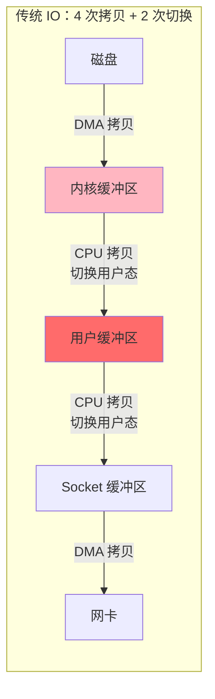
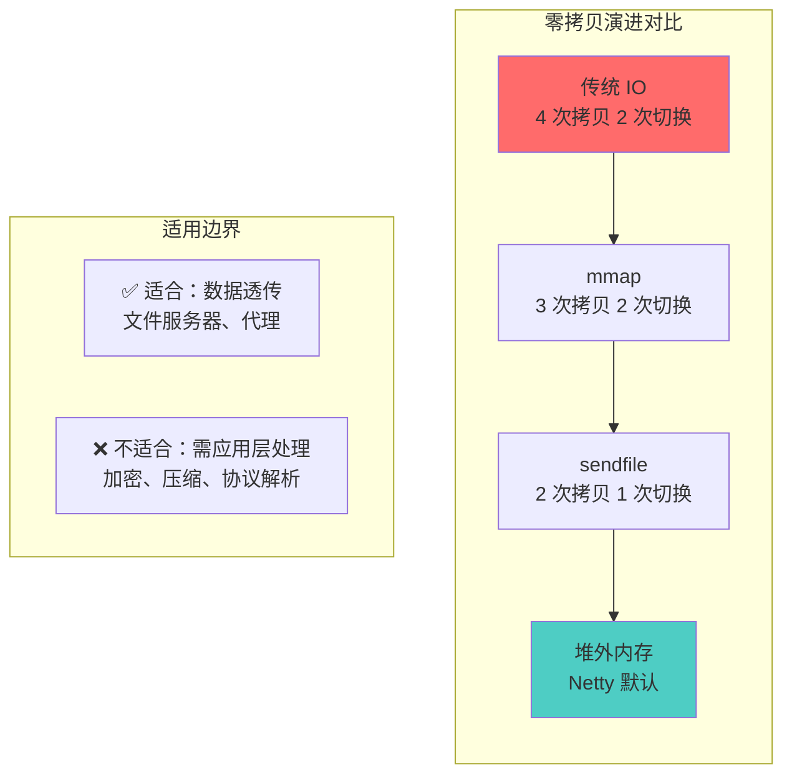
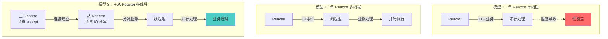
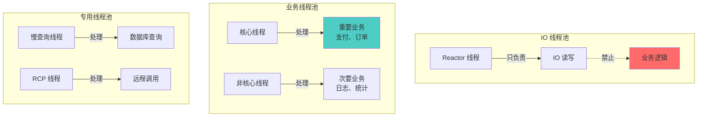
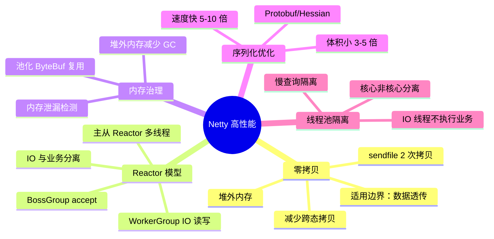

# Netty 高性能原理

> **核心主题**：Netty 高性能原理——零拷贝、Reactor 线程模型、内存管理、序列化优化

---

## 🎯 一句话定位

**Netty 解决什么问题？**
```
传统网络编程：手动处理 TCP 粘包/拆包、内存泄漏、线程切换、IO 多路复用
Netty：封装了所有脏活累活，让你像搭积木一样写高性能网络程序
```

**生活化比喻**：
就像开餐厅——你可以自己砌灶台、通烟道（传统 Socket 编程），也可以直接用商用厨房（Netty）。商用厨房已经优化好了火力、排烟、动线，你只管炒菜就行。

**核心特点**：异步事件驱动、零拷贝、高性能，轻松支撑百万连接。

---

## 💎 核心要点速览

> **快速掌握核心设计要点**

### 核心观点（3 层架构）

**1. 零拷贝：减少数据跨态搬运（不是完全不拷贝）**
```
❌ 误区：零拷贝 = 完全不拷贝
✅ 真相：零拷贝 = 减少跨"用户态/内核态"的拷贝

传统 IO：4 次拷贝（磁盘→内核缓冲→用户缓冲→内核 socket→网卡）
sendfile：2 次拷贝（数据直接内核→网卡，跳过用户态）
堆外内存：直接在内核空间操作，减少一次拷贝
适用边界：只适合数据透传，需应用层处理时失效
```

**2. Reactor 线程模型：架构核心**
```
单 Reactor 单线程：IO 和业务串行，只适合轻量测试
单 Reactor 多线程：Reactor 负责 IO 分发，业务交线程池
主从 Reactor 多线程（Netty 默认）：主 Reactor 负责 accept，从 Reactor 负责 IO 读写
性能差的原因：耗时业务逻辑扔到 IO 线程堵住 Reactor
```

**3. 体系化工程优化**
```
内存治理：池化 ByteBuffer 复用、堆外内存减少 GC、内存泄露检测
序列化优化：用 protobuf/hessian 替代 json/xml
线程池隔离：IO 线程不执行业务、核心非核心拆分
```

---

## 🚀 一句话精华（如果只能记住一句）

> **Netty 高性能 = 零拷贝（减少跨态搬运） + Reactor 多线程（IO 与业务分离） + 池化内存（复用减少 GC）**

---

## 一、零拷贝的本质：减少跨态拷贝

### ❌ 传统 IO 的 4 次拷贝

**生活化比喻**：
```
传统 IO 就像搬家：
1. 家具从你家搬到卡车（磁盘→内核缓冲）
2. 从卡车卸到中转站（内核缓冲→用户缓冲）
3. 从中转站再搬到另一辆卡车（用户缓冲→内核 socket）
4. 卡车送到新家（内核 socket→网卡）

问题：第 2、3 步完全多余！家具在中转站白折腾一圈。
```

**技术细节**：
```
传统 read() + write() 流程：
1. 磁盘 → 内核缓冲区（DMA 拷贝）
2. 内核缓冲区 → 用户缓冲区（CPU 拷贝，需要切换用户态）
3. 用户缓冲区 → 内核 Socket 缓冲区（CPU 拷贝，需要切换用户态）
4. Socket 缓冲区 → 网卡（DMA 拷贝）

总共：4 次拷贝 + 2 次上下文切换（用户态↔内核态）
CPU 浪费在第 2、3 步的无效拷贝上
```



### ✅ 零拷贝的演进

**1. mmap（内存映射）**
```
原理：把内核缓冲区和用户缓冲区映射到同一块内存
效果：减少一次 CPU 拷贝（第 2 步变成直接映射）
流程：磁盘→内核缓冲（DMA）→ 用户缓冲（映射，无拷贝）→ Socket 缓冲（CPU）→ 网卡（DMA）
总计：3 次拷贝 + 2 次切换
```

**2. sendfile（Linux 2.1 引入）**
```
原理：数据直接在内核空间流转，不经过用户态
流程：磁盘→内核缓冲（DMA）→ Socket 缓冲（CPU）→ 网卡（DMA）
总计：2 次拷贝 + 1 次切换

生活化比喻：
sendfile 就像快递柜，你不用亲自回家取包裹，快递柜直接转交给快递员。
```

**3. 堆外内存（Direct Buffer）**
```
原理：直接分配内核态内存，Java 应用直接操作
效果：减少一次拷贝（跳过 JVM 堆内存）
适用场景：Netty 默认使用 DirectByteBuffer 作为网络缓冲区
```



### 表格对比：零拷贝方案

| 方案 | 拷贝次数 | 切换次数 | 适用场景 | 生活化比喻 |
|------|---------|---------|----------|------------|
| **传统 IO** | 4 次 | 2 次 | 需要处理数据 | 搬家：来回折腾 |
| **mmap** | 3 次 | 2 次 | 大块数据读写 | 地图映射：少跑一趟 |
| **sendfile** | 2 次 | 1 次 | 文件传输、代理 | 快递柜：直接转交 |
| **堆外内存** | 2 次 | 1 次 | Netty 网络传输 | 直接操作：省去中转 |

**关键理解**：
```
零拷贝的本质是"减少跨态拷贝"，不是"完全不拷贝"。
当需要应用层处理数据时（如加密、压缩、协议解析），零拷贝失效，必须回到用户态处理。
生活化比喻：你可以用快递柜（sendfile）快速转发包裹，但如果要拆开检查（应用层处理），还是得拿回家。
```

---

## 二、Reactor 线程模型：架构核心

### 生活化比喻理解 Reactor

```
Reactor 模型就像餐厅的前台 + 厨师：
- Reactor（前台）：负责接待客人（IO 事件），点单后交给厨师
- 业务线程（厨师）：负责炒菜（业务逻辑）

单 Reactor 单线程：前台兼厨师，点单炒菜都一个人干（性能差）
单 Reactor 多线程：一个前台，多个厨师（性能好）
主从 Reactor：多个前台分工合作（Netty 默认，性能最优）
```

### 三种 Reactor 模型对比



**详细对比表格**：

| 模型 | Reactor 数量 | 业务处理 | 优点 | 缺点 | 适用场景 |
|------|-------------|---------|------|------|----------|
| **单 Reactor 单线程** | 1 个 | 自己处理 | 简单 | IO 和业务串行，性能差 | 轻量测试、学习 |
| **单 Reactor 多线程** | 1 个 | 线程池 | 业务并行 | Reactor 可能成瓶颈 | 中等并发 |
| **主从 Reactor 多线程** | 多个 | 线程池 | IO/业务完全分离 | 复杂 | **Netty 默认，生产首选** ⭐⭐⭐⭐⭐ |

### Netty 的线程模型（主从 Reactor）

**生活化比喻**：
```
Netty 的主从 Reactor 就像大型餐厅：
- 老板（BossGroup/主 Reactor）：负责接待新客人（accept 连接）
- 经理（WorkerGroup/从 Reactor）：负责点单、上菜（IO 读写）
- 厨师（业务线程池）：负责炒菜（业务逻辑）

老板只负责接待，不炒菜；经理只负责 IO，不炒菜；厨师只炒菜，不接待。
分工明确，各司其职，效率最高。
```

**代码示例（Go 语言版，模拟 Netty 线程模型）**：
```go
package main

import (
    "fmt"
    "net"
    "sync"
)

// BossGroup：主 Reactor，负责 accept 连接
type BossGroup struct {
    listener net.Listener
    workers  []*WorkerGroup
}

// WorkerGroup：从 Reactor，负责 IO 读写
type WorkerGroup struct {
    id     int
    conns  chan net.Conn
    pool   *sync.Pool
}

// 业务线程池
type BusinessPool struct {
    tasks chan func()
}

func (bp *BusinessPool) Submit(task func()) {
    bp.tasks <- task
}

func (bp *BusinessPool) Run(workers int) {
    for i := 0; i < workers; i++ {
        go func() {
            for task := range bp.tasks {
                task() // 执行业务逻辑
            }
        }()
    }
}

func main() {
    listener, _ := net.Listen("tcp", ":8080")
    
    // 模拟 Netty 的主从 Reactor
    bossGroup := &BossGroup{
        listener: listener,
        workers:  make([]*WorkerGroup, 4), // 4 个 Worker
    }
    
    // 初始化 Worker
    for i := 0; i < 4; i++ {
        bossGroup.workers[i] = &WorkerGroup{
            id:    i,
            conns: make(chan net.Conn, 100),
        }
        go bossGroup.workers[i].run()
    }
    
    // 业务线程池（独立于 IO 线程）
    businessPool := &BusinessPool{tasks: make(chan func(), 1000)}
    businessPool.Run(8) // 8 个业务线程
    
    // Boss Reactor：只负责 accept
    go func() {
        for {
            conn, _ := listener.Accept()
            // 轮询分配给 Worker
            worker := bossGroup.workers[conn.LocalAddr().(*net.TCPAddr).Port%4]
            worker.conns <- conn
        }
    }()
    
    select {}
}

func (w *WorkerGroup) run() {
    for conn := range w.conns {
        // Worker Reactor：只负责 IO 读写
        go func(c net.Conn) {
            buf := make([]byte, 1024)
            for {
                n, _ := c.Read(buf)
                if n == 0 {
                    return
                }
                // ❌ 错误：在 IO 线程处理业务
                // processBusiness(c, buf[:n])
                
                // ✅ 正确：交给业务线程池
                // businessPool.Submit(func() {
                //     processBusiness(c, buf[:n])
                // })
            }
        }(conn)
    }
}
```

**性能差的常见原因**：
```
❌ 错误做法：
IO 线程里执行业务逻辑（如数据库查询、RPC 调用）
→ 业务耗时堵住 IO 线程
→ Reactor 无法处理其他连接的 IO 事件
→ 整体性能下降

✅ 正确做法：
IO 线程只负责读写，业务逻辑交给业务线程池
→ IO 和业务完全分离
→ 性能最优
```

---

## 三、体系化工程优化

### 3.1 内存治理

**生活化比喻**：
```
内存治理就像餐厅的餐具管理：
- 池化 ByteBuffer：餐具循环利用，不用每次都买新的（减少 GC）
- 堆外内存：直接放在厨房（内核态），不用端到餐桌再拿回去（减少拷贝）
- 内存泄漏检测：定期检查餐具有没有丢失（防止内存泄漏）
```

**Netty 的内存优化**：

| 优化点 | 原理 | 效果 | 生活化比喻 |
|--------|------|------|------------|
| **池化 ByteBuffer** | 复用 ByteBuf 对象 | 减少 GC 压力 | 餐具循环利用 |
| **堆外内存** | 直接分配内核态内存 | 减少一次拷贝 | 厨房直接操作 |
| **引用计数** | 手动管理内存释放 | 防止内存泄漏 | 餐具归还检查 |
| **内存泄漏检测** | ResourceLeakDetector | 发现未释放的内存 | 定期盘点 |

**代码示例（Go 语言版，模拟池化内存）**：
```go
package main

import (
    "sync"
)

// 模拟 Netty 的 ByteBuf 池化
type ByteBuf struct {
    data []byte
    pool *ByteBufPool
}

func (b *ByteBuf) Release() {
    if b.pool != nil {
        b.pool.Put(b) // 归还到池中
    }
}

type ByteBufPool struct {
    pool sync.Pool
}

func NewByteBufPool(capacity int) *ByteBufPool {
    return &ByteBufPool{
        pool: sync.Pool{
            New: func() interface{} {
                return &ByteBuf{
                    data: make([]byte, 0, capacity),
                }
            },
        },
    }
}

func (p *ByteBufPool) Get() *ByteBuf {
    buf := p.pool.Get().(*ByteBuf)
    buf.pool = p
    return buf
}

func (p *ByteBufPool) Put(buf *ByteBuf) {
    buf.data = buf.data[:0] // 清空数据
    p.pool.Put(buf)         // 放回池中
}

// 使用示例
func main() {
    pool := NewByteBufPool(1024)
    
    // 获取缓冲区
    buf := pool.Get()
    defer buf.Release() // 记得归还！
    
    // 使用缓冲区
    buf.data = append(buf.data, []byte("hello")...)
    
    // 自动归还到池中，下次复用
}
```

### 3.2 序列化优化

**生活化比喻**：
```
序列化就像打包行李：
- JSON/XML：打包得很整齐，但占用空间大，打包慢（像精心折叠的衣服）
- Protobuf/Hessian：压缩打包，体积小，速度快（像真空压缩袋）

生产环境：
- 内部服务间通信：用 Protobuf（体积小 3-5 倍，速度快 5-10 倍）
- 对外接口：用 JSON（通用性强，人类可读）
```

**序列化方案对比**：

| 方案 | 体积 | 速度 | 可读性 | 适用场景 |
|------|------|------|--------|----------|
| **JSON** | 大 | 慢 | ✅ 好 | 对外接口、调试 |
| **XML** | 更大 | 更慢 | ✅ 好 | 遗留系统 |
| **Protobuf** | 小（3-5 倍） | 快（5-10 倍） | ❌ 差 | 内部服务、高性能 |
| **Hessian** | 中等 | 中等 | ❌ 差 | Java 生态 |

**代码示例（Go 语言版，JSON vs Protobuf）**：
```go
package main

import (
    "encoding/json"
    "github.com/golang/protobuf/proto"
    "fmt"
)

// 假设 User 结构体
type User struct {
    ID   int64  `json:"id"`
    Name string `json:"name"`
    Age  int    `json:"age"`
}

func main() {
    user := &User{
        ID:   12345,
        Name: "张三",
        Age:  28,
    }
    
    // JSON 序列化
    jsonData, _ := json.Marshal(user)
    fmt.Printf("JSON 大小：%d bytes\n", len(jsonData))
    // 输出：{"id":12345,"name":"张三","age":28}
    // 大小：约 40 bytes
    
    // Protobuf 序列化（需要定义 .proto 文件）
    // protoData, _ := proto.Marshal(userProto)
    // fmt.Printf("Protobuf 大小：%d bytes\n", len(protoData))
    // 大小：约 10 bytes（小 4 倍）
}
```

### 3.3 线程池隔离

**生活化比喻**：
```
线程池隔离就像餐厅的员工分工：
- IO 线程：只负责接待客人、点单（IO 读写）
- 业务线程：只负责炒菜（业务逻辑）
- 核心线程：处理重要业务（如支付）
- 非核心线程：处理次要业务（如日志）

如果让接待员也去炒菜，客人来了没人接待，餐厅就乱了。
```

**线程池隔离原则**：



**最佳实践**：
```
✅ IO 线程：只负责网络读写，不执行业务逻辑
✅ 业务线程池：处理耗时操作（数据库、RPC、文件）
✅ 核心/非核心分离：重要业务用独立线程池，防止被非核心业务拖累
✅ 慢查询隔离：数据库查询用独立线程池，防止慢查询堵住整个业务线程池

❌ 错误：在 IO 线程里查数据库
❌ 错误：所有业务共用一个线程池
❌ 错误：慢查询和快速响应共用线程池
```

---

## 四、技术深度考点

### 高频问题 1：为什么 Netty 性能好？

**标准回答（30 秒版）**：
> "Netty 高性能主要来自三个方面：
> 1. **零拷贝**：通过 sendfile 和堆外内存，减少数据在内核态和用户态之间的拷贝，传统 IO 4 次拷贝，Netty 可以优化到 2 次。
> 2. **Reactor 线程模型**：采用主从 Reactor 多线程，IO 线程只负责读写，业务逻辑交给业务线程池，完全分离。
> 3. **内存优化**：池化 ByteBuf 复用内存，减少 GC 压力；使用堆外内存，减少一次拷贝。"

**加分回答（展示深度）**：
> "除了这三点，Netty 还有很多细节优化：
> - **序列化优化**：支持 Protobuf、Hessian 等高效序列化协议
> - **线程池隔离**：IO、业务、慢查询完全隔离，防止互相影响
> - **内存泄漏检测**：ResourceLeakDetector 自动检测未释放的内存
> - **优雅启停**：支持优雅关闭，防止数据丢失"

### 高频问题 2：零拷贝的适用边界？

**标准回答**：
> "零拷贝适合数据透传场景，如文件服务器、代理服务器，数据从磁盘直接发送到网络，不需要应用层处理。
> 
> 但如果需要应用层处理数据（如加密、压缩、协议解析），零拷贝就失效了，必须回到用户态处理。
> 
> 生活化比喻：你可以用快递柜（sendfile）快速转发包裹，但如果要拆开检查（应用层处理），还是得拿回家。"

### 高频问题 3：Reactor 模型为什么性能好？

**标准回答**：
> "Reactor 模型的核心是 IO 和业务分离。
> 
> 单 Reactor 单线程：IO 和业务串行，业务耗时会堵住 IO，性能差。
> 
> 主从 Reactor 多线程（Netty 默认）：
> - 主 Reactor 只负责 accept 连接
> - 从 Reactor 只负责 IO 读写
> - 业务逻辑交给业务线程池
> 
> 分工明确，各司其职，性能最优。
> 
> 生活化比喻：大型餐厅的老板只接待客人，经理只负责 IO，厨师只炒菜，效率最高。"

---

## 五、核心要点总结



**方案总结**：

> **Netty 高性能来自五个方面**：
> 
> 1. **零拷贝**：通过 sendfile 和堆外内存，减少数据在内核态和用户态的拷贝，传统 IO 4 次，Netty 优化到 2 次。适合数据透传，需应用层处理时失效。
> 
> 2. **Reactor 线程模型**：采用主从 Reactor 多线程，主 Reactor 负责 accept，从 Reactor 负责 IO 读写，业务逻辑交给业务线程池，完全分离。
> 
> 3. **内存治理**：池化 ByteBuf 复用内存，减少 GC 压力；使用堆外内存，减少一次拷贝；ResourceLeakDetector 检测内存泄漏。
> 
> 4. **序列化优化**：支持 Protobuf、Hessian 等高效序列化，体积比 JSON 小 3-5 倍，速度快 5-10 倍。
> 
> 5. **线程池隔离**：IO 线程不执行业务，核心/非核心业务分离，慢查询独立线程池，防止互相影响。

---

## 六、生产环境 Checklist

| 类别 | 检查项 | 状态 | 生活化比喻 |
|------|--------|------|------------|
| **零拷贝** | 启用 sendfile/DirectBuffer | ⬜ | 快递柜直接转发 |
| **Reactor 模型** | 主从 Reactor 配置合理 | ⬜ | 老板接待，经理 IO，厨师炒菜 |
| **内存治理** | 池化 ByteBuf 启用 | ⬜ | 餐具循环利用 |
| | 堆外内存配置 | ⬜ | 厨房直接操作 |
| | 内存泄漏检测开启 | ⬜ | 定期盘点餐具 |
| **序列化** | 使用 Protobuf/Hessian | ⬜ | 真空压缩袋 |
| **线程池** | IO 线程不执行业务 | ⬜ | 接待员不炒菜 |
| | 核心/非核心分离 | ⬜ | 重要业务独立处理 |
| | 慢查询隔离 | ⬜ | 慢查询不堵快速响应 |

---

## 七、总结

### 🎯 一句话总结

> **Netty 高性能 = 零拷贝（减少跨态搬运） + Reactor 多线程（IO 与业务分离） + 池化内存（复用减少 GC） + 高效序列化（Protobuf） + 线程池隔离（防止互相影响）**

### 🧠 核心记忆点

1. **零拷贝的本质**：减少跨"用户态/内核态"的拷贝，不是完全不拷贝。适合数据透传，需应用层处理时失效。
2. **Reactor 模型**：主从 Reactor 多线程，IO 和业务完全分离。生活化比喻：老板接待，经理 IO，厨师炒菜。
3. **内存治理**：池化 ByteBuf 复用，堆外内存减少拷贝，内存泄漏检测防止漏洞。
4. **序列化优化**：Protobuf 比 JSON 体积小 3-5 倍，速度快 5-10 倍。
5. **线程池隔离**：IO 线程不执行业务，核心/非核心分离，慢查询独立线程池。

---

**参考视频**：[内卷的琪某人 - Netty 高性能原理深度解析](https://v.douyin.com/)

---


