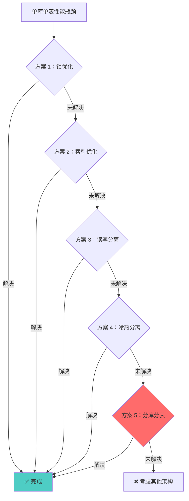
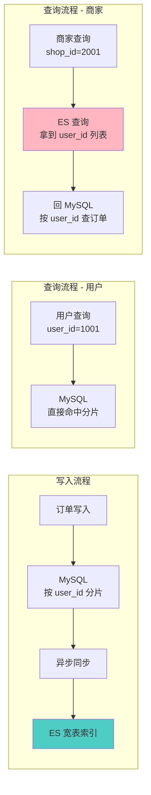
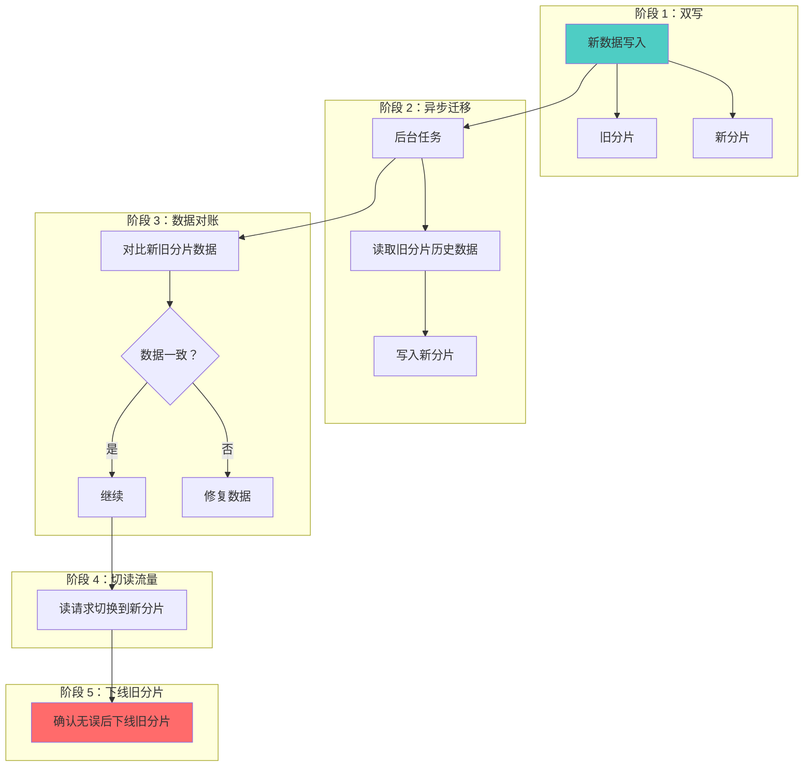
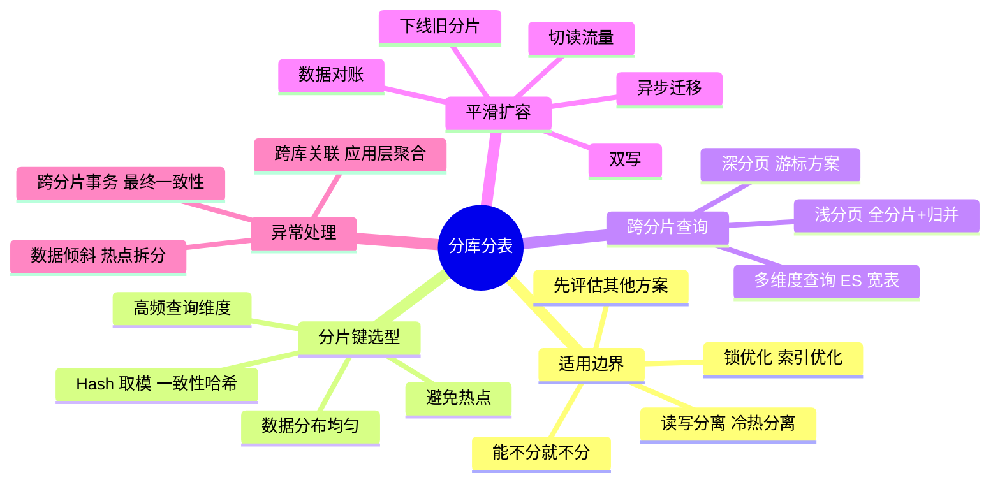

# 分库分表设计

> **核心主题**：分库分表设计——分片策略、跨分片查询、数据迁移、分布式事务、数据倾斜

---

## 🎯 一句话定位

**分库分表解决什么问题？**
```
单库单表扛不住了：
- 数据量太大：单表超过 1000 万，查询变慢
- 并发太高：单库 QPS 超过 5000，响应变慢
- 磁盘满了：单库超过 2TB，备份恢复困难

分库分表：把大表拆成多个小表，分散到多个数据库，提升性能。
```

**生活化比喻**：
就像图书馆藏书太多，一个书架放不下：
- 方案 1：换更大的书架（垂直扩展，贵）
- 方案 2：把书分散到多个书架，按类别分（分库分表，便宜）

**核心特点**：性能提升，但引入复杂度（跨分片查询、事务、扩容迁移）。

---

## 💎 核心要点速览

> **快速掌握核心设计要点**

### 核心观点（3 层架构）

**1. 适用边界：先评估其他方案**
```
❌ 不要一上来就分库分表！
✅ 先评估：锁优化、读写分离、冷热分离能否解决

分片后的难题（能避免就避免）：
- 跨分片查询分页：ORDER BY + LIMIT 需要全分片查询 + 应用层归并
- 多维度查询：按用户 ID 分片，但商家要按商品 ID 查询，麻烦
- 扩容迁移：数据重新分布，停服时间长
- 分布式事务：跨库事务难以保证一致性
- 数据倾斜：某些分片数据量远超其他分片
```

**2. 核心方案：分片键 + 跨分片查询 + 平滑扩容**
```
分片键选型：高频查询维度、数据分布均匀（用户 ID/订单 ID）
跨分片分页：浅分页全分片+应用层归并、深分页用游标（上一页最大 ID）
多维度查询：引入 ES 宽表索引，先走 ES 拿分片键再回分片库
平滑扩容：双写→异步迁移→数据对账→切读流量→下线旧分片
```

**3. 异常处理：数据倾斜 + 跨分片事务 + 跨库关联**
```
数据倾斜：分片键分布度评估、热点分片二次拆分
跨分片事务：业务设计规避（数据冗余单分片）、最终一致性兜底
跨库关联：禁止跨分片关联、字典表全局同步、两次查询+应用层聚合
```

---

## 🚀 一句话精华（如果只能记住一句）

> **分库分表 = 先评估其他方案（读写分离/冷热分离） + 分片键选型（高频查询维度） + 跨分片查询优化（ES 索引） + 平滑扩容（双写迁移）**

---

## 一、适用边界：不要一上来就分库分表

### ❌ 分库分表的代价

**生活化比喻**：
```
分库分表就像搬家：
- 搬家前：东西都在一个房间，找起来方便（单库单表简单）
- 搬家后：东西分散到多个房间，找起来麻烦（跨分片查询复杂）

所以：能不分就不分，先评估其他方案！
```

**分片后的五大难题**：

| 难题 | 描述 | 影响 | 生活化比喻 |
|------|------|------|------------|
| **跨分片查询** | ORDER BY + LIMIT 需要全分片查询 | 性能下降 | 找书要翻遍所有书架 |
| **多维度查询** | 按用户 ID 分片，但商家要按商品 ID 查 | 无法直接查询 | 按作者分架，但读者想按书名找 |
| **扩容迁移** | 数据重新分布，停服时间长 | 运维成本高 | 重新整理所有书架，累死人 |
| **分布式事务** | 跨库事务难以保证一致性 | 数据可能不一致 | 多个仓库同步入库，容易出错 |
| **数据倾斜** | 某些分片数据量远超其他 | 热点分片压力大 | 某个书架堆满热门书，其他书架空着 |

### ✅ 先评估其他方案

**优化优先级（能不分就不分）**：



**各方案对比**：

| 方案 | 原理 | 优点 | 缺点 | 适用场景 |
|------|------|------|------|----------|
| **锁优化** | 减少锁竞争、优化事务 | 简单 | 效果有限 | 锁竞争严重 |
| **索引优化** | 添加合适索引 | 简单 | 索引占用空间 | 查询慢 |
| **读写分离** | 主库写，从库读 | 简单 | 主从延迟 | 读多写少 |
| **冷热分离** | 热数据 Redis，冷数据 MySQL | 简单 | 一致性难保证 | 热点数据明显 |
| **分库分表** | 数据分散到多个库表 | 性能提升 | 复杂度高 | 数据量/并发量极大 |

**生活化比喻**：
```
优化就像减肥：
- 锁优化：少吃零食（简单，效果有限）
- 索引优化：多运动（简单，需要坚持）
- 读写分离：请私人教练（简单，但贵）
- 冷热分离：抽脂（快，但有风险）
- 分库分表：整容手术（效果明显，但复杂、有风险）

所以：能运动减肥就别整容！
```

---

## 二、分片键选型：核心中的核心

### 分片键选型原则

**生活化比喻**：
```
分片键就像图书馆的分类标准：
- 按作者分：读者想找某作者的书，很快；但想找某书名，就麻烦了
- 按书名分：读者想找某书名，很快；但想找某作者，就麻烦了
- 按类别分：均衡，但热门类别可能书架不够

分片键选型：选最常用的查询维度，数据分布均匀，避免热点。
```

**选型原则**：

| 原则 | 说明 | 示例 | 生活化比喻 |
|------|------|------|------------|
| **高频查询维度** | 按最常用的查询字段分片 | 电商按用户 ID 分片 | 按读者最常问的分类 |
| **数据分布均匀** | 避免某些分片数据过多 | 用户 ID 取模分片 | 各类别书籍数量均衡 |
| **避免热点** | 防止某些分片压力过大 | 一致性哈希 | 热门书分散到多个书架 |

### 常见分片策略

**1. Hash 取模（最常用）**
```
公式：分片键 % 分片数 = 分片编号
示例：user_id % 8 = 0-7（8 个分片）

优点：数据分布均匀
缺点：扩容困难（需要重新计算所有数据）
适用：数据量稳定，不经常扩容

生活化比喻：
就像按身份证号尾号分 8 个窗口：
- 尾号 0-7 分别对应 8 个窗口
- 新来一个人，看尾号去对应窗口
- 但如果要增加窗口，所有人都要重新分配窗口
```

**2. 一致性哈希（适合扩容）**
```
原理：将哈希值空间组织成一个虚拟的圆环（0 ~ 2^32-1）
优点：扩容时只需迁移部分数据
缺点：实现复杂，数据分布可能不均匀

生活化比喻：
就像圆桌上的座位：
- 每个人按名字哈希值坐在圆桌上
- 新来一个人，坐在相邻的空位
- 如果增加一个座位，只需移动相邻的几个人
```

**3. 范围分片（适合时间序列）**
```
公式：按时间范围分片（按月、按年）
示例：2024-01 的数据在分片 1，2024-02 在分片 2

优点：扩容简单（新月份直接加分片）
缺点：数据分布不均（某个月数据特别多）
适用：订单、日志等时间序列数据

生活化比喻：
就像按月份整理文件：
- 1 月的文件在 1 号柜
- 2 月的文件在 2 号柜
- 新月份直接加新柜子
```

**代码示例（Go 语言版，Hash 取模分片）**：
```go
package main

import (
    "fmt"
    "hash/fnv"
)

// 分片路由
type ShardingRouter struct {
    shardCount int // 分片数量
}

func NewShardingRouter(shardCount int) *ShardingRouter {
    return &ShardingRouter{shardCount: shardCount}
}

// 根据用户 ID 计算分片
func (r *ShardingRouter) GetShard(userID int64) int {
    return int(userID % int64(r.shardCount))
}

// 根据字符串计算分片（使用 FNV 哈希）
func (r *ShardingRouter) GetShardByKey(key string) int {
    h := fnv.New32a()
    h.Write([]byte(key))
    return int(h.Sum32()) % r.shardCount
}

// 使用示例
func main() {
    router := NewShardingRouter(8) // 8 个分片
    
    // 测试用户 ID 分片
    userIDs := []int64{1001, 1002, 1003, 1004, 1005}
    for _, uid := range userIDs {
        shard := router.GetShard(uid)
        fmt.Printf("用户 %d → 分片 %d\n", uid, shard)
    }
    
    // 测试字符串分片
    keys := []string{"user:1001", "user:1002", "order:2001"}
    for _, key := range keys {
        shard := router.GetShardByKey(key)
        fmt.Printf("键 %s → 分片 %d\n", key, shard)
    }
}
```

### 分片键选型实战

**电商场景**：

| 业务 | 分片键 | 理由 | 生活化比喻 |
|------|--------|------|------------|
| **用户表** | user_id | 高频按用户查询 | 按读者证号分架 |
| **订单表** | user_id | 用户查自己的订单 | 按读者证号分订单 |
| **商品表** | category_id | 按类别查询 | 按类别分架 |
| **支付流水** | order_id | 按订单查询 | 按订单号分流水 |

**社交场景**：

| 业务 | 分片键 | 理由 | 生活化比喻 |
|------|--------|------|------------|
| **用户表** | user_id | 高频按用户查询 | 按用户 ID 分架 |
| **关注关系** | follower_id | 查某人的关注列表 | 按粉丝分架 |
| **消息表** | conversation_id | 按会话查询 | 按会话分架 |
| **朋友圈** | user_id | 按用户查询动态 | 按用户分架 |

---

## 三、跨分片查询：最头疼的问题

### 问题 1：跨分片分页

**生活化比喻**：
```
场景：电商订单列表，按创建时间排序，每页 10 条
问题：订单分散在 8 个分片，怎么查第 3 页？

传统方案：
1. 每个分片都查一次，每次查 30 条（3 页 × 10 条）
2. 应用层归并 8 个分片的结果（8 × 30 = 240 条）
3. 排序后取第 21-30 条

问题：数据量大时，性能差！
```

**浅分页优化（前 N 页）**：
```
方案：全分片查询 + 应用层归并
流程：
1. 每个分片查询 LIMIT 30（3 页 × 10 条）
2. 应用层归并 8 个分片的结果
3. 排序后取第 21-30 条

适用：前 N 页（N < 100）
不适用：深分页（第 1000 页）
```

**深分页优化（游标方案）**：
```
方案：记录上一页的最大 ID，下次从该 ID 开始查
流程：
1. 第一页：SELECT * FROM orders ORDER BY id LIMIT 10
2. 记住最后一条的 ID：last_id = 100
3. 第二页：SELECT * FROM orders WHERE id > 100 ORDER BY id LIMIT 10
4. 记住最后一条的 ID：last_id = 200
5. 第三页：SELECT * FROM orders WHERE id > 200 ORDER BY id LIMIT 10

优点：性能稳定，不受页码影响
缺点：只能顺序翻页，不能跳页

生活化比喻：
就像看书，记住上一页的页码，下次从该页继续看。
不能直接跳到第 1000 页，但可以一直往后翻。
```

**代码示例（Go 语言版，跨分片分页）**：
```go
package main

import (
    "fmt"
    "sort"
)

// 订单结构
type Order struct {
    ID        int64
    UserID    int64
    Amount    float64
    CreatedAt int64
}

// 跨分片分页查询
type ShardingPaginator struct {
    shardCount int
}

// 浅分页：全分片查询 + 应用层归并
func (p *ShardingPaginator) QueryPage(page, pageSize int) []Order {
    // 1. 每个分片查询
    var allOrders []Order
    for shard := 0; shard < p.shardCount; shard++ {
        // 模拟从分片查询
        orders := queryFromShard(shard, page*pageSize)
        allOrders = append(allOrders, orders...)
    }
    
    // 2. 应用层归并排序
    sort.Slice(allOrders, func(i, j int) bool {
        return allOrders[i].CreatedAt > allOrders[j].CreatedAt
    })
    
    // 3. 取当前页的数据
    start := (page - 1) * pageSize
    end := start + pageSize
    if end > len(allOrders) {
        end = len(allOrders)
    }
    
    return allOrders[start:end]
}

// 深分页：游标方案
func (p *ShardingPaginator) QueryByCursor(lastID int64, pageSize int) []Order {
    var allOrders []Order
    
    // 每个分片从 lastID 开始查询
    for shard := 0; shard < p.shardCount; shard++ {
        // 模拟从分片查询
        orders := queryFromShardByCursor(shard, lastID, pageSize)
        allOrders = append(allOrders, orders...)
    }
    
    // 归并排序
    sort.Slice(allOrders, func(i, j int) bool {
        return allOrders[i].CreatedAt > allOrders[j].CreatedAt
    })
    
    // 取前 pageSize 条
    if len(allOrders) > pageSize {
        return allOrders[:pageSize]
    }
    return allOrders
}

// 模拟从分片查询
func queryFromShard(shard, limit int) []Order {
    // 实际项目：从数据库查询
    return []Order{}
}

func queryFromShardByCursor(shard int, lastID int64, limit int) []Order {
    // 实际项目：从数据库查询
    return []Order{}
}

func main() {
    paginator := &ShardingPaginator{shardCount: 8}
    
    // 浅分页：查第 3 页，每页 10 条
    orders := paginator.QueryPage(3, 10)
    fmt.Printf("第 3 页：%d 条订单\n", len(orders))
    
    // 深分页：从 lastID=100 开始查 10 条
    orders = paginator.QueryByCursor(100, 10)
    fmt.Printf("下一页：%d 条订单\n", len(orders))
}
```

### 问题 2：多维度查询

**生活化比喻**：
```
场景：
- 用户按 user_id 查自己的订单（已按 user_id 分片，很快）
- 商家按 shop_id 查店铺订单（按 user_id 分片，无法直接查！）

问题：分片键只能满足一个维度的查询，其他维度怎么办？

方案：引入 ES 宽表索引
1. 订单数据写入 MySQL（按 user_id 分片）
2. 同步到 ES（包含 user_id、shop_id 等所有字段）
3. 商家查询：先走 ES，拿到 user_id，再回 MySQL 查具体订单
```

**ES 宽表方案**：



**代码示例（Go 语言版，ES 宽表查询）**：
```go
package main

import (
    "context"
    "fmt"
)

// 订单服务
type OrderService struct {
    mysqlDB  *MySQLDB
    esClient *ESClient
}

// 用户查询订单（直接走 MySQL）
func (s *OrderService) QueryByUserID(userID int64) []Order {
    // 直接查询 MySQL，已按 user_id 分片
    return s.mysqlDB.Query("SELECT * FROM orders WHERE user_id = ?", userID)
}

// 商家查询订单（先走 ES，再回 MySQL）
func (s *OrderService) QueryByShopID(shopID int64) []Order {
    // 1. 先查 ES，拿到 user_id 列表
    userIDs := s.esClient.Query("SELECT user_id FROM orders_index WHERE shop_id = ?", shopID)
    
    // 2. 根据 user_id 回 MySQL 查询
    var allOrders []Order
    for _, userID := range userIDs {
        orders := s.mysqlDB.Query("SELECT * FROM orders WHERE user_id = ? AND shop_id = ?", userID, shopID)
        allOrders = append(allOrders, orders...)
    }
    
    return allOrders
}

// 模拟 MySQL 查询
type MySQLDB struct{}

func (db *MySQLDB) Query(sql string, args ...interface{}) []Order {
    // 实际项目：执行 SQL
    return []Order{}
}

// 模拟 ES 查询
type ESClient struct{}

func (es *ESClient) Query(sql string, args ...interface{}) []int64 {
    // 实际项目：执行 ES 查询
    return []int64{1001, 1002, 1003}
}

func main() {
    service := &OrderService{
        mysqlDB:  &MySQLDB{},
        esClient: &ESClient{},
    }
    
    // 用户查询
    orders := service.QueryByUserID(1001)
    fmt.Printf("用户订单：%d 条\n", len(orders))
    
    // 商家查询
    orders = service.QueryByShopID(2001)
    fmt.Printf("商家订单：%d 条\n", len(orders))
}
```

### 问题 3：平滑扩容

**生活化比喻**：
```
场景：原来 8 个分片，现在要扩容到 16 个分片
问题：数据需要重新分布，如何不停服迁移？

方案：双写 + 异步迁移 + 数据对账 + 切读流量 + 下线旧分片

流程：
1. 双写：新数据同时写入旧分片和新分片
2. 异步迁移：后台任务把旧分片的历史数据迁移到新分片
3. 数据对账：校验新旧分片的数据一致性
4. 切读流量：读请求切换到新分片
5. 下线旧分片：确认无误后，下线旧分片
```

**平滑扩容流程**：



**代码示例（Go 语言版，双写逻辑）**：
```go
package main

import (
    "context"
    "fmt"
)

// 双写服务
type DualWriteService struct {
    oldShards []*Shard
    newShards []*Shard
    migrating bool // 是否正在迁移
}

// 写入数据（双写）
func (s *DualWriteService) Write(ctx context.Context, order *Order) error {
    // 1. 写入旧分片
    oldShard := s.getOldShard(order.UserID)
    if err := oldShard.Write(ctx, order); err != nil {
        return err
    }
    
    // 2. 如果正在迁移，同时写入新分片
    if s.migrating {
        newShard := s.getNewShard(order.UserID)
        if err := newShard.Write(ctx, order); err != nil {
            // 新分片写入失败，记录日志，但不影响主流程
            fmt.Printf("新分片写入失败：%v\n", err)
        }
    }
    
    return nil
}

// 读取数据（根据迁移状态选择）
func (s *DualWriteService) Read(ctx context.Context, userID int64) []Order {
    if s.migrating {
        // 迁移中：从新分片读
        newShard := s.getNewShard(userID)
        return newShard.Read(ctx, userID)
    }
    
    // 未迁移：从旧分片读
    oldShard := s.getOldShard(userID)
    return oldShard.Read(ctx, userID)
}

// 开始迁移
func (s *DualWriteService) StartMigration() {
    s.migrating = true
    // 启动后台任务迁移历史数据
    go s.migrateHistoryData()
}

// 迁移历史数据
func (s *DualWriteService) migrateHistoryData() {
    // 遍历旧分片，迁移到新分片
    for _, oldShard := range s.oldShards {
        data := oldShard.ReadAll()
        for _, order := range data {
            newShard := s.getNewShard(order.UserID)
            newShard.Write(context.Background(), order)
        }
    }
}

// 模拟分片
type Shard struct {
    ID int
}

func (s *Shard) Write(ctx context.Context, order *Order) error {
    return nil
}

func (s *Shard) Read(ctx context.Context, userID int64) []Order {
    return []Order{}
}

func (s *Shard) ReadAll() []Order {
    return []Order{}
}

func (s *DualWriteService) getOldShard(userID int64) *Shard {
    return s.oldShards[0]
}

func (s *DualWriteService) getNewShard(userID int64) *Shard {
    return s.newShards[0]
}

// 订单结构
type Order struct {
    ID     int64
    UserID int64
}
```

---

## 四、异常处理

### 异常 1：数据倾斜

**生活化比喻**：
```
数据倾斜就像餐厅的热门菜品：
- 某些菜品特别火，某个厨师忙不过来（热点分片）
- 其他厨师闲着没事干（冷分片）

解决方案：
1. 分片键分布度评估：提前分析数据分布
2. 热点分片二次拆分：把热点分片再拆成多个
3. 一致性哈希：分散热点
```

**数据倾斜处理方案**：

| 方案 | 原理 | 优点 | 缺点 | 适用场景 |
|------|------|------|------|----------|
| **分片键分布度评估** | 提前分析数据分布 | 预防问题 | 需要数据分析 | 初期规划 |
| **热点分片二次拆分** | 把热点分片再拆成多个 | 针对性强 | 实现复杂 | 已出现倾斜 |
| **一致性哈希** | 分散热点 | 均衡 | 实现复杂 | 数据分布不均 |
| **加盐** | 分片键加随机前缀 | 简单 | 查询复杂 | 写入热点 |

**代码示例（Go 语言版，热点分片二次拆分）**：
```go
package main

import (
    "fmt"
)

// 热点分片二次拆分
type HotShardSplitter struct {
    hotShardID int      // 热点分片 ID
    subShards  []int    // 子分片 ID 列表
}

// 判断是否为热点分片
func (s *HotShardSplitter) IsHotShard(shardID int) bool {
    return shardID == s.hotShardID
}

// 热点分片路由
func (s *HotShardSplitter) Route(userID int64) int {
    if userID%8 == int64(s.hotShardID) {
        // 热点分片：再拆分成多个子分片
        subIndex := userID % int64(len(s.subShards))
        return s.subShards[subIndex]
    }
    
    // 非热点分片：直接路由
    return int(userID % 8)
}

func main() {
    splitter := &HotShardSplitter{
        hotShardID: 3,           // 分片 3 是热点
        subShards:  []int{30, 31, 32}, // 拆分成 3 个子分片
    }
    
    // 测试路由
    userIDs := []int64{11, 19, 27, 35} // 都是分片 3 的用户
    for _, uid := range userIDs {
        shard := splitter.Route(uid)
        fmt.Printf("用户 %d → 分片 %d\n", uid, shard)
    }
}
```

### 异常 2：跨分片事务

**生活化比喻**：
```
跨分片事务就像跨行转账：
- 从 A 银行转账到 B 银行，需要保证一致性
- 如果 A 银行扣款成功，B 银行入账失败，怎么办？

解决方案：
1. 业务设计规避：尽量让相关数据在同一个分片
2. 最终一致性：通过 MQ 异步保证最终一致
3. TCC：Try-Confirm-Cancel 三阶段提交
```

**跨分片事务处理方案**：

| 方案 | 原理 | 优点 | 缺点 | 适用场景 |
|------|------|------|------|----------|
| **业务设计规避** | 数据冗余到同一分片 | 简单 | 数据冗余 | 能避免跨分片 |
| **最终一致性** | MQ 异步保证一致 | 性能高 | 有中间状态 | 允许短暂不一致 |
| **TCC** | Try-Confirm-Cancel | 强一致 | 实现复杂 | 要求强一致 |

**代码示例（Go 语言版，最终一致性方案）**：
```go
package main

import (
    "context"
    "fmt"
)

// 订单服务
type OrderService struct {
    orderDB    *ShardDB
    inventoryDB *ShardDB
    mq         *MessageQueue
}

// 创建订单（跨分片事务）
func (s *OrderService) CreateOrder(ctx context.Context, order *Order) error {
    // 1. 创建订单（订单分片）
    if err := s.orderDB.Insert(ctx, order); err != nil {
        return err
    }
    
    // 2. 发送 MQ 消息（异步扣减库存）
    msg := &Message{
        Type:    "DEDUCT_INVENTORY",
        OrderID: order.ID,
        Payload: order,
    }
    if err := s.mq.Send(ctx, msg); err != nil {
        // MQ 发送失败，记录日志，人工处理
        fmt.Printf("MQ 发送失败：%v\n", err)
        return err
    }
    
    return nil
}

// 库存消费者（异步扣减库存）
type InventoryConsumer struct {
    inventoryDB *ShardDB
}

func (c *InventoryConsumer) Consume(msg *Message) error {
    if msg.Type != "DEDUCT_INVENTORY" {
        return nil
    }
    
    order := msg.Payload.(*Order)
    
    // 扣减库存
    if err := c.inventoryDB.Update(context.Background(), order); err != nil {
        // 失败重试
        return err
    }
    
    return nil
}

// 模拟数据库
type ShardDB struct{}

func (db *ShardDB) Insert(ctx context.Context, order *Order) error {
    return nil
}

func (db *ShardDB) Update(ctx context.Context, order *Order) error {
    return nil
}

// 模拟 MQ
type MessageQueue struct{}

type Message struct {
    Type    string
    OrderID int64
    Payload interface{}
}

func (mq *MessageQueue) Send(ctx context.Context, msg *Message) error {
    return nil
}

// 订单结构
type Order struct {
    ID        int64
    UserID    int64
    ProductID int64
    Quantity  int
}
```

### 异常 3：跨库关联

**生活化比喻**：
```
跨库关联就像跨图书馆借书：
- 你想同时借 A 图书馆的书和 B 图书馆的书
- 但两个图书馆的系统不互通，无法直接关联查询

解决方案：
1. 禁止跨分片关联：应用层组装数据
2. 字典表全局同步：小表复制到所有分片
3. 两次查询 + 应用层聚合：先查 A，再查 B，应用层合并
```

**跨库关联处理方案**：

| 方案 | 原理 | 优点 | 缺点 | 适用场景 |
|------|------|------|------|----------|
| **禁止跨分片关联** | 应用层组装 | 简单 | 多次查询 | 能避免就避免 |
| **字典表全局同步** | 小表复制到所有分片 | 查询简单 | 数据冗余 | 字典表、配置表 |
| **两次查询 + 聚合** | 先查 A，再查 B，应用层合并 | 灵活 | 性能差 | 必须关联时 |

**代码示例（Go 语言版，两次查询 + 应用层聚合）**：
```go
package main

import (
    "fmt"
)

// 订单服务
type OrderService struct {
    orderDB  *ShardDB
    productDB *ShardDB
}

// 查询订单详情（包含商品信息）
func (s *OrderService) GetOrderDetail(orderID int64) *OrderDetail {
    // 1. 查询订单（订单分片）
    order := s.orderDB.Query(orderID)
    if order == nil {
        return nil
    }
    
    // 2. 查询商品信息（商品分片）
    product := s.productDB.Query(order.ProductID)
    
    // 3. 应用层组装
    return &OrderDetail{
        OrderID:     order.ID,
        UserID:      order.UserID,
        ProductName: product.Name,
        Price:       product.Price,
        Quantity:    order.Quantity,
        TotalAmount: product.Price * float64(order.Quantity),
    }
}

// 订单详情
type OrderDetail struct {
    OrderID     int64
    UserID      int64
    ProductName string
    Price       float64
    Quantity    int
    TotalAmount float64
}

// 订单结构
type Order struct {
    ID        int64
    UserID    int64
    ProductID int64
    Quantity  int
}

// 商品结构
type Product struct {
    ID    int64
    Name  string
    Price float64
}

// 模拟数据库
type ShardDB struct{}

func (db *ShardDB) Query(id int64) interface{} {
    // 实际项目：查询数据库
    return nil
}

func main() {
    service := &OrderService{
        orderDB:   &ShardDB{},
        productDB: &ShardDB{},
    }
    
    detail := service.GetOrderDetail(1001)
    if detail != nil {
        fmt.Printf("订单详情：%+v\n", detail)
    }
}
```

---

## 五、技术深度考点

### 高频问题 1：为什么要分库分表？

**标准回答（30 秒版）**：
> "分库分表是为了解决单库单表的性能瓶颈：
> 1. **数据量太大**：单表超过 1000 万，查询变慢
> 2. **并发太高**：单库 QPS 超过 5000，响应变慢
> 3. **磁盘满了**：单库超过 2TB，备份恢复困难
> 
> 但分库分表会引入复杂度（跨分片查询、事务、扩容迁移），所以能不分就不分，先评估其他方案（锁优化、读写分离、冷热分离）。"

### 高频问题 2：如何选择分片键？

**标准回答**：
> "分片键选型遵循三个原则：
> 1. **高频查询维度**：按最常用的查询字段分片，如电商按 user_id
> 2. **数据分布均匀**：避免某些分片数据过多，用 Hash 取模或一致性哈希
> 3. **避免热点**：防止某些分片压力过大，如用一致性哈希分散热点
> 
> 生活化比喻：就像图书馆分类，按读者最常问的分类标准分架，各类别书籍数量均衡。"

### 高频问题 3：如何解决跨分片分页？

**标准回答**：
> "跨分片分页有两种方案：
> 1. **浅分页**：全分片查询 + 应用层归并。每个分片查 LIMIT N，应用层归并排序后取当前页。适合前 N 页（N < 100）。
> 2. **深分页**：游标方案。记录上一页的最大 ID，下次从该 ID 开始查。性能稳定，但只能顺序翻页。
> 
> 生活化比喻：浅分页像翻书，每页都要翻一遍；深分页像记住页码，从该页继续看。"

### 高频问题 4：如何平滑扩容？

**标准回答**：
> "平滑扩容分五步：
> 1. **双写**：新数据同时写入旧分片和新分片
> 2. **异步迁移**：后台任务把旧分片的历史数据迁移到新分片
> 3. **数据对账**：校验新旧分片的数据一致性
> 4. **切读流量**：读请求切换到新分片
> 5. **下线旧分片**：确认无误后，下线旧分片
> 
> 生活化比喻：就像搬家，新旧房子同时住（双写），慢慢搬东西（异步迁移），确认都搬完了（数据对账），最后退掉旧房子（下线旧分片）。"

---

## 六、核心要点总结



**方案总结**：

> **分库分表的核心是"能不分就不分"**，先评估锁优化、读写分离、冷热分离能否解决。
> 
> **分片键选型**遵循三个原则：高频查询维度（如电商按 user_id）、数据分布均匀（Hash 取模）、避免热点（一致性哈希）。
> 
> **跨分片查询**：浅分页用全分片查询 + 应用层归并，深分页用游标方案（记录上一页最大 ID）。多维度查询引入 ES 宽表索引，先走 ES 拿分片键再回分片库。
> 
> **平滑扩容**分五步：双写→异步迁移→数据对账→切读流量→下线旧分片。
> 
> **异常处理**：数据倾斜用热点分片二次拆分，跨分片事务用最终一致性兜底，跨库关联用两次查询 + 应用层聚合。

---

## 七、生产环境 Checklist

| 类别 | 检查项 | 状态 | 生活化比喻 |
|------|--------|------|------------|
| **评估阶段** | 是否评估过其他方案 | ⬜ | 先运动减肥再考虑整容 |
| **分片键** | 选择高频查询维度 | ⬜ | 按读者最常问的分类 |
| | 数据分布均匀 | ⬜ | 各类别书籍数量均衡 |
| **跨分片查询** | 分页方案确定 | ⬜ | 浅分页/深分页 |
| | ES 宽表索引 | ⬜ | 多维度查询支持 |
| **扩容方案** | 双写逻辑 | ⬜ | 新旧房子同时住 |
| | 数据对账工具 | ⬜ | 确认都搬完了 |
| **异常处理** | 数据倾斜监控 | ⬜ | 监控热门书架 |
| | 跨分片事务方案 | ⬜ | 最终一致性兜底 |
| | 跨库关联方案 | ⬜ | 应用层聚合 |

---

## 八、总结

### 🎯 一句话总结

> **分库分表 = 先评估其他方案（能不分就不分） + 分片键选型（高频查询维度） + 跨分片查询优化（浅分页/深分页/ES 宽表） + 平滑扩容（双写迁移） + 异常处理（数据倾斜/跨分片事务/跨库关联）**

### 🧠 核心记忆点

1. **能不分就不分**：先评估锁优化、读写分离、冷热分离。生活化比喻：能运动减肥就别整容！
2. **分片键选型**：高频查询维度、数据分布均匀、避免热点。生活化比喻：按读者最常问的分类标准分架。
3. **跨分片分页**：浅分页用全分片 + 归并，深分页用游标（记录上一页最大 ID）。
4. **平滑扩容**：双写→异步迁移→数据对账→切读流量→下线旧分片。生活化比喻：搬家五步曲。
5. **异常处理**：数据倾斜用热点拆分，跨分片事务用最终一致性，跨库关联用应用层聚合。

---

**参考视频**：[内卷的琪某人 - 分库分表设计深度解析](https://v.douyin.com/)

---


