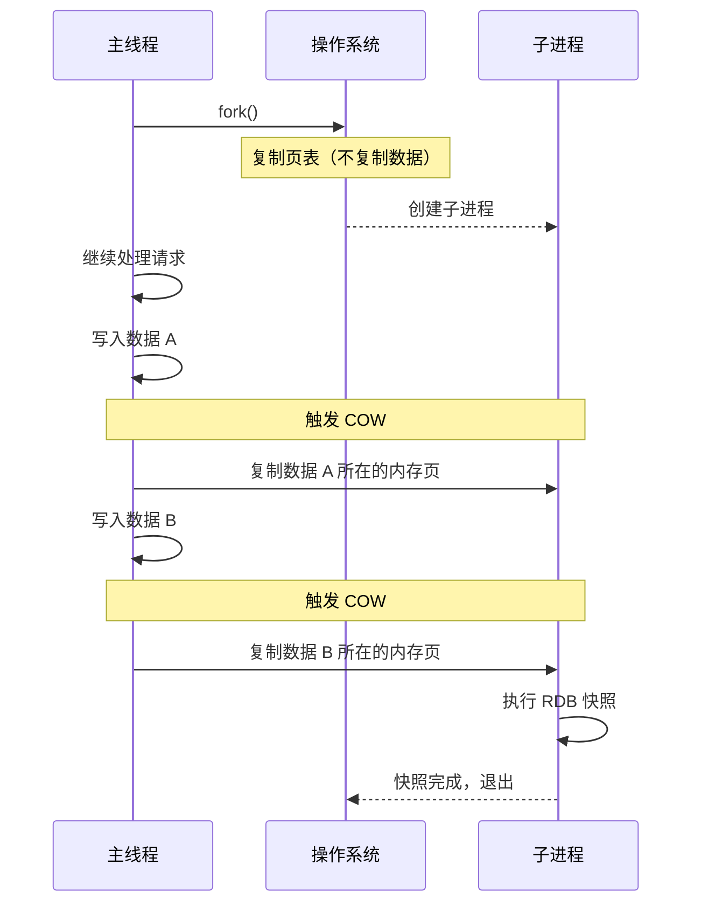
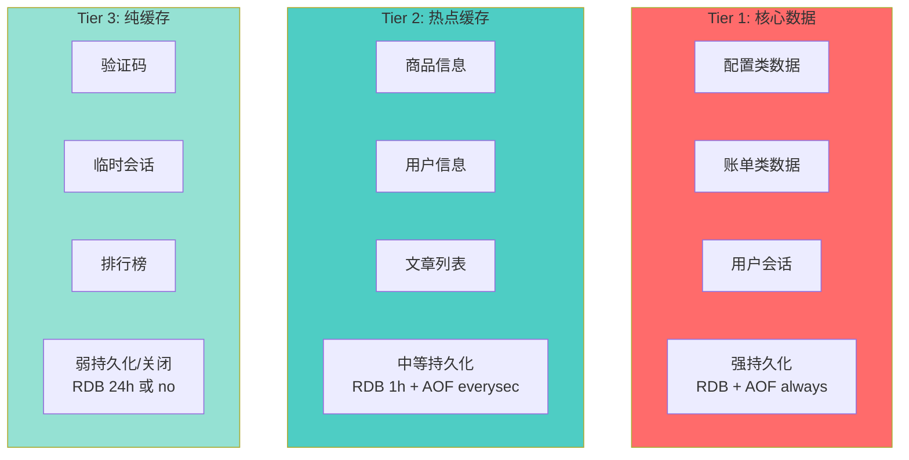
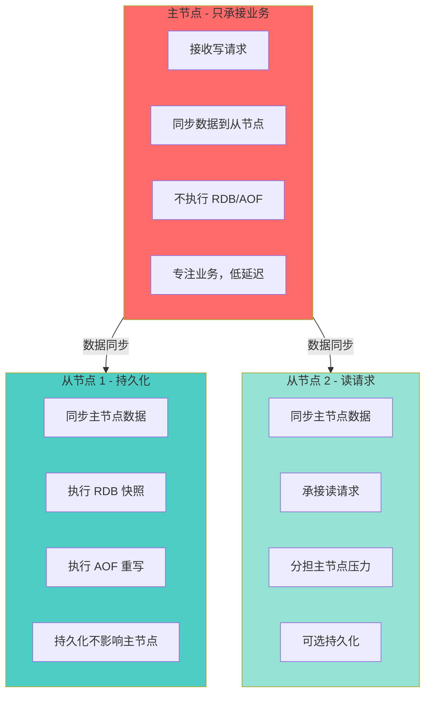
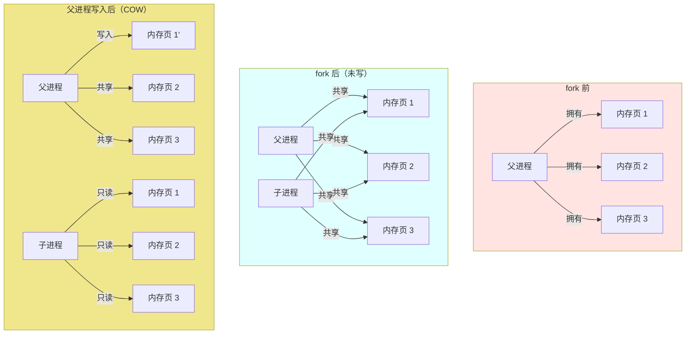
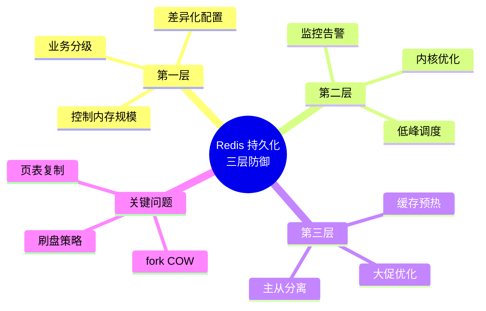
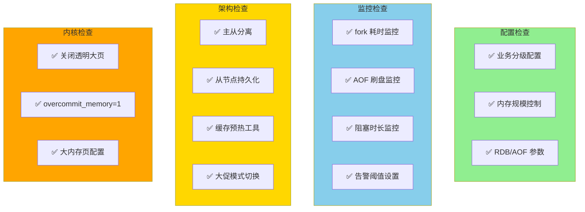
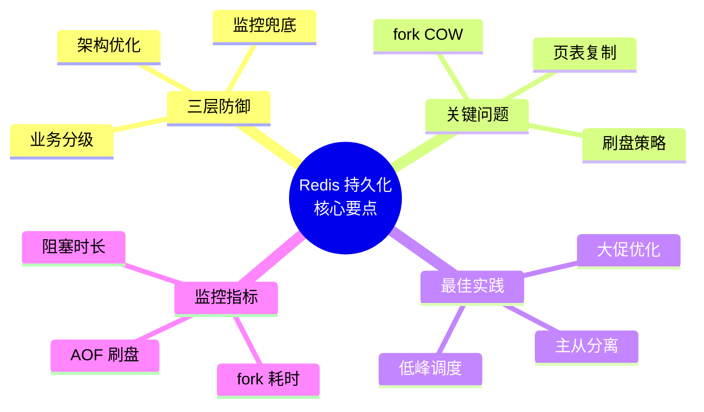

# Redis 持久化选型与优化

> **核心主题**：Redis 持久化选型与优化——RDB/AOF 原理、fork 内存拷贝、COW 机制、主从架构优化、监控告警

---

## 🎯 一句话定位

**Redis 持久化解决什么问题？**
```
Redis 是内存数据库，数据都在内存里。
一旦宕机，数据就全没了——就像你在脑子里记账，脑子一晕，账本全忘光了。

持久化 = 把内存数据定期写到磁盘上
就像给大脑配个"外接硬盘"，脑子晕了，硬盘还在。
```

**生活化比喻**：
就像你写日记：
- **RDB（快照）**：每天凌晨 2 点拍张照片，把今天的内容全拍下来
- **AOF（追加日志）**：随时记录，每写一句话就记在本子上

**核心矛盾**：
- RDB 快但可能丢数据（两次快照之间的数据丢了）
- AOF 安全但慢（每句话都记，本子越写越厚）

---

## 💎 核心要点速览

> **快速掌握核心设计要点**

### 三层防御体系

**1. 第一层：业务分级差异化持久化**
```
❌ 所有数据一刀切开启强持久化
✅ 按业务重要性分级：
   - 核心热点缓存：拉长 RDB 间隔、调松 AOF 刷盘、纯缓存可关闭
   - 配置类/账单类：开启强持久化
   - 控制单实例内存：避免大内存 fork 页表拷贝耗时过长
```

**2. 第二层：监控兜底与时机管控**
```
❌ 持久化在业务高峰期执行
✅ 主动管控：
   - 专项监控：fork 耗时、AOF 刷盘耗时、重写频率、阻塞时长
   - 调度优化：快照/AOF 重写移到低峰期
   - 内核优化：关闭透明大页减少 fork 卡顿
```

**3. 第三层：架构层优化**
```
❌ 主节点既承接业务又做持久化
✅ 主从职责分离：
   - 持久化下沉到从节点，主节点只承接业务
   - 缓存快速预热与多副本切换
   - 大促临时关闭主节点持久化
```

---

## 🚀 一句话精华（如果只能记住一句）

> **Redis 持久化 = 业务分级（差异化配置） + 监控兜底（低峰调度） + 架构优化（主从分离）**

---

## 一、为什么 Redis 持久化是个难题？

### ❌ 传统持久化的三大痛点

**1. fork 子进程的内存拷贝开销**

**生活化比喻**：
```
想象你在抄写一本 1000 页的书：
- 普通做法：把整本书抄一遍（全量拷贝）
- Redis 做法：只抄你改过的页（COW，Copy-On-Write）

但如果书有 10000 页，就算只抄改过的，也得先翻一遍看看哪些改了。
这个"翻一遍"的过程就是 fork 时的页表拷贝。
```

**技术问题**：
```
Redis fork() 时会发生什么？
1. 父进程调用 fork()，操作系统创建子进程
2. 子进程复制父进程的页表（不是数据本身）
3. 父进程继续写数据时，才会复制对应的内存页（COW）

问题：
- 内存越大，页表越大，fork 越慢
- 64GB 内存的 Redis，fork 可能需要 1-2 秒
- 这期间 Redis 是阻塞的，无法处理请求！
```



**2. 大内存页表复制耗时**

**生活化比喻**：
```
就像图书馆要搬家：
- 小图书馆（1GB 内存）：搬一次只要 10 分钟
- 大图书馆（64GB 内存）：搬一次要 10 小时！

而且搬家期间，图书馆不对外开放（Redis 阻塞）。
```

**数据对比**：
| 内存大小 | fork 耗时（典型值） | 影响 | 生活化比喻 |
|---------|-------------------|------|------------|
| 1 GB | 10-50 ms | 几乎无感 | 小书店搬家，瞬间完成 |
| 10 GB | 100-300 ms | 轻微抖动 | 图书馆搬家，闭馆 1 小时 |
| 32 GB | 500-1000 ms | 明显卡顿 | 大图书馆搬家，闭馆半天 |
| 64 GB | 1-2 s | 严重阻塞 | 国家图书馆搬家，闭馆 1 天 |
| 128 GB | 3-5 s | 不可接受 | 整个城市图书馆搬家，闭馆 1 周 |

**3. 刷盘策略错配**

**生活化比喻**：
```
AOF 刷盘策略就像写日记：
- always：每写一句话就保存一次（安全但慢）
- everysec：每秒保存一次（折中）
- no：攒够一页再保存（快但可能丢数据）

错配场景：
- 账单系统用 no：宕机丢数据，用户投诉
- 纯缓存用 always：性能浪费，像给草稿纸买保险
```

---

## 二、第一层防御：业务分级差异化持久化

### ✅ 核心思路（30 秒版）

```
生活化比喻：
就像保险投保：
- 豪车（核心数据）：买全险（强持久化）
- 自行车（纯缓存）：不买险（关闭持久化）
- 普通车（一般数据）：买基础险（弱持久化）

技术实现：
按业务重要性分级配置，而不是一刀切。
```

### 2.1 业务分级策略



**配置示例**：
```go
// Redis 持久化配置分级
type RedisPersistenceConfig struct {
    Tier1 Tier1Config // 核心数据
    Tier2 Tier2Config // 热点缓存
    Tier3 Tier3Config // 纯缓存
}

type Tier1Config struct {
    RDBInterval  string // "60"（60秒）
    RDBChanges   string // "1"（1次改动）
    AOFEnabled   bool   // true
    AOFStrategy  string // "always"
    AOFRewriteMB int    // 64（64MB触发重写）
}

type Tier2Config struct {
    RDBInterval  string // "300"（5分钟）
    RDBChanges   string // "100"（100次改动）
    AOFEnabled   bool   // true
    AOFStrategy  string // "everysec"
    AOFRewriteMB int    // 128（128MB触发重写）
}

type Tier3Config struct {
    RDBInterval  string // "86400"（24小时）
    RDBChanges   string // "10000"（10000次改动）
    AOFEnabled   bool   // false（纯缓存可关闭）
    AOFStrategy  string // "no"
    AOFRewriteMB int    // 0
}
```

### 2.2 控制单实例内存规模

**生活化比喻**：
```
就像搬家：
- 小箱子（1GB）：一个人就能搬动
- 大箱子（64GB）：需要 10 个人一起搬

单实例内存太大，fork 就越慢。
建议：单个 Redis 实例内存控制在 10-20GB。
```

**分片策略**：
```
场景：需要缓存 100GB 数据
❌ 方案1：1 个 100GB 实例
   - fork 耗时：5-10 秒
   - 风险：单点故障，恢复慢

✅ 方案2：10 个 10GB 实例（Redis Cluster）
   - fork 耗时：100-300 ms
   - 优势：并行处理，故障隔离
```

```go
// Redis Cluster 分片配置
type RedisClusterConfig struct {
    Shards        []ShardConfig
    MaxMemoryMB   int // 单实例最大内存，建议 10-20GB
    ReplicaCount  int // 副本数，建议 1-2
}

type ShardConfig struct {
    NodeID      string
    MemoryMB    int
    Role        string // "master" or "slave"
    Persistence PersistenceConfig
}

func NewRedisCluster(totalMemoryGB int, maxMemoryPerNodeGB int) *RedisClusterConfig {
    shardCount := totalMemoryGB / maxMemoryPerNodeGB
    shards := make([]ShardConfig, shardCount*2) // 主从
    
    for i := 0; i < shardCount; i++ {
        // 主节点
        shards[i*2] = ShardConfig{
            NodeID:   fmt.Sprintf("node-%d-master", i),
            MemoryMB: maxMemoryPerNodeGB * 1024,
            Role:     "master",
            Persistence: PersistenceConfig{
                RDBEnabled:  true,
                AOFEnabled:  false, // 主节点关闭 AOF
            },
        }
        // 从节点
        shards[i*2+1] = ShardConfig{
            NodeID:   fmt.Sprintf("node-%d-slave", i),
            MemoryMB: maxMemoryPerNodeGB * 1024,
            Role:     "slave",
            Persistence: PersistenceConfig{
                RDBEnabled:  true,
                AOFEnabled:  true, // 从节点开启 AOF
            },
        }
    }
    
    return &RedisClusterConfig{
        Shards:       shards,
        MaxMemoryMB:  maxMemoryPerNodeGB * 1024,
        ReplicaCount: 1,
    }
}
```

---

## 三、第二层防御：监控兜底与时机管控

### ✅ 核心思路（30 秒版）

```
生活化比喻：
就像高速公路施工：
❌ 白天高峰期施工：堵车 10 公里
✅ 凌晨 2 点施工：车少，影响小

Redis 持久化同理：
❌ 业务高峰期 fork：阻塞请求，用户体验差
✅ 低峰期执行：影响最小
```

### 3.1 持久化专项监控

**生活化比喻**：
```
监控指标就像体检报告：
- fork 耗时：心跳时间（越长越危险）
- AOF 刷盘耗时：排尿时间（越长越有问题）
- 重写频率：体重变化（越频繁越异常）
- 阻塞时长：昏迷时间（越长越严重）
```

```go
// Redis 持久化监控指标
type PersistenceMonitor struct {
    // fork 耗时监控
    ForkDuration    time.Duration // fork 耗时
    ForkThreshold   time.Duration // 阈值，建议 500ms
    
    // AOF 刷盘监控
    AOFWriteLatency time.Duration // AOF 刷盘延迟
    AOFThreshold    time.Duration // 阈值，建议 10ms
    
    // 重写监控
    RewriteCount    int           // 重写次数
    RewriteInterval time.Duration // 重写间隔
    
    // 阻塞监控
    BlockedTime     time.Duration // 阻塞时长
    BlockedThreshold time.Duration // 阈值，建议 1s
}

func (m *PersistenceMonitor) CheckHealth() error {
    if m.ForkDuration > m.ForkThreshold {
        return fmt.Errorf("fork 耗时过长: %v > %v", m.ForkDuration, m.ForkThreshold)
    }
    
    if m.AOFWriteLatency > m.AOFThreshold {
        return fmt.Errorf("AOF 刷盘延迟过高: %v > %v", m.AOFWriteLatency, m.AOFThreshold)
    }
    
    if m.BlockedTime > m.BlockedThreshold {
        return fmt.Errorf("阻塞时长过长: %v > %v", m.BlockedTime, m.BlockedThreshold)
    }
    
    return nil
}
```

### 3.2 主动管控：调度优化

**生活化比喻**：
```
就像餐厅清洁：
❌ 午餐时间清洁：影响顾客用餐
✅ 凌晨 2 点清洁：餐厅打烊后，不影响业务

Redis 持久化调度：
- RDB 快照：凌晨 2-4 点执行
- AOF 重写：凌晨 3-5 点执行
- 避免业务高峰期
```

```go
// 持久化调度器
type PersistenceScheduler struct {
    RDBSchedule   string // "0 2 * * *"（凌晨 2 点）
    AOFRewriteSchedule string // "0 3 * * *"（凌晨 3 点）
    BlackoutHours []int  // 黑名单时段（业务高峰期）
}

func (s *PersistenceScheduler) ShouldExecute(now time.Time, taskType string) bool {
    hour := now.Hour()
    
    // 检查是否在黑名单时段
    for _, blackHour := range s.BlackoutHours {
        if hour == blackHour {
            return false // 业务高峰期不执行
        }
    }
    
    // 检查是否在调度窗口
    switch taskType {
    case "rdb":
        return hour >= 2 && hour <= 4 // 凌晨 2-4 点
    case "aof_rewrite":
        return hour >= 3 && hour <= 5 // 凌晨 3-5 点
    default:
        return true
    }
}
```

### 3.3 内核优化：关闭透明大页

**生活化比喻**：
```
透明大页（THP）就像：
你把 100 个小盒子合并成 1 个大盒子，看起来更整洁。
但每次拿东西时，得把大盒子拆开，拿完再合并回去。

Redis fork 时：
- 开启 THP：fork 耗时增加 30-50%
- 关闭 THP：fork 更快，性能更稳定

建议：关闭透明大页
```

```bash
# 关闭透明大页
echo never > /sys/kernel/mm/transparent_hugepage/enabled
echo never > /sys/kernel/mm/transparent_hugepage/defrag

# 验证
cat /sys/kernel/mm/transparent_hugepage/enabled
# 应该输出：always madvise [never]
```

```go
// 内核参数检查工具
type KernelOptimizer struct {
    THPEnabled string // "never"
    OvercommitMemory string // "1"（允许 overcommit）
}

func (k *KernelOptimizer) Apply() error {
    // 关闭透明大页
    if err := writeFile("/sys/kernel/mm/transparent_hugepage/enabled", "never"); err != nil {
        return err
    }
    
    // 允许 overcommit（fork 时不检查内存是否足够）
    if err := writeFile("/proc/sys/vm/overcommit_memory", "1"); err != nil {
        return err
    }
    
    return nil
}
```

---

## 四、第三层防御：架构层优化

### ✅ 核心思路（30 秒版）

```
生活化比喻：
就像公司分工：
❌ 老板既接客又扫地：效率低，风险高
✅ 老板接客，员工扫地：各司其职，效率高

Redis 架构：
❌ 主节点既承接业务又做持久化：阻塞风险
✅ 主节点承接业务，从节点做持久化：职责分离
```

### 4.1 主从职责分离



**配置示例**：
```go
// 主从配置分离
type MasterSlaveConfig struct {
    Master MasterConfig
    Slaves []SlaveConfig
}

type MasterConfig struct {
    NodeID        string
    Role          string // "master"
    Persistence   PersistenceConfig
    MaxClients    int
}

type SlaveConfig struct {
    NodeID        string
    Role          string // "slave"
    Persistence   PersistenceConfig
    MaxClients    int
    SlaveRead     bool // 是否承接读请求
}

func NewMasterSlaveConfig() *MasterSlaveConfig {
    return &MasterSlaveConfig{
        Master: MasterConfig{
            NodeID: "master-1",
            Role:   "master",
            Persistence: PersistenceConfig{
                RDBEnabled: false, // 主节点关闭 RDB
                AOFEnabled: false, // 主节点关闭 AOF
            },
            MaxClients: 10000,
        },
        Slaves: []SlaveConfig{
            {
                NodeID: "slave-1",
                Role:   "slave",
                Persistence: PersistenceConfig{
                    RDBEnabled: true, // 从节点 1 做 RDB
                    AOFEnabled: true, // 从节点 1 做 AOF
                    AOFStrategy: "everysec",
                },
                MaxClients: 5000,
                SlaveRead:  false, // 不承接读，专注持久化
            },
            {
                NodeID: "slave-2",
                Role:   "slave",
                Persistence: PersistenceConfig{
                    RDBEnabled: true,
                    AOFEnabled: false,
                },
                MaxClients: 5000,
                SlaveRead:  true, // 承接读请求
            },
        },
    }
}
```

### 4.2 缓存快速预热与多副本切换

**生活化比喻**：
```
就像餐厅备用厨师：
- 主厨生病了（主节点宕机）
- 备用厨师立刻顶上（从节点切换为主节点）
- 新厨师先看看菜谱（缓存预热）

技术实现：
1. 主节点宕机，从节点自动切换为主节点
2. 新主节点从其他从节点同步数据
3. 快速预热热点数据，减少缓存未命中
```

```go
// 缓存预热工具
type CacheWarmer struct {
    HotKeys       []string // 热点 key 列表
    WarmUpTimeout time.Duration // 预热超时
}

func (w *CacheWarmer) WarmUp(redisClient *redis.Client) error {
    start := time.Now()
    
    for _, key := range w.HotKeys {
        // 检查是否已存在
        exists, err := redisClient.Exists(key).Result()
        if err != nil {
            continue
        }
        
        if exists == 0 {
            // 从 MySQL 加载
            value, err := LoadFromMySQL(key)
            if err != nil {
                continue
            }
            
            // 写入 Redis
            redisClient.Set(key, value, 24*time.Hour)
        }
        
        // 检查超时
        if time.Since(start) > w.WarmUpTimeout {
            break
        }
    }
    
    return nil
}
```

### 4.3 大促临时关闭主节点持久化

**生活化比喻**：
```
就像双十一：
- 平时：每笔订单都记账（持久化）
- 双十一：订单太多，先不记账了，专心接客
- 双十一后：再补记账

技术实现：
- 大促前：临时关闭主节点 RDB/AOF
- 大促中：主节点专注业务，从节点做持久化
- 大促后：恢复主节点持久化
```

```go
// 大促模式切换
type PromotionMode struct {
    Enabled       bool
    MasterPersistence PersistenceConfig
    SlavePersistence  PersistenceConfig
}

func (p *PromotionMode) Enable(redisClient *redis.Client) error {
    // 关闭主节点持久化
    redisClient.ConfigSet("save", "") // 关闭 RDB
    redisClient.ConfigSet("appendonly", "no") // 关闭 AOF
    
    // 确保从节点持久化开启
    // ...
    
    p.Enabled = true
    return nil
}

func (p *PromotionMode) Disable(redisClient *redis.Client) error {
    // 恢复主节点持久化
    redisClient.ConfigSet("save", "900 1 300 10 60 10000") // 恢复 RDB
    redisClient.ConfigSet("appendonly", "yes") // 恢复 AOF
    
    p.Enabled = false
    return nil
}
```

---

## 五、关键问题深度剖析

### 5.1 fork 子进程的内存拷贝开销（COW 机制）

**生活化比喻**：
```
COW（Copy-On-Write）就像：
你和室友共用一本书：
- 你不改：直接看，不用复印
- 你要改：先复印一页，再在复印件上改

Redis fork 后：
- 父子进程共用内存页（不复制数据）
- 父进程写数据时，才复制对应的内存页（COW）
- 如果写很多数据，COW 会很慢
```



**优化方案**：
```
1. 控制内存规模：单实例 10-20GB
2. 减少写入：fork 期间尽量少写数据
3. 内核优化：关闭透明大页
4. 硬件优化：使用大内存页（hugetlbfs）
```

### 5.2 大内存页表复制

**生活化比喻**：
```
页表就像书的目录：
- 1GB 内存：目录 10 页，翻一遍很快
- 64GB 内存：目录 640 页，翻一遍很慢

fork 时复制页表：
- 内存越大，页表越大，fork 越慢
- 解决方案：分片，把大书拆成多本小书
```

### 5.3 刷盘策略错配

**生活化比喻**：
```
就像写信：
- 重要信件（账单）：每写一句就保存（always）
- 草稿（缓存）：攒够一页再保存（no）

错配后果：
- 账单用 no：丢数据，用户投诉
- 缓存用 always：性能浪费，像给草稿买保险
```

---

## 六、技术深度追问

```mermaid
graph TB
    subgraph Q1["Q1: RDB 和 AOF 如何选择?"]
        A1[按业务重要性] --> A2[核心数据用 AOF]
        A2 --> A3[纯缓存用 RDB]
        A3 --> A4[混合使用]
    end
    
    subgraph Q2["Q2: fork 耗时过长怎么办?"]
        B1[控制内存规模] --> B2[10-20GB/实例]
        B2 --> B3[关闭透明大页]
        B3 --> B4[主从分离]
    end
    
    subgraph Q3["Q3: 如何保证数据不丢失?"]
        C1[AOF always] --> C2[性能差]
        C2 --> C3[AOF everysec]
        C3 --> C4[最多丢 1 秒数据]
        C4 --> C5[主从分离兜底]
    end
    
    subgraph Q4["Q4: 大促如何优化?"]
        D1[临时关闭主节点持久化] --> D2[从节点做持久化]
        D2 --> D3[大促后恢复]
    end
    
    subgraph Q5["Q5: 监控哪些指标?"]
        E1[fork 耗时] --> E2[AOF 刷盘耗时]
        E2 --> E3[重写频率]
        E3 --> E4[阻塞时长]
    end
    
    style Q1 fill:#FFE4E1
    style Q2 fill:#E0FFFF
    style Q3 fill:#F0E68C
    style Q4 fill:#DDA0DD
    style Q5 fill:#90EE90
```



### 详细分析

**Q1: RDB 和 AOF 如何选择？**  
**答**：不是二选一，而是按业务分级：
1. **核心数据**（账单、配置）：AOF always + RDB，保证数据不丢
2. **热点缓存**（商品、用户）：AOF everysec + RDB，折中方案
3. **纯缓存**（验证码、临时数据）：RDB 24h 或关闭持久化，性能优先

**Q2: fork 耗时过长怎么办？**  
**答**：四招解决：
1. **控制内存**：单实例 10-20GB，不要超过 32GB
2. **关闭透明大页**：减少 fork 卡顿 30-50%
3. **主从分离**：主节点不做持久化，从节点做
4. **低峰调度**：RDB/AOF 重写放到低峰期

**Q3: 如何保证数据不丢失？**  
**答**：三层防御：
1. **AOF everysec**：最多丢 1 秒数据
2. **主从分离**：从节点做持久化，主节点宕机有备份
3. **监控告警**：fork 耗时、AOF 刷盘耗时超标立即告警

**Q4: 大促如何优化？**  
**答**：临时关闭主节点持久化，从节点做持久化。大促后恢复。就像双十一先不记账，专心接客。

**Q5: 监控哪些指标？**  
**答**：四个关键指标：
1. **fork 耗时**：阈值 500ms，超标告警
2. **AOF 刷盘耗时**：阈值 10ms，超标告警
3. **重写频率**：每天 1-2 次正常，过多异常
4. **阻塞时长**：阈值 1s，超标立即处理

---

## 七、核心要点总结



**方案总结**：

> **Redis 持久化通过三层防御保证性能和数据安全：**
> 
> **第一层：业务分级**。核心数据（账单、配置）开启强持久化，热点缓存（商品、用户）中等持久化，纯缓存（验证码）可关闭。同时控制单实例内存 10-20GB，避免大内存 fork 耗时过长。
> 
> **第二层：监控兜底**。专项监控 fork 耗时、AOF 刷盘耗时、重写频率、阻塞时长，超标立即告警。主动管控：RDB/AOF 重写调度到低峰期，内核优化关闭透明大页。
> 
> **第三层：架构优化**。主从职责分离，主节点只承接业务，从节点做持久化。缓存快速预热与多副本切换，大促临时关闭主节点持久化。

---

## 八、生产环境 Checklist（部署检查清单）



**部署检查清单**：

| 类别 | 检查项 | 状态 | 生活化比喻 |
|------|--------|------|------------|
| **配置检查** | 业务分级配置 | ⬜ | 保险分类 |
| | 内存规模控制（10-20GB） | ⬜ | 箱子别太大 |
| | RDB/AOF 参数 | ⬜ | 写日记策略 |
| **监控检查** | fork 耗时监控（<500ms） | ⬜ | 心跳监测 |
| | AOF 刷盘监控（<10ms） | ⬜ | 排尿监测 |
| | 阻塞时长监控（<1s） | ⬜ | 昏迷监测 |
| | 告警阈值设置 | ⬜ | 异常报警 |
| **架构检查** | 主从分离 | ⬜ | 老板接客，员工扫地 |
| | 从节点持久化 | ⬜ | 备用厨师记账 |
| | 缓存预热工具 | ⬜ | 新厨师看菜谱 |
| | 大促模式切换 | ⬜ | 双十一不记账 |
| **内核检查** | 关闭透明大页 | ⬜ | 别合并盒子 |
| | overcommit_memory=1 | ⬜ | 允许透支 |
| | 大内存页配置 | ⬜ | 大箱子装东西 |

---

## 九、总结



### 🎯 一句话总结

> **Redis 持久化 = 业务分级（差异化配置） + 监控兜底（低峰调度） + 架构优化（主从分离）**

### 🧠 核心记忆点

1. **为什么分三层？** 单一优化不够，多层防御才可靠。就像保险，交强险 + 商业险 + 意外险。
2. **为什么主从分离？** 主节点做持久化会阻塞，影响业务。就像老板既接客又扫地，效率低。
3. **为什么控制内存？** 内存越大，fork 越慢。10GB 内存 fork 100ms，64GB 内存 fork 1-2s。
4. **为什么低峰调度？** 高峰期 fork 会阻塞请求。就像高速公路施工，白天堵车，凌晨不堵。

---


