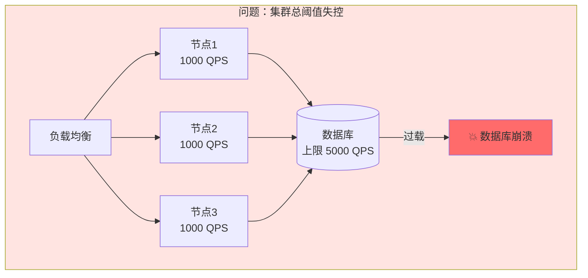
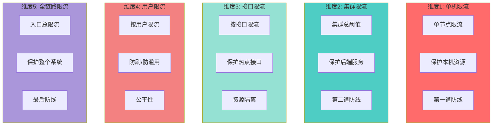
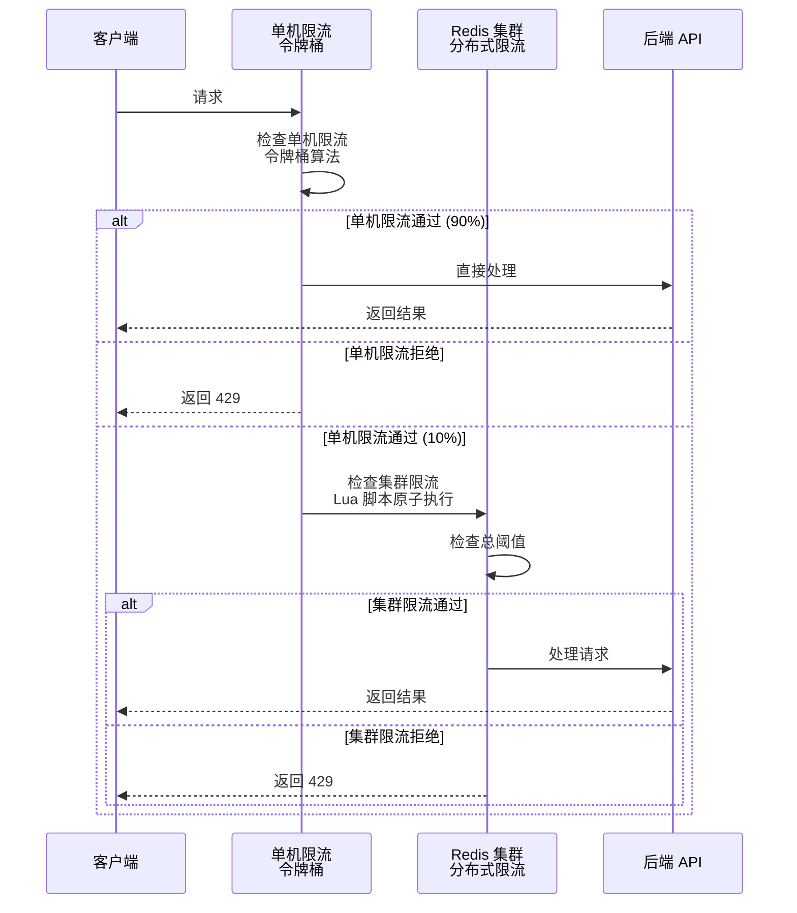
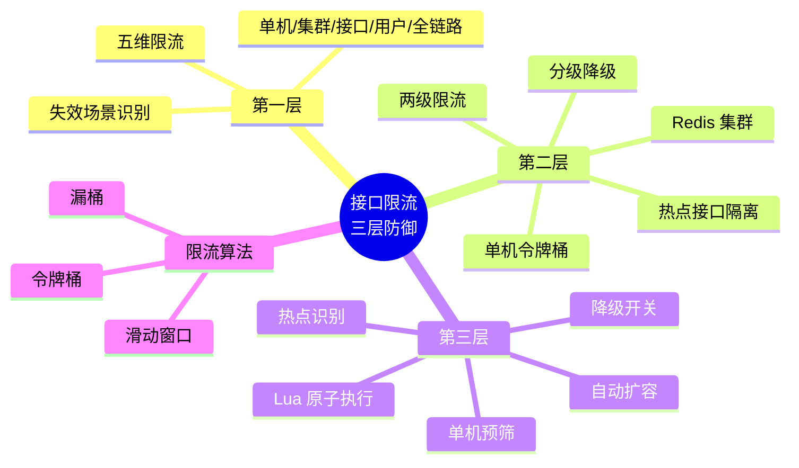
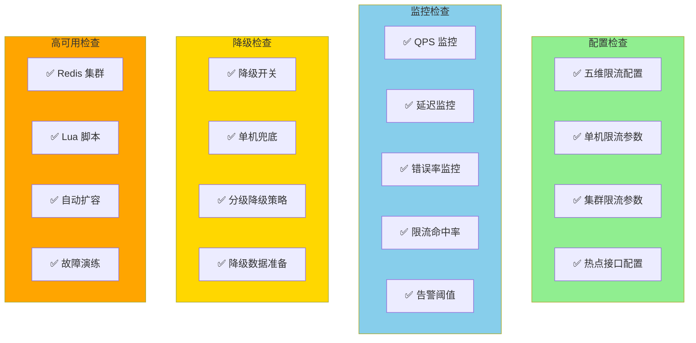
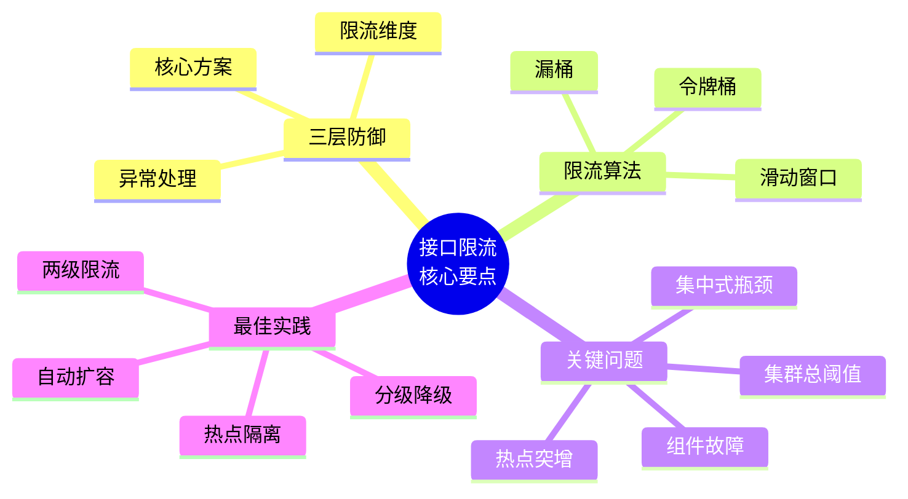

# 接口限流设计

> **场景定位**：后端架构设计场景  
> **核心设计要点**：限流算法、分布式限流、热点防护、降级策略、高可用架构

---

## 🎯 一句话定位

**接口限流解决什么问题？**
```
没有限流，就像餐厅没有排队系统：
- 100 个顾客同时涌入，服务员忙不过来
- 厨师炒菜炒到手抽筋，菜品质量下降
- 顾客等太久，投诉、差评、流失

限流 = 给系统装个"排队系统"
- 控制进入的流量（不让 100 人同时进）
- 保护后端服务（厨师不被累死）
- 提升用户体验（排队比挤破门好）
```

**生活化比喻**：
就像高速公路收费站：
- **没有限流**：所有车同时涌入，堵成停车场
- **有限流**：分批放行，虽然要排队，但至少能动

**核心矛盾**：
- 限流太严：用户体验差（排队太久）
- 限流太松：系统被压垮（服务挂了）

---

## 💎 核心观点（5 分钟速览版）

> **快速概览**

### 三层防御体系

**1. 第一层：限流维度与失效场景**
```
❌ 只懂单机限流，不懂集群限流
✅ 五维限流：单机/集群/接口/用户/全链路
❌ 不知道限流会失效
✅ 失效场景：集群总阈值失控、集中式性能瓶颈、流量突刺误杀、热点接口拖垮服务、组件故障雪崩
```

**2. 第二层：核心方案分场景落地**
```
❌ 只有限流，没有降级
✅ 单机+分布式两级限流：单机令牌桶第一道防线、Redis 集群第二道防线
❌ 一刀切限流
✅ 流量平滑：令牌桶替代计数器、用户维度滑动窗口
❌ 热点接口没特殊待遇
✅ 热点接口单独配置阈值+资源隔离
❌ 超限就拒绝
✅ 限流降级：核心接口排队等待（削峰填谷）、非核心返回降级数据
```

**3. 第三层：异常处理**
```
❌ 集中式限流性能瓶颈
✅ 单机预筛+集群复核（90% 在单机层处理）
❌ Redis 脚本非原子
✅ Redis Lua 脚本原子执行
❌ 限流组件挂了怎么办
✅ 降级开关切回单机模式
❌ 热点突增没预案
✅ 实时识别+动态调整阈值+自动扩容
❌ 全服务超限无脑拒绝
✅ 分级降级（先关非核心→核心排队→入口总限流）
```

---

## 🚀 一句话精华（如果只能记住一句）

> **接口限流 = 单机+分布式两级限流 + 流量平滑（令牌桶/滑动窗口） + 分级降级（核心排队/非核心降级）**

---

## 一、为什么限流是个难题？

### ❌ 传统限流的五大失效场景

**1. 集群总阈值失控**

**生活化比喻**：
```
就像公司规定：
- 每个部门每天最多报销 1000 元（单机限流）
- 但没规定公司总报销额度（集群限流）

结果：10 个部门各报销 1000 元，总共 10000 元，超出预算！

技术问题：
- 10 台机器，每台限流 1000 QPS
- 总流量 10 × 1000 = 10000 QPS
- 但后端数据库只能扛 5000 QPS
- 数据库被压垮！
```



**2. 集中式性能瓶颈**

**生活化比喻**：
```
就像餐厅只有一个收银员：
- 所有顾客都要经过收银员（集中式限流）
- 收银员忙不过来，顾客排长队
- 限流组件成了瓶颈！

技术问题：
- 所有请求都经过 Redis 限流
- Redis 成为单点瓶颈
- 限流组件挂了，整个系统挂了
```

**3. 流量突刺误杀**

**生活化比喻**：
```
就像餐厅限流：
- 规定每分钟最多进 10 个顾客
- 突然 100 个顾客同时到
- 90 个被拒之门外（误杀）

技术问题：
- 固定窗口限流：窗口切换瞬间流量翻倍
- 滑动窗口限流：窗口内均匀分布，但突刺流量被误杀
- 正确做法：令牌桶允许突发流量
```

**4. 热点接口拖垮服务**

**生活化比喻**：
```
就像餐厅热门菜品：
- 宫保鸡丁占了 80% 的订单
- 厨师全在做宫保鸡丁
- 其他菜品做不完，顾客投诉

技术问题：
- 某个接口被大量调用（热点接口）
- 占用所有资源
- 其他接口饿死
```

**5. 组件故障雪崩**

**生活化比喻**：
```
就像多米诺骨牌：
- 限流组件（Redis）挂了
- 所有限流失效
- 流量涌入，后端挂了
- 整个系统雪崩

技术问题：
- 限流组件单点故障
- 没有降级方案
- 故障扩散，雪崩效应
```

---

## 二、第一层防御：限流维度与失效场景

### ✅ 五维限流模型

**生活化比喻**：
```
就像公司管理：
- 单机限流：每个员工每天最多工作 8 小时
- 集群限流：整个部门每天最多工作 80 小时
- 接口限流：每个任务每天最多处理 100 个
- 用户限流：每个客户每天最多提 10 个需求
- 全链路限流：整个公司每天最多接 1000 个项目
```



**配置示例**：
```go
// 多维度限流配置
type RateLimitConfig struct {
    // 单机限流
    SingleNode SingleNodeConfig
    
    // 集群限流
    Cluster ClusterConfig
    
    // 接口限流
    API map[string]APIConfig
    
    // 用户限流
    User UserConfig
    
    // 全链路限流
    Global GlobalConfig
}

type SingleNodeConfig struct {
    QPS       int  // 单节点 QPS 上限
    Algorithm string // "token_bucket" or "sliding_window"
}

type ClusterConfig struct {
    TotalQPS   int  // 集群总 QPS 上限
    RedisAddr  string // Redis 集群地址
    LuaScript  string // Lua 脚本（原子执行）
}

type APIConfig struct {
    QPS       int  // 接口 QPS 上限
    Burst     int  // 突发流量上限
    Timeout   time.Duration // 超时时间
}

type UserConfig struct {
    QPS       int  // 单用户 QPS 上限
    DailyLimit int // 每日上限
}

type GlobalConfig struct {
    TotalQPS  int  // 全链路总 QPS 上限
    Priority  []string // 优先级队列
}
```

---

## 三、第二层防御：核心方案分场景落地

### ✅ 核心思路（30 秒版）

```
生活化比喻：
就像餐厅管理：
- 单机限流：每个服务员最多服务 10 桌（第一道防线）
- 集群限流：整个餐厅最多接待 100 桌（第二道防线）
- 热点接口：宫保鸡丁单独配 2 个厨师（资源隔离）
- 限流降级：VIP 客户排队等待，普通客户发优惠券下次来

技术实现：
单机令牌桶第一道防线 → Redis 集群第二道防线 → 热点接口资源隔离 → 分级降级
```

### 3.1 单机+分布式两级限流

**生活化比喻**：
```
就像公司审批：
- 单机限流：部门经理审批（快速，90% 在这里处理）
- 集群限流：总经理审批（慢，但全局控制）

优势：
- 90% 的请求在单机层处理，不用经过 Redis
- 减少 Redis 压力，提升性能
- Redis 挂了，单机限流还能兜底
```



**代码实现**：
```go
// 两级限流器
type TwoLevelRateLimiter struct {
    singleLimiter *TokenBucketLimiter // 单机限流
    clusterLimiter *RedisClusterLimiter // 集群限流
    fallbackEnabled bool // 降级开关
}

func (t *TwoLevelRateLimiter) Allow(key string) bool {
    // 第一级：单机限流（快速，90% 在这里处理）
    if !t.singleLimiter.Allow(key) {
        return false // 单机限流拒绝
    }
    
    // 第二级：集群限流（慢，但全局控制）
    if t.fallbackEnabled {
        // 降级模式：跳过集群限流
        return true
    }
    
    if !t.clusterLimiter.Allow(key) {
        return false // 集群限流拒绝
    }
    
    return true
}

// 单机令牌桶限流器
type TokenBucketLimiter struct {
    capacity   int           // 桶容量
    rate       float64       // 令牌生成速率（个/秒）
    tokens     float64       // 当前令牌数
    lastUpdate time.Time     // 上次更新时间
    mu         sync.Mutex    // 互斥锁
}

func (t *TokenBucketLimiter) Allow(key string) bool {
    t.mu.Lock()
    defer t.mu.Unlock()
    
    now := time.Now()
    elapsed := now.Sub(t.lastUpdate).Seconds()
    
    // 生成新令牌
    t.tokens += elapsed * t.rate
    if t.tokens > float64(t.capacity) {
        t.tokens = float64(t.capacity) // 不超过桶容量
    }
    
    t.lastUpdate = now
    
    // 检查是否有令牌
    if t.tokens >= 1 {
        t.tokens--
        return true
    }
    
    return false
}

// Redis 集群限流器
type RedisClusterLimiter struct {
    redisClient *redis.Client
    luaScript   string // Lua 脚本（原子执行）
    maxQPS      int
}

func (r *RedisClusterLimiter) Allow(key string) bool {
    result, err := r.redisClient.Eval(r.luaScript, []string{key}, r.maxQPS).Int()
    if err != nil {
        // Redis 挂了，降级到单机限流
        return true // 放行
    }
    return result == 1
}
```

### 3.2 流量平滑：令牌桶替代计数器

**生活化比喻**：
```
计数器 vs 令牌桶：
- 计数器：严格限流，像漏斗，水流得很均匀
- 令牌桶：允许突发，像水桶，水满了可以一次性倒很多

场景：
- 计数器：适合严格限流（如数据库连接数）
- 令牌桶：适合允许突发（如 API 限流）
```

```go
// 令牌桶限流器（允许突发流量）
type TokenBucket struct {
    capacity int           // 桶容量（最大突发量）
    rate     float64       // 令牌生成速率（个/秒）
    tokens   float64       // 当前令牌数
    lastTime time.Time     // 上次更新时间
    mu       sync.Mutex
}

func NewTokenBucket(capacity int, rate float64) *TokenBucket {
    return &TokenBucket{
        capacity: capacity,
        rate:     rate,
        tokens:   float64(capacity), // 初始满桶
        lastTime: time.Now(),
    }
}

func (t *TokenBucket) Allow() bool {
    t.mu.Lock()
    defer t.mu.Unlock()
    
    now := time.Now()
    elapsed := now.Sub(t.lastTime).Seconds()
    
    // 生成新令牌
    t.tokens += elapsed * t.rate
    if t.tokens > float64(t.capacity) {
        t.tokens = float64(t.capacity)
    }
    
    t.lastTime = now
    
    // 检查令牌
    if t.tokens >= 1 {
        t.tokens--
        return true
    }
    
    return false
}

// 滑动窗口限流器（用户维度）
type SlidingWindowLimiter struct {
    windowSize time.Duration // 窗口大小
    maxRequests int          // 窗口内最大请求数
    requests    []time.Time  // 请求时间戳
    mu          sync.Mutex
}

func (s *SlidingWindowLimiter) Allow(userID string) bool {
    s.mu.Lock()
    defer s.mu.Unlock()
    
    now := time.Now()
    windowStart := now.Add(-s.windowSize)
    
    // 清理过期请求
    validRequests := make([]time.Time, 0)
    for _, reqTime := range s.requests {
        if reqTime.After(windowStart) {
            validRequests = append(validRequests, reqTime)
        }
    }
    s.requests = validRequests
    
    // 检查是否超限
    if len(s.requests) >= s.maxRequests {
        return false
    }
    
    // 记录请求
    s.requests = append(s.requests, now)
    return true
}
```

### 3.3 热点接口单独配置阈值+资源隔离

**生活化比喻**：
```
就像餐厅热门菜品：
- 宫保鸡丁占 80% 订单
- 单独配 2 个厨师做宫保鸡丁（资源隔离）
- 其他菜品不受影响

技术实现：
- 识别热点接口（访问频率 > 1000 QPS）
- 单独配置限流阈值
- 独立线程池/协程池（资源隔离）
```

```go
// 热点接口限流器
type HotAPILimiter struct {
    limiters map[string]*TokenBucket // 每个接口独立限流
    hotAPIs  map[string]bool         // 热点接口标识
    mu       sync.RWMutex
}

func NewHotAPILimiter() *HotAPILimiter {
    return &HotAPILimiter{
        limiters: make(map[string]*TokenBucket),
        hotAPIs:  make(map[string]bool),
    }
}

func (h *HotAPILimiter) Allow(apiPath string, qps int) bool {
    h.mu.RLock()
    limiter, exists := h.limiters[apiPath]
    h.mu.RUnlock()
    
    if !exists {
        // 新建限流器
        h.mu.Lock()
        limiter = NewTokenBucket(qps*2, float64(qps)) // 允许 2 倍突发
        h.limiters[apiPath] = limiter
        h.mu.Unlock()
    }
    
    return limiter.Allow()
}

func (h *HotAPILimiter) MarkAsHot(apiPath string) {
    h.mu.Lock()
    defer h.mu.Unlock()
    h.hotAPIs[apiPath] = true
}

// 资源隔离：独立协程池
type IsolatedPool struct {
    apiName    string
    workerChan chan func()
    workers    int
}

func NewIsolatedPool(apiName string, workers int) *IsolatedPool {
    pool := &IsolatedPool{
        apiName:    apiName,
        workerChan: make(chan func(), workers*10),
        workers:    workers,
    }
    
    // 启动 worker
    for i := 0; i < workers; i++ {
        go func() {
            for task := range pool.workerChan {
                task()
            }
        }()
    }
    
    return pool
}

func (p *IsolatedPool) Submit(task func()) {
    p.workerChan <- task
}
```

### 3.4 限流降级：核心接口排队等待（削峰填谷）

**生活化比喻**：
```
就像餐厅排队：
- VIP 客户：排队等待（削峰填谷）
- 普通客户：发优惠券，下次再来（降级）

技术实现：
- 核心接口：排队等待（有界队列）
- 非核心接口：返回降级数据（缓存/默认值）
```

```go
// 降级策略
type DegradationStrategy struct {
    // 核心接口：排队等待
    CoreAPIQueue *BoundedQueue
    
    // 非核心接口：返回降级数据
    NonCoreFallback map[string]interface{}
}

type BoundedQueue struct {
    queue    chan func()
    timeout  time.Duration
    capacity int
}

func NewBoundedQueue(capacity int, timeout time.Duration) *BoundedQueue {
    return &BoundedQueue{
        queue:    make(chan func(), capacity),
        timeout:  timeout,
        capacity: capacity,
    }
}

func (b *BoundedQueue) Enqueue(task func()) bool {
    select {
    case b.queue <- task:
        return true // 入队成功
    case <-time.After(b.timeout):
        return false // 超时，拒绝
    }
}

func (b *BoundedQueue) Process() {
    for task := range b.queue {
        task() // 处理任务
    }
}

// 限流降级处理器
type RateLimitDegradation struct {
    coreAPIs     map[string]bool // 核心接口列表
    queue        *BoundedQueue   // 排队队列
    fallbackData map[string]interface{} // 降级数据
}

func (r *RateLimitDegradation) Handle(apiPath string, handler func()) (interface{}, error) {
    // 检查是否核心接口
    if r.coreAPIs[apiPath] {
        // 核心接口：排队等待
        success := r.queue.Enqueue(handler)
        if !success {
            return nil, errors.New("queue full, please retry later")
        }
        return nil, nil // 排队成功
    }
    
    // 非核心接口：返回降级数据
    if data, exists := r.fallbackData[apiPath]; exists {
        return data, nil
    }
    
    return nil, errors.New("service degraded")
}
```

---

## 四、第三层防御：异常处理

### ✅ 核心思路（30 秒版）

```
生活化比喻：
就像应急预案：
- 集中式性能瓶颈：单机预筛+集群复核（90% 在单机层处理）
- Redis 挂了：降级开关切回单机模式
- 热点突增：实时识别+动态调整阈值+自动扩容
- 全服务超限：分级降级（先关非核心→核心排队→入口总限流）
```

### 4.1 集中式性能：单机预筛+集群复核

**生活化比喻**：
```
就像公司审批：
- 90% 的小事：部门经理审批（单机限流）
- 10% 的大事：总经理审批（集群限流）

优势：
- 减少总经理压力（Redis 压力）
- 提升审批速度（性能）
- 部门经理挂了，还有总经理兜底（高可用）
```

```go
// 单机预筛+集群复核
type PreFilterClusterLimiter struct {
    singleLimiter *TokenBucketLimiter
    clusterLimiter *RedisClusterLimiter
    preFilterRate float64 // 预筛比例（如 0.9 = 90%）
}

func (p *PreFilterClusterLimiter) Allow(key string) bool {
    // 第一层：单机预筛（90% 在这里处理）
    if !p.singleLimiter.Allow(key) {
        return false // 单机拒绝
    }
    
    // 第二层：集群复核（10% 到这里）
    if !p.clusterLimiter.Allow(key) {
        return false // 集群拒绝
    }
    
    return true
}
```

### 4.2 Redis Lua 脚本原子执行

**生活化比喻**：
```
就像银行转账：
- 非原子：A 账户扣钱 → 网络延迟 → B 账户加钱（中间可能出错）
- 原子：A 账户扣钱 + B 账户加钱（一步完成，不出错）

Redis Lua 脚本：
- 多个命令打包执行
- 要么全成功，要么全失败
- 避免并发问题
```

```go
// Redis Lua 脚本（原子执行）
const luaScript = `
local key = KEYS[1]
local limit = tonumber(ARGV[1])
local current = tonumber(redis.call('get', key) or "0")

if current + 1 > limit then
    return 0 -- 拒绝
else
    redis.call('incr', key)
    redis.call('expire', key, 1) -- 1 秒过期
    return 1 -- 通过
end
`

type AtomicRateLimiter struct {
    redisClient *redis.Client
    luaScript   string
}

func (a *AtomicRateLimiter) Allow(key string, limit int) bool {
    result, err := a.redisClient.Eval(a.luaScript, []string{key}, limit).Int()
    if err != nil {
        return true // Redis 挂了，放行
    }
    return result == 1
}
```

### 4.3 组件故障：降级开关切回单机模式

**生活化比喻**：
```
就像餐厅收银系统：
- 正常：电子收银（Redis 集群限流）
- 故障：手工记账（单机限流）

降级开关：
- 检测到 Redis 挂了
- 自动切回单机限流
- 保证服务可用
```

```go
// 降级开关
type DegradationSwitch struct {
    enabled     bool
    lastCheck   time.Time
    checkInterval time.Duration
    mu          sync.Mutex
}

func (d *DegradationSwitch) Check(redisClient *redis.Client) bool {
    d.mu.Lock()
    defer d.mu.Unlock()
    
    now := time.Now()
    if now.Sub(d.lastCheck) < d.checkInterval {
        return d.enabled
    }
    
    // 检查 Redis 是否可用
    _, err := redisClient.Ping().Result()
    if err != nil {
        d.enabled = true // Redis 挂了，开启降级
    } else {
        d.enabled = false // Redis 正常，关闭降级
    }
    
    d.lastCheck = now
    return d.enabled
}
```

### 4.4 热点突增：实时识别+动态调整阈值+自动扩容

**生活化比喻**：
```
就像餐厅应对突发流量：
- 实时监控：发现门口排长队（热点识别）
- 动态调整：增加服务员（调整阈值）
- 自动扩容：叫更多厨师来帮忙（自动扩容）

技术实现：
- 实时监控 QPS、延迟、错误率
- 动态调整限流阈值
- 触发自动扩容（Kubernetes HPA）
```

```go
// 热点识别器
type HotSpotDetector struct {
    apiStats   map[string]*APIStats
    threshold  int // 热点阈值
    mu         sync.RWMutex
}

type APIStats struct {
    qps       int
    latency   time.Duration
    errorRate float64
}

func (h *HotSpotDetector) Detect(apiPath string) bool {
    h.mu.RLock()
    defer h.mu.RUnlock()
    
    stats, exists := h.apiStats[apiPath]
    if !exists {
        return false
    }
    
    return stats.qps > h.threshold
}

// 动态调整限流阈值
type DynamicRateLimiter struct {
    baseQPS    int
    currentQPS int
    detector   *HotSpotDetector
    mu         sync.Mutex
}

func (d *DynamicRateLimiter) Adjust(apiPath string) {
    d.mu.Lock()
    defer d.mu.Unlock()
    
    if d.detector.Detect(apiPath) {
        // 热点突增，提升限流阈值
        d.currentQPS = d.baseQPS * 2
    } else {
        // 恢复正常
        d.currentQPS = d.baseQPS
    }
}

// 自动扩容（Kubernetes HPA）
type AutoScaler struct {
    minReplicas int
    maxReplicas int
    targetCPU   int
}

func (a *AutoScaler) Scale(currentQPS int) int {
    // 根据 QPS 计算需要的副本数
    replicas := currentQPS / 1000 // 每个副本处理 1000 QPS
    if replicas < a.minReplicas {
        return a.minReplicas
    }
    if replicas > a.maxReplicas {
        return a.maxReplicas
    }
    return replicas
}
```

### 4.5 全服务超限：分级降级

**生活化比喻**：
```
就像餐厅应对爆满：
- 第一步：关闭非核心服务（不接生日宴会）
- 第二步：核心服务排队（VIP 客户等待）
- 第三步：入口总限流（门口排队，分批进入）

技术实现：
- 分级降级：先关非核心→核心排队→入口总限流
- 保证核心服务可用
```

```go
// 分级降级策略
type TieredDegradation struct {
    tier1NonCore []string // 非核心接口（优先关闭）
    tier2Core    []string // 核心接口（排队等待）
    tier3Global  int      // 全局限流阈值
}

func (t *TieredDegradation) Handle(totalQPS int) {
    if totalQPS > t.tier3Global {
        // 第三级：入口总限流
        t.GlobalRateLimit()
    } else if totalQPS > int(float64(t.tier3Global)*0.8) {
        // 第二级：核心接口排队
        t.CoreAPIQueue()
    } else if totalQPS > int(float64(t.tier3Global)*0.5) {
        // 第一级：关闭非核心
        t.ShutdownNonCore()
    }
}

func (t *TieredDegradation) ShutdownNonCore() {
    for _, api := range t.tier1NonCore {
        // 关闭非核心接口
        fmt.Printf("Shutdown non-core API: %s\n", api)
    }
}

func (t *TieredDegradation) CoreAPIQueue() {
    for _, api := range t.tier2Core {
        // 核心接口排队等待
        fmt.Printf("Queue core API: %s\n", api)
    }
}

func (t *TieredDegradation) GlobalRateLimit() {
    // 入口总限流
    fmt.Printf("Global rate limit: %d QPS\n", t.tier3Global)
}
```

---

## 五、技术追问与深度问题

```mermaid
graph TB
    subgraph Q1["Q1: 令牌桶 vs 漏桶?"]
        A1[令牌桶: 允许突发] --> A2[适合 API 限流]
        A3[漏桶: 平滑流量] --> A4[适合严格限流]
    end
    
    subgraph Q2["Q2: 如何识别热点接口?"]
        B1[实时监控 QPS] --> B2[访问频率 > 1000]
        B2 --> B3[标记为热点]
    end
    
    subgraph Q3["Q3: 限流组件挂了怎么办?"]
        C1[降级开关] --> C2[切回单机模式]
        C2 --> C3[保证服务可用]
    end
    
    subgraph Q4["Q4: 如何保证限流原子性?"]
        D1[Redis Lua 脚本] --> D2[多命令打包执行]
        D2 --> D3[避免并发问题]
    end
    
    subgraph Q5["Q5: 全服务超限如何处理?"]
        E1[分级降级] --> E2[先关非核心]
        E2 --> E3[核心排队]
        E3 --> E4[入口总限流]
    end
    
    style Q1 fill:#FFE4E1
    style Q2 fill:#E0FFFF
    style Q3 fill:#F0E68C
    style Q4 fill:#DDA0DD
    style Q5 fill:#90EE90
```



### 方案详解

**Q1: 令牌桶和漏桶有什么区别？**  
**答**：
- **令牌桶**：允许突发流量，像水桶，水满了可以一次性倒很多。适合 API 限流，用户突然多请求几次也能处理。
- **漏桶**：平滑流量，像漏斗，水流得很均匀。适合严格限流，如数据库连接数控制。

**Q2: 如何识别热点接口？**  
**答**：实时监控每个接口的 QPS、延迟、错误率。如果某个接口 QPS > 1000，标记为热点接口，单独配置限流阈值和资源隔离。

**Q3: 限流组件挂了怎么办？**  
**答**：降级开关。检测到 Redis 挂了，自动切回单机限流模式。就像电子收银挂了，改用手工记账。保证服务可用。

**Q4: 如何保证限流的原子性？**  
**答**：Redis Lua 脚本。把多个命令打包执行，要么全成功，要么全失败。避免并发问题，就像银行转账，A 扣钱和 B 加钱必须同时完成。

**Q5: 全服务超限如何处理？**  
**答**：分级降级：
1. **第一级**：关闭非核心服务（如评论、推荐）
2. **第二级**：核心服务排队等待（如订单、支付）
3. **第三级**：入口总限流（如首页、登录）

保证核心服务可用，牺牲非核心服务。

---

## 六、方案总结



**方案总结**：

> **接口限流通过三层防御保证高可用：**
> 
> **第一层：限流维度**。五维限流模型：单机/集群/接口/用户/全链路。识别失效场景：集群总阈值失控、集中式性能瓶颈、流量突刺误杀、热点接口拖垮服务、组件故障雪崩。
> 
> **第二层：核心方案**。单机+分布式两级限流：单机令牌桶第一道防线，处理 90% 请求；Redis 集群第二道防线，全局控制。热点接口单独配置阈值+资源隔离。限流降级：核心接口排队等待（削峰填谷），非核心返回降级数据。
> 
> **第三层：异常处理**。单机预筛+集群复核，90% 在单机层处理。Redis Lua 脚本原子执行。降级开关切回单机模式。热点突增：实时识别+动态调整阈值+自动扩容。全服务超限：分级降级（先关非核心→核心排队→入口总限流）。

---

## 七、生产环境 Checklist（部署检查清单）



**部署检查清单**：

| 类别 | 检查项 | 状态 | 生活化比喻 |
|------|--------|------|------------|
| **配置检查** | 五维限流配置 | ⬜ | 公司管理制度 |
| | 单机限流参数（QPS） | ⬜ | 员工工作量 |
| | 集群限流参数（总 QPS） | ⬜ | 部门总工作量 |
| | 热点接口配置 | ⬜ | 热门菜品单独配厨师 |
| **监控检查** | QPS 监控 | ⬜ | 车流量监控 |
| | 延迟监控 | ⬜ | 排队时间监控 |
| | 错误率监控 | ⬜ | 投诉率监控 |
| | 限流命中率 | ⬜ | 限流有效率 |
| | 告警阈值 | ⬜ | 异常报警 |
| **降级检查** | 降级开关 | ⬜ | 应急开关 |
| | 单机兜底 | ⬜ | 备用方案 |
| | 分级降级策略 | ⬜ | 应急预案 |
| | 降级数据准备 | ⬜ | 备用数据 |
| **高可用检查** | Redis 集群 | ⬜ | 多收银员 |
| | Lua 脚本 | ⬜ | 原子操作 |
| | 自动扩容 | ⬜ | 自动加开窗口 |
| | 故障演练 | ⬜ | 消防演习 |

---

## 八、总结（一句话带走）



### 🎯 一句话总结

> **接口限流 = 单机+分布式两级限流 + 流量平滑（令牌桶/滑动窗口） + 分级降级（核心排队/非核心降级）**

### 🧠 核心记忆点

1. **为什么两级限流？** 90% 在单机层处理，减少 Redis 压力。Redis 挂了，单机还能兜底。
2. **为什么用令牌桶？** 允许突发流量，用户体验好。计数器太严格，用户突然多请求几次就被拒。
3. **为什么热点隔离？** 热点接口占用所有资源，其他接口饿死。单独配厨师，互不影响。
4. **为什么分级降级？** 全服务超限时，先关非核心，保证核心服务可用。就像餐厅爆满，先不接生日宴会，保证普通顾客用餐。

---

*本文档基于 8 个专家提示词指导改写，遵循深入浅出、生活化比喻、幽默风趣的教学原则。*
