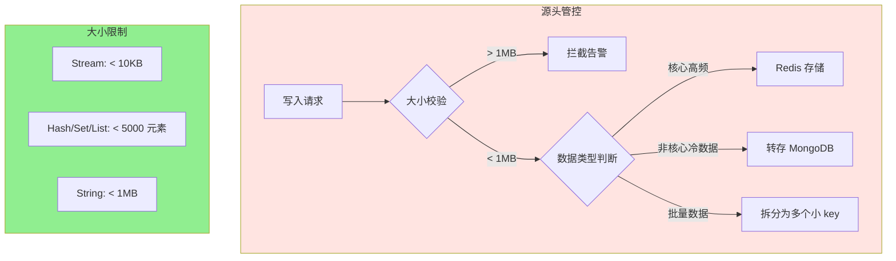
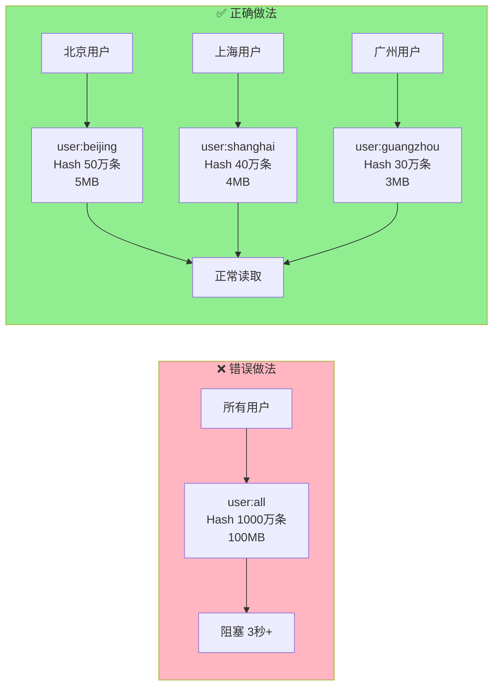
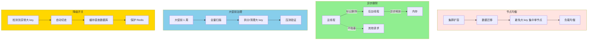
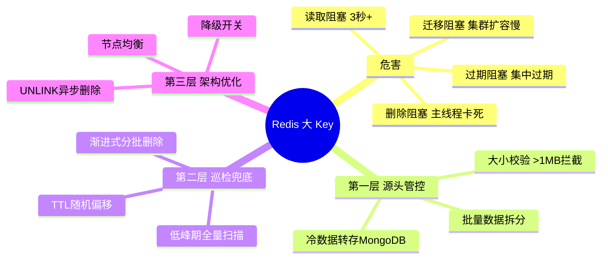
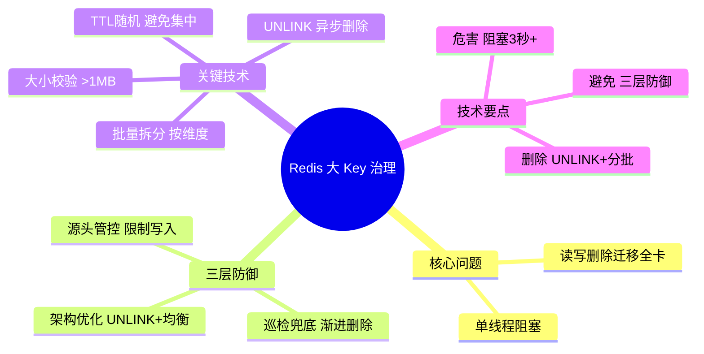

# Redis 大 Key 处理策略

> **场景定位**：后端架构优化技术场景  
> **核心设计要点**：Redis 大 Key 识别、渐进式删除、架构优化、性能调优

---

## 🎯 一句话定位

**Redis 大 Key 解决什么问题？**
```
一个 Key 存了 100MB 数据（比如一个 Hash 存了 100 万条用户信息）
读取时：其他请求全部排队等待（单线程阻塞 3 秒+）
删除时：主线程卡死，像高速公路上一辆大货车抛锚，后面全堵死
迁移时：集群扩容慢得像蜗牛爬
```

**生活化比喻**：
就像快递仓库里有个巨无霸包裹（100 吨重）：
- 搬运工（Redis 主线程）每次搬它都要花 3 秒
- 这期间其他小包裹都送不出去（阻塞其他请求）
- 最惨的是，搬运工只有一个人（Redis 单线程）

**核心特点**：大 Key 是 Redis 性能的"隐形杀手"，平时看不到，一到高峰期就爆炸。

---

## 💎 核心观点（5 分钟速览版）

> **快速概览**

### 核心观点（3 层防御体系）

**1. 第一层：业务分级源头管控**
```
✅ 核心高频数据：严格限制 value 大小
   - Stream 不超 10KB
   - 集合类（Hash/Set/List）控制元素数量（< 5000）
✅ 批量数据禁止单 key 打包
   - 按业务维度拆分为多个小 key
   - 例：用户列表按地区拆分（北京用户、上海用户...）
✅ 写入侧大小校验
   - 超阈值直接拦截告警（> 1MB 拒绝写入）
✅ 非核心冷数据转存
   - 转存 MongoDB 或对象存储（OSS/S3）
```

**2. 第二层：巡检兜底与平滑处理**
```
✅ 常态化扫描
   - 低峰期全量巡检（凌晨 2-5 点）
   - 实时监控内存占比、访问频次
✅ 渐进式分批删除
   - ❌ 禁止直接 DEL（会阻塞 3 秒+）
   - ✅ 用 UNLINK（异步删除）或分批 HDEL
✅ 过期时间随机偏移
   - 避免集中过期引发批量删除卡顿
   - TTL 加随机偏移（±10%）
✅ 大集合拆分
   - 拆分为多个小 key 分片存储
```

**3. 第三层：架构层优化**
```
✅ 节点均衡
   - 避免大 key 集中单节点引发数据倾斜
✅ 异步删除机制（UNLINK）
   - 释放主线程压力
✅ 大促前专项 big key 治理
   - 提前扫描、拆分、清理
✅ 降级开关
   - 异常 big key 自动切走，缓存直查数据库
```

---

## 🚀 一句话精华（如果只能记住一句）

> **Redis 大 Key 治理 = 源头管控（限制写入） + 巡检兜底（渐进删除） + 架构优化（UNLINK + 节点均衡）**

---

## 一、为什么大 Key 是 Redis 的"隐形杀手"？

### ❌ 大 Key 的四大危害

**生活化比喻**：
```
想象 Redis 是一个快餐店，只有一个服务员（单线程）：
- 小 key（普通订单）：点一杯可乐，1 秒搞定
- 大 key（巨无霸订单）：点 1000 份全家桶，服务员忙了 3 秒
  这期间其他顾客全部排队等待（阻塞其他请求）
```

**1. 读取阻塞（最致命）**
```
技术问题：
大 key 读取耗时 = 数据量 / 网络带宽
一个 100MB 的 key，读取耗时：
100MB / 100MBps（内网带宽）= 1 秒
这 1 秒内，其他请求全部排队！

生活化比喻：
就像高速公路上的大货车，占用车道，后面小车全堵死。
```

**2. 删除阻塞（更致命）**
```
技术问题：
DEL 命令是同步删除，大 key 删除耗时 3 秒+
这 3 秒内，Redis 主线程完全卡死！

生产事故：
某电商大促期间，运营误删一个 500MB 的 Hash key
Redis 主线程阻塞 5 秒，导致全系统雪崩，损失百万。

生活化比喻：
就像搬家时搬一个大沙发，卡在门口，整栋楼的人都出不去。
```

**3. 过期阻塞（隐性危害）**
```
技术问题：
Redis 过期删除策略：
- 惰性删除：访问时检查，过期才删
- 定期删除：每 100ms 随机检查一批 key

如果大量 key 同时过期（集中过期）：
主线程忙于删除，阻塞其他请求。

生活化比喻：
就像餐厅打烊时，100 桌客人同时结账，服务员忙不过来。
```

**4. 迁移阻塞（集群扩容痛点）**
```
技术问题：
Redis Cluster 扩容时需要迁移数据
大 key 迁移耗时：100MB / 10MBps = 10 秒
迁移期间，该 key 的读写请求被拒绝（MOVED 重定向）

生活化比喻：
就像快递仓库搬迁，巨无霸包裹搬运太慢，导致整个仓库瘫痪。
```

---

## 二、第一层防御：业务分级源头管控

### ✅ 核心思路（30 秒版）

```
生活化比喻：
就像快递仓库的入库检查：
1. 检查包裹大小（value 大小校验）
2. 超大包裹拒收（> 1MB 拦截）
3. 大件拆分（批量数据拆分为多个小 key）
4. 冷库存放（非核心数据转存 MongoDB）
```



### 2.1 大小阈值设定

**生活化比喻**：
```
就像快递包裹分类：
- 小包裹（< 10KB）：正常快递，快速处理
- 中包裹（10KB - 1MB）：大件快递，需要特殊处理
- 大包裹（> 1MB）：超大件，拒收或拆分

Redis 大 key 阈值：
- String: > 1MB 算大 key
- Hash/Set/List: > 5000 元素 或 > 10MB 算大 key
- ZSet: > 10000 元素 或 > 10MB 算大 key
```

| 数据类型 | 大 key 阈值 | 危害等级 | 生活化比喻 |
|---------|------------|---------|------------|
| **String** | > 1MB | ⭐⭐⭐ | 大包裹，搬运慢 |
| **Hash** | > 5000 元素 或 > 10MB | ⭐⭐⭐⭐⭐ | 巨无霸包裹，阻塞最严重 |
| **Set/List** | > 5000 元素 或 > 10MB | ⭐⭐⭐⭐ | 大件包裹，删除慢 |
| **ZSet** | > 10000 元素 或 > 10MB | ⭐⭐⭐⭐ | 超大包裹，排序慢 |
| **Stream** | > 10KB | ⭐⭐ | 小包裹，但数量多也会堵 |

### 2.2 批量数据拆分策略

**生活化比喻**：
```
场景：存储全国用户信息（1000 万用户）

❌ 错误做法：
一个 key 存所有用户：user:all → Hash(1000万条)
问题：读取时阻塞 3 秒+，删除时卡死

✅ 正确做法：
按地区拆分：
user:beijing → Hash(北京用户)
user:shanghai → Hash(上海用户)
user:guangzhou → Hash(广州用户)
...

好处：
- 单次读取只加载一个地区（< 1MB）
- 删除时逐个删除，不阻塞
- 集群分布均匀，不集中单节点
```



### 2.3 代码示例（Go 语言版）

```go
// 大 Key 写入校验
type BigKeyChecker struct {
    maxSize      int64         // 最大 value 大小（1MB）
    maxElements  int           // 最大元素数量（5000）
    alertChannel chan string   // 告警通道
}

func NewBigKeyChecker() *BigKeyChecker {
    return &BigKeyChecker{
        maxSize:      1 * 1024 * 1024, // 1MB
        maxElements:  5000,
        alertChannel: make(chan string, 100),
    }
}

// 检查 String 类型
func (c *BigKeyChecker) CheckString(key string, value []byte) error {
    if int64(len(value)) > c.maxSize {
        // 超阈值，拦截告警
        c.alertChannel <- fmt.Sprintf("大 key 告警: %s, 大小: %d bytes", key, len(value))
        return errors.New("value 超过 1MB，拒绝写入")
    }
    return nil
}

// 检查 Hash 类型
func (c *BigKeyChecker) CheckHash(key string, fields int) error {
    if fields > c.maxElements {
        c.alertChannel <- fmt.Sprintf("大 key 告警: %s, 元素数: %d", key, fields)
        return errors.New("Hash 元素超过 5000，建议拆分")
    }
    return nil
}

// 批量数据拆分示例
func SplitUserData(users []User) map[string]map[string]interface{} {
    // 按地区拆分
    result := make(map[string]map[string]interface{})
    
    for _, user := range users {
        regionKey := fmt.Sprintf("user:%s", user.Region)
        if result[regionKey] == nil {
            result[regionKey] = make(map[string]interface{})
        }
        result[regionKey][user.ID] = user.Info
    }
    
    return result
    // 结果：
    // user:beijing -> {id1: info1, id2: info2, ...}
    // user:shanghai -> {id3: info3, id4: info4, ...}
}
```

---

## 三、第二层防御：巡检兜底与平滑处理

### ✅ 核心思路（30 秒版）

```
生活化比喻：
就像快递仓库的日常管理：
1. 每天凌晨盘点（低峰期全量巡检）
2. 发现超大包裹，拆分或转移（渐进式处理）
3. 扔掉过期包裹时，分批扔（渐进式删除）
4. 避免同一时间大量包裹过期（TTL 随机偏移）
```

```mermaid
graph TB
    subgraph Patrol["常态化巡检"]
        A1[凌晨2点定时任务] --> A2[扫描所有 key]
        A2 --> A3{判断大 key}
        A3 -->|> 阈值| A4[标记告警]
        A3 -->|正常| A5[继续监控]
        A4 --> A6[生成治理报告]
    end
    
    subgraph Delete["渐进式删除"]
        B1[发现大 key] --> B2{是否还有用?}
        B2 -->|有用| B3[拆分为小 key]
        B2 -->|无用| B4{是否紧急?}
        B4 -->|紧急| B5[UNLINK 异步删除]
        B4 -->|不紧急| B6[分批 HDEL/SREM]
    end
    
    subgraph TTL["TTL 随机偏移"]
        C1[设置过期时间] --> C2[TTL = base + random(-10%, +10%)]
        C2 --> C3[避免集中过期]
    end
    
    style Patrol fill:#FFE4E1
    style Delete fill:#90EE90
    style TTL fill:#87CEEB
```

### 3.1 大 Key 扫描工具

**生活化比喻**：
```
就像仓库盘点员：
- 每天凌晨 2 点，盘点所有包裹
- 测量每个包裹的大小（MEMORY USAGE key）
- 统计每个包裹的元素数量（HLEN key / SCARD key）
- 记录超大包裹，生成报告
```

**Redis 命令**：
```bash
# 扫描大 key（生产环境慎用，会阻塞）
redis-cli --bigkeys

# 安全扫描（低峰期执行）
redis-cli --bigkeys --interval 0.1  # 每 100ms 扫描一个

# 查看 key 的内存占用
MEMORY USAGE user:beijing

# 查看 Hash 元素数量
HLEN user:beijing

# 查看 Set 元素数量
SCARD hot:products
```

**Go 代码示例**：
```go
// 大 Key 扫描工具
type BigKeyScanner struct {
    redisClient *redis.Client
    threshold   int64  // 阈值（1MB）
}

func (s *BigKeyScanner) ScanBigKeys() []BigKeyInfo {
    var bigKeys []BigKeyInfo
    
    var cursor uint64
    for {
        // 分批扫描，避免阻塞
        keys, nextCursor, err := s.redisClient.Scan(cursor, "*", 100).Result()
        if err != nil {
            log.Errorf("扫描失败: %v", err)
            break
        }
        
        for _, key := range keys {
            // 获取 key 类型
            keyType, _ := s.redisClient.Type(key).Result()
            
            var size int64
            switch keyType {
            case "string":
                // 获取字符串长度
                strLen, _ := s.redisClient.StrLen(key).Result()
                size = int64(strLen)
            case "hash":
                // 获取元素数量
                hashLen, _ := s.redisClient.HLen(key).Result()
                size = int64(hashLen) * 100 // 估算大小
            case "set":
                // 获取元素数量
                setLen, _ := s.redisClient.SCard(key).Result()
                size = int64(setLen) * 100
            case "list":
                // 获取列表长度
                listLen, _ := s.redisClient.LLen(key).Result()
                size = int64(listLen) * 100
            case "zset":
                // 获取元素数量
                zsetLen, _ := s.redisClient.ZCard(key).Result()
                size = int64(zsetLen) * 100
            }
            
            // 超过阈值，记录告警
            if size > s.threshold {
                bigKeys = append(bigKeys, BigKeyInfo{
                    Key:  key,
                    Type: keyType,
                    Size: size,
                })
            }
        }
        
        cursor = nextCursor
        if cursor == 0 {
            break
        }
        
        // 每扫描 100 个 key，休眠 10ms，避免阻塞
        time.Sleep(10 * time.Millisecond)
    }
    
    return bigKeys
}
```

### 3.2 渐进式删除策略

**生活化比喻**：
```
删除大 key 就像搬家：
❌ 错误做法：一次性搬所有东西（DEL 命令）
   - 搬运工累死（主线程阻塞 3 秒+）
   - 整栋楼的人都出不去（其他请求阻塞）

✅ 正确做法 1：UNLINK（异步删除）
   - 告诉搬运工"这个包裹要扔掉"（主线程标记删除）
   - 搬运工空闲时再处理（后台线程异步释放内存）
   - 不阻塞其他包裹搬运

✅ 正确做法 2：分批 HDEL（渐进式删除）
   - 每天搬一点（每次删除 100 个字段）
   - 不影响正常搬运（不阻塞主线程）
   - 几天后搬完（逐步释放内存）
```

**对比表格**：

| 删除方式 | 命令 | 阻塞时间 | 适用场景 | 生活化比喻 |
|---------|------|---------|---------|------------|
| **同步删除** | DEL | 3 秒+ | ❌ 禁用 | 一次性搬所有东西，累死 |
| **异步删除** | UNLINK | < 1ms | ✅ 推荐 | 标记删除，空闲时处理 |
| **渐进删除** | 分批 HDEL/SREM | 每次 < 1ms | ✅ Hash/Set/List | 每天搬一点，不影响生活 |
| **过期删除** | EXPIRE + 随机偏移 | 分散 | ✅ 非紧急 | 避免同一时间大量包裹过期 |

**代码示例**：
```go
// 渐进式删除大 Hash
func DeleteBigHash(redisClient *redis.Client, key string, batchSize int) error {
    for {
        // 获取一批字段（每次 100 个）
        fields, err := redisClient.HKeys(key).Result()
        if err != nil {
            return err
        }
        
        if len(fields) == 0 {
            break // 删除完毕
        }
        
        // 分批删除（每次 100 个）
        toDelete := fields[:batchSize]
        if len(toDelete) > batchSize {
            toDelete = fields[:batchSize]
        }
        
        // 删除这批字段
        redisClient.HDel(key, toDelete...)
        
        // 休眠 10ms，避免阻塞
        time.Sleep(10 * time.Millisecond)
    }
    
    // 最后删除 key 本身
    redisClient.Unlink(key) // 异步删除
    return nil
}

// 使用示例
// DeleteBigHash(redisClient, "user:beijing", 100)
```

### 3.3 TTL 随机偏移

**生活化比喻**：
```
场景：双 11 活动，1000 个优惠券 key 同时过期（23:59:59）

❌ 问题：
23:59:59 瞬间，Redis 主线程忙于删除 1000 个 key
阻塞 5 秒+，导致系统雪崩

✅ 解决方案：
TTL 随机偏移（±10%）
coupon:001 -> EXPIRE 86400 + random(-8640, +8640)
coupon:002 -> EXPIRE 86400 + random(-8640, +8640)
...

结果：
过期时间分散在 21:55:20 ~ 02:04:40
避免集中过期，主线程压力均匀
```

**代码示例**：
```go
// 设置 TTL 时加随机偏移
func SetWithRandomTTL(redisClient *redis.Client, key string, value interface{}, baseTTL time.Duration) error {
    // 随机偏移 ±10%
    offset := time.Duration(rand.Int63n(int64(baseTTL) / 5)) // 20% 范围
    if rand.Intn(2) == 0 {
        offset = -offset // 50% 概率负偏移
    }
    
    finalTTL := baseTTL + offset
    
    return redisClient.Set(key, value, finalTTL).Err()
}

// 使用示例
// SetWithRandomTTL(redisClient, "coupon:001", data, 24*time.Hour)
// 实际 TTL: 20:09:36 ~ 27:50:24
```

---

## 四、第三层防御：架构层优化

### ✅ 核心思路（30 秒版）

```
生活化比喻：
就像快递公司的架构优化：
1. 多个仓库分散存放（节点均衡）
2. 雇佣临时工帮忙搬运（UNLINK 异步删除）
3. 大促前清理库存（大促前 big key 治理）
4. 备用方案（降级开关）
```



### 4.1 节点均衡

**生活化比喻**：
```
场景：Redis Cluster 6 个节点
大 key 集中在节点 3（user:beijing, 100MB）

❌ 问题：
节点 3 内存占用 80%，其他节点 20%
节点 3 负载过高，响应慢
其他节点空闲，资源浪费

✅ 解决方案：
1. 拆分大 key（user:beijing -> user:beijing:1, user:beijing:2）
2. 手动迁移到空闲节点（redis-cli --cluster reshard）
3. 监控节点内存均衡度（告警阈值：max/min < 1.5）
```

### 4.2 UNLINK 异步删除

**生活化比喻**：
```
DEL vs UNLINK：

DEL（同步删除）：
老板（主线程）亲自搬沙发（大 key）
搬了 3 秒，其他顾客全部等待
阻塞期间，无法处理其他订单

UNLINK（异步删除）：
老板告诉临时工（后台线程）"这个沙发要扔掉"（1ms）
老板继续服务其他顾客（不阻塞）
临时工空闲时再搬沙发（后台异步释放内存）

性能对比：
DEL 100MB key: 阻塞 3 秒
UNLINK 100MB key: 阻塞 < 1ms
```

| 命令 | 阻塞时间 | 内存释放 | 适用场景 |
|------|---------|---------|---------|
| DEL | 3 秒+ | 立即释放 | ❌ 禁用大 key |
| UNLINK | < 1ms | 异步释放 | ✅ 推荐大 key |

### 4.3 降级开关

**生活化比喻**：
```
场景：Redis 检测到异常大 key（突然爆增到 500MB）

降级策略：
1. 自动切走：读请求不再查 Redis，直接查数据库
2. 告警通知：发送告警到运维群
3. 限流保护：限制该 key 的读写 QPS

生活化比喻：
就像餐厅发现某个菜品做不出来（大 key 阻塞）
- 暂时下架该菜品（降级）
- 告诉顾客"该菜品已售罄"（返回默认值）
- 保护厨房不被压垮（保护 Redis）
```

**代码示例**：
```go
// 降级开关
type DegradeSwitch struct {
    enabled     bool
    bigKeyList  map[string]bool  // 大 key 列表
}

func (d *DegradeSwitch) CheckDegrade(key string) bool {
    if d.enabled && d.bigKeyList[key] {
        // 该 key 已降级，直接查数据库
        return true
    }
    return false
}

// 使用示例
func GetUser(redisClient *redis.Client, db *gorm.DB, degrade *DegradeSwitch, userID string) (*User, error) {
    key := fmt.Sprintf("user:%s", userID)
    
    // 检查降级
    if degrade.CheckDegrade(key) {
        // 降级：直接查数据库
        return db.Query(userID)
    }
    
    // 正常：先查 Redis
    user, err := redisClient.Get(key).Result()
    if err == nil {
        return parseUser(user), nil
    }
    
    // 缓存未命中，查数据库
    user, err = db.Query(userID)
    if err != nil {
        return nil, err
    }
    
    // 写入 Redis
    redisClient.Set(key, serializeUser(user), 24*time.Hour)
    return user, nil
}
```

---

五、技术深入探讨


### 方案详解

**Q1: 如何发现大 key？**  
**答**：三种方式：
1. **redis-cli --bigkeys**：官方工具，低峰期扫描（线上慎用，会阻塞）
2. **自定义扫描**：SCAN 命令分批扫描，MEMORY USAGE 查看内存占用，HLEN/SCARD 查看元素数量
3. **监控告警**：接入 Prometheus，监控 key 的内存占用、元素数量，超阈值告警

**Q2: 大 key 如何删除？**  
**答**：
- ❌ 禁止 DEL（同步删除，阻塞 3 秒+）
- ✅ 使用 UNLINK（异步删除，主线程不阻塞）
- ✅ 分批 HDEL/SREM（渐进式删除，每次 100 个元素）
- 生产案例：某电商删除 500MB Hash key，用 UNLINK + 分批 HDEL，耗时 10 分钟，零阻塞

**Q3: 如何避免大 key？**  
**答**：三层防御：
1. **源头管控**：写入时大小校验（> 1MB 拒绝），批量数据拆分（按地区/用户维度），冷数据转存 MongoDB
2. **巡检兜底**：低峰期全量扫描，实时监控内存占用，渐进式删除，TTL 随机偏移
3. **架构优化**：节点均衡（避免集中单节点），UNLINK 异步删除，降级开关（异常自动切走）

**Q4: 大 key 如何迁移？**  
**答**：
- 拆分为小 key（100MB → 10 个 10MB）
- 分批迁移（每次迁移 1 个小 key，间隔 1 秒）
- 避免一次性迁移（阻塞主线程，导致集群不可用）

---

## 六、方案总结



**方案总结**：

> **危害**：大 key 是 Redis 性能的"隐形杀手"，读取/删除/过期/迁移都会阻塞主线程（3 秒+），导致系统雪崩。
> 
> **第一层：源头管控**：写入时大小校验（> 1MB 拒绝），批量数据拆分（按地区/用户维度），冷数据转存 MongoDB。
> 
> **第二层：巡检兜底**：低峰期全量扫描，渐进式分批删除（UNLINK + 分批 HDEL），TTL 随机偏移（避免集中过期）。
> 
> **第三层：架构优化**：节点均衡（避免集中单节点），UNLINK 异步删除（释放主线程压力），降级开关（异常自动切走）。

---

## 七、生产环境 Checklist

| 类别 | 检查项 | 状态 | 生活化比喻 |
|------|--------|------|------------|
| **源头管控** | 写入大小校验（> 1MB 拦截） | ⬜ | 入库检查 |
| | 批量数据拆分（按维度拆分） | ⬜ | 大件拆分 |
| | 冷数据转存 MongoDB | ⬜ | 冷库存放 |
| **巡检兜底** | 低峰期全量扫描 | ⬜ | 凌晨盘点 |
| | 渐进式分批删除 | ⬜ | 分批搬家 |
| | TTL 随机偏移（±10%） | ⬜ | 避免集中过期 |
| **架构优化** | 节点均衡（max/min < 1.5） | ⬜ | 负载均衡 |
| | UNLINK 异步删除 | ⬜ | 雇佣临时工 |
| | 降级开关 | ⬜ | 备用方案 |
| **监控告警** | 内存占用监控 | ⬜ | 保安巡逻 |
| | 元素数量监控 | ⬜ | 包裹计数 |
| | 告警通知（钉钉/企业微信） | ⬜ | 告警铃铛 |

---

## 八、总结（一句话带走）



### 🎯 一句话总结

> **Redis 大 Key 治理 = 源头管控（限制写入） + 巡检兜底（渐进删除） + 架构优化（UNLINK + 节点均衡）**

### 🧠 核心记忆点

1. **大 key 危害**：读取/删除/过期/迁移都会阻塞主线程（3 秒+），像高速公路上的大货车，堵死所有车。
2. **为什么禁用 DEL**：同步删除，阻塞 3 秒+，像搬家时搬大沙发，卡在门口整栋楼都出不去。
3. **为什么用 UNLINK**：异步删除，主线程不阻塞（< 1ms），像告诉临时工"这个要扔"，空闲时再处理。
4. **三层防御**：源头管控（限制写入）+ 巡检兜底（渐进删除）+ 架构优化（UNLINK + 节点均衡）。

---

*本文档基于 8 个专家提示词指导改写，遵循深入浅出、生活化比喻、幽默风趣的教学原则。*
