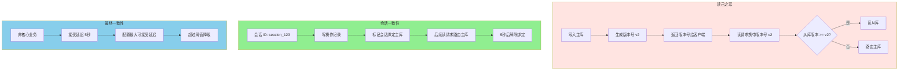
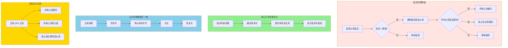
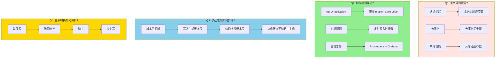
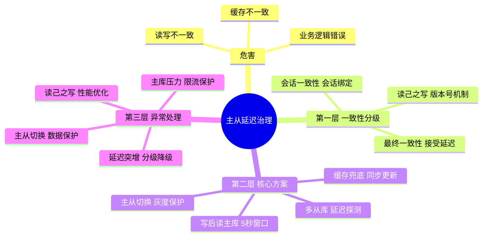
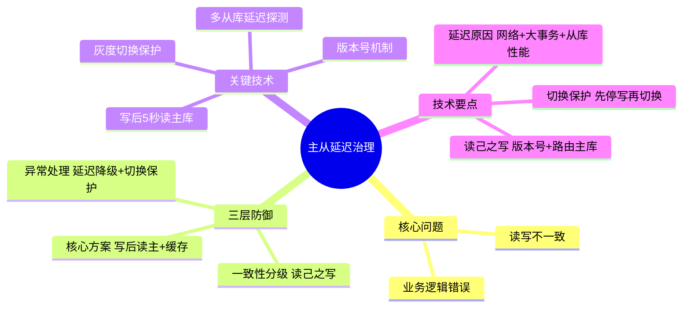

# 主从延迟治理策略

> **场景定位**：后端架构优化技术场景  
> **核心设计要点**：主从延迟原因、一致性保障、读写分离优化、异常处理

---

## 🎯 一句话定位

**主从延迟解决什么问题？**
```
写入主库：用户信息更新（version=1 → version=2）
同步到从库：延迟 2 秒
此时读请求路由到从库：读到旧数据（version=1）

用户体验：
"我刚改的昵称，怎么还是旧的？"
"是不是系统出 bug 了？"
```

**生活化比喻**：
就像公司发文：
- 老板（主库）签发文件
- 秘书同步给分公司（从库）需要 2 秒
- 这期间你问分公司"文件内容是什么？"
- 分公司说"还是旧版本"（延迟）

**核心特点**：主从延迟是读写分离架构的"天敌"，延迟越高，数据不一致窗口越大。

---

## 💎 核心观点（5 分钟速览版）

> **快速概览**

### 核心观点（3 层防御体系）

**1. 第一层：一致性等级分级**
```
✅ 读己之写（最强一致性）
   - 写入后生成版本号
   - 读请求携带版本号
   - 从库版本不够 → 自动路由主库
✅ 会话一致性（中等一致性）
   - 同一会话写后读 → 会话标记录由
   - 黏库读（绑定到特定从库）
✅ 最终一致性（最弱一致性）
   - 非核心业务接受延迟
   - 配置最大可接受延迟时间（如 5 秒）
```

**2. 第二层：核心方案**
```
✅ 写后短时间内读主库
   - 写入后 5 秒内，读请求强制走主库
   - 超时后回归从库
✅ 缓存兜底
   - 写入后同步更新缓存
   - 读请求先查缓存
✅ 主从切换
   - 设置读流量灰度（先切 10%）
   - 校验同步位点再切读流量
✅ 多从库
   - 延迟探测机制
   - 优先路由延迟最低从库
   - 超阈值自动摘除
```

**3. 第三层：异常处理**
```
✅ 延迟突增分级降级
   - 先摘最高延迟从库
   - 所有从库延迟超标 → 非核心走缓存、核心切主库限流
✅ 读己之写性能问题
   - 缓存兜底 + 短时间主库组合
✅ 主从切换数据不一致
   - 先停写 → 等从库同步完 → 切主 → 恢复写
✅ 主库压力过高
   - 非核心走缓存/默认值
   - 核心按比例切回从库
```

---

## 🚀 一句话精华（如果只能记住一句）

> **主从延迟治理 = 一致性分级（读己之写） + 核心方案（写后读主 + 缓存兜底） + 异常处理（延迟降级 + 切换保护）**

---

## 一、为什么主从延迟是读写分离的"天敌"？

### ❌ 主从延迟的三大危害

**生活化比喻**：
```
场景：你在微信群发消息
- 老板（主库）发消息："明天放假"
- 秘书同步到分公司群（从库）需要 2 秒
- 这期间你问分公司"明天放不放假？"
- 分公司说"不知道，没收到通知"（读到旧数据）

这就是主从延迟导致的数据不一致！
```

**1. 读写不一致（用户体验差）**
```
技术问题：
写入主库：UPDATE users SET name='Alice' WHERE id=1
同步延迟：2 秒
读从库：SELECT name FROM users WHERE id=1 → 'Bob'（旧数据）

用户体验：
"我刚改的昵称，怎么还是旧的？"
"系统是不是有 bug？"

生产事故：
某支付系统，用户充值后查询余额
主库已更新（100 → 200），从库还是 100
用户以为充值失败，重复充值，损失万元。
```

**2. 业务逻辑错误（严重 bug）**
```
场景：库存扣减
写入主库：UPDATE stock SET count=10 WHERE sku='iPhone'
同步延迟：3 秒
读从库：SELECT count FROM stock WHERE sku='iPhone' → 20（旧数据）

结果：
超卖！本来只剩 10 个，从库读到 20 个，卖出 20 个
实际只有 10 个库存，导致 10 个订单无法发货。
```

**3. 缓存与数据库不一致（雪崩风险）**
```
场景：缓存 + 从库
写入主库：UPDATE users SET age=30 WHERE id=1
同步延迟：2 秒
读从库：age=25（旧数据）→ 写入缓存 age=25
2 秒后从库更新：age=30

结果：
缓存是 25，数据库是 30，不一致持续 5 分钟（缓存 TTL）
```

---

## 二、第一层防御：一致性等级分级

### ✅ 核心思路（30 秒版）

```
生活化比喻：
就像公司的文件分发：
1. 老板签发文件（写入主库）
2. 文件上有版本号 v1、v2、v3...
3. 你问分公司"文件是什么版本？"
   - 分公司说"我这是 v1"
   - 你说"我要 v2"（携带版本号）
   - 分公司说"我还没收到 v2，你去问老板吧"（路由主库）
```



### 2.1 一致性等级对比

| 一致性等级 | 强度 | 适用场景 | 实现成本 | 生活化比喻 |
|-----------|------|---------|---------|------------|
| **读己之写** | ⭐⭐⭐⭐⭐ 最强 | 支付、库存等核心场景 | 高（版本号 + 路由） | 你发的消息，你一定能看到 |
| **会话一致性** | ⭐⭐⭐⭐ 中等 | 用户个人中心 | 中（会话绑定） | 同一会话内，数据一致 |
| **最终一致性** | ⭐⭐ 最弱 | 商品列表、文章列表 | 低（接受延迟） | 等几秒就能看到最新数据 |

### 2.2 读己之写实现方案

**生活化比喻**：
```
场景：你在微信群发消息

1. 你发消息："明天放假"（写入主库）
   - 消息上标注版本号 v2
   - 返回给你："已发送，版本号 v2"

2. 你问："我刚才发的消息是什么？"（读请求）
   - 你携带版本号："我要 v2"
   - 分公司检查："我这是 v1，还没收到 v2"
   - 分公司说："你去问老板吧"（路由主库）
   - 老板说："是'明天放假'"（返回最新数据）

3. 5 秒后，分公司也收到 v2 了
   - 下次读请求，分公司可以直接回答
```

**技术实现**：
```go
// 读己之写实现
type ReadYourWrite struct {
    redisClient    *redis.Client
    versionManager *VersionManager
    degradeSwitch  *DegradeSwitch
}

// 写入操作
func (r *ReadYourWrite) Write(ctx context.Context, key string, value interface{}) (*WriteResult, error) {
    // 1. 写入主库
    err := r.redisClient.Set(key, value, 0).Err()
    if err != nil {
        return nil, err
    }
    
    // 2. 生成版本号（递增）
    version, err := r.versionManager.IncrVersion(key)
    if err != nil {
        return nil, err
    }
    
    // 3. 返回版本号给客户端
    return &WriteResult{
        Key:     key,
        Version: version,
    }, nil
}

// 读操作
func (r *ReadYourWrite) Read(ctx context.Context, key string, expectedVersion int64) (interface{}, error) {
    // 1. 先查缓存
    cached, err := r.getFromCache(key)
    if err == nil && cached.Version >= expectedVersion {
        return cached.Value, nil
    }
    
    // 2. 查询从库版本号
    slaveVersion, err := r.versionManager.GetVersionFromSlave(key)
    if err != nil {
        // 从库不可用，降级到主库
        return r.getFromMaster(key)
    }
    
    // 3. 判断从库版本是否满足要求
    if slaveVersion >= expectedVersion {
        // 从库版本够新，读从库
        return r.getFromSlave(key)
    }
    
    // 4. 从库版本不够，路由主库
    return r.getFromMaster(key)
}

// 版本号管理
type VersionManager struct {
    masterRedis *redis.Client
    slaveRedis  *redis.Client
}

func (v *VersionManager) IncrVersion(key string) (int64, error) {
    // 主库递增版本号
    versionKey := fmt.Sprintf("version:%s", key)
    return v.masterRedis.Incr(versionKey).Result()
}

func (v *VersionManager) GetVersionFromSlave(key string) (int64, error) {
    // 从库查询版本号
    versionKey := fmt.Sprintf("version:%s", key)
    return v.slaveRedis.Get(versionKey).Int64()
}
```

### 2.3 会话一致性实现

**生活化比喻**：
```
场景：用户登录后的操作

1. 用户登录（会话 ID: session_123）
   - 记录：session_123 绑定主库
   - 有效期：5 秒

2. 用户修改昵称（写操作）
   - 写入主库
   - 标记：session_123 刚写过

3. 用户查询个人信息（读操作）
   - 检查：session_123 绑定主库？
   - 是：路由主库（保证一致性）
   - 否：路由从库（负载均衡）

4. 5 秒后
   - 解除绑定
   - 后续读请求路由从库
```

**代码示例**：
```go
// 会话一致性实现
type SessionConsistency struct {
    sessionStore *SessionStore
    masterRedis  *redis.Client
    slaveRedis   *redis.Client
}

// 写操作
func (s *SessionConsistency) Write(ctx context.Context, sessionID string, key string, value interface{}) error {
    // 1. 写入主库
    err := s.masterRedis.Set(key, value, 0).Err()
    if err != nil {
        return err
    }
    
    // 2. 标记会话绑定主库（5 秒有效期）
    s.sessionStore.BindToMaster(sessionID, 5*time.Second)
    
    return nil
}

// 读操作
func (s *SessionConsistency) Read(ctx context.Context, sessionID string, key string) (interface{}, error) {
    // 1. 检查会话是否绑定主库
    if s.sessionStore.IsBoundToMaster(sessionID) {
        // 绑定主库，路由主库
        return s.masterRedis.Get(key).Result()
    }
    
    // 2. 未绑定，路由从库
    return s.slaveRedis.Get(key).Result()
}

// 会话存储
type SessionStore struct {
    redis *redis.Client
}

func (s *SessionStore) BindToMaster(sessionID string, ttl time.Duration) {
    key := fmt.Sprintf("session:bind:%s", sessionID)
    s.redis.Set(key, "master", ttl)
}

func (s *SessionStore) IsBoundToMaster(sessionID string) bool {
    key := fmt.Sprintf("session:bind:%s", sessionID)
    val, err := s.redis.Get(key).Result()
    return err == nil && val == "master"
}
```

---

## 三、第二层防御：核心方案

### ✅ 核心思路（30 秒版）

```
生活化比喻：
就像公司的文件分发：
1. 老板签发文件后，5 秒内问老板（写后读主库）
2. 秘书同步给分公司后，问分公司（回归从库）
3. 同时，文件备份到云端（缓存兜底）
4. 多个分公司，选最快的（多从库）
```



```mermaid
graph TB
    subgraph WriteThenReadMaster["写后读主库"]
        A1[写入主库] --> A2[记录写入时间]
        A2 --> A3{当前时间 - 写入时间 < 5秒?}
        A3 -->|是| A4[路由主库]
        A3 -->|否| A5[路由从库]
    end
    
    subgraph CacheBackup["缓存兜底"]
        B1[写入主库] --> B2[同步更新缓存]
        B2 --> B3[读请求先查缓存]
        B3 --> B4{缓存命中?}
        B4 -->|是| B5[返回缓存数据]
        B4 -->|否| B6[查数据库]
    end
    
    subgraph MultiSlave["多从库"]
        C1[读请求] --> C2[探测所有从库延迟]
        C2 --> C3[选择延迟最低的从库]
        C3 --> C4{延迟 > 阈值?}
        C4 -->|是| C5[摘除该从库]
        C4 -->|否| C6[路由该从库]
    end
    
    subgraph MasterSlaveSwitch["主从切换"]
        D1[主库故障] --> D2[选延迟最低的从库]
        D2 --> D3[校验同步位点]
        D3 --> D4[灰度切读流量 10%]
        D4 --> D5[观察 1 分钟]
        D5 --> D6[全量切换]
    end
    
    style WriteThenReadMaster fill:#FFE4E1
    style CacheBackup fill:#90EE90
    style MultiSlave fill:#87CEEB
    style MasterSlaveSwitch fill:#FFD700
```

### 3.1 写后短时间内读主库

**生活化比喻**：
```
场景：你发微信给女朋友

1. 你发消息："我爱你"（写入主库）
   - 记录时间：12:00:00

2. 12:00:01（1 秒后），你问："我刚才发了什么？"
   - 检查：12:00:01 - 12:00:00 = 1 秒 < 5 秒
   - 结论：你还在"刚发完"窗口
   - 路由：问你自己（主库）
   - 回答："我爱你"

3. 12:00:06（6 秒后），你问："我刚才发了什么？"
   - 检查：12:00:06 - 12:00:00 = 6 秒 > 5 秒
   - 结论：已超过"刚发完"窗口
   - 路由：问女朋友（从库）
   - 女朋友已同步，回答："我爱你"
```

**代码示例**：
```go
// 写后读主库实现
type WriteThenReadMaster struct {
    masterRedis   *redis.Client
    slaveRedis    *redis.Client
    writeRecorder *WriteRecorder
    windowSeconds int  // 窗口时间（5秒）
}

// 写入操作
func (w *WriteThenReadMaster) Write(ctx context.Context, key string, value interface{}) error {
    // 1. 写入主库
    err := w.masterRedis.Set(key, value, 0).Err()
    if err != nil {
        return err
    }
    
    // 2. 记录写入时间
    w.writeRecorder.RecordWrite(key, time.Now())
    
    return nil
}

// 读操作
func (w *WriteThenReadMaster) Read(ctx context.Context, key string) (interface{}, error) {
    // 1. 检查是否在"写后"窗口
    lastWriteTime, exists := w.writeRecorder.GetLastWriteTime(key)
    if exists {
        elapsed := time.Since(lastWriteTime).Seconds()
        if int(elapsed) < w.windowSeconds {
            // 在窗口内，读主库
            return w.masterRedis.Get(key).Result()
        }
    }
    
    // 2. 超过窗口，读从库
    return w.slaveRedis.Get(key).Result()
}

// 写入记录器
type WriteRecorder struct {
    writes map[string]time.Time
    mutex  sync.RWMutex
}

func (r *WriteRecorder) RecordWrite(key string, t time.Time) {
    r.mutex.Lock()
    defer r.mutex.Unlock()
    r.writes[key] = t
}

func (r *WriteRecorder) GetLastWriteTime(key string) (time.Time, bool) {
    r.mutex.RLock()
    defer r.mutex.RUnlock()
    t, exists := r.writes[key]
    return t, exists
}
```

### 3.2 缓存兜底

**生活化比喻**：
```
场景：你在微信群发消息

1. 你发消息："明天放假"（写入主库）
   - 同时，消息备份到云端（同步更新缓存）

2. 你问："我刚才发了什么？"
   - 先查云端备份（缓存）
   - 云端有："明天放假"（返回缓存数据）
   - 不用问老板或分公司（不查数据库）

好处：
- 减少数据库压力
- 读取速度快（缓存 > 数据库）
- 避免主从延迟问题
```

**代码示例**：
```go
// 缓存兜底实现
type CacheBackup struct {
    masterRedis *redis.Client
    cacheRedis  *redis.Client  // 独立缓存
    slaveRedis  *redis.Client
}

// 写入操作
func (c *CacheBackup) Write(ctx context.Context, key string, value interface{}) error {
    // 1. 写入主库
    err := c.masterRedis.Set(key, value, 0).Err()
    if err != nil {
        return err
    }
    
    // 2. 同步更新缓存（异步）
    go func() {
        c.cacheRedis.Set(key, value, 5*time.Minute)
    }()
    
    return nil
}

// 读操作
func (c *CacheBackup) Read(ctx context.Context, key string) (interface{}, error) {
    // 1. 先查缓存
    cached, err := c.cacheRedis.Get(key).Result()
    if err == nil {
        return cached, nil  // 缓存命中
    }
    
    // 2. 缓存未命中，查从库
    val, err := c.slaveRedis.Get(key).Result()
    if err == nil {
        // 回写缓存
        go c.cacheRedis.Set(key, val, 5*time.Minute)
        return val, nil
    }
    
    // 3. 从库也未命中，查主库
    val, err = c.masterRedis.Get(key).Result()
    if err == nil {
        // 回写缓存
        go c.cacheRedis.Set(key, val, 5*time.Minute)
        return val, nil
    }
    
    return nil, errors.New("key not found")
}
```

### 3.3 多从库延迟探测

**生活化比喻**：
```
场景：3 个分公司（从库）

1. 探测延迟：
   - 北京分公司：延迟 1 秒（最快）
   - 上海分公司：延迟 3 秒
   - 广州分公司：延迟 10 秒（最慢）

2. 读请求路由：
   - 优先选择北京分公司（延迟最低）
   - 如果北京分公司延迟 > 5 秒，摘除
   - 选择上海分公司

3. 所有分公司延迟 > 5 秒：
   - 非核心业务：走缓存/默认值
   - 核心业务：问老板（主库，限流）
```

**代码示例**：
```go
// 多从库延迟探测
type MultiSlaveRouter struct {
    slaves     []*SlaveNode
    threshold  int  // 延迟阈值（秒）
}

type SlaveNode struct {
    client    *redis.Client
    delay     int  // 当前延迟（秒）
    available bool
}

// 探测所有从库延迟
func (m *MultiSlaveRouter) ProbeDelays() {
    for _, slave := range m.slaves {
        // 发送探测命令（INFO replication）
        info, err := slave.client.Info("replication").Result()
        if err != nil {
            slave.available = false
            continue
        }
        
        // 解析延迟
        delay := parseSlaveDelay(info)
        slave.delay = delay
        
        // 判断是否可用
        slave.available = delay <= m.threshold
    }
}

// 选择延迟最低的从库
func (m *MultiSlaveRouter) SelectBestSlave() *SlaveNode {
    var best *SlaveNode
    for _, slave := range m.slaves {
        if !slave.available {
            continue
        }
        if best == nil || slave.delay < best.delay {
            best = slave
        }
    }
    return best
}

// 读请求路由
func (m *MultiSlaveRouter) Read(ctx context.Context, key string) (interface{}, error) {
    // 1. 探测延迟
    m.ProbeDelays()
    
    // 2. 选择最优从库
    best := m.SelectBestSlave()
    if best != nil {
        return best.client.Get(key).Result()
    }
    
    // 3. 所有从库不可用，降级到主库
    return m.fallbackToMaster(ctx, key)
}

// 降级到主库
func (m *MultiSlaveRouter) fallbackToMaster(ctx context.Context, key string) (interface{}, error) {
    // 主库限流（保护主库）
    if !m.tryAcquireMasterLimit() {
        return nil, errors.New("主库压力过高，请稍后重试")
    }
    return m.masterRedis.Get(key).Result()
}
```

### 3.4 主从切换保护

**生活化比喻**：
```
场景：老板（主库）突然离职（故障）

1. 选接班人：
   - 延迟最低的分公司（从库）
   - 检查同步位点（确保数据最新）

2. 灰度切换：
   - 先切 10% 读流量（试水）
   - 观察 1 分钟（无异常）
   - 全量切换

3. 数据一致性保护：
   - 先停写（暂停 5 秒）
   - 等新老板同步完所有数据
   - 切主（新老板上任）
   - 恢复写（继续业务）
```

**代码示例**：
```go
// 主从切换保护
type MasterSlaveSwitcher struct {
    master       *redis.Client
    slaves       []*SlaveNode
    switchLock   sync.Mutex
    grayPercent  int  // 灰度百分比
}

// 主从切换流程
func (s *MasterSlaveSwitcher) SwitchOver() error {
    s.switchLock.Lock()
    defer s.switchLock.Unlock()
    
    // 1. 选择延迟最低的从库
    best := s.selectBestSlave()
    if best == nil {
        return errors.New("无可用的从库")
    }
    
    // 2. 校验同步位点
    masterOffset, _ := s.master.Info("replication").Result()
    slaveOffset, _ := best.client.Info("replication").Result()
    
    if !s.checkOffsetMatch(masterOffset, slaveOffset) {
        // 同步位点不匹配，等待同步
        time.Sleep(5 * time.Second)
    }
    
    // 3. 灰度切读流量（10%）
    s.grayPercent = 10
    s.routeReadTraffic(best, 10)
    
    // 4. 观察 1 分钟
    time.Sleep(1 * time.Minute)
    
    // 5. 检查是否有异常
    if s.hasError() {
        // 回滚
        s.grayPercent = 0
        return errors.New("切换异常，已回滚")
    }
    
    // 6. 全量切换
    s.grayPercent = 100
    s.routeReadTraffic(best, 100)
    
    // 7. 提升为主库
    s.promoteToMaster(best)
    
    return nil
}
```

---

## 四、第三层防御：异常处理

### ✅ 核心思路（30 秒版）

```
生活化比喻：
就像公司突发状况：
1. 分公司延迟突增 → 先开除最慢的（摘除最高延迟从库）
2. 所有分公司都慢 → 非核心问秘书（缓存），核心问老板（主库限流）
3. 老板突然离职 → 先停写，等接班人同步完，再切主
4. 老板压力过大 → 非核心问秘书/默认值，核心按比例分流
```



### 4.1 延迟突增分级降级

**生活化比喻**：
```
场景：3 个从库延迟突然飙升

1. 北京从库：延迟 1 秒（正常）
2. 上海从库：延迟 8 秒（超标）
3. 广州从库：延迟 15 秒（超标）

降级策略：
1. 先摘除广州从库（延迟最高）
2. 如果上海从库延迟也超标（> 5 秒）：
   - 非核心业务：走缓存/默认值
   - 核心业务：切主库（限流保护）
```

**代码示例**：
```go
// 延迟突增分级降级
type DelayDegrader struct {
    slaves    []*SlaveNode
    threshold int  // 延迟阈值（5秒）
    master    *redis.Client
    cache     *redis.Client
}

// 降级处理
func (d *DelayDegrader) HandleDelaySpike() {
    // 1. 摘除最高延迟从库
    maxDelay := 0
    var maxSlave *SlaveNode
    for _, slave := range d.slaves {
        if slave.delay > maxDelay {
            maxDelay = slave.delay
            maxSlave = slave
        }
    }
    
    if maxSlave != nil && maxSlave.delay > d.threshold {
        maxSlave.available = false  // 摘除
        log.Warnf("摘除从库: delay=%d", maxSlave.delay)
    }
    
    // 2. 检查是否所有从库都超标
    allDelayed := true
    for _, slave := range d.slaves {
        if slave.available && slave.delay <= d.threshold {
            allDelayed = false
            break
        }
    }
    
    if allDelayed {
        // 所有从库延迟超标，启动降级
        d.enableDegradeMode()
    }
}

// 降级模式
func (d *DelayDegrader) enableDegradeMode() {
    log.Warn("所有从库延迟超标，启动降级模式")
    
    // 非核心业务：走缓存/默认值
    // 核心业务：切主库（限流）
}

// 读请求（降级模式）
func (d *DelayDegrader) Read(ctx context.Context, key string, isCore bool) (interface{}, error) {
    if isCore {
        // 核心业务：切主库（限流）
        if !d.tryAcquireMasterLimit() {
            return nil, errors.New("主库压力过高，请稍后重试")
        }
        return d.master.Get(key).Result()
    }
    
    // 非核心业务：走缓存
    cached, err := d.cache.Get(key).Result()
    if err == nil {
        return cached, nil
    }
    
    // 缓存未命中，返回默认值
    return d.getDefaultValue(key), nil
}
```

### 4.2 主从切换数据不一致保护

**生活化比喻**：
```
场景：老板（主库）突然离职（故障）

错误做法：
直接让分公司（从库）当老板
- 分公司数据可能不是最新的（延迟 2 秒）
- 导致数据丢失

正确做法：
1. 先停写（暂停 5 秒）
   - 告诉所有员工："暂停提交新文件"
2. 等分公司同步完
   - 检查同步位点
   - 确保数据一致
3. 切主
   - 分公司正式当老板
4. 恢复写
   - 告诉员工："可以继续提交了"
```

**代码示例**：
```go
// 主从切换数据不一致保护
type SwitchProtector struct {
    master     *redis.Client
    slave      *redis.Client
    writeLock  sync.Mutex
    isStopping bool
}

// 安全切换流程
func (s *SwitchProtector) SafeSwitch() error {
    s.writeLock.Lock()
    defer s.writeLock.Unlock()
    
    // 1. 先停写
    s.isStopping = true
    log.Info("暂停写入")
    
    // 2. 等待从库同步完
    for {
        masterOffset := s.getMasterOffset()
        slaveOffset := s.getSlaveOffset()
        
        if slaveOffset >= masterOffset {
            break  // 同步完成
        }
        
        log.Info("等待从库同步...")
        time.Sleep(1 * time.Second)
    }
    
    // 3. 切主
    s.promoteToMaster()
    log.Info("从库提升为主库")
    
    // 4. 恢复写
    s.isStopping = false
    log.Info("恢复写入")
    
    return nil
}

// 写入操作（受保护）
func (s *SwitchProtector) Write(ctx context.Context, key string, value interface{}) error {
    if s.isStopping {
        return errors.New("系统正在切换，请稍后重试")
    }
    return s.master.Set(key, value, 0).Err()
}
```

### 4.3 主库压力过高保护

**生活化比喻**：
```
场景：主库 QPS 飙升到 10 万（正常 1 万）

原因：
- 所有从库延迟超标
- 读请求全部切到主库
- 主库扛不住

保护策略：
1. 非核心业务：走缓存/默认值
   - 商品列表：返回缓存数据
   - 文章列表：返回默认值
2. 核心业务：按比例切回从库
   - 订单查询：50% 主库，50% 从库
   - 即使从库延迟，也要分担压力
```

**代码示例**：
```go
// 主库压力过高保护
type MasterProtector struct {
    master      *redis.Client
    slaves      []*SlaveNode
    cache       *redis.Client
    masterQPS   int
    qpsLimit    int  // QPS 限制（1万）
}

// 读请求（主库保护）
func (m *MasterProtector) Read(ctx context.Context, key string, isCore bool) (interface{}, error) {
    // 检查主库 QPS
    if m.masterQPS >= m.qpsLimit {
        if !isCore {
            // 非核心业务：走缓存/默认值
            cached, err := m.cache.Get(key).Result()
            if err == nil {
                return cached, nil
            }
            return m.getDefaultValue(key), nil
        }
        
        // 核心业务：按比例切回从库
        if rand.Intn(100) < 50 {  // 50% 概率
            return m.readFromBestSlave(key)
        }
    }
    
    // 主库 QPS 未超标，正常路由
    return m.master.Get(key).Result()
}
```

---

五、技术深入探讨



### 方案详解

**Q1: 主从延迟的原因？**  
**答**：三大原因：
1. **网络延迟**：主从间网络带宽不足，跨机房延迟高
2. **大事务**：大事务（如批量更新 10 万条）同步慢，阻塞后续事务
3. **从库性能**：从库磁盘 IO 慢（如机械硬盘），无法及时处理同步

**Q2: 如何检测主从延迟？**  
**答**：三种方式：
1. **INFO replication**：查看主从 offset 差值（差值越大，延迟越高）
2. **心跳探测**：定时写入时间戳，从库读取并计算延迟
3. **监控告警**：Prometheus + Grafana，实时监控延迟，超阈值告警

**Q3: 读己之写如何实现？**  
**答**：版本号机制：
1. **写入生成版本号**：每次写入，主库递增版本号（v1 → v2）
2. **读取携带版本号**：读请求携带期望版本号（我要 v2）
3. **从库版本不够路由主库**：从库版本 < 期望版本，路由主库读取

**Q4: 主从切换如何保护数据一致性？**  
**答**：四步流程：
1. **先停写**：暂停所有写入请求（5 秒）
2. **等同步完**：检查从库同步位点，确保数据一致
3. **切主**：从库提升为主库
4. **恢复写**：恢复写入请求

---

## 六、方案总结



**方案总结**：

> **危害**：主从延迟导致读写不一致、业务逻辑错误、缓存不一致，是读写分离架构的"天敌"。
> 
> **第一层：一致性分级**：读己之写（版本号机制，写入后生成版本号，读取携带版本号，从库版本不够路由主库）、会话一致性（会话绑定，5 秒有效期）、最终一致性（接受延迟，配置最大可接受时间）。
> 
> **第二层：核心方案**：写后读主库（5 秒窗口内读主库）、缓存兜底（写入后同步更新缓存）、多从库（延迟探测，选择最优从库）、主从切换（灰度保护，先停写再切换）。
> 
> **第三层：异常处理**：延迟突增分级降级（摘除最高延迟从库，非核心走缓存，核心切主库限流）、主从切换数据保护（先停写，等同步完，再切主）、主库压力保护（非核心走缓存/默认值，核心按比例切回从库）。

---

## 七、生产环境 Checklist

| 类别 | 检查项 | 状态 | 生活化比喻 |
|------|--------|------|------------|
| **一致性分级** | 读己之写版本号机制 | ⬜ | 文件版本号 |
| | 会话一致性绑定 | ⬜ | 会话绑定 |
| | 最终一致性配置 | ⬜ | 接受延迟 |
| **核心方案** | 写后读主库（5秒窗口） | ⬜ | 刚发完问老板 |
| | 缓存兜底 | ⬜ | 云端备份 |
| | 多从库延迟探测 | ⬜ | 选最快分公司 |
| | 主从切换灰度保护 | ⬜ | 灰度试水 |
| **异常处理** | 延迟突增分级降级 | ⬜ | 开除最慢的 |
| | 主从切换数据保护 | ⬜ | 先停写再切换 |
| | 主库压力限流保护 | ⬜ | 保护老板 |
| **监控告警** | 主从延迟监控 | ⬜ | 监控延迟 |
| | 告警通知（钉钉/企业微信） | ⬜ | 告警铃铛 |

---

## 八、总结（一句话带走）



### 🎯 一句话总结

> **主从延迟治理 = 一致性分级（读己之写） + 核心方案（写后读主 + 缓存兜底） + 异常处理（延迟降级 + 切换保护）**

### 🧠 核心记忆点

1. **主从延迟危害**：读写不一致，像分公司没收到最新文件，给你旧数据。
2. **读己之写**：版本号机制，写入后生成版本号，读取携带版本号，从库版本不够路由主库。
3. **写后读主库**：5 秒窗口内读主库，超过后回归从库，像刚发完消息问自己，5 秒后问对方。
4. **主从切换保护**：先停写 → 等同步完 → 切主 → 恢复写，避免数据丢失。

---

*本文档基于 8 个专家提示词指导改写，遵循深入浅出、生活化比喻、幽默风趣的教学原则。*
