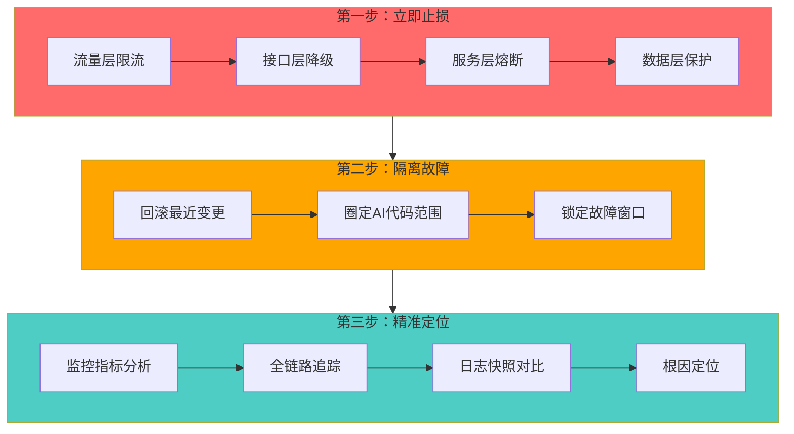
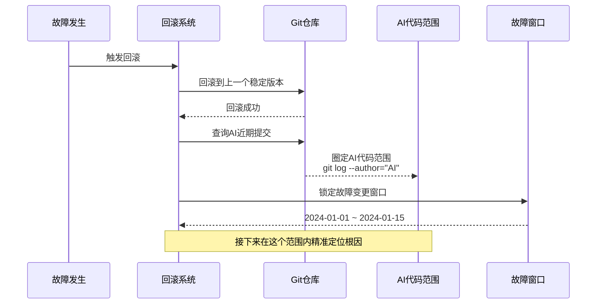
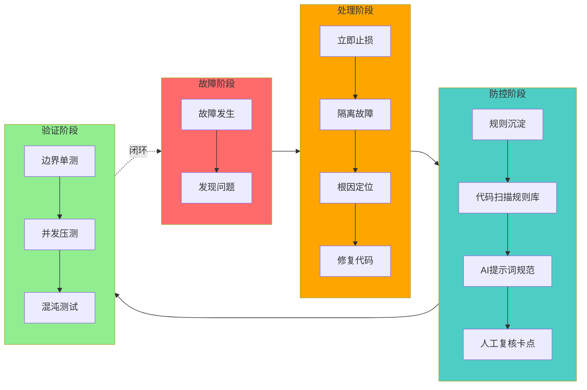
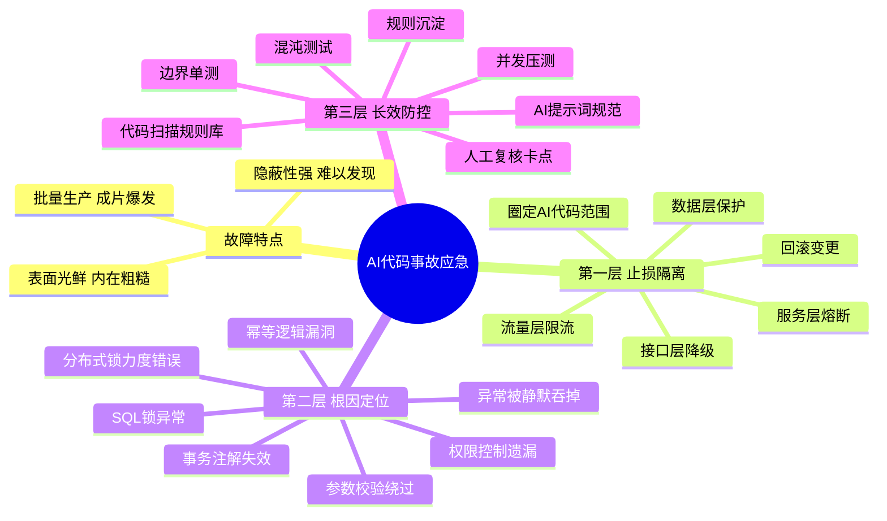

# AI 代码事故应急与根因治理

> **场景定位**：后端工程实践技术场景  
> **核心设计要点**：故障分级止损、根因定位方法论、AI 代码风险防控、长效治理机制

---

## 🎯 一句话定位

**AI 代码故障有什么特别？**
```
表层逻辑工整得像教科书，底层边界全是漏洞，
堆栈信息一大片，抓不住真正诱因。
就像看起来装修精美的房子，一碰墙就塌了。
```

**生活化比喻**：
AI 生成的代码就像"速成厨师做的菜"——摆盘很漂亮，但可能没洗干净菜、火候不对、调料放错。出了问题是"系统性风险"，不是单个 bug。

**核心特点**：批量生产、模式相似、隐蔽性强、爆发时成片。

---

## 💎 核心观点（5 分钟速览版）

> **快速概览**

### 核心观点（3 个关键层）

**1. 第一层：分级止损与故障隔离（先止血再查因）**
```
❌ 错误做法：出了问题先查代码、找 bug
✅ 正确做法：先止损、再隔离、最后查因

四级执行：
流量层 → 接口层 → 服务层 → 数据层熔断降级
回滚最近变更版本 → 圈定 AI 近期迭代代码范围 → 锁定故障变更窗口
```

**2. 第二层：精准根因定位（AI 高频踩坑点）**
```
AI 代码 7 大高频问题：
1. 事务注解是否生效（@Transactional 失效）
2. 幂等逻辑漏洞（重复提交没防住）
3. 分布式锁力度错误（锁太细/太粗）
4. 参数校验绕过（前端没校验，后端也没校验）
5. SQL 锁异常（死锁、慢查询）
6. 异常被静默吞掉（catch 了但不处理）
7. 权限控制遗漏（越权访问）
```

**3. 第三层：根因根治与长效防控（形成闭环）**
```
故障 → 发现 → 止损 → 修复 → 规则沉淀 → AI 约束

高风险模块（支付/订单/库存/权限）强制人工复核卡点
补充边界单测、并发压测、混沌测试
把踩坑点写入提示词规范与代码扫描规则库
```

---

## 🚀 一句话精华（如果只能记住一句）

> **AI 代码故障治理 = 先止损再查因（四级隔离） + 精准定位 7 大高频坑 + 长效防控闭环（规则沉淀→AI 约束）**

---

## 一、为什么 AI 代码故障特别难搞？

### ❌ AI 代码的三大"坑爹"特性

**1. 表面光鲜，内在粗糙**
```
生活化比喻：
就像"样板间"——看起来装修精美，但用的材料可能是劣质的。
AI 生成的代码：
- 结构清晰、命名规范、注释完整（表面光鲜）
- 但边界条件没考虑、并发场景没测试、异常处理不到位（内在粗糙）

技术问题：
代码 Review 时看起来没问题，一上线就崩。
```

**2. 批量生产，成片爆发**
```
生活化比喻：
就像"批量生产的蛋糕"——如果配方错了，整批蛋糕都有问题。
AI 生成代码：
- 同一个 Prompt 生成 10 个接口，都有同样的逻辑漏洞
- 一次性引入 5 个新功能，都忽略了幂等校验
- 故障不是单点，而是"面状爆发"

技术问题：
一个 bug 触发 N 个告警，抓不住真正诱因。
```

**3. 隐蔽性强，难以发现**
```
生活化比喻：
就像"慢性毒药"——短期内看不出问题，长期积累突然爆发。
AI 代码的隐蔽问题：
- 事务注解失效（数据不一致，但不会立即报错）
- 分布式锁力度错误（高并发才暴露）
- 异常被静默吞掉（问题积累到一定程度才爆发）

技术问题：
单元测试覆盖不到，Code Review 看不出来，上线后才暴露。
```

---

## 二、第一层：分级止损与故障隔离

### ✅ 核心原则（30 秒版）

```
生活化比喻：
着火了怎么办？
❌ 错误做法：先查起火原因（等查清楚，房子都烧完了）
✅ 正确做法：先灭火、再隔离、最后查因

技术流程：
故障发生 → 立即止损（降级/熔断） → 隔离故障范围 → 回滚变更 → 圈定 AI 代码范围 → 精准定位根因
```



### 2.1 四级执行：流量层→接口层→服务层→数据层

**生活化比喻**：
```
就像"消防隔离带"：
流量层：在小区门口拦住人，不让进（限流）
接口层：把着火楼栋的门禁关掉（降级非核心接口）
服务层：把着火楼层的电梯停掉（熔断故障服务）
数据层：把着火房间的门关上（保护数据库，加锁/限流）
```

**四级执行详解**：

| 层级 | 执行动作 | 目的 | 生活化比喻 | Go 代码示例 |
|------|---------|------|------------|------------|
| **流量层** | 限流（令牌桶/漏桶） | 减少请求量，保护后端 | 小区门口保安限制进入人数 | `if !limiter.Allow() { return 429 }` |
| **接口层** | 降级非核心接口 | 保证核心功能可用 | 关掉小区游泳池，保住宅楼 | `if !isCoreAPI { return "降级响应" }` |
| **服务层** | 熔断故障服务 | 防止故障蔓延 | 把着火楼层的电梯停掉 | `if errCount > threshold { circuitBreaker.Open() }` |
| **数据层** | 数据库保护（加锁/限流） | 防止数据库被打挂 | 把着火房间的门关上 | `db.SetMaxOpenConns(100)` |

**Go 代码示例**（四级止损）：
```go
// 流量层：限流
type RateLimiter struct {
    limiter *rate.Limiter
}

func (r *RateLimiter) Allow() bool {
    return r.limiter.Allow()
}

// 接口层：降级非核心接口
func HandleRequest(w http.ResponseWriter, r *http.Request, isCoreAPI bool) {
    if !isCoreAPI && isDegrading {
        http.Error(w, "服务降级中", http.StatusServiceUnavailable)
        return
    }
    // 处理核心逻辑
}

// 服务层：熔断
type CircuitBreaker struct {
    mu          sync.Mutex
    errCount    int
    threshold   int
    isOpen      bool
    lastFail    time.Time
    timeout     time.Duration
}

func (cb *CircuitBreaker) Execute(fn func() error) error {
    cb.mu.Lock()
    if cb.isOpen {
        if time.Since(cb.lastFail) < cb.timeout {
            cb.mu.Unlock()
            return errors.New("circuit breaker open")
        }
        cb.isOpen = false // 半开状态，尝试恢复
    }
    cb.mu.Unlock()
    
    err := fn()
    if err != nil {
        cb.mu.Lock()
        cb.errCount++
        if cb.errCount >= cb.threshold {
            cb.isOpen = true
            cb.lastFail = time.Now()
        }
        cb.mu.Unlock()
        return err
    }
    
    cb.mu.Lock()
    cb.errCount = 0 // 成功则重置
    cb.mu.Unlock()
    return nil
}

// 数据层：数据库保护
func InitDB() *gorm.DB {
    db, _ := gorm.Open(mysql.Open("..."), &gorm.Config{})
    sqlDB, _ := db.DB()
    sqlDB.SetMaxOpenConns(100)      // 限制最大连接数
    sqlDB.SetMaxIdleConns(20)       // 限制空闲连接
    sqlDB.SetConnMaxLifetime(time.Hour)
    return db
}
```

### 2.2 回滚变更与圈定 AI 代码范围

**生活化比喻**：
```
就像"排查嫌疑人"：
1. 先回滚到上一个稳定版本（排除最近变更的嫌疑）
2. 圈定 AI 近期迭代的代码范围（锁定嫌疑人范围）
3. 锁定故障变更窗口（确定作案时间）

技术问题：
git log --since="2024-01-01" --author="AI" --oneline
```



**Git 命令示例**：
```bash
# 回滚到上一个稳定版本
git revert HEAD

# 圈定 AI 近期迭代的代码范围
git log --since="2024-01-01" --author="AI" --oneline

# 查看 AI 代码变更详情
git diff HEAD~10 HEAD -- '*.go' | grep -A 5 -B 5 "TODO\|FIXME\|HACK"

# 锁定故障变更窗口
git log --since="2024-01-01" --until="2024-01-15" --oneline
```

---

## 三、第二层：精准根因定位

### ✅ AI 高频踩坑点（7 大常见问题）

**生活化比喻**：
```
AI 代码的 7 大"通病"，就像"速成厨师"常犯的错：
1. 火候不对（事务注解失效）
2. 重复上菜（幂等逻辑漏洞）
3. 钥匙丢了（分布式锁力度错误）
4. 没洗菜（参数校验绕过）
5. 锅糊了（SQL 锁异常）
6. 把糊的菜藏起来（异常被静默吞掉）
7. 谁都能进厨房（权限控制遗漏）
```

| 问题类型 | 表现 | 根因 | 检测方法 | 生活化比喻 |
|---------|------|------|---------|------------|
| **事务注解失效** | 数据不一致，部分成功部分失败 | `@Transactional` 没生效，或作用域不对 | 检查事务边界，查看日志 | 厨师做菜做了一半，另一半没做完 |
| **幂等逻辑漏洞** | 重复提交导致重复扣款/下单 | 没做幂等校验，或幂等 key 设计错误 | 压测重复请求，查看数据库 | 顾客点了一次菜，厨师做了两次 |
| **分布式锁力度错误** | 高并发下数据错乱 | 锁太细（性能差）或太粗（并发问题） | 压测并发场景，查看锁日志 | 钥匙太小（开不了门）或太大（所有人都能用） |
| **参数校验绕过** | 非法参数导致系统异常 | 前端没校验，后端也没校验 | 接口测试，传入非法参数 | 顾客说要"有毒的菜"，厨师真做了 |
| **SQL 锁异常** | 死锁、慢查询、数据库 CPU 高 | SQL 没加索引，或事务太长 | 查看慢查询日志，分析执行计划 | 锅糊了，因为火太大或时间太长 |
| **异常被静默吞掉** | 问题积累到一定程度爆发 | `catch` 了但不处理，或只打印日志 | 代码扫描，查看 `catch` 块 | 把糊的菜藏起来，假装没发生 |
| **权限控制遗漏** | 越权访问，数据泄露 | 没做权限校验，或校验逻辑错误 | 接口测试，尝试越权访问 | 谁都能进厨房，随便拿菜 |

### 3.1 事务注解失效

**生活化比喻**：
```
就像"转账"：
A 转 100 元给 B，应该：
1. A 的账户 -100
2. B 的账户 +100
这两步要么都成功，要么都失败（事务）。

但如果事务注解失效：
1. A 的账户 -100（成功了）
2. B 的账户 +100（失败了，但没回滚）
结果：A 丢了 100 元，B 没收到。
```

**Go 代码示例**（事务正确用法）：
```go
// ❌ 错误示例：事务失效
func TransferWrong(from, to string, amount float64) error {
    // 没有事务，部分失败不会回滚
    db.Model(&Account{}).Where("name = ?", from).Update("balance", gorm.Expr("balance - ?", amount))
    db.Model(&Account{}).Where("name = ?", to).Update("balance", gorm.Expr("balance + ?", amount))
    return nil
}

// ✅ 正确示例：事务生效
func TransferCorrect(from, to string, amount float64) error {
    return db.Transaction(func(tx *gorm.DB) error {
        // 步骤1：A 账户扣款
        if err := tx.Model(&Account{}).Where("name = ?", from).
            Update("balance", gorm.Expr("balance - ?", amount)).Error; err != nil {
            return err // 失败会回滚
        }
        
        // 步骤2：B 账户加款
        if err := tx.Model(&Account{}).Where("name = ?", to).
            Update("balance", gorm.Expr("balance + ?", amount)).Error; err != nil {
            return err // 失败会回滚
        }
        
        return nil // 都成功才提交
    })
}
```

### 3.2 幂等逻辑漏洞

**生活化比喻**：
```
就像"点菜"：
顾客点了一次"宫保鸡丁"，厨师应该只做一次。
但如果没做幂等校验：
顾客点了两次（网络延迟导致重复提交），厨师做了两次。
结果：顾客收到两份菜，但只付了一份钱。
```

**Go 代码示例**（幂等校验）：
```go
// 幂等校验（基于唯一键）
type IdempotencyService struct {
    db *gorm.DB
    rdb *redis.Client
}

func (s *IdempotencyService) CreateOrder(userID string, req *OrderRequest) (*Order, error) {
    // 幂等 key（基于用户ID + 请求参数）
    idempotencyKey := fmt.Sprintf("order:%s:%s", userID, req.RequestID)
    
    // 检查是否已处理
    if s.rdb.Exists(idempotencyKey).Val() {
        return nil, errors.New("请求已处理，请勿重复提交")
    }
    
    // 加分布式锁
    lockKey := fmt.Sprintf("lock:order:%s", userID)
    if !s.rdb.SetNX(lockKey, 1, 10*time.Second).Val() {
        return nil, errors.New("系统繁忙，请稍后重试")
    }
    defer s.rdb.Del(lockKey)
    
    // 创建订单
    order := &Order{
        UserID:  userID,
        Product: req.Product,
        Amount:  req.Amount,
    }
    
    if err := s.db.Create(order).Error; err != nil {
        return nil, err
    }
    
    // 标记已处理
    s.rdb.Set(idempotencyKey, order.ID, 24*time.Hour)
    
    return order, nil
}
```

### 3.3 异常被静默吞掉

**生活化比喻**：
```
就像"把糊了的菜藏起来"：
厨师做菜时糊了，但他把糊的部分切掉，假装没事。
结果：顾客吃到了有问题的菜，但不知道问题在哪。

技术问题：
catch (err) {
    // 什么都不做，异常被吞掉了
}
```

**Go 代码示例**（异常处理）：
```go
// ❌ 错误示例：异常被吞掉
func ProcessDataWrong(data []byte) {
    defer func() {
        if r := recover(); r != nil {
            // 什么都不做，异常被吞掉了
        }
    }()
    
    // 可能 panic 的代码
    var result int = 10 / 0
}

// ✅ 正确示例：异常处理
func ProcessDataCorrect(data []byte) (err error) {
    defer func() {
        if r := recover(); r != nil {
            // 记录异常
            log.Printf("panic occurred: %v", r)
            err = fmt.Errorf("internal error: %v", r)
            
            // 发送告警
            alert.Send("ProcessData panic", r)
        }
    }()
    
    // 业务逻辑
    if len(data) == 0 {
        return errors.New("data is empty")
    }
    
    return nil
}
```

---

## 四、第三层：根因根治与长效防控

### ✅ 核心思路（形成闭环）

**生活化比喻**：
```
就像"免疫系统"：
第一次生病 → 发现病毒 → 治疗 → 产生抗体 → 下次不会再病

技术流程：
故障 → 发现 → 止损 → 修复 → 规则沉淀 → AI 约束
```



### 4.1 规则沉淀与 AI 约束

**生活化比喻**：
```
就像"制定菜谱规范"：
第一次做菜糊了 → 总结经验 → 写进菜谱 → 下次按菜谱做

技术规范：
1. 把踩坑点写成代码扫描规则（如 SonarQube 规则）
2. 把业务约束写进 AI 提示词规范（如"必须做幂等校验"）
3. 高风险模块强制人工复核（如支付、订单、库存、权限）
```

**AI 提示词规范示例**：
```markdown
# AI 代码生成规范

## 必须遵守的规则

### 1. 事务管理
- 涉及多表操作的，必须使用事务
- 事务注解必须生效（检查作用域）
- 事务粒度要合理（不要太大，也不要太小）

### 2. 幂等校验
- 所有写接口必须做幂等校验
- 幂等 key 设计要合理（基于业务唯一键）
- 使用分布式锁防止并发问题

### 3. 参数校验
- 前端校验 + 后端校验（双重校验）
- 使用参数校验框架（如 validator）
- 非法参数必须返回明确错误信息

### 4. 异常处理
- 禁止静默吞掉异常
- 必须记录异常日志
- 必须发送告警通知

### 5. 权限控制
- 所有接口必须做权限校验
- 使用 RBAC 或 ABAC 模型
- 越权访问必须返回 403

## 高风险模块（强制人工复核）

- 支付模块：涉及资金安全
- 订单模块：涉及业务核心
- 库存模块：涉及数据一致性
- 权限模块：涉及系统安全
```

### 4.2 代码扫描规则库

**生活化比喻**：
```
就像"安检"：
进机场前要安检，检查是否携带违禁品。
代码上线前要扫描，检查是否存在风险。

工具：
- SonarQube：代码质量扫描
- ESLint：JavaScript 代码规范
- GoSec：Go 安全扫描
```

**Go 代码扫描规则示例**（自定义规则）：
```go
// 自定义规则：检查是否使用了事务
// 规则：涉及多表操作的，必须使用事务
func checkTransactionUsage(node *ast.CallExpr) bool {
    // 检查是否有多表操作
    if hasMultipleTableOperations(node) {
        // 检查是否在事务中
        if !isInTransaction(node) {
            reportError("多表操作必须使用事务")
            return false
        }
    }
    return true
}

// 自定义规则：检查是否做了幂等校验
// 规则：所有写接口必须做幂等校验
func checkIdempotency(node *ast.FuncDecl) bool {
    if isWriteAPI(node) {
        if !hasIdempotencyCheck(node) {
            reportError("写接口必须做幂等校验")
            return false
        }
    }
    return true
}

// 自定义规则：检查异常处理
// 规则：禁止静默吞掉异常
func checkErrorHandling(node *ast.DeferStmt) bool {
    if hasRecover(node) {
        if !hasErrorLogging(node) {
            reportError("禁止静默吞掉异常，必须记录日志")
            return false
        }
    }
    return true
}
```

### 4.3 测试验证（边界单测 + 并发压测 + 混沌测试）

**生活化比喻**：
```
就像"考试"：
1. 边界单测：考基础题（正常场景 + 边界场景）
2. 并发压测：考高数（高并发场景）
3. 混沌测试：考突发情况（服务器挂了、网络断了）
```

| 测试类型 | 目的 | 工具 | 生活化比喻 |
|---------|------|------|------------|
| **边界单测** | 覆盖正常 + 边界场景 | Go test, testify | 基础题：1+1=2，1+0=1，1+(-1)=0 |
| **并发压测** | 验证高并发下的稳定性 | wrk, JMeter, k6 | 高数题：10 万人同时做题 |
| **混沌测试** | 验证突发情况下的容错性 | Chaos Monkey, Litmus | 突发情况：考试时停电了 |

**Go 代码示例**（边界单测）：
```go
func TestTransfer(t *testing.T) {
    // 正常场景
    t.Run("正常转账", func(t *testing.T) {
        err := TransferCorrect("A", "B", 100)
        assert.NoError(t, err)
        
        // 验证余额
        balanceA := getBalance("A")
        balanceB := getBalance("B")
        assert.Equal(t, 900.0, balanceA) // A 原有 1000
        assert.Equal(t, 1100.0, balanceB) // B 原有 1000
    })
    
    // 边界场景：余额不足
    t.Run("余额不足", func(t *testing.T) {
        err := TransferCorrect("A", "B", 2000)
        assert.Error(t, err)
        assert.Contains(t, err.Error(), "余额不足")
    })
    
    // 边界场景：转账金额为 0
    t.Run("转账金额为0", func(t *testing.T) {
        err := TransferCorrect("A", "B", 0)
        assert.Error(t, err)
        assert.Contains(t, err.Error(), "转账金额必须大于0")
    })
    
    // 边界场景：转账金额为负数
    t.Run("转账金额为负数", func(t *testing.T) {
        err := TransferCorrect("A", "B", -100)
        assert.Error(t, err)
        assert.Contains(t, err.Error(), "转账金额必须大于0")
    })
}
```

---

五、技术深入探讨与深度问题



### 方案详解

**Q1: AI 代码故障有什么特点？**  
**答**：AI 代码故障有三个特点：
1. **表面光鲜，内在粗糙**：代码结构清晰、命名规范，但边界条件、并发场景、异常处理不到位。
2. **批量生产，成片爆发**：同一个 Prompt 生成的代码可能有同样的漏洞，故障不是单点，而是"面状爆发"。
3. **隐蔽性强，难以发现**：事务注解失效、分布式锁力度错误等问题，单元测试覆盖不到，Code Review 看不出来，上线后才暴露。

**Q2: 出了 AI 代码故障，第一步做什么？**  
**答**：第一步是**立即止损**，不是查因。就像着火了先灭火，不是查起火原因。
1. **流量层限流**：减少请求量，保护后端。
2. **接口层降级**：关掉非核心接口，保证核心功能可用。
3. **服务层熔断**：熔断故障服务，防止故障蔓延。
4. **数据层保护**：限制数据库连接数，防止数据库被打挂。
5. **回滚变更**：回滚到上一个稳定版本，圈定 AI 近期迭代代码范围。

**Q3: 如何精准定位 AI 代码的根因？**  
**答**：AI 代码有 7 大高频踩坑点：
1. **事务注解失效**：检查事务边界，查看日志。
2. **幂等逻辑漏洞**：压测重复请求，查看数据库。
3. **分布式锁力度错误**：压测并发场景，查看锁日志。
4. **参数校验绕过**：接口测试，传入非法参数。
5. **SQL 锁异常**：查看慢查询日志，分析执行计划。
6. **异常被静默吞掉**：代码扫描，查看 `catch` 块。
7. **权限控制遗漏**：接口测试，尝试越权访问。

结合**监控指标 + 全链路追踪 + 日志快照**，可以快速定位根因。

**Q4: 如何长效防控 AI 代码风险？**  
**答**：形成闭环：**故障 → 发现 → 止损 → 修复 → 规则沉淀 → AI 约束**。
1. **规则沉淀**：把踩坑点写成代码扫描规则（如 SonarQube 规则）。
2. **AI 提示词规范**：把业务约束、架构红线写进 AI 提示词规范。
3. **人工复核卡点**：高风险模块（支付/订单/库存/权限）强制人工复核。
4. **测试验证**：补充边界单测、并发压测、混沌测试。

---

## 六、方案总结

**方案总结**：

> **AI 代码故障特点**：表面光鲜、内在粗糙，批量生产、成片爆发，隐蔽性强、难以发现。
> 
> **第一层：止损隔离**：先止损再查因，四级执行（流量层→接口层→服务层→数据层），回滚变更，圈定 AI 代码范围。
> 
> **第二层：根因定位**：AI 高频 7 大踩坑点（事务注解失效、幂等逻辑漏洞、分布式锁力度错误、参数校验绕过、SQL 锁异常、异常被静默吞掉、权限控制遗漏），结合监控指标 + 全链路追踪 + 日志快照精准定位。
> 
> **第三层：长效防控**：形成闭环（故障→发现→止损→修复→规则沉淀→AI 约束），高风险模块强制人工复核，补充边界单测、并发压测、混沌测试。

---

## 七、生产环境 Checklist（部署检查清单）

| 类别 | 检查项 | 状态 | 生活化比喻 |
|------|--------|------|------------|
| **止损机制** | 流量层限流（令牌桶/漏桶） | ⬜ | 小区门口保安 |
| | 接口层降级（非核心接口可关闭） | ⬜ | 关掉游泳池 |
| | 服务层熔断（故障服务自动熔断） | ⬜ | 停掉着火楼层电梯 |
| | 数据层保护（限制数据库连接数） | ⬜ | 关上着火房间门 |
| **根因定位** | 监控指标（QPS、延迟、错误率） | ⬜ | 保安巡逻 |
| | 全链路追踪（Trace ID 贯穿） | ⬜ | 监控摄像头 |
| | 日志快照（关键节点日志） | ⬜ | 现场照片 |
| **长效防控** | 代码扫描规则库（SonarQube） | ⬜ | 安检 |
| | AI 提示词规范（业务约束） | ⬜ | 菜谱规范 |
| | 人工复核卡点（高风险模块） | ⬜ | 大厨审核 |
| | 边界单测（正常 + 边界场景） | ⬜ | 基础题 |
| | 并发压测（高并发场景） | ⬜ | 高数题 |
| | 混沌测试（突发情况） | ⬜ | 突发情况 |

---

## 八、总结（一句话带走）

### 🎯 一句话总结

> **AI 代码故障治理 = 先止损再查因（四级隔离） + 精准定位 7 大高频坑 + 长效防控闭环（规则沉淀→AI 约束）**

### 🧠 核心记忆点

1. **AI 代码故障特点**：表面光鲜、内在粗糙，批量生产、成片爆发，隐蔽性强、难以发现。
2. **第一层：止损隔离**：先止损再查因，四级执行（流量层→接口层→服务层→数据层）。
3. **第二层：根因定位**：AI 高频 7 大踩坑点（事务注解失效、幂等逻辑漏洞、分布式锁力度错误等）。
4. **第三层：长效防控**：形成闭环（故障→发现→止损→修复→规则沉淀→AI 约束），高风险模块强制人工复核。

---

*本文档基于 8 个专家提示词指导改写，遵循深入浅出、生活化比喻、幽默风趣的教学原则。*
