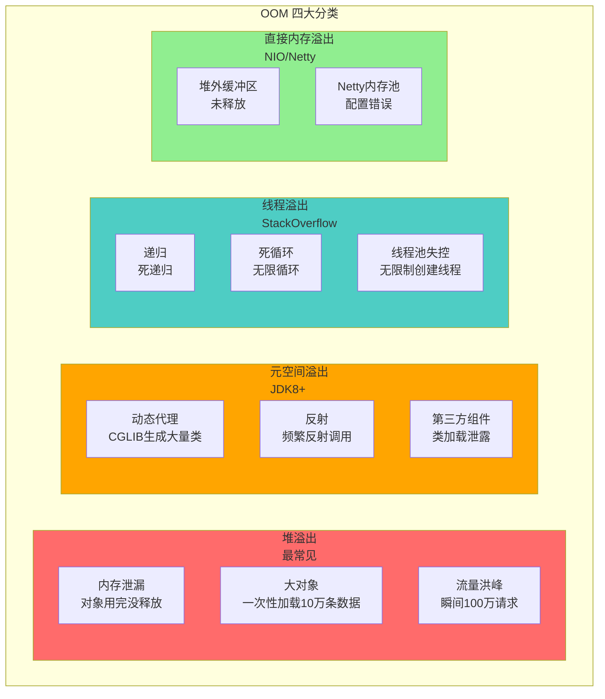
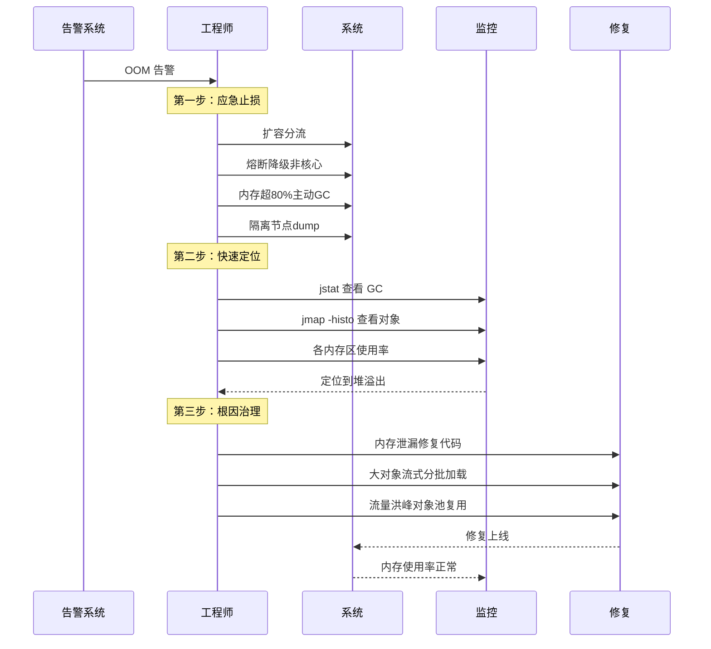
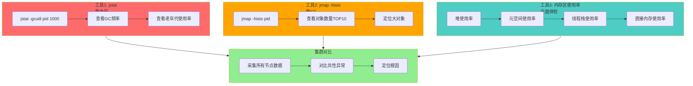
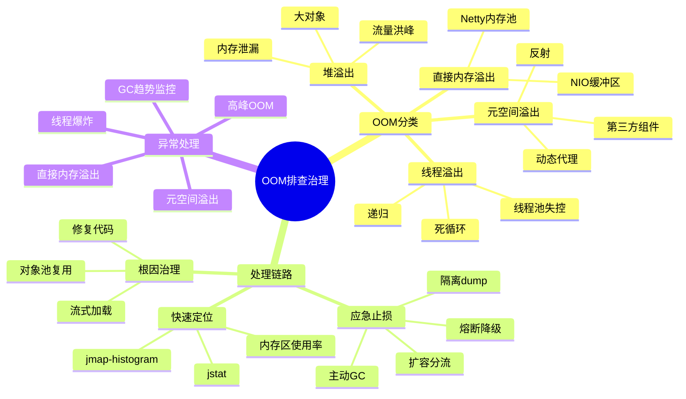

# 线上 OOM 宕机排查与治理

> **场景定位**：后端工程实践技术场景  
> **核心设计要点**：OOM 分类诊断、应急处理链路、内存泄漏排查、GC 调优、长效治理

---

## 🎯 一句话定位

**OOM 是什么？**
```
OOM（Out of Memory）：内存溢出，程序申请的内存超过了系统能提供的上限。
就像水杯装满了水，再倒就溢出来了。
```

**生活化比喻**：
OOM 就像"吃撑了"——你点了 10 盘菜，但胃只有 2 盘菜的容量。结果要么吐出来（程序崩溃），要么撑坏胃（系统宕机）。

**核心特点**：突发性强、影响面大、排查难度高、需要系统性方法论。

---

## 💎 核心观点（5 分钟速览版）

> **快速概览**

### 核心观点（3 个关键层）

**1. 第一层：OOM 分类（4 种类型）**
```
堆溢出：内存泄漏、大对象、一次性加载、流量洪峰
元空间溢出：动态代理、反射、批量生成类、第三方组件类加载泄露
线程溢出：递归、死循环、线程池失控、无限制创建线程
直接内存溢出：NIO/Netty 堆外缓冲区未释放
```

**2. 第二层：处理链路（三步走）**
```
应急止损：扩容分流 → 熔断降级非核心 → 内存超 80% 主动 GC 拒绝非核心 → 隔离节点 dump 不影响线上
快速定位：jstat/jmap-histogram 在线轻量排查 → 各内存区使用率 → 集群统一采集对比共性异常
根因治理：内存泄漏修复代码、大对象流式分批加载、流量洪峰对象池复用 + 分层降级
```

**3. 第三层：异常处理（5 种场景）**
```
高峰 OOM：先降级扩容扛过流量，低峰期复盘根因
GC 趋势监控：频率突变、老年代持续上涨提前预警
元空间溢出：排查动态代理/热加载、设置上限、类卸载校验
线程爆炸：统一线程池管控、禁止私自创建线程、监控线程数突增
直接内存溢出：统一封装 NIO 申请释放、配置堆外上限、Netty 内存池大小
```

---

## 🚀 一句话精华（如果只能记住一句）

> **OOM 治理 = 分类诊断（4 种类型） + 三步走（止损→定位→根治） + 5 种场景差异化处理**

---

## 一、OOM 分类：4 种类型详解

### ✅ 核心思路（30 秒版）

**生活化比喻**：
```
OOM 就像"不同类型的吃撑"：
堆溢出：吃太多正餐（对象太多）
元空间溢出：吃太多配菜（类元数据太多）
线程溢出：同时吃太多餐（线程太多）
直接内存溢出：吃太多零食（堆外内存太多）
```



### 1.1 堆溢出（最常见）

**生活化比喻**：
```
就像"吃太多正餐"：
你点了 10 盘菜（创建了 100 万个对象），但胃只有 2 盘菜的容量（堆内存 2GB）。
结果：胃撑爆了（OOM: Java heap space）。
```

**常见原因**：

| 原因 | 表现 | 检测方法 | 生活化比喻 |
|------|------|---------|------------|
| **内存泄漏** | 对象用完没释放，老年代持续上涨 | jmap + MAT 分析 | 吃完的菜不扔，堆在胃里 |
| **大对象** | 一次性加载 10 万条数据到内存 | jmap -histo 查看大对象 | 点了一头大象当菜 |
| **流量洪峰** | 瞬间 100 万请求，每个请求创建对象 | 监控 QPS 和内存使用率 | 瞬间来了 100 万人吃饭 |

**Go 代码示例**（堆溢出场景）：
```go
// ❌ 错误示例：内存泄漏
func ProcessDataWrong() {
    var data []string
    for {
        // 不断添加数据，但从不释放
        data = append(data, "some data")
    }
}

// ❌ 错误示例：大对象一次性加载
func LoadAllDataWrong() []User {
    // 一次性加载 100 万条数据到内存
    var users []User
    db.Find(&users) // OOM!
    return users
}

// ✅ 正确示例：流式分批加载
func LoadDataCorrect() {
    var offset int
    batchSize := 1000
    
    for {
        var users []User
        db.Limit(batchSize).Offset(offset).Find(&users)
        
        if len(users) == 0 {
            break // 数据加载完毕
        }
        
        // 处理当前批次数据
        for _, user := range users {
            processUser(user)
        }
        
        offset += batchSize
        
        // 每批次处理完后，users 会被 GC 回收
    }
}

// ✅ 正确示例：使用 sync.Pool 复用对象
var userPool = sync.Pool{
    New: func() interface{} {
        return &User{}
    },
}

func ProcessWithPool() {
    user := userPool.Get().(*User)
    defer userPool.Put(user) // 用完放回池中
    
    // 使用 user
    user.Name = "Alice"
    processUser(user)
}
```

### 1.2 元空间溢出（JDK8+）

**生活化比喻**：
```
就像"吃太多配菜"：
你点了 1000 种配菜（加载了 10 万个类），但桌子只有 100 个位置（元空间 256MB）。
结果：桌子撑爆了（OOM: Metaspace）。
```

**常见原因**：
- **动态代理**：CGLIB 动态代理生成大量类
- **反射**：频繁反射调用，生成大量类
- **第三方组件**：某些组件类加载泄露

**Go 代码示例**（元空间溢出场景）：
```go
// Go 没有元空间概念，但有类似问题：goroutine 泄漏
func GoroutineLeak() {
    for i := 0; i < 100000; i++ {
        go func() {
            // goroutine 永远不会结束
            select {}
        }()
    }
}

// ✅ 正确示例：控制 goroutine 数量
func GoroutineCorrect() {
    sem := make(chan struct{}, 100) // 信号量，限制并发数
    
    for i := 0; i < 10000; i++ {
        sem <- struct{}{} // 获取信号量
        go func(id int) {
            defer func() { <-sem }() // 释放信号量
            processTask(id)
        }(i)
    }
}
```

### 1.3 线程溢出（StackOverflow）

**生活化比喻**：
```
就像"同时吃太多餐"：
你同时开了 10000 个派对（创建了 10000 个线程），但餐厅只有 100 个桌位（线程栈空间）。
结果：餐厅撑爆了（OOM: unable to create new native thread）。
```

**常见原因**：
- **递归**：死递归，栈深度无限增加
- **死循环**：无限循环，线程永远不会释放
- **线程池失控**：无限制创建线程

**Go 代码示例**（线程溢出场景）：
```go
// ❌ 错误示例：死递归
func DeadRecurse() {
    DeadRecurse() // 栈溢出：stack overflow
}

// ❌ 错误示例：无限制创建 goroutine
func GoroutineExplosion() {
    for {
        go func() {
            // 永远不会结束
            time.Sleep(time.Hour)
        }()
    }
}

// ✅ 正确示例：控制递归深度
func SafeRecurse(depth int) {
    if depth > 100 {
        return // 限制递归深度
    }
    SafeRecurse(depth + 1)
}

// ✅ 正确示例：使用 worker pool
func WorkerPool() {
    tasks := make(chan int, 1000)
    
    // 启动固定数量的 worker
    for i := 0; i < 10; i++ {
        go func(workerID int) {
            for task := range tasks {
                fmt.Printf("Worker %d processing task %d\n", workerID, task)
            }
        }(i)
    }
    
    // 发送任务
    for i := 0; i < 100; i++ {
        tasks <- i
    }
    close(tasks)
}
```

### 1.4 直接内存溢出（NIO/Netty）

**生活化比喻**：
```
就像"吃太多零食"：
你吃了 100 包零食（分配了 10GB 堆外内存），但零食柜只有 10 包容量（直接内存限制 1GB）。
结果：零食柜撑爆了（OOM: Direct buffer memory）。
```

**常见原因**：
- **NIO 堆外缓冲区未释放**：ByteBuffer.allocateDirect() 分配后没释放
- **Netty 内存池配置错误**：内存池大小配置不合理

**Go 代码示例**（直接内存溢出场景）：
```go
// Go 没有直接内存概念，但有类似问题：大量使用 cgo 分配外部内存
// #include <stdlib.h>
import "C"
import "unsafe"

func DirectMemoryLeak() {
    for i := 0; i < 1000000; i++ {
        // 分配外部内存，但从不释放
        ptr := C.malloc(1024 * 1024) // 每次分配 1MB
        _ = ptr
    }
}

// ✅ 正确示例：及时释放外部内存
func DirectMemoryCorrect() {
    ptr := C.malloc(1024 * 1024)
    defer C.free(ptr) // 及时释放
    
    // 使用 ptr
    buf := (*[1024 * 1024]byte)(ptr)
    _ = buf
}
```

---

## 二、第二层：处理链路（三步走）

### ✅ 核心思路（30 秒版）

**生活化比喻**：
```
OOM 处理就像"急救"：
第一步：止血（应急止损）
第二步：检查（快速定位）
第三步：治疗（根因治理）
```



### 2.1 第一步：应急止损（5 个动作）

**生活化比喻**：
```
就像"急救止血"：
1. 扩容分流：叫更多医生来看病（加机器）
2. 熔断降级非核心：先治重病，轻病排队（关掉非核心功能）
3. 内存超 80% 主动 GC：主动吐出来（手动触发 GC）
4. 隔离节点 dump：把病人隔离，做详细检查（dump 内存分析）
5. 不影响线上：保证其他医生还能看病（隔离节点不影响线上）
```

| 动作 | 目的 | 实施方法 | 生活化比喻 | Go 代码示例 |
|------|------|---------|------------|------------|
| **扩容分流** | 增加处理能力，减少单节点压力 | 加机器、加 Pod | 叫更多医生 | `kubectl scale deployment --replicas=10` |
| **熔断降级非核心** | 保证核心功能可用 | 关掉非核心接口 | 先治重病 | `if !isCore { return "降级" }` |
| **内存超 80% 主动 GC** | 主动释放内存 | 手动触发 GC | 主动吐出来 | `runtime.GC()` |
| **隔离节点 dump** | 分析内存泄漏 | dump 内存快照 | 隔离检查 | `jmap -dump:format=b,file=heap.hprof <pid>` |
| **不影响线上** | 保证服务可用 | 隔离 dump 节点 | 不影响其他医生 | 从负载均衡摘除节点 |

**Go 代码示例**（应急止损）：
```go
// 1. 内存超 80% 主动 GC
func AutoGC() {
    var m runtime.MemStats
    runtime.ReadMemStats(&m)
    
    // 计算内存使用率
    usedPercent := float64(m.Alloc) / float64(m.Sys) * 100
    
    if usedPercent > 80 {
        log.Printf("内存使用率 %.2f%%，触发主动 GC", usedPercent)
        runtime.GC() // 手动触发 GC
    }
}

// 2. 熔断降级非核心
func HandleRequest(w http.ResponseWriter, r *http.Request, isCore bool) {
    var m runtime.MemStats
    runtime.ReadMemStats(&m)
    usedPercent := float64(m.Alloc) / float64(m.Sys) * 100
    
    if usedPercent > 90 && !isCore {
        http.Error(w, "服务降级中", http.StatusServiceUnavailable)
        return
    }
    
    // 处理请求
}

// 3. 内存 dump（隔离节点）
func DumpMemory() {
    var m runtime.MemStats
    runtime.ReadMemStats(&m)
    
    log.Printf("内存使用: Alloc=%d MB, Sys=%d MB", m.Alloc/1024/1024, m.Sys/1024/1024)
    
    // 生成 heap profile
    f, _ := os.Create("heap.prof")
    defer f.Close()
    pprof.WriteHeapProfile(f)
}
```

### 2.2 第二步：快速定位（3 个工具）

**生活化比喻**：
```
就像"体检"：
1. jstat：量血压（查看 GC 情况）
2. jmap -histo：做 CT（查看对象分布）
3. 各内存区使用率：全面体检（堆、元空间、线程栈、直接内存）
```



**常用命令**：
```bash
# 1. jstat：查看 GC 情况（每 1 秒打印一次）
jstat -gcutil <pid> 1000

# 输出示例：
#  S0     S1     E      O      M     CCS    YGC     YGCT    FGC    FGCT     GCT
#  0.00   50.00  75.00  85.00  95.00  90.00    100    5.000     5    2.000    7.000
#  -      -      -      老年代使用率85%  元空间使用率95%  -       Young GC 100次  Full GC 5次

# 2. jmap -histo：查看对象分布
jmap -histo <pid> | head -20

# 输出示例：
#  num     #instances         #bytes  class name
#  1:        1000000        64000000  [B
#  2:         500000        32000000  java.lang.String
#  3:         200000        16000000  java.util.HashMap$Node

# 3. jmap -dump：生成 heap dump
jmap -dump:format=b,file=heap.hprof <pid>

# 4. 使用 MAT（Memory Analyzer Tool）分析 heap dump
# 下载 MAT：https://www.eclipse.org/mat/downloads.php
# 打开 heap.hprof，查看 Leak Suspects（泄漏疑点）
```

**Go 代码示例**（内存监控）：
```go
// 内存监控指标
type MemoryMetrics struct {
    Alloc      uint64 // 当前使用的内存（字节）
    TotalAlloc uint64 // 累计分配的内存（字节）
    Sys        uint64 // 从系统申请的内存（字节）
    NumGC      uint32 // GC 次数
}

func CollectMemoryMetrics() *MemoryMetrics {
    var m runtime.MemStats
    runtime.ReadMemStats(&m)
    
    return &MemoryMetrics{
        Alloc:      m.Alloc,
        TotalAlloc: m.TotalAlloc,
        Sys:        m.Sys,
        NumGC:      m.NumGC,
    }
}

// 打印内存使用情况
func PrintMemoryUsage() {
    var m runtime.MemStats
    runtime.ReadMemStats(&m)
    
    fmt.Printf("Alloc: %d MB\n", m.Alloc/1024/1024)
    fmt.Printf("Sys: %d MB\n", m.Sys/1024/1024)
    fmt.Printf("NumGC: %d\n", m.NumGC)
    fmt.Printf("使用率: %.2f%%\n", float64(m.Alloc)/float64(m.Sys)*100)
}
```

### 2.3 第三步：根因治理（3 个方向）

**生活化比喻**：
```
就像"治疗"：
1. 内存泄漏：修复代码（止血）
2. 大对象：流式分批加载（少吃多餐）
3. 流量洪峰：对象池复用 + 分层降级（提前准备）
```

| 方向 | 根因 | 治理方案 | 生活化比喻 | Go 代码示例 |
|------|------|---------|------------|------------|
| **内存泄漏** | 对象用完没释放 | 修复代码，及时释放引用 | 吃完的菜扔掉 | `defer Close()` |
| **大对象** | 一次性加载太多数据 | 流式分批加载 | 少吃多餐 | `db.Limit(1000).Offset(offset)` |
| **流量洪峰** | 瞬间大量请求 | 对象池复用 + 分层降级 | 提前准备餐具 | `sync.Pool` |

**Go 代码示例**（根因治理）：
```go
// 1. 内存泄漏修复：及时释放引用
func ProcessDataCorrect() {
    data := make([]byte, 1024*1024) // 1MB
    defer func() {
        data = nil // 及时释放引用
    }()
    
    // 处理数据
    process(data)
}

// 2. 大对象流式分批加载
func LoadDataStreaming() {
    var offset int
    batchSize := 1000
    
    for {
        var users []User
        db.Limit(batchSize).Offset(offset).Find(&users)
        
        if len(users) == 0 {
            break
        }
        
        // 处理当前批次
        for _, user := range users {
            processUser(user)
        }
        
        offset += batchSize
        // users 会在下次循环时被 GC 回收
    }
}

// 3. 对象池复用
var bufferPool = sync.Pool{
    New: func() interface{} {
        return make([]byte, 0, 1024*1024) // 1MB buffer
    },
}

func ProcessWithPool() {
    buf := bufferPool.Get().([]byte)
    defer bufferPool.Put(buf) // 用完放回池中
    
    // 使用 buf
    buf = buf[:0] // 重置
    buf = append(buf, "data"...)
    process(buf)
}

// 4. 分层降级
func HandleRequestWithDegradation(w http.ResponseWriter, r *http.Request) {
    var m runtime.MemStats
    runtime.ReadMemStats(&m)
    usedPercent := float64(m.Alloc) / float64(m.Sys) * 100
    
    switch {
    case usedPercent > 95:
        // 严重：只处理核心请求
        if !isCoreRequest(r) {
            http.Error(w, "服务降级", 503)
            return
        }
    case usedPercent > 85:
        // 中等：降级非核心功能
        disableNonCoreFeatures()
    case usedPercent > 75:
        // 轻度：减少缓存使用
        reduceCacheUsage()
    }
    
    // 正常处理
    processRequest(w, r)
}
```

---

## 三、第三层：异常处理（5 种场景）

### ✅ 核心思路（30 秒版）

**生活化比喻**：
```
5 种 OOM 场景，就像 5 种不同的病：
1. 高峰 OOM：吃撑了（流量洪峰）
2. GC 趋势异常：消化不良（GC 频率突变）
3. 元空间溢出：配菜吃太多（类加载泄露）
4. 线程爆炸：同时吃太多餐（线程失控）
5. 直接内存溢出：零食吃太多（堆外内存泄露）
```

### 3.1 高峰 OOM：先降级扩容，低峰期复盘

**生活化比喻**：
```
就像"节假日医院爆满"：
高峰期：先加医生（扩容）、让轻病排队（降级），保证重病能治
低峰期：复盘为什么爆满，优化流程
```

**处理流程**：
```bash
# 高峰期：紧急扩容
kubectl scale deployment --replicas=20

# 高峰期：降级非核心功能
# 在配置中心关闭非核心功能

# 低峰期：dump 内存分析
jmap -dump:format=b,file=heap.hprof <pid>

# 低峰期：使用 MAT 分析泄漏
```

**Go 代码示例**（高峰 OOM 处理）：
```go
// 高峰期自动降级
type AutoDegradation struct {
    mu            sync.Mutex
    currentLevel  int // 0:正常 1:轻度 2:中等 3:严重
}

func (d *AutoDegradation) CheckAndDegrade() {
    var m runtime.MemStats
    runtime.ReadMemStats(&m)
    usedPercent := float64(m.Alloc) / float64(m.Sys) * 100
    
    d.mu.Lock()
    defer d.mu.Unlock()
    
    switch {
    case usedPercent > 95:
        d.currentLevel = 3
        log.Printf("严重降级：内存使用率 %.2f%%", usedPercent)
        // 只处理核心请求
    case usedPercent > 85:
        d.currentLevel = 2
        log.Printf("中等降级：内存使用率 %.2f%%", usedPercent)
        // 降级非核心功能
    case usedPercent > 75:
        d.currentLevel = 1
        log.Printf("轻度降级：内存使用率 %.2f%%", usedPercent)
        // 减少缓存使用
    default:
        d.currentLevel = 0
    }
}
```

### 3.2 GC 趋势监控：频率突变、老年代持续上涨

**生活化比喻**：
```
就像"体检指标"：
GC 频率突变：突然频繁跑厕所（可能吃坏肚子了）
老年代持续上涨：体重持续增加（可能有健康问题）
```

**监控指标**：
| 指标 | 正常范围 | 异常表现 | 可能原因 |
|------|---------|---------|---------|
| **Young GC 频率** | 每分钟 1-5 次 | 每分钟 10+ 次 | 对象创建过快，或有大对象 |
| **Full GC 频率** | 每小时 0-1 次 | 每分钟 1+ 次 | 老年代空间不足，或内存泄漏 |
| **老年代使用率** | < 70% | > 85% 持续上涨 | 内存泄漏，或长生命周期对象过多 |
| **GC 耗时** | < 100ms | > 1s | 堆过大，或有大量对象需要回收 |

**Go 代码示例**（GC 监控）：
```go
// GC 监控
type GCMonitor struct {
    lastNumGC   uint32
    lastGCTime  time.Time
}

func (m *GCMonitor) CheckGCTrend() {
    var stats runtime.MemStats
    runtime.ReadMemStats(&stats)
    
    // 计算 GC 频率
    currentTime := time.Now()
    timeDiff := currentTime.Sub(m.lastGCTime).Seconds()
    gcDiff := stats.NumGC - m.lastNumGC
    
    if timeDiff > 0 {
        gcPerMinute := float64(gcDiff) / timeDiff * 60
        if gcPerMinute > 10 {
            log.Printf("GC 频率异常：%.2f 次/分钟", gcPerMinute)
        }
    }
    
    // 检查老年代使用率
    // 注意：Go 没有分代，这里是模拟
    oldGenPercent := float64(stats.Alloc) / float64(stats.HeapSys) * 100
    if oldGenPercent > 85 {
        log.Printf("老年代使用率过高：%.2f%%", oldGenPercent)
    }
    
    m.lastNumGC = stats.NumGC
    m.lastGCTime = currentTime
}
```

### 3.3 元空间溢出：排查动态代理/热加载

**生活化比喻**：
```
就像"配菜吃太多"：
动态代理：自动配菜机器人不断生成新配菜
热加载：不断上新菜，但旧菜不撤
```

**排查步骤**：
```bash
# 1. 查看元空间使用率
jstat -gcmetacapacity <pid>

# 2. 查看加载的类数量
jcmd <pid> VM.classloader_stats

# 3. 使用 Arthas 查看类加载
# 下载 Arthas：https://arthas.aliyun.com/
java -jar arthas-boot.jar
sc -d *  # 查看加载的类
```

### 3.4 线程爆炸：统一线程池管控

**生活化比喻**：
```
就像"同时开太多派对"：
每个线程就像一个派对，太多派对会把房子撑爆。
```

**Go 代码示例**（线程池管控）：
```go
// ❌ 错误示例：无限制创建 goroutine
func GoroutineExplosion() {
    for i := 0; i < 100000; i++ {
        go func() {
            time.Sleep(time.Hour)
        }()
    }
}

// ✅ 正确示例：使用 worker pool
type WorkerPool struct {
    taskCh chan func()
    quit   chan struct{}
}

func NewWorkerPool(workerCount int) *WorkerPool {
    wp := &WorkerPool{
        taskCh: make(chan func(), 1000),
        quit:   make(chan struct{}),
    }
    
    // 启动固定数量的 worker
    for i := 0; i < workerCount; i++ {
        go wp.worker()
    }
    
    return wp
}

func (wp *WorkerPool) worker() {
    for {
        select {
        case task := <-wp.taskCh:
            task()
        case <-wp.quit:
            return
        }
    }
}

func (wp *WorkerPool) Submit(task func()) {
    wp.taskCh <- task
}

func (wp *WorkerPool) Shutdown() {
    close(wp.quit)
}

// 使用示例
func main() {
    pool := NewWorkerPool(10) // 固定 10 个 worker
    
    for i := 0; i < 100; i++ {
        pool.Submit(func() {
            fmt.Println("processing task")
        })
    }
    
    time.Sleep(time.Second)
    pool.Shutdown()
}
```

### 3.5 直接内存溢出：统一封装 NIO 申请释放

**生活化比喻**：
```
就像"零食柜管理"：
统一封装：零食柜管理员统一发放和回收零食
统一上限：零食柜最多放 10 包零食
```

**Go 代码示例**（直接内存管理）：
```go
// Go 没有直接内存概念，但可以使用 cgo 分配外部内存
// #include <stdlib.h>
import "C"
import "unsafe"

// 直接内存管理器
type DirectMemoryManager struct {
    mu        sync.Mutex
    allocated map[unsafe.Pointer]int64
    limit     int64
    used      int64
}

func NewDirectMemoryManager(limitMB int64) *DirectMemoryManager {
    return &DirectMemoryManager{
        allocated: make(map[unsafe.Pointer]int64),
        limit:     limitMB * 1024 * 1024,
        used:      0,
    }
}

func (m *DirectMemoryManager) Allocate(size int64) (unsafe.Pointer, error) {
    m.mu.Lock()
    defer m.mu.Unlock()
    
    if m.used+size > m.limit {
        return nil, fmt.Errorf("直接内存不足：已使用 %d MB，限制 %d MB", 
            m.used/1024/1024, m.limit/1024/1024)
    }
    
    ptr := C.malloc(C.size_t(size))
    if ptr == nil {
        return nil, fmt.Errorf("内存分配失败")
    }
    
    m.allocated[ptr] = size
    m.used += size
    
    return ptr, nil
}

func (m *DirectMemoryManager) Free(ptr unsafe.Pointer) {
    m.mu.Lock()
    defer m.mu.Unlock()
    
    if size, ok := m.allocated[ptr]; ok {
        C.free(ptr)
        delete(m.allocated, ptr)
        m.used -= size
    }
}

// 使用示例
func main() {
    manager := NewDirectMemoryManager(100) // 限制 100MB
    
    ptr, err := manager.Allocate(1024 * 1024) // 分配 1MB
    if err != nil {
        log.Fatal(err)
    }
    defer manager.Free(ptr) // 及时释放
    
    // 使用 ptr
    buf := (*[1024 * 1024]byte)(ptr)
    _ = buf
}
```

---

四、技术深入探讨与深度问题



### 方案详解

**Q1: OOM 有哪几种类型？**  
**答**：OOM 有 4 种类型：
1. **堆溢出**（最常见）：内存泄漏、大对象、流量洪峰。
2. **元空间溢出**（JDK8+）：动态代理、反射、第三方组件类加载泄露。
3. **线程溢出**：递归、死循环、线程池失控。
4. **直接内存溢出**（NIO/Netty）：堆外缓冲区未释放。

**Q2: 线上出现 OOM，第一步做什么？**  
**答**：第一步是**应急止损**，不是查因。
1. **扩容分流**：加机器，减少单节点压力。
2. **熔断降级非核心**：关掉非核心功能，保证核心功能可用。
3. **内存超 80% 主动 GC**：手动触发 GC，释放内存。
4. **隔离节点 dump**：从负载均衡摘除节点，dump 内存分析，不影响线上。

**Q3: 如何快速定位 OOM 根因？**  
**答**：使用 3 个工具快速定位：
1. **jstat -gcutil**：查看 GC 频率、老年代使用率，判断是否内存泄漏。
2. **jmap -histo**：查看对象数量 TOP10，定位大对象。
3. **各内存区使用率**：判断是堆溢出、元空间溢出、还是线程溢出。

结合**集群统一采集对比**，可以快速定位共性异常。

**Q4: 如何长效治理 OOM？**  
**答**：根因治理 3 个方向：
1. **内存泄漏**：修复代码，及时释放引用（`defer Close()`）。
2. **大对象**：流式分批加载（`db.Limit(1000).Offset(offset)`）。
3. **流量洪峰**：对象池复用（`sync.Pool`）+ 分层降级。

同时需要**监控告警**：GC 频率突变、老年代持续上涨提前预警。

---

## 五、方案总结

**方案总结**：

> **OOM 分类**：4 种类型（堆溢出、元空间溢出、线程溢出、直接内存溢出），堆溢出最常见。
> 
> **处理链路**：三步走（应急止损→快速定位→根因治理）。先止损再查因，隔离 dump 不影响线上。
> 
> **异常处理**：5 种场景差异化处理（高峰 OOM、GC 趋势监控、元空间溢出、线程爆炸、直接内存溢出）。
> 
> **长效治理**：内存泄漏修复代码、大对象流式分批加载、流量洪峰对象池复用 + 分层降级。

---

## 六、生产环境 Checklist（部署检查清单）

| 类别 | 检查项 | 状态 | 生活化比喻 |
|------|--------|------|------------|
| **监控告警** | 内存使用率监控（阈值 80%） | ⬜ | 量血压 |
| | GC 频率监控（Young GC、Full GC） | ⬜ | 量体温 |
| | 线程数监控（阈值告警） | ⬜ | 数人头 |
| **应急止损** | 自动扩容机制 | ⬜ | 叫更多医生 |
| | 降级开关（配置中心） | ⬜ | 先治重病 |
| | 手动 GC 接口 | ⬜ | 主动吐出来 |
| | dump 工具（隔离节点） | ⬜ | 隔离检查 |
| **根因治理** | 内存泄漏检测工具 | ⬜ | 体检 |
| | 流式加载组件 | ⬜ | 少吃多餐 |
| | 对象池组件（sync.Pool） | ⬜ | 重复使用餐具 |
| **长效防控** | GC 趋势分析（日报/周报） | ⬜ | 体检报告 |
| | 压测报告（流量洪峰场景） | ⬜ | 模拟演练 |

---

## 七、总结（一句话带走）

### 🎯 一句话总结

> **OOM 治理 = 分类诊断（4 种类型） + 三步走（止损→定位→根治） + 5 种场景差异化处理**

### 🧠 核心记忆点

1. **OOM 4 种类型**：堆溢出（最常见）、元空间溢出、线程溢出、直接内存溢出。
2. **处理链路三步走**：先止损再查因，隔离 dump 不影响线上。
3. **快速定位 3 个工具**：jstat（GC 频率）、jmap-histogram（对象分布）、内存区使用率。
4. **长效治理 3 个方向**：内存泄漏修复代码、大对象流式分批加载、流量洪峰对象池复用。

---

*本文档基于 8 个专家提示词指导改写，遵循深入浅出、生活化比喻、幽默风趣的教学原则。*
