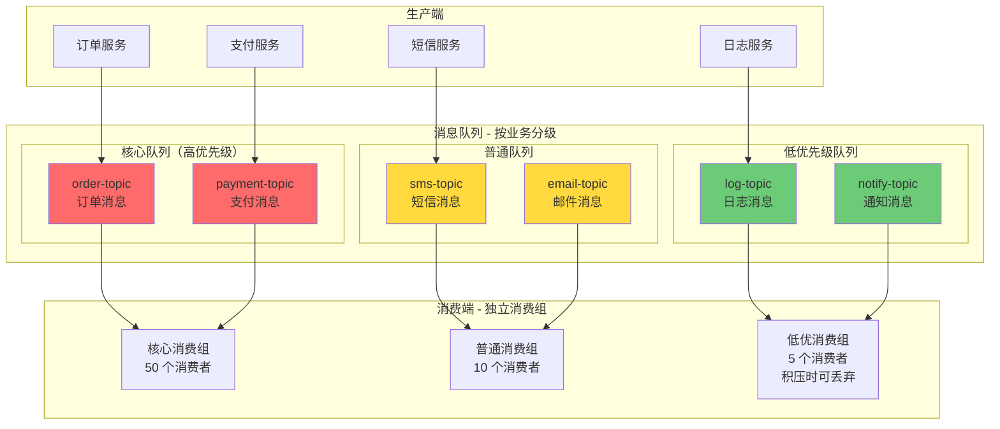
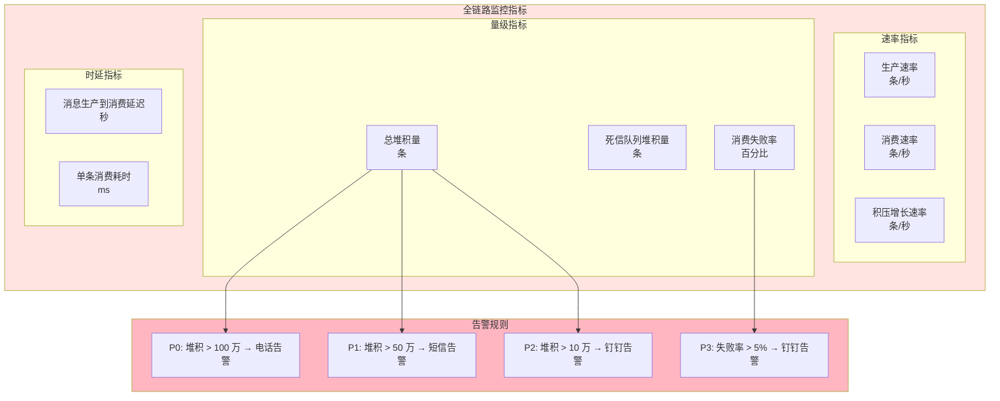
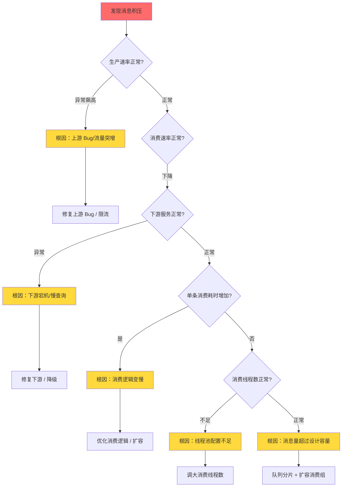
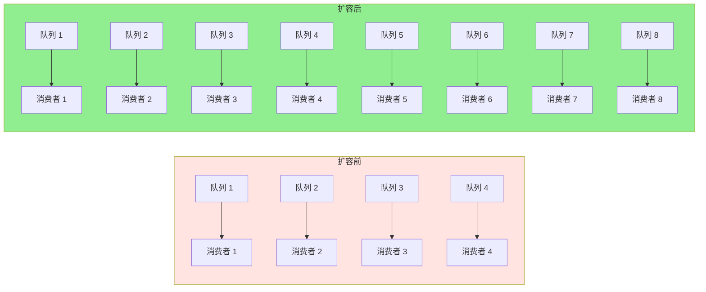
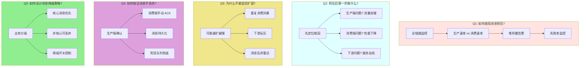
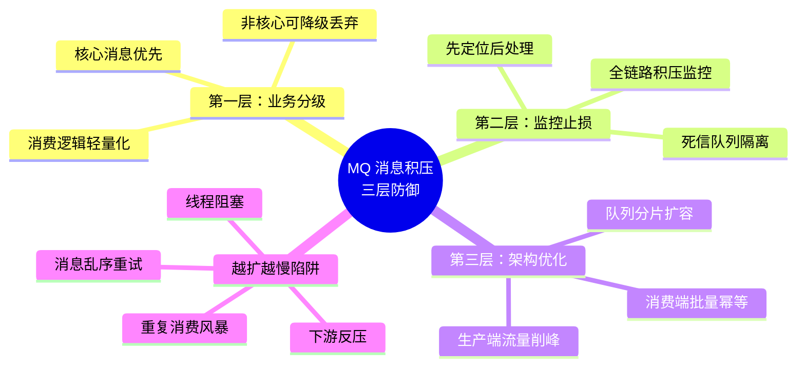
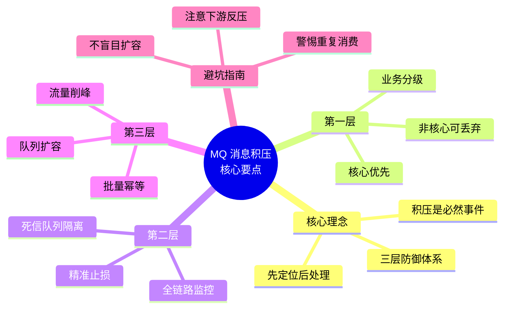

# MQ 消息积压处理方案

> **场景定位**：后端架构设计 / 中间件运维技术场景  
> **核心设计要点**：消息队列运维、三层防御体系、业务分级、监控告警、架构优化

---

## 🎯 一句话定位

**MQ 消息积压解决什么问题？**
```
消费者处理不过来，消息在队列里越堆越多，最终导致系统瘫痪。
```

**生活化比喻**：
就像快递站爆仓了——双十一来了 10 万件包裹，但快递员只有 10 个人，一天只能送 1000 件。包裹越堆越多，最后连站都进不去了。

**核心特点**：消息积压不是"偶发故障"，而是"必然会发生的事"——大促、峰值、下游宕机，迟早会来。关键在于你有没有提前准备好"三层防御"。

---

## 💎 核心观点（5 分钟速览版）

> **快速概览**

### 核心观点（3 层防御）

**1. 第一层：业务分级差异化消费**
```
❌ 所有消息一视同仁 → 核心消息被非核心消息淹没
✅ 核心消息（订单/支付）与非核心消息（短信/通知/日志）拆分独立队列
   - 积压时优先保障核心链路
   - 非核心可临时降级、延后、甚至丢弃
   - 消费逻辑轻量化：禁止无超时远程调用、大事务
```

**2. 第二层：监控兜底与精准止损**
```
- 全链路积压监控：生产速率、消费速率、堆积量、失败率
- 先定位根源：生产端流量突增 vs 消费端性能下降
- 死信队列隔离：消费失败消息自动转入，避免反复重试占用线程
- 极端场景：一键丢弃非核心历史堆积消息
```

**3. 第三层：架构层优化**
```
- 生产端：流量削峰机制，峰值先缓冲再匀速入队
- 消费端：批量消费 + 幂等校验，大幅提升吞吐
- 容量评估 + 扩容逻辑：支持队列分片消费组快速扩容
- 大促前专项压测验证
```

---

## 🚀 一句话精华（如果只能记住一句）

> **消息积压处理 = 业务分级保核心 + 监控止损防雪崩 + 架构优化治根本**

---

## 一、为什么消息积压是"必然事件"？

### 积压的五大触发场景

**生活化比喻**：
```
消息积压就像交通拥堵，有五种典型场景：

1. 早高峰（大促峰值）
   - 车流量瞬间翻了 10 倍，路还是那条路
   - 消息：双十一订单量是平时的 10 倍

2. 交通事故（下游宕机）
   - 前方车祸，车全堵在这了
   - 消息：下游数据库挂了，消费全部失败

3. 道路施工（消费逻辑慢）
   - 路变窄了，通行速度下降
   - 消息：消费逻辑里加了个远程调用，耗时从 10ms 变成 500ms

4. 临时限行（消费线程不足）
   - 只开了 2 个收费口，排队排到高速上了
   - 消息：消费线程池配置太小，并发上不去

5. 车流量突增（上游 Bug）
   - 某个服务突然疯狂发消息（死循环/Bug）
   - 消息：生产端异常，每秒发送量从 1000 变成 100000
```

| 触发场景 | 根因 | 典型表现 | 危险等级 |
|---------|------|---------|---------|
| 大促峰值 | 流量暴增 | 堆积量匀速增长 | ⭐⭐⭐ |
| 下游宕机 | 消费失败 | 堆积 + 失败率飙升 | ⭐⭐⭐⭐⭐ |
| 消费逻辑慢 | 性能下降 | 消费速率下降 | ⭐⭐⭐⭐ |
| 线程不足 | 配置不当 | 消费速率上不去 | ⭐⭐⭐ |
| 上游 Bug | 生产异常 | 堆积量指数增长 | ⭐⭐⭐⭐⭐ |

---

## 二、第一层防御：业务分级差异化消费

### 2.1 核心思路

**生活化比喻**：
```
就像医院的急诊分级：
- 🔴 危重病人（订单/支付）：立即处理，一刻不能等
- 🟡 普通病人（短信/邮件）：排队等候，可以晚一点
- 🟢 轻微症状（日志/通知）：可以延后，甚至不去

消息积压时，优先保障核心链路，非核心可以"让路"。
```

### 2.2 队列拆分架构



### 2.3 消费逻辑轻量化

**核心原则**：单条消息消费耗时压到最低，禁止"重操作"。

**反面案例（踩坑）**：
```go
// ❌ 反面示例：消费逻辑里塞了太多东西
func (c *OrderConsumer) Consume(msg *Message) error {
    // 1. 远程调用用户服务（无超时！）
    user, err := userService.GetUser(msg.UserID) // 可能阻塞 30s
    
    // 2. 远程调用风控服务（无超时！）
    risk, err := riskService.Check(msg.OrderID) // 可能阻塞 30s
    
    // 3. 大事务：一条消息里做了 5 张表的更新
    tx := db.Begin()
    tx.Create(&order)
    tx.Model(&user).Update("balance", gorm.Expr("balance - ?", msg.Amount))
    tx.Create(&payment)
    tx.Create(&log)
    tx.Create(&notification)
    tx.Commit()
    
    // 单条消费耗时：500ms - 2s
    // 消费速率：500-2000 条/秒/消费者
}
```

**正确做法（优化后）**：
```go
// ✅ 正确示例：消费逻辑轻量化
func (c *OrderConsumer) Consume(msg *Message) error {
    // 1. 所有远程调用必须设置超时
    ctx, cancel := context.WithTimeout(context.Background(), 200*time.Millisecond)
    defer cancel()
    
    user, err := userService.GetUserWithContext(ctx, msg.UserID)
    if err != nil {
        // 超时不重试，直接转入死信队列
        return err
    }
    
    // 2. 只做最小事务：只更新订单状态
    tx := db.Begin()
    tx.Model(&order).Update("status", "paid")
    tx.Commit()
    
    // 3. 非核心操作异步化：发短信、记日志等通过新消息异步处理
    mq.Send(&Message{Topic: "sms-topic", Data: msg.SmsData})
    mq.Send(&Message{Topic: "log-topic", Data: msg.LogData})
    
    // 单条消费耗时：10-50ms
    // 消费速率：20000-100000 条/秒/消费者
}
```

### 2.4 降级策略

| 消息级别 | 积压阈值 | 降级动作 | 恢复条件 |
|---------|---------|---------|---------|
| 🔴 核心（订单/支付） | 堆积 > 10 万 | 紧急扩容消费组 | 堆积 < 1 万 |
| 🟡 普通（短信/邮件） | 堆积 > 50 万 | 降级：批量发送/合并通知 | 堆积 < 5 万 |
| 🟢 低优（日志/通知） | 堆积 > 100 万 | 丢弃非核心历史消息 | 无需恢复 |

---

## 三、第二层防御：监控兜底与精准止损

### 3.1 全链路监控体系

**生活化比喻**：
```
监控就像医院的监护仪：
- 心率（消费速率）：每秒处理多少条消息
- 血压（堆积量）：队列里有多少消息没处理
- 体温（失败率）：有多少消息消费失败了
- 呼吸频率（生产速率）：每秒进来多少条消息

任何一个指标异常，都要立刻报警。
```



### 3.2 根因定位流程

**核心原则**：**先定位，后处理，不盲目扩容！**



### 3.3 死信队列隔离

**生活化比喻**：
```
死信队列就像医院的"隔离病房"：
- 正常消息在"普通病房"消费
- 消费失败的消息转入"隔离病房"（死信队列）
- 避免反复重试占用"医疗资源"（消费线程）
- 后续人工排查或定时重试
```

```go
// ✅ 死信队列处理逻辑
func (c *Consumer) Consume(msg *Message) error {
    err := c.processMessage(msg)
    if err != nil {
        c.retryCount++
        
        // 重试次数超过阈值，转入死信队列
        if c.retryCount >= MaxRetryCount {
            // 转入死信队列，不再重试
            deadLetterQueue.Send(&DeadLetterMessage{
                OriginalMsg: msg,
                Error:       err.Error(),
                RetryCount:  c.retryCount,
                FailedAt:    time.Now(),
            })
            
            // 告警通知
            alert.Send("消息转入死信队列", map[string]string{
                "topic":      msg.Topic,
                "msgID":      msg.ID,
                "error":      err.Error(),
                "retryCount": strconv.Itoa(c.retryCount),
            })
            
            return nil // 返回 nil，不再重试
        }
        
        // 未超过阈值，继续重试（指数退避）
        time.Sleep(time.Duration(c.retryCount) * time.Second)
        return err
    }
    
    return nil
}
```

### 3.4 极端场景：一键丢弃

```go
// ✅ 极端场景：丢弃非核心历史堆积消息
func DiscardBacklog(topic string, threshold int64) error {
    // 查询当前堆积量
    backlog, err := mq.GetBacklog(topic)
    if err != nil {
        return err
    }
    
    if backlog <= threshold {
        return nil // 堆积量在阈值内，不需要丢弃
    }
    
    // 丢弃超过阈值的历史消息
    discardCount := backlog - threshold
    
    // 重置消费位点（跳过历史消息）
    err = mq.ResetOffset(topic, consumerGroup, time.Now().Add(-1*time.Hour))
    if err != nil {
        return err
    }
    
    log.Printf("已丢弃 %d 条非核心消息，topic: %s", discardCount, topic)
    return nil
}
```

---

## 四、第三层防御：架构层优化

### 4.1 生产端：流量削峰

**生活化比喻**：
```
流量削峰就像水库蓄水：
- 洪水来了（流量峰值），先蓄在水库里
- 然后匀速放水，下游就不会被冲垮
- 水库就是"缓冲队列"，匀速放水就是"限流"
```

```go
// ✅ 生产端限流：匀速入队
type RateLimitedProducer struct {
    producer  *mq.Producer
    limiter   *rate.Limiter // 令牌桶限流器
}

func (p *RateLimitedProducer) Send(msg *Message) error {
    // 令牌桶限流：每秒最多 1000 条
    if !p.limiter.Allow() {
        // 超过限流阈值，先缓冲到本地队列
        return p.bufferToLocalQueue(msg)
    }
    
    return p.producer.Send(msg)
}

// 本地缓冲队列：峰值先缓冲，再匀速入队
func (p *RateLimitedProducer) bufferToLocalQueue(msg *Message) error {
    // 本地队列缓冲
    p.localQueue <- msg
    
    // 后台协程匀速消费本地队列
    return nil
}
```

### 4.2 消费端：批量消费 + 幂等

```go
// ✅ 批量消费：一次拉取多条消息，批量处理
func (c *BatchConsumer) ConsumeBatch(messages []*Message) error {
    // 1. 批量查询（合并请求，减少 IO）
    orderIDs := make([]string, 0, len(messages))
    for _, msg := range messages {
        orderIDs = append(orderIDs, msg.OrderID)
    }
    
    // 一次查询 100 条，而不是 100 次查询 1 条
    orders, err := orderService.BatchGetOrders(orderIDs)
    if err != nil {
        return err
    }
    
    // 2. 幂等校验：防止重复消费
    validMessages := make([]*Message, 0)
    for _, msg := range messages {
        if !c.idempotentChecker.IsProcessed(msg.MsgID) {
            validMessages = append(validMessages, msg)
        }
    }
    
    // 3. 批量写入数据库
    tx := db.Begin()
    for _, msg := range validMessages {
        tx.Model(&Order{ID: msg.OrderID}).Update("status", "processed")
        c.idempotentChecker.MarkProcessed(msg.MsgID)
    }
    tx.Commit()
    
    return nil
}
```

### 4.3 队列分片与扩容

**生活化比喻**：
```
队列分片就像高速公路增加车道：
- 原来 4 车道（4 个队列），堵车了
- 扩到 8 车道、16 车道
- 同时增加消费车辆（消费者数量）
- 通行速度成倍提升
```



### 4.4 容量评估与压测

| 评估维度 | 评估方法 | 安全阈值 | 扩容触发条件 |
|---------|---------|---------|-------------|
| 队列容量 | 压测得出最大吞吐 | 日常流量 × 3 | 峰值流量 > 安全阈值 |
| 消费线程数 | 压测得出最优并发 | CPU 使用率 < 70% | CPU > 70% 且堆积增长 |
| 单条耗时 | P99 耗时监控 | < 100ms | P99 > 200ms |
| 堆积量 | 实时监控 | < 10 万条 | > 5 万条触发预警 |

---

## 五、关键问题：越扩容越慢的原因

### 5.1 四大"越扩越慢"陷阱

**生活化比喻**：
```
你以为加人就能加快速度？就像：
- 你开了 10 个窗口卖票，但售票系统是同一台电脑（下游反压）
- 10 个人同时查同一本书的库存（重复消费风暴）
- 10 个人按不同顺序处理订单，结果全乱了（消息乱序重试）
- 10 个人互相等对方先处理完（消费线程阻塞）
```

| 陷阱 | 根因 | 表现 | 解决方案 |
|------|------|------|---------|
| **重复消费风暴** | 多消费者重复消费同一消息 | 数据库锁竞争加剧 | 幂等校验 + 消息去重 |
| **下游反压** | 下游服务（DB/RPC）达到瓶颈 | 消费耗时增加，成功率下降 | 下游扩容 + 限流降级 |
| **消息乱序重试** | 失败消息重试导致乱序 | 业务逻辑出错（如先退款后扣款） | 顺序消息 + 状态机校验 |
| **消费线程阻塞** | 线程池配置不合理 / 锁竞争 | 消费线程全部阻塞 | 线程池隔离 + 减少锁粒度 |

### 5.2 重复消费风暴详解

```go
// ❌ 没有幂等校验：多次消费导致数据异常
func (c *Consumer) Consume(msg *Message) error {
    // 消息重试，被消费了 3 次
    // 第一次：扣减库存成功
    // 第二次：又扣减库存（重复扣减！）
    // 第三次：又扣减库存（库存变成负数！）
    db.Exec("UPDATE stock SET count = count - 1 WHERE product_id = ?", msg.ProductID)
    return nil
}

// ✅ 幂等校验：基于消息 ID 去重
func (c *Consumer) Consume(msg *Message) error {
    // 幂等校验：检查是否已处理
    if c.idempotentChecker.IsProcessed(msg.MsgID) {
        log.Printf("消息已处理，跳过: %s", msg.MsgID)
        return nil
    }
    
    // 处理业务逻辑
    db.Exec("UPDATE stock SET count = count - 1 WHERE product_id = ?", msg.ProductID)
    
    // 标记已处理（Redis SETNX，24 小时过期）
    c.idempotentChecker.MarkProcessed(msg.MsgID)
    return nil
}
```

---

## 六、技术追问与深度问题



### 方案详解

**Q1: 如何发现消息积压？**  
**答**：通过全链路监控，监控三个核心指标：
1. **堆积量**：队列里有多少消息没处理（阈值 10 万告警）
2. **消费速率**：每秒处理多少条（对比历史基线，下降 50% 告警）
3. **失败率**：消费失败的消息占比（> 5% 告警）

同时监控"生产速率 vs 消费速率"，如果生产速率持续大于消费速率，说明积压在增长。

**Q2: 积压后第一步做什么？**  
**答**：**先定位根因，再决定处理策略**。不盲目扩容！
- 如果是生产端流量突增：限流上游，或者开启削峰
- 如果是消费端性能下降：优化消费逻辑，或者扩容消费组
- 如果是下游服务宕机：降级下游，或者开启熔断
- 如果是线程池配置不足：调大消费线程数

**Q3: 为什么不能盲目扩容？**  
**答**：因为可能"越扩越慢"！四个典型陷阱：
1. **重复消费风暴**：多消费者重复消费同一消息，数据库锁竞争加剧
2. **下游反压**：下游服务（DB/RPC）已经达到瓶颈，扩容消费端只会让下游更慢
3. **消息乱序重试**：失败消息重试导致乱序，业务逻辑出错
4. **消费线程阻塞**：线程池配置不合理，或者锁竞争，导致消费线程全部阻塞

**Q4: 如何保证消息不丢失？**  
**答**：三道防线：
1. **生产端**：消息持久化 + 发送确认（ACK）
2. **消费端**：手动 ACK（处理完再确认，不自动确认）
3. **兜底**：死信队列（消费失败的消息转入死信队列，后续人工处理）

**Q5: 如何设计消息降级策略？**  
**答**：核心思路是"业务分级 + 差异化处理"：
1. 将消息按业务重要性分为三级：核心（订单/支付）、普通（短信/邮件）、低优（日志/通知）
2. 积压时优先保障核心消息消费，非核心消息可以降级、延后、甚至丢弃
3. 通过降级开关控制，支持动态调整降级策略

---

## 七、方案总结



**方案总结**：

> **消息积压处理，我通常用三层防御体系：**
> 
> **第一层：业务分级差异化消费**——将核心消息（订单/支付）和非核心消息（短信/日志）拆分独立队列和消费组，积压时优先保障核心链路，非核心可以降级、延后、甚至丢弃。同时消费逻辑要轻量化，禁止无超时远程调用和大事务。
> 
> **第二层：监控兜底与精准止损**——全链路监控生产速率、消费速率、堆积量、失败率。积压后先定位根因（是生产端流量突增还是消费端性能下降），不盲目扩容。消费失败的消息转入死信队列，避免反复重试占用线程。
> 
> **第三层：架构层优化**——生产端用令牌桶限流做流量削峰，消费端用批量消费 + 幂等校验提升吞吐。支持队列分片快速扩容，大促前做专项压测验证。
> 
> **特别注意**：不能盲目扩容，否则可能"越扩越慢"——重复消费风暴、下游反压、消息乱序重试、消费线程阻塞，都是典型陷阱。

---

## 八、生产环境 Checklist（部署检查清单）

| 类别 | 检查项 | 状态 | 生活化比喻 |
|------|--------|------|------------|
| **业务分级** | 核心消息与非核心消息拆分独立队列 | ⬜ | 急诊分级 |
| | 消费组独立配置 | ⬜ | 独立医生团队 |
| | 降级开关可动态调整 | ⬜ | 应急预案 |
| **监控告警** | 堆积量告警（P0/P1/P2/P3） | ⬜ | 监护仪 |
| | 消费速率监控 | ⬜ | 心率监测 |
| | 失败率监控 | ⬜ | 体温监测 |
| | 死信队列监控 | ⬜ | 隔离病房 |
| **消费优化** | 消费逻辑轻量化（< 100ms） | ⬜ | 快速处理 |
| | 远程调用超时设置 | ⬜ | 限时服务 |
| | 幂等校验机制 | ⬜ | 防重复处理 |
| | 批量消费支持 | ⬜ | 批量处理 |
| **生产优化** | 生产端限流（令牌桶） | ⬜ | 水库蓄水 |
| | 队列分片扩容支持 | ⬜ | 增加车道 |
| **压测验证** | 大促前专项压测 | ⬜ | 演练 |
| | 容量评估文档 | ⬜ | 体检报告 |

---

## 九、总结（一句话带走）



### 🎯 一句话总结

> **消息积压处理 = 业务分级保核心 + 监控止损防雪崩 + 架构优化治根本**

### 🧠 核心记忆点

1. **三层防御**：业务分级（保核心）→ 监控止损（防雪崩）→ 架构优化（治根本）
2. **先定位后处理**：积压后别急着扩容，先搞清楚是生产端问题还是消费端问题
3. **越扩越慢陷阱**：重复消费风暴、下游反压、消息乱序重试、线程阻塞
4. **死信队列**：消费失败的消息转入隔离区，避免反复重试占用线程
5. **幂等校验**：防止重复消费导致数据异常

---

*本文档基于 8 个专家提示词指导改写，遵循深入浅出、生活化比喻、幽默风趣的教学原则。*
