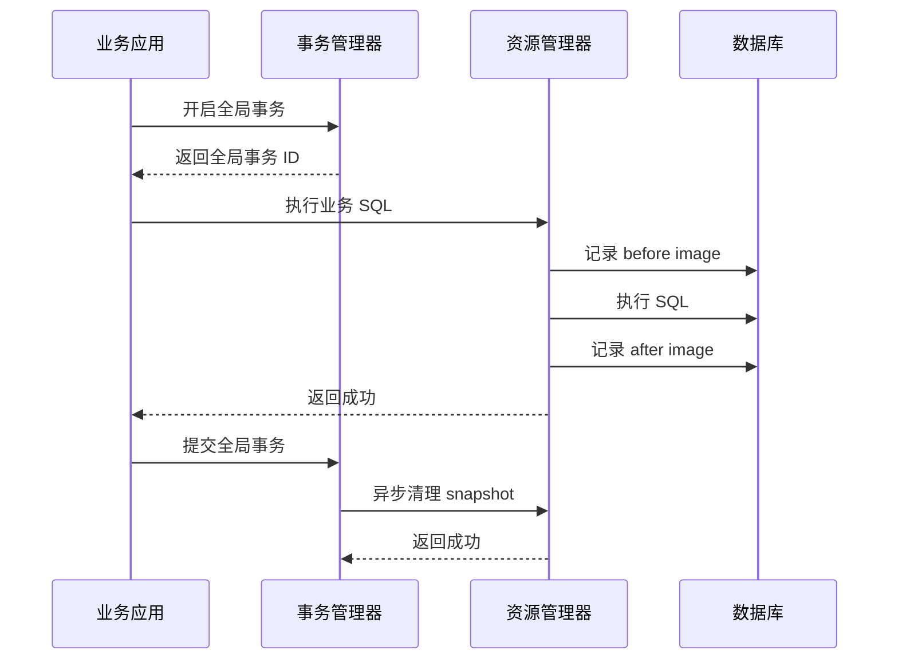
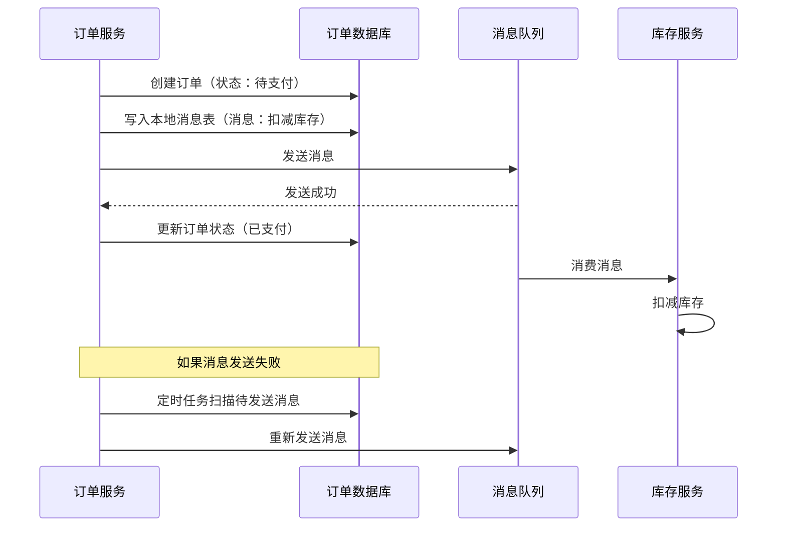

# 分布式事务一致性：最终一致性方案落地

> **场景定位**：分布式系统技术场景  
> **核心设计要点**：AT/TCC/Saga 模式对比、事务时间窗口、幂等性、兜底校验

---

## 🎯 一句话定位

**分布式事务一致性怎么保证？**
```
❌ 错误认知：用 Seata 或 TCC 就行
✅ 正确认知：根据业务场景选择方案，做好事务时间窗口防控和兜底校验
```

**生活化比喻**：
就像银行转账——你在 A 银行转 1000 元给 B 银行，如果 A 银行扣款成功但 B 银行加款失败，钱就"消失"了。单机事务可以保证 A 银行内部一致，但跨银行的事务需要分布式事务协议来保证最终一致性。

**核心特点**：不是追求"强一致性"，而是在"业务容忍的时间窗口内"达到最终一致性。

---

## 💎 核心观点（5 分钟速览版）

> **快速概览**

### 核心观点（3 个层次）

**1. 分布式事务方案深度拆解**
```
AT 模式（Seata 默认）：
- 优点：无业务侵入，自动补偿
- 缺点：全局锁力度大，热点行冲突飙升
- 适用：中小规模、非高并发场景

TCC 模式：
- 优点：性能好，无全局锁
- 缺点：业务侵入强，需实现 Try/Confirm/Cancel
- 适用：高并发、核心业务链路

本地消息表 + 事务消息：
- 优点：实现简单，最终一致性
- 缺点：时间窗口长，需兜底校验
- 适用：非核心业务、对一致性要求不高
```

**2. 事务量化分析**
```
关键指标：
- 事务时间窗口：从开始到最终一致的时间（如 5 秒）
- 事务失败率：补偿机制的成功率（如 99.9%）
- 兜底机制：事务中间件不可用时的抗压极限

核心认知：
不是所有场景都需要强一致性，根据业务容忍度选择方案
```

**3. 分布式事务架构落地规范**
```
事务准入标准：
- 制定强事务禁用场景清单
- 事务链路长度与执行时长红线
- 热点行事务自动识别与优化

兜底校验：
- 事务状态表 + 定时对账
- 核心数据一致性巡检
- 异常自动告警与补偿
```

---

## 🚀 一句话精华（如果只能记住一句）

> **分布式事务 = 根据业务场景选择方案（AT/TCC/本地消息表） + 事务时间窗口防控 + 兜底校验（对账 + 巡检）**

---

## 一、分布式事务方案深度拆解

### 1.1 AT 模式（Auto Transaction）

**核心原理**：
```
生活化比喻：
就像你在淘宝买东西：
1. 下单：冻结库存（Try）
2. 支付：确认扣款（Confirm）
3. 取消：解冻库存（Cancel）

Seata AT 模式：
1. 业务 SQL 执行前，记录"before image"（执行前快照）
2. 业务 SQL 执行后，记录"after image"（执行后快照）
3. 如果失败，用"before image"自动生成回滚 SQL
```



**优点**：
- ✅ **无业务侵入**：业务代码不用改，Seata 自动补偿
- ✅ **开发简单**：像用本地事务一样用分布式事务

**缺点**：
- ❌ **全局锁力度大**：热点行冲突飙升（如秒杀场景）
- ❌ **性能较差**：每次操作都要记录 snapshot

**适用场景**：
- 中小规模、非高并发场景
- 业务逻辑复杂、不想改代码的场景

### 1.2 TCC 模式（Try-Confirm-Cancel）

**核心原理**：
```
生活化比喻：
就像你在酒店预订房间：
1. Try：预留房间（不扣钱）
2. Confirm：确认入住（扣钱）
3. Cancel：取消预订（释放房间）

技术要求：
- 每个业务操作都要实现 Try/Confirm/Cancel 三个接口
- Try：资源预留（如冻结库存）
- Confirm：真正执行（如扣减库存）
- Cancel：释放资源（如解冻库存）
```

**代码示例**（TCC 接口定义）：
```java
// TCC 接口定义
@TwoPhaseBusinessAction(
    name = "deductInventory", 
    commitMethod = "confirm", 
    rollbackMethod = "cancel"
)
public interface InventoryService {
    
    // Try：冻结库存
    boolean try deductInventory(BusinessActionContext context, 
                                @BusinessActionContextParameter(paramName = "productId") String productId,
                                @BusinessActionContextParameter(paramName = "count") int count);
    
    // Confirm：真正扣减库存
    boolean confirm(BusinessActionContext context);
    
    // Cancel：解冻库存
    boolean cancel(BusinessActionContext context);
}

// 实现类
@Service
public class InventoryServiceImpl implements InventoryService {
    
    @Autowired
    private InventoryMapper inventoryMapper;
    
    @Override
    public boolean tryDeductInventory(BusinessActionContext context, String productId, int count) {
        // Try：冻结库存（不真正扣减）
        Inventory inventory = inventoryMapper.selectById(productId);
        if (inventory.getStock() < count) {
            return false; // 库存不足
        }
        // 冻结库存
        inventoryMapper.freezeInventory(productId, count);
        return true;
    }
    
    @Override
    public boolean confirm(BusinessActionContext context) {
        // Confirm：真正扣减库存
        String productId = (String) context.getActionContext("productId");
        int count = (int) context.getActionContext("count");
        inventoryMapper.deductInventory(productId, count);
        // 释放冻结
        inventoryMapper.unfreezeInventory(productId, count);
        return true;
    }
    
    @Override
    public boolean cancel(BusinessActionContext context) {
        // Cancel：解冻库存
        String productId = (String) context.getActionContext("productId");
        int count = (int) context.getActionContext("count");
        inventoryMapper.unfreezeInventory(productId, count);
        return true;
    }
}
```

**优点**：
- ✅ **性能好**：无全局锁，资源预留阶段不阻塞
- ✅ **灵活性高**：业务可自定义 Try/Confirm/Cancel 逻辑

**缺点**：
- ❌ **业务侵入强**：每个操作都要实现三个接口
- ❌ **开发复杂**：需要处理空回滚、悬挂、幂等等问题

**适用场景**：
- 高并发、核心业务链路
- 对性能要求高的场景

### 1.3 本地消息表 + 事务消息

**核心原理**：
```
生活化比喻：
就像你在网上买东西：
1. 下单：写一条"待支付"订单（本地消息表）
2. 支付：更新订单状态为"已支付"，发消息给库存服务
3. 库存服务：收到消息，扣减库存

如果消息发送失败：
- 定时任务扫描"待支付"订单，重新发送消息
- 直到消息发送成功
```



**优点**：
- ✅ **实现简单**：不需要引入分布式事务框架
- ✅ **最终一致性**：通过重试机制保证最终一致

**缺点**：
- ❌ **时间窗口长**：从开始到最终一致可能需要几秒到几分钟
- ❌ **需要兜底校验**：定时对账、巡检

**适用场景**：
- 非核心业务、对一致性要求不高
- 允许短时间数据不一致的场景

---

## 二、事务量化分析：拒绝凭感觉

### 2.1 事务时间窗口

**核心概念**：
```
事务时间窗口 = 从事务开始到最终一致的时间

示例：
- AT 模式：时间窗口短（毫秒级）
- TCC 模式：时间窗口中等（秒级）
- 本地消息表：时间窗口长（分钟级）

业务容忍度：
- 订单支付：时间窗口 < 5 秒（用户不能接受长时间看不到订单）
- 库存扣减：时间窗口 < 1 分钟（可以接受短时间超卖）
- 积分发放：时间窗口 < 1 小时（可以接受延迟发放）
```

### 2.2 事务失败率评估

**核心指标**：
```
事务失败率 = 事务失败次数 / 总事务数

示例：
- AT 模式：失败率 < 0.1%（自动补偿）
- TCC 模式：失败率 < 0.01%（业务控制）
- 本地消息表：失败率 < 1%（依赖重试）

评估方法：
- 压测：模拟高并发场景，统计失败率
- 监控：实时监控事务成功率
```

### 2.3 兜底机制

**核心思想**：
```
事务中间件不可用时，业务如何抗压？

兜底方案：
1. 事务状态表：记录每个事务的状态（开始/成功/失败）
2. 定时对账：定时扫描事务状态表，发现异常自动补偿
3. 人工介入：严重异常时，告警通知人工处理
```

**代码示例**（定时对账）：
```java
// 定时对账任务
@Scheduled(fixedRate = 60000) // 每分钟执行一次
public void reconcileTransactions() {
    // 1. 扫描超时事务（超过 5 分钟未成功）
    List<Transaction> timeoutTransactions = transactionMapper.selectTimeout(300);
    
    for (Transaction tx : timeoutTransactions) {
        // 2. 检查事务状态
        if (tx.getStatus() == TransactionStatus.PENDING) {
            // 3. 尝试补偿
            try {
                compensate(tx);
                tx.setStatus(TransactionStatus.COMPENSATED);
            } catch (Exception e) {
                // 4. 补偿失败，告警
                log.error("事务补偿失败: {}", tx.getId(), e);
                alertService.sendAlert("事务补偿失败: " + tx.getId());
            }
        }
    }
    
    // 5. 更新事务状态
    transactionMapper.batchUpdate(timeoutTransactions);
}
```

---

## 三、分布式事务架构落地规范

### 3.1 事务准入标准

**核心原则**：
```
不是所有业务都需要分布式事务！

制定强事务禁用场景清单：
- 非核心业务（如日志记录）
- 允许数据不一致的场景（如统计数据）
- 高性能要求场景（如秒杀）

事务链路长度与执行时长红线：
- 事务链路长度 < 5 个服务
- 事务执行时长 < 10 秒
```

### 3.2 热点行事务优化

**核心问题**：
```
热点行冲突：
- 秒杀场景：1000 个用户同时抢购 1 件商品
- AT 模式：全局锁锁住这一行，其他事务排队等待
- 结果：性能急剧下降

优化方案：
1. 分片：把 1 件商品拆成 10 件，分散到 10 个分片
2. 队列：把并发请求串行化，排队处理
3. Redis：用 Redis 原子操作代替数据库事务
```

**代码示例**（Redis 优化）：
```java
// ❌ 优化前：数据库事务（热点行冲突）
@Transactional
public boolean seckill(String productId) {
    Product product = productMapper.selectById(productId);
    if (product.getStock() > 0) {
        productMapper.deductStock(productId);
        return true;
    }
    return false;
}

// ✅ 优化后：Redis 原子操作（无热点行冲突）
public boolean seckill(String productId) {
    String stockKey = "product:stock:" + productId;
    Long stock = redisTemplate.opsForValue().decrement(stockKey);
    if (stock >= 0) {
        // 扣减成功，异步更新数据库
        mqProducer.send("seckill", productId);
        return true;
    } else {
        // 库存不足，回滚
        redisTemplate.opsForValue().increment(stockKey);
        return false;
    }
}
```

### 3.3 事务状态全链路埋点

**核心思想**：
```
事务状态全链路追踪：
- 事务开始：记录事务 ID、开始时间、参与服务
- 事务执行：记录每个步骤的执行结果
- 事务结束：记录成功/失败、耗时

监控告警：
- 事务成功率 < 99.9%：告警
- 事务执行时长 > 10 秒：告警
- 事务失败率 > 0.1%：严重告警
```

---

四、技术深入探讨

### Q1: AT 模式和 TCC 模式怎么选？
**答**：
- **AT 模式**：无业务侵入，适合中小规模、非高并发场景
- **TCC 模式**：性能好，适合高并发、核心业务链路，但业务侵入强

### Q2: 本地消息表的兜底机制怎么做？
**答**：
1. **事务状态表**：记录每个事务的状态
2. **定时对账**：定时扫描超时事务，自动补偿
3. **人工介入**：严重异常时，告警通知人工处理

### Q3: 热点行事务冲突怎么优化？
**答**：
1. **分片**：把热点数据拆分成多个分片
2. **队列**：把并发请求串行化
3. **Redis**：用 Redis 原子操作代替数据库事务

### Q4: 如何保证分布式事务的最终一致性？
**答**：
1. **选择合适方案**：根据业务容忍度选择 AT/TCC/本地消息表
2. **事务时间窗口防控**：控制事务执行时长
3. **兜底校验**：定时对账、巡检、自动补偿

---

## 五、方案总结

**方案总结**：

> **方案选择**：根据业务场景选择分布式事务方案。AT 模式无业务侵入，适合中小规模；TCC 模式性能好，适合高并发；本地消息表实现简单，适合非核心业务。
> 
> **事务量化**：关键指标是事务时间窗口、失败率、兜底机制。根据业务容忍度评估，不是所有场景都需要强一致性。
> 
> **落地规范**：制定事务准入标准，禁用不必要的强事务；优化热点行事务（分片、队列、Redis）；建立事务状态全链路埋点和监控告警。
> 
> **兜底校验**：事务状态表 + 定时对账 + 人工介入，保证极端故障下的数据一致性。

---

## 六、生产环境 Checklist（部署检查清单）

| 类别 | 检查项 | 状态 | 生活化比喻 |
|------|--------|------|------------|
| **方案选择** | 根据业务选择 AT/TCC/本地消息表 | ⬜ | 选择合适的交通工具 |
| | 评估事务时间窗口 | ⬜ | 评估通勤时间 |
| **事务优化** | 热点行事务优化（分片/队列/Redis） | ⬜ | 避免堵车 |
| | 事务链路长度控制 | ⬜ | 减少换乘次数 |
| **兜底校验** | 事务状态表 | ⬜ | 行程记录 |
| | 定时对账任务 | ⬜ | 定期核对账单 |
| | 异常告警机制 | ⬜ | 异常自动报警 |
| **监控告警** | 事务成功率监控 | ⬜ | 准点率监控 |
| | 事务执行时长监控 | ⬜ | 耗时监控 |

---

## 七、总结（一句话带走）

### 🎯 一句话总结

> **分布式事务 = 根据业务场景选择方案（AT/TCC/本地消息表） + 事务时间窗口防控 + 兜底校验（对账 + 巡检）**

### 🧠 核心记忆点

1. **方案选择**：AT 无侵入但性能差，TCC 性能好但侵入强，本地消息表简单但时间窗口长。
2. **事务量化**：关键指标是时间窗口、失败率、兜底机制，根据业务容忍度选择。
3. **热点行优化**：分片、队列、Redis，避免全局锁冲突。
4. **兜底校验**：事务状态表 + 定时对账 + 人工介入，保证极端故障下的一致性。

---

**参考视频**：[内卷的琪某人 - 分布式事务一致性怎么保证？](https://v.douyin.com/6frkTBtg3m4/)

---

*本文档基于 8 个专家提示词指导改写，遵循深入浅出、生活化比喻、幽默风趣的教学原则。*
