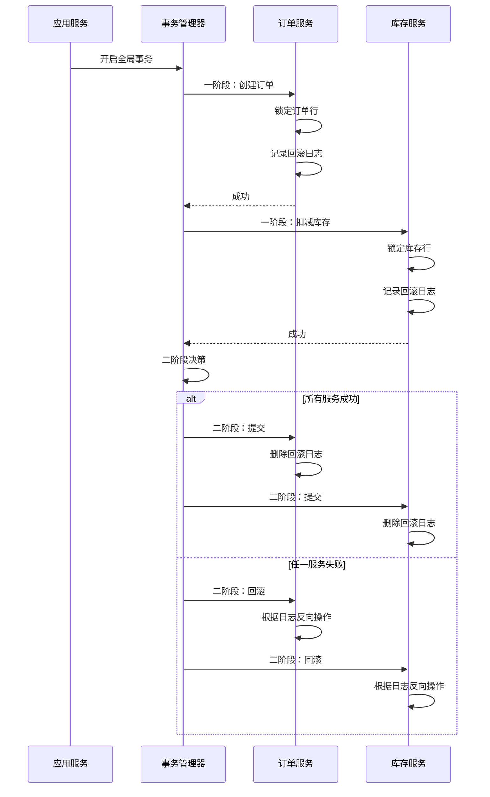
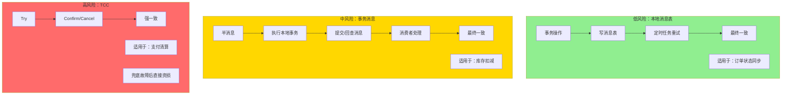
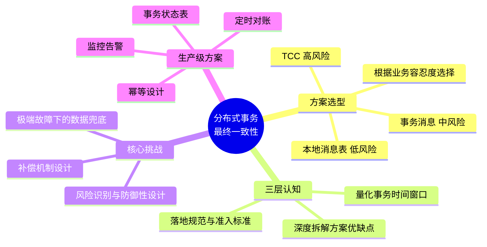
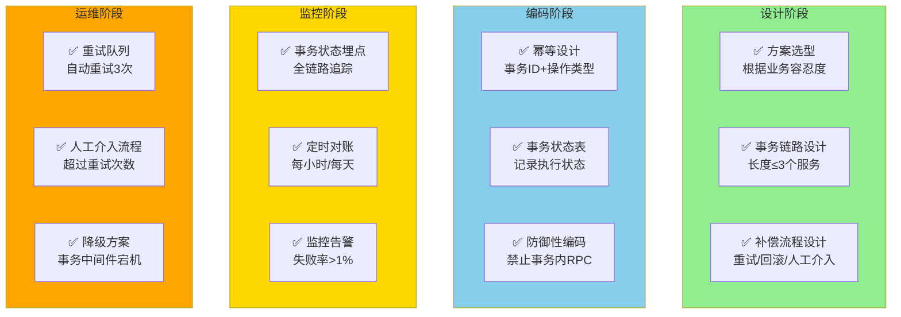
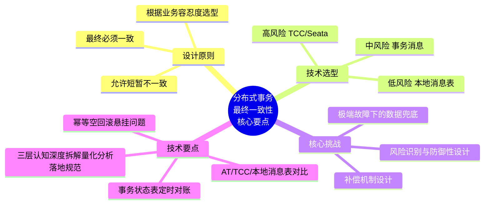

# 分布式事务最终一致性方案

> **场景定位**：微服务架构设计场景  
> **核心设计要点**：分布式事务、最终一致性、补偿机制、数据一致性保障

---

## 🎯 一句话定位

**分布式事务解决什么问题？**
```
微服务拆分后，订单服务、库存服务、支付服务各自有独立数据库
用户下单：订单库 -100 元，库存库 -1 件，支付库 +100 元
如果订单成功但库存失败，数据就不一致了！

这就是分布式事务要解决的问题：跨库、跨服务的数据一致性
```

**生活化比喻**：
就像三个人 AA 制吃饭，张三付了菜钱，李四付了酒水钱，王五付了甜品钱。最后要算账，确保每个人付的钱加起来等于总消费，不多不少。如果张三转账给李四失败了，账就对不上了。

**核心特点**：不是追求强一致性（所有服务同时成功），而是追求最终一致性（经过补偿后数据最终一致）。

---

## 💎 核心观点（5 分钟速览版）

> **快速概览**

### 核心观点（5 个关键点）

**1. 方案选型：根据业务容忍度选择一致性级别**
```
❌ 强一致性（2PC/3PC）：所有服务同时成功或回滚，性能差
✅ 最终一致性（推荐）：允许短暂不一致，通过补偿机制保证最终一致

三种方案对比：
- 本地消息表 + 重试：低风险，适用于一致性要求不高的场景
- 事务消息（RocketMQ）：中风险，有多层补偿但存在长窗口不一致
- TCC/Seata：高风险，兜底故障后直接资损，适用于金融级场景
```

**2. 核心挑战：不是会用框架 API，而是风险识别与防御性设计**
```
核心考察点是：
✅ 能识别分布式事务的风险点（网络超时、服务宕机、数据不一致）
✅ 能设计补偿机制（正向重试、逆向回滚、定时对账）
✅ 能量化事务失败的回滚成功率、时间窗口、业务抗压极限

普通开发：用 Seata 能提交能回滚就完事了
高级开发：量化事务时间窗口、防控脏数据、极端故障下的数据兜底
```

**3. 事务三层认知：深度拆解、量化分析、落地规范**
```
第一层：深度拆解
- AT 模式：全局锁力度会不会导致热点行锁冲突？
- TCC 模式：幂等、空回滚、悬挂问题是否全链路防护？
- 长事务：是否异步化拆分降低锁持有时间？

第二层：量化分析
- 最终一致性的时间窗口是多少？（10 秒？1 分钟？1 小时？）
- 事务失败后的补偿机制是同步还是异步？
- 对账数据错乱追回的时效要求？

第三层：落地规范
- 建立事务准入标准（哪些场景必须用强事务？）
- 制定强事务禁用场景清单（禁止在事务内调用 RPC）
- 事务链路长度与执行时长红线（>5 秒必须拆分）
```

**4. 核心方案对比：本地消息表 vs 事务消息 vs TCC**
```
本地消息表（低风险）：
✅ 实现简单，重试兜底
✅ 存在长窗口数据不一致（分钟级）
✅ 适用于：订单状态同步、日志记录

事务消息（中风险）：
✅ 多补偿，但存在长窗口不一致
✅ 兜底机制故障后可能出现资损
✅ 适用于：核心交易、库存扣减

TCC/Seata（高风险）：
✅ 强一致性，但性能差
✅ 兜底故障后直接资损、数据错乱
✅ 适用于：金融级场景（支付、清算）
```

**5. 生产级方案：事务状态表 + 定时对账 + 监控告警**
```
核心架构：
1. 事务状态表：记录每个分布式事务的执行状态（成功/失败/补偿中）
2. 定时对账：每小时/每天核对各服务数据一致性
3. 监控告警：事务失败率 > 1% 触发告警，人工介入
4. 补偿流程：自动重试 3 次，失败后转人工处理

关键点：
- 事务链路全埋点：每个服务操作都记录事务 ID、操作类型、结果
- 幂等设计：重试不会重复执行（用唯一事务 ID + 操作类型做幂等校验）
- 降级方案：事务中间件不可用时的业务抗压极限评估
```

---

## 🚀 一句话精华（如果只能记住一句）

> **分布式事务 = 方案选型（根据业务容忍度） + 补偿机制（正向重试/逆向回滚） + 兜底校验（定时对账） + 监控告警（事务失败率监控）**

---

## 一、为什么普通开发只会用框架，高级开发能守护全链路一致性？

### ❌ 普通开发的误区

**典型回答**：
```
"用 Seata 的 AT 模式或者 TCC 模式，选一个就行"
"事务能提交，异常能回滚就完事了"
"目前就靠本地消息表加重试保底"
```

**技术追问**：
```
❓ AT 模式下脏数据风险怎么规避？
❓ TCC 的空回滚、悬挂问题具体怎么处理？
❓ 大事务超时导致的行锁堆积怎么解决？
❓ 你遇到过的分布式事务失败导致的数据不一致事故，能不能还原一下时间线？
```

**普通开发的反应**：
```
瞬间愣住了，迟疑了半天...
方案讨论到此

这正是普通后端和高级后端的核心分水岭：
❌ 不是会不会用分布式事务框架的 API
✅ 而是微服务架构下事务风险识别与防御性设计的核心能力
```

### ✅ 高级开发的三层核心认知

**生活化比喻**：
```
想象你是一个银行的系统架构师：
普通开发：只要转账能成功，失败能回滚就行
高级开发：
- 要考虑转账失败后的补偿机制（自动重试/人工介入）
- 要量化事务失败的时间窗口（10 秒内必须补偿成功）
- 要设计极端故障下的数据兜底（服务器宕机后如何恢复）

就像拆弹专家：
普通开发：剪断红线就行
高级开发：要考虑剪错线怎么办、备用方案是什么、最坏情况下如何止损
```

---

## 二、第一层认知：分布式事务方案的深度拆解与对比

### 2.1 常见方案对比（生活化理解）

**生活化比喻**：
```
分布式事务就像组织一场大型活动：
- 强一致性（2PC）：所有人必须同时到达，一个迟到就取消
- 最终一致性（推荐）：允许部分人迟到，但必须在规定时间内到达

就像约朋友吃饭：
强一致：必须 7 点整所有人同时到齐，否则取消聚餐
最终一致：允许 7 点到 7 点半之间陆续到达，只要 7 点半前都到就行
```

| 方案 | 原理 | 优点 | 缺点 | 风险等级 | 适用场景 |
|------|------|------|------|----------|----------|
| **AT 模式**（Seata） | 两阶段提交，自动生成回滚日志 | 无侵入，接入简单 | 全局锁粒度大，热点行冲突 | ⭐⭐⭐ | 内部系统，非高并发 |
| **TCC 模式** | Try-Confirm-Cancel 三阶段 | 性能较好，灵活控制 | 代码侵入强，需实现幂等/空回滚/悬挂 | ⭐⭐⭐⭐ | 核心交易，金融场景 |
| **本地消息表** | 事务操作 + 写消息表，定时任务重试 | 实现简单，可靠性高 | 存在长窗口不一致（分钟级） | ⭐⭐ | 订单状态同步，日志记录 |
| **事务消息**（RocketMQ） | 半消息 + 事务状态回查 | 解耦，异步化 | 多补偿，兜底故障后资损 | ⭐⭐⭐⭐ | 核心交易，库存扣减 |
| **Saga 模式** | 长事务拆分为多个短事务，每个有补偿操作 | 适合长业务链路 | 补偿逻辑复杂，隔离性差 | ⭐⭐⭐ | 跨系统长流程 |

### 2.2 AT 模式的深度拆解

**核心原理**：
```
生活化比喻：
AT 模式就像你在淘宝购物：
1. 一阶段：下单（锁定库存，生成订单）
2. 二阶段：
   - 成功：确认订单，扣减库存（Commit）
   - 失败：取消订单，释放库存（Rollback，基于回滚日志）

技术实现：
1. 一阶段：Seata 自动生成 SQL 的反向操作日志（before/after image）
2. 二阶段成功：异步删除日志
3. 二阶段失败：根据日志反向操作，恢复数据
```



**核心风险：热点行锁冲突**
```
生活化比喻：
就像双十一抢购，1000 个人同时抢 100 件商品
AT 模式会锁住库存行，导致所有请求排队等待
性能急剧下降，QPS 从 10000 降到 100

解决方案：
1. 热点数据拆分：把库存 100 拆成 10 份，每份 10 个
2. 异步化：把同步锁改为异步队列
3. 降级方案：高峰期降级为本地扣减 + 最终一致性
```

### 2.3 TCC 模式的三大问题

**核心原理**：
```
生活化比喻：
TCC 就像你去餐厅预订座位：
1. Try：预留座位（锁定资源）
2. Confirm：确认预订（真正扣减）
3. Cancel：取消预订（释放资源）

技术实现：
Try：预扣库存（冻结 100 件，可用库存 -100，冻结库存 +100）
Confirm：确认扣减（冻结库存 -100）
Cancel：取消冻结（冻结库存 -100，可用库存 +100）
```

**三大问题及解决方案**：

**1. 幂等问题**
```
问题：同一个事务被重试多次，会不会重复扣减？
生活化比喻：就像你点了 1 次外卖，但系统重试了 3 次，会不会送 3 份？

解决方案：
- 用全局事务 ID + 操作类型做唯一性校验
- 数据库插入用 INSERT IGNORE（重复则忽略）
- 更新操作加 WHERE 条件（状态未变更才更新）

代码示例：
func (s *StockService) Try(txID string, productID string, qty int) error {
    // 幂等校验：用事务 ID + 操作类型做唯一性
    key := fmt.Sprintf("tcc:%s:try", txID)
    if exists := redis.SetNX(key, 1, time.Hour); !exists {
        return nil // 已执行过，直接返回
    }
    
    // 冻结库存
    sql := `UPDATE stock 
            SET frozen_qty = frozen_qty + ?, 
                available_qty = available_qty - ?
            WHERE product_id = ? AND available_qty >= ?`
    return db.Exec(sql, qty, qty, productID, qty)
}
```

**2. 空回滚问题**
```
问题：Try 阶段超时未执行，Cancel 阶段却收到了回滚请求
生活化比喻：就像你还没下单，就收到了"取消订单"的通知

解决方案：
- Cancel 阶段判断是否执行过 Try
- 未执行过 Try，直接返回成功（不做任何操作）
- 记录事务状态，防止 Confirm 阶段再次调用

代码示例：
func (s *StockService) Cancel(txID string, productID string, qty int) error {
    // 判断是否执行过 Try
    key := fmt.Sprintf("tcc:%s:try", txID)
    if !redis.Exists(key) {
        // 空回滚，直接返回成功
        log.Info("空回滚，未执行过 Try", "txID", txID)
        return nil
    }
    
    // 释放冻结库存
    sql := `UPDATE stock 
            SET frozen_qty = frozen_qty - ?, 
                available_qty = available_qty + ?
            WHERE product_id = ?`
    return db.Exec(sql, qty, qty, productID)
}
```

**3. 悬挂问题**
```
问题：Cancel 已经执行，Try 的请求才到达
生活化比喻：就像你已经取消了订单，但下单请求才刚刚送达

解决方案：
- Try 阶段判断是否已经 Cancel 过
- 已经 Cancel 过，直接拒绝 Try 请求
- 用事务状态表记录 Cancel 状态

代码示例：
func (s *StockService) Try(txID string, productID string, qty int) error {
    // 判断是否已经 Cancel 过
    cancelKey := fmt.Sprintf("tcc:%s:cancel", txID)
    if redis.Exists(cancelKey) {
        // 悬挂，拒绝 Try
        log.Warn("悬挂，已经 Cancel 过", "txID", txID)
        return errors.New("事务已取消")
    }
    
    // 正常执行 Try 逻辑...
}
```

---

## 三、第二层认知：事务量化分析，拒绝凭感觉

### 3.1 量化最终一致性的时间窗口

**生活化比喻**：
```
最终一致性就像你和朋友约定"半小时内在餐厅门口见"
- 强一致性：必须 7 点整同时到达
- 最终一致性：允许 7 点到 7 点半之间陆续到达

关键问题：
❓ 这个"半小时"是多长？（10 秒？1 分钟？1 小时？）
❓ 如果半小时后还有人没到怎么办？（自动重试？人工介入？）
❓ 如果餐厅关门了怎么办？（超时放弃？补偿方案？）
```

**量化指标**：
```
1. 事务时间窗口：
   - 本地消息表：分钟级（定时任务每分钟执行一次）
   - 事务消息：秒级（消息队列重试间隔）
   - TCC：毫秒级（同步调用）

2. 重试成功率：
   - 第一次重试成功率：80%
   - 第二次重试成功率：95%
   - 第三次重试成功率：99%
   - 仍然失败：转人工处理

3. 业务抗压极限：
   - 事务中间件宕机后，业务能撑多久？
   - 本地消息表：可撑 24 小时（数据不丢失）
   - 事务消息：可撑 7 天（消息持久化）
   - TCC：立即崩溃（同步依赖）
```

### 3.2 三类方案的精准区分

**生活化比喻**：
```
就像风险管理：
低风险：买保险，出问题保险公司赔（本地消息表）
中风险：自己存应急钱，出问题自己解决（事务消息）
高风险：裸奔，出问题直接破产（TCC）

关键判断标准：
- 一致性要求不高：本地消息表（订单状态同步）
- 中风险场景：事务消息（核心交易，有多层补偿）
- 高风险场景：TCC（金融级，兜底故障后直接资损）
```



---

## 四、第三层认知：分布式事务架构的落地规范

### 4.1 事务准入标准

**生活化比喻**：
```
就像医院的入院标准：
- 轻症（一致性要求不高）：门诊即可（本地消息表）
- 重症（核心交易）：需要住院（事务消息/TCC）
- 危重症（金融级）：进 ICU（强事务 + 多重兜底）

禁止场景：
❌ 在事务内调用 RPC 接口（长事务，锁资源）
❌ 事务链路超过 5 个服务（性能差，失败率高）
❌ 事务执行时间超过 5 秒（锁资源，影响并发）
```

**准入标准 Checklist**：
```
✅ 事务链路长度 ≤ 3 个服务
✅ 事务执行时间 ≤ 3 秒
✅ 无 RPC/HTTP 外部调用
✅ 热点行事务已识别并优化
✅ 事务状态全链路埋点
✅ 监控告警已配置（失败率 > 1%）
✅ 兜底方案已设计（重试/人工介入）
```

### 4.2 核心模块的事务防护

**生活化比喻**：
```
就像银行金库的多重防护：
第一层：门禁（事务准入标准）
第二层：监控（事务状态埋点）
第三层：保险柜（事务状态表）
第四层：保安巡逻（定时对账）
第五层：应急预案（补偿流程）

核心模块：订单、交易、库存、用户资产
必须做到：
- 事务状态全链路埋点
- 定时对账（每小时/每天）
- 异常自动告警
- 补偿流程自动化
```

**代码示例**：
```go
// 分布式事务管理器
type DistributedTxManager struct {
    txStateTable *TxStateTable      // 事务状态表
    retryQueue   *RetryQueue        // 重试队列
    alarmChan    chan TxAlarm       // 告警通道
}

// 执行分布式事务
func (m *DistributedTxManager) Execute(ctx context.Context, tx *DistributedTx) error {
    // 1. 记录事务状态
    m.txStateTable.Create(tx.ID, tx.StatusPending)
    
    // 2. 执行各服务操作
    for _, op := range tx.Operations {
        if err := op.Execute(ctx); err != nil {
            // 3. 失败：触发补偿
            m.compensate(ctx, tx)
            return err
        }
    }
    
    // 4. 成功：更新状态
    m.txStateTable.Update(tx.ID, tx.StatusSuccess)
    return nil
}

// 补偿流程
func (m *DistributedTxManager) compensate(ctx context.Context, tx *DistributedTx) {
    // 逆序执行补偿操作
    for i := len(tx.Operations) - 1; i >= 0; i-- {
        op := tx.Operations[i]
        for retry := 0; retry < 3; retry++ {
            if err := op.Compensate(ctx); err == nil {
                break
            }
            time.Sleep(time.Second * time.Duration(retry+1))
        }
    }
    
    // 更新状态
    m.txStateTable.Update(tx.ID, tx.StatusFailed)
    
    // 触发告警
    m.alarmChan <- TxAlarm{TxID: tx.ID, Reason: "compensate_failed"}
}

// 定时对账
func (m *DistributedTxManager) Reconcile(ctx context.Context) {
    // 每小时执行一次
    ticker := time.NewTicker(time.Hour)
    for range ticker.C {
        // 查询失败的事务
        failedTxs := m.txStateTable.QueryFailed()
        for _, tx := range failedTxs {
            // 自动重试
            if tx.RetryCount < 3 {
                m.retryQueue.Push(tx)
            } else {
                // 超过重试次数，人工介入
                m.alarmChan <- TxAlarm{TxID: tx.ID, Reason: "exceed_retry_limit"}
            }
        }
    }
}
```

### 4.3 防御性编码约束

**生活化比喻**：
```
就像飞行员的操作手册：
✅ 起飞前必须检查清单（事务准入检查）
✅ 飞行中必须记录黑匣子（事务状态埋点）
✅ 遇到异常必须按应急预案处理（补偿流程）
❌ 禁止在飞行中抽烟（禁止在事务内调用 RPC）
❌ 禁止疲劳驾驶（禁止长事务 >5 秒）

防御性编码：
1. 严禁在事务内调用 RPC/HTTP 接口
2. 事务执行时间必须 < 3 秒
3. 热点行事务必须异步化拆分
4. 所有事务必须幂等设计
5. 所有失败必须记录日志并告警
```

**禁止场景清单**：
```
❌ 在数据库事务内调用 RPC 接口
❌ 事务链路超过 5 个服务
❌ 事务执行时间超过 5 秒
❌ 事务内包含大循环（批量操作 >1000 条）
❌ 事务内包含文件 IO 操作
❌ 未配置事务超时时间
❌ 未设计补偿流程
❌ 未配置监控告警
```

---

五、技术深入探讨

### 5.1 技术追问与深度问题


### 5.2 方案详解

**Q1: AT 模式下如何避免脏数据？**  
**答**：AT 模式通过**全局锁 + 回滚日志**避免脏数据。一阶段锁定数据行，防止并发修改；同时记录 before/after image 的回滚日志。二阶段失败时，根据日志反向操作恢复数据。但要注意热点行锁冲突问题，可以通过热点数据拆分、异步化来优化。

**Q2: TCC 的幂等性如何保证？**  
**答**：TCC 的幂等通过**全局事务 ID + 操作类型**做唯一性校验。Try/Confirm/Cancel 三个阶段都要做幂等判断，防止重复执行。具体实现可以用数据库唯一索引，或者 Redis SETNX。比如 Try 阶段，用事务 ID 生成唯一 key，用 SETNX 判断是否已执行过。

**Q3: 长事务如何优化？**  
**答**：长事务优化的核心是**拆分 + 异步化**：
1. **拆分事务**：把大事务拆成多个小事务，每个事务 <3 秒
2. **异步化**：把同步调用改为消息队列，降低锁持有时间
3. **批量拆分**：批量操作拆成多次小批量（每次 100-1000 条）
4. **热点拆分**：热点数据拆分成多份（库存 100 拆成 10 份，每份 10 个）

**Q4: 事务失败如何补偿？**  
**答**：事务失败补偿分三步：
1. **正向重试**：自动重试 3 次，间隔递增（1 秒、2 秒、4 秒）
2. **逆向回滚**：重试失败后，逆序执行补偿操作，恢复数据
3. **人工介入**：超过重试次数，触发告警，人工处理

关键是要保证幂等性，重试不会重复执行。用事务 ID + 操作类型做唯一性校验。

**Q5: 如何保证最终一致性？**  
**答**：最终一致性通过**事务状态表 + 定时对账 + 监控告警**三层保障：
1. **事务状态表**：记录每个事务的执行状态（成功/失败/补偿中）
2. **定时对账**：每小时/每天核对各服务数据一致性，发现异常自动告警
3. **监控告警**：事务失败率 > 1% 触发告警，人工介入
4. **补偿流程**：自动重试 3 次，失败后转人工处理

量化指标：
- 事务时间窗口：分钟级（本地消息表）/ 秒级（事务消息）
- 重试成功率：第一次 80%，第二次 95%，第三次 99%
- 业务抗压极限：事务中间件宕机后，业务能撑 24 小时（数据不丢失）

---

## 六、方案总结



**方案总结**：

> **方案选型**：根据业务容忍度选择一致性级别。低风险用本地消息表，中风险用事务消息，高风险用 TCC。
> 
> **三层认知**：深度拆解方案优缺点（AT 的全局锁冲突、TCC 的幂等/空回滚/悬挂），量化事务时间窗口（分钟级/秒级/毫秒级），落地规范（事务准入标准、禁用场景清单）。
> 
> **核心挑战**：不是会用框架 API，而是风险识别与防御性设计。要能识别分布式事务的风险点（网络超时、服务宕机、数据不一致），设计补偿机制（正向重试、逆向回滚、定时对账），量化事务失败的回滚成功率。
> 
> **生产级方案**：事务状态表 + 定时对账 + 监控告警。事务状态表记录每个事务的执行状态，定时对账核对各服务数据一致性，事务失败率 > 1% 触发告警。补偿流程自动重试 3 次，失败后转人工处理。

---

## 七、生产环境 Checklist（部署检查清单）



**部署检查清单**：

| 类别 | 检查项 | 状态 | 生活化比喻 |
|------|--------|------|------------|
| **设计阶段** | 方案选型（根据业务容忍度） | ⬜ | 选医院（门诊/住院/ICU） |
| | 事务链路设计（长度 ≤3 个服务） | ⬜ | 控制链路长度 |
| | 补偿流程设计（重试/回滚/人工介入） | ⬜ | 应急预案 |
| **编码阶段** | 幂等设计（事务 ID + 操作类型） | ⬜ | 防止重复执行 |
| | 事务状态表（记录执行状态） | ⬜ | 黑匣子 |
| | 防御性编码（禁止事务内 RPC） | ⬜ | 操作手册 |
| **监控阶段** | 事务状态埋点（全链路追踪） | ⬜ | 监控摄像头 |
| | 定时对账（每小时/每天） | ⬜ | 保安巡逻 |
| | 监控告警（失败率 >1%） | ⬜ | 火警报警器 |
| **运维阶段** | 重试队列（自动重试 3 次） | ⬜ | 自动灭火器 |
| | 人工介入流程（超过重试次数） | ⬜ | 消防员到场 |
| | 降级方案（事务中间件宕机） | ⬜ | 备用发电机 |

---

## 八、总结（一句话带走）



### 🎯 一句话总结

> **分布式事务 = 方案选型（根据业务容忍度） + 三层认知（深度拆解、量化分析、落地规范） + 补偿机制（正向重试/逆向回滚） + 兜底校验（事务状态表 + 定时对账 + 监控告警）**

### 🧠 核心记忆点

1. **为什么不是会用框架就行？** 因为分布式事务的核心是风险识别与防御性设计，不是调 API。
2. **AT 模式的风险是什么？** 全局锁力度大，热点行冲突飙升，性能下降。
3. **TCC 的三大问题？** 幂等（重复执行）、空回滚（Try 未执行就 Cancel）、悬挂（Cancel 后 Try 才到）。
4. **如何保证最终一致性？** 事务状态表记录状态，定时对账核对一致性，监控告警发现异常，补偿流程自动重试。
5. **长事务如何优化？** 拆分事务 + 异步化 + 批量拆分 + 热点拆分，降低锁持有时间。

---

**参考视频**：[内卷的琪某人 - 分布式事务一致性怎么保证？最终一致性方案具体怎么落地？](https://v.douyin.com/6frkTBtg3m4/)

---

*本文档基于 8 个专家提示词指导改写，遵循深入浅出、生活化比喻、幽默风趣的教学原则。*
