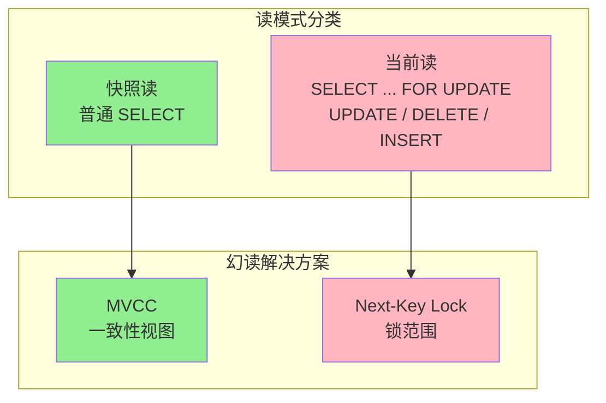
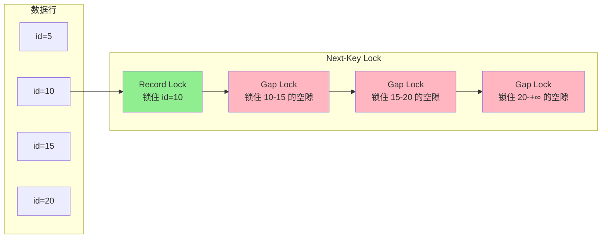

# MySQL 幻读：别只会说 MVCC

> **场景定位**：数据库事务技术场景  
> **核心设计要点**：快照读 vs 当前读、MVCC 适用边界、Next-Key Lock、隔离级别选型

---

## 🎯 一句话定位

**MySQL 怎么解决幻读？**
```
❌ 错误认知：靠 MVCC 就解决了
✅ 正确认知：快照读靠 MVCC，当前读靠 Next-Key Lock，双机制配合才是完整方案
```

**生活化比喻**：
就像你在图书馆看书：
- **快照读**：你拍了一张书架的照片，之后每次看照片，书的位置都不变（MVCC）
- **当前读**：你走到书架前，发现新书被放进来了（Next-Key Lock 防止这种情况）

**核心特点**：MVCC 只管快照读，Next-Key Lock 才管当前读。只知道 MVCC = 只懂了一半。

---

## 💎 核心观点（5 分钟速览版）

> **快速概览**

### 核心观点（3 个层次）

**1. 幻读解法分场景：MVCC 只覆盖快照读**
```
快照读（普通 SELECT）：
- 基于事务启动时的一致性视图
- 读取数据的历史版本
- 全程不加锁
- 天然不会出现幻读（MVCC 保证）

当前读（SELECT ... FOR UPDATE / UPDATE / DELETE / INSERT）：
- 读取数据的最新提交版本
- 需要加锁保证并发安全
- MVCC 的历史版本失效
- 依然会出现幻读风险（需要 Next-Key Lock）
```

**2. Next-Key Lock 是当前读防幻读的核心**
```
行锁：只能锁住已存在的数据行
间隙锁（Gap Lock）：锁住两个索引值之间的空隙
Next-Key Lock = 行锁 + 间隙锁（左开右闭区间锁）

示例：
查询 id=10 的行，加 Next-Key Lock 会锁住 (10, +∞) 的区间
区间内所有空隙都不允许插入新数据
从根源上堵住了新增数据的可能
```

**3. RR 级别也不是绝对没有幻读**
```
边界场景：事务内混合使用快照读和当前读
- 先快照读，得到 10 条数据
- 另一个事务插入新数据并提交
- 当前事务执行 UPDATE，会更新到 11 条
- 当前读已经能读到 11 条 → 幻读

生产选型：
很多互联网团队主动把 RR 改成 RC
因为间隙锁会增加锁冲突和死锁概率
绝大多数业务能接受极少数幻读，换取更高并发
```

---

## 🚀 一句话精华（如果只能记住一句）

> **MySQL 幻读解决 = 快照读靠 MVCC（一致性视图） + 当前读靠 Next-Key Lock（锁范围） + 隔离级别选型（RR vs RC）**

---

## 一、幻读解法分场景：MVCC 只覆盖快照读

### 1.1 什么是幻读？

**定义**：
```
幻读：同一个事务内，两次查询返回的数据行数不一致

示例：
事务 A：
  SELECT * FROM users WHERE age > 20;  -- 返回 10 条
  -- 事务 B 插入了一条新数据
  SELECT * FROM users WHERE age > 20;  -- 返回 11 条
  
"幻影"出现了：多了一条数据
```

**生活化比喻**：
```
就像你数教室里的学生：
第一次数：30 人
转个头回来再数：31 人
"幻影"出现了：多了一个人
```

### 1.2 两种读模式

**快照读（Snapshot Read）**：
```
定义：普通的不加锁的 SELECT
特点：
- 基于事务启动时生成的一致性视图
- 读取数据的历史版本
- 全程不加锁
- 读写不冲突

示例：
SELECT * FROM users WHERE age > 20;
```

**当前读（Current Read）**：
```
定义：加锁的 SELECT 或写操作
特点：
- 读取数据的最新提交版本
- 需要加锁保证并发安全
- 会阻塞其他事务的写操作

示例：
SELECT * FROM users WHERE age > 20 FOR UPDATE;  -- 加锁
UPDATE users SET age = 25 WHERE age > 20;        -- 写操作
DELETE FROM users WHERE age > 20;                -- 写操作
INSERT INTO users (name, age) VALUES ('Tom', 22); -- 写操作
```



### 1.3 MVCC 如何解决快照读的幻读？

**核心原理**：
```
生活化比喻：
就像你在图书馆看书：
1. 你拍了一张书架的照片（事务启动时的一致性视图）
2. 之后每次看照片，书的位置都不变（读取历史版本）
3. 即使别人放了新书进来，你看的还是照片（不会出现幻读）

技术实现：
1. 每行数据有两个隐藏列：
   - 事务 ID（transaction_id）：最后一次修改该行的事务 ID
   - 回滚指针（roll_pointer）：指向该行的上一个版本

2. 事务启动时，生成一致性视图：
   - 记录当前所有活跃事务的 ID 列表
   - 只读取"视图生成前已提交"或"本事务修改"的版本

3. 读取时，根据一致性视图找到对应的历史版本
```

**代码示例**（MVCC 读取逻辑）：
```java
// 伪代码：MVCC 读取逻辑
public Row readRow(Row row, Transaction currentTx) {
    // 1. 获取当前事务的一致性视图
    ReadView view = currentTx.getReadView();
    
    // 2. 从当前版本开始，向前查找
    Row current = row;
    while (current != null) {
        // 3. 判断该版本是否对当前事务可见
        if (view.isVisible(current.getTransactionId())) {
            return current; // 找到可见版本
        }
        // 4. 不可见，继续找上一个版本
        current = current.getPreviousVersion();
    }
    
    return null; // 没有可见版本
}
```

**关键点**：
```
✅ 快照读全程不加锁，读写不冲突
✅ 同一个事务内，多次快照读的结果完全一致
✅ 天然不会出现幻读（MVCC 保证）
```

### 1.4 为什么当前读还需要 Next-Key Lock？

**问题场景**：
```
事务 A：
  SELECT * FROM users WHERE age > 20 FOR UPDATE;  -- 当前读，返回 10 条
  -- 事务 B 插入了一条新数据（age=25）
  UPDATE users SET age = 25 WHERE age > 20;        -- 当前读，更新了 11 条
  
"幻影"出现了：多了一条数据被更新
```

**为什么 MVCC 失效？**
```
当前读的特点：
- 读取数据的最新提交版本（不是历史版本）
- 需要加锁保证并发安全

MVCC 的历史版本对当前读无效，必须用锁来防止幻读。
```

---

## 二、Next-Key Lock：当前读防幻读的核心

### 2.1 行锁的局限性

**行锁（Record Lock）**：
```
定义：锁住具体的索引行
示例：
SELECT * FROM users WHERE id = 10 FOR UPDATE;
只锁住 id=10 这一行

局限性：
行锁只能锁住已存在的数据行
管不了还没插入的新数据
幻读的本质恰恰是新增数据落在了查询范围内
```

**生活化比喻**：
```
行锁就像给已有的座位贴上"已占用"的标签
但管不了新来的客人坐在空位上
```

### 2.2 间隙锁（Gap Lock）

**定义**：
```
间隙锁：锁住两个索引值之间的空隙
示例：
查询 id=10 的行，加间隙锁会锁住 (10, +∞) 的区间
区间内所有空隙都不允许插入新数据
```

**生活化比喻**：
```
间隙锁就像在座位之间放上隔离带
新客人不能坐在空位上
```

### 2.3 Next-Key Lock = 行锁 + 间隙锁

**定义**：
```
Next-Key Lock = Record Lock + Gap Lock
左开右闭区间锁

示例：
查询 id=10 的行，加 Next-Key Lock 会锁住 (10, +∞) 的区间
- 锁住 id=10 这一行（Record Lock）
- 锁住 id>10 的所有空隙（Gap Lock）
```



**工作原理**：
```
查询 id=10 的行，加 Next-Key Lock：
1. 锁住 id=10 这一行（Record Lock）
2. 锁住 (10, 15) 的空隙（Gap Lock）
3. 锁住 (15, 20) 的空隙（Gap Lock）
4. 锁住 (20, +∞) 的空隙（Gap Lock）

结果：
区间 (10, +∞) 内不允许插入新数据
从根源上堵住了新增数据的可能
```

### 2.4 RR vs RC：隔离级别的核心区别

**RC（Read Committed）级别**：
```
特点：
- 只有 Record Lock，没有 Gap Lock
- 并发度更高
- 但当前读会出现幻读

适用场景：
- 高并发场景
- 能接受极少数幻读
```

**RR（Repeatable Read）级别**：
```
特点：
- 有 Record Lock + Gap Lock（Next-Key Lock）
- 并发度较低（锁冲突和死锁概率增加）
- 当前读不会出现幻读

适用场景：
- 对一致性要求高的场景
- 能接受一定的性能损失
```

**生活化比喻**：
```
RC 级别：
就像图书馆允许新书进来，但你可以选择看旧版本（快照读）
并发度高，但可能出现"幻影"

RR 级别：
就像图书馆不允许新书进来（Next-Key Lock）
并发度低，但不会出现"幻影"
```

---

## 三、RR 级别也不是绝对没有幻读

### 3.1 边界场景：快照读 + 当前读混用

**问题场景**：
```
事务 A（RR 级别）：
  SELECT * FROM users WHERE age > 20;              -- 快照读，返回 10 条
  -- 事务 B 插入了一条新数据（age=25）并提交
  UPDATE users SET age = 25 WHERE age > 20;        -- 当前读，更新了 11 条
  
"幻影"出现了：
- 快照读看到 10 条
- 当前读看到 11 条（包括事务 B 插入的新数据）
- 两次查询结果不一致
```

**为什么会出现幻读？**
```
快照读：基于一致性视图，看不到事务 B 的插入
当前读：读取最新提交版本，能看到事务 B 的插入

混用导致：
同一个事务内，快照读和当前读看到的数据不一致
```

### 3.2 生产环境选型：RR vs RC

**很多互联网团队主动把 RR 改成 RC**：
```
原因：
1. 间隙锁会大幅增加锁冲突和死锁概率
2. 绝大多数业务场景能接受不可重复读和极少数幻读
3. 换取更高的并发性能

示例：
- 阿里、美团、字节等大厂默认使用 RC 级别
- 只有金融级高一致性场景才用 RR
```

**选型建议**：
```
RR 级别：
- 对一致性要求极高（如金融交易）
- 能接受一定的性能损失
- 事务内不会混用快照读和当前读

RC 级别：
- 高并发场景
- 能接受极少数幻读
- 追求更高的并发性能
```

---

四、技术深入探讨

### Q1: 有了 MVCC 为什么还要设计间隙锁？
**答**：
- MVCC 只解决快照读的幻读（普通 SELECT）
- 当前读（SELECT ... FOR UPDATE / UPDATE / DELETE）读取最新提交版本，MVCC 失效
- 需要 Next-Key Lock（行锁 + 间隙锁）来防止当前读的幻读

### Q2: 行锁为什么解决不了幻读？
**答**：
- 行锁只能锁住已存在的数据行
- 幻读的本质是新增数据落在了查询范围内
- 需要间隙锁锁住两个索引值之间的空隙，防止新数据插入

### Q3: RR 级别一定没有幻读吗？
**答**：
- 不一定。如果事务内混用快照读和当前读，会出现幻读
- 快照读基于一致性视图，当前读读取最新提交版本
- 两者看到的数据不一致，导致幻读

### Q4: 为什么很多大厂把 RR 改成 RC？
**答**：
- 间隙锁会大幅增加锁冲突和死锁概率
- 绝大多数业务能接受极少数幻读，换取更高并发性能
- 只有金融级高一致性场景才用 RR

---

## 五、方案总结

**方案总结**：

> **解法分场景**：快照读靠 MVCC（一致性视图），当前读靠 Next-Key Lock（锁范围），双机制配合才是完整方案。
> 
> **Next-Key Lock**：由行锁和间隙锁组成，行锁锁住已有的数据行，间隙锁锁住两个索引值之间的空隙，从根源上堵住新增数据的可能。
> 
> **边界认知**：RR 级别也不是绝对没有幻读，事务内混用快照读和当前读时会出现幻读。
> 
> **生产选型**：很多互联网团队主动把 RR 改成 RC，因为间隙锁会增加锁冲突和死锁概率，绝大多数业务能接受极少数幻读，换取更高并发性能。

---

## 六、生产环境 Checklist（部署检查清单）

| 类别 | 检查项 | 状态 | 生活化比喻 |
|------|--------|------|------------|
| **隔离级别** | 根据业务选择 RR/RC | ⬜ | 选择合适的交通工具 |
| | 评估幻读容忍度 | ⬜ | 评估风险承受能力 |
| **锁优化** | 减少事务内锁持有时间 | ⬜ | 减少堵车时间 |
| | 避免长事务 | ⬜ | 避免长途旅行 |
| **监控告警** | 死锁监控 | ⬜ | 交通事故监控 |
| | 锁等待监控 | ⬜ | 堵车监控 |

---

## 七、总结（一句话带走）

### 🎯 一句话总结

> **MySQL 幻读解决 = 快照读靠 MVCC（一致性视图） + 当前读靠 Next-Key Lock（锁范围） + 隔离级别选型（RR vs RC）**

### 🧠 核心记忆点

1. **MVCC 只管快照读**：普通 SELECT 基于一致性视图，不会出现幻读。
2. **Next-Key Lock 管当前读**：行锁 + 间隙锁，锁住已有数据和空隙，防止新数据插入。
3. **RR 也不是绝对安全**：混用快照读和当前读会出现幻读。
4. **生产选型**：很多大厂用 RC，因为间隙锁会增加锁冲突，绝大多数业务能接受极少数幻读。

---

**参考视频**：[内卷的琪某人 - MySQL 怎么解决幻读？别只会说 MVCC](https://v.douyin.com/6frkTBtg3m4/)

---

*本文档基于 8 个专家提示词指导改写，遵循深入浅出、生活化比喻、幽默风趣的教学原则。*
