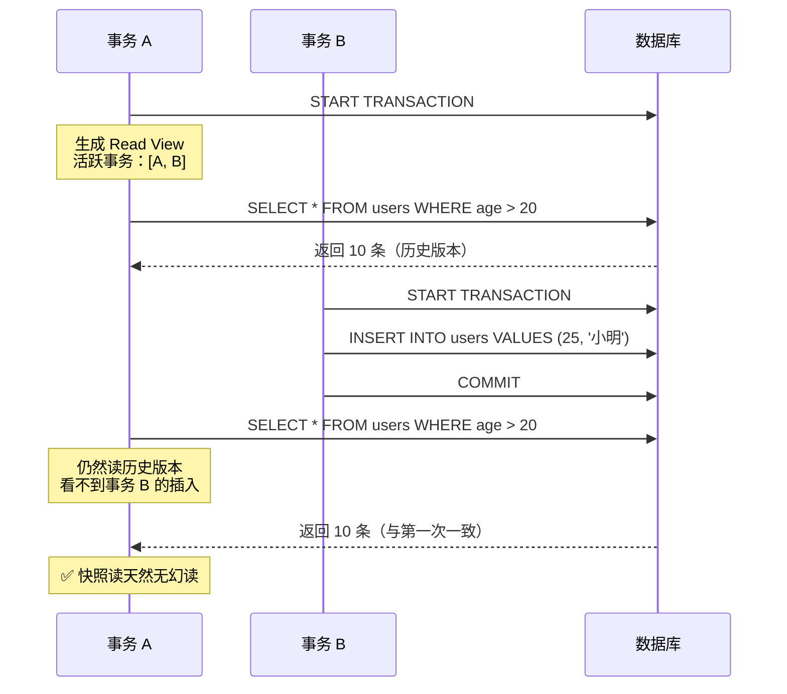
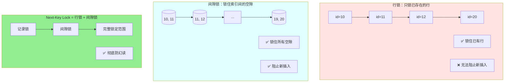
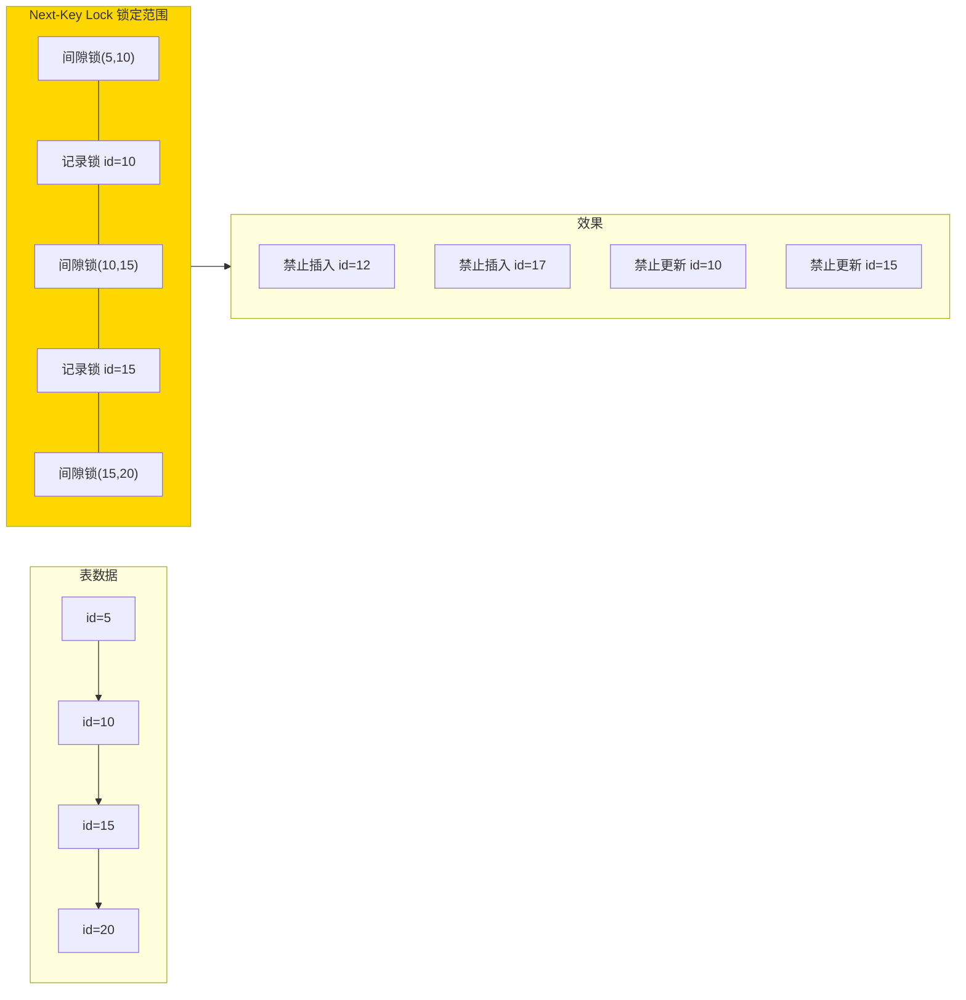
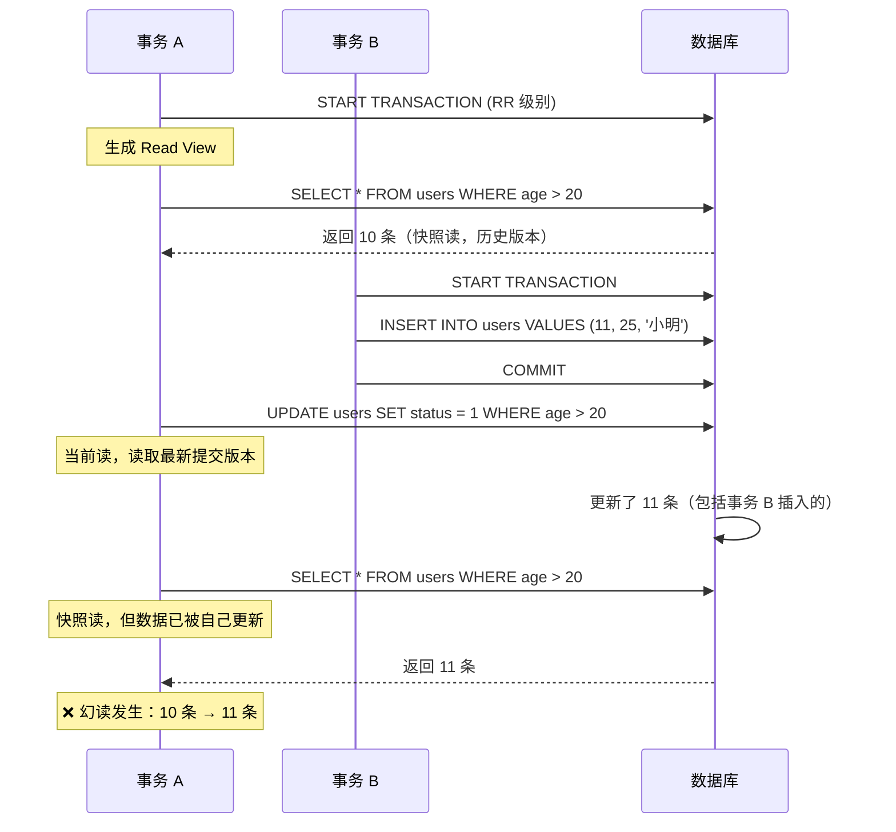
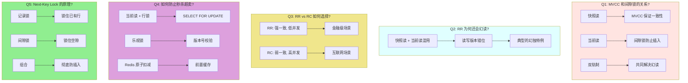
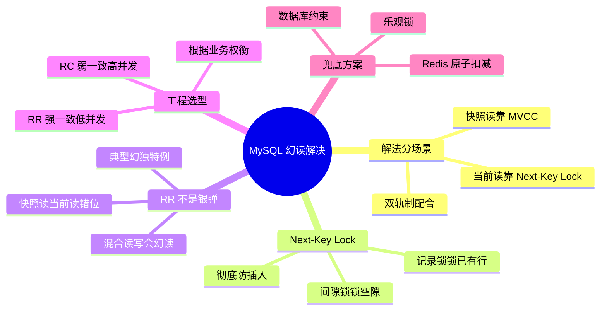
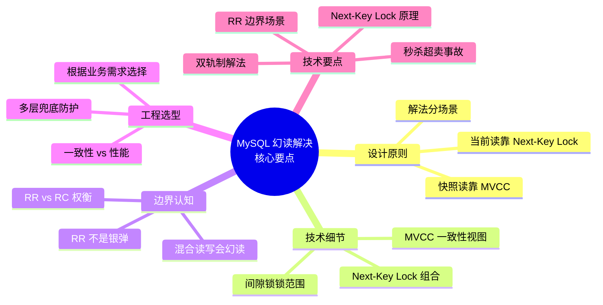

# MySQL 幻读解决：别只会说 MVCC

> **场景定位**：MySQL 事务与锁机制技术场景  
> **核心设计要点**：幻读定义、MVCC 机制、Next-Key Lock、快照读 vs 当前读、隔离级别选型

---

## 🎯 一句话定位

**幻读是什么问题？**
```
事务 A 第一次查询：SELECT * FROM users WHERE age > 20;
结果返回 10 条数据

此时事务 B 插入了一条新数据：INSERT INTO users VALUES (25, '小明');

事务 A 第二次查询：SELECT * FROM users WHERE age > 20;
结果返回 11 条数据（多了事务 B 插入的那条）

这就是"幻读"：同一个事务内，两次查询结果不一致，像是产生了幻觉
```

**生活化比喻**：
就像你在教室里数人数，第一次数是 30 人，低头写了个"30"。抬头再数一次，变成了 31 人——有个新同学悄悄进来了。你揉了揉眼睛："我刚才明明数的是 30 人啊，怎么多了 1 个？"

**核心特点**：MySQL 的 RR（可重复读）隔离级别**并非单靠 MVCC 解决幻读**，而是**双轨制**：快照读靠 MVCC，当前读靠 Next-Key Lock。

---

## 💎 核心观点（5 分钟速览版）

> **快速概览**

### 核心观点（5 个关键点）

**1. 幻读解法分场景：MVCC 只覆盖快照读，绝非通用答案**
```
❌ 错误回答："MySQL 靠 MVCC 解决幻读"
✅ 正确回答："解法分场景，快照读靠 MVCC，当前读靠 Next-Key Lock"

两种读模式：
- 快照读（Snapshot Read）：普通 SELECT，不加锁，读历史版本
  → MVCC 保证一致性，天然无幻读
- 当前读（Current Read）：SELECT ... FOR UPDATE / UPDATE / DELETE / INSERT
  → 读取最新提交版本，必须加锁
  → Next-Key Lock 锁范围防插入，才能防幻读
```

**2. Next-Key Lock 是当前读防幻读的核心，间隙锁是精髓**
```
生活化比喻：
行锁只能锁住已存在的数据行（锁住房子里的人）
间隙锁能锁住两个索引值之间的空隙（锁住房子之间的空地，不让盖新房子）

Next-Key Lock = 记录锁 + 间隙锁
- 记录锁：锁具体的索引行（锁住房子）
- 间隙锁：锁两个索引值之间的空隙（锁住空地）

比如查询 id=10 的行，加间隙锁会锁住 (10, +∞) 的整个区间
区间内所有空隙都不允许插入新数据，从根源上堵住幻读
```

**3. RR 不是银弹：混合使用快照读和当前读会出现幻读**
```
边界场景：
事务内先做快照读（得到 10 条）
另一个事务插入新数据并提交
当前事务再执行 UPDATE（会更新到 11 条）
→ 这就是典型的幻独特例

RR vs RC 的核心区别：
- RC：只有记录锁，没有间隙锁，并发度高，但会出现幻读
- RR：引入间隙锁，牺牲并发性能，换来当前读无幻读
- 本质是一致性与性能的权衡
```

**4. 生产选型：很多团队主动把 RR 改成 RC**
```
为什么？
- RR 的间隙锁会大幅增加锁冲突和死锁概率
- 绝大多数业务能接受不可重复读和极少数幻读
- 换成 RC 换来更高的并发性能

工程师的核心能力：
❌ 不是死记隔离级别特性
✅ 而是根据业务一致性要求和并发压力选择最合适的隔离级别
✅ 同时做好对应的兜底校验
```

**5. 快照读与当前读混用是 MVCC 与隔离级别最隐蔽的陷阱**
```
秒杀超卖事故：
- 库存服务用 RR 隔离级别
- 扣库存逻辑：先快照读查库存，确认充足后再执行扣减更新
- 并发下多个事务都读到同一份库存快照，先后完成扣减
- 结果：库存被扣成负数，超卖了 30 多单

根因：快照读和当前读混用，事务内读写持续错位
解决：核心写操作用当前读 + 行锁做前置校验
```

---

## 🚀 一句话精华（如果只能记住一句）

> **MySQL 幻读解决 = 双轨制（快照读靠 MVCC 一致性视图 + 当前读靠 Next-Key Lock 锁范围） + RR 不是银弹（混合读写仍会幻读） + 工程选型（RR vs RC 权衡一致性与并发）**

---

## 一、为什么"MVCC 解决幻读"这个回答是错误的？

### ❌ 普通开发的典型回答

**技术场景**：
```
场景提问：MySQL 的可重复读隔离级别是如何解决幻读的？

候选人（自信满满）：
"靠 MVCC 多版本并发控制，每行数据都带隐藏的事务 ID 和回滚指针，
事务启动时生成一致性读视图，读取历史版本的数据，
不用加锁就能保证两次查询结果一致，自然就不会出现幻读，
还能实现读写不冲突。"
```

**技术追问**：
```
❓ 你说的 MVCC 是基础结论，那我问你：
❓ 有了 MVCC 为什么还要设计间隙锁？
❓ 如果 MVCC 就能彻底解决幻读，那 InnoDB 的 Next-Key Lock 还有存在的必要吗？
❓ 比如我执行 SELECT ... FOR UPDATE 做当前读，这时候 MVCC 还能防幻读吗？
```

**候选人的反应**：
```
愣了一下：
"当前读应该是加行锁吧，具体间隙锁和幻读的关系没太深究..."

讨论到此原因：
❌ 把解决幻读简单地归为 MVCC
❌ 只知其一不知其二
❌ 理解停留在表面
```

### ✅ 核心设计要点之三层深度

**生活化比喻**：
```
就像问"如何防止教室里突然多出一个人？"

普通回答："靠监控摄像头（MVCC）记录历史画面"
这个回答只说对了一半

完整回答：
1. 如果你只是看历史记录（快照读）：监控摄像头够用（MVCC）
2. 如果你要实时防止有人溜进来（当前读）：需要在门口安排保安（Next-Key Lock）

两种方案配合，才能彻底解决幻读问题
```


---

## 二、第一层：幻读解法分场景，MVCC 只覆盖快照读

### 2.1 两种读模式的本质区别

**生活化比喻**：
```
快照读 vs 当前读：

快照读（Snapshot Read）：
就像看照片——拍的是过去的瞬间
- 你翻看昨天的合影，照片里永远是那 10 个人
- 即使今天有新人加入，照片里还是昨天的样子
- 优点：不受外界干扰，看到的永远是"历史"
- 缺点：不是实时的，可能错过最新变化

当前读（Current Read）：
就像照镜子——看到的是此刻的实时画面
- 你照镜子，看到的就是现在房间里的人
- 有人进来，镜子里就多一个人
- 优点：实时，看到的就是最新状态
- 缺点：容易被干扰，需要加锁保证一致性
```

**技术对比**：

| 特性 | 快照读（Snapshot Read） | 当前读（Current Read） |
|------|------------------------|------------------------|
| **SQL 类型** | 普通 SELECT | SELECT ... FOR UPDATE<br/>SELECT ... LOCK IN SHARE MODE<br/>UPDATE / DELETE / INSERT |
| **读取版本** | 事务启动时的一致性视图（历史版本） | 数据的最新提交版本 |
| **是否加锁** | ❌ 不加锁 | ✅ 加锁（行锁 / 间隙锁 / Next-Key Lock） |
| **是否防幻读** | ✅ 天然无幻读（读历史版本） | ⚠️ 需要 Next-Key Lock 防幻读 |
| **并发性能** | ⭐⭐⭐⭐⭐（读写不冲突） | ⭐⭐⭐（加锁，有冲突） |
| **生活化比喻** | 看照片（历史记录） | 照镜子（实时画面） |

### 2.2 快照读为何天然无幻读？

**生活化比喻**：
```
想象你在图书馆查阅一本古籍：
1. 你借出了这本书（事务启动，生成一致性视图）
2. 你翻到第 100 页，看到"梁山好汉共 108 位"（第一次查询）
3. 此时作者修改了书稿，改成"梁山好汉共 110 位"（其他事务插入新数据）
4. 你再翻到第 100 页，还是看到"108 位"（因为你借的是旧版本）

这就是 MVCC 的魅力：
- 你看到的是事务启动时的"快照"
- 其他事务的修改不会影响你的视图
- 天然不会出现"第一次 108 位，第二次 110 位"的幻读现象
```

**MVCC 核心原理**：
```
每行数据都有两个隐藏字段：
- DB_TRX_ID：最近修改这行数据的事务 ID
- DB_ROLL_PTR：回滚指针，指向这行数据的上一个版本

事务启动时：
1. 生成一致性视图（Read View）
   - 包含所有活跃事务的 ID 列表
   - 确定"哪些事务的修改对我可见"

2. 读取时：
   - 比较数据的 DB_TRX_ID 和 Read View
   - 如果 DB_TRX_ID < 最小活跃事务 ID：说明是历史已提交的数据，可见
   - 如果 DB_TRX_ID 在活跃事务列表中：说明是其他事务未提交的修改，不可见
   - 通过回滚指针找到历史版本，返回可见的版本

关键点：
✅ 全程不加锁，读写不冲突
✅ 每次读的都是同一个版本，天然无幻读
❌ 但只适用于普通 SELECT（快照读）
```



### 2.3 当前读为何需要 Next-Key Lock？

**生活化比喻**：
```
当前读就像你在教室里实时数人数：
1. 你数了一遍："教室里有 30 人"（第一次查询）
2. 此时有个新同学悄悄从后门溜进来（其他事务插入）
3. 你再数一遍："教室里有 31 人"（第二次查询）
4. 你懵了："我刚才明明数的是 30 人啊，怎么多了 1 个？"

解决方案：
- 在前后门都安排保安（Next-Key Lock）
- 任何人不允许进出（锁定索引范围，禁止插入）
- 你数人的过程中，教室里的人数永远不变

这就是 Next-Key Lock 的作用：
- 锁定查询范围内的所有空隙
- 防止其他事务插入新数据
- 保证两次查询结果一致
```

**技术实现**：
```
当前读的场景：
- SELECT ... FOR UPDATE（加排他锁）
- SELECT ... LOCK IN SHARE MODE（加共享锁）
- UPDATE（加排他锁）
- DELETE（加排他锁）
- INSERT（加排他锁）

问题：
行锁只能锁住已存在的数据行
无法阻止新数据插入到查询范围内

例如：
SELECT * FROM users WHERE id BETWEEN 10 AND 20 FOR UPDATE;
→ 行锁锁住 id=10 到 id=20 的所有行
→ 但无法阻止插入 id=15 的新数据（15 在 10 和 20 之间）

解决方案：
Next-Key Lock = 记录锁 + 间隙锁
- 记录锁：锁住 id=10, 11, 12...20 的所有行
- 间隙锁：锁住 (10, 11), (11, 12)...(19, 20) 的所有空隙
- 组合效果：锁住 [10, 20] 的整个范围，禁止任何插入
```



---

## 三、第二层：Next-Key Lock 是当前读防幻读的核心

### 3.1 Next-Key Lock 的组成与原理

**生活化比喻**：
```
Next-Key Lock 就像在高速公路上设置路障：

记录锁（Record Lock）：
- 锁住具体的车辆（已存在的数据行）
- 比如锁住车牌号京 A12345、京 A12346...

间隙锁（Gap Lock）：
- 锁住两个车辆之间的空隙（索引值之间的间隔）
- 比如锁住京 A12345 和京 A12346 之间的位置
- 其他车辆不允许插入到这个空隙

Next-Key Lock = 记录锁 + 间隙锁：
- 既锁住车辆，又锁住车辆之间的空隙
- 完全封闭一段道路，禁止任何车辆进入
- 查询 id BETWEEN 10 AND 20 时，锁住 [10, 20] 的整个范围
- 其他事务无法插入 id=15 的新数据
```

**锁的类型对比**：

| 锁类型 | 锁定范围 | 防止插入 | 防止更新 | 生活化比喻 |
|--------|----------|----------|----------|------------|
| **记录锁**（Record Lock） | 具体的索引行 | ❌ | ✅ | 锁住房子里的人 |
| **间隙锁**（Gap Lock） | 两个索引值之间的空隙 | ✅ | ❌ | 锁住房子之间的空地 |
| **Next-Key Lock** | 记录锁 + 间隙锁 | ✅ | ✅ | 锁住房子 + 空地 |

**示例**：
```
表数据：
id: 5, 10, 15, 20

执行：SELECT * FROM users WHERE id >= 10 AND id < 20 FOR UPDATE;

锁定范围：
1. 记录锁：锁住 id=10, 15 两行
2. 间隙锁：锁住 (5, 10), (10, 15), (15, 20) 三个空隙
3. Next-Key Lock：锁住 [10, 20) 的整个范围

效果：
✅ 其他事务无法插入 id=12, 13, 17, 18 的新数据
✅ 其他事务无法更新 id=10, 15 的现有数据
✅ 彻底防止幻读
```



### 3.2 RR vs RC 的核心区别

**生活化比喻**：
```
RR（可重复读）vs RC（读已提交）：

RR 就像严格的门禁管理：
- 每次进入小区都要刷卡（加锁）
- 小区内的空地也被锁住，禁止新建房屋（间隙锁）
- 优点：非常安全，不会出现幻读
- 缺点：管理成本高，并发度低

RC 就像宽松的门禁管理：
- 只锁住已有的房屋（记录锁）
- 空地可以随便建新房（无间隙锁）
- 优点：管理成本低，并发度高
- 缺点：可能出现幻读（新房突然多出来）

选择哪个？
- 金融级场景：RR（安全第一）
- 互联网高并发：RC（性能优先）
- 关键是根据业务需求权衡
```

**技术对比**：

| 特性 | RR（可重复读） | RC（读已提交） |
|------|---------------|---------------|
| **隔离级别** | 高 | 低 |
| **锁类型** | 记录锁 + 间隙锁（Next-Key Lock） | 仅记录锁 |
| **幻读问题** | ✅ 当前读无幻读 | ❌ 会出现幻读 |
| **并发性能** | ⭐⭐⭐（锁冲突多） | ⭐⭐⭐⭐⭐（锁冲突少） |
| **死锁概率** | 高（间隙锁导致） | 低 |
| **适用场景** | 金融级、强一致性 | 互联网高并发 |
| **生活化比喻** | 严格门禁（安全但慢） | 宽松门禁（快但可能出问题） |

**生产选型**：
```
很多互联网团队主动把默认隔离级别从 RR 改成 RC：

原因：
1. RR 的间隙锁会大幅增加锁冲突和死锁概率
2. 绝大多数业务能接受不可重复读和极少数幻读
3. 换成 RC 换来更高的并发性能

工程师的核心能力：
❌ 不是死记隔离级别特性
✅ 而是根据业务一致性要求和并发压力选择最合适的隔离级别
✅ 同时做好对应的兜底校验
```

---

## 四、第三层：RR 不是银弹，边界场景与工程选型

### 4.1 RR 级别也会出现幻读的边界场景

**生活化比喻**：
```
边界场景：
就像你在教室里数人数，但用了两种不同的方法：
1. 先看照片数（快照读）："照片里有 30 人"
2. 此时有个新同学进来了
3. 再看实时画面数（当前读）："教室里有 31 人"
4. 你懵了："我刚才明明数的是 30 人啊，怎么多了 1 个？"

问题根因：
- 快照读和当前读混用
- 两种读模式看到的版本不同
- 导致"幻觉"产生
```

**示例场景**：
```
表数据：
id: 1, 2, 3, 4, 5, 6, 7, 8, 9, 10（age > 20 的有 10 条）

事务 A（RR 隔离级别）：
1. 快照读：SELECT * FROM users WHERE age > 20;
   → 返回 10 条（历史版本）

2. 事务 B 插入新数据：
   INSERT INTO users VALUES (11, 25, '小明');
   COMMIT;

3. 事务 A 执行 UPDATE：
   UPDATE users SET status = 1 WHERE age > 20;
   → 更新了 11 条（包括事务 B 插入的那条）
   
4. 事务 A 再次快照读：
   SELECT * FROM users WHERE age > 20;
   → 返回 11 条（因为已经更新了）

结果：
- 第一次查询 10 条
- UPDATE 更新了 11 条
- 第二次查询 11 条
→ 典型的幻读现象
```



**根因分析**：
```
问题根因：
1. 快照读和当前读混用
2. UPDATE 是当前读，读取最新提交版本
3. UPDATE 更新了事务 B 插入的数据
4. 后续的快照读看到的是被自己更新过的数据

关键认知：
❌ RR 不是绝对没有幻读
✅ 混合使用快照读和当前读时，会出现幻读
✅ 这是 MVCC 与隔离级别最隐蔽的陷阱
```

### 4.2 秒杀超卖事故：快照读与当前读混用的灾难

**生活化比喻**：
```
秒杀超卖就像电影院卖票：
1. 你在网上看到"剩余 100 张票"（快照读）
2. 你点击购买（准备扣减）
3. 同时，另外 30 个人也看到"剩余 100 张票"，也点击购买
4. 结果：100 张票卖出了 31 份，超卖了 30 张

问题根因：
- 所有人都读到了同一份"快照"（剩余 100 张）
- 没有实时校验"最新库存"
- 导致超卖
```

**事故还原**：
```
表数据：
products 表：id=1, stock=100（商品库存 100 件）

事务 A、B、C...（30 个并发事务）：

每个事务的逻辑：
1. 快照读查库存：
   SELECT stock FROM products WHERE id = 1;
   → 返回 100（历史版本）

2. 判断库存充足（100 > 0）

3. 执行扣减：
   UPDATE products SET stock = stock - 1 WHERE id = 1;
   → 当前读，读取最新提交版本
   → 但所有事务都读到了 stock=100
   → 都成功执行了 stock = 99

结果：
- 30 个事务都成功扣减
- 库存被扣成 100 - 30 = 70
- 但实际应该只卖 1 件，超卖了 29 件

更严重的情况：
- 如果库存只有 10 件
- 10 个事务都读到 stock=10
- 都成功扣减
- 库存被扣成 10 - 10 = 0
- 但实际只应该卖 1 件，超卖了 9 件
```

**解决方案**：

```go
// ❌ 错误写法：快照读 + 更新（会超卖）
func BuyWrong(tx *gorm.DB, productID string) error {
    // 快照读：查库存
    var product Product
    tx.First(&product, "id = ?", productID)
    
    if product.Stock <= 0 {
        return errors.New("库存不足")
    }
    
    // 更新：扣减库存
    tx.Model(&Product{}).Where("id = ?", productID).
        Update("stock", gorm.Expr("stock - 1"))
    
    return nil
}

// ✅ 正确写法 1：当前读 + 行锁（推荐）
func BuyCorrect1(tx *gorm.DB, productID string) error {
    // 当前读：加行锁查库存
    var product Product
    tx.Set("gorm:query_option", "FOR UPDATE").
        First(&product, "id = ?", productID)
    
    if product.Stock <= 0 {
        return errors.New("库存不足")
    }
    
    // 更新：扣减库存
    tx.Model(&Product{}).Where("id = ?", productID).
        Update("stock", gorm.Expr("stock - 1"))
    
    return nil
}

// ✅ 正确写法 2：乐观锁（推荐）
func BuyCorrect2(tx *gorm.DB, productID string) error {
    // 查询库存和版本号
    var product Product
    tx.First(&product, "id = ?", productID)
    
    if product.Stock <= 0 {
        return errors.New("库存不足")
    }
    
    // 乐观锁：更新时校验版本号
    result := tx.Model(&Product{}).
        Where("id = ? AND version = ?", productID, product.Version).
        Updates(map[string]interface{}{
            "stock":   gorm.Expr("stock - 1"),
            "version": gorm.Expr("version + 1"),
        })
    
    if result.RowsAffected == 0 {
        return errors.New("并发冲突，请重试")
    }
    
    return nil
}

// ✅ 正确写法 3：原子操作（最推荐）
func BuyCorrect3(tx *gorm.DB, productID string) error {
    // 原子操作：直接扣减，让数据库保证一致性
    result := tx.Model(&Product{}).
        Where("id = ? AND stock > 0", productID).
        Update("stock", gorm.Expr("stock - 1"))
    
    if result.RowsAffected == 0 {
        return errors.New("库存不足")
    }
    
    return nil
}
```

### 4.3 工程选型：根据业务需求权衡

**生活化比喻**：
```
就像选择交通工具：
- 自行车（RC）：快，但可能淋雨（幻读）
- 汽车（RR）：慢，但不会淋雨（无幻读）
- 地铁（自定义）：最快，但需要自己设计路线

关键是根据业务需求选择：
- 一致性要求高：RR（金融级场景）
- 并发要求高：RC（互联网高并发）
- 特殊场景：自定义（混合方案）
```

**选型 Checklist**：

| 场景 | 推荐隔离级别 | 原因 | 生活化比喻 |
|------|-------------|------|------------|
| 金融交易（支付、清算） | RR | 强一致性，不能出错 | 银行金库（安全第一） |
| 互联网高并发（电商、社交） | RC | 性能优先，可接受极少数幻读 | 快餐厅（效率优先） |
| 核心写操作（库存扣减） | RR + 当前读 | 防止超卖 | 电影院售票（实时校验） |
| 纯查询场景（报表、统计） | RC | 不需要强一致性 | 看新闻（不要求实时） |

**工程师的核心能力**：
```
❌ 不是死记隔离级别特性
✅ 而是根据业务一致性要求和并发压力选择最合适的隔离级别
✅ 同时做好对应的兜底校验

兜底方案：
1. 数据库层：数值字段加非负约束（库存 ≥ 0）
2. 应用层：乐观锁（版本号校验）
3. 架构层：Redis 原子扣减（前置缓存）
4. 监控层：定时对账（发现异常自动告警）
```

---

五、技术深入探讨

### 5.1 技术追问与深度问题



### 5.2 方案详解

**Q1: MVCC 和间隙锁的关系是什么？**  
**答**：MySQL 解决幻读是**双轨制**：
- **快照读**（普通 SELECT）：靠 MVCC 保证一致性，读取历史版本，天然无幻读
- **当前读**（SELECT FOR UPDATE / UPDATE / DELETE）：靠 Next-Key Lock 锁范围，防止新数据插入

两者分别对应不同的读写场景，缺了任何一个都不完整。只知道 MVCC 等于只懂了一半。

**Q2: RR 隔离级别为何还会出现幻读？**  
**答**：RR 不是银弹，存在明确的边界场景。当事务内**混合使用快照读和当前读**时，会出现幻读。

比如：事务内先做快照读（得到 10 条），另一个事务插入新数据并提交，当前事务再执行 UPDATE（会更新到 11 条）。这就是典型的幻独特例。

根因：快照读和当前读看到的版本不同，导致"幻觉"产生。

**Q3: RR vs RC 如何选择？**  
**答**：本质是**一致性与性能的权衡**：
- **RR**：引入间隙锁，牺牲并发性能，换来当前读无幻读。适用于金融级、强一致性场景。
- **RC**：只有记录锁，并发度高，但会出现幻读。适用于互联网高并发场景。

很多互联网团队主动把默认隔离级别从 RR 改成 RC，因为绝大多数业务能接受不可重复读和极少数幻读，换来更高的并发性能。

工程师的核心能力不是死记隔离级别特性，而是根据业务一致性要求和并发压力选择最合适的隔离级别，同时做好对应的兜底校验。

**Q4: 如何防止秒杀超卖？**  
**答**：秒杀超卖的根因是**快照读和当前读混用**，多个事务都读到同一份库存快照，先后完成扣减。

解决方案有三种：
1. **当前读 + 行锁**：SELECT ... FOR UPDATE，加行锁查库存，防止并发修改
2. **乐观锁**：更新时携带版本号或原始值校验，影响行数为零则自动重试
3. **Redis 原子扣减**：将库存前置到 Redis，用原子指令完成扣减，异步同步回数据库

兜底方案：
- 数据库层：数值字段加非负约束（库存 ≥ 0）
- 监控层：定时对账，发现异常自动告警

**Q5: Next-Key Lock 的原理是什么？**  
**答**：Next-Key Lock 是当前读防幻读的核心，由**记录锁 + 间隙锁**组成：
- **记录锁**：锁住具体的索引行（锁住已有的数据）
- **间隙锁**：锁住两个索引值之间的空隙（防止新数据插入）

比如查询 id BETWEEN 10 AND 20 FOR UPDATE，Next-Key Lock 会锁住 [10, 20) 的整个范围，禁止任何插入。

这也是 RR 和 RC 的核心区别：RC 只有记录锁没有间隙锁，并发度更高，但当前读会出现幻读。RR 引入间隙锁，牺牲了一部分并发性能，换来了当前读下的无幻读。

---

## 六、方案总结



**方案总结**：

> **解法分场景**：MySQL 解决幻读是**双轨制**——快照读靠 MVCC 的一致性视图，当前读靠 Next-Key Lock 锁范围。只知道 MVCC 等于只懂了一半。
> 
> **Next-Key Lock**：由**记录锁 + 间隙锁**组成，记录锁锁已有行，间隙锁锁空隙，组合起来锁定整个范围，彻底防止新数据插入。
> 
> **RR 不是银弹**：当事务内**混合使用快照读和当前读**时，会出现幻读。比如先快照读得到 10 条，另一个事务插入新数据，当前事务 UPDATE 会更新到 11 条，典型的幻独特例。
> 
> **工程选型**：RR 和 RC 的本质是**一致性与性能的权衡**。很多互联网团队主动把 RR 改成 RC，因为绝大多数业务能接受极少数幻读，换来更高的并发性能。工程师的核心能力是根据业务需求选择最合适的隔离级别，同时做好兜底校验。
> 
> **兜底方案**：数据库层加非负约束，应用层用乐观锁，架构层用 Redis 原子扣减，监控层定时对账。多层防护，确保数据一致性。

---

## 七、总结（一句话带走）



### 🎯 一句话总结

> **MySQL 幻读解决 = 双轨制（快照读靠 MVCC 一致性视图 + 当前读靠 Next-Key Lock 锁范围） + RR 不是银弹（混合读写仍会幻读） + 工程选型（RR vs RC 权衡一致性与并发） + 多层兜底（数据库约束 + 乐观锁 + Redis 原子扣减 + 定时对账）**

### 🧠 核心记忆点

1. **为什么"MVCC 解决幻读"是错的？** 因为 MVCC 只覆盖快照读，当前读需要 Next-Key Lock 才能防幻读。
2. **Next-Key Lock 是什么？** 记录锁 + 间隙锁，既锁已有行，又锁空隙，彻底防止新数据插入。
3. **RR 为何还会幻读？** 混合使用快照读和当前读时，读写版本错位，导致幻读。
4. **RR vs RC 如何选择？** 本质是一致性与性能的权衡。RR 强一致低并发，RC 弱一致高并发。
5. **如何防止秒杀超卖？** 核心写操作用当前读 + 行锁，或者乐观锁，或者 Redis 原子扣减。兜底方案：数据库约束 + 定时对账。

---

**参考视频**：[内卷的琪某人 - MySQL 怎么解决幻读？别只会说 MVCC！](https://v.douyin.com/6frkTBtg3m4/)

---

*本文档基于 8 个专家提示词指导改写，遵循深入浅出、生活化比喻、幽默风趣的教学原则。*
