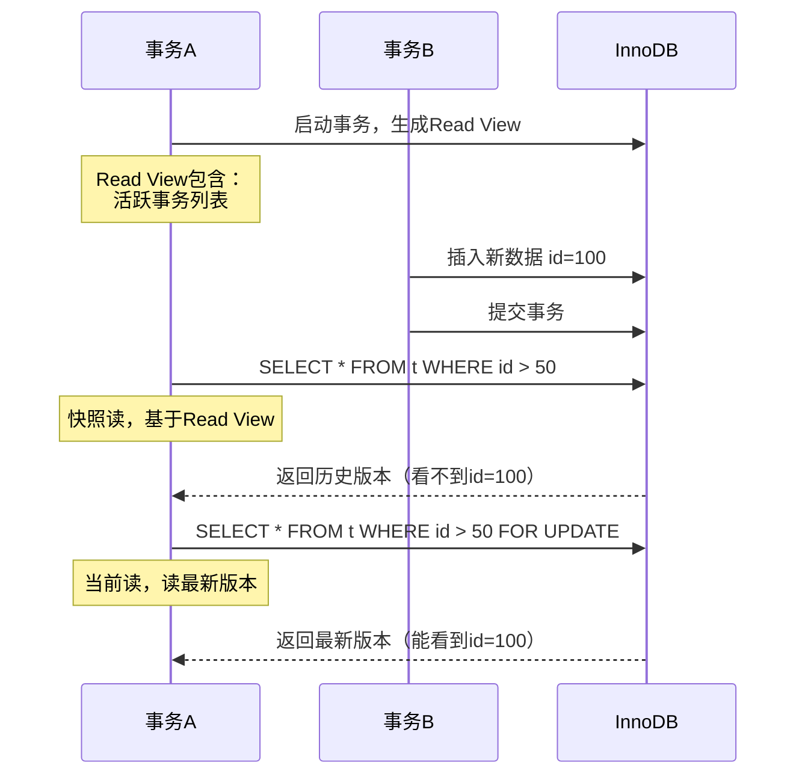
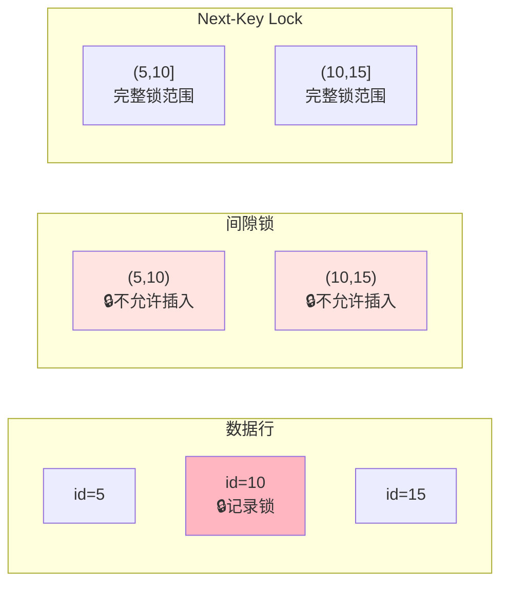
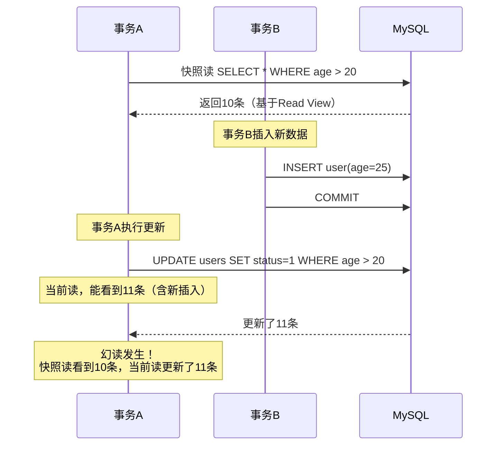

# MySQL 解决幻读：MVCC + Next-Key Lock 双轨制

> **场景定位**：MySQL 事务技术场景
> **核心设计要点**：快照读 vs 当前读、MVCC 原理、Next-Key Lock、隔离级别选型

---

## 🎯 一句话定位

**MySQL 解决幻读的核心机制是什么？**
```
一句话：双轨制——快照读靠 MVCC 的历史版本，当前读靠 Next-Key Lock 锁范围
```

**生活化比喻**：
```
快照读 = 看历史照片（不加锁，看的是一直不变的历史版本）
当前读 = 看实时直播（加锁，看的是最新提交的数据）

生活化比喻：
- 快照读：看你手机相册里的照片（历史版本，不变）
- 当前读：看监控摄像头的实时画面（最新状态，要锁住资源）
```

**核心特点**：只知道 MVCC 等于只懂了一半，必须结合 Next-Key Lock 才是完整方案。

---

## 💎 核心观点（5 分钟速览版）

### 核心观点（3 层深度）

**1. 解法分场景：MVCC 只覆盖快照读**
```
快照读：普通不加锁 select
- 基于事务启动时生成的一致性视图（Read View）
- 读数据的历史版本，全程不加锁
- 同一事务内多次快照读结果完全一致
- 天然不会出现幻读 ✓

当前读：select for update / update / delete / insert
- 读数据的最新提交版本
- 必须加锁保证并发安全
- MVCC 的历史版本失效
- 需要 Next-Key Lock 防幻读
```

**2. Next-Key Lock 是当前读防幻读核心**
```
Next-Key Lock = 记录锁（Record Lock）+ 间隙锁（Gap Lock）

记录锁：锁具体的索引行（比如 id=10 这一行）
间隙锁：锁两个索引值之间的空隙（比如 id=10 到 id=20 之间）
组合：左开右闭的区间锁（10, 20]

生活化比喻：
- 记录锁：锁住已有的座位
- 间隙锁：锁住座位之间的过道，不让新座位插入
- 两者组合：整个区域都被锁住，新数据无处可插
```

**3. RR vs RC 核心区别**
```
RC（Read Committed）：
- 只有记录锁，没有间隙锁
- 并发度高
- 当前读会出现幻读

RR（Repeatable Read）：
- 引入间隙锁
- 牺牲一部分并发性能
- 换来当前读下的无幻读

本质：一致性与性能的权衡
```

---

## 🚀 一句话精华

> **MySQL 解决幻读 = 快照读靠 MVCC（历史版本）+ 当前读靠 Next-Key Lock（记录锁+间隙锁），双机制配合才是完整方案**

---

## 一、快照读 vs 当前读

### 📊 两种读模式对比

| 维度 | 快照读 | 当前读 |
|------|--------|--------|
| **SQL类型** | 普通 SELECT | SELECT FOR UPDATE / UPDATE / DELETE / INSERT |
| **是否加锁** | 不加锁 | 加锁 |
| **读取版本** | 事务启动时的一致性视图（历史版本） | 最新已提交版本 |
| **幻读防护** | MVCC 天然防护 ✓ | 需要 Next-Key Lock |
| **并发性能** | 高（读写不冲突） | 低（有锁竞争） |
| **适用场景** | 查询、报表、统计 | 需要保证并发安全的写操作 |

### 📊 MVCC 工作原理



---

## 二、Next-Key Lock 详解

### 📊 组成与原理

**生活化比喻**：
```
假设表中有 id = 5, 10, 15 三条记录

执行：SELECT * FROM t WHERE id = 10 FOR UPDATE

锁住的范围：
- 记录锁：锁住 id=10 这一行
- 间隙锁：锁住 (5, 10) 和 (10, 15) 两个间隙
- Next-Key Lock：(5, 10] 和 (10, 15] 两个左开右闭区间

效果：
- 其他事务不能修改 id=10（记录锁）
- 其他事务不能在 (5, 10) 和 (10, 15) 之间插入新数据（间隙锁）
- 从根源上堵住了新增数据的可能
```



### 📊 代码示例：间隙锁防幻读

```go
// 演示间隙锁防幻读
func testGapLock(db *gorm.DB) {
    // 事务A：查询并加锁
    txA := db.Begin()
    var users []User
    txA.Where("age > ?", 20).Find(&users) // 快照读
    // SELECT * FROM users WHERE age > 20 FOR UPDATE // 当前读+间隙锁

    // 事务B：尝试插入新数据
    txB := db.Begin()
    newUser := &User{Name: "Alice", Age: 25}
    err := txB.Create(newUser).Error
    // 会被间隙锁阻塞，直到事务A提交或回滚

    // 事务A：再次查询
    txA.Where("age > ?", 20).Find(&users)
    // 结果一致，没有幻读

    txA.Commit()
    txB.Commit()
}
```

---

## 三、RR vs RC 隔离级别选型

### 📊 核心区别

| 维度 | RC（Read Committed） | RR（Repeatable Read） |
|------|---------------------|----------------------|
| **记录锁** | ✓ | ✓ |
| **间隙锁** | ✗ | ✓ |
| **幻读防护** | 当前读会出现幻读 | 快照读+当前读都无幻读 |
| **并发性能** | 高 | 中（间隙锁增加锁冲突） |
| **死锁概率** | 低 | 高（间隙锁范围大） |
| **适用场景** | 高并发互联网业务 | 对一致性要求高的金融业务 |

### 📊 为什么很多团队用 RC 而非 RR？

**生活化比喻**：
```
RR像严格的保安：
- 检查每个人的身份
- 不让任何可疑人员进入
- 安全但效率低

RC像灵活的保安：
- 只检查明显可疑的人
- 大多数时候效率更高
- 偶尔有小风险但可以接受

互联网团队的选择：
- 大多数业务能接受极少数幻读
- 换来更高的并发性能
- 通过业务层兜底（唯一约束、乐观锁）解决极端场景
```

---

## 四、RR 的边界场景

### ⚠️ 快照读和当前读混用会出现幻读



### 生产环境规避方案

```go
// 规避方案：统一使用当前读
func safeUpdate(db *gorm.DB, age int) error {
    return db.Transaction(func(tx *gorm.DB) error {
        // 统一使用当前读 + 行锁
        var users []User
        tx.Where("age > ?", age).
            Find(&users) // 这里应该是 FOR UPDATE

        for _, u := range users {
            tx.Model(&u).Update("status", 1)
        }
        return nil
    })
}
```

---

## 五、技术深入探讨


### 技术方案

**Q1: MVCC 能彻底解决幻读吗？**
> "不能。MVCC 只能解决快照读的幻读问题。快照读基于事务启动时的一致性视图，读的是历史版本，天然无幻读。但当前读（SELECT FOR UPDATE / UPDATE / DELETE / INSERT）读的是最新提交版本，MVCC 的历史版本失效，必须依赖 Next-Key Lock 来防止幻读。"

**Q2: 为什么有了 MVCC 还需要间隙锁？**
> "因为行锁只能锁住已存在的数据行，管不了还没插入的新数据。幻读的本质恰恰是新增数据落在了查询范围内。间隙锁锁住索引值之间的空隙，阻止新数据插入，从根源上堵住了幻读的可能。"

**Q3: RR 级别一定没有幻读吗？**
> "不是绝对的。当事务内混合使用快照读和当前读时，会出现幻读。比如事务内先快照读得到 10 条，另一个事务插入新数据，当前事务再执行 UPDATE 会意外更新到 11 条。这是 RR 的边界场景。"

**Q4: 为什么很多互联网团队用 RC 而不是 RR？**
> "因为 RR 的间隙锁会大幅增加锁冲突和死锁概率，而绝大多数业务场景能接受不可重复读和极少数幻读，换来更高的并发性能。同时通过业务层的唯一约束、乐观锁等机制兜底极端场景。"

---

## 六、总结

### 🎯 一句话总结

> **MySQL 解决幻读 = 快照读靠 MVCC（历史版本）+ 当前读靠 Next-Key Lock（记录锁+间隙锁），双机制配合才是完整方案**

### 🧠 核心记忆点

1. **MVCC 只覆盖快照读**：普通 SELECT 不加锁，读历史版本，天然无幻读
2. **Next-Key Lock 防当前读幻读**：记录锁 + 间隙锁，左开右闭区间锁
3. **间隙锁是精髓**：锁住索引间隙，阻止新数据插入
4. **RR vs RC**：RR 引入间隙锁牺牲并发换无幻读，RC 并发高但有幻读风险
5. **RR 有边界**：快照读和当前读混用会出现幻读
6. **选型权衡**：很多团队主动选 RC，业务层兜底极端场景

---

*本文档基于技术视频整理，遵循深入浅出、生活化比喻、幽默风趣的教学原则。*
