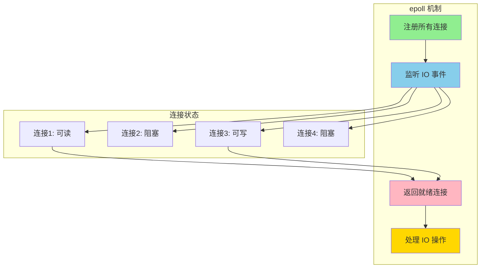
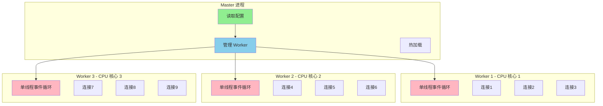
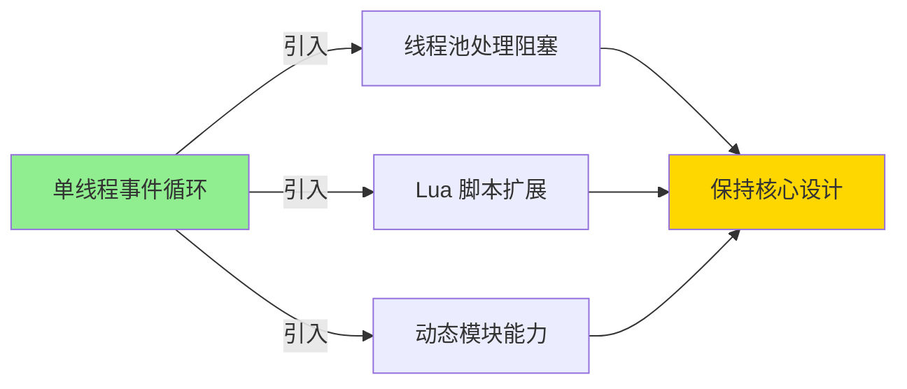

# Nginx 单线程模型为何能扛住百万级并发？

> **场景定位**：Web 服务器架构技术场景  
> **核心设计要点**：IO 多路复用、Master/Worker 进程模型、异步非阻塞、架构取舍

---

## 🎯 一句话定位

**Nginx 是单线程事件模型，为什么能扛住百万级并发？**
```
❌ 错误认知：因为异步非阻塞，省了线程开销
✅ 正确认知：基于 epoll 的 IO 多路复用 + Master/Worker 多进程架构 + 场景匹配的架构取舍
```

**生活化比喻**：
就像一家高效的餐厅：
- **传统多线程**：每个服务员只服务一桌客人（线程绑定连接）
- **Nginx 单线程**：一个服务员服务多桌客人，哪桌需要就去哪桌（IO 多路复用）
- **Master/Worker**：多个服务员分工合作，每人负责一个区域（多进程绑核）

**核心特点**：Nginx 的核心瓶颈不是 CPU，而是网络 IO。单线程模型把 CPU 算力全部用在有效的 IO 处理上，而不是线程调度上。

---

## 💎 核心观点（5 分钟速览版）

> **快速概览**

### 核心观点（3 个层次）

**1. 核心机制：基于 epoll 的 IO 多路复用**
```
传统多线程模型：
- 每个连接一个线程
- 线程阻塞等待 IO
- 1 万个连接 = 1 万个线程（上下文切换开销巨大）

Nginx 单线程模型：
- 单个线程监听数万个连接
- 基于 epoll 机制，只有连接准备好数据时才触发处理
- 空闲连接不占用线程资源
- 1 个线程 = 数万个连接（零调度开销）
```

**2. 多核利用：Master/Worker 进程架构**
```
Master 进程：
- 管理 Worker 进程
- 监控 Worker 健康状态
- 热加载配置文件（零停机）

Worker 进程：
- 每个 Worker 绑定独立的 CPU 核心
- 单 Worker 内单线程，无锁竞争
- 多 Worker 间进程隔离，并行处理
- 充分利用多核算力
```

**3. 架构取舍：单线程的边界与演进**
```
为什么单线程模型沿用至今？
- Nginx 核心定位：反向代理、静态资源服务、流量转发
- 绝大多数操作是网络数据转发，CPU 计算量极低
- 单线程完全可以跑满网卡带宽
- 性能上限在网络带宽和系统 IO，而不是 CPU 算力

演进方向：
- 引入线程池处理磁盘 IO（避免慢 IO 阻塞主事件循环）
- 支持 Lua 脚本扩展（灵活定制）
- 增加动态模块能力（热插拔）
- 始终坚守单线程事件循环的核心设计
```

---

## 🚀 一句话精华（如果只能记住一句）

> **Nginx 高并发 = 基于 epoll 的 IO 多路复用（单线程管理海量连接） + Master/Worker 多进程架构（充分利用多核） + 场景匹配的架构取舍（单线程事件循环 + 线程池兜底）**

---

## 一、核心机制：基于 epoll 的 IO 多路复用

### 1.1 传统多线程模型的问题

**工作原理**：
```
每个连接一个线程：
1. 客户端连接 → 创建新线程
2. 线程阻塞等待 IO（read/write）
3. IO 完成后处理请求
4. 线程销毁

问题：
- 1 万个连接 = 1 万个线程
- 线程创建/销毁开销大
- 上下文切换频繁（CPU 时间浪费在调度上）
- 内存占用高（每个线程 1MB 栈空间）
```

**生活化比喻**：
```
就像一家餐厅：
- 每桌客人配一个专属服务员
- 服务员全程等待客人点菜、上菜、结账
- 100 桌客人 = 100 个服务员
- 大部分时间服务员都在等待（阻塞）
- 人力成本极高（资源浪费）
```

### 1.2 Nginx 单线程模型的优势

**工作原理**：
```
单个线程监听数万个连接：
1. 基于 epoll 机制，监听所有连接的 IO 事件
2. 只有连接准备好数据时（可读/可写），才触发处理
3. 空闲连接不占用线程资源
4. 1 个线程 = 数万个连接

核心优势：
- 零上下文切换开销（单线程）
- 零线程创建/销毁开销
- 内存占用极低（无需为每个连接分配线程栈）
- CPU 算力全部用在有效的 IO 处理上
```

**生活化比喻**：
```
就像一家高效的餐厅：
- 1 个服务员服务所有桌子
- 服务员不断巡视，哪桌需要就去哪桌
- 客人点菜时（IO 就绪），服务员才过来处理
- 客人思考时（IO 阻塞），服务员去服务其他桌
- 1 个服务员 = 100 桌客人（高效利用）
```

### 1.3 epoll 机制详解

**什么是 epoll？**
```
epoll 是 Linux 内核提供的 IO 多路复用机制
核心功能：单个线程同时监听数万个连接的 IO 事件

工作流程：
1. 把所有连接注册到 epoll
2. epoll 监听所有连接的 IO 事件（可读/可写/异常）
3. 当连接有 IO 事件时，epoll 返回就绪的连接列表
4. 单线程遍历就绪列表，处理 IO 操作
5. 继续监听下一轮事件
```

**代码示例**（epoll 伪代码）：
```c
// 创建 epoll 实例
int epfd = epoll_create(10000);

// 注册连接到 epoll
for (int i = 0; i < connections.length; i++) {
    struct epoll_event event;
    event.data.fd = connections[i].fd;
    event.events = EPOLLIN | EPOLLOUT;  // 监听可读和可写事件
    epoll_ctl(epfd, EPOLL_CTL_ADD, connections[i].fd, &event);
}

// 事件循环
while (true) {
    // 等待 IO 事件（阻塞）
    struct epoll_event events[10000];
    int n = epoll_wait(epfd, events, 10000, -1);
    
    // 处理就绪的连接
    for (int i = 0; i < n; i++) {
        int fd = events[i].data.fd;
        if (events[i].events & EPOLLIN) {
            // 可读事件：读取请求数据
            handle_read(fd);
        }
        if (events[i].events & EPOLLOUT) {
            // 可写事件：写入响应数据
            handle_write(fd);
        }
    }
}
```



### 1.4 性能对比

| 模型 | 1 万连接 | 10 万连接 | 100 万连接 |
|------|---------|----------|-----------|
| **多线程** | 1 万线程（上下文切换频繁） | 10 万线程（内存不足） | 无法支撑 |
| **Nginx 单线程** | 1 个线程（零调度开销） | 1 个线程（零调度开销） | 1 个线程（零调度开销） |

**关键数据**：
```
多线程模型：
- 1 万线程上下文切换：CPU 时间 30% 用于调度
- 内存占用：1 万 × 1MB = 10GB

Nginx 单线程模型：
- 上下文切换：0（单线程）
- 内存占用：数万个连接 × 数 KB = 数百 MB
```

---

## 二、多核利用：Master/Worker 进程架构

### 2.1 为什么需要多进程？

**单线程的局限性**：
```
单线程无法充分利用多核 CPU：
- 单线程只能在一个 CPU 核心上运行
- 其他核心闲置（浪费算力）

解决方案：
- 启动多个 Worker 进程
- 每个 Worker 绑定独立的 CPU 核心
- 多进程并行处理
```

### 2.2 Master/Worker 架构

**Master 进程**：
```
职责：
1. 读取和验证配置文件
2. 创建、监控、重启 Worker 进程
3. 接收信号（如 reload、stop）
4. 热加载配置文件（零停机）

特点：
- 不处理客户端请求
- 只负责管理 Worker 进程
```

**Worker 进程**：
```
职责：
1. 监听客户端请求
2. 处理请求并返回响应
3. 与后端服务器通信（反向代理）

特点：
- 每个 Worker 绑定独立的 CPU 核心
- 单 Worker 内单线程，无锁竞争
- 多 Worker 间进程隔离，并行处理
```



### 2.3 进程间通信

**共享内存**：
```
Worker 进程间通过共享内存通信：
- 共享配置信息
- 共享缓存数据
- 共享统计信息

优势：
- 零拷贝（直接读取共享内存）
- 无需序列化/反序列化
```

**信号机制**：
```
Master 通过信号控制 Worker：
- SIGHUP：重新加载配置
- SIGQUIT：优雅关闭
- SIGTERM：立即关闭
```

---

## 三、架构取舍：单线程的边界与演进

### 3.1 为什么单线程模型沿用至今？

**场景匹配**：
```
Nginx 核心定位：
- 反向代理
- 静态资源服务
- 流量转发

操作特点：
- 绝大多数操作是网络数据转发
- CPU 计算量极低
- 单线程完全可以跑满网卡带宽

性能瓶颈：
- 在网络带宽和系统 IO，而不是 CPU 算力
- 单线程已经足够
```

### 3.2 演进方向：线程池兜底阻塞操作

**问题场景**：
```
某些操作会阻塞主事件循环：
- 磁盘 IO（读取大文件）
- 慢速网络 IO（访问后端服务）
- Lua 脚本执行（复杂计算）

后果：
- 主事件循环被阻塞
- 所有请求排队延迟
- 性能急剧下降
```

**解决方案：线程池**
```
引入线程池处理阻塞操作：
1. 主事件循环检测到阻塞操作
2. 将阻塞操作提交给线程池
3. 主事件循环继续处理其他请求
4. 线程池完成操作后，通知主事件循环

优势：
- 主事件循环不被阻塞
- 阻塞操作异步处理
- 保持单线程事件循环的核心设计
```

**代码示例**（Nginx 线程池配置）：
```nginx
# nginx.conf
thread_pool default threads=32 max_queue=65536;

location /static/ {
    alias /var/www/static/;
    thread_pool default;  # 使用线程池处理磁盘 IO
}
```

### 3.3 架构演进总结



**核心思想**：
```
没有为了强行利用多核推翻简洁的单线程架构
而是：
- 用多进程适配多核（Master/Worker）
- 用线程池兜底阻塞场景
- 始终坚守单线程事件循环的核心设计
- 用最小的复杂度换取最高的 IO 效率
```

---

四、技术深入探讨

### Q1: 为什么单线程模式比多线程更快？
**答**：
- 零上下文切换开销（单线程）
- 零线程创建/销毁开销
- 内存占用极低（无需为每个连接分配线程栈）
- CPU 算力全部用在有效的 IO 处理上

### Q2: 单线程如何充分利用多核 CPU？
**答**：
- Master/Worker 多进程架构
- 每个 Worker 绑定独立的 CPU 核心
- 单 Worker 内单线程，无锁竞争
- 多 Worker 间进程隔离，并行处理

### Q3: 单线程遇到阻塞操作怎么办？
**答**：
- 引入线程池处理阻塞操作（如磁盘 IO）
- 主事件循环将阻塞操作提交给线程池
- 线程池完成后通知主事件循环
- 主事件循环不被阻塞，继续处理其他请求

### Q4: Nginx 和 Redis 的单线程模型有什么异同？
**答**：
**相同点**：
- 都基于 IO 多路复用（epoll）
- 都是单线程事件循环
- 都避免了线程切换开销

**不同点**：
- Nginx：多进程架构（Master/Worker），充分利用多核
- Redis：单进程架构，通过 Redis Cluster 实现分布式

---

## 五、方案总结

**方案总结**：

> **核心机制**：Nginx 基于 epoll 的 IO 多路复用，单个线程可以同时监听数万个连接的读写事件，只有连接准备好数据时才触发处理，空闲连接不占用线程资源，零调度开销。
> 
> **多核利用**：Master/Worker 多进程架构，每个 Worker 绑定独立的 CPU 核心，单 Worker 内单线程无锁竞争，多 Worker 间进程隔离并行处理，充分利用多核算力。
> 
> **架构取舍**：Nginx 核心定位是反向代理和静态资源服务，绝大多数操作是网络数据转发，CPU 计算量极低，单线程可以跑满网卡带宽。引入线程池处理磁盘 IO 等阻塞操作，始终坚守单线程事件循环的核心设计，用最小复杂度换取最高 IO 效率。

---

## 六、生产环境 Checklist（部署检查清单）

| 类别 | 检查项 | 状态 | 生活化比喻 |
|------|--------|------|------------|
| **进程配置** | Worker 数量 = CPU 核心数 | ⬜ | 服务员数量 = 区域数量 |
| | Worker 绑定 CPU 核心 | ⬜ | 每个服务员负责固定区域 |
| **IO 优化** | 启用 epoll 模型 | ⬜ | 高效巡视机制 |
| | 启用 sendfile（零拷贝） | ⬜ | 直接传递，无需中转 |
| **线程池** | 配置线程池处理磁盘 IO | ⬜ | 备用服务员 |
| | 线程池队列大小合理 | ⬜ | 排队人数限制 |
| **监控告警** | Worker 进程健康检查 | ⬜ | 服务员健康检查 |
| | 连接数监控 | ⬜ | 客人数量监控 |

---

## 七、总结（一句话带走）

### 🎯 一句话总结

> **Nginx 高并发 = 基于 epoll 的 IO 多路复用（单线程管理海量连接） + Master/Worker 多进程架构（充分利用多核） + 场景匹配的架构取舍（单线程事件循环 + 线程池兜底）**

### 🧠 核心记忆点

1. **IO 多路复用**：基于 epoll，单线程监听数万个连接，零调度开销。
2. **多进程架构**：Master/Worker，每个 Worker 绑定独立 CPU 核心，充分利用多核。
3. **架构取舍**：单线程事件循环 + 线程池兜底，用最小复杂度换取最高 IO 效率。
4. **场景匹配**：Nginx 核心是网络 IO，不是 CPU 计算，单线程足够。

---

**参考视频**：[内卷的琪某人 - Nginx 单线程为何能扛住百万级并发？](https://v.douyin.com/6frkTBtg3m4/)

---

*本文档基于 8 个专家提示词指导改写，遵循深入浅出、生活化比喻、幽默风趣的教学原则。*
