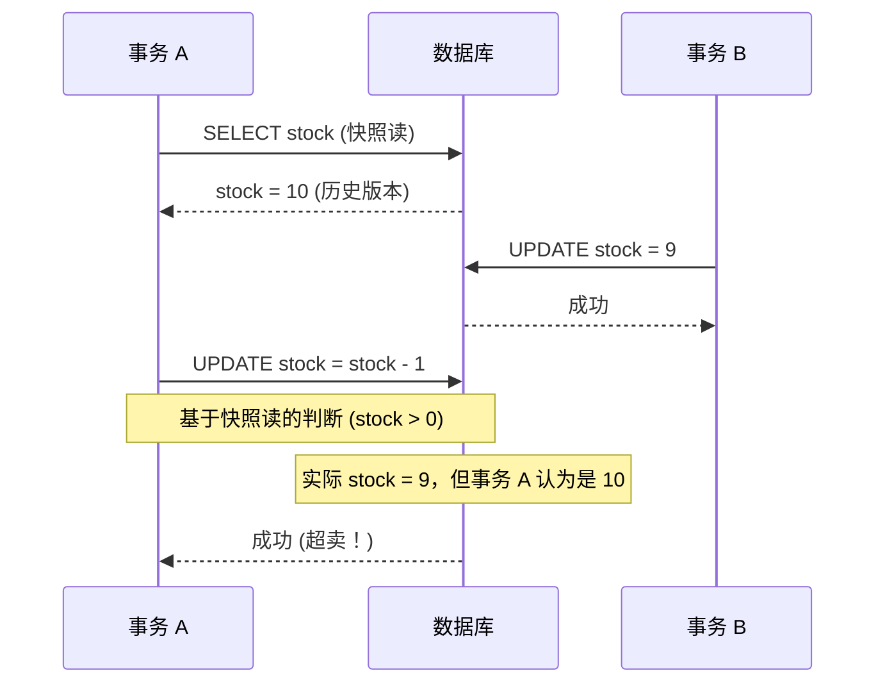

# MySQL 可重复读隔离级别：幻读真的解决了吗？

> **场景定位**：数据库事务高级技术场景  
> **核心设计要点**：MVCC 适用边界、快照读 vs 当前读、并发读写风险、工程化防御方案

---

## 🎯 一句话定位

**MySQL 可重复读隔离级别真的解决幻读了吗？**
```
❌ 错误认知：RR 级别 + MVCC 就彻底解决了幻读
✅ 正确认知：快照读靠 MVCC，当前读靠 Next-Key Lock，但混用会出现"幽灵幻读"
```

**生活化比喻**：
就像你在超市买东西：
- **快照读**：你看的是货架上的标签（历史版本），标签不会因为别人拿走商品而改变
- **当前读**：你走到货架前拿商品（最新提交版本），如果别人正在拿，你们会冲突

**核心特点**：RR 级别不是银弹，分不清快照读与当前读的边界，就可能埋下超卖资损的线上事故。

---

## 💎 核心观点（5 分钟速览版）

> **快速概览**

### 核心观点（3 层防御）

**1. 业务分级，精准匹配读模式**
```
核心写操作链路（库存扣减、资金变更）：
- 统一使用当前读 + 行锁做前置校验
- 禁止用快照读判断后再执行更新
- 从事务写法上杜绝并发下的判断失效

纯查询、报表、统计等非核心场景：
- 正常使用快照读提升并发性能
- 不做过度加锁

拆分事务粒度：
- 核心写事务尽量精简短小
- 避免长事务内快照版本长期不变引发的读写不一致
```

**2. 兜底校验与多层防护**
```
数据库层：
- 给数值类核心字段加约束校验（如库存字段非负约束）
- 作为最后一道防线，即使上层逻辑全部失效，也绝不会出现负数超卖

应用层：
- 核心写操作引入乐观锁机制
- 更新时携带版本号或原始值校验
- 影响行数为零则自动重试，确保更新的是预期数据

运维层：
- 搭建核心数据一致性巡检任务
- 定时核对库存、订单、流水三方数据
- 发现异常自动告警，并触发补偿流程
```

**3. 架构层优化，从根源转移并发压力**
```
热点秒杀、高频扣减类场景：
- 将库存数据前置到 Redis
- 用原子指令完成扣减
- 异步同步回数据库
- 从架构上把高并发写压力从数据库转移到缓存

核心写链路控制并发度：
- 通过分布式限流管控同时进入数据库的写请求数量
- 降低并发冲突概率

大促等高并发场景：
- 开启强校验模式
- 所有核心写操作强制走当前读、加锁、乐观锁双重保障
- 宁可牺牲少量并发性能，也绝不允许数据一致性出问题
```

---

## 🚀 一句话精华（如果只能记住一句）

> **MySQL 可重复读 = 快照读靠 MVCC（一致性视图） + 当前读靠 Next-Key Lock（锁范围） + 三层防御（业务分级/兜底校验/架构优化）**

---

## 一、幽灵幻读：RR 级别最隐蔽的陷阱

### 1.1 真实案例：秒杀超卖事故

**场景描述**：
```
商品库存服务使用默认 RR 隔离级别
扣库存逻辑包在一个事务里：
1. 快照读查询库存数量（确认充足）
2. 执行扣减更新

自测和压测都没测出超卖问题
可秒杀活动上线几秒后
后台就爆出库存被扣成负数，超卖了三十多单
```

**问题排查**：
```
事务日志显示：
- 每个事务单独执行时都读到了正库存
- 也都成功执行了更新
- 没有锁报错
- 也没有脏读、不可重复读的迹象

可就是实实在在出现了多事务同时扣减成功的情况
就像发生了幻读一样
```

**根因分析**：
```
问题出在：快照读与当前读混用，事务内读写持续错位

事务 A：
  SELECT stock FROM products WHERE id = 1;  -- 快照读，返回 10
  -- 事务 B 也读到 10，并扣减成功
  UPDATE products SET stock = stock - 1 WHERE id = 1;  -- 当前读，基于旧快照更新
  
结果：
- 快照读看到 10
- 当前读也看到 10（因为 RR 级别的快照隔离）
- 但实际库存已经被事务 B 扣减了
- 事务 A 基于旧快照更新，导致超卖
```

### 1.2 为什么会出现"幽灵幻读"？

**MVCC 的适用边界**：
```
MVCC 只解决快照读的幻读：
- 快照读基于一致性视图，读取历史版本
- 同一个事务内，多次快照读的结果完全一致
- 天然不会出现幻读

但当前读不一样：
- 当前读读取最新提交版本
- 需要加锁保证并发安全
- MVCC 的历史版本对当前读无效
```

**混用导致的幽灵幻读**：
```
事务 A（RR 级别）：
  SELECT stock FROM products WHERE id = 1;  -- 快照读，返回 10
  -- 事务 B 扣减库存并提交（stock = 9）
  UPDATE products SET stock = stock - 1 WHERE id = 1;  -- 当前读
  
问题：
- 快照读看到 10（历史版本）
- 当前读看到 9（最新提交版本）
- 但 UPDATE 基于快照读的判断（stock > 0），执行扣减
- 结果：超卖
```



---

## 二、第一层防御：业务分级，精准匹配读模式

### 2.1 核心写操作链路：当前读 + 行锁

**核心原则**：
```
库存扣减、资金变更等核心写操作：
- 统一使用当前读 + 行锁做前置校验
- 禁止用快照读判断后再执行更新
- 从事务写法上杜绝并发下的判断失效
```

**❌ 错误示例**（快照读 + 更新）：
```java
// 错误：快照读判断后再更新
@Transactional
public boolean deductStock(String productId, int count) {
    // 快照读：查询库存
    int stock = productMapper.selectStock(productId);  // SELECT stock FROM products WHERE id = ?
    
    // 判断库存是否充足
    if (stock < count) {
        return false;
    }
    
    // 更新库存
    productMapper.deductStock(productId, count);  // UPDATE products SET stock = stock - ? WHERE id = ?
    return true;
}

// 问题：
// 快照读和更新之间，其他事务可能已经扣减了库存
// 导致超卖
```

**✅ 正确示例**（当前读 + 行锁）：
```java
// 正确：当前读 + 行锁
@Transactional
public boolean deductStock(String productId, int count) {
    // 当前读：加锁查询
    int stock = productMapper.selectStockForUpdate(productId);  // SELECT stock FROM products WHERE id = ? FOR UPDATE
    
    // 判断库存是否充足
    if (stock < count) {
        return false;
    }
    
    // 更新库存
    productMapper.deductStock(productId, count);
    return true;
}

// 优势：
// SELECT ... FOR UPDATE 加行锁，阻塞其他事务的写操作
// 保证库存判断和更新在同一锁保护下，不会超卖
```

### 2.2 非核心场景：快照读提升并发

**核心原则**：
```
纯查询、报表、统计等非核心场景：
- 正常使用快照读提升并发性能
- 不做过度加锁
- 允许短时间数据不一致
```

**示例**（报表查询）：
```java
// 报表查询：使用快照读
public List<Order> queryOrders(String userId) {
    // 普通 SELECT，不加锁
    return orderMapper.selectByUserId(userId);  // SELECT * FROM orders WHERE user_id = ?
}

// 优势：
// 快照读不加锁，读写不冲突
// 并发性能高
```

### 2.3 拆分事务粒度

**核心原则**：
```
核心写事务尽量精简短小：
- 避免长事务内快照版本长期不变引发的读写不一致
- 事务执行时间越短，并发冲突概率越低
```

**❌ 错误示例**（长事务）：
```java
// 错误：长事务
@Transactional
public void createOrder(Order order) {
    // 1. 查询库存（快照读）
    int stock = productMapper.selectStock(order.getProductId());
    
    // 2. 调用第三方支付接口（耗时 5 秒）
    paymentService.pay(order);
    
    // 3. 扣减库存
    productMapper.deductStock(order.getProductId(), order.getCount());
    
    // 4. 创建订单
    orderMapper.insert(order);
}

// 问题：
// 事务执行时间 5 秒，库存快照版本长期不变
// 其他事务可能已经扣减了库存，但当前事务看不到
// 导致超卖
```

**✅ 正确示例**（短事务）：
```java
// 正确：短事务
public void createOrder(Order order) {
    // 1. 调用第三方支付接口（耗时 5 秒，不在事务内）
    paymentService.pay(order);
    
    // 2. 扣减库存（短事务）
    deductStock(order.getProductId(), order.getCount());
    
    // 3. 创建订单（短事务）
    createOrderRecord(order);
}

@Transactional
public void deductStock(String productId, int count) {
    int stock = productMapper.selectStockForUpdate(productId);  // 当前读
    if (stock < count) {
        throw new RuntimeException("库存不足");
    }
    productMapper.deductStock(productId, count);
}

@Transactional
public void createOrderRecord(Order order) {
    orderMapper.insert(order);
}

// 优势：
// 事务执行时间短，并发冲突概率低
// 每个事务职责单一，易于维护
```

---

## 三、第二层防御：兜底校验与多层防护

### 3.1 数据库层：约束校验

**核心原则**：
```
给数值类核心字段加约束校验：
- 如库存字段设置非负约束
- 作为最后一道防线
- 即使上层逻辑全部失效，也绝不会出现负数超卖
```

**SQL 示例**：
```sql
-- 添加非负约束
ALTER TABLE products 
MODIFY COLUMN stock INT NOT NULL CHECK (stock >= 0);

-- 或者使用触发器
DELIMITER $$
CREATE TRIGGER before_stock_update
BEFORE UPDATE ON products
FOR EACH ROW
BEGIN
    IF NEW.stock < 0 THEN
        SIGNAL SQLSTATE '45000' 
        SET MESSAGE_TEXT = '库存不能为负数';
    END IF;
END$$
DELIMITER ;
```

### 3.2 应用层：乐观锁机制

**核心原则**：
```
核心写操作引入乐观锁机制：
- 更新时携带版本号或原始值校验
- 影响行数为零则自动重试
- 确保更新的是预期数据
```

**代码示例**（乐观锁）：
```java
// 乐观锁实现
@Transactional
public boolean deductStock(String productId, int count) {
    int maxRetries = 3;
    for (int i = 0; i < maxRetries; i++) {
        // 1. 查询当前库存和版本号
        Product product = productMapper.selectById(productId);
        int stock = product.getStock();
        int version = product.getVersion();
        
        // 2. 判断库存是否充足
        if (stock < count) {
            return false;
        }
        
        // 3. 乐观锁更新（携带版本号）
        int updated = productMapper.deductStockWithVersion(
            productId, count, version
        );  // UPDATE products SET stock = stock - ?, version = version + 1 
            // WHERE id = ? AND version = ?
        
        // 4. 更新成功，返回
        if (updated > 0) {
            return true;
        }
        
        // 5. 更新失败（版本号变化），重试
    }
    
    // 6. 重试次数用完，返回失败
    return false;
}
```

### 3.3 运维层：数据一致性巡检

**核心原则**：
```
搭建核心数据一致性巡检任务：
- 定时核对库存、订单、流水三方数据
- 发现异常自动告警
- 触发补偿流程
```

**代码示例**（定时巡检）：
```java
// 定时巡检任务
@Scheduled(fixedRate = 60000) // 每分钟执行一次
public void reconcileData() {
    // 1. 查询所有商品的库存
    List<Product> products = productMapper.selectAll();
    
    for (Product product : products) {
        // 2. 计算理论库存（进货 - 销售）
        int theoreticalStock = calculateTheoreticalStock(product.getId());
        
        // 3. 对比实际库存
        if (product.getStock() != theoreticalStock) {
            // 4. 库存不一致，告警
            log.error("库存不一致: 商品={}, 实际={}, 理论={}", 
                product.getId(), product.getStock(), theoreticalStock);
            
            // 5. 触发补偿流程
            compensate(product.getId(), theoreticalStock);
        }
    }
}
```

---

## 四、第三层防御：架构层优化

### 4.1 Redis 前置库存

**核心原则**：
```
热点秒杀、高频扣减类场景：
- 将库存数据前置到 Redis
- 用原子指令完成扣减
- 异步同步回数据库
- 从架构上把高并发写压力从数据库转移到缓存
```

**代码示例**（Redis 扣减库存）：
```java
// Redis 扣减库存
public boolean deductStock(String productId, int count) {
    String stockKey = "product:stock:" + productId;
    
    // 1. Redis 原子扣减
    Long stock = redisTemplate.opsForValue().decrement(stockKey, count);
    
    if (stock >= 0) {
        // 2. 扣减成功，异步同步回数据库
        mqProducer.send("deduct_stock", productId, count);
        return true;
    } else {
        // 3. 库存不足，回滚
        redisTemplate.opsForValue().increment(stockKey, count);
        return false;
    }
}

// 消费者：异步同步回数据库
@KafkaListener(topics = "deduct_stock")
public void syncStockToDB(String productId, int count) {
    productMapper.deductStock(productId, count);
}
```

### 4.2 分布式限流

**核心原则**：
```
核心写链路控制并发度：
- 通过分布式限流管控同时进入数据库的写请求数量
- 降低并发冲突概率
```

**代码示例**（分布式限流）：
```java
// 分布式限流（Redis + Lua）
public boolean tryAcquire(String key, int permits, int timeWindow) {
    String luaScript = 
        "local current = redis.call('incr', KEYS[1]) " +
        "if current == 1 then redis.call('expire', KEYS[1], ARGV[1]) end " +
        "return current <= tonumber(ARGV[2])";
    
    Long result = redisTemplate.execute(
        new DefaultRedisScript<>(luaScript, Long.class),
        Collections.singletonList(key),
        timeWindow, permits
    );
    
    return result != null && result > 0;
}

// 使用
public boolean deductStock(String productId, int count) {
    // 1. 限流
    if (!tryAcquire("deduct_stock_limit", 1000, 1)) {
        return false; // 超过限流阈值
    }
    
    // 2. 扣减库存
    return doDeductStock(productId, count);
}
```

### 4.3 大促强校验模式

**核心原则**：
```
大促等高并发场景：
- 开启强校验模式
- 所有核心写操作强制走当前读、加锁、乐观锁双重保障
- 宁可牺牲少量并发性能，也绝不允许数据一致性出问题
```

**配置示例**：
```java
// 大促模式配置
@Configuration
public class PromotionConfig {
    
    @Value("${promotion.mode:false}")
    private boolean promotionMode;
    
    @Bean
    public StockService stockService() {
        if (promotionMode) {
            // 大促模式：强校验
            return new StrictStockService();
        } else {
            // 普通模式：正常校验
            return new NormalStockService();
        }
    }
}

// 大促模式：强校验
public class StrictStockService implements StockService {
    
    @Override
    public boolean deductStock(String productId, int count) {
        // 1. 当前读 + 行锁
        int stock = productMapper.selectStockForUpdate(productId);
        
        // 2. 乐观锁更新
        return productMapper.deductStockWithVersion(productId, count, version);
    }
}
```

---

五、技术深入探讨

### Q1: RR 级别一定没有幻读吗？
**答**：
- 不一定。如果事务内混用快照读和当前读，会出现"幽灵幻读"
- 快照读基于一致性视图，当前读读取最新提交版本
- 两者看到的数据不一致，导致超卖等问题

### Q2: 如何避免 RR 级别的幽灵幻读？
**答**：
- 核心写操作统一使用当前读 + 行锁
- 禁止用快照读判断后再执行更新
- 拆分事务粒度，避免长事务

### Q3: 秒杀场景如何防止超卖？
**答**：
- 三层防御：业务分级 + 兜底校验 + 架构优化
- 业务分级：核心写操作用当前读 + 行锁
- 兜底校验：数据库约束 + 乐观锁 + 数据巡检
- 架构优化：Redis 前置库存 + 分布式限流

### Q4: 为什么很多大厂把 RR 改成 RC？
**答**：
- 间隙锁会大幅增加锁冲突和死锁概率
- 绝大多数业务能接受极少数幻读，换取更高并发性能
- 只有金融级高一致性场景才用 RR

---

## 六、方案总结

**方案总结**：

> **核心认知**：RR 级别不是银弹，分不清快照读与当前读的边界，就可能埋下超卖资损的线上事故。快照读靠 MVCC，当前读靠 Next-Key Lock，但混用会出现"幽灵幻读"。
> 
> **第一层防御**：业务分级，精准匹配读模式。核心写操作统一使用当前读 + 行锁，禁止用快照读判断后再执行更新。拆分事务粒度，避免长事务。
> 
> **第二层防御**：兜底校验与多层防护。数据库层加约束校验（如库存非负约束），应用层引入乐观锁机制，运维层搭建数据一致性巡检任务。
> 
> **第三层防御**：架构层优化。热点秒杀场景将库存前置到 Redis，用原子指令扣减，异步同步回数据库。分布式限流控制并发度，大促场景开启强校验模式。

---

## 七、生产环境 Checklist（部署检查清单）

| 类别 | 检查项 | 状态 | 生活化比喻 |
|------|--------|------|------------|
| **业务分级** | 核心写操作用当前读 + 行锁 | ⬜ | VIP 专用通道 |
| | 非核心查询用快照读 | ⬜ | 普通通道 |
| **兜底校验** | 数据库约束校验 | ⬜ | 最后一道防线 |
| | 乐观锁机制 | ⬜ | 版本号校验 |
| | 数据一致性巡检 | ⬜ | 定期盘点 |
| **架构优化** | Redis 前置库存 | ⬜ | 缓存加速 |
| | 分布式限流 | ⬜ | 控制流量 |
| | 大促强校验模式 | ⬜ | 战时状态 |

---

## 八、总结（一句话带走）

### 🎯 一句话总结

> **MySQL 可重复读 = 快照读靠 MVCC（一致性视图） + 当前读靠 Next-Key Lock（锁范围） + 三层防御（业务分级/兜底校验/架构优化）**

### 🧠 核心记忆点

1. **RR 不是银弹**：混用快照读和当前读会出现"幽灵幻读"，导致超卖等问题。
2. **业务分级**：核心写操作用当前读 + 行锁，非核心查询用快照读。
3. **兜底校验**：数据库约束 + 乐观锁 + 数据巡检，多层防护。
4. **架构优化**：Redis 前置库存 + 分布式限流，从根源转移并发压力。

---

**参考视频**：[内卷的琪某人 - MySQL 可重复读隔离级别怎么解决幻读？](https://v.douyin.com/6frkTBtg3m4/)

---

*本文档基于 8 个专家提示词指导改写，遵循深入浅出、生活化比喻、幽默风趣的教学原则。*
