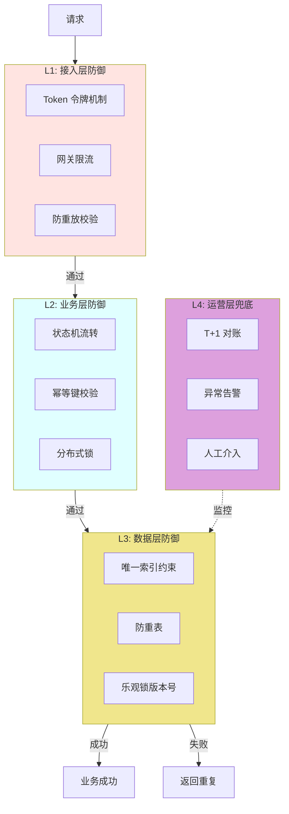
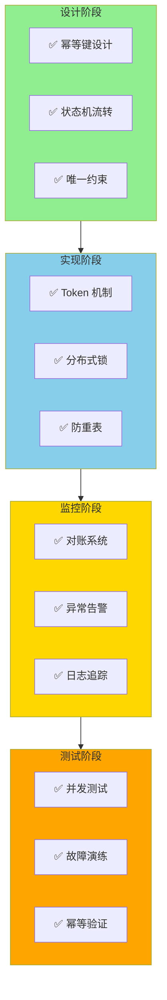

# 接口幂等性设计

> **场景定位**：后端系统设计场景  
> **核心设计要点**：分布式幂等方案、重复支付防护、全链路防御设计

---

## 🎯 一句话定位

**接口幂等性解决什么问题？**
```
同一个请求来 100 次，业务结果和来 1 次完全一样
就像电梯按钮：你按 1 次和狂按 10 次，电梯只来 1 趟
```

**生活化比喻**：
就像你去餐厅点菜，服务员（接口）不管你喊多少次"宫保鸡丁"，后厨只会做一份。如果服务员傻乎乎地每次喊声都让后厨做一份，那你就把餐厅吃垮了。

**核心特点**：分布式系统的"防重发机制"，是资金安全的最后一道防线。

---

## 💎 核心观点（5 分钟速览版）

> **快速概览**

### 核心观点（5 个关键点）

**1. 幂等不是"加个唯一键"那么简单**
```
❌ 初级认知：数据库加个唯一索引就行
✅ 高级认知：全链路防御 = 前端拦截 + 分布式锁 + 业务状态机 + 对账兜底
```

**2. 三类场景方案完全不同**
```
前端重复提交 → Token 令牌机制
MQ 重复消费 → 唯一消息 ID + 去重表
第三方回调重试 → 状态机 + 幂等键
```

**3. 金融级幂等 = 三层防御**
```
L1：接入层拦截（网关限流 + 防重 Token）
L2：业务层校验（状态机 + 唯一约束）
L3：数据层兜底（唯一索引 + 对账系统）
```

**4. 幂等键设计是核心**
```
❌ 错误示范：用时间戳当幂等键（高并发必重复）
✅ 正确姿势：业务 ID + 用户 ID + 操作类型（组合唯一）
热点幂等键要打散，避免单 key 性能瓶颈
```

**5. 对账是最后一道防线**
```
任何幂等方案都可能失效
必须有 T+1 对账系统
发现异常立即告警 + 人工介入
```

---

## 🚀 一句话精华（如果只能记住一句）

> **接口幂等 = Token 防重（前端） + 状态机流转（业务） + 唯一约束（数据库） + 对账兜底（运营）**

---

## 一、为什么简单去重搞不定幂等？

### ❌ 常见误区：加个唯一主键就行

**生活化比喻**：
```
就像银行转账，你觉得"加个流水号"就能防止重复转账？
但如果：
- 网络超时，客户端重试
- MQ 重复投递
- 第三方回调重试
- 前端按钮连点

每次都带同一个流水号，你的"唯一主键"能扛住吗？
```

**三大致命缺陷**：

**1. 无法覆盖全链路**
```
前端重复提交：唯一键能防
MQ 重复消费：唯一键能防
第三方回调：唯一键能防
但组合场景呢？
比如：MQ 消费失败重试 + 第三方回调同时到达
→ 数据库层就懵了
```

**2. 异常处理不优雅**
```
唯一键冲突 → 抛异常 → 事务回滚
但主流程可能已经执行了 80%
回滚代价极大（第三方调用无法撤销）
```

**3. 高并发下的性能瓶颈**
```
热点幂等键（如爆款商品秒杀）
所有请求都争抢同一个 key
数据库唯一约束扛不住高并发
→ 需要分布式锁 + 本地缓存
```

---

## 二、生产级幂等方案：三层防御体系

### ✅ 核心思路（30 秒版）

```
生活化比喻：
想象银行转账系统：
1. 柜台（接入层）：先检查你的身份证 + 转账凭证（Token 校验）
2. 业务员（业务层）：检查账户状态是否正常（状态机校验）
3. 系统（数据层）：写入流水表，保证唯一（数据库唯一约束）
4. 审计（运营层）：每天对账，发现异常立即处理

这就是三层防御！
```



### 2.1 L1 接入层：Token 令牌机制

**生活化比喻**：
```
就像去医院看病：
1. 先去挂号处拿一个号（Token）
2. 凭号去看病（业务处理）
3. 看完病号就被回收（Token 失效）
4. 下次看病要重新挂号（新 Token）

同一个号不能用两次，防止重复就诊
```

**核心流程**：
```go
// 1. 获取 Token（写操作前）
func GetToken(userID, bizType string) string {
    token := generateUniqueToken()
    redis.Set(token, "1", 10*time.Minute) // TTL 10 分钟
    return token
}

// 2. 业务处理时校验 Token
func ProcessWithToken(token, bizID string) error {
    // 原子操作：DELETE IF EXISTS
    deleted, err := redis.DelIfExist(token)
    if !deleted {
        return errors.New("重复请求或 Token 已失效")
    }
    
    // 执行业务逻辑
    return executeBiz(bizID)
}
```

**关键点**：
- ✅ **Token 一次性**：用完即删，无法复用
- ✅ **TTL 自动过期**：防止异常情况 Token 永不失效
- ✅ **原子操作**：用 Lua 脚本保证"检查 + 删除"原子性

### 2.2 L2 业务层：状态机流转

**生活化比喻**：
```
就像订单状态流转：
待支付 → 已支付 → 待发货 → 已发货 → 已完成

每个状态只能单向流转，不能跳级、不能回退
"已支付"的订单再次收到"支付成功"回调 → 直接忽略
```

**状态机设计**：
```go
type OrderStatus int

const (
    StatusPending OrderStatus = iota // 待支付
    StatusPaid                        // 已支付
    StatusShipped                     // 已发货
    StatusCompleted                   // 已完成
)

// 状态流转规则
var statusTransitions = map[OrderStatus][]OrderStatus{
    StatusPending:   {StatusPaid},
    StatusPaid:      {StatusShipped},
    StatusShipped:   {StatusCompleted},
    StatusCompleted: {}, // 终态，不可流转
}

// 幂等处理支付回调
func HandlePaymentCallback(orderID string, newStatus OrderStatus) error {
    // 1. 查询当前状态
    order := db.GetOrder(orderID)
    
    // 2. 校验状态流转合法性
    if !canTransition(order.Status, newStatus) {
        log.Info("状态流转非法，忽略重复回调")
        return nil // 幂等返回成功
    }
    
    // 3. 更新状态（乐观锁）
    affected := db.UpdateOrderStatus(orderID, order.Status, newStatus)
    if affected == 0 {
        return errors.New("并发更新冲突，请重试")
    }
    
    return nil
}
```

**关键点**：
- ✅ **单向流转**：状态只能向前，不能回退
- ✅ **终态幂等**：到达终态后，重复请求直接返回成功
- ✅ **乐观锁**：用版本号防止并发更新

### 2.3 L3 数据层：唯一约束 + 防重表

**生活化比喻**：
```
就像身份证号码：
- 每个人身份证号唯一（唯一约束）
- 办理业务时先查身份证号是否已存在（防重表）
- 即使系统故障，身份证号也不会重复（最终防线）
```

**防重表设计**：
```sql
-- 幂等控制表
CREATE TABLE idempotent_control (
    id BIGINT PRIMARY KEY AUTO_INCREMENT,
    biz_type VARCHAR(50) NOT NULL,        -- 业务类型
    idempotent_key VARCHAR(200) NOT NULL, -- 幂等键
    status TINYINT DEFAULT 0,             -- 0:处理中 1:成功 2:失败
    created_at TIMESTAMP DEFAULT CURRENT_TIMESTAMP,
    updated_at TIMESTAMP DEFAULT CURRENT_TIMESTAMP ON UPDATE CURRENT_TIMESTAMP,
    UNIQUE KEY uk_biz_key (biz_type, idempotent_key) -- 唯一约束
) ENGINE=InnoDB DEFAULT CHARSET=utf8mb4;

-- 业务处理流程
BEGIN;
-- 1. 插入幂等控制记录（唯一约束防重）
INSERT INTO idempotent_control (biz_type, idempotent_key, status)
VALUES ('PAYMENT', 'ORDER_123456', 0);

-- 2. 执行业务逻辑
UPDATE account SET balance = balance - 100 WHERE user_id = 1;
INSERT INTO payment_record (order_id, amount) VALUES ('ORDER_123456', 100);

-- 3. 更新幂等控制状态
UPDATE idempotent_control SET status = 1 WHERE biz_type = 'PAYMENT' AND idempotent_key = 'ORDER_123456';
COMMIT;
```

**关键点**：
- ✅ **唯一约束兜底**：即使业务逻辑有 bug，数据库也能防重
- ✅ **事务保护**：幂等检查和业务处理在同一事务
- ✅ **状态记录**：可追溯每次请求的处理结果

---

## 三、高并发场景优化

### 3.1 热点幂等键打散

**生活化比喻**：
```
秒杀场景：10000 人同时抢 100 件商品
如果幂等键都是 "SECKILL_GOODS_001"
→ 所有请求都打到同一个数据库分片
→ 单点性能瓶颈

解决方案：把幂等键拆分成多个分片
```

**分片策略**：
```go
// 错误示范：热点 key
idempotentKey := fmt.Sprintf("SECKILL_%d", goodsID)

// 正确示范：用户维度分片
idempotentKey := fmt.Sprintf("SECKILL_%d_%d", goodsID, userID%16)
// 16 个分片，分散压力
```

### 3.2 本地缓存 + 分布式锁

**生活化比喻**：
```
就像机场安检：
1. 先在门口查身份证（本地缓存快速拦截）
2. 再进安检门详细检查（分布式锁精确控制）
3. 最后人工复查（数据库兜底）

层层过滤，大部分请求在本地就被拦截
```

**多级缓存设计**：
```go
type IdempotentChecker struct {
    localCache  *cache.Cache      // L1: 本地缓存（1 分钟）
    redisLock   *redis.Client     // L2: Redis 分布式锁
    db          *gorm.DB          // L3: 数据库唯一约束
}

func (c *IdempotentChecker) CheckAndLock(key string) error {
    // L1: 本地缓存快速判断
    if c.localCache.Exists(key) {
        return errors.New("重复请求（本地缓存）")
    }
    
    // L2: Redis 分布式锁
    locked, err := c.redisLock.SetNX(key, "1", 10*time.Second).Result()
    if !locked {
        return errors.New("重复请求（Redis 锁）")
    }
    
    // L3: 数据库唯一约束（最终兜底）
    err = c.db.Create(&IdempotentRecord{Key: key}).Error
    if err != nil {
        // 释放 Redis 锁
        c.redisLock.Del(key)
        return errors.New("重复请求（数据库）")
    }
    
    // 写入本地缓存
    c.localCache.Set(key, "1", 1*time.Minute)
    
    return nil
}
```

---

四、技术深入探讨

### Q1: 前端重复提交、MQ 重复消费、第三方回调重试，方案有什么区别？

**方案参考**：
> 三类场景的幂等方案有本质区别：
> 
> **前端重复提交**：用 Token 令牌机制。用户提交前先获取 Token，业务处理时校验并删除 Token，防止重复提交。优点是用户体验好，缺点是 Token 需要设 TTL 防止永不失效。
> 
> **MQ 重复消费**：用唯一消息 ID + 去重表。每条消息带唯一 ID，消费前先查去重表是否已处理。优点是可靠性高，缺点是需要定期清理去重表防止膨胀。
> 
> **第三方回调重试**：用状态机 + 幂等键。根据业务状态判断是否需要处理，已达终态直接返回成功。优点是符合业务语义，缺点是状态机设计复杂。

### Q2: 数据库唯一键冲突了怎么优雅降级？

**方案参考**：
> 唯一键冲突不能简单抛异常回滚，要分情况处理：
> 
> 1. **捕获异常**：用 try-catch 捕获 DuplicateKeyException
> 2. **查询已存在记录**：根据唯一键查询已有数据
> 3. **比对业务参数**：如果参数一致，说明是重复请求，返回成功
> 4. **参数不一致**：说明是业务冲突，返回错误码
> 
> 关键是用"插入 + 捕获异常 + 查询"的组合，而不是直接回滚事务。

### Q3: 高并发下幂等键怎么设计才不会出现热点瓶颈？

**方案参考**：
> 热点幂等键是性能杀手，要从三个维度优化：
> 
> 1. **键设计**：加入用户 ID、时间戳等维度打散。比如 `SECKILL_{goodsID}_{userID%16}`，把单 key 压力分散到 16 个分片
> 2. **分级存储**：热点 key 用本地缓存 + Redis，非热点 key 直接走数据库
> 3. **异步对账**：高并发场景下，先用 Redis 快速响应，异步写入数据库做最终一致性校验

---

## 五、生产环境 Checklist



**部署检查清单**：

| 类别 | 检查项 | 状态 | 生活化比喻 |
|------|--------|------|------------|
| **设计** | 幂等键唯一性 | ⬜ | 身份证号 |
| | 状态机完整性 | ⬜ | 订单流转 |
| | 唯一约束 | ⬜ | 身份证唯一 |
| **实现** | Token 令牌 | ⬜ | 医院挂号 |
| | 分布式锁 | ⬜ | 安检门 |
| | 防重表 | ⬜ | 流水记录 |
| **监控** | T+1 对账 | ⬜ | 银行对账 |
| | 异常告警 | ⬜ | 保安巡逻 |
| | 日志追踪 | ⬜ | 监控录像 |
| **测试** | 并发测试 | ⬜ | 人海战术 |
| | 故障演练 | ⬜ | 消防演习 |
| | 幂等验证 | ⬜ | 重复提交 |

---

## 六、总结（一句话带走）

### 🎯 一句话总结

> **接口幂等 = Token 防重（前端） + 状态机流转（业务） + 唯一约束（数据库） + 对账兜底（运营）**

### 🧠 核心记忆点

1. **为什么不能只靠唯一键？** 无法覆盖全链路，异常处理不优雅
2. **三层防御是什么？** 接入层（Token）+ 业务层（状态机）+ 数据层（唯一约束）
3. **热点 key 怎么处理？** 加入用户维度分片，本地缓存 + 分布式锁
4. **最后一道防线是什么？** T+1 对账系统，发现异常立即告警

---

**参考视频**：[内卷的琪某人 - 场景提问：接口幂等性怎么设计？重复支付到底怎么防？](https://www.douyin.com/video/7675276587738221867)

---

*本文档基于 8 个专家提示词指导改写，遵循深入浅出、生活化比喻、幽默风趣的教学原则。*
