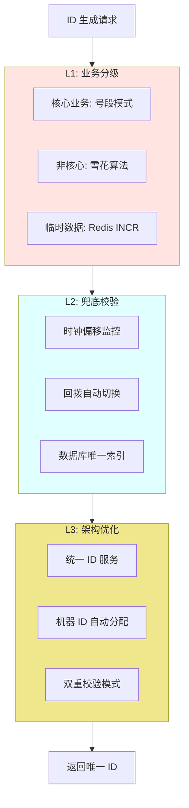

# 分布式 ID 生成

> **场景定位**：后端系统设计场景  
> **核心设计要点**：雪花算法、时钟回拨、号段模式、高可用设计

---

## 🎯 一句话定位

**分布式 ID 解决什么问题？**
```
分布式系统里，每个数据都需要唯一标识
就像每个人都需要身份证号，不能重复
```

**生活化比喻**：
就像全国 14 亿人，每个人的身份证号都唯一。分布式 ID 就是给数据发"身份证号"，保证全球唯一。

**核心特点**：唯一性、有序性、高可用、高性能。

---

## 💎 核心观点（5 分钟速览版）

### 核心观点（5 个关键点）

**1. 雪花算法不是万能的**
```
❌ 误区：雪花算法绝对安全
✅ 真相：时钟回拨会导致 ID 重复
生产环境必须有兜底方案
```

**2. 三类方案场景不同**
```
雪花算法：高性能，但依赖时钟
号段模式：强唯一，但依赖数据库
Redis INCR：简单，但持久化有风险
```

**3. 时钟回拨是幽灵陷阱**
```
运维校准时间 → 时钟回拨 → ID 重复
必须有时钟偏移监控 + 自动切换机制
```

**4. 业务分级差异化方案**
```
核心订单：号段模式（强唯一）
日志/消息：雪花算法（高性能）
机器 ID：注册中心自动分配
```

**5. 数据库唯一索引是最终防线**
```
即使 ID 生成逻辑异常
数据库唯一约束也能防止重复数据入库
```

---

## 🚀 一句话精华

> **分布式 ID = 雪花算法（高性能） + 号段模式（强唯一） + 时钟回拨兜底 + 数据库唯一约束**

---

## 一、为什么雪花算法会翻车？

### ❌ 雪花算法的三大隐患

**生活化比喻**：
```
雪花算法就像用"时间 + 地点 + 顺序号"生成身份证号：
- 时间：当前时间戳
- 地点：机器 ID
- 顺序号：同一毫秒内的序列号

但如果有人把时钟往回拨，同一时间同一地点就会生成相同 ID！
```

**隐患 1：时钟回拨**
```
场景：运维校准服务器时间
时钟从 2024-01-01 12:00:00 → 2024-01-01 11:59:50
→ 这 10 秒内生成的 ID 全部可能重复！

真实案例：
某电商机房做时间同步，时钟回拨 5 分钟
结果：几百笔订单 ID 重复，财务对账直接崩了
```

**隐患 2：机器 ID 冲突**
```
容器化部署：
Pod 重启 → IP 变化 → 机器 ID 变化
如果手动配置机器 ID，扩容时容易重复
```

**隐患 3：实例扩容错位**
```
机器位数固定（如 10 位 = 1024 台）
超过 1024 台怎么办？
需要重新设计 ID 结构或引入注册中心
```

---

## 二、生产级方案：三层防御体系

### ✅ 核心思路（30 秒版）

```
生活化比喻：
银行发银行卡号：
1. 核心卡（信用卡）：号段模式，严格管控，绝对唯一
2. 普通卡（储蓄卡）：雪花算法，高性能，偶尔容错
3. 临时卡：Redis INCR，简单快速

不同场景用不同方案！
```



### 2.1 号段模式（核心业务）

**生活化比喻**：
```
就像户籍中心批量发身份证号：
1. 从户籍中心领 1000 个号（1000-1999）
2. 本地用完再领下一批（2000-2999）
3. 完全不依赖时钟，绝对唯一

优点：强一致，不怕时钟回拨
缺点：依赖数据库，性能有上限
```

**核心实现**：
```go
type SegmentIDGenerator struct {
    db        *gorm.DB
    current   int64  // 当前 ID
    max       int64  // 当前号段最大值
    step      int64  // 号段步长（如 1000）
    bizType   string // 业务类型
    mu        sync.Mutex
}

func (g *SegmentIDGenerator) NextID() (int64, error) {
    g.mu.Lock()
    defer g.mu.Unlock()
    
    // 当前号段用完，重新申请
    if g.current >= g.max {
        err := g.fetchNewSegment()
        if err != nil {
            return 0, err
        }
    }
    
    g.current++
    return g.current, nil
}

func (g *SegmentIDGenerator) fetchNewSegment() error {
    // 原子更新：UPDATE SET max = max + step WHERE biz_type = ?
    result := g.db.Raw(`
        UPDATE id_segment 
        SET max_value = max_value + step, 
            updated_at = NOW()
        WHERE biz_type = ?
    `, g.bizType).Exec()
    
    if result.Error != nil {
        return result.Error
    }
    
    // 查询新的 max 值
    var segment IDSgement
    g.db.Where("biz_type = ?", g.bizType).First(&segment)
    
    g.current = segment.MaxValue - segment.Step
    g.max = segment.MaxValue
    return nil
}
```

**关键点**：
- ✅ **强唯一**：不依赖时钟，绝对唯一
- ✅ **批量申请**：一次领 1000 个，减少数据库压力
- ✅ **双 Buffer 优化**：当前号段用到 80% 时，异步加载下一号段

### 2.2 雪花算法（非核心业务）

**核心结构**：
```
64 位 ID 结构：
0 - 41 位时间戳 - 10 位机器 ID - 12 位序列号
  |               |              |
  |               |              └─ 每毫秒 4096 个 ID
  |               └─ 1024 台机器
  └─ 69 年时间范围
```

**时钟回拨处理**：
```go
type SnowflakeGenerator struct {
    machineID     int64
    lastTimestamp int64
    sequence      int64
    mu            sync.Mutex
}

func (g *SnowflakeGenerator) NextID() (int64, error) {
    g.mu.Lock()
    defer g.mu.Unlock()
    
    timestamp := time.Now().UnixMilli()
    
    // 时钟回拨检测
    if timestamp < g.lastTimestamp {
        offset := g.lastTimestamp - timestamp
        if offset <= 5 { // 小幅回拨（<5ms）
            // 等待时钟追上
            time.Sleep(time.Duration(offset*2) * time.Millisecond)
            timestamp = time.Now().UnixMilli()
            if timestamp < g.lastTimestamp {
                return 0, errors.New("时钟仍然回拨")
            }
        } else { // 大幅回拨
            // 切换到备用号段模式
            return g.segmentFallback()
        }
    }
    
    // 同一毫秒，序列号递增
    if timestamp == g.lastTimestamp {
        g.sequence = (g.sequence + 1) & 0xFFF
        if g.sequence == 0 { // 序列号溢出
            // 等待下一毫秒
            for timestamp <= g.lastTimestamp {
                timestamp = time.Now().UnixMilli()
            }
        }
    } else {
        g.sequence = 0
    }
    
    g.lastTimestamp = timestamp
    
    // 组合 ID
    id := (timestamp << 22) | (g.machineID << 12) | g.sequence
    return id, nil
}
```

**关键点**：
- ✅ **小幅回拨**：等待时钟追上
- ✅ **大幅回拨**：自动切换号段模式
- ✅ **序列号溢出**：等待下一毫秒

### 2.3 数据库唯一索引（最终防线）

```sql
-- 所有业务表都要加唯一索引
CREATE TABLE orders (
    id BIGINT PRIMARY KEY,
    order_no VARCHAR(64) NOT NULL,
    -- 其他字段...
    UNIQUE KEY uk_order_no (order_no) -- 最终防线
) ENGINE=InnoDB DEFAULT CHARSET=utf8mb4;

-- 即使 ID 生成逻辑异常，唯一约束也能防重
INSERT INTO orders (id, order_no) VALUES (?, ?)
-- 如果 order_no 重复，会抛出 DuplicateKeyException
```

---

三、技术深入探讨

### Q1: 时钟回拨怎么快速止损？

**方案参考**：
> 时钟回拨是雪花算法的致命缺陷，止损方案分三步：
> 
> 1. **监控预警**：实时监控服务器时钟偏移，超过阈值（如 10ms）立即告警
> 2. **自动切换**：检测到回拨后，自动切换到号段模式，不依赖时钟
> 3. **双重校验**：生成 ID 后，异步校验唯一性，发现重复立即修复
> 
> 关键是不能禁止运维校准时钟，而是从架构层面容忍时钟异常。

### Q2: 核心订单和日志 ID 方案有什么区别？

**方案参考**：
> 业务分级是 ID 设计的核心原则：
> 
> **核心订单/支付流水**：号段模式。强一致性要求，不能容忍任何重复。性能要求相对低（万级 QPS），号段模式完全够用。
> 
> **日志/消息 ID**：雪花算法。性能要求高（十万级 QPS），允许极低概率重复。即使重复也不影响核心业务。
> 
> **机器 ID**：注册中心自动分配。禁止手动配置，防止扩容时冲突。

---

## 四、总结

### 🎯 一句话总结

> **分布式 ID = 号段模式（核心业务） + 雪花算法（非核心） + 时钟回拨兜底 + 数据库唯一约束**

### 🧠 核心记忆点

1. **雪花算法的致命缺陷**：时钟回拨会导致 ID 重复
2. **号段模式的优势**：不依赖时钟，强唯一
3. **时钟回拨怎么处理**：小幅等待，大幅切换号段模式
4. **最终防线**：数据库唯一索引

---

**参考视频**：[内卷的琪某人 - 场景提问：分布式 ID 怎么生成？](https://www.douyin.com/video/7673832693653687588)

---

*本文档基于 8 个专家提示词指导改写，遵循深入浅出、生活化比喻、幽默风趣的教学原则。*
