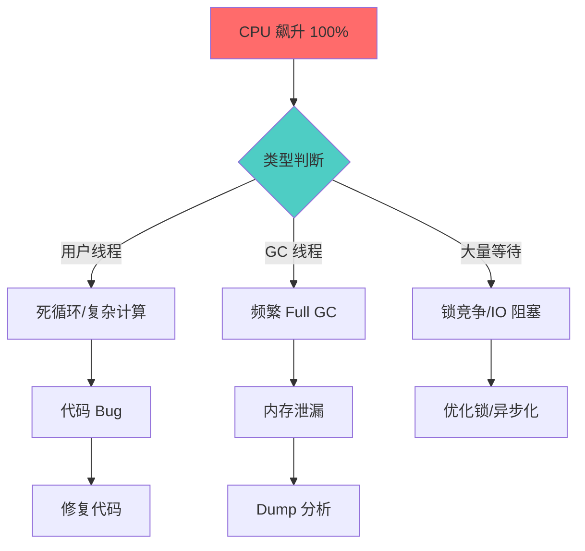

# 线上 CPU 飙升排查

> **场景定位**：线上故障排查技术场景  
> **核心设计要点**：故障排查、应急止损、根因分析、长效治理

---

## 🎯 一句话定位

**CPU 飙升排查解决什么问题？**
```
线上服务 CPU 突然打满（100%），接口全线超时
快速定位根因，紧急止损，防止服务雪崩
```

**生活化比喻**：
就像家里突然停电：
1. 先检查是不是跳闸了（快速止损）
2. 再检查哪个电器短路了（根因定位）
3. 最后换保险丝/修电器（修复）

**核心特点**：先止血再治病，不能为了找根因让服务一直挂着。

---

## 💎 核心观点（5 分钟速览版）

### 核心观点（5 个关键点）

**1. 先止损后排查**
```
❌ 错误：先打线程栈找问题
✅ 正确：先摘流量/扩容/降级，再慢慢查

服务已经挂了，找根因有什么用？
```

**2. 三类根因差异化处理**
```
死循环：代码 bug，直接 kill 进程重启
频繁 Full GC：内存问题，dump 堆快照分析
流量洪峰：限流降级，弹性扩容
```

**3. 排查工具选择**
```
top：看进程 CPU 使用率
jstack：打线程栈（有侵入）
arthas：无侵入排查（推荐）
火焰图：可视化性能瓶颈
```

**4. 死循环 vs GC 问题区分**
```
死循环：CPU 高，但 GC 正常
频繁 GC：CPU 高，GC 日志频繁

一个改代码，一个调内存
```

**5. 长效治理机制**
```
压测验证 → 监控告警 → 故障演练 → 防御性编码
不能每次都靠重启续命
```

---

## 🚀 一句话精华

> **CPU 飙升 = 先止损（摘流量/扩容） + 再排查（top/arthas/火焰图） + 后治理（压测/监控/演练）**

---

## 一、故障应急止损（第一优先级）

### 1.1 紧急止损三板斧

**生活化比喻**：
```
火灾现场：
1. 先报警 + 灭火（止损）
2. 再调查起火原因（排查）
3. 最后加强消防措施（治理）

不能火势都控制不住，还在调查烟从哪里冒出来的
```

**三板斧**：
```
1. 摘流量：把故障机器从负载均衡摘除
2. 扩容：紧急加机器，分摊压力
3. 降级：关闭非核心功能，保核心链路
```

**操作示例**：
```bash
# 1. 摘流量（Nginx 配置）
upstream backend {
    server 192.168.1.100 down;  # 标记为下线
    server 192.168.1.101;
    server 192.168.1.102;
}

# 2. 扩容（K8s）
kubectl scale deployment order-service --replicas=20

# 3. 降级（配置中心）
# 关闭非核心功能（积分、消息推送等）
feature.degrade.points = true
feature.degrade.push = true
```

### 1.2 根因快速定位

**排查工具选择**：
```go
// 1. top 命令：看进程 CPU 使用率
top -p <pid>

// 2. jstack：打线程栈（有侵入，会暂停应用）
jstack <pid> > thread_dump.txt

// 3. arthas：无侵入排查（推荐）
// 安装
curl -O https://arthas.aliyun.com/arthas-boot.jar
java -jar arthas-boot.jar

// 查看线程 CPU 使用情况
thread -n 3

// 查看具体线程堆栈
thread <thread_id>

// 4. 火焰图：可视化性能瓶颈
// 生成火焰图
profiler start
# 等待 30 秒
profiler stop --file flamegraph.html
```

**根因分类**：


---

## 二、三类根因排查

### 2.1 死循环（代码 Bug）

**特征**：
```
CPU 高：某些线程一直 100%
GC 正常：没有频繁 Full GC
重启后：很快复现
```

**排查步骤**：
```bash
# 1. 找到 CPU 最高的进程
top -c

# 2. 找到该进程中 CPU 最高的线程
top -Hp <pid>

# 3. 转换线程 ID 为十六进制
printf "%x\n" <thread_id>

# 4. 用 jstack 打线程栈
jstack <pid> | grep <hex_thread_id> -A 50

# 5. 分析堆栈，定位代码行
```

**典型案例**：
```go
// ❌ 死循环 Bug
func ProcessOrder(order *Order) {
    for {
        if order.Status == "completed" {
            break
        }
        // Bug: 忘记更新 order.Status
        // 无限循环
    }
}

// ✅ 修复
func ProcessOrder(order *Order) {
    for {
        if order.Status == "completed" {
            break
        }
        order.Status = updateStatus(order)
        time.Sleep(100 * time.Millisecond) // 防止 CPU 飙高
    }
}
```

### 2.2 频繁 Full GC（内存问题）

**特征**：
```
CPU 高：GC 线程占用大量 CPU
GC 日志：频繁触发 Full GC
堆内存：老年代占用率高
```

**排查步骤**：
```bash
# 1. 查看 GC 情况
jstat -gcutil <pid> 1000

# 输出示例：
#  S0     S1     E      O      M     CCS    YGC     YGCT    FGC    FGCT     GCT
#  0.00   50.00  25.00  95.00  95.00 90.00    100    5.000     50   20.000   25.000
#                                               ↑       ↑
#                                           Full GC 次数  Full GC 耗时

# 2. Dump 堆内存
jmap -dump:format=b,file=heap.hprof <pid>

# 3. 用 MAT/JProfiler 分析
# 找到占用内存最大的对象
```

**典型案例**：
```go
// ❌ 内存泄漏
var globalCache = make(map[string][]byte)

func ProcessData(key string, data []byte) {
    // Bug: 只写不删，无限增长
    globalCache[key] = data
}

// ✅ 修复：设置过期时间
var globalCache = cache.New(10*time.Minute, 30*time.Second)

func ProcessData(key string, data []byte) {
    globalCache.Set(key, data, cache.DefaultExpiration)
}
```

### 2.3 流量洪峰（容量问题）

**特征**：
```
CPU 高：所有线程都在处理请求
GC 正常：内存使用正常
请求量：QPS 远超预期
```

**解决方案**：
```go
// 1. 限流
func RateLimitMiddleware(next http.Handler) http.Handler {
    limiter := rate.NewLimiter(1000, 10) // 1000 QPS
    
    return http.HandlerFunc(func(w http.ResponseWriter, r *http.Request) {
        if !limiter.Allow() {
            http.Error(w, "rate limit exceeded", http.StatusTooManyRequests)
            return
        }
        next.ServeHTTP(w, r)
    })
}

// 2. 降级
func DegradeMiddleware(next http.Handler) http.Handler {
    return http.HandlerFunc(func(w http.ResponseWriter, r *http.Request) {
        // 非核心接口直接返回降级数据
        if isNonCoreAPI(r.URL.Path) && isPeakTime() {
            w.Write([]byte(`{"code": 503, "msg": "服务降级中"}`))
            return
        }
        next.ServeHTTP(w, r)
    })
}

// 3. 扩容
// K8s HPA 自动扩容
apiVersion: autoscaling/v1
kind: HorizontalPodAutoscaler
metadata:
  name: order-service-hpa
spec:
  scaleTargetRef:
    apiVersion: apps/v1
    kind: Deployment
    name: order-service
  minReplicas: 5
  maxReplicas: 20
  targetCPUUtilizationPercentage: 70
```

---

## 三、长效治理机制

### 3.1 压测验证

**全链路压测**：
```go
// 压测场景
func BenchmarkOrderService(b *testing.B) {
    // 模拟高并发场景
    var wg sync.WaitGroup
    
    for i := 0; i < b.N; i++ {
        wg.Add(1)
        go func() {
            defer wg.Done()
            client.Post("/api/order/create", orderData)
        }()
    }
    
    wg.Wait()
}

// 压测指标
// - CPU 使用率 < 70%
// - 内存使用率 < 80%
// - P99 延迟 < 500ms
// - 错误率 < 0.1%
```

### 3.2 监控告警

**核心指标**：
```yaml
# Prometheus 监控
groups:
  - name: cpu
    rules:
      - alert: HighCPU
        expr: process_cpu_usage > 0.8
        for: 5m
        annotations:
          summary: "CPU 使用率超过 80%"
          
      - alert: HighGC
        expr: rate(jvm_gc_pause_seconds_count[5m]) > 10
        annotations:
          summary: "GC 频率过高"
```

### 3.3 故障演练

**定期演练**：
```
每季度做一次故障演练：
1. 模拟 CPU 飙升场景
2. 检验监控告警是否生效
3. 检验应急预案是否有效
4. 复盘改进
```

---

四、技术深入探讨

### Q1: 死循环和频繁 GC 怎么区分？

**方案参考**：
> 两类问题特征完全不同：
> 
> **死循环**：
> - CPU 高：某些线程一直 100%
> - GC 正常：没有频繁 Full GC
> - 堆内存：正常
> - 解决：改代码 Bug
> 
> **频繁 Full GC**：
> - CPU 高：GC 线程占用大量 CPU
> - GC 日志：频繁触发 Full GC
> - 堆内存：老年代占用率高
> - 解决：Dump 分析，修复内存泄漏
> 
> 用 jstat -gcutil 一看就清楚了。

### Q2: 线上机器不能随便打栈怎么办？

**方案参考**：
> jstack 打栈会暂停应用（STW），线上慎用。推荐用 arthas：
> 
> 1. **无侵入**：不需要重启应用
> 2. **实时查看**：thread -n 3 看 CPU 最高的线程
> 3. **动态追踪**：trace 方法耗时
> 4. **热修复**：紧急情况下可以热更新代码
> 
> arthas 是阿里开源的线上排查神器，必须掌握。

---

## 五、总结

### 🎯 一句话总结

> **CPU 飙升 = 先止损（摘流量/扩容/降级） + 再排查（top/arthas/火焰图） + 后治理（压测/监控/演练）**

### 🧠 核心记忆点

1. **先止损后排查**：服务挂了找根因没用
2. **三类根因**：死循环（改代码）、频繁 GC（调内存）、流量洪峰（限流扩容）
3. **排查工具**：arthas 无侵入排查（推荐）
4. **长效治理**：压测 + 监控 + 演练

---

**参考视频**：[内卷的琪某人 - 场景提问：线上 CPU 飙升 100% 怎么排查？](https://www.douyin.com/video/7673461765052697866)

---

*本文档基于 8 个专家提示词指导改写，遵循深入浅出、生活化比喻、幽默风趣的教学原则。*
