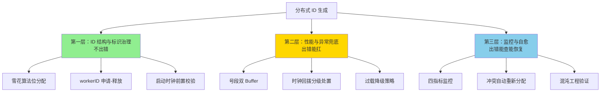
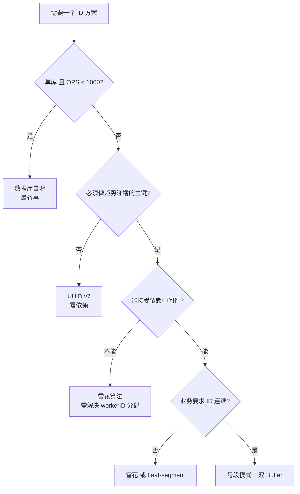

# 分布式 ID 生成方案：雪花算法与号段模式

> **问题域**：分布式系统 / 分库分表后的主键生成
> **技术栈**：语言无关。代码以 Go 举例，Java 生态对应 Leaf、UidGenerator、TinyID
> **难度**：⭐⭐⭐⭐（需要了解分库分表与并发基础）
> **阅读时长**：5 分钟看「速览」｜20 分钟读全文｜30 分钟含自测题

---

## 🎯 一句话定位

**分布式 ID 解决什么问题？**

> 系统拆成多库多节点之后，"数据库自增主键"这条路断了——每个库都从 1 开始发号，必然撞车。所以需要一套**全局唯一、尽量有序、性能扛得住**的发号机制。

**生活化比喻**：
> 身份证号。14 亿人不能重号，但你又希望号段大致能按地区、按出生年份排序——这就是"全局唯一 + 趋势递增"。

**不适合谁**：单库单表、数据量 < 千万。这种情况直接用数据库自增，引入这套复杂度纯属自找麻烦。

---

## ⚡ 5 分钟速览版（赶时间看这里）

**核心结论一句话**：
> **用位分配换性能，用 workerID 换唯一性，用 buffer 换可用性；时钟回拨是唯一能真正打破唯一性的裂缝。**

**五个必须记住的点**：

| # | 要点 | 一句话记忆 |
|---|---|---|
| 1 | 雪花 = 1 符号 + 41 时间戳 + 10 机器 + 12 序列 | **时间的切片 + 机器的编号** |
| 2 | 唯一性只由 `workerID` 保证，**不是时钟同步** | **时钟只管有序，机器号才管不撞** |
| 3 | 时钟回拨按幅度分 4 级处置 | **小回拨等，中回拨换号，大回拨摘节点** |
| 4 | 号段模式用双 Buffer 把 DB 抖动挡在门外 | **提前备料，而不是饿肚子了才去买** |
| 5 | 容器化下 workerID 必须申请-释放，不能硬编码 | **Pod 天天重建，硬编码必撞号** |

**选型速查**：

```
单库 且 QPS<1000        → 数据库自增
需要主键但不需要严格有序  → UUID v7
大规模 + 要趋势递增      → 雪花算法
要求连续 / 要抗 DB 抖动  → 号段模式（Leaf-segment）
```

---

## 🗺 知识地图（先看地图，再进细节）



**三层是递进的**：第一层决定**故障概率**，第二层决定**故障影响面**，第三层决定**恢复速度**。

> 后文的三、五、六节分别对应这三层。不必一次读完——按层看，每层都能独立成篇。

---

## 〇、从场景开始：一个订单号引发的血案

**设定一个真实场景，贯穿全文**：

> 你负责电商订单服务，当前状况：
> - **日订单 5000 万**，峰值 **2 万 TPS**（大促再翻 3 倍）
> - **3 个机房**，K8s 部署，Pod 每天重建上百次
> - 订单表**分 16 库 256 表**
>
> 现在要给订单号设计发号方案。你会被这些问题连环追问：

| # | 场景逼出来的问题 | 后文位置 |
|---|---|---|
| 1 | 16 个库都自增，怎么保证不重复？ | 第 2 节 |
| 2 | 2 万 TPS 下，发号会不会拖垮链？ | 第 3 节 |
| 3 | 机器时钟被 NTP 调回 1 秒，会怎样？ | 第 4 节 |
| 4 | 发号服务依赖的 DB 挂了，还能发号吗？ | 第 5 节 |
| 5 | Pod 反复重建，机器号怎么不重复分配？ | 第 6 节 |

**请带着这 5 个问题往下读**——每读完一层，回头看一眼能答几个。这比从头背到尾有效得多。

---

## 一、需求边界：什么叫"好"的分布式 ID

| 要求 | 大白话 | 不满足会怎样 | 优先级 |
|---|---|---|---|
| **全局唯一** | 绝对不能重号 | 主键冲突、订单被覆盖 | **底线** |
| **趋势递增** | 大致越来越大就行 | B+ 树频繁页分裂，写入放大 | 加分项 |
| **高性能** | 发号不能成为瓶颈 | 发号慢了，全站写操作排队 | 工程约束 |
| **高可用** | 没有单点 | 发号服务挂了 = 全站不能下单 | 工程约束 |
| **信息安全** | 别让人算出你的业务量 | 竞对用订单号除以天数量，估出你的日单量 | 视业务 |
| **可读性** | 能看出时间、机房 | 排查问题靠猜 | 弱需求 |

> ⚠️ **最容易搞混的两个词**：
> - **递增**（趋势变大）= 索引友好，**必须**
> - **连续**（1,2,3,4 无空洞）= 业务好看，**不必须**
>
> 追求"连续"会逼你每次都访问 DB，性能和可用性全毁。绝大多数业务要的只是"递增"。

---

## 二、方案全景：有哪几条路，各自代价是什么

### 2.1 八种方案横向对比

| 方案 | 大白话 | 唯一性 | 有序 | 性能 | 依赖 | 什么时候用 |
|---|---|---|---|---|---|---|
| **DB 自增** | 让数据库帮你数数 | ✅ | ✅ 连续 | 低 | 强依赖 DB | 单库、小规模 |
| **DB 多步长** | 每个库步伐不同（1,4,7…） | ✅ | ✅ 递增 | 中 | 强依赖 DB | 小规模分库 |
| **UUID v4** | 随机数，撞上算你运气差 | ✅ | ❌ 乱 | 极高 | 无 | 日志追踪，**不当主键** |
| **UUID v7** | 带时间前缀的 UUID | ✅ | ✅ 时间有序 | 极高 | 无 | 可当主键（RFC 9562） |
| **Redis INCR** | 计数器 +1 | ⚠️ 主从切换可能重 | ✅ | 极高 | 强依赖 Redis | 中小规模，可容忍极小概率重 |
| **雪花算法** | 时间 + 机器号 + 序号拼起来 | ✅ 靠机器号不冲突 | ✅ 递增 | 极高（纯本地） | 只需分配机器号 | **大规模主力** |
| **号段模式** | 一次领一批，慢慢发 | ✅ | ✅ 递增（不连续） | 高 | 低频依赖 DB | 要抗 DB 抖动 |
| **Leaf / UidGenerator / TinyID** | 别人造好的轮子 | ✅ | ✅ | 高 | 各自 | 生产级直接选 |

**⚠️ 特别澄清两个常见错误说法**：

1. **"Redis INCR 是强一致、绝对唯一"——错。** Redis 主从是**异步复制**，主库宕机切从库可能丢一段增量，导致 ID 回退、产生重复。Redis 给的是**高性能**，不是强一致。用它必须配业务侧唯一索引兜底。
2. **"UUID 不能做主键"——不完全对。** UUID v4 确实会因为无序导致 B+ 树页分裂；但 **UUID v7**（前 48 位是毫秒时间戳）是时间有序的，完全可以做分布式主键，而且零依赖。

### 2.2 选型决策树



### 2.3 四栏记忆表

| 概念 | 大白话 | 生活比喻 | 一句话记忆 |
|---|---|---|---|
| 全局唯一 | 不能重号 | 身份证号 | 重号 = 数据灾难 |
| 趋势递增 | 大致越来越大 | 排队领号 | 有序 ≠ 连续 |
| 雪花算法 | 时间+机器+序号 | 出生时间+户籍地+顺序 | 本地生成，不依赖任何人 |
| 号段模式 | 一次领一批 | 批发一叠号码本 | 1000 次发号只碰 1 次 DB |
| 双 Buffer | 提前领好下一批 | 餐厅提前备料 | 不饿肚子才去买菜 |
| workerID | 机器自己的编号 | 工位号 | 唯一性的唯一来源 |

---

## 三、第一层：ID 结构与全局标识治理（雪花算法）

> **这一层要解决的问题**：把 ID 的结构规划好，让机器号有合法来源——**目标是"不出错"**。

### 3.1 结构：64 位怎么切

```
┌───┬─────────────────────┬──────────────┬──────────────┐
│ 0 │  41 位时间戳(毫秒)   │ 10 位 workerID│ 12 位序列号  │
└───┴─────────────────────┴──────────────┴──────────────┘
 符号位    约 69.7 年          1024 个节点     每毫秒 4096 个
```

| 字段 | 位数 | 容量 | 关键点 |
|---|---|---|---|
| 符号位 | 1 | 恒为 0 | 保证正数，兼容 `long` / `int64` |
| 时间戳 | 41 | 2^41 ms ≈ **69.7 年** | **从哪个 epoch 起算，决定你能用多久** |
| workerID | 10 | 1024 | **唯一性完全靠它** |
| 序列号 | 12 | 4096/ms | 单节点理论上限 409.6 万/s |

### 3.2 三个必须答对的细节

**① epoch 从哪算起？用完了怎么办？**

- epoch 是代码里的常量。Twitter 原始实现用 `2010-11-04`，国内多数用 `2021-01-01 00:00:00 UTC`（毫秒值 `1609459200000`）。
- **epoch 一旦上线就不能改**，改了会导致新旧 ID 冲突。
- 69.7 年到期后：提前规划新 epoch 灰度切换，或把时间位从 41 扩到 42/43（但会挤占 workerID，属于**不兼容变更**，要提前很多年规划）。

**② 10 位 workerID 为什么要拆成 5+5？**

拆成 **5 位机房（32 个）+ 5 位机器（32 台）**：

- 扩容时编号有语义：`机房 2、机器 7` → 一眼知道是哪台机器发的号
- 多机房部署时可以按机房分段，跨机房迁移不影响
- 排障成本大幅下降（否则拿到 `workerID=723` 你得反查是哪个 Pod）

**③ 序列号一毫秒用完了怎么办？**

4096 个用尽 → 必须等下一毫秒。**但等待方式很关键**：

```go
// ❌ 错误：裸自旋，会打满一个 CPU 核，且不产生 ID
for now <= s.lastMs {
    now = time.Now().UnixNano() / 1e6
}

// ✅ 正确：让出 CPU，避免空转
for now <= s.lastMs {
    runtime.Gosched()                    // 或 time.Sleep(50 * time.Microsecond)
    now = s.clock()
}
```

这个是真实踩过的坑：压测时 CPU 100% 但 QPS 上不去，就是这个循环在空转。

### 3.3 实现要点（Go 示例，逻辑与语言无关）

```go
const (
    epoch       = int64(1609459200000)       // 2021-01-01T00:00:00Z，不可随意更改
    workerBits  = 10
    seqBits     = 12
    maxWorker   = int64(1<<workerBits) - 1   // 1023
    maxSeq      = int64(1<<seqBits) - 1      // 4095
    timeShift   = workerBits + seqBits
    workerShift = seqBits
)

type Snowflake struct {
    mu       sync.Mutex
    lastMs   int64
    workerID int64
    seq      int64
    clock    func() int64 // 注入时钟：便于单测构造回拨场景
}

func (s *Snowflake) Next() (int64, error) {
    s.mu.Lock()
    defer s.mu.Unlock()

    now := s.clock()
    switch {
    case now == s.lastMs:                 // 同一毫秒
        s.seq = (s.seq + 1) & maxSeq
        if s.seq == 0 {                   // 本毫秒 4096 个用尽
            for now <= s.lastMs {         // 等下一毫秒（注意退避，见 3.2③）
                runtime.Gosched()
                now = s.clock()
            }
        }
    case now > s.lastMs:                  // 正常推进
        s.seq = 0
    default:                              // now < lastMs：时钟回拨
        return 0, fmt.Errorf("clock moved backwards: last=%d now=%d", s.lastMs, now)
    }
    s.lastMs = now
    return (now-epoch)<<timeShift | s.workerID<<workerShift | s.seq, nil
}
```

**三个工程细节（很多博客的代码没有）**：

1. **时钟注入 `clock func()`**：否则单测时钟回拨只能改系统时间，无法自动化。
2. **序列号耗尽必须退避**（见上）。
3. **回拨直接报错只是最保守策略**，生产要分级处理——见第 4 节。

### 3.4 主流实现对照

| 实现 | 关键特点 | 备注 |
|---|---|---|
| **Twitter Snowflake** | 原始实现，ZK 分配 workerID | 最经典 |
| **百度 UidGenerator** | RingBuffer 预热、秒级时间、支持未来时间 | 吞吐极高 |
| **美团 Leaf-snowflake** | ZK 顺序节点分配 workerID + **ZK 记录上次时间戳做回拨校验** | 国内落地最多 |
| **滴滴 TinyID** | 号段 + 多级缓存 | 偏号段路线 |

---

## 四、裂缝在哪：时钟回拨

> 这是**唯一能真正打破唯一性的地方**，所以单独成节。

### 4.1 先澄清一个高频误解（答错直接暴露理解深度）

**问题**：两台机器时钟差 1 秒，会生成重复 ID 吗？

**答案：不会。** 因为 ID = `(时间戳, workerID, 序列号)`，两台机器 **workerID 不同**，时间戳差多少都不会撞。

| 因素 | 保障什么 |
|---|---|
| **workerID 唯一** | **唯一性**（不重复） |
| **时钟同步（NTP）** | **趋势递增性**（不乱序），以及预防回拨 |

> 所以"机器时钟不准 → 会重复"这个说法是**错的**。真正会重复的只有一种情况：
> **同一台机器**、时钟回拨到**用过的毫秒**、序列号又从头开始 → 生成和历史上完全相同的 ID。

### 4.2 分级兜底：按回拨幅度决定处置代价

| 回拨幅度 | 处置 | 为什么这么定 |
|---|---|---|
| **毫秒级（< 100ms）** | 小睡自旋，等时钟追平 | 阻塞极短，业务无感，最省事 |
| **百毫秒级（100ms ~ 1s）** | 切换到备用 workerID 发号 | 不阻塞核心链路，同时避开重复窗口 |
| **秒级（> 1s）** | 摘除节点 + 告警 + 人工介入 | 大概率是 NTP 故障或人为改时间，硬扛会扩大故障 |
| **启动时发现回拨** | **直接拒绝启动** | 最安全：不带着坏时钟进集群 |

**为什么要分级**：
- 全部"等待" → 长回拨会拖死发号链路（2 万 TPS 下阻塞 1 秒 = 堆积 2 万个请求）
- 全部"拒绝" → 一次 NTP 抖动打挂一片节点

分级本质是**在"阻塞代价"和"重复风险"之间做权衡**。

### 4.3 Leaf-snowflake 的跨重启水位线（工程标准答案）

单机检测的盲区是：**进程重启后，`lastMs` 丢了**，如果重启期间时钟被调回，检测不出来。

Leaf 的做法：

1. 启动时从 ZK 取 workerID（**顺序节点**，不是取模）
2. **在 ZK 持久记录本机上次上报的时间戳**
3. 启动时对比：`本地时间 < ZK 记录的 lastTimestamp` → 判定回拨 → **拒绝启动 + 告警**
4. 运行中定期上报时间戳，持续维护这条"时间水位线"

**一句话记忆**：把"回拨检测"从**进程内单机对比**，升级为**跨重启的持久化水位线**。

---

## 五、第二层：性能与异常兜底（号段模式）

> **这一层要解决的问题**：DB 抖动、号段耗尽、极端流量——**目标是"出错能扛"**。

### 5.1 原理：用空间换 DB 访问

**生活化比喻**：
> 不是每次发号都去窗口排队（访问 DB），而是**一次批发一叠号码本**（如 1~1000），发完再批下一叠。

**表设计**：

```sql
CREATE TABLE id_segment (
    biz_type   VARCHAR(64) PRIMARY KEY,        -- 业务隔离：order / user 各自一条
    max_id     BIGINT      NOT NULL,           -- 已分配到的最大值
    step       INT         NOT NULL,           -- 每次批多少
    version    INT         NOT NULL DEFAULT 0, -- 乐观锁
    updated_at TIMESTAMP   NOT NULL DEFAULT CURRENT_TIMESTAMP ON UPDATE CURRENT_TIMESTAMP
);
INSERT INTO id_segment (biz_type, max_id, step) VALUES ('order', 0, 1000);
```

**批号段（乐观锁抢占）**：

```sql
UPDATE id_segment
   SET max_id = max_id + step, version = version + 1
 WHERE biz_type = 'order' AND version = #{version};
-- RowsAffected = 1 → 抢占成功，拿到 (old_max, new_max] 这段私有号段
-- RowsAffected = 0 → 被并发抢走，重试（务必带退避，别无限紧循环打爆 DB）
```

拿到号段后**纯内存发号，零网络 IO**。

### 5.2 单 Buffer → 双 Buffer（关键进化）

| 版本 | 做法 | 致命问题 |
|---|---|---|
| **单 Buffer** | 号段发完了才去 DB 领 | 领的过程**同步阻塞**所有发号请求；DB 抖一下，发号就超时 |
| **双 Buffer** | 当前号段用到阈值就**异步预加载**下一段 | 切换无缝，DB 抖动被 buffer 吸收 |


### 5.3 三个实现细节（原文缺失，都是真坑）

**① 阈值不是拍脑袋的 10%**

计算公式：

```
剩余量 / QPS > DB 往返耗时 × 安全系数
```

例：QPS 2 万、DB 一次批号 50ms → 剩余量至少 `20000 × 0.05 = 1000` 个才有安全边际。如果你的 `step` 只有 1000，那**必须一拿到就预加载**，50% 阈值都不够。

**② `loading` 标志必须复位**

```go
if !b.loading && b.current.used >= int64(float64(b.current.size)*0.9) {
    b.loading = true
    go func() {
        defer func() { b.loading = false }()  // ← 必须复位，否则只会预加载一次
        b.loadNext()
    }()
}
```

漏了这句 `defer`，系统前 10 分钟正常，之后就不再预加载——这个 bug 极难在测试环境发现。

**③ 切换必须原子**

用指针 swap 或 CAS。否则并发下会出现"一个请求还在旧段、另一个已到新段"，可能跳号甚至重复。

### 5.4 号段模式的固有代价（选它就要接受）

| 代价 | 说明 | 能接受吗 |
|---|---|---|
| **ID 不连续** | 多节点各领各段，中间会跳号 | 绝大多数业务可接受 |
| **重启浪费** | 进程重启，未用完的号段丢弃 | 可接受（或落盘续用） |
| **非严格单调** | 不同节点领的段天然乱序 | 可接受（只要趋势递增） |
| **强依赖 DB** | 首次启动必须有 DB | 需配降级 |

**降级策略**：DB 不可用且 buffer 耗尽时，降级到**本地文件预分配号段**（Leaf 有此设计），保证核心链路仍可写。

> **什么时候别用号段**：业务强依赖 ID 连续（如对账单流水号、发票号）。这种情况得用"分段 + 号池回收"方案，成本高得多。

---

## 六、第三层：集群与可观测

> **这一层要解决的问题**：机器号怎么分、时钟怎么管、出问题怎么发现——**目标是"出错能查能恢复"**。

### 6.1 workerID 分配的三代方案

| 代 | 方案 | 做法 | 风险 |
|---|---|---|---|
| 1 | **硬编码 / 配置文件** | 每台机器配 `workerID=3` | 扩缩容靠人肉，**配错就撞号**；容器化后几乎不可用 |
| 2 | **ZK / etcd 顺序节点** | 启动注册临时顺序节点取号 | 依赖协调组件；**取模会在节点数 > 1024 时撞号**，需监听节点变化回收 |
| 3 | **注册中心申请-释放** | 容器启动申请、销毁释放，全局回收 | **容器化场景的正解** |

**为什么容器化是放大器**：
> Pod 每天重建上百次，硬编码 workerID 必然冲突。这是很多团队从"虚拟机时代"迁到 K8s 后翻车的起点。

**第 3 代的关键**：
- 申请时**必须带租约（TTL）**，否则 Pod 被 kill -9 时 workerID 永不释放
- 释放要**幂等**（重复释放不报错）
- 剩余可分配号不足时要**告警**（否则扩缩容时才发现没号可用）

### 6.2 时钟同步的正确定位

| 项 | 说明 |
|---|---|
| **作用** | 保证 ID 的**趋势递增性**（否则跨节点 ID 乱序，索引局部性变差）；预防回拨 |
| **不是** | 唯一性的保障（唯一性靠 workerID） |
| **做法** | 所有节点接同一组 NTP；监控 `offset` 指标，超 10ms 告警 |
| **加固** | 应用启动时校验一次时钟偏移，超阈值拒绝启动 |

> 原文写"时钟偏差建议 < 5ms"，这个阈值没有依据。10ms 是更常见的选择，具体看你的 NTP 环境和 ID 有序性要求——**关键是标准要自己算，不要抄数字**。

### 6.3 必须监控的四个指标

| 指标 | 异常含义 | 级别 |
|---|---|---|
| **发号耗时 P99** | 链路卡了（锁竞争 / 时钟等待 / DB 阻塞） | P1 |
| **号段剩余量** | 预加载失效或 QPS 突增，即将耗尽 | P1 |
| **时钟偏移** | NTP 异常，回拨前兆 | P2 |
| **ID 重复率** | **唯一性已被破坏** | **P0，立即止血** |

**ID 重复率怎么监控（不需要全量比对）**：
- 抽样写入 Redis：`SETNX dup_check:{id} 1 EX 3600`
- 或用布隆过滤器（会有假阳性，但成本极低）
- 抽样比例 1%~5% 足以在分钟级发现异常

### 6.4 混沌工程：验证兜底是真的生效

**必做的三个注入实验**：

| 注入故障 | 预期表现 |
|---|---|
| **时钟回拨 500ms** | 切到备用 workerID，发号继续，无重复 |
| **号段耗尽 + DB 断开** | 降级到本地预分配，核心链路可写 |
| **两个 Pod 拿到同一 workerID** | 监控告警触发，冲突自动重新申请 |

> 没做过混沌注入的"兜底设计"，基本等于没设计——因为从来没验证过。

---

## 七、回到场景：这个订单服务怎么落地

把第〇节的 5 个问题逐个收口：

| # | 问题 | 答案 |
|---|---|---|
| 1 | 16 个库怎么不重复？ | 不用库自增，改成**统一发号服务**（雪花 + 号段混合：订单号用号段保证趋势连续，内部事件 ID 用雪花） |
| 2 | 2 万 TPS 会不会拖垮链？ | 雪花纯本地无 IO；号段双 Buffer 把 DB 调用降到每 1000 次 1 次 → **DB 压力 ≈ 20 TPS，可忽略** |
| 3 | 时钟回拨 1 秒会怎样？ | 秒级回拨 → **摘除节点 + 告警**；集群其他节点正常发号，业务无感 |
| 4 | DB 挂了还能发号吗？ | 双 Buffer 里还有备用段；再耗尽则降级到**本地文件预分配**，保证大促期间可写 |
| 5 | Pod 重建怎么不撞号？ | workerID 用**注册中心申请-释放 + TTL 租约**，Pod 销毁自动回收 |

> 这就是"架构设计"和"背方案"的区别：**方案要能落回具体流量、具体故障、具体部署方式。**

---

## 八、常见误区（6 条，自查用）

| # | 误区 | 真相 |
|---|---|---|
| 1 | "机器时钟不准会导致 ID 重复" | ❌ **唯一性靠 workerID，时钟只管有序** |
| 2 | "Redis INCR 能保证绝对唯一" | ❌ 主从异步复制，主从切换可能回退 → 必须业务唯一索引兜底 |
| 3 | "雪花单机 409.6 万 QPS" | ⚠️ 那是理论上限；实际受 `time.Now()` + 锁 + 序列号耗尽等待限制，通常 100~200 万/s |
| 4 | "UUID 完全不能做主键" | ⚠️ UUID v4 确实不行；**UUID v7 时间有序，可以做主键** |
| 5 | "ID 要连续才好" | ❌ 要的是**趋势递增**；追求连续必然牺牲性能 |
| 6 | "号段模式的 90% 阈值是标准做法" | ❌ 阈值要算：`剩余量/QPS > DB往返×安全系数` |

---

## 九、追问视角：这道题会被从哪儿深挖

按**考察意图**组织，用来自查盲区。每条都标了"答错会暴露什么"。

| 追问角度 | 考察什么 | 答错会暴露什么 |
|---|---|---|
| 41 位时间戳从哪算？用完了怎么办？ | 是否真读过实现 | 只背"1+41+10+12"的纸面理解 |
| 10 位 workerID 为什么拆 5+5？ | 是否考虑多机房与运维成本 | 没做过真实部署 |
| **两台机器时钟差 1 秒会撞吗？** | **是否理解唯一性来源** | **概念混淆：把时钟同步当唯一性保障** |
| 序列号一毫秒用完怎么办？ | 是否意识到自旋的 CPU 代价 | 只会照抄代码，没压测过 |
| K8s 弹性扩缩容下 workerID 怎么不冲突？ | 是否有容器化落地经验 | 只会说"用 ZK"，没考虑 Pod 重建 |
| 号段不连续，业务能接受吗？ | 是否理解业务约束 | 分不清"连续"和"递增" |
| DB 挂了号段还能发多久？ | 是否设计过降级 | 没有兜底意识 |
| 怎么验证方案真的不会重复？ | 是否有验证手段 | 只会说"理论上不会" |
| 雪花 vs 号段，你的场景选哪个？ | 综合权衡能力 | **只能罗列优缺点，给不出决策** |

> **最后一条是分水岭**：能讲清"选型代价"的人通常真做过；只讲"优点"的人通常只看过博客。

---

### 9.1 标准答案

#### ① 41 位时间戳从哪算？用完了怎么办？

**核心答案**：从代码里的 `epoch` 常量起算，**这个值一旦上线就不能改**，改了会导致新旧 ID 空间重叠。

- Twitter 原始实现用 `2010-11-04`，国内多数用 `2021-01-01T00:00:00Z`（`1609459200000`）
- 2^41 毫秒 ≈ **69.7 年**
- 快到期时的两条路：
  1. **换新 epoch + 灰度切换**：保证新旧 ID 空间不重叠，做好双写/兼容期
  2. **扩时间位**（41 → 42/43）：会挤占 workerID 或序列号，属于**不兼容变更**，必须提前很多年规划
- **加分句**："epoch 是架构决策不是魔法数字，选的时候就要算清楚这套系统要用多少年。"

#### ② 10 位 workerID 为什么拆 5+5？

**核心答案**：拆成 **5 位机房（32）+ 5 位机器（32）**，总数仍是 1024，但编号有了语义。

- **排障快**：拿到 `workerID=723` 能直接解出"机房 22、机器 19"，不用反查 Pod
- **多机房规划**：按机房分段，跨机房迁移不影响编号体系
- **扩容可控**：新机房直接用新号段，不干扰存量
- **代价**：单机房最多 32 台（可再用逻辑分组缓解）
- **加分句**："不拆也能跑，拆分是拿'灵活性换运维效率'——如果只在单机房、机器很少，10 位全给机器也合理。"

#### ③ 两台机器时钟差 1 秒会撞 ID 吗？

**核心答案**：**不会。** 唯一性由 `workerID` 保证，不靠时钟。

- ID = `(时间戳, workerID, 序列号)`，workerID 不同 → ID 必然不同
- 时钟只影响**趋势递增性**（跨节点 ID 是否近似有序）
- 真正会撞的只有一种：**同一台机器**、时钟回拨到**用过的毫秒**、序列号又归零
- **加分句**："所以 NTP 的作用是保证 ID 近似全局有序 + 预防回拨，不是唯一性保障。把这两件事混起来，是这道题最典型的概念错误。"

#### ④ 序列号一毫秒用完怎么办？

**核心答案**：等到下一毫秒，**且等待必须退避**。

```go
for now <= s.lastMs {
    runtime.Gosched()   // 或 time.Sleep(50 * time.Microsecond)
    now = s.clock()
}
```

- 裸自旋（只重读时间）会**打满一个 CPU 核却不产生 ID**
- 理论上限 409.6 万/s，实测通常 **100~200 万/s**（受 `time.Now()` 与锁开销限制）
- **加分句**："压测时如果出现 CPU 100% 但 QPS 不涨，八成就是这个循环在空转——所以监控里'发号耗时'和'CPU'要一起看。"

#### ⑤ K8s 弹性扩缩容下 workerID 怎么不冲突？

**核心答案**：**申请-释放 + TTL 租约**，禁止硬编码。

- 硬编码必撞：Pod 重建后还是同一个号，**新旧 Pod 可能同时在跑**
- 三代方案演进：
  1. 硬编码/配置 → 人肉运维，容器化下不可用
  2. ZK 顺序节点 → 可用，但 `seq % 1024` 在节点数 > 1024 时会撞号，且要监听节点变化回收
  3. **注册中心申请-释放** → 容器场景正解
- 三个必备细节：**TTL 租约**（防 kill -9 后号泄漏）、**释放幂等**、**剩余号不足告警**
- **加分句**："Pod 被 kill -9 时没有优雅退出机会，所以不能依赖'主动释放'，必须靠租约过期兜底。"

#### ⑥ 号段不连续，业务能接受吗？

**核心答案**：**绝大多数能接受，少数不能。**

| 场景 | 能接受吗 | 理由 |
|---|---|---|
| 订单/用户/消息 ID | ✅ | 只做唯一标识与排序，跳号无影响 |
| 对账单流水号、发票号 | ❌ | 财务审计要求零空洞 |
| 需要"ID 数量 = 业务量"对账 | ❌ | 跳号会让统计口径失真 |

- 真要连续：**分段发号 + 号池回收**（成本高、复杂度陡增），或退回单点发号（牺牲可用性）
- **加分句**："关键要分清'递增'和'连续'——递增是为了索引局部性，必须；连续是业务审美，不一定必须。"

#### ⑦ DB 挂了，号段还能发多久？

**核心答案**：`剩余量 ÷ 峰值 QPS = 可撑时长`，**必须按峰值算，不能按均值**。

- 例：当前号段剩 4000 个，峰值 2 万 TPS → 只能撑 **200ms**
- 结论：**双 Buffer 是必需项，不是优化项**——否则一次 200ms 抖动就是一次雪崩
- buffer 也撑不住时：**降级到本地文件预分配号段**（Leaf 的做法），保核心链路可写
- **加分句**："这个数字要在大促前实际演练一遍——很多人算完才发现自己只能撑 200 毫秒。"

#### ⑧ 怎么验证方案真的不会重复？

**核心答案**：三层验证——**压测边界 + 混沌注入 + 线上抽样监控**。

| 层 | 做什么 | 抓什么 |
|---|---|---|
| **压测** | 把单机打到 >409.6 万/s，逼出序列号耗尽 | 自旋、耗时飙升 |
| **混沌** | 注入时钟回拨 / workerID 冲突 / 号段耗尽 | 兜底是否真生效 |
| **线上** | 抽样写 `SETNX dup_check:{id}` 或布隆过滤器，重复率定 **P0 告警** | 真实重复 |

- 抽样 1%~5% 即可在分钟级发现异常，不需要全量比对
- **加分句**："没做过混沌注入的'兜底设计'基本等于没设计——因为从来没验证过它会不会真的生效。"

#### ⑨ 雪花 vs 号段，你的场景选哪个？

**核心答案**：**先说决策维度，再说结论和代价，最后给切换条件。**

**决策维度**（四个）：

| 维度 | 选雪花 | 选号段 |
|---|---|---|
| ID 有序性要求 | 趋势递增即可 | 要求更严格的递增 |
| 吞吐规模 | 极高（纯本地） | 高（受 buffer 限制） |
| DB 依赖容忍度 | 完全不想依赖 | 能接受低频依赖 |
| 部署形态 | 容器化频繁扩缩 | 机器相对稳定 |

**参考结论**（订单号场景：日单 5000 万 / 3 机房 / K8s）：

> **可以混合**：对外订单号用**号段**（趋势连续、抗 DB 抖动），内部事件/流水 ID 用**雪花**（纯本地高吞吐）。
> **单选用雪花也行**，但必须解决 workerID 申请-释放 + 回拨分级，代价是治理成本。
> **如果条件变化**——比如要求 ID 绝对连续、或 DB 可以接受更高频访问——我会切到纯号段或"分段+号池"方案。

- **加分句**："我选 A，代价是 B；如果条件变成 C，我会换成 D。" —— 能说出这句话，说明是真做过取舍而不是背方案。

---

## 十、生产 Checklist

| 类别 | 检查项 | 说明 |
|---|---|---|
| **结构** | epoch 已文档化且与历史数据一致 | 换 epoch = 灾难 |
| | 位分配预留扩展位 | 避免过早耗尽 |
| | workerID 有语义（机房+机器） | 便于排障 |
| **标识治理** | workerID 全局申请-释放，禁止硬编码 | 容器化必需 |
| | 申请带 TTL 租约，释放幂等 | 防 Pod 被 kill 后号泄漏 |
| | 启动校验时钟偏移，超阈值拒绝启动 | 防带病上线 |
| **性能兜底** | 号段双 Buffer，阈值有计算依据 | 别拍脑袋 |
| | `loading` 标志在 finally 复位 | 高频实现 bug |
| | 序列号耗尽有退避，非裸自旋 | 防 CPU 打满 |
| | DB 不可用时有降级路径 | 保核心链路 |
| **可观测** | 四指标监控（耗时/剩余量/偏移/重复率） | 缺一不可 |
| | 重复率告警定为 P0 | 唯一性被破坏 |
| **验证** | 压测过序列号耗尽边界 | 边界最易出问题 |
| | 混沌注入过回拨/耗尽/workerID 冲突 | 验证兜底真生效 |

---

## 十一、自测题（10 题，能答 8 题算过关）

> 答案要点在每题下方，**先自己答，再看**。

**Q1** 雪花 ID 的 41 位时间戳一共能用多少年？到期后怎么办？
<details><summary>答案要点</summary>2^41 ms ≈ 69.7 年。到期前需规划新 epoch 灰度切换，或扩时间位（不兼容变更，要提前很多年）。</details>

**Q2** 两台机器时钟差 1 秒，会生成重复 ID 吗？为什么？
<details><summary>答案要点</summary>不会。唯一性由 workerID 保证，workerID 不同则 ID 必不同。时钟只影响有序性。</details>

**Q3** 序列号在 1ms 内用尽了，正确做法是什么？
<details><summary>答案要点</summary>等到下一毫秒，且等待必须退避（Gosched 或 Sleep）。裸自旋会打满 CPU 且不产生 ID。</details>

**Q4** 时钟回拨分哪几级？为什么不能只用一个策略？
<details><summary>答案要点</summary>毫秒级等待 / 百毫秒级切备用 workerID / 秒级摘节点告警 / 启动时拒绝启动。全等待会拖死链路，全拒绝会被 NTP 抖动打挂。</details>

**Q5** 号段模式双 Buffer 的预加载阈值怎么定？
<details><summary>答案要点</summary>剩余量/QPS > DB 往返耗时 × 安全系数。要看 step 大小，step 太小则必须拿到就预加载。</details>

**Q6** 号段模式为什么会出现 ID 不连续？能修吗？
<details><summary>答案要点</summary>多节点各自领段。修不了——要连续就得每次访问 DB，性能和可用性全毁。</details>

**Q7** workerID 在 K8s 下应该怎么分配？
<details><summary>答案要点</summary>注册中心申请-释放，带 TTL 租约，释放幂等，剩余号不足告警。硬编码必撞号。</details>

**Q8** Redis INCR 能保证绝对唯一吗？
<details><summary>答案要点</summary>不能。主从异步复制，主从切换可能丢增量导致回退。需业务唯一索引兜底。</details>

**Q9** 怎么在不做全量比对的前提下监控 ID 重复？
<details><summary>答案要点</summary>抽样写 Redis SETNX（或布隆过滤器），1%~5% 抽样即可分钟级发现异常；重复率告警定 P0。</details>

**Q10** 订单号场景（日单 5000 万、3 机房、K8s）：雪花和号段你怎么选？
<details><summary>答案要点</summary>可混合：订单号用号段（趋势连续、抗 DB 抖动），内部事件/流水用雪花（纯本地高吞吐）。单选用雪花也行，但要配 workerID 申请-释放 + 回拨分级。关键是能说出取舍代价。</details>

---

## 🧠 一句话带走

> **分布式 ID 的本质是"用位分配换性能，用 workerID 换唯一性，用 buffer 换可用性"；时钟回拨是唯一能真正打破唯一性的裂缝，所以要用分级兜底 + 跨重启水位线把它焊死。**
