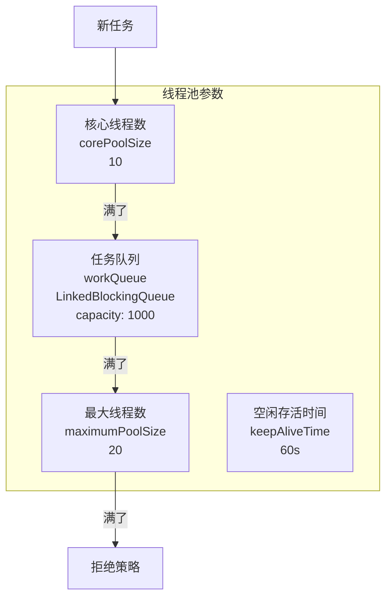
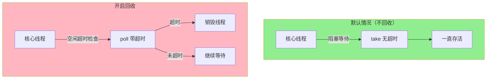
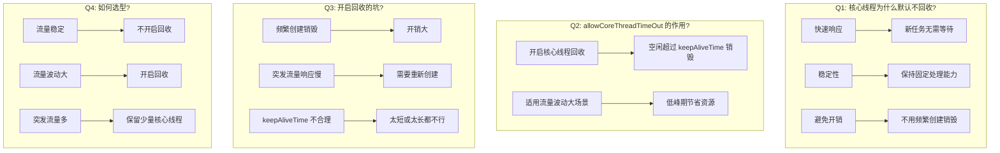
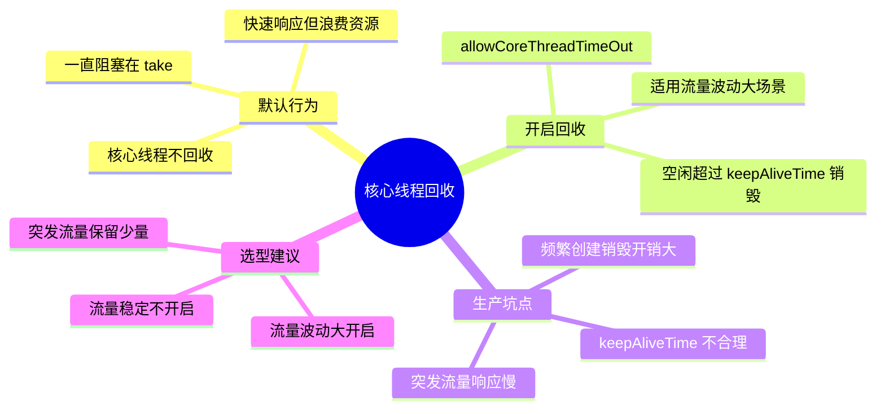
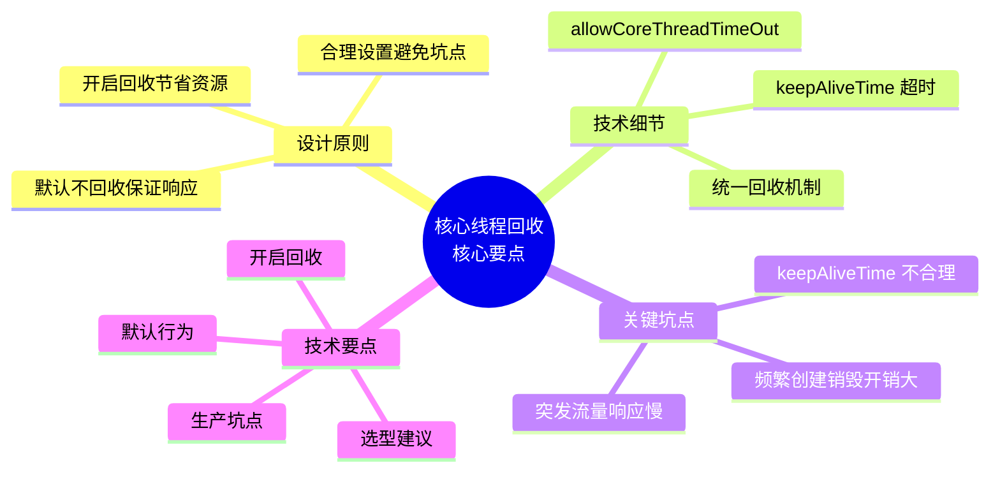

# 线程池核心线程回收机制

> **场景引入**：线程池是 Java 并发编程的核心组件，理解核心线程的回收机制对于资源优化和流量波动场景的处理至关重要。

---

## 🎯 一句话定位

**核心线程回收解决什么问题？**
```
线程池的核心线程默认不会被回收，即使空闲也会一直常驻。
但在流量波动大的场景（如电商大促后夜间），低峰期大量核心线程空转浪费资源。
开启 allowCoreThreadTimeOut 后，核心线程空闲超过阈值也会被回收，实现动态资源伸缩。
```

**生活化比喻**：
就像公司的前台员工：
- **默认情况**：核心员工（正式工）即使没事干也不会被辞退，一直常驻
- **开启回收**：低峰期没事干，核心员工也会被辞退，高峰期再重新招聘
- **好处**：节省人力成本，避免"吃空饷"

**核心特点**：默认不回收，开启后可回收，适用流量波动大的场景。

---

## 💎 核心要点概览

> **快速了解线程池核心线程回收机制的设计要点**

### 核心观点（5 个关键点）

**1. 默认情况下核心线程不回收**
```
✅ 核心线程会一直阻塞在任务队列的 take() 方法上
✅ 即使空闲也不会主动销毁
✅ 系统会保留 corePoolSize 数量的常驻线程
❌ 问题：低峰期资源浪费
```

**2. allowCoreThreadTimeOut 开关**
```
✅ JDK 提供的核心线程回收开关
✅ 开启后，核心线程空闲超过 keepAliveTime 也会被销毁
✅ 统一超时回收机制：核心线程和非核心线程一样对待
✅ 适用场景：流量波动大、低峰期资源闲置
```

**3. 工作原理**
```
开启 allowCoreThreadTimeOut 后：
1. 核心线程空闲超过 keepAliveTime
2. 线程池检测到空闲超时
3. 自动销毁该线程
4. 新任务到来时再创建新线程

相当于在线程层面做了一层动态资源伸缩
```

**4. 生产环境的坑**
```
坑 1：盲目开启导致高峰期线程频繁创建销毁
   - 流量波动大但频繁，线程反复创建销毁开销大
   - 解决方案：合理设置 keepAliveTime，避免频繁回收

坑 2：低峰期线程全部销毁，突发流量响应慢
   - 所有线程都被回收，新任务到来要重新创建
   - 解决方案：保留少量核心线程（不开启回收）或使用弹性伸缩

坑 3：keepAliveTime 设置不合理
   - 太短：频繁回收创建，开销大
   - 太长：资源浪费，失去回收意义
   - 推荐：根据业务峰谷周期设置（如 30s-60s）
```

**5. 选型建议**
```
✅ 流量稳定场景：不开启回收（默认）
✅ 流量波动大且有明显峰谷：开启回收
✅ 突发流量多：谨慎开启，配合弹性伸缩
✅ 资源紧张：开启回收，节省内存
```

---

## 🚀 核心总结

> **核心线程回收 = 默认不回收 + 开启 allowCoreThreadTimeOut 后可回收 + 适用流量波动大场景 + 合理设置 keepAliveTime**

---

## 一、线程池核心参数回顾

### 1.1 七大核心参数

**生活化比喻**：
```
想象你是一家餐厅的老板，要管理服务员：

1. corePoolSize（核心员工数）：
   正式工数量，即使没事干也养着

2. maximumPoolSize（最大员工数）：
   正式工 + 临时工的最大数量

3. keepAliveTime（临时工存活时间）：
   临时工没事干多久会被辞退

4. unit（时间单位）：
   keepAliveTime 的单位（秒、分钟等）

5. workQueue（任务队列）：
   等待服务的客人排队区

6. threadFactory（线程工厂）：
   招聘服务员的方式（自定义命名等）

7. handler（拒绝策略）：
   客人太多怎么办？（直接拒绝、排队等待等）
```



### 1.2 工作流程（30 秒版）

**生活化比喻**：
```
餐厅接待客人的流程：

1. 客人来了（新任务）：
   先看正式工（核心线程）有没有空闲
   有空闲 → 直接服务
   没空闲 → 进入下一步

2. 正式工都忙（核心线程满）：
   看排队区（任务队列）有没有位置
   有位置 → 排队等待
   没位置 → 进入下一步

3. 排队区也满了（队列满）：
   看能不能招临时工（非核心线程）
   临时工数量 < 最大线程数 → 招临时工
   临时工数量 = 最大线程数 → 拒绝服务
```

**代码示例**：
```java
ThreadPoolExecutor executor = new ThreadPoolExecutor(
    10,                          // corePoolSize: 核心线程数 10
    20,                          // maximumPoolSize: 最大线程数 20
    60,                          // keepAliveTime: 60
    TimeUnit.SECONDS,            // unit: 秒
    new LinkedBlockingQueue<>(1000), // workQueue: 阻塞队列
    new ThreadFactory() {        // threadFactory: 线程工厂
        private AtomicInteger counter = new AtomicInteger(0);
        @Override
        public Thread newThread(Runnable r) {
            Thread t = new Thread(r);
            t.setName("my-pool-" + counter.incrementAndGet());
            return t;
        }
    },
    new ThreadPoolExecutor.CallerRunsPolicy() // handler: 拒绝策略
);
```

---

## 二、核心线程回收机制详解

### 2.1 默认行为：核心线程不回收

**生活化比喻**：
```
默认情况下，核心线程就像公司的正式员工：
- 即使没事干，也不会被辞退
- 一直坐在工位上等待新任务
- 阻塞在 take() 方法上，等待任务队列唤醒

为什么这样设计？
- 快速响应：新任务到来时，不用等待线程创建
- 稳定性：保持固定的处理能力
- 避免开销：不用频繁创建销毁线程
```

**源码分析**：
```java
// ThreadPoolExecutor 核心逻辑
public void execute(Runnable command) {
    int c = ctl.get();
    
    // 当前工作线程数 < corePoolSize
    if (workerCountOf(c) < corePoolSize) {
        // 创建核心线程
        addWorker(command, true);
        return;
    }
    
    // 尝试放入队列
    if (workQueue.offer(command)) {
        // 放入成功，检查是否需要创建线程
    } else {
        // 队列满了，创建非核心线程
        if (!addWorker(command, false)) {
            reject(command); // 拒绝
        }
    }
}

// 核心线程获取任务的逻辑
public void run() {
    Runnable task = null;
    while (true) {
        // 核心线程：一直阻塞等待，不超时
        task = workQueue.take(); // 没有超时时间
        if (task != null) {
            task.run();
        }
    }
}
```

**问题**：
```
场景：电商系统，大促期间 QPS 10 万，低峰期 QPS 100

大促期间：
- 核心线程 100 个，全部忙
- 临时工 100 个，也全部忙

低峰期：
- 核心线程 100 个，只有 10 个在忙
- 临时工 100 个，早被回收了
- 问题：90 个核心线程空转，浪费内存

每个线程占用内存：1MB（栈空间）
浪费内存：90 × 1MB = 90MB

对于大规模集群（100 台机器）：
浪费：90MB × 100 = 9GB
```

### 2.2 开启回收：allowCoreThreadTimeOut

**生活化比喻**：
```
开启 allowCoreThreadTimeOut 后：
核心线程就像临时工一样，没事干超过一定时间也会被辞退

辞退流程：
1. 核心线程空闲超过 keepAliveTime（如 60s）
2. 线程池检测到空闲超时
3. 自动销毁该线程
4. 新任务到来时再创建新线程

好处：
- 低峰期节省资源
- 高峰期再重新创建
- 实现动态资源伸缩
```

**代码示例**：
```java
ThreadPoolExecutor executor = new ThreadPoolExecutor(
    10, 20, 60, TimeUnit.SECONDS,
    new LinkedBlockingQueue<>(1000)
);

// 开启核心线程回收
executor.allowCoreThreadTimeOut(true);

// 验证是否开启
System.out.println(executor.allowsCoreThreadTimeOut()); // true
```

**源码分析**：
```java
// ThreadPoolExecutor 核心逻辑
public void run() {
    Runnable task = null;
    while (true) {
        // 判断是否开启核心线程回收
        if (allowCoreThreadTimeOut || workerCountOf(ctl.get()) > corePoolSize) {
            // 核心线程或非核心线程，带超时等待
            task = workQueue.poll(keepAliveTime, TimeUnit.NANOSECONDS);
        } else {
            // 核心线程，不超时
            task = workQueue.take();
        }
        
        if (task == null) {
            // 超时了，退出线程
            break;
        }
        
        task.run();
    }
}
```

**工作原理**：


### 2.3 统一超时回收机制

**生活化比喻**：
```
开启 allowCoreThreadTimeOut 后：
核心线程和非核心线程一样，都套用同一个空闲超时规则

就像公司员工：
- 以前：正式工永远不会被辞退，临时工才会
- 现在：所有人都一样，没事干超过时间都会被辞退
- 好处：统一管理，动态伸缩
```

**对比表**：

| 特性 | 默认情况 | 开启回收 |
|------|----------|----------|
| **核心线程空闲** | 一直存活 | 超过 keepAliveTime 销毁 |
| **非核心线程空闲** | 超过 keepAliveTime 销毁 | 超过 keepAliveTime 销毁 |
| **线程数量** | corePoolSize 常驻 | 动态变化 |
| **资源利用** | 低峰期浪费 | 低峰期节省 |
| **响应速度** | 快（线程常驻） | 慢（需要创建） |
| **适用场景** | 流量稳定 | 流量波动大 |

---

## 三、生产环境的坑与解决方案

### 3.1 坑 1：频繁创建销毁开销大

**生活化比喻**：
```
想象你是餐厅老板，发现：
- 中午高峰期：招 10 个临时工
- 下午低峰期：辞退 10 个临时工
- 晚上高峰期：又招 10 个临时工
- 夜间低峰期：又辞退 10 个临时工

问题：招聘和辞退的成本太高（面试、培训、补偿金）
类比到线程池：创建和销毁线程的开销（系统调用、内存分配）

原因：keepAliveTime 设置太短，频繁回收
```

**代码示例（错误示范）**：
```java
// ❌ 错误示范：keepAliveTime 太短
ThreadPoolExecutor executor = new ThreadPoolExecutor(
    10, 20, 5, TimeUnit.SECONDS, // keepAliveTime 只有 5 秒
    new LinkedBlockingQueue<>(1000)
);
executor.allowCoreThreadTimeOut(true);

// 流量波动：100 QPS → 10 QPS → 100 QPS
// 结果：线程频繁创建销毁，CPU 飙升
```

**解决方案**：
```java
// ✅ 正确做法：合理设置 keepAliveTime
ThreadPoolExecutor executor = new ThreadPoolExecutor(
    10, 20, 60, TimeUnit.SECONDS, // keepAliveTime 60 秒
    new LinkedBlockingQueue<>(1000)
);
executor.allowCoreThreadTimeOut(true);

// 流量波动：100 QPS → 10 QPS → 100 QPS
// 结果：低峰期等待 60 秒后再回收，避免频繁
```

**选型建议**：
```
keepAliveTime 设置原则：
1. 根据业务峰谷周期设置
   - 峰谷周期短（如每分钟波动）：设置长一些（60-120s）
   - 峰谷周期长（如小时级波动）：设置短一些（30-60s）

2. 根据创建销毁开销设置
   - 开销大（如大对象初始化）：设置长一些
   - 开销小（如轻量级任务）：设置短一些

3. 推荐值：30-120 秒
```

### 3.2 坑 2：突发流量响应慢

**生活化比喻**：
```
想象你是餐厅老板，低峰期辞退了所有员工：
- 突然来了一群客人（突发流量）
- 需要重新招聘员工（创建线程）
- 招聘需要时间（几十毫秒）
- 客人等不及，走了（请求超时）

问题：低峰期线程全部销毁，突发流量响应慢
```

**代码示例（错误示范）**：
```java
// ❌ 错误示范：低峰期所有线程都被回收
ThreadPoolExecutor executor = new ThreadPoolExecutor(
    10, 20, 30, TimeUnit.SECONDS,
    new LinkedBlockingQueue<>(1000)
);
executor.allowCoreThreadTimeOut(true);

// 低峰期：所有线程都被回收，线程数 = 0
// 突发流量：100 QPS
// 结果：需要创建 100 个线程，响应慢
```

**解决方案**：
```java
// ✅ 方案 1：保留少量核心线程（不开启回收）
ThreadPoolExecutor executor = new ThreadPoolExecutor(
    5, 20, 60, TimeUnit.SECONDS,
    new LinkedBlockingQueue<>(1000)
);
// 不开启回收，保留 5 个核心线程
// executor.allowCoreThreadTimeOut(false);

// ✅ 方案 2：使用弹性伸缩（动态调整 corePoolSize）
ScheduledExecutorService scheduler = Executors.newScheduledThreadPool(1);
scheduler.scheduleAtFixedRate(() -> {
    int currentQPS = getQPS(); // 获取当前 QPS
    if (currentQPS > 100) {
        executor.setCorePoolSize(20); // 高峰期增加核心线程
    } else {
        executor.setCorePoolSize(5);  // 低峰期减少核心线程
    }
}, 0, 60, TimeUnit.SECONDS);
```

**选型建议**：
```
突发流量场景：
1. 保留少量核心线程（不开启回收）
2. 使用弹性伸缩（动态调整 corePoolSize）
3. 配合限流降级，保护系统

推荐方案 1：简单可靠
```

### 3.3 坑 3：keepAliveTime 设置不合理

**生活化比喻**：
```
keepAliveTime 就像餐厅的"空闲等待时间"：

太短（如 5 秒）：
- 员工刚空闲 5 秒就被辞退
- 客人刚走，新员工又要重新招聘
- 问题：频繁招聘，成本高

太长（如 1 小时）：
- 员工空闲 1 小时才被辞退
- 餐厅一天都没客人，员工还在等
- 问题：资源浪费

合理（如 30-60 秒）：
- 员工空闲 30-60 秒后再辞退
- 既避免频繁招聘，又不会太浪费
- 推荐值
```

**推荐配置表**：

| 场景 | corePoolSize | maximumPoolSize | keepAliveTime | allowCoreThreadTimeOut |
|------|--------------|-----------------|---------------|------------------------|
| **流量稳定** | CPU 核数 * 2 | 同 core | 60s | false |
| **流量波动大** | CPU 核数 | CPU 核数 * 4 | 60-120s | true |
| **突发流量多** | CPU 核数 / 2 | CPU 核数 * 4 | 60s | false |
| **资源紧张** | CPU 核数 / 2 | CPU 核数 * 2 | 30s | true |

---

## 四、核心设计要点与深度问题



### 详细回答

**Q1: 核心线程为什么默认不回收？**  
**答**：核心线程默认不回收有三个原因：
1. **快速响应**：新任务到来时，无需等待线程创建，直接由核心线程处理。
2. **稳定性**：保持固定的处理能力，应对突发流量。
3. **避免开销**：线程创建和销毁有系统调用开销，避免频繁操作。

**Q2: allowCoreThreadTimeOut 的作用是什么？**  
**答**：allowCoreThreadTimeOut 是 JDK 提供的核心线程回收开关。开启后，核心线程空闲超过 keepAliveTime 也会被销毁，和非核心线程一样对待。适用流量波动大的场景，低峰期节省资源，高峰期再重新创建。相当于在线程层面做了一层动态资源伸缩。

**Q3: 开启回收有哪些坑？**  
**答**：主要有三个坑：
1. **频繁创建销毁开销大**：keepAliveTime 设置太短，线程频繁回收创建，CPU 飙升。解决方案：合理设置 keepAliveTime（30-120s）。
2. **突发流量响应慢**：低峰期所有线程都被回收，突发流量需要重新创建线程，响应慢。解决方案：保留少量核心线程或使用弹性伸缩。
3. **keepAliveTime 设置不合理**：太短频繁回收，太长资源浪费。解决方案：根据业务峰谷周期设置。

**Q4: 如何选型？**  
**答**：
- **流量稳定**：不开启回收，保持核心线程常驻。
- **流量波动大**：开启回收，低峰期节省资源。
- **突发流量多**：保留少量核心线程（不开启回收），或配合弹性伸缩。
- **资源紧张**：开启回收，节省内存。

---

## 五、方案总结



**方案总结**：

> **默认行为**：核心线程默认不回收，会一直阻塞在 take() 方法上等待任务，即使空闲也会常驻，保证快速响应。
> 
> **开启回收**：JDK 提供 allowCoreThreadTimeOut 开关，开启后核心线程空闲超过 keepAliveTime 也会被销毁，和非核心线程一样对待。适用流量波动大的场景，低峰期节省资源。
> 
> **生产坑点**：频繁创建销毁开销大（keepAliveTime 太短）、突发流量响应慢（所有线程被回收）、keepAliveTime 设置不合理（太短或太长都不行）。
> 
> **选型建议**：流量稳定不开启，流量波动大开启，突发流量保留少量核心线程。

---

## 六、总结（一句话带走）



### 🎯 一句话总结

> **核心线程回收 = 默认不回收 + 开启 allowCoreThreadTimeOut 后可回收 + 适用流量波动大场景 + 合理设置 keepAliveTime（30-120s）**

### 🧠 核心记忆点

1. **默认不回收**：核心线程一直阻塞在 take()，即使空闲也常驻，保证快速响应。
2. **开启回收**：allowCoreThreadTimeOut(true)，核心线程空闲超过 keepAliveTime 也会被销毁。
3. **适用场景**：流量波动大、低峰期资源闲置的场景。
4. **生产坑点**：频繁创建销毁（keepAliveTime 太短）、突发流量响应慢（所有线程被回收）。
5. **推荐配置**：keepAliveTime 30-120 秒，根据业务峰谷周期调整。

---
