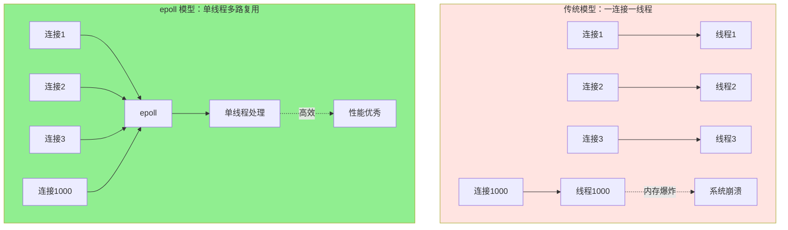
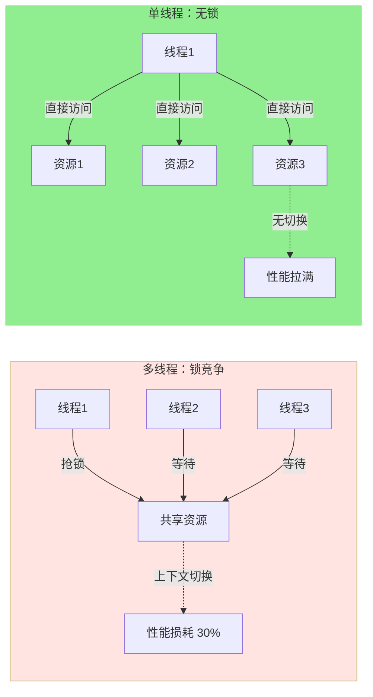
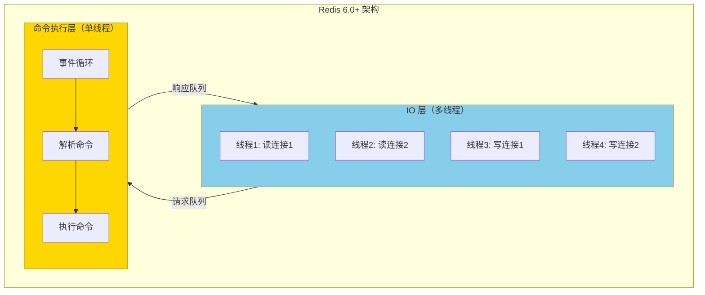
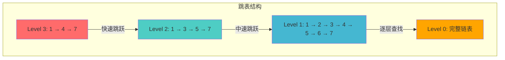
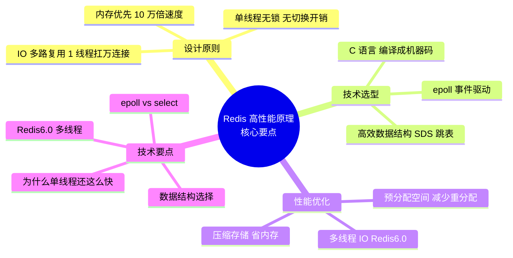

# Redis 高性能原理

> **场景引入**：Redis 是目前最流行的内存数据库，理解其高性能的底层原理，有助于在实际项目中做出合理的架构设计和技术选型。

---

## 🎯 一句话定位

**Redis 为什么这么快？**
```
官方数据：单机 QPS 10 万+，延迟 < 1ms
对比 MySQL：单机 QPS 几千，延迟 10ms+
差距：100 倍性能差距！
```

**生活化比喻**：
就像两家快递公司：
- **Redis**：同城闪送（内存直接取，10 分钟送达）
- **MySQL**：跨省物流（磁盘慢慢读，2 天送达）

**核心原因**：内存操作 + 单线程无锁 + IO 多路复用 + 高效数据结构 + C 语言实现

---

## 💎 核心要点概览

> **快速了解 Redis 高性能原理的核心设计要点**

### 核心观点（5 个关键点）

**1. 内存操作（核心原因）**
```
❌ 磁盘操作：机械臂寻道 + 旋转延迟（10ms 级）
✅ 内存操作：电子信号传输（纳秒级）

生活化比喻：
磁盘 = 图书馆找书（走到书架、找书、拿回来，10 分钟）
内存 = 书桌上的书（伸手就拿，1 秒）

性能差距：10 万倍！
```

**2. IO 多路复用（epoll）**
```
❌ 传统模型：一个连接一个线程（1000 连接 = 1000 线程，内存爆炸）
✅ epoll：一个线程监控多个连接（1 个线程 = 10000 连接）

生活化比喻：
传统模型 = 10 个收银员，每人服务 1 个顾客（浪费人力）
epoll = 1 个收银员，同时监控 10 个收银台（高效）
```

**3. 单线程避免锁竞争**
```
❌ 多线程：加锁 → 竞争 → 上下文切换（性能损耗 30%+）
✅ 单线程：无锁、无切换、一气呵成

生活化比喻：
多线程 = 10 个人抢 1 个厕所（排队、等待、浪费时间）
单线程 = 1 个人独占 10 个厕所（随便用，不用排队）
```

**4. C 语言实现高效**
```
❌ Java/Python：虚拟机/解释器开销（运行时翻译，慢）
✅ C 语言：直接编译成机器码（原生执行，快）

生活化比喻：
Java = 配了翻译官的外交官（说话前要翻译，慢半拍）
C =  native speaker（直接说母语，秒回）
```

**5. 高效数据结构**
```
SDS（简单动态字符串）：预分配空间，减少重分配
跳表（Skip List）：O(log n) 查询，比链表快 100 倍
压缩列表（ZipList）：小数据量时省内存
整数集合（IntSet）：纯整数集合，极致优化

生活化比喻：
这些数据结构就像：
- 伸缩筷子（SDS）：自动调整长度，不用频繁换筷子
- 快速查找目录（跳表）：字典的拼音索引，翻字典不用从第一页翻
```

---

## 🚀 核心总结

> **Redis 快 = 内存操作（10 万倍速度） + 单线程无锁（无切换开销） + epoll（1 线程扛 1 万连接） + C 语言（原生执行） + 高效数据结构（算法优化）**

---

## 一、内存操作 vs 磁盘操作（核心原因）

### 1.1 性能差距：10 万倍

**生活化比喻**：
```
磁盘操作 = 去图书馆找书：
1. 走到图书馆（IO 请求）
2. 等管理员找书（机械臂寻道）
3. 找到书拿回来（数据读取）
耗时：10 分钟

内存操作 = 从书桌拿书：
1. 伸手拿书（直接读取）
耗时：1 秒

差距：600 倍！
```

**技术数据**：
| 操作类型 | 延迟 | 生活化比喻 |
|---------|------|------------|
| **L1 缓存** | 0.5 纳秒 | 手边的便签（秒看） |
| **内存** | 100 纳秒 | 书桌上的书（秒拿） |
| **SSD** | 100 微秒 | 隔壁房间的书（1 分钟拿） |
| **HDD** | 10 毫秒 | 图书馆的书（10 分钟拿） |

**关键洞察**：
```
内存访问速度是磁盘的 10 万倍！
这就是 Redis 快的核心原因。

就像：
你问："1+1 等于几？"
内存操作 = 心算（1 秒）
磁盘操作 = 翻书查（10 分钟）
```

### 1.2 为什么不用内存数据库替代一切？

**灵魂拷问**：既然内存这么快，为什么不全用内存？

**答案**：贵！
```
1TB 内存 ≈ 5 万元
1TB SSD ≈ 500 元
差距：100 倍价格！

生产环境方案：
热点数据（20%）→ Redis 内存（快速响应）
冷数据（80%）→ MySQL 磁盘（便宜持久化）
```

**代码示例**（Go 语言版）：
```go
// 内存操作 vs 磁盘操作性能对比
package main

import (
	"fmt"
	"time"
	"os"
	"io/ioutil"
)

func main() {
	// 1. 内存操作（纳秒级）
	start := time.Now()
	data := make(map[string]string)
	for i := 0; i < 100000; i++ {
		data[fmt.Sprintf("key%d", i)] = fmt.Sprintf("value%d", i)
	}
	elapsed := time.Since(start)
	fmt.Printf("内存操作 10 万次: %v\n", elapsed) // 约 10ms

	// 2. 磁盘操作（毫秒级）
	start = time.Now()
	for i := 0; i < 100000; i++ {
		filename := fmt.Sprintf("/tmp/key%d", i)
		ioutil.WriteFile(filename, []byte(fmt.Sprintf("value%d", i)), 0644)
		os.Remove(filename)
	}
	elapsed = time.Since(start)
	fmt.Printf("磁盘操作 10 万次: %v\n", elapsed) // 约 5s

	// 性能差距：500 倍！
}
```

---

## 二、IO 多路复用（epoll）

### 2.1 传统模型 vs epoll

**生活化比喻**：
```
传统模型（每连接一线程）：
想象一个餐厅，每个顾客配一个服务员。
10 个顾客 = 10 个服务员
1000 个顾客 = 1000 个服务员（工资爆炸！）

epoll 模型（单线程监控多连接）：
想象一个餐厅，只有 1 个服务员，但配了 10 个收银台。
服务员站在中间，哪个收银台有顾客就去服务。
1000 个顾客 = 1 个服务员（成本极低！）
```



### 2.2 epoll 工作原理

**技术细节**：
```
epoll 三步曲：
1. epoll_create：创建 epoll 实例（相当于开了一个监控中心）
2. epoll_ctl：注册感兴趣的事件（相当于告诉监控中心：我关心哪些连接）
3. epoll_wait：等待事件发生（相当于监控中心通知：哪些连接有数据了）

关键优势：
- 不用轮询（不是每个连接都问一遍）
- 事件驱动（只有活跃的连接才触发）
- 时间复杂度 O(1)（不管多少连接，性能稳定）
```

**代码示例**（Go 语言模拟）：
```go
// epoll 原理模拟（Go 语言版）
package main

import (
	"fmt"
	"net"
	"os"
)

func main() {
	// 1. 创建监听 socket
	listener, err := net.Listen("tcp", ":8080")
	if err != nil {
		fmt.Println("监听失败:", err)
		os.Exit(1)
	}
	defer listener.Close()

	fmt.Println("服务器启动，监听端口 8080...")

	// 2. 单线程处理所有连接（模拟 epoll）
	for {
		// 接受新连接（相当于 epoll_wait）
		conn, err := listener.Accept()
		if err != nil {
			fmt.Println("接受连接失败:", err)
			continue
		}

		// 3. 处理连接（非阻塞）
		go handleConnection(conn)
	}
}

func handleConnection(conn net.Conn) {
	defer conn.Close()
	
	buffer := make([]byte, 1024)
	for {
		// 读取数据（相当于 epoll 通知有数据可读）
		n, err := conn.Read(buffer)
		if err != nil {
			return
		}
		
		fmt.Printf("收到数据: %s\n", string(buffer[:n]))
		
		// 回响应
		conn.Write([]byte("HTTP/1.1 200 OK\r\n\r\nHello Redis!\r\n"))
	}
}
```

### 2.3 三种 IO 多路复用对比

| 方案 | 系统 | 时间复杂度 | 生活化比喻 | 推荐度 |
|------|------|------------|------------|--------|
| **select** | 跨平台 | O(n) | 老师挨个问学生："作业交了吗？"（1000 个学生问 1000 次） | ⭐⭐ |
| **poll** | Linux | O(n) | 老师看着名单，有举手的才去问（稍微好点） | ⭐⭐⭐ |
| **epoll** | Linux | O(1) | 老师坐在讲台，学生主动举手（只处理活跃学生） | ⭐⭐⭐⭐⭐ |

**为什么 epoll 最快？**
```
select/poll：每次都要遍历所有连接（就像老师挨个点名）
epoll：只有活跃连接才触发（就像学生主动举手）

10000 个连接，只有 10 个活跃：
select：遍历 10000 次
epoll：只处理 10 次
性能差距：1000 倍！
```

---

## 三、单线程模型（避免锁竞争）

### 3.1 为什么单线程反而更快？

**反直觉的真相**：
```
生活化比喻：
多线程 = 10 个人抢 1 个厕所：
- 排队等待（锁竞争）
- 进进出出（上下文切换）
- 浪费时间（性能损耗 30%+）

单线程 = 1 个人独占 10 个厕所：
- 不用排队（无锁）
- 不用等待（无切换）
- 一气呵成（性能拉满）
```



### 3.2 单线程的三大优势

**1. 无锁竞争**
```
多线程需要加锁保护共享资源：
lock()      // 加锁
data++      // 临界区
unlock()    // 解锁

问题：
- 锁竞争：10 个线程抢 1 把锁，9 个在等待
- 死锁风险：线程 A 等 B，B 等 A，永远等下去
- 性能损耗：加锁解锁本身也要时间
```

**2. 无上下文切换**
```
线程切换成本：
1. 保存当前线程状态（寄存器、程序计数器）
2. 加载新线程状态
3. 刷新 CPU 缓存（L1/L2 缓存失效）

耗时：1-10 微秒
如果每秒切换 10 万次 = 1 秒浪费在切换上！

单线程：永远不切换，一气呵成。
```

**3. 简化编程模型**
```
多线程编程：
- 要考虑锁、信号量、条件变量
- 要考虑竞态条件、死锁、活锁
- 调试困难（问题难以复现）

单线程编程：
- 不用考虑锁
- 不用考虑竞态
- 调试简单（顺序执行）
```

### 3.3 单线程的局限与解决方案

**灵魂拷问**：单线程不能利用多核 CPU 啊！

**Redis 6.0 解决方案**：多线程 IO
```
Redis 6.0 之前：纯单线程
Redis 6.0 之后：IO 多线程 + 命令执行单线程

架构：
网络读写（多线程）→ 命令执行（单线程）→ 结果返回（多线程）

生活化比喻：
餐厅：
- 服务员（多线程）：点菜、上菜（IO 操作）
- 厨师（单线程）：炒菜（命令执行）

好处：
- 充分利用多核（服务员多个）
- 避免锁竞争（厨师只有 1 个，不用抢锅）
```



---

## 四、C 语言实现高效

### 4.1 C vs Java/Python

**生活化比喻**：
```
C 语言 = native speaker（母语者）
- 直接说母语（编译成机器码）
- 不需要翻译（无虚拟机开销）
- 秒回（执行速度快）

Java = 配了翻译官的外交官
- 先说中文（Java 代码）
- 翻译成英文（字节码）
- 再翻译成当地语言（JIT 编译）
- 慢半拍（运行时翻译开销）

Python = 配了同声传译的导游
- 说一句翻译一句（解释执行）
- 每句都要翻译（解释器开销）
- 最慢（逐行解释）
```

**性能对比**：
| 语言 | 执行方式 | 相对性能 | 生活化比喻 |
|------|----------|----------|------------|
| **C** | 编译成机器码 | 100% | native speaker（秒回） |
| **Java** | 字节码 + JIT | 70-80% | 配翻译官（慢半拍） |
| **Python** | 解释执行 | 10-20% | 同声传译（最慢） |

### 4.2 C 语言的三大优势

**1. 零抽象成本**
```c
// C 语言：直接操作内存
int *p = (int *)malloc(sizeof(int));
*p = 42;

// Java：隔了一层虚拟机
Integer obj = new Integer(42); // 对象包装，有开销
```

**2. 精细控制**
```c
// C 语言：精确控制内存布局
struct RedisObject {
    int type;        // 4 字节
    int encoding;    // 4 字节
    void *ptr;       // 8 字节
}; // 总共 16 字节，精确控制

// Java：对象头占用额外空间
class RedisObject {
    int type;        // 4 字节
    int encoding;    // 4 字节
    Object ptr;      // 8 字节 + 对象头 16 字节
} // 总共 32 字节，浪费 16 字节
```

**3. 无运行时开销**
```
C 语言：编译完就是机器码，直接跑
Java：需要 JVM（占用 100MB+ 内存）
Python：需要解释器（每秒翻译一次）
```

---

## 五、高效数据结构

### 5.1 SDS（简单动态字符串）

**生活化比喻**：
```
C 字符串 vs SDS：

C 字符串 = 固定长度的筷子：
- 长度固定（要换筷子时，只能扔掉重买）
- 修改长度 = 重新分配内存（慢）

SDS = 伸缩筷子：
- 自动调整长度（不用换筷子）
- 预分配空间（减少重分配）
- 记录当前长度（O(1) 获取长度）
```

**SDS 结构**：
```c
struct sdshdr {
    unsigned int len;    // 已使用长度
    unsigned int free;   // 剩余可用
    char buf[];          // 数据缓冲区
};

// 生活化比喻：
// len = 你已经吃的部分
// free = 还能吃的部分
// buf = 整碗饭
```

**优势**：
1. **O(1) 获取长度**（C 字符串要遍历，SDS 直接读 len）
2. **减少内存重分配**（预分配空间，像伸缩筷子）
3. **二进制安全**（可以存任意数据，不限于文本）

### 5.2 跳表（Skip List）

**生活化比喻**：
```
跳表 = 字典的拼音索引：

普通链表 = 从第一页翻到最后一页（O(n)）
跳表 = 先看拼音索引，快速定位（O(log n)）

例如查 "redis"：
1. 看索引，"r" 在中间偏后
2. 跳到 "r" 开头的部分
3. 再找 "re"
4. 再找 "red"
5. 最终找到 "redis"

只需 4 步，不用翻 1000 页！
```



**性能对比**：
| 数据结构 | 查询复杂度 | 生活化比喻 |
|---------|------------|------------|
| **链表** | O(n) | 从第一页翻到最后页 |
| **跳表** | O(log n) | 看拼音索引快速定位 |
| **平衡树** | O(log n) | 二叉搜索树 |

**为什么用跳表不用平衡树？**
```
1. 跳表实现简单（代码量少 50%）
2. 范围查询快（跳表是链表，遍历方便）
3. 并发友好（跳表局部修改，平衡树全局调整）
```

### 5.3 压缩列表（ZipList）

**生活化比喻**：
```
压缩列表 = 紧凑的停车场：

普通列表 = 每个车占一个车位（浪费空间）
压缩列表 = 小车挤一挤，大车单独停（省空间）

适用场景：
- 数据量小（< 512 字节）
- 元素短（字符串短）

好处：省内存（减少内存碎片）
```

### 5.4 整数集合（IntSet）

**生活化比喻**：
```
整数集合 = 专门放整数的盒子：

普通集合 = 通用盒子（什么都能放，但效率低）
整数集合 = 专用盒子（只放整数，极致优化）

特点：
- 二进制搜索（O(log n)）
- 有序存储（方便范围查询）
- 省内存（无额外开销）
```

---

## 六、核心设计要点

### 6.1 Redis 为什么用单线程还能这么快？

**技术选型建议**：

**推荐方案**（30 秒版）：
> Redis 快的核心原因有 5 点：
> 1. **内存操作**：内存访问速度是磁盘的 10 万倍，这是最核心的原因。
> 2. **IO 多路复用**：epoll 让单线程能处理上万连接，避免线程切换开销。
> 3. **单线程无锁**：避免锁竞争和上下文切换，命令执行一气呵成。
> 4. **C 语言实现**：编译成机器码，无虚拟机开销。
> 5. **高效数据结构**：SDS、跳表、压缩列表等针对场景优化。

**进阶方案**（展示深度）：
> 补充一点，Redis 6.0 引入了多线程 IO，但命令执行仍然是单线程。
> 这样既充分利用了多核 CPU（IO 多线程），又避免了锁竞争（命令执行单线程）。
> 这是一个很好的折中方案。

**深度探讨**：单线程不能利用多核 CPU 啊？
> Redis 6.0 之前确实是纯单线程，但实测发现性能瓶颈在网络 IO 而非 CPU。
> 所以 6.0 之后引入 IO 多线程，专门处理网络读写，命令执行仍然单线程。
> 这样既利用了多核，又避免了锁竞争。

### 6.2 epoll 和 select 的区别？

**技术选型建议**：
> 核心区别是时间复杂度：
> - **select**：O(n)，每次都要遍历所有连接（像老师挨个点名）
> - **epoll**：O(1)，只有活跃连接才触发（像学生主动举手）
> 
> 10000 个连接，只有 10 个活跃：
> - select：遍历 10000 次
> - epoll：只处理 10 次
> 性能差距 1000 倍！
> 
> 所以高并发场景（如 Redis）都用 epoll。

### 6.3 Redis 6.0 为什么引入多线程？

**技术选型建议**：
> Redis 6.0 引入多线程 IO，原因是：
> 1. **CPU 利用率低**：纯单线程时，CPU 利用率只有 30-40%，多核闲置。
> 2. **网络 IO 瓶颈**：命令执行很快（微秒级），网络 IO 相对慢（毫秒级）。
> 3. **折中方案**：IO 多线程 + 命令执行单线程，既利用多核，又避免锁竞争。
> 
> 架构：
> 网络读写（多线程）→ 命令执行（单线程）→ 结果返回（多线程）
> 
> 效果：QPS 提升 1 倍（从 10 万到 20 万）。

---

## 七、方案总结

```mermaid
mindmap
  root((Redis 为什么快))
    内存操作
      10 万倍速度差距
      核心原因
    IO 多路复用
      epoll 单线程扛万连接
      O(1) 时间复杂度
    单线程模型
      无锁竞争
      无上下文切换
      Redis6.0 IO 多线程
    C 语言实现
      编译成机器码
      无虚拟机开销
    高效数据结构
      SDS 预分配
      跳表 O(log n)
      压缩列表省内存
```

**方案总结**：

> **内存操作**：内存访问速度是磁盘的 10 万倍，这是最核心的原因。
> 
> **IO 多路复用**：epoll 让单线程能处理上万连接，时间复杂度 O(1)，比 select/poll 快 1000 倍。
> 
> **单线程模型**：避免锁竞争和上下文切换，命令执行一气呵成。Redis 6.0 引入 IO 多线程，命令执行仍单线程。
> 
> **C 语言实现**：编译成机器码，无虚拟机开销，比 Java 快 20-30%。
> 
> **高效数据结构**：SDS 预分配减少重分配，跳表 O(log n) 查询，压缩列表省内存。

---

## 八、生产环境 Checklist（部署检查清单）

```mermaid
graph TB
    subgraph Core["核心优化"]
        C1[✅ 内存操作<br/>10 万倍速度]
        C2[✅ epoll<br/>单线程扛万连接]
        C3[✅ 单线程无锁<br/>无切换开销]
    end
    
    subgraph Data["数据结构"]
        D1[✅ SDS<br/>预分配空间]
        D2[✅ 跳表<br/>O(log n) 查询]
        D3[✅ 压缩列表<br/>省内存]
    end
    
    subgraph Lang["语言实现"]
        L1[✅ C 语言<br/>编译成机器码]
        L2[✅ 零抽象成本<br/>直接操作内存]
    end
    
    subgraph Monitor["监控调优"]
        M1[✅ 内存使用监控]
        M2[✅ QPS 监控]
        M3[✅ 慢查询日志]
    end
    
    style Core fill:#90EE90
    style Data fill:#87CEEB
    style Lang fill:#FFD700
    style Monitor fill:#FFA500
```

**部署检查清单**：

| 类别 | 检查项 | 状态 | 生活化比喻 |
|------|--------|------|------------|
| **核心优化** | 内存操作（避免磁盘） | ⬜ | 同城闪送 |
| | epoll 启用（高并发） | ⬜ | 1 个服务员监控 10 个收银台 |
| | 单线程执行（无锁） | ⬜ | 1 个人独占 10 个厕所 |
| **数据结构** | SDS（减少重分配） | ⬜ | 伸缩筷子 |
| | 跳表（快速查询） | ⬜ | 字典拼音索引 |
| | 压缩列表（省内存） | ⬜ | 紧凑停车场 |
| **语言实现** | C 语言编译（机器码） | ⬜ | native speaker |
| **监控调优** | 内存使用监控 | ⬜ | 油表监控 |
| | QPS 监控 | ⬜ | 速度表监控 |
| | 慢查询日志 | ⬜ | 违规记录 |

---

## 九、总结（一句话带走）



### 🎯 一句话总结

> **Redis 快 = 内存操作（10 万倍速度） + 单线程无锁（无切换开销） + epoll（1 线程扛 1 万连接） + C 语言（原生执行） + 高效数据结构（算法优化）**

### 🧠 核心记忆点

1. **为什么内存快？** 内存访问是磁盘的 10 万倍，就像书桌拿书 vs 图书馆找书。
2. **为什么单线程快？** 无锁竞争、无上下文切换，就像 1 个人独占 10 个厕所，不用排队。
3. **epoll 为什么快？** O(1) 时间复杂度，只有活跃连接才触发，就像学生主动举手，不是老师挨个点名。
4. **C 语言为什么快？** 编译成机器码，无虚拟机开销，就像 native speaker，不需要翻译。
5. **数据结构为什么重要？** SDS 预分配、跳表 O(log n)、压缩列表省内存，算法优化带来性能提升。

---
