# 缓存穿透、击穿、雪崩：三大缓存灾难与解决方案

> **场景引入**：缓存穿透、击穿、雪崩是缓存系统中最常见的三类问题，理解其成因和解决方案，是保障后端系统高可用的关键。

---

## 🎯 一句话定位

**缓存三大灾难解决什么问题？**
```
缓存是数据库的"防弹衣"，但这件防弹衣有三个致命漏洞：
穿透 → 请求直接打到数据库（防弹衣有个洞）
击穿 → 热点数据过期瞬间崩溃（防弹衣被狙击手打穿）
雪崩 → 大量缓存同时失效（防弹衣被炸成碎片）
```

**生活化比喻**：
想象你开了一家奶茶店，雇了个前台（缓存）帮顾客点单，厨房（数据库）只管做奶茶。正常情况前台能处理 90% 的订单，厨房很轻松。但如果：
- **穿透**：有人一直问"有龙肉奶茶吗？"，前台说没有，但顾客不信，非要进厨房问厨师 → 厨师被烦死了
- **击穿**：网红"珍珠奶茶"的配方突然过期了（前台忘了怎么做），瞬间 1000 个顾客都来点，全冲进厨房问厨师 → 厨师崩溃
- **雪崩**：前台突然集体失忆（缓存宕机），所有顾客的问题都得问厨房 → 厨房直接爆炸

**核心特点**：三个问题都是"缓存失效导致数据库被打爆"，但原因和解法完全不同。

---

## 💎 核心要点概览

> **快速了解缓存三大问题的核心设计要点**

### 核心观点（5 个关键点）

**1. 缓存穿透：查询不存在的数据，缓存挡不住**
```
❌ 问题：大量请求查询不存在的数据，缓存没有，全打到 DB
✅ 方案1：布隆过滤器 — 在缓存前加"门禁"，拦截 99% 不存在的 key
✅ 方案2：空值缓存 — 查询结果为空也缓存（TTL 5 分钟）
核心思想：让"不存在的请求"在缓存层就被挡住，别去烦数据库
```

**2. 缓存击穿：热点 key 过期，瞬间并发打 DB**
```
❌ 问题：某个超热 key 过期瞬间，10 万并发请求同时打到 DB
✅ 方案1：互斥锁（SETNX）— 只让一个线程去 DB 查，其他等着
✅ 方案2：逻辑过期 — 不设 TTL，用业务字段控制过期，后台异步更新
核心思想：热点 key 过期时，别让所有请求同时穿透到 DB
```

**3. 缓存雪崩：大量 key 同时过期 / Redis 宕机**
```
❌ 问题1：大批 key 同一时间过期，DB 压力瞬间暴增
❌ 问题2：Redis 节点挂了，缓存全部失效
✅ 方案1：过期时间加随机值 — 让 key 的过期时间错开
✅ 方案2：高可用集群 — Redis Sentinel / Cluster，主挂了从顶上
✅ 方案3：多级缓存 — L1 本地缓存 + L2 Redis，Redis 挂了还有本地缓存
核心思想：让缓存"永远在线"，即使部分失效也不影响全局
```

**4. 三者区别：一张表看清**
```
穿透 → 数据本身不存在 → 布隆过滤器 + 空值缓存
击穿 → 热点 key 过期 → 互斥锁 + 逻辑过期
雪崩 → 大量 key 同时失效 → 过期随机化 + 高可用集群
```

**5. 生产环境组合拳：多层防护**
```
L1 本地缓存（GoCache）：抗 10 万+ QPS，Redis 挂了也能撑
L2 布隆过滤器：拦截 99% 不存在的 key
L3 Redis 集群：主从 + 哨兵，自动故障转移
L4 限流降级：DB 快扛不住时，直接返回"系统繁忙"
```

---

## 🚀 核心总结

> **缓存三兄弟：穿透靠布隆过滤器（门禁），击穿靠互斥锁（排队），雪崩靠过期随机化（错峰）+ 高可用集群（备份）。**

---

## 一、缓存穿透：数据不存在，缓存挡不住

### 1.1 什么是缓存穿透？

**生活化比喻**：
```
想象你是个前台（缓存），每天有人来问"张三在几楼？"
你查了通讯录，没有"张三"这个人。
但对方不信，非要去问 HR（数据库）。
第二天，又有 100 个人来问"张三在几楼？"
你每次都说"没有"，但他们每次都去问 HR。
HR 被烦死了："这个张三到底是谁？！"

这就是缓存穿透：
查询一个根本不存在的数据，缓存没有，每次都得查数据库。
就像你家的防弹衣有个洞，子弹（请求）直接打到你身上（数据库）。
```

**技术定义**：
```
查询不存在的数据 → 缓存未命中 → 查询数据库 → 结果为空 → 不写回缓存
下次同样的请求还是未命中 → 又查数据库 → 数据库压力大
```

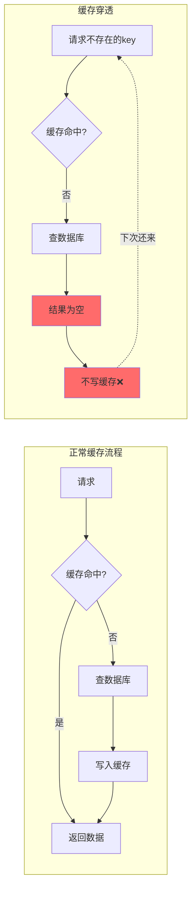

### 1.2 解决方案一：布隆过滤器

**生活化比喻**：
```
布隆过滤器就像公司门口的"门禁系统"：
- 员工入职时，把名字录入系统（写入布隆过滤器）
- 有人来访时，先刷脸（查询布隆过滤器）
- 如果门禁说"没这个人"，直接拦住，不用进办公室问 HR
- 如果门禁说"可能有"，再进办公室确认（查缓存/数据库）

好处：99% 的"不存在"请求在门口就被拦住了，HR（数据库）很轻松。
```

**布隆过滤器原理**：
```
核心数据结构：位数组（bit array）+ 多个哈希函数
写入流程：
  key → 哈希函数1 → 位置1 → 置为1
  key → 哈希函数2 → 位置2 → 置为1
  key → 哈希函数3 → 位置3 → 置为1

查询流程：
  key → 三个哈希函数 → 三个位置
  如果三个位置都是1 → "可能存在"（有误判概率）
  如果有一个位置是0 → "一定不存在"（100% 准确）

特点：
✅ 不会误判"不存在"（说不存在就一定不存在）
✅ 空间效率高（用位数组，不用存完整 key）
❌ 会误判"存在"（说可能存在，但实际可能不存在）
❌ 不能删除元素（只能加不能减）
```

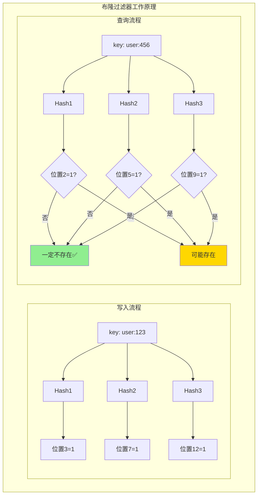

**Go 代码示例**：
```go
package main

import (
    "fmt"
    "hash/fnv"
    "math"
)

// BloomFilter 布隆过滤器
type BloomFilter struct {
    bits    []bool      // 位数组
    k       int         // 哈希函数个数
    size    int         // 位数组大小
}

// NewBloomFilter 创建布隆过滤器
// n: 预计插入元素数量, fpRate: 误判率（如 0.01 = 1%）
func NewBloomFilter(n int, fpRate float64) *BloomFilter {
    // 计算最优位数组大小：m = -n*ln(fpRate) / (ln2)^2
    m := int(-float64(n) * math.Log(fpRate) / (math.Log(2) * math.Log(2)))
    // 计算最优哈希函数个数：k = (m/n) * ln2
    k := int(float64(m) / float64(n) * math.Log(2))
    if k < 1 {
        k = 1
    }
    return &BloomFilter{
        bits: make([]bool, m),
        k:    k,
        size: m,
    }
}

// hash 生成多个哈希值
func (bf *BloomFilter) hash(item string) []int {
    positions := make([]int, bf.k)
    for i := 0; i < bf.k; i++ {
        h := fnv.New32a()
        h.Write([]byte(fmt.Sprintf("%s-%d", item, i)))
        positions[i] = int(h.Sum32()) % bf.size
    }
    return positions
}

// Add 添加元素
func (bf *BloomFilter) Add(item string) {
    for _, pos := range bf.hash(item) {
        bf.bits[pos] = true
    }
}

// MightContain 查询元素是否可能存在
func (bf *BloomFilter) MightContain(item string) bool {
    for _, pos := range bf.hash(item) {
        if !bf.bits[pos] {
            return false // 有一个位置是0，一定不存在
        }
    }
    return true // 所有位置都是1，可能存在
}

// 使用示例
func main() {
    // 预计存储100万个key，误判率1%
    bf := NewBloomFilter(1000000, 0.01)
    
    // 写入存在的key
    bf.Add("user:1001")
    bf.Add("user:1002")
    bf.Add("user:1003")
    
    // 查询
    fmt.Println(bf.MightContain("user:1001")) // true（可能存在）
    fmt.Println(bf.MightContain("user:9999")) // false（一定不存在）✅ 拦截成功
}
```

**生产级方案（Redis + 布隆过滤器）**：
```go
// CacheWithBloomFilter 带布隆过滤器的缓存服务
type CacheWithBloomFilter struct {
    redis       *redis.Client
    bloomFilter *BloomFilter // 实际生产中用 Redis 的布隆过滤器模块
    db          *gorm.DB
}

func (c *CacheWithBloomFilter) Get(key string) (string, error) {
    // Step 1: 布隆过滤器拦截
    if !c.bloomFilter.MightContain(key) {
        return "", errors.New("key not found") // 直接返回，不查数据库
    }
    
    // Step 2: 查缓存
    val, err := c.redis.Get(key).Result()
    if err == nil {
        return val, nil
    }
    
    // Step 3: 查数据库（布隆过滤器说"可能存在"，但实际可能不存在）
    val, err = c.db.Query(key)
    if err != nil {
        return "", err
    }
    
    // Step 4: 写回缓存
    c.redis.Set(key, val, 24*time.Hour)
    return val, nil
}

// 新增数据时，同步更新布隆过滤器
func (c *CacheWithBloomFilter) Set(key string, value string) {
    c.bloomFilter.Add(key)  // 先加布隆过滤器
    c.redis.Set(key, value, 24*time.Hour)
    c.db.Save(key, value)
}
```

### 1.3 解决方案二：空值缓存

**生活化比喻**：
```
空值缓存就像前台的"记事本"：
有人问"张三在几楼？"，你查了通讯录没有。
但你在记事本上写下来："张三：不存在（5 分钟内有效）"
下次再有人问同样的问题，你直接看记事本："不存在，别去问 HR 了"
5 分钟后，这条记录过期，如果还有人问，再去查一次 HR

好处：简单粗暴，不需要额外的数据结构
缺点：如果攻击者用大量不同的不存在 key 来查询（如随机用户ID），
      记事本（缓存）会被撑爆，还是挡不住
```

**Go 代码示例**：
```go
// CacheWithNullValue 空值缓存方案
type CacheWithNullValue struct {
    redis *redis.Client
    db    *gorm.DB
}

const (
    NullValue = "NULL_VALUE" // 特殊标记，表示"查无此数据"
    NullTTL   = 5 * time.Minute // 空值缓存 5 分钟
)

func (c *CacheWithNullValue) Get(key string) (string, error) {
    // Step 1: 查缓存
    val, err := c.redis.Get(key).Result()
    if err == nil {
        if val == NullValue {
            return "", errors.New("key not found") // 空值命中，直接返回
        }
        return val, nil
    }
    
    // Step 2: 查数据库
    result, err := c.db.Query(key)
    if err != nil {
        return "", err
    }
    
    // Step 3: 结果为空，缓存空值
    if result == "" {
        c.redis.Set(key, NullValue, NullTTL) // 缓存"不存在"，5分钟有效
        return "", errors.New("key not found")
    }
    
    // Step 4: 结果不为空，缓存真实值
    c.redis.Set(key, result, 24*time.Hour)
    return result, nil
}
```

### 1.4 穿透方案对比

| 方案 | 优点 | 缺点 | 适用场景 | 生活化比喻 |
|------|------|------|----------|------------|
| **布隆过滤器** | 内存效率高、支持海量 key、拦截 99% | 有误判率、不能删除 | 数据量大、key 重复率高 | 门禁系统（拦住 99% 陌生人） |
| **空值缓存** | 实现简单、无需额外组件 | 可能被大量不同 key 攻击 | 数据量小、攻击风险低 | 记事本（记下"查无此人"） |
| **两者结合** | 最安全、层层防护 | 实现复杂 | 生产环境推荐 | 门禁 + 记事本（双重防护） |

---

## 二、缓存击穿：热点 key 过期，瞬间崩溃

### 2.1 什么是缓存击穿？

**生活化比喻**：
```
想象一个网红餐厅（热点 key），每天排队 1000 人。
餐厅的招牌菜配方（缓存）突然过期了（厨师忘了怎么做）。
1000 个顾客同时问："招牌菜怎么做？"
服务员（缓存）说："我忘了，你们去问厨师吧。"
1000 个人同时冲进厨房问厨师（数据库）→ 厨师当场辞职。

这就是缓存击穿：
某个超热的 key 过期了，大量并发请求同时打到数据库。
就像狙击手（热点 key 过期）打穿了防弹衣（缓存），
子弹（请求）直接打到你身上（数据库）。
```

**技术定义**：
```
热点 key（访问频率极高的 key）过期 → 大量并发请求同时未命中
→ 同时查询数据库 → 数据库压力瞬间暴增 → 可能崩溃
特点：只发生在"热点 key"上，非热点 key 过期不会有这个问题
```

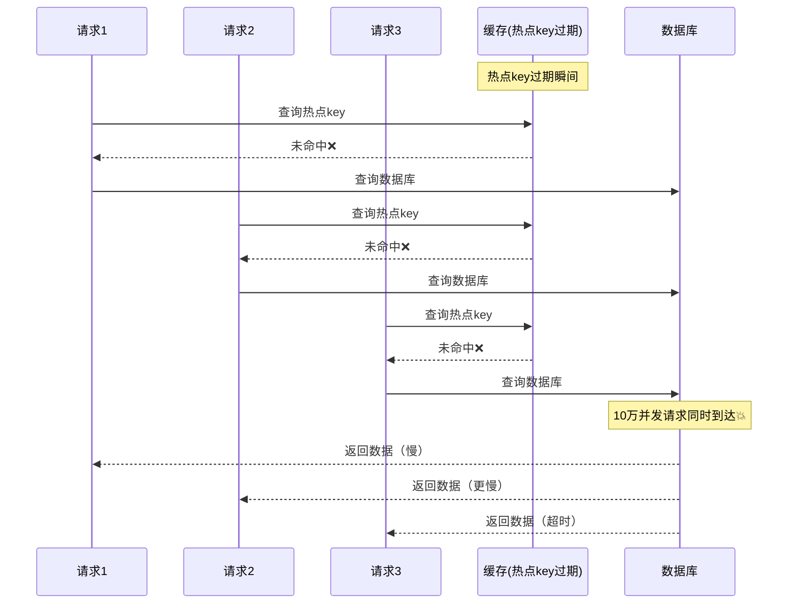

### 2.2 解决方案一：互斥锁（分布式锁）

**生活化比喻**：
```
互斥锁就像"排队取号"：
招牌菜配方忘了？没关系，只让一个人（线程 A）去厨房问厨师。
其他 999 人在大厅等着（阻塞等待）。
等线程 A 从厨房出来（拿到数据），把配方抄到白板上（写回缓存）。
然后大家看白板就行了，不用再去问厨师。

好处：数据库只被查询一次，压力极小
缺点：其他线程要等着（延迟增加），可能超时
适用：对延迟不敏感的场景（如商品详情页）
```

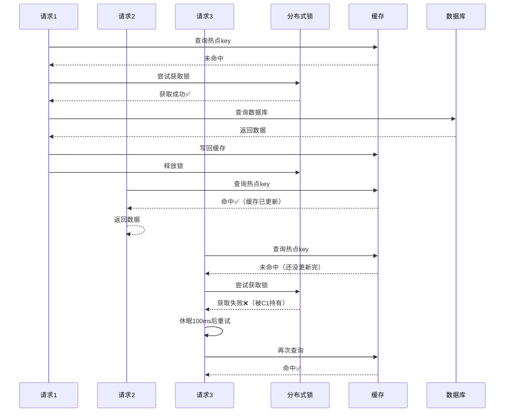

**Go 代码示例（Redis SETNX 实现分布式锁）**：
```go
// CacheWithMutex 互斥锁方案
type CacheWithMutex struct {
    redis *redis.Client
    db    *gorm.DB
}

const (
    LockKeyPrefix = "lock:"
    LockTTL       = 10 * time.Second // 锁的过期时间
    RetryDelay    = 100 * time.Millisecond // 重试间隔
    MaxRetries    = 10 // 最大重试次数
)

func (c *CacheWithMutex) Get(key string) (string, error) {
    // Step 1: 先查缓存
    val, err := c.redis.Get(key).Result()
    if err == nil {
        return val, nil
    }
    
    // Step 2: 缓存未命中，尝试获取分布式锁
    lockKey := LockKeyPrefix + key
    
    for i := 0; i < MaxRetries; i++ {
        // 使用 SETNX（SET if Not eXists）加锁
        locked, err := c.redis.SetNX(lockKey, "1", LockTTL).Result()
        if err != nil {
            return "", err
        }
        
        if locked {
            // 获取锁成功，去数据库查询
            defer c.redis.Del(lockKey) // 释放锁（defer 保证一定释放）
            
            // 双重检查：再查一次缓存（可能其他线程已经更新了）
            val, err = c.redis.Get(key).Result()
            if err == nil {
                return val, nil
            }
            
            // 查询数据库
            result, err := c.db.Query(key)
            if err != nil {
                return "", err
            }
            
            // 写回缓存（带随机过期时间，防雪崩）
            ttl := 24*time.Hour + time.Duration(rand.Intn(60))*time.Minute
            c.redis.Set(key, result, ttl)
            return result, nil
        }
        
        // 获取锁失败，其他线程在查询，休眠后重试
        time.Sleep(RetryDelay)
        
        // 重试时查缓存（可能已经更新了）
        val, err = c.redis.Get(key).Result()
        if err == nil {
            return val, nil
        }
    }
    
    return "", errors.New("timeout: too many retries")
}
```

### 2.3 解决方案二：逻辑过期

**生活化比喻**：
```
逻辑过期就像"奶茶的保质期"：
奶茶包装上写的保质期是"2024-12-31"（逻辑过期时间），
但奶茶本身不会自动消失（缓存不会自动删除）。
你看到过期了，不会扔掉，而是：
1. 先把旧奶茶给顾客（返回旧数据，保证可用性）
2. 让服务员去后台重新做一杯（异步线程去 DB 查询）
3. 新奶茶做好了，替换掉旧的（更新缓存）

好处：不用等着，响应快（高可用）
缺点：数据可能短时间不一致（返回的是旧数据）
适用：对一致性要求不高、对延迟敏感的场景（如首页推荐）
```

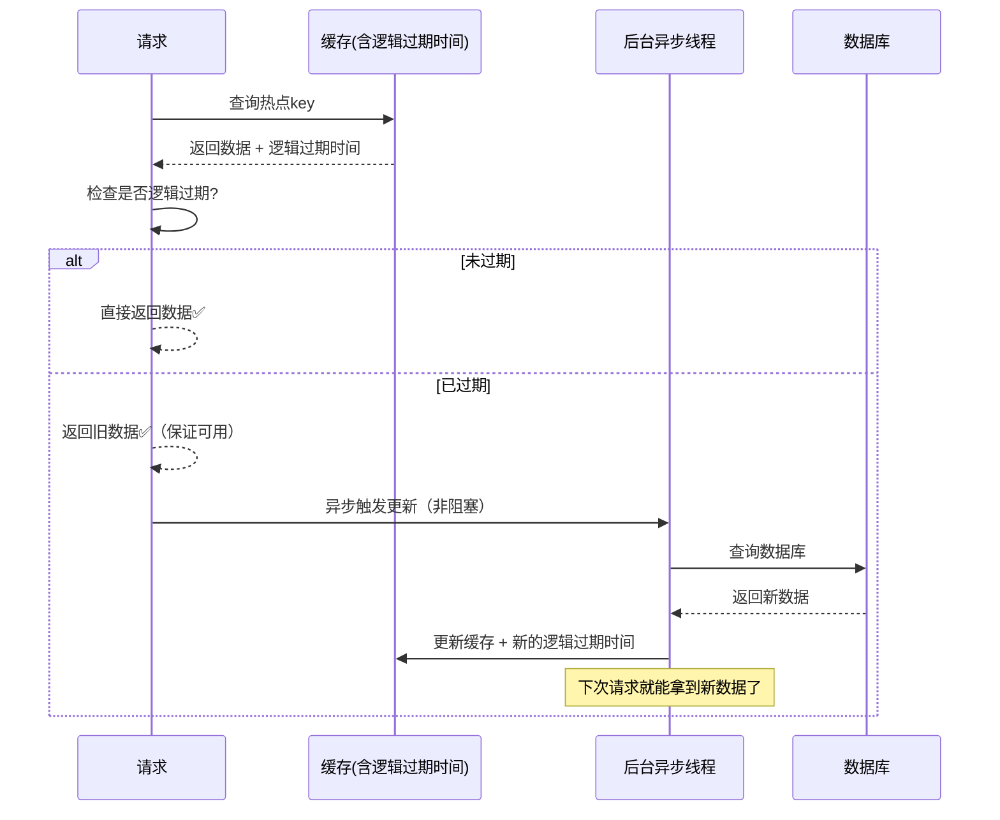

**Go 代码示例**：
```go
// CacheValue 带逻辑过期的缓存值
type CacheValue struct {
    Value      string    `json:"value"`
    ExpireTime time.Time `json:"expire_time"` // 逻辑过期时间
}

// CacheWithLogicalExpire 逻辑过期方案
type CacheWithLogicalExpire struct {
    redis *redis.Client
    db    *gorm.DB
}

const (
    LogicalExpireTTL = 24 * time.Hour // 逻辑过期时间：24小时
    RealTTL          = 0              // 不设真实过期时间（永不过期）
)

func (c *CacheWithLogicalExpire) Get(key string) (string, error) {
    // Step 1: 从缓存获取数据（含逻辑过期时间）
    val, err := c.redis.Get(key).Result()
    if err != nil {
        // 缓存未命中（首次加载）
        return c.loadFirst(key)
    }
    
    var cacheVal CacheValue
    json.Unmarshal([]byte(val), &cacheVal)
    
    // Step 2: 检查是否逻辑过期
    if time.Now().Before(cacheVal.ExpireTime) {
        // 未过期，直接返回
        return cacheVal.Value, nil
    }
    
    // Step 3: 已过期，返回旧数据 + 异步更新
    go c.refreshCache(key) // 异步更新，不阻塞当前请求
    
    return cacheVal.Value, nil // 返回旧数据（保证可用）
}

// loadFirst 首次加载（缓存未命中时）
func (c *CacheWithLogicalExpire) loadFirst(key string) (string, error) {
    // 用互斥锁防止多个线程同时加载
    lockKey := "lock:" + key
    locked, _ := c.redis.SetNX(lockKey, "1", 10*time.Second).Result()
    if !locked {
        time.Sleep(100 * time.Millisecond)
        return c.Get(key) // 重试
    }
    defer c.redis.Del(lockKey)
    
    // 双重检查
    if val, err := c.redis.Get(key).Result(); err == nil {
        return val, nil
    }
    
    // 从数据库加载
    result, err := c.db.Query(key)
    if err != nil {
        return "", err
    }
    
    // 写入缓存（带逻辑过期时间，不设真实 TTL）
    cacheVal := CacheValue{
        Value:      result,
        ExpireTime: time.Now().Add(LogicalExpireTTL),
    }
    valBytes, _ := json.Marshal(cacheVal)
    c.redis.Set(key, string(valBytes), RealTTL) // 永不过期
    
    return result, nil
}

// refreshCache 异步刷新缓存
func (c *CacheWithLogicalExpire) refreshCache(key string) {
    // 加锁，防止多个线程同时刷新
    lockKey := "lock:" + key
    locked, _ := c.redis.SetNX(lockKey, "1", 10*time.Second).Result()
    if !locked {
        return // 其他线程在刷新，直接返回
    }
    defer c.redis.Del(lockKey)
    
    // 从数据库加载最新数据
    result, err := c.db.Query(key)
    if err != nil {
        return
    }
    
    // 更新缓存 + 新的逻辑过期时间
    cacheVal := CacheValue{
        Value:      result,
        ExpireTime: time.Now().Add(LogicalExpireTTL),
    }
    valBytes, _ := json.Marshal(cacheVal)
    c.redis.Set(key, string(valBytes), RealTTL)
}
```

### 2.4 击穿方案对比

| 方案 | 优点 | 缺点 | 适用场景 | 生活化比喻 |
|------|------|------|----------|------------|
| **互斥锁** | 保证一致性、DB 压力小 | 延迟高（要等着）、可能超时 | 对一致性要求高 | 排队取号（等一等） |
| **逻辑过期** | 高可用、响应快 | 数据可能短时间不一致 | 对延迟敏感、可接受旧数据 | 先给旧奶茶，后台做新的 |
| **两者结合** | 最灵活、按需选择 | 实现复杂 | 生产环境推荐 | 看情况决定要不要等 |

---

## 三、缓存雪崩：大量 key 同时失效

### 3.1 什么是缓存雪崩？

**生活化比喻**：
```
缓存雪崩有两种情况：

情况1：大量 key 同时过期
就像奶茶店所有饮品的配方同时过期了（奶茶、果汁、咖啡...）
所有顾客的问题都得问厨房 → 厨房直接爆炸
技术上：大量 key 在同一时间过期（如都是 24 小时后过期），
DB 压力瞬间暴增

情况2：Redis 宕机
就像前台（缓存）集体请假了
所有顾客的问题都得直接问厨房（数据库）→ 厨房扛不住
技术上：Redis 节点挂了，缓存全部失效，所有请求打到 DB

两者都是"缓存大面积失效"，但原因不同，解法也不同
```

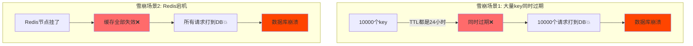

### 3.2 解决方案一：过期时间加随机值

**生活化比喻**：
```
过期时间加随机值就像"错峰下班"：
如果所有员工都在 18:00 准时下班（同时过期），电梯会挤爆（DB 压力）。
但如果每个人随机延迟 0-30 分钟下班（过期时间 + 随机值），
有人 18:00 走，有人 18:15 走，有人 18:30 走 → 电梯很轻松

技术实现：
原 TTL：24 小时
新 TTL：24 小时 + 随机 0-60 分钟
效果：key 的过期时间分散开，不会同时过期
```

**Go 代码示例**：
```go
// CacheWithRandomTTL 过期时间加随机值
type CacheWithRandomTTL struct {
    redis *redis.Client
    db    *gorm.DB
}

const (
    BaseTTL     = 24 * time.Hour  // 基础过期时间
    RandomRange = 60 * time.Minute // 随机范围：0-60分钟
)

func (c *CacheWithRandomTTL) Get(key string) (string, error) {
    // Step 1: 查缓存
    val, err := c.redis.Get(key).Result()
    if err == nil {
        return val, nil
    }
    
    // Step 2: 缓存未命中，查数据库
    result, err := c.db.Query(key)
    if err != nil {
        return "", err
    }
    
    // Step 3: 写回缓存，TTL = 基础时间 + 随机时间
    randomTTL := BaseTTL + time.Duration(rand.Int63n(int64(RandomRange)))
    c.redis.Set(key, result, randomTTL)
    
    return result, nil
}

// 使用示例
func main() {
    cache := &CacheWithRandomTTL{
        redis: redis.NewClient(&redis.Options{Addr: "localhost:6379"}),
        db:    db,
    }
    
    // 写入10000个key，过期时间都会错开
    for i := 0; i < 10000; i++ {
        cache.Get(fmt.Sprintf("key:%d", i))
    }
    // 这10000个key会在24小时到25小时之间陆续过期，不会同时过期✅
}
```

### 3.3 解决方案二：高可用 Redis 集群

**生活化比喻**：
```
高可用集群就像"备胎系统"：
主前台（Redis Master）请假了？
备前台（Redis Slave）立刻顶上，继续处理顾客问题。
顾客甚至感觉不到变化（自动故障转移）。

Redis Sentinel（哨兵模式）：
1 主 + N 从，哨兵监控主节点
主挂了，哨兵自动把从提升为主（秒级切换）
就像：经理（主）请假了，副经理（从）立刻接管，员工（哨兵）自动通知大家

Redis Cluster（集群模式）：
数据分片存储在多个节点上
某个节点挂了，其他节点顶上
就像：多个前台分工合作，一个倒了其他人继续工作
```

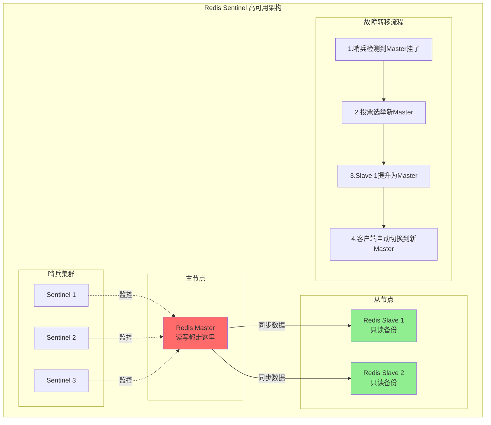

**Go 代码示例（Redis Sentinel 客户端）**：
```go
// NewSentinelClient 创建 Redis Sentinel 客户端
func NewSentinelClient() *redis.Client {
    // Sentinel 会自动故障转移，客户端无需感知
    client := redis.NewFailoverClient(&redis.FailoverOptions{
        MasterName:    "mymaster", // 主节点名称
        SentinelAddrs: []string{
            "sentinel1:26379",
            "sentinel2:26379",
            "sentinel3:26379",
        },
        Password: "your_password",
        DB:       0,
        
        // 高可用配置
        MaxRetries:      3,                  // 最大重试次数
        DialTimeout:     5 * time.Second,    // 连接超时
        ReadTimeout:     3 * time.Second,    // 读超时
        WriteTimeout:    3 * time.Second,    // 写超时
        PoolSize:        100,                // 连接池大小
        PoolTimeout:     5 * time.Second,    // 连接池超时
    })
    
    return client
}

// 使用示例
func main() {
    client := NewSentinelClient()
    
    // 正常读写，主节点挂了会自动切换到从节点
    err := client.Set("key", "value", 24*time.Hour).Err()
    if err != nil {
        log.Printf("Redis write error: %v", err)
        // 降级：查数据库
    }
    
    val, err := client.Get("key").Result()
    if err != nil {
        log.Printf("Redis read error: %v", err)
        // 降级：查数据库
    }
}
```

### 3.4 解决方案三：多级缓存 + 降级兜底

**生活化比喻**：
```
多级缓存就像"三级备份"：
L1 本地缓存（GoCache/Caffeine）：在你手机上存一份（最快，但容量小）
L2 Redis 缓存：在公司服务器存一份（快，容量中等）
L3 数据库：最后底牌（慢，但永久保存）

如果 Redis 挂了（L2 失效），还有本地缓存（L1）顶着。
如果本地缓存也没有，再查数据库（L3）。

降级兜底就像"紧急情况下的应急预案"：
如果数据库也快扛不住了，直接返回"系统繁忙，请稍后再试"。
虽然用户体验不好，但至少数据库不会挂。
```

```mermaid
graph TB
    subgraph MultiLevel["多级缓存架构"]
        Request[请求] --> L1{L1 本地缓存<br/>GoCache}
        L1 -->|命中| Return1[返回数据✅]
        L1 -->|未命中| L2{L2 Redis集群}
        
        L2 -->|命中| Return2[返回数据✅]
        L2 -->|未命中/挂了| L3{L3 数据库}
        
        L3 -->|查到| Return3[返回数据✅]
        L3 -->|没查到| Return4[返回空❌]
        
        L3 -->|压力过大| Fallback[降级:返回"系统繁忙"]
    end
    
    subgraph LocalCache["L1 本地缓存优势"]
        LC1[零网络IO] --> LC2[抗10万+QPS]
        LC2 --> LC3[Redis挂了也能撑]
    end
    
    style L1 fill:#FF6B6B
    style L2 fill:#4ECDC4
    style L3 fill:#45B7D1
    style Fallback fill:#FFA500
```

**Go 代码示例（多级缓存 + 降级）**：
```go
// MultiLevelCacheWithFallback 多级缓存 + 降级兜底
type MultiLevelCacheWithFallback struct {
    localCache *cache.Cache // 本地缓存（GoCache）
    redis      *redis.Client // Redis 集群
    db         *gorm.DB     // 数据库
}

func (c *MultiLevelCacheWithFallback) Get(key string) (string, error) {
    // L1: 本地缓存（最快，Redis 挂了也能用）
    if val, found := c.localCache.Get(key); found {
        return val.(string), nil
    }
    
    // L2: Redis 集群（主从 + 哨兵，高可用）
    val, err := c.redis.Get(key).Result()
    if err == nil {
        // 回写本地缓存
        c.localCache.Set(key, val, 5*time.Minute)
        return val, nil
    }
    
    // Redis 查询失败，记录日志
    log.Printf("Redis error: %v, fallback to database", err)
    
    // L3: 数据库（最后底牌）
    result, err := c.db.Query(key)
    if err != nil {
        // 数据库也快扛不住了，降级处理
        if isDBOverloaded(err) {
            return "", errors.New("系统繁忙，请稍后再试") // 降级
        }
        return "", err
    }
    
    if result == "" {
        // 空值缓存，防穿透
        c.localCache.Set(key, "", 5*time.Minute)
        return "", errors.New("key not found")
    }
    
    // 回写各级缓存
    c.redis.Set(key, result, 24*time.Hour+time.Duration(rand.Intn(60))*time.Minute)
    c.localCache.Set(key, result, 5*time.Minute)
    
    return result, nil
}

func isDBOverloaded(err error) bool {
    // 判断数据库是否过载（如连接池耗尽、响应超时等）
    return strings.Contains(err.Error(), "too many connections") ||
           strings.Contains(err.Error(), "timeout")
}
```

### 3.5 雪崩方案对比

| 方案 | 优点 | 缺点 | 适用场景 | 生活化比喻 |
|------|------|------|----------|------------|
| **过期时间随机化** | 实现简单、效果显著 | 只能防"同时过期" | 所有场景必加 | 错峰下班 |
| **高可用集群** | 自动故障转移、零停机 | 成本高、架构复杂 | 生产环境必备 | 备胎系统 |
| **多级缓存** | 层层防护、Redis 挂了也不怕 | 实现复杂、有一致性问题 | 高并发场景 | 三级备份 |
| **降级兜底** | 保护数据库、避免雪崩 | 用户体验差 | 紧急情况 | 应急预案 |
| **组合使用** | 最安全、全方位防护 | 架构复杂 | 生产环境推荐 | 多重保险 |

---

## 四、核心设计要点：三者对比与综合应用

### 4.1 三者核心对比（一张表搞定）

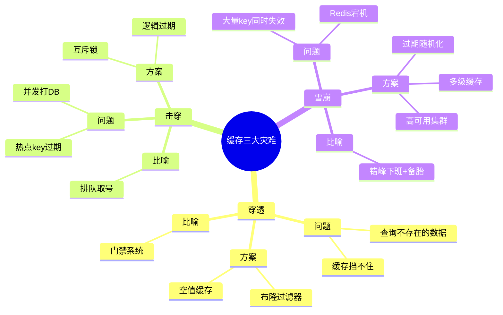

| 维度 | 缓存穿透 | 缓存击穿 | 缓存雪崩 |
|------|----------|----------|----------|
| **问题本质** | 数据不存在 | 热点 key 过期 | 大量 key 同时失效 |
| **影响范围** | 单个 key（但请求量大） | 单个热点 key | 大量 key |
| **核心方案** | 布隆过滤器 + 空值缓存 | 互斥锁 + 逻辑过期 | 过期随机化 + 高可用集群 |
| **生活化比喻** | 门禁系统 | 排队取号 | 错峰下班 + 备胎 |
| **实现复杂度** | ⭐⭐（中等） | ⭐⭐⭐（较高） | ⭐⭐⭐⭐（高） |
| **生产必加** | ✅ 是 | ✅ 是（热点数据） | ✅ 是 |

### 4.2 技术选型建议

**推荐方案**（30 秒版）：
> 缓存三大问题是后端架构中的经典问题，分别说明：
> 
> **缓存穿透**是指查询不存在的数据，缓存没有，每次都打到数据库。解决方案有两个：一是**布隆过滤器**，在缓存前加一层'门禁'，拦截 99% 不存在的 key；二是**空值缓存**，查询结果为空也缓存，TTL 设短一点（5 分钟）。
> 
> **缓存击穿**是指热点 key 过期瞬间，大量并发请求同时打到数据库。解决方案也有两个：一是**互斥锁**，只让一个线程去 DB 查，其他线程等着；二是**逻辑过期**，不设真实 TTL，用业务字段控制过期，后台异步更新。互斥锁保证一致性，逻辑过期保证高可用。
> 
> **缓存雪崩**是指大量 key 同时过期或 Redis 宕机，导致所有请求打到 DB。解决方案有三个：一是**过期时间加随机值**，让 key 的过期时间错开；二是**高可用集群**，Redis Sentinel 或 Cluster，主挂了从顶上；三是**多级缓存**，本地缓存 + Redis，Redis 挂了还有本地缓存。
> 
> 生产环境通常是**组合使用**，多层防护，确保缓存系统的高可用。

**进阶方案**（展示深度）：
> 实际项目中，还需要考虑以下几点：
> 
> 1. **布隆过滤器的维护**：布隆过滤器不能删除元素，需要定期重建（如每天凌晨重建一次）。Redis 提供了布隆过滤器模块，可以直接用。
> 
> 2. **互斥锁的超时问题**：如果持有锁的线程挂了，锁没释放怎么办？用 Redis 的 SETNX + TTL，锁有自动过期时间（如 10 秒），防止死锁。
> 
> 3. **逻辑过期的数据一致性**：逻辑过期会返回旧数据，对一致性要求高的场景不适用。可以用'双写一致性'方案：先更新 DB，再删除缓存，配合延时双删保证最终一致性。
> 
> 4. **雪崩的降级策略**：如果 DB 也快扛不住了，直接返回'系统繁忙'，保护数据库。这叫'限流降级'，是最后的安全网。
> 
> 5. **监控告警**：对缓存命中率、DB 响应时间、Redis 集群状态都有监控，一旦异常立即告警，提前发现问题。

### 4.3 深度追问与扩展问题

**Q1: 布隆过滤器的误判率如何处理？**  
**答**：布隆过滤器有误判（可能误认为存在，但不会误认为不存在）。处理方案：
- 误判时查 MySQL，查不到返回 404（就像门禁放你进去了，但办公室发现你不在）
- 调整比特数组大小和 Hash 函数数量，控制误判率 < 1%
- 定期重建（删除过期数据后）

**Q2: 互斥锁和逻辑过期怎么选？**  
**答**：看业务场景：
- **互斥锁**：对一致性要求高（如商品库存），可以接受短暂延迟
- **逻辑过期**：对可用性要求高（如首页推荐），可以接受短时间数据不一致
- **混合方案**：核心数据用互斥锁，非核心数据用逻辑过期

**Q3: 如何检测热点 key？**  
**答**：两种方案：
- **实时统计**：用 Redis 的 ZSET 记录每个 key 的访问次数，超过阈值（如 1000 次/秒）就是热点
- **离线分析**：每天分析访问日志，找出 Top 100 热点 key，提前加缓存

**Q4: Redis 集群挂了怎么办？**  
**答**：多层防护：
- L1 本地缓存（GoCache）：Redis 挂了还能撑一会
- L2 降级到数据库：直接查 DB，但加限流
- L3 限流兜底：DB 也快扛不住时，返回"系统繁忙"

**Q5: 生产环境如何验证这些方案有效？**  
**答**：压力测试 + 故障演练：
- **压力测试**：模拟热点 key 过期、大量并发请求，看 DB 压力
- **故障演练**：主动关掉 Redis 节点，看系统是否能自动切换
- **监控指标**：缓存命中率 > 95%、DB 响应时间 < 100ms、Redis 集群可用性 > 99.9%

---

## 五、方案总结

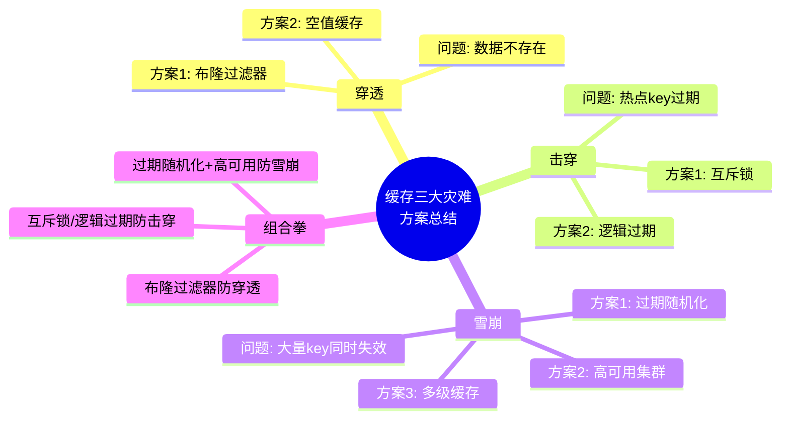

**方案总结**：

> **穿透**：数据不存在 → 布隆过滤器（门禁）+ 空值缓存（记事本）
> 
> **击穿**：热点 key 过期 → 互斥锁（排队）+ 逻辑过期（先给旧的）
> 
> **雪崩**：大量 key 同时失效 → 过期随机化（错峰）+ 高可用集群（备胎）+ 多级缓存（三级备份）
> 
> **生产环境**：组合使用，多层防护，监控告警，定期演练。

---

## 六、生产环境 Checklist（部署检查清单）

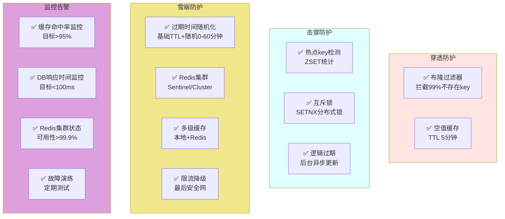

**部署检查清单**：

| 类别 | 检查项 | 状态 | 生活化比喻 |
|------|--------|------|------------|
| **穿透防护** | 布隆过滤器（Redis Bloom Filter） | ⬜ | 门禁系统 |
| | 空值缓存（TTL 5 分钟） | ⬜ | 记事本 |
| **击穿防护** | 热点 key 检测（ZSET 统计） | ⬜ | 明星识别 |
| | 互斥锁（SETNX 分布式锁） | ⬜ | 排队取号 |
| | 逻辑过期（后台异步更新） | ⬜ | 奶茶保质期 |
| **雪崩防护** | 过期时间随机化（基础 + 随机） | ⬜ | 错峰下班 |
| | Redis 集群（Sentinel/Cluster） | ⬜ | 备胎系统 |
| | 多级缓存（本地 + Redis） | ⬜ | 三级备份 |
| | 限流降级（最后安全网） | ⬜ | 应急预案 |
| **监控告警** | 缓存命中率监控（> 95%） | ⬜ | 健康体检 |
| | DB 响应时间监控（< 100ms） | ⬜ | 血压监测 |
| | Redis 集群状态（> 99.9%） | ⬜ | 保安巡逻 |
| | 故障演练（定期测试） | ⬜ | 消防演习 |

---

## 七、总结（一句话带走）

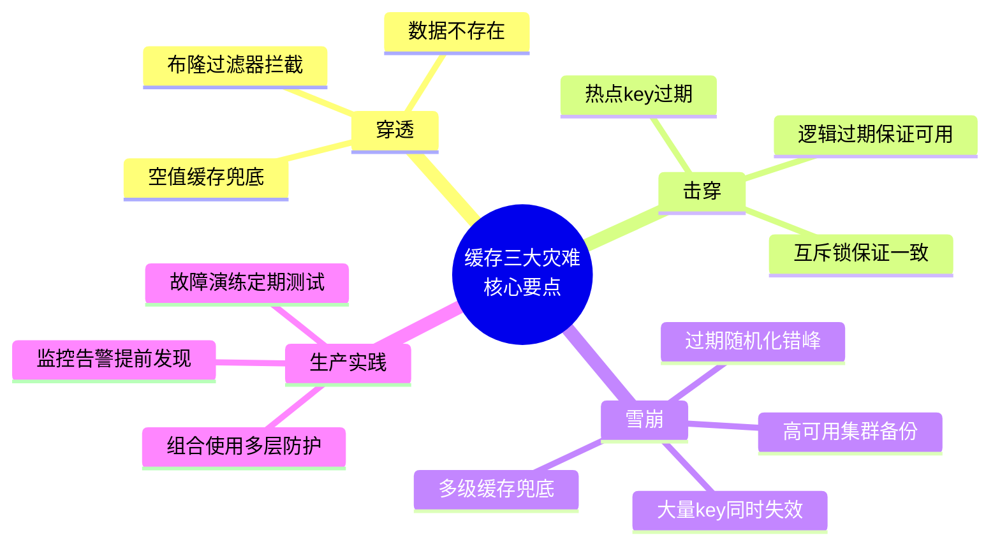

### 🎯 一句话总结

> **缓存三兄弟：穿透靠布隆过滤器（门禁），击穿靠互斥锁（排队），雪崩靠过期随机化（错峰）+ 高可用集群（备份）。生产环境组合使用，多层防护，确保万无一失。**

### 🧠 核心记忆点

1. **穿透 vs 击穿 vs 雪崩的区别？**
   - 穿透：数据不存在（门禁没拦住）
   - 击穿：热点 key 过期（狙击手打穿防弹衣）
   - 雪崩：大量 key 同时失效（防弹衣被炸成碎片）

2. **为什么布隆过滤器不会误判"不存在"？**
   - 因为写入时把三个位置都置为 1，查询时只要有一个位置是 0，就一定没写过。
   - 就像门禁系统：如果没录入过你的脸，就一定认不出你。

3. **互斥锁和逻辑过期怎么选？**
   - 互斥锁：保证一致性，但要等着（如库存）
   - 逻辑过期：保证高可用，但返回旧数据（如推荐）
   - 看业务：核心数据用互斥锁，非核心用逻辑过期

4. **过期时间为什么要加随机值？**
   - 防止大量 key 同时过期，导致 DB 压力瞬间暴增。
   - 就像错峰下班，避免电梯挤爆。

5. **生产环境如何验证方案有效？**
   - 压力测试：模拟高并发场景
   - 故障演练：主动关掉 Redis 节点
   - 监控指标：缓存命中率 > 95%、DB 响应时间 < 100ms

---
