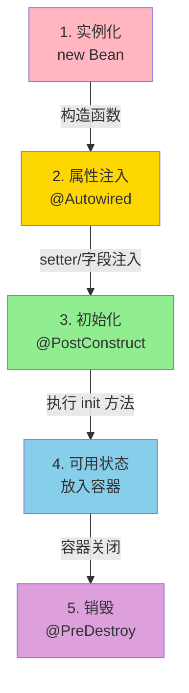
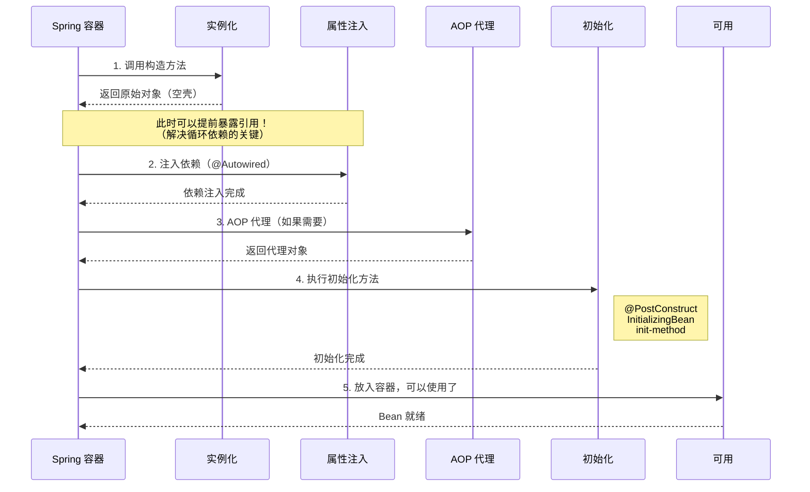
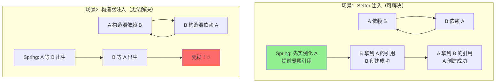
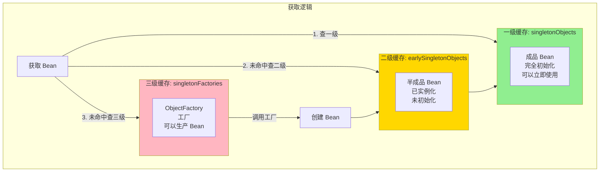
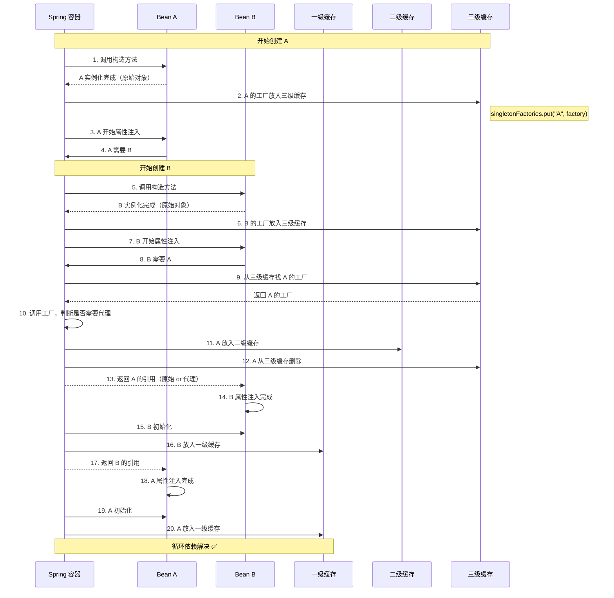
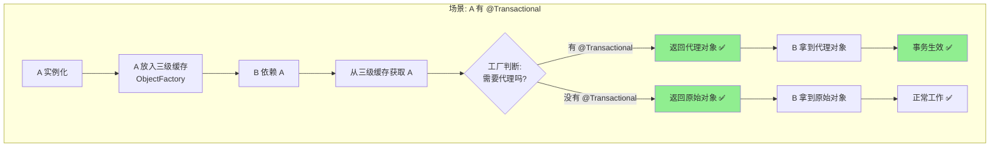
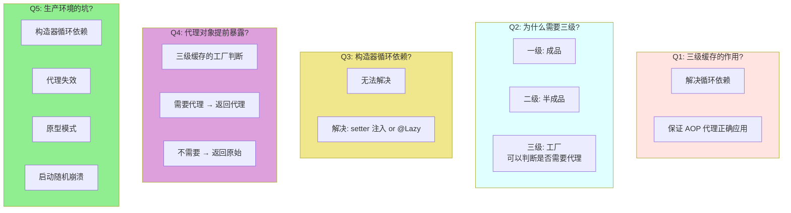
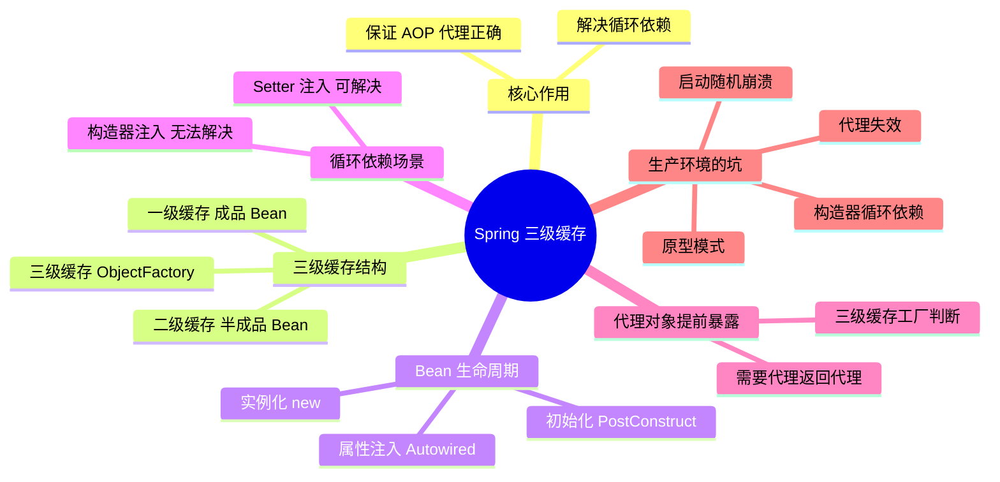
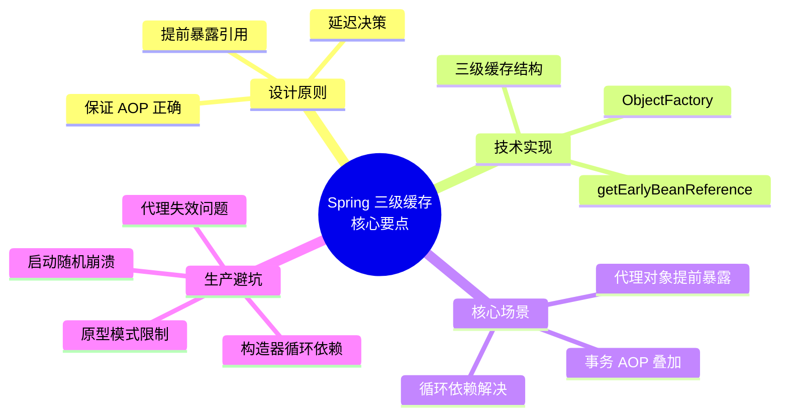

# Spring 三级缓存与循环依赖

> **场景引入**：Spring 的三级缓存机制是框架设计中的精巧之处，理解其原理对于掌握 Bean 生命周期、循环依赖解决和 AOP 代理应用具有重要意义。

---

## 🎯 一句话定位

**Spring 三级缓存解决什么问题？**
```
Bean A 依赖 Bean B，Bean B 依赖 Bean A
就像：张三说"我的房子借给李四住"，李四说"我的车子借给张三开"
两个人互相依赖，如果都等对方先准备好，就死锁了！
```

**生活化比喻**：
就像两个明星合作拍戏，甲说"必须等乙签约我才签"，乙说"必须等甲签约我才签"。经纪人（Spring 容器）怎么办？先让甲签个"意向书"（提前暴露引用），乙看到甲有意向就也签了，最后甲再正式签约（完成初始化）。

**核心特点**：三级缓存是 Spring 解决循环依赖的"秘密武器"，让原本会死锁的 Bean 互相依赖能够成功创建。

---

## 💎 核心要点概览

> **快速了解 Spring 三级缓存的核心设计要点**

### 核心观点（5 个关键点）

**1. 三级缓存的作用：解决循环依赖**
```
一级缓存（singletonObjects）：存放完全初始化好的 Bean（成品）
二级缓存（earlySingletonObjects）：存放实例化但未初始化的 Bean（半成品）
三级缓存（singletonFactories）：存放 Bean 的 ObjectFactory（工厂，用来生产半成品）

❌ 两级缓存不够吗？
   - 如果 Bean 需要 AOP 代理（如事务），两级缓存无法解决
   - 三级缓存存的是"工厂"，可以决定返回原始对象还是代理对象
```

**2. Bean 生命周期：实例化 → 属性注入 → 初始化**
```
实例化（Instantiation）：new 一个对象（像刚出生的婴儿）
属性注入（Populate）：设置依赖（像给婴儿喂奶、穿衣服）
初始化（Initialization）：执行 init 方法（像婴儿学会走路说话）

循环依赖只能解决"属性注入"阶段的依赖（setter 注入）
构造器注入的依赖无法解决（因为还没实例化出来）
```

**3. 循环依赖场景：setter vs 构造器**
```
✅ Setter 注入：可以解决（Spring 默认方式）
   - 先实例化（new），再注入属性（set）
   - 实例化后可以提前暴露引用

❌ 构造器注入：无法解决（Spring Boot 2.6+ 默认禁止）
   - 必须先有依赖才能实例化
   - 死锁：A 等 B，B 等 A，都没实例化

解决方案：
- 改用 @Autowired 字段注入或 setter 注入
- 或者用 @Lazy 延迟加载（代理模式）
```

**4. 代理对象提前暴露：事务 AOP 叠加循环依赖**
```
场景：Bean A 有 @Transactional，Bean B 依赖 A
问题：B 拿到的 A 是原始对象还是代理对象？
答案：必须是代理对象！否则事务失效

三级缓存的妙用：
- 三级缓存存 ObjectFactory（工厂）
- 工厂判断是否需要代理
- 需要代理 → 返回代理对象
- 不需要代理 → 返回原始对象
```

**5. 生产环境的坑：构造器循环依赖、代理失效、启动随机崩溃**
```
坑1：构造器循环依赖
   - Spring Boot 2.6+ 默认禁止
   - 解决：改用 setter 注入或 @Lazy

坑2：代理对象失效
   - 如果从二级缓存直接拿，可能拿到原始对象
   - 事务、切面全部失效

坑3：多例模式（@Scope("prototype")）
   - 原型模式不缓存，每次 new
   - 循环依赖直接失败

坑4：启动随机崩溃
   - 循环依赖的顺序不确定
   - 今天能启动，明天改了点代码就挂了
```

---

## 🚀 核心总结

> **Spring 三级缓存 = 一级缓存（成品） + 二级缓存（半成品） + 三级缓存（工厂），通过提前暴露"半成品引用"解决循环依赖，同时保证 AOP 代理正确应用。**

---

## 一、Bean 生命周期：理解三级缓存的前提

### 🍼 生活化比喻：Bean 的一生

**生活化比喻**：
```
Bean 的生命周期就像人的成长过程：

1. 实例化（Instantiation）
   - 就像婴儿出生（new 一个对象）
   - 此时什么都没有，就是个"空壳"
   - 代码：Object obj = new Bean();

2. 属性注入（Populate）
   - 就像父母给孩子喂奶、穿衣服
   - 把依赖的 Bean 注入进来（@Autowired）
   - 代码：obj.setDependency(anotherBean);

3. 初始化（Initialization）
   - 就像孩子上学、学会做人做事
   - 执行 @PostConstruct、init-method 等方法
   - 代码：obj.init();

4. 可用状态
   - 孩子长大成人，可以工作了
   - Bean 放在容器里，等待被使用

5. 销毁（Destruction）
   - 人老了，退休了
   - 执行 @PreDestroy、destroy-method
```



### 1.1 实例化 vs 初始化（高频混淆点）

**生活化比喻**：
```
实例化（Instantiation）：
- 就像"出生"，从妈妈肚子里出来
- 只是有了身体（内存空间），还没有技能
- 代码：Object obj = new MyClass();

初始化（Initialization）：
- 就像"上学"，学习知识和技能
- 注入依赖、设置属性、执行初始化方法
- 代码：obj.setService(service); obj.init();

❌ 常见错误：
"实例化的时候就注入了依赖" → 错！
实例化只是 new，注入是后面的步骤
```

| 阶段 | 动作 | 比喻 | 代码示例 |
|------|------|------|----------|
| **实例化** | `new Bean()` | 出生 | `Object obj = new Bean();` |
| **属性注入** | `setDependency()` | 喂奶 | `obj.setDep(dep);` |
| **初始化** | `init()` | 上学 | `obj.init();` |

### 1.2 Bean 生命周期完整流程



**代码示例**（完整生命周期）：
```java
@Component
public class MyBean implements InitializingBean, DisposableBean {
    
    @Autowired
    private Dependency dep;  // 属性注入阶段
    
    public MyBean() {
        System.out.println("1. 实例化：构造方法执行");
    }
    
    @Autowired
    public void setDep(Dependency dep) {
        System.out.println("2. 属性注入：setter 执行");
        this.dep = dep;
    }
    
    @PostConstruct
    public void postConstruct() {
        System.out.println("3. 初始化：@PostConstruct 执行");
    }
    
    @Override
    public void afterPropertiesSet() {
        System.out.println("3. 初始化：InitializingBean 执行");
    }
    
    public void initMethod() {
        System.out.println("3. 初始化：init-method 执行");
    }
    
    @PreDestroy
    public void preDestroy() {
        System.out.println("4. 销毁：@PreDestroy 执行");
    }
    
    @Override
    public void destroy() {
        System.out.println("4. 销毁：DisposableBean 执行");
    }
}
```

---

## 二、循环依赖：为什么需要三级缓存？

### 🔗 什么是循环依赖？

**生活化比喻**：
```
循环依赖就像"石头剪刀布"的死循环：

场景1：setter 注入（可以解决）
张三说："等李四准备好了，我再跟他合作"
李四说："等张三准备好了，我再跟他合作"
Spring 说："别急，我先让你们签意向书，慢慢等"

场景2：构造器注入（无法解决）
张三说："李四必须先准备好，我才能出生"
李四说："张三必须先准备好，我才能出生"
Spring 说："你们都在等对方，那永远别出生了！"

结果：BeanCurrentlyInCreationException（死锁）
```



### 2.1 代码示例：循环依赖场景

```java
// 场景1：Setter 注入（✅ 可以解决）
@Component
public class ServiceA {
    @Autowired
    private ServiceB serviceB;  // A 依赖 B
    
    public void doSomething() {
        serviceB.doOtherThing();
    }
}

@Component
public class ServiceB {
    @Autowired
    private ServiceA serviceA;  // B 依赖 A
    
    public void doOtherThing() {
        serviceA.doSomething();
    }
}
// 结果：Spring 启动成功 ✅

// 场景2：构造器注入（❌ 无法解决）
@Component
public class ServiceA {
    private final ServiceB serviceB;
    
    @Autowired
    public ServiceA(ServiceB serviceB) {  // A 的构造器依赖 B
        this.serviceB = serviceB;
    }
}

@Component
public class ServiceB {
    private final ServiceA serviceA;
    
    @Autowired
    public ServiceB(ServiceA serviceA) {  // B 的构造器依赖 A
        this.serviceA = serviceA;
    }
}
// 结果：BeanCurrentlyInCreationException ❌
```

### 2.2 为什么构造器注入无法解决？

**生活化比喻**：
```
构造器注入的死锁：

A 说："我必须等 B 出生，我才能出生"
B 说："我必须等 A 出生，我才能出生"

问：A 和 B 谁先出生？
答：都不可能出生！因为他们都在等对方。

技术原因：
- 构造器执行时，对象还没实例化
- 无法提前暴露引用（因为对象都不存在）
- Spring 无法介入帮助

解决方案：
1. 改用 setter 注入（推荐）
2. 使用 @Lazy（延迟加载）
```

```java
// 解决方案：使用 @Lazy
@Component
public class ServiceA {
    private final ServiceB serviceB;
    
    @Autowired
    public ServiceA(@Lazy ServiceB serviceB) {  // 延迟加载
        this.serviceB = serviceB;
    }
}
// @Lazy 会创建一个代理对象
// 真正调用方法时才会去获取真实的 Bean
```

---

## 三、三级缓存详解：Spring 的秘密武器

### 🏛️ 三级缓存的结构

**生活化比喻**：
```
三级缓存就像一个"餐厅"：

一级缓存（singletonObjects）：
- 就像"做好的菜品"，可以直接上桌
- 存放完全初始化好的 Bean（成品）
- 状态：可以立即使用

二级缓存（earlySingletonObjects）：
- 就像"半成品"，还在烹饪中
- 存放实例化但未初始化的 Bean
- 状态：对象已创建，但属性还没注入

三级缓存（singletonFactories）：
- 就像"菜谱"，告诉厨师怎么做菜
- 存放 ObjectFactory（工厂）
- 状态：还没做，但可以按菜谱做

为什么需要三级？
- 如果只有两级，无法处理 AOP 代理
- 三级缓存的工厂可以决定：返回原始对象 or 代理对象
```



### 3.1 三级缓存的源码结构

```java
// DefaultSingletonBeanRegistry.java
public class DefaultSingletonBeanRegistry implements SingletonBeanRegistry {
    
    // 一级缓存：存放完全初始化好的 Bean（成品）
    private final Map<String, Object> singletonObjects = new ConcurrentHashMap<>(256);
    
    // 二级缓存：存放早期 Bean（实例化但未初始化）
    private final Map<String, Object> earlySingletonObjects = new ConcurrentHashMap<>(16);
    
    // 三级缓存：存放 ObjectFactory（工厂）
    private final Map<String, ObjectFactory<?>> singletonFactories = new LinkedHashMap<>(16);
    
    protected Object getSingleton(String beanName, boolean allowEarlyReference) {
        // 1. 先从一级缓存找（成品）
        Object singletonObject = this.singletonObjects.get(beanName);
        if (singletonObject == null && isSingletonCurrentlyInCreation(beanName)) {
            // 2. 一级缓存没有，且 Bean 正在创建中（循环依赖）
            singletonObject = this.earlySingletonObjects.get(beanName);
            if (singletonObject == null && allowEarlyReference) {
                // 3. 二级缓存也没有，从三级缓存找（工厂）
                ObjectFactory<?> objectFactory = this.singletonFactories.get(beanName);
                if (objectFactory != null) {
                    // 调用工厂生产 Bean
                    singletonObject = objectFactory.getObject();
                    // 放入二级缓存（下次直接从二级拿）
                    this.earlySingletonObjects.put(beanName, singletonObject);
                    // 从三级缓存删除（已经生产了）
                    this.singletonFactories.remove(beanName);
                }
            }
        }
        return singletonObject;
    }
}
```

### 3.2 为什么需要三级缓存？两级不够吗？

**生活化比喻**：
```
为什么需要三级缓存？

假设只有两级缓存：
- 一级缓存：成品 Bean
- 二级缓存：半成品 Bean

场景：Bean A 需要 AOP 代理（@Transactional）
1. A 实例化（原始对象）
2. A 放入二级缓存
3. B 依赖 A，从二级缓存拿到 A 的原始对象
4. B 初始化完成
5. A 继续初始化，执行 AOP 代理
6. A 变成代理对象

问题：B 拿到的是原始对象，不是代理对象！
结果：事务失效！💥

三级缓存的解决方案：
- 三级缓存存 ObjectFactory（工厂）
- 工厂可以判断：是否需要代理？
  - 需要 → 返回代理对象
  - 不需要 → 返回原始对象
- B 从三级缓存拿 A 时，工厂返回代理对象
- 结果：B 拿到的是代理对象 ✅
```



```mermaid
graph TB
    subgraph "两级缓存的问题"
        A1[A 实例化] --> A2[A 放入二级缓存]
        A2 --> B1[B 依赖 A<br/>从二级缓存拿]
        B1 --> B2[B 拿到原始对象 ❌]
        B2 --> B3[B 初始化完成]
        B3 --> A3[A 继续初始化<br/>AOP 代理]
        A3 --> A4[A 变成代理对象]
        A4 -.->|但 B 拿到的还是原始对象| B2
    end
    
    subgraph "三级缓存的解决方案"
        C1[A 实例化] --> C2[A 的工厂放入三级缓存]
        C2 --> D1[B 依赖 A<br/>从三级缓存拿]
        D1 --> D2[工厂判断: 需要代理吗?]
        D2 -->|需要| D3[返回代理对象 ✅]
        D2 -->|不需要| D4[返回原始对象 ✅]
        D3 --> D5[B 拿到代理对象]
        D4 --> D5
        D5 --> D6[B 初始化完成]
        D6 --> C3[A 继续初始化]
    end
    
    style B2 fill:#FF6B6B
    style D3 fill:#90EE90
    style D4 fill:#90EE90
```

**代码示例**（三级缓存处理 AOP）：
```java
// AbstractAutowireCapableBeanFactory.java
protected Object doCreateBean(String beanName, RootBeanDefinition mbd, Object[] args) {
    // 1. 实例化
    BeanWrapper instanceWrapper = createBeanInstance(beanName, mbd, args);
    Object bean = instanceWrapper.getWrappedInstance();
    
    // 2. 提前暴露引用（解决循环依赖）
    if (mbd.isSingleton() && allowsCircularReferences()) {
        addSingletonFactory(beanName, () -> getEarlyBeanReference(beanName, mbd, bean));
    }
    
    // 3. 属性注入
    populateBean(beanName, mbd, instanceWrapper);
    
    // 4. 初始化
    bean = initializeBean(beanName, bean, mbd);
    
    return bean;
}

// 关键：getEarlyBeanReference 方法
protected Object getEarlyBeanReference(String beanName, RootBeanDefinition mbd, Object bean) {
    Object exposedObject = bean;
    
    if (!mbd.isSynthetic() && hasInstantiationAwareBeanPostProcessors()) {
        for (BeanPostProcessor bp : getBeanPostProcessors()) {
            if (bp instanceof SmartInstantiationAwareBeanPostProcessor) {
                SmartInstantiationAwareBeanPostProcessor ibp = 
                    (SmartInstantiationAwareBeanPostProcessor) bp;
                
                // 这里会调用 AnnotationAwareAspectJAutoProxyCreator
                // 判断是否需要创建代理
                exposedObject = ibp.getEarlyBeanReference(bean, beanName);
            }
        }
    }
    
    return exposedObject;  // 返回原始对象 or 代理对象
}
```

---

## 四、循环依赖解决流程：图解全过程

### 🔄 生活化比喻：Spring 如何破解循环依赖？

**生活化比喻**：
```
场景：A 依赖 B，B 依赖 A

Spring 的解决步骤：

1. 创建 A
   - Spring: "我要创建 A 了"
   - A: "好的，但我需要 B"
   - Spring: "别急，我先把你实例化，再帮你找 B"

2. A 实例化完成
   - Spring: "A 已经出生了，但还没长大"
   - Spring: "我把 A 的'出生证明'（ObjectFactory）放在三级缓存"

3. A 开始属性注入
   - Spring: "A 需要 B，我先去创建 B"

4. 创建 B
   - Spring: "我要创建 B 了"
   - B: "好的，但我需要 A"
   - Spring: "别急，A 已经有'出生证明'了，我先拿给你"

5. B 从三级缓存获取 A
   - Spring: "从三级缓存拿 A 的工厂"
   - 工厂: "需要代理吗？不需要，返回原始对象"
   - Spring: "把 A 放入二级缓存，删除三级缓存"
   - B: "拿到 A 了，我可以初始化了"

6. B 初始化完成
   - Spring: "B 已经完全初始化，放入一级缓存"

7. A 继续属性注入
   - Spring: "A 拿到 B（一级缓存）"
   - A: "拿到 B 了，我可以初始化了"

8. A 初始化完成
   - Spring: "A 已经完全初始化，放入一级缓存"
   - 完成！✅
```



### 4.1 关键步骤解析

**步骤 1-3：A 实例化并放入三级缓存**
```java
// 伪代码
Object beanA = new ServiceA();  // 实例化

// 提前暴露引用（关键！）
ObjectFactory factory = () -> getEarlyBeanReference(beanA);
singletonFactories.put("serviceA", factory);  // 放入三级缓存

// 为什么放三级而不是二级？
// - 三级缓存可以延迟决策（是否需要代理）
// - 二级缓存是直接存放对象，无法动态判断
```

**步骤 9-12：B 从三级缓存获取 A**
```java
// B 需要 A，从三级缓存获取
ObjectFactory factory = singletonFactories.get("serviceA");
Object earlyA = factory.getObject();  // 调用工厂

// 判断是否需要代理
// - 需要 → 返回代理对象
// - 不需要 → 返回原始对象

// 放入二级缓存（下次直接从二级拿）
earlySingletonObjects.put("serviceA", earlyA);

// 从三级缓存删除（已经生产了）
singletonFactories.remove("serviceA");
```

**步骤 16、20：初始化完成后放入一级缓存**
```java
// B 初始化完成
singletonObjects.put("serviceB", beanB);  // 放入一级缓存

// A 初始化完成
singletonObjects.put("serviceA", beanA);  // 放入一级缓存

// 为什么要删除二级缓存？
// - 一级缓存已经是成品，二级缓存不需要了
// - 保证下次直接从一级缓存拿
```

---

## 五、代理对象提前暴露：事务 AOP 叠加循环依赖

### 🎭 最复杂的场景：AOP + 循环依赖

**生活化比喻**：
```
场景：
- Bean A 有 @Transactional（需要事务代理）
- Bean B 依赖 A

问题：
B 拿到的 A 是原始对象还是代理对象？
- 如果是原始对象 → 事务失效！💥
- 如果是代理对象 → 正常 ✅

Spring 的解决方案：
三级缓存的工厂会判断：
1. A 是否需要代理？（有 @Transactional）
2. 需要 → 返回代理对象
3. 不需要 → 返回原始对象

结果：B 拿到的是代理对象，事务正常 ✅
```



### 5.1 代码示例：事务 + 循环依赖

```java
// 场景：A 有事务，B 依赖 A
@Service
public class ServiceA {
    @Autowired
    private ServiceB serviceB;
    
    @Transactional  // 需要事务代理
    public void doTransaction() {
        System.out.println("A 执行事务方法");
        // 如果 B 拿到的是原始对象，事务会失效
        serviceB.doOtherThing();
    }
}

@Service
public class ServiceB {
    @Autowired
    private ServiceA serviceA;  // B 依赖 A
    
    public void doOtherThing() {
        System.out.println("B 执行方法");
    }
}

// Spring 启动时：
// 1. A 实例化
// 2. A 放入三级缓存（工厂知道 A 有 @Transactional）
// 3. B 依赖 A，从三级缓存获取
// 4. 工厂判断：A 需要代理 → 返回代理对象
// 5. B 拿到 A 的代理对象 ✅
// 6. A 初始化完成，事务生效 ✅
```

### 5.2 为什么二级缓存无法解决？

```java
// 假设只有两级缓存的场景：

// 1. A 实例化
Object beanA = new ServiceA();

// 2. A 放入二级缓存（原始对象）
earlySingletonObjects.put("serviceA", beanA);

// 3. B 依赖 A，从二级缓存获取
Object earlyA = earlySingletonObjects.get("serviceA");
// earlyA 是原始对象，不是代理对象！

// 4. B 拿到原始对象 ❌
// 5. A 继续初始化，创建代理对象
// 6. 但 B 已经拿到原始对象了，无法改变

结果：B 拿到的是原始对象，事务失效！💥

// 三级缓存的解决方案：

// 1. A 实例化
Object beanA = new ServiceA();

// 2. A 的工厂放入三级缓存
ObjectFactory factory = () -> {
    // 工厂方法：判断是否需要代理
    Object earlyRef = getEarlyBeanReference(beanA);
    return earlyRef;  // 可能返回代理对象
};
singletonFactories.put("serviceA", factory);

// 3. B 依赖 A，从三级缓存获取
ObjectFactory factory = singletonFactories.get("serviceA");
Object earlyA = factory.getObject();  // 调用工厂
// earlyA 可能是代理对象！

// 4. B 拿到代理对象 ✅
// 5. 事务生效 ✅
```

### 5.3 关键源码：AnnotationAwareAspectJAutoProxyCreator

```java
// AnnotationAwareAspectJAutoProxyCreator.java
@Override
public Object getEarlyBeanReference(Object bean, String beanName) {
    Object cacheKey = getCacheKey(bean.getClass(), beanName);
    this.earlyProxyReferences.put(cacheKey, bean);
    
    // 判断是否需要代理
    return wrapIfNecessary(bean, beanName, cacheKey);
}

protected Object wrapIfNecessary(Object bean, String beanName, Object cacheKey) {
    // 判断是否有切面（如 @Transactional）
    if (hasAdvisors(bean)) {
        // 有切面，创建代理对象
        Object proxy = createProxy(bean, beanName, advisors);
        return proxy;  // 返回代理对象
    }
    
    // 没有切面，返回原始对象
    return bean;
}
```

---

## 六、生产环境的坑：踩坑指南

### 🕳️ 坑 1：构造器循环依赖

**生活化比喻**：
```
构造器循环依赖就像"鸡生蛋，蛋生鸡"的问题：
- A 说："我必须等 B 出生，我才能出生"
- B 说："我必须等 A 出生，我才能出生"
- 结果：永远无法出生 💥

Spring Boot 2.6+ 默认禁止构造器循环依赖
抛出 BeanCurrentlyInCreationException
```

```java
// ❌ 错误示例：构造器循环依赖
@Component
public class ServiceA {
    private final ServiceB serviceB;
    
    @Autowired
    public ServiceA(ServiceB serviceB) {
        this.serviceB = serviceB;
    }
}

@Component
public class ServiceB {
    private final ServiceA serviceA;
    
    @Autowired
    public ServiceB(ServiceA serviceA) {
        this.serviceA = serviceA;
    }
}

// 启动报错：
// BeanCurrentlyInCreationException: Error creating bean with name 'serviceA'

// ✅ 解决方案1：改用 setter 注入
@Component
public class ServiceA {
    @Autowired
    private ServiceB serviceB;  // 字段注入
}

// ✅ 解决方案2：使用 @Lazy
@Component
public class ServiceA {
    private final ServiceB serviceB;
    
    @Autowired
    public ServiceA(@Lazy ServiceB serviceB) {  // 延迟加载
        this.serviceB = serviceB;
    }
}
// @Lazy 会创建一个代理对象
// 真正调用方法时才会获取真实 Bean
```

### 🕳️ 坑 2：代理对象失效

**生活化比喻**：
```
场景：
- A 有 @Transactional
- B 依赖 A
- 但 B 拿到的是原始对象（不是代理）

结果：A 的事务失效！

原因：
- 如果从二级缓存直接拿，拿到的是原始对象
- 必须从三级缓存拿，工厂才会判断是否需要代理

解决：
- Spring 已经处理了这个问题
- 三级缓存的工厂会返回代理对象
- 但如果你自己写了"提前暴露"的逻辑，可能踩坑
```

```java
// ❌ 错误示例：手动提前暴露
@Component
public class ServiceA {
    @Autowired
    private ServiceB serviceB;
    
    @PostConstruct
    public void init() {
        // 错误：在初始化时把原始对象暴露给 B
        // B 拿到的是原始对象，事务失效
        serviceB.setServiceA(this);  // ❌
    }
}

// ✅ 正确做法：让 Spring 处理
@Component
public class ServiceA {
    @Autowired
    private ServiceB serviceB;  // 让 Spring 注入代理对象
    
    @Transactional
    public void doTransaction() {
        // 事务正常
    }
}
```

### 🕳️ 坑 3：原型模式（@Scope("prototype")）

**生活化比喻**：
```
原型模式（prototype）：
- 每次获取 Bean 都 new 一个新的
- 不缓存，就像"一次性筷子"

循环依赖场景：
- A 是原型，B 是原型
- A 依赖 B，B 依赖 A
- 每次 new A 都要 new B，每次 new B 都要 new A
- 无限循环！💥

结论：原型模式无法解决循环依赖
```

```java
// ❌ 原型模式 + 循环依赖 = 死循环
@Component
@Scope("prototype")  // 原型模式
public class ServiceA {
    @Autowired
    private ServiceB serviceB;
}

@Component
@Scope("prototype")
public class ServiceB {
    @Autowired
    private ServiceA serviceA;
}

// 启动报错：
// BeanCurrentlyInCreationException

// 原因：
// - 原型模式不缓存，每次 new
// - new A → need B → new B → need A → new A → ...
// - 无限循环

// 解决方案：
// 避免原型模式 + 循环依赖
// 或者使用 @Lazy
```

### 🕳️ 坑 4：启动随机崩溃

**生活化比喻**：
```
场景：
- 项目有循环依赖（A → B → A）
- 今天能正常启动
- 明天改了点代码，启动失败了

原因：
- 循环依赖的创建顺序不确定
- 取决于 Bean 的定义顺序、依赖关系
- 代码改动可能改变顺序，导致死锁

解决：
- 彻底消除循环依赖（重构代码）
- 使用 @Lazy 延迟加载
```

```java
// 不稳定的循环依赖
@Component
public class ServiceA {
    @Autowired
    private ServiceB serviceB;
    
    // 如果改了这里的依赖，可能导致启动失败
    @Autowired
    private ServiceC serviceC;
}

@Component
public class ServiceB {
    @Autowired
    private ServiceA serviceA;
    
    @Autowired
    private ServiceD serviceD;  // 改了依赖
}

// 解决方案：重构代码，消除循环依赖
// 或者使用 @Lazy
@Component
public class ServiceA {
    @Autowired
    @Lazy
    private ServiceB serviceB;  // 延迟加载，避免死锁
}
```

---

## 七、核心设计要点



### 详细回答

**Q1: Spring 三级缓存的作用是什么？**  
**答**：三级缓存主要解决两个问题：
1. **循环依赖**：通过提前暴露 Bean 的引用，让互相依赖的 Bean 能够成功创建。
2. **AOP 代理正确应用**：三级缓存的工厂可以判断是否需要代理，保证其他 Bean 拿到的是代理对象而不是原始对象。

**Q2: 为什么需要三级缓存？两级不够吗？**  
**答**：两级缓存无法处理 AOP 代理的场景。如果只有二级缓存，其他 Bean 拿到的是原始对象，导致事务失效。三级缓存的工厂可以延迟决策，在需要时返回代理对象。

**Q3: 构造器循环依赖为什么无法解决？**  
**答**：构造器执行时，对象还没实例化，无法提前暴露引用。Spring Boot 2.6+ 默认禁止构造器循环依赖，解决方案是改用 setter 注入或 @Lazy 延迟加载。

**Q4: 代理对象如何提前暴露？**  
**答**：三级缓存存放 ObjectFactory，工厂方法会调用 `getEarlyBeanReference`，判断是否需要代理。需要代理则返回代理对象，不需要则返回原始对象。这样保证其他 Bean 拿到的是正确的对象。

**Q5: 生产环境有哪些坑？**  
**答**：
1. **构造器循环依赖**：Spring Boot 2.6+ 默认禁止，改用 setter 或 @Lazy。
2. **代理对象失效**：手动提前暴露可能导致拿到原始对象，事务失效。
3. **原型模式**：原型模式不缓存，循环依赖会无限循环。
4. **启动随机崩溃**：循环依赖的顺序不确定，代码改动可能导致启动失败。

---

## 八、方案总结



**方案总结**：

> **核心作用**：三级缓存解决**循环依赖**，同时保证 **AOP 代理正确应用**。
> 
> **三级结构**：一级缓存（成品）、二级缓存（半成品）、三级缓存（工厂）。
> 
> **Bean 生命周期**：实例化 → 属性注入 → 初始化。循环依赖在属性注入阶段解决。
> 
> **循环依赖**：Setter 注入可以解决（提前暴露引用），构造器注入无法解决（对象未实例化）。
> 
> **代理提前暴露**：三级缓存的工厂判断是否需要代理，需要则返回代理对象，保证事务生效。
> 
> **生产坑**：构造器循环依赖（改用 setter 或 @Lazy）、代理失效（不要手动暴露）、原型模式（不缓存）、启动随机崩溃（重构消除循环依赖）。

---

## 九、总结（一句话带走）



### 🎯 一句话总结

> **Spring 三级缓存 = 一级缓存（成品） + 二级缓存（半成品） + 三级缓存（工厂），通过提前暴露"半成品引用"解决循环依赖，同时保证 AOP 代理正确应用。**

### 🧠 核心记忆点

1. **为什么需要三级缓存？** 两级缓存无法处理 AOP 代理，三级缓存的工厂可以判断是否需要代理。
2. **构造器循环依赖为什么无法解决？** 对象还没实例化，无法提前暴露引用。
3. **代理对象如何提前暴露？** 三级缓存的工厂调用 `getEarlyBeanReference`，返回代理对象。
4. **生产环境最大的坑？** 构造器循环依赖（Spring Boot 2.6+ 默认禁止）和代理失效（事务不生效）。

---
