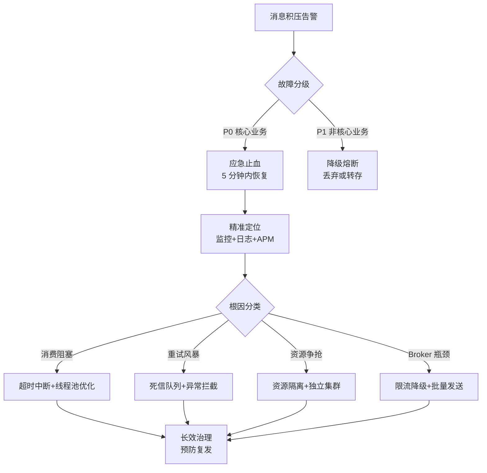
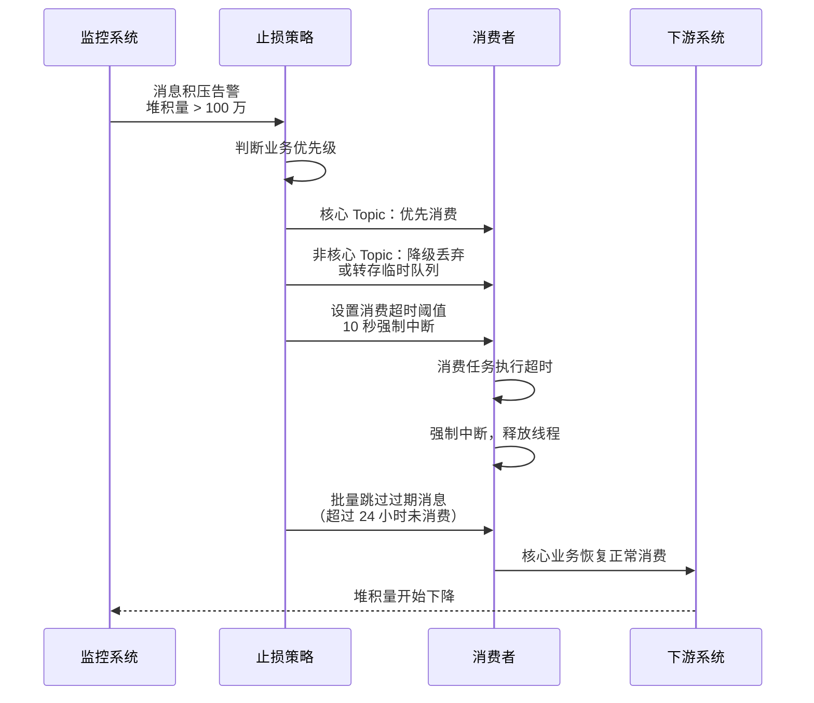
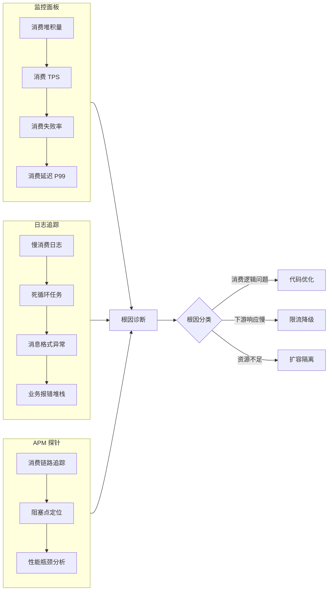
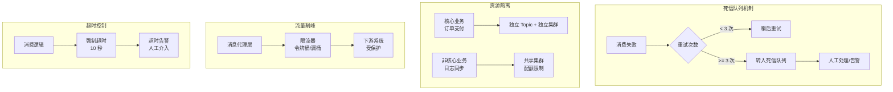
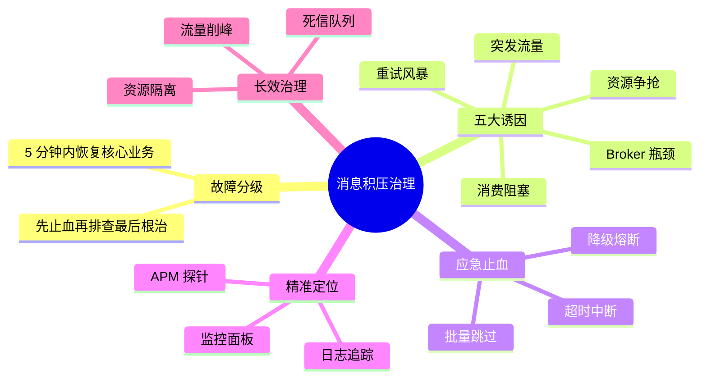
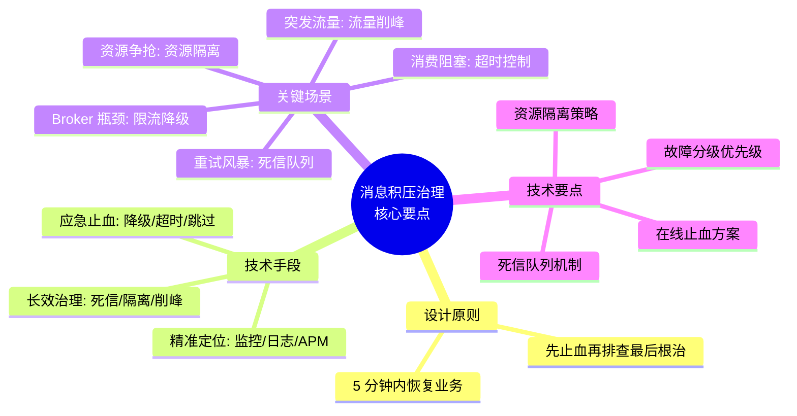

# 消息积压百万条，如何从崩溃到稳定？

> **场景引入**：消息队列是高并发系统中的核心组件，消息积压是生产环境中最常见的故障之一。掌握从应急止血到长效治理的完整方案，是后端工程师的必备技能。

---

## 🎯 一句话定位

**消息积压问题解决什么？**
```
线上突然告警：消息队列积压 100 万条，消费端卡壳，下游业务全延迟。
你要做的不是重启、加机器，而是快速止血 → 精准定位 → 长效治理。
```

**生活化比喻**：
就像医院急诊室突然涌来 100 个病人（消息积压），护士（消费者）忙不过来。
- ❌ 错误做法：直接喊"多叫几个护士"（盲目加消费者），结果医生（数据库）被问诊请求打垮。
- ✅ 正确做法：先分诊（止损）→ 找病因（定位）→ 预防复发（治理）。

**核心特点**：消息积压不是单一问题，而是**消费阻塞、死循环、资源争抢、Broker 瓶颈**的连锁反应。

---

## 💎 核心要点概览

> **快速了解消息积压处理的核心设计要点**

### 核心观点（5 个关键点）

**1. 故障分级：先止血，再排查，最后根治**
```
❌ 错误：上来就找根因，业务停摆 30 分钟
✅ 正确：
  第 1 步：快速止血（5 分钟内恢复核心业务）
  第 2 步：精准定位（找到具体消费组、代码位置）
  第 3 步：长效治理（死信队列、资源隔离、超时控制）
```

**2. 五大典型诱因**
```
1. 消费侧阻塞：慢查询、死循环占线程
2. 重试风暴：消息格式异常，反复消费失败
3. 资源争抢：多业务共用消费集群，互相挤占
4. 突发流量：峰值流量超消费能力 3 倍
5. Broker 瓶颈：磁盘打满，无法写入新消息
```

**3. 应急止血三板斧**
```
✅ 降级熔断：非核心 Topic 直接丢弃或转存
✅ 超时中断：强制杀掉执行超时的消费任务
✅ 批量跳过：积压的过期无效消息直接跳过
```

**4. 精准定位四件套**
```
✅ 监控面板：消费堆积量、TPS、失败率
✅ 日志追踪：慢消费、死循环任务定位
✅ 异常栈打印：消息格式异常、业务报错位置
✅ APM 探针：消费阻塞点精准定位
```

**5. 长效治理三件套**
```
✅ 死信队列：重试超阈值自动转入，避免无效消费
✅ 资源隔离：核心业务单独 Topic + 独立消费集群
✅ 流量削峰：消息代理层限流，保护下游系统
```

---

## 🚀 核心总结

> **消息积压治理 = 先止血（降级/跳过/超时中断）+ 再定位（监控/日志/APM）+ 后根治（死信队列/资源隔离/流量削峰）**

---

## 一、为什么"加消费者"解决不了消息积压？

### ❌ 常见误区：重启 + 加机器 + 调参数

**思路**：消费慢？加消费者实例，调大线程数！

**三大致命缺陷**：

**1. 下游系统被打垮（最致命）**
```
生活化比喻：
就像餐厅厨房做不过来菜（消费慢），你加了 10 个服务员（消费者）去催菜。
结果 10 个服务员同时问厨师"我的菜好了没？"，厨师直接懵逼，出菜更慢。

技术问题：
消费者实例从 5 个加到 50 个，每个消费者每秒查询数据库 100 次。
数据库 QPS 从 500 暴增到 5000，直接被打垮。
解决方案：评估下游承载能力，做限流降级
代价：不加控制地加消费者，会引发连锁故障
```

**2. 死循环消费无法定位**
```
就像流水线上的工人（消费者）拿到一个零件（消息），发现有问题，
但他不放弃，一直尝试组装，占着工位不放手。
其他工人等着工位，整条流水线停摆。

技术问题：
消费逻辑进入死循环，线程一直占用不释放，不提交消费位点。
消费者看起来在运行，实际一条消息都没消费成功。
盲目加消费者只会让更多线程卡在死循环里。
```

**3. 资源争抢引发连锁反应**
```
就像医院只有一个 CT 室（消费集群），内科、外科、儿科都要用。
儿科病人特别多，把 CT 室占满了，内科急诊病人排队等死。

技术问题：
多个业务线共用一个消费集群，非核心业务（如日志同步）打满资源。
核心业务（如订单支付）消费延迟，影响交易成功率。
```

---

## 二、生产级方案：三层防御体系

### ✅ 核心思路（30 秒版）

```
生活化比喻：
消息积压治理就像医院急诊分诊：
1. 先止血（5 分钟内恢复核心业务）：重症优先，轻症暂缓
2. 再定位（找到病因）：CT、验血、问诊，找到具体问题
3. 后根治（预防复发）：建立分诊制度、预约系统、急诊通道

技术流程：
应急止血（降级/跳过/超时中断） → 精准定位（监控/日志/APM） → 长效治理（死信队列/资源隔离/流量削峰）
```



### 2.1 第一层：应急止血（5 分钟内恢复业务）

**生活化比喻**：
```
就像医院急诊室：
1. 重症优先：心脏病人优先救治（核心业务优先恢复）
2. 轻症暂缓：感冒发烧先等等（非核心业务降级）
3. 强制干预：病人情绪失控就绑起来（超时中断）

技术手段：
- 降级熔断：非核心 Topic 直接丢弃或转存到临时队列
- 超时中断：消费任务执行超过 10 秒强制杀掉
- 批量跳过：积压的过期消息直接跳过，不消费
```



**代码示例**（Go 语言版）：
```go
// 消费超时中断机制
type ConsumerWithTimeout struct {
    consumer    *rocketmq.PushConsumer
    timeout     time.Duration // 消费超时阈值
    maxRetry    int           // 最大重试次数
    dlqProducer *rocketmq.Producer // 死信队列生产者
}

func (c *ConsumerWithTimeout) Consume(ctx context.Context, msgs []*rocketmq.MessageExt) {
    for _, msg := range msgs {
        // 1. 检查消息是否过期（超过 24 小时未消费）
        if time.Since(msg.BornTimestamp) > 24*time.Hour {
            log.Warnf("消息过期，直接跳过: msgId=%s", msg.MsgId)
            continue // 批量跳过
        }
        
        // 2. 设置消费超时
        done := make(chan error, 1)
        go func() {
            done <- c.processMessage(msg)
        }()
        
        select {
        case err := <-done:
            if err != nil {
                // 3. 消费失败，检查重试次数
                if msg.ReconsumeTimes >= c.maxRetry {
                    // 超过最大重试次数，转入死信队列
                    c.sendToDLQ(msg)
                } else {
                    return consume.LaterRetry // 稍后重试
                }
            }
        case <-time.After(c.timeout):
            // 4. 消费超时，强制中断
            log.Errorf("消费超时，强制中断: msgId=%s", msg.MsgId)
            // 可以记录到异常日志，后续人工处理
        }
    }
    return consume.Success
}
```

### 2.2 第二层：精准定位（找到根因）

**生活化比喻**：
```
就像医生诊断病因：
1. 望闻问切：看监控（堆积量、TPS、失败率）
2. CT 扫描：查日志（慢消费、死循环任务）
3. 验血分析：异常栈打印（消息格式异常、业务报错）
4. 专家会诊：APM 探针（消费阻塞点精准定位）

技术手段：
- 监控面板：RocketMQ Console、Grafana + Prometheus
- 日志追踪：ELK Stack（Elasticsearch + Logstash + Kibana）
- APM 工具：SkyWalking、Pinpoint
```



**定位 Checklist**：

| 检查项 | 工具 | 阈值 | 生活化比喻 |
|--------|------|------|------------|
| 消费堆积量 | RocketMQ Console | > 10 万告警 | 医院排队人数 |
| 消费 TPS | Grafana | 环比下降 50% | 医生看诊速度 |
| 消费失败率 | Prometheus | > 5% 告警 | 误诊率 |
| 消费延迟 P99 | SkyWalking | > 10 秒告警 | 病人等待时间 |
| 死循环任务 | 日志分析 | 单消息消费 > 30 秒 | 病人占用诊室太久 |
| 异常消息比例 | ELK | > 1% 告警 | 病历填写错误率 |

### 2.3 第三层：长效治理（预防复发）

**生活化比喻**：
```
就像医院建立长期制度：
1. 分诊制度：不同病情去不同科室（资源隔离）
2. 预约系统：控制每天看诊人数（流量削峰）
3. 急诊通道：重症优先救治（优先级队列）
4. 病历归档：治不好的转入专科（死信队列）

技术手段：
- 死信队列：重试超阈值自动转入，人工处理
- 资源隔离：核心业务单独 Topic + 独立消费集群
- 流量削峰：消息代理层限流，保护下游系统
```



**代码示例**（Go 语言版）：
```go
// 死信队列 + 资源隔离 + 流量削峰
type MessageHandler struct {
    dlqProducer    *rocketmq.Producer     // 死信队列生产者
    rateLimiter    *rate.Limiter          // 限流器
    topicIsolation map[string]*Consumer   // Topic 隔离
    maxRetry       int                    // 最大重试次数
}

func (h *MessageHandler) HandleMessage(msg *rocketmq.MessageExt) error {
    // 1. 限流保护下游系统
    if !h.rateLimiter.Allow() {
        return consume.LaterRetry // 触发限流，稍后重试
    }
    
    // 2. 消费逻辑（带超时控制）
    ctx, cancel := context.WithTimeout(context.Background(), 10*time.Second)
    defer cancel()
    
    err := h.processInContext(ctx, msg)
    if err != nil {
        // 3. 消费失败，检查重试次数
        if msg.ReconsumeTimes >= h.maxRetry {
            // 超过最大重试次数，转入死信队列
            h.sendToDLQ(msg, err)
            return consume.Success // 标记为成功，避免继续重试
        }
        return consume.LaterRetry
    }
    
    return consume.Success
}

func (h *MessageHandler) sendToDLQ(msg *rocketmq.MessageExt, err error) {
    dlqMsg := &rocketmq.Message{
        Topic: fmt.Sprintf("%%DLQ%%_%s", msg.Topic), // 死信队列 Topic
        Body:  msg.Body,
        Properties: map[string]string{
            "originMsgId":    msg.MsgId,
            "originTopic":    msg.Topic,
            "retryCount":     fmt.Sprintf("%d", msg.ReconsumeTimes),
            "errorMessage":   err.Error(),
            "failedTime":     time.Now().Format(time.RFC3339),
        },
    }
    
    // 发送死信队列
    h.dlqProducer.SendSync(context.Background(), dlqMsg)
    
    // 告警通知
    alert.SendAlert(fmt.Sprintf("消息转入死信队列: msgId=%s, error=%s", msg.MsgId, err.Error()))
}
```

---

## 三、五大典型场景与解决方案

### 3.1 消费侧阻塞（慢查询、死循环）

**生活化比喻**：
```
就像餐厅厨师做菜太慢：
- 慢查询：厨师每道菜都要现杀活鱼（查询数据库慢）
- 死循环：厨师发现鱼不新鲜，反复去换鱼，占着灶台不放手

解决方案：
1. 超时控制：做菜超过 10 分钟强制换人
2. 线程池优化：增加厨师数量，但要评估厨房承载能力
3. 异步处理：现杀活鱼改成预制菜（异步查询）
```

**代码示例**：
```go
// 消费侧超时控制 + 异步处理
func (h *MessageHandler) processWithTimeout(msg *rocketmq.MessageExt) error {
    // 1. 设置消费超时
    ctx, cancel := context.WithTimeout(context.Background(), 10*time.Second)
    defer cancel()
    
    // 2. 异步查询数据库（避免阻塞）
    resultCh := make(chan *QueryResult, 1)
    go func() {
        result, err := h.queryDatabase(ctx, msg)
        if err != nil {
            resultCh <- nil
        } else {
            resultCh <- result
        }
    }()
    
    select {
    case result := <-resultCh:
        if result == nil {
            return errors.New("数据库查询失败")
        }
        return h.processResult(result)
    case <-ctx.Done():
        return errors.New("消费超时，强制中断")
    }
}
```

### 3.2 重试风暴（消息格式异常）

**生活化比喻**：
```
就像医院收到一批错误的病历：
医生看病历上写"患者姓名：张三"，但系统里查不到这个人。
医生反复查，每次都查不到，占着诊室不放手。
其他病人排队等死。

解决方案：
1. 死信队列：查 3 次查不到，转入"异常病历室"（死信队列）
2. 异常拦截：在入口处检查病历格式，不合格的直接退回
3. 告警通知：异常病历超过阈值，通知管理员
```

**代码示例**：
```go
// 重试风暴防护
func (h *MessageHandler) handleWithRetryProtection(msg *rocketmq.MessageExt) error {
    // 1. 消息格式校验（前置拦截）
    if !h.validateMessageFormat(msg) {
        log.Errorf("消息格式异常: msgId=%s", msg.MsgId)
        h.sendToDLQ(msg, errors.New("消息格式异常"))
        return consume.Success // 标记成功，避免重试
    }
    
    // 2. 消费逻辑
    err := h.processMessage(msg)
    if err != nil {
        // 3. 检查重试次数
        if msg.ReconsumeTimes >= h.maxRetry {
            log.Errorf("消费失败超过最大重试次数: msgId=%s, retryCount=%d", 
                msg.MsgId, msg.ReconsumeTimes)
            h.sendToDLQ(msg, err)
            return consume.Success
        }
        
        // 4. 异常增长率告警
        h.metrics.IncrementRetryCount(msg.Topic)
        if h.metrics.GetRetryRate(msg.Topic) > 0.05 { // 重试率 > 5%
            alert.SendAlert(fmt.Sprintf("Topic %s 重试率过高: %.2f%%", 
                msg.Topic, h.metrics.GetRetryRate(msg.Topic)*100))
        }
        
        return consume.LaterRetry
    }
    
    return consume.Success
}
```

### 3.3 多业务资源争抢

**生活化比喻**：
```
就像医院只有一个 CT 室：
内科、外科、儿科都要用，儿科病人特别多，把 CT 室占满了。
内科急诊病人排队等死。

解决方案：
1. 资源隔离：核心业务（急诊）单独 CT 室
2. 配额限制：非核心业务（普通门诊）每天最多用 10 次
3. 优先级调度：急诊病人优先使用
```

**代码示例**：
```go
// 资源隔离 + 优先级调度
type IsolatedConsumer struct {
    coreConsumers    map[string]*rocketmq.PushConsumer // 核心业务独立集群
    sharedConsumer   *rocketmq.PushConsumer            // 非核心业务共享集群
    quotaManager     *QuotaManager                     // 配额管理
}

func (c *IsolatedConsumer) Start() {
    // 1. 核心业务：独立消费集群
    coreTopics := []string{"order_payment", "inventory_deduction"}
    for _, topic := range coreTopics {
        consumer := rocketmq.NewPushConsumer(
            rocketmq.WithGroupName("core_consumer_"+topic),
            rocketmq.WithNameserver([]string{"namesrv1:9876"}), // 独立集群
        )
        consumer.Subscribe(topic, c.handleCoreMessage)
        c.coreConsumers[topic] = consumer
    }
    
    // 2. 非核心业务：共享消费集群，配额限制
    c.sharedConsumer = rocketmq.NewPushConsumer(
        rocketmq.WithGroupName("shared_consumer"),
        rocketmq.WithNameserver([]string{"namesrv2:9876"}), // 共享集群
    )
    nonCoreTopics := []string{"log_sync", "data_migration"}
    for _, topic := range nonCoreTopics {
        c.sharedConsumer.Subscribe(topic, c.handleNonCoreMessage)
    }
}

func (c *IsolatedConsumer) handleNonCoreMessage(msg *rocketmq.MessageExt) {
    // 配额检查
    if !c.quotaManager.Allow(msg.Topic) {
        log.Warnf("Topic %s 超过配额限制，延迟消费", msg.Topic)
        return consume.LaterRetry
    }
    
    return c.processMessage(msg)
}
```

### 3.4 突发流量超消费能力

**生活化比喻**：
```
就像双十一大促：
平时每天 1 万个订单，大促当天 10 万个订单。
消费者（下游系统）只能处理 5 万个，剩下 5 万个积压。

解决方案：
1. 流量削峰：消息代理层限流，每秒最多处理 1000 个
2. 批量处理：10 个小订单合并成 1 个批量任务
3. 弹性扩容：临时增加消费者实例（但要评估下游承载能力）
```

**代码示例**：
```go
// 流量削峰 + 批量处理
type RateLimitedConsumer struct {
    consumer     *rocketmq.PushConsumer
    rateLimiter  *rate.Limiter
    batchProcessor *BatchProcessor
}

func (c *RateLimitedConsumer) Start() {
    // 1. 限流器：每秒最多处理 1000 条消息
    c.rateLimiter = rate.NewLimiter(1000, 100)
    
    // 2. 批量处理器
    c.batchProcessor = NewBatchProcessor(
        WithBatchSize(10),           // 每批 10 条
        WithFlushInterval(1*time.Second), // 或每秒刷新
    )
    
    c.consumer.RegisterMessageCallback(func(msgs []*rocketmq.MessageExt) {
        for _, msg := range msgs {
            // 限流检查
            if !c.rateLimiter.Allow() {
                log.Warnf("触发限流，延迟消费: msgId=%s", msg.MsgId)
                continue // 稍后重试
            }
            
            // 批量处理
            c.batchProcessor.Add(msg)
        }
    })
}
```

### 3.5 Broker 磁盘打满

**生活化比喻**：
```
就像仓库爆仓：
货物（消息）太多，仓库（Broker 磁盘）装不下了。
新货物进不来，旧货物发不出去。

解决方案：
1. 生产端限流：控制进货速度
2. 批量发送：小包裹合并成大包裹
3. 非核心丢弃：过期货物直接扔掉
4. 核心优先：重要货物优先入库
```

**代码示例**：
```go
// 生产端限流 + 批量发送
type RateLimitedProducer struct {
    producer      *rocketmq.Producer
    rateLimiter   *rate.Limiter
    batchSender   *BatchSender
    localCache    *cache.Cache // 本地缓存
}

func (p *RateLimitedProducer) Send(topic string, body []byte) error {
    // 1. 限流检查
    if !p.rateLimiter.Allow() {
        // 2. 本地缓存（临时存储）
        p.localCache.Set(topic, body, 5*time.Minute)
        log.Warnf("触发限流，消息缓存到本地: topic=%s", topic)
        return nil
    }
    
    // 3. 批量发送
    p.batchSender.Add(&rocketmq.Message{
        Topic: topic,
        Body:  body,
    })
    
    return nil
}

func (p *RateLimitedProducer) flushBatch() {
    // 批量发送（减少 Broker 写入次数）
    msgs := p.batchSender.Flush()
    if len(msgs) > 0 {
        p.producer.SendBatchSync(context.Background(), msgs)
    }
}
```

---

## 四、核心设计要点

### Q1: 消息积压的五大诱因是什么？

**答**：
1. **消费侧阻塞**：慢查询、死循环占线程
2. **重试风暴**：消息格式异常，反复消费失败
3. **资源争抢**：多业务共用消费集群，互相挤占
4. **突发流量**：峰值流量超消费能力
5. **Broker 瓶颈**：磁盘打满，无法写入

### Q2: 如何做到 5 分钟内恢复业务？

**答**：
```
1. 降级熔断：非核心 Topic 直接丢弃或转存（1 分钟）
2. 超时中断：强制杀掉执行超时的消费任务（2 分钟）
3. 批量跳过：积压的过期无效消息直接跳过（2 分钟）
```

### Q3: 死信队列的作用是什么？

**答**：
```
死信队列（DLQ）是消息队列的"异常病历室"：
1. 消费失败超过最大重试次数（如 3 次），自动转入死信队列
2. 避免无效消费反复占坑（重试风暴）
3. 人工处理或告警通知（异常增长率告警）
4. 保证主流程消息不丢失（兜底机制）
```

### Q4: 如何防止多业务资源争抢？

**答**：
```
1. 资源隔离：核心业务单独 Topic + 独立消费集群
2. 配额限制：非核心业务配额限制（如每天最多 10 万次）
3. 优先级调度：核心业务优先消费
4. 物理隔离：不同业务使用不同消费集群
```

### Q5: Broker 磁盘打满怎么处理？

**答**：
```
1. 生产端限流：控制消息发送速度
2. 本地缓存：消息先缓存到本地，稍后批量发送
3. 批量发送：小消息合并成批量，减少 Broker 写入次数
4. 非核心丢弃：过期消息直接丢弃
5. 核心优先：保证核心业务消息不丢失
```

---

## 五、方案总结



**方案总结**：

> **故障分级**：消息积压不是简单加消费者就能解决，而是**先止损再排查最后根治**。第一优先级是 5 分钟内恢复核心业务，而不是死磕根因。
> 
> **五大诱因**：消费侧阻塞（慢查询、死循环）、重试风暴（消息格式异常）、资源争抢（多业务共用集群）、突发流量（超消费能力）、Broker 瓶颈（磁盘打满）。
> 
> **应急止血**：非核心 Topic 降级熔断，超时消费强制中断，过期消息批量跳过。
> 
> **精准定位**：监控面板看堆积量、TPS、失败率，日志追踪慢消费、死循环任务，APM 探针定位阻塞点。
> 
> **长效治理**：死信队列兜底异常消息，资源隔离防止争抢，流量削峰保护下游系统。

---

## 六、生产环境 Checklist（部署检查清单）

| 类别 | 检查项 | 状态 | 生活化比喻 |
|------|--------|------|------------|
| **应急止血** | 降级熔断策略配置 | ⬜ | 急诊分诊制度 |
| | 消费超时中断机制 | ⬜ | 强制换人机制 |
| | 批量跳过过期消息 | ⬜ | 清理过期药品 |
| **精准定位** | 监控面板（堆积量、TPS、失败率） | ⬜ | 医院监控摄像头 |
| | 日志追踪（慢消费、死循环） | ⬜ | 病历追踪系统 |
| | APM 探针（阻塞点定位） | ⬜ | CT 扫描仪 |
| **长效治理** | 死信队列（异常消息兜底） | ⬜ | 异常病历室 |
| | 资源隔离（核心业务独立集群） | ⬜ | 急诊专用 CT 室 |
| | 流量削峰（限流器） | ⬜ | 预约系统 |
| **监控告警** | 重试率告警（> 5%） | ⬜ | 误诊率告警 |
| | 堆积量告警（> 10 万） | ⬜ | 排队人数告警 |
| | 消费延迟告警（P99 > 10 秒） | ⬜ | 等待时间告警 |

---

## 七、总结（一句话带走）



### 🎯 一句话总结

> **消息积压治理 = 先止血（降级/跳过/超时中断）+ 再定位（监控/日志/APM）+ 后根治（死信队列/资源隔离/流量削峰）**

### 🧠 核心记忆点

1. **为什么不能只加消费者？** 会打垮下游系统，就像加 10 个服务员催菜，厨师直接懵逼。
2. **如何 5 分钟内恢复？** 非核心降级、超时中断、批量跳过，先通再治。
3. **如何防止重试风暴？** 死信队列兜底，超过 3 次自动转入，避免无效消费占坑。
4. **如何防止资源争抢？** 核心业务独立集群，非核心业务配额限制。
5. **Broker 磁盘打满怎么办？** 生产端限流、本地缓存、批量发送、非核心丢弃。

---
