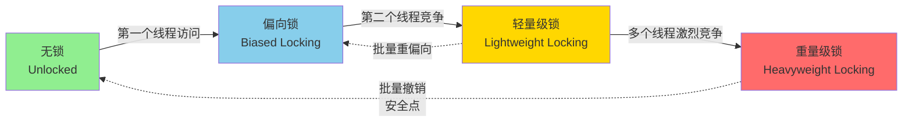
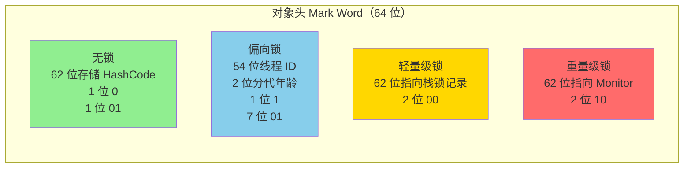
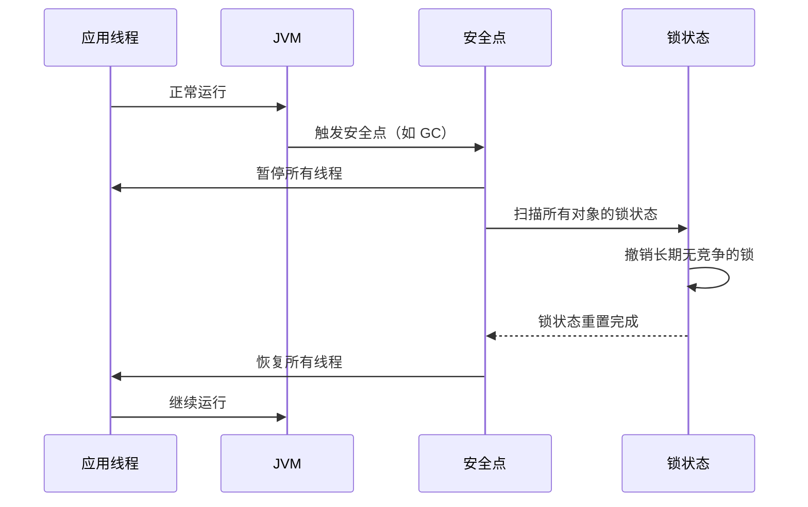
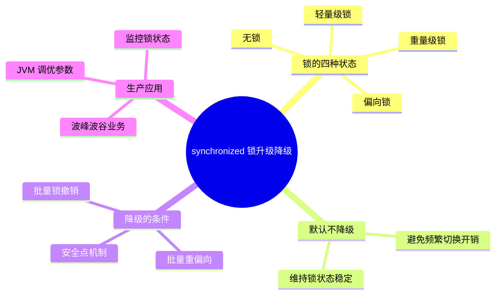
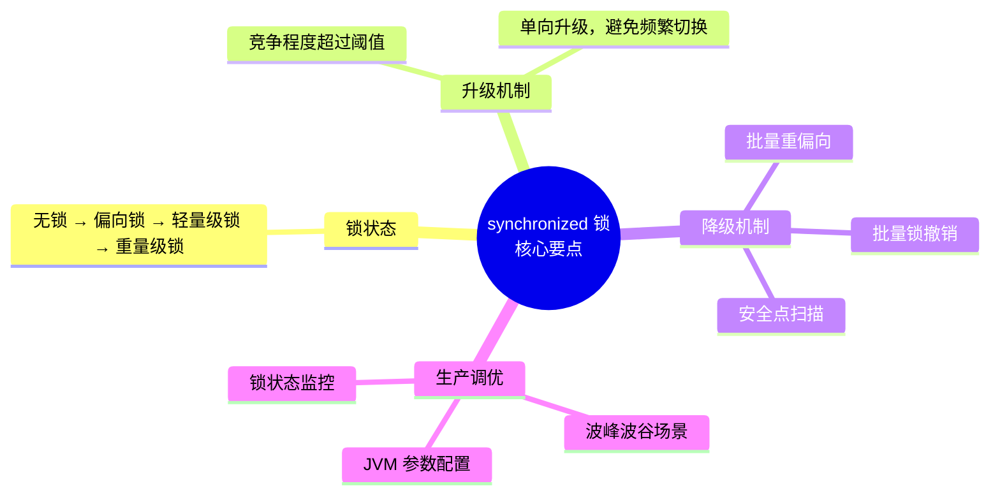

# synchronized 锁升级后真的不会降级吗？

> **场景引入**：synchronized 是 Java 中最基础的同步机制，其锁升级与降级机制是 JVM 并发优化的核心设计。深入理解锁状态流转和批量撤销机制，有助于在实际项目中进行性能调优。

---

## 🎯 一句话定位

**问题引入**：
```
synchronized 锁升级后真的永远不会降级吗？
答案：会降级！触发批量重偏向或批量锁撤销机制就能降级。
那什么时候触发？
JVM 在安全点扫描所有对象的锁状态，把长期无竞争的锁撤销掉。
```

**生活化比喻**：
就像公司门禁系统的升级：
- **无锁**：大门敞开，谁都能进（没有竞争）
- **偏向锁**：刷脸进门，只认一个人（单线程访问）
- **轻量级锁**：刷卡进门，多人轮流用（轻微竞争）
- **重量级锁**：保安守着，排队进入（激烈竞争）

**核心特点**：锁只能单向升级（避免频繁切换开销），但在特定条件下可以降级（批量撤销机制）。

---

## 💎 核心要点概览

> **快速了解 synchronized 锁升级机制的核心设计要点**

### 核心观点（5 个关键点）

**1. 锁的四种状态**
```
无锁 → 偏向锁 → 轻量级锁 → 重量级锁
（单向升级，默认不降级）

生活化比喻：
无锁：大门敞开
偏向锁：刷脸进门（只认一个人）
轻量级锁：刷卡进门（多人轮流）
重量级锁：保安守着（排队进入）
```

**2. 为什么默认不降级？**
```
✅ 避免频繁切换锁态带来额外性能开销
✅ 只要还有线程在持续使用，就维持当前锁态
✅ 这就是"锁不能降级"认知的来源

生活化比喻：
门禁系统升级后，不会轻易降回去。
因为降级需要重新配置，开销大。
```

**3. 什么情况下会降级？（关键转折）**
```
✅ 触发批量重偏向：大量偏向锁被多个线程交替使用
✅ 触发批量锁撤销：JVM 在安全点扫描所有对象的锁状态
✅ 长时间空闲的重量级锁会被释放降级

生活化比喻：
公司搬迁（安全点），重新配置所有门禁。
长期没人的办公室，门禁降级回刷脸模式。
```

**4. 安全点（Safepoint）机制**
```
✅ JVM 在安全点暂停所有线程
✅ 扫描所有对象的锁状态
✅ 把长期无竞争的锁撤销，恢复到无锁或可偏向状态
✅ 相当于全局层面的锁状态重置

生活化比喻：
公司统一停工检修（安全点），IT 部门重新配置所有门禁。
```

**5. 生产环境的实际应用**
```
✅ 有明显波峰波谷的业务系统：
   - 高峰期：大量线程竞争，锁升级成重量级
   - 低峰期：竞争消失，触发批量撤销，锁降级回去
✅ 避免重量级锁常驻带来的性能浪费
✅ 避免锁只能一直升级，最终全是重量级锁
```

---

## 🚀 核心总结

> **synchronized 锁不是天生不能降级，而是默认运行过程中不主动降级；触发批量重偏向或批量撤销机制，它就能降级。**

---

## 一、锁的四种状态与升级流程

### 1.1 锁状态详解

**生活化比喻**：
```
想象一个办公室的门禁系统：

1. 无锁（Unlocked）：
   - 大门敞开，谁都能进
   - 没有任何线程访问
   - 最轻量级

2. 偏向锁（Biased Locking）：
   - 刷脸进门，只认一个人
   - 第一个线程访问时，在对象头记录线程 ID
   - 后续该线程再访问，直接进来，无需加锁
   - 适合单线程场景（90% 的情况只有一个线程访问）

3. 轻量级锁（Lightweight Locking）：
   - 刷卡进门，多人轮流用
   - 第二个线程来竞争时，偏向锁撤销，升级为轻量级锁
   - 使用 CAS 操作，不涉及操作系统级别的锁
   - 适合轻微竞争场景（偶尔有 2-3 个线程竞争）

4. 重量级锁（Heavyweight Locking）：
   - 保安守着，排队进入
   - 多个线程激烈竞争时，升级为重量级锁
   - 依赖操作系统的 Mutex Lock，涉及线程阻塞、唤醒
   - 适合高竞争场景（大量线程同时访问）
```



### 1.2 锁升级流程（代码示例）

**Java 代码示例**：
```java
public class LockUpgradeDemo {
    private final Object lock = new Object();
    
    // 场景 1：偏向锁（单线程访问）
    public void biasedLocking() {
        // 第一次访问，升级为偏向锁
        synchronized (lock) {
            // 偏向锁，对象头记录线程 ID
            System.out.println("偏向锁");
        }
        
        // 第二次访问，还是偏向锁
        synchronized (lock) {
            System.out.println("还是偏向锁");
        }
    }
    
    // 场景 2：轻量级锁（两个线程交替访问）
    public void lightweightLocking() {
        new Thread(() -> {
            synchronized (lock) {
                System.out.println("线程 1");
            }
        }).start();
        
        new Thread(() -> {
            synchronized (lock) {
                System.out.println("线程 2");
            }
        }).start();
        // 两个线程交替访问，偏向锁撤销，升级为轻量级锁
    }
    
    // 场景 3：重量级锁（多个线程激烈竞争）
    public void heavyweightLocking() {
        for (int i = 0; i < 10; i++) {
            new Thread(() -> {
                synchronized (lock) {
                    try {
                        Thread.sleep(1000); // 模拟长时间持有锁
                    } catch (InterruptedException e) {
                        e.printStackTrace();
                    }
                }
            }).start();
        }
        // 10 个线程同时竞争，升级为重量级锁
    }
}
```

### 1.3 对象头（Mark Word）结构

**生活化比喻**：
```
对象头就像门的"状态指示牌"：
- 无锁：显示"空闲"
- 偏向锁：显示"张三专用"（记录线程 ID）
- 轻量级锁：显示"使用中"（指向栈中的锁记录）
- 重量级锁：显示"排队中"（指向 Monitor 对象）
```



---

## 二、为什么默认不降级？

### 2.1 单向升级的原因

**生活化比喻**：
```
门禁系统升级后，不会轻易降回去：
1. 降级需要重新配置，开销大（性能损耗）
2. 如果刚降级又升级，来回切换，浪费资源
3. 只要还有人在用，就维持当前状态

技术问题：
- 锁升级：竞争程度超过当前锁态的承受阈值
- 默认规则：避免频繁切换锁态带来额外性能开销
- 只要还有线程在持续使用，就维持当前锁态
```

**代码示例**（演示默认不降级）：
```java
public class LockNoDowngrade {
    private final Object lock = new Object();
    
    public void testNoDowngrade() throws InterruptedException {
        // 第一轮：10 个线程竞争，升级为重量级锁
        for (int i = 0; i < 10; i++) {
            new Thread(() -> {
                synchronized (lock) {
                    try {
                        Thread.sleep(100);
                    } catch (InterruptedException e) {
                        e.printStackTrace();
                    }
                }
            }).start();
        }
        
        Thread.sleep(2000); // 等待所有线程完成
        
        // 第二轮：单线程访问，还是重量级锁（不会降级）
        synchronized (lock) {
            System.out.println("还是重量级锁");
        }
        // 锁状态：重量级锁 → 重量级锁（没有降级）
    }
}
```

### 2.2 避免频繁切换的性能开销

**生活化比喻**：
```
门禁系统来回切换的代价：
- 偏向锁 → 轻量级锁：需要撤销偏向，重新配置
- 轻量级锁 → 重量级锁：需要申请操作系统锁
- 重量级锁 → 轻量级锁：需要释放操作系统锁，重新配置

如果频繁切换，就像门禁系统不断重启，性能急剧下降。
```

---

## 三、什么情况下会降级？（关键转折）

### 3.1 批量重偏向（Bulk Rebias）

**生活化比喻**：
```
公司有很多办公室（对象），每个办公室都有门禁（偏向锁）。
问题是：
- 张三经常去 A 办公室，门禁记录了张三的 ID
- 后来李四也经常去 A 办公室，每次都要撤销偏向锁，升级为轻量级锁
- 这样效率很低

解决方案：批量重偏向
- IT 部门统计发现，A 办公室经常被张三、李四交替使用
- 直接在安全点（公司统一停工检修）时，把 A 办公室的门禁重置
- 重新偏向到新的线程（李四）
```

**触发条件**：
```
1. 大量偏向锁被多个线程交替使用
2. 频繁升级轻量级锁，性能损耗大
3. JVM 在安全点触发批量重偏向
```

**代码示例**：
```java
public class BulkRebiasDemo {
    private final Object lock = new Object();
    
    public void testBulkRebias() throws InterruptedException {
        // 场景：多个线程轮询访问同步块
        for (int i = 0; i < 100; i++) {
            final int threadId = i;
            new Thread(() -> {
                for (int j = 0; j < 1000; j++) {
                    synchronized (lock) {
                        // 每个线程访问 1000 次
                    }
                }
            }).start();
            
            Thread.sleep(10); // 线程交替启动
        }
        // 多个线程交替访问，触发批量重偏向
    }
}
```

### 3.2 批量锁撤销（Bulk Revocation）

**生活化比喻**：
```
公司搬迁（安全点），IT 部门重新配置所有门禁：
1. 扫描所有办公室的门禁状态
2. 长期没人的办公室：撤销偏向锁，恢复到无锁状态
3. 长时间无竞争的重量级锁：释放降级，恢复到无锁或可偏向状态
4. 相当于全局层面的锁状态重置
```

**触发条件**：
```
1. JVM 进入安全点（Safepoint）
   - GC 时
   - 线程切换时
   - 调用某些 JVM 方法时
2. 扫描所有对象的锁状态
3. 长期无竞争的锁被撤销
```

**代码示例**：
```java
public class BulkRevocationDemo {
    private final Object lock = new Object();
    
    public void testBulkRevocation() throws InterruptedException {
        // 第一轮：大量线程竞争，升级为重量级锁
        for (int i = 0; i < 100; i++) {
            new Thread(() -> {
                synchronized (lock) {
                    try {
                        Thread.sleep(100);
                    } catch (InterruptedException e) {
                        e.printStackTrace();
                    }
                }
            }).start();
        }
        
        Thread.sleep(5000); // 等待所有线程完成
        
        // 此时锁是重量级锁
        
        // 第二轮：长时间没有线程访问
        Thread.sleep(10000); // 等待 10 秒
        
        // 第三轮：JVM 进入安全点（如触发 GC）
        System.gc(); // 触发 GC，JVM 进入安全点
        
        // 第四轮：单线程访问，锁可能已经降级
        synchronized (lock) {
            System.out.println("锁可能已经降级");
        }
        // 锁状态：重量级锁 → 无锁/偏向锁（降级）
    }
}
```

### 3.3 安全点（Safepoint）机制

**生活化比喻**：
```
安全点就像公司统一停工检修：
1. 所有员工停止工作（所有线程暂停）
2. IT 部门检查所有设备（扫描所有对象的锁状态）
3. 长期不用的设备关闭（撤销长期无竞争的锁）
4. 检修完毕，恢复工作（线程继续执行）
```

**安全点触发时机**：
```
1. GC（垃圾回收）时
2. 线程切换时
3. 调用某些 JVM 方法时（如 Thread.sleep）
4. 周期性触发（JVM 参数控制）
```



---

## 四、生产环境的实际应用

### 4.1 波峰波谷业务场景

**生活化比喻**：
```
电商系统的订单处理：
- 双 11 高峰期：大量线程竞争锁，锁升级成重量级
- 凌晨低峰期：竞争消失，触发批量撤销，锁降级回去
- 第二天早高峰：锁再次升级

好处：
- 高峰期通过重量级锁保证并发控制
- 低峰期回到轻量锁态，减少性能开销
- 避免重量级锁常驻带来的性能浪费
```

**代码示例**：
```java
public class ECommerceOrderService {
    private final Object inventoryLock = new Object();
    
    public void processOrder(Order order) {
        // 高峰期：大量线程竞争，锁升级为重量级
        // 低峰期：竞争消失，触发批量撤销，锁降级
        synchronized (inventoryLock) {
            // 扣减库存
            deductInventory(order.getItemId(), order.getQuantity());
            
            // 创建订单
            createOrder(order);
        }
    }
    
    private void deductInventory(String itemId, int quantity) {
        // 数据库操作
    }
    
    private void createOrder(Order order) {
        // 数据库操作
    }
}
```

### 4.2 JVM 调优参数

**常用参数**：
```bash
# 启用偏向锁（默认启用）
-XX:+UseBiasedLocking

# 批量重偏向阈值（默认 20）
-XX:BiasedLockingBulkRebiasThreshold=20

# 批量撤销阈值（默认 40）
-XX:BiasedLockingBulkRevokeThreshold=40

# 安全点间隔（毫秒，默认 10000）
-XX:SAFEPointRescopeDelay=10000
```

**调优建议**：
```
1. 单线程为主的场景：启用偏向锁（默认）
2. 多线程竞争激烈的场景：禁用偏向锁
   -XX:-UseBiasedLocking
3. 波峰波谷明显的场景：调整批量撤销阈值
   -XX:BiasedLockingBulkRevokeThreshold=30
```

---

## 五、核心设计要点

### Q1: synchronized 锁升级后真的不会降级吗？

**技术选型建议**：
> 不是绝对的。默认运行过程中，synchronized 锁只能单向升级，不会主动降级，保证锁状态的稳定性。但当触发批量重偏向、批量锁撤销，或者经过安全点的全局锁清理后，空闲的重量级锁是可以被撤销降级的，回到更轻量的锁态甚至无锁状态。

**进阶方案**（展示深度）：
> 判断锁会不会降级的本质，是看当前是不是持续运行状态，有没有触发批量撤销机制，加上有没有经过安全点的全局清理。像一些有明显波峰波谷的业务系统，高峰期锁升级成重量级，低峰期触发批量撤销后锁就会降级回去。

### Q2: 什么是安全点（Safepoint）？

**答**：
```
安全点是 JVM 暂停所有线程执行本地代码的时刻：
1. 所有线程到达安全点后，JVM 可以执行某些操作（如 GC）
2. 在安全点，JVM 扫描所有对象的锁状态
3. 撤销长期无竞争的锁，恢复到无锁或可偏向状态
4. 安全点触发时机：GC、线程切换、调用某些 JVM 方法
```

### Q3: 批量重偏向和批量锁撤销的区别？

**答**：
```
批量重偏向：
- 场景：大量偏向锁被多个线程交替使用
- 作用：重新偏向到新的线程，避免频繁升级轻量级锁
- 触发：线程交替访问同步块

批量锁撤销：
- 场景：长期无竞争的锁（如重量级锁）
- 作用：撤销锁，恢复到无锁或可偏向状态
- 触发：JVM 在安全点扫描所有对象的锁状态
```

### Q4: 生产环境如何避免锁性能问题？

**答**：
```
1. 减少锁竞争：
   - 缩小同步块范围
   - 使用读写锁（ReentrantReadWriteLock）
   - 使用无锁数据结构（ConcurrentHashMap）

2. 锁调优：
   - 单线程场景：启用偏向锁（默认）
   - 多线程竞争：禁用偏向锁
   - 波峰波谷：调整批量撤销阈值

3. 监控锁状态：
   - 使用 JOL（Java Object Layout）查看锁状态
   - 使用 JProfiler 分析锁竞争
   - 监控安全点停顿时间
```

### Q5: 如何查看对象的锁状态？

**答**：
```java
// 使用 JOL（Java Object Layout）
import org.openjdk.jol.info.ClassLayout;

public class LockStateDemo {
    public static void main(String[] args) {
        Object lock = new Object();
        
        // 打印对象头信息
        System.out.println(ClassLayout.parseInstance(lock).toPrintable());
        
        synchronized (lock) {
            // 加锁后打印
            System.out.println(ClassLayout.parseInstance(lock).toPrintable());
        }
    }
}
```

---

## 六、方案总结



**方案总结**：

> **锁的四种状态**：无锁 → 偏向锁 → 轻量级锁 → 重量级锁，默认单向升级。
> 
> **默认不降级**：避免频繁切换锁态带来额外性能开销，只要还有线程在持续使用，就维持当前锁态。
> 
> **降级条件**：触发批量重偏向（多个线程交替访问）或批量锁撤销（JVM 在安全点扫描所有对象的锁状态），空闲的重量级锁可以被撤销降级。
> 
> **生产应用**：有明显波峰波谷的业务系统，高峰期锁升级成重量级，低峰期触发批量撤销后锁降级回去，减少性能开销。

---

## 七、总结（一句话带走）



### 🎯 一句话总结

> **synchronized 锁不是天生不能降级，而是默认运行过程中不主动降级；触发批量重偏向或批量撤销机制，它就能降级。**

### 🧠 核心记忆点

1. **四种状态**：无锁 → 偏向锁 → 轻量级锁 → 重量级锁。
2. **默认不降级**：避免频繁切换开销，维持锁状态稳定。
3. **降级条件**：批量重偏向（线程交替访问）+ 批量锁撤销（安全点扫描）。
4. **安全点**：JVM 暂停所有线程，扫描锁状态，撤销长期无竞争的锁。
5. **生产应用**：波峰波谷业务，高峰期升级，低峰期降级。

---
