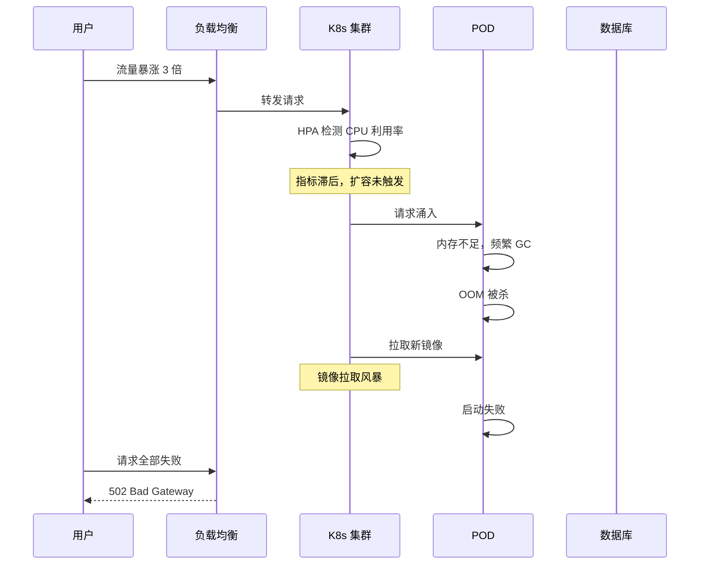
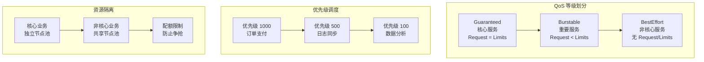
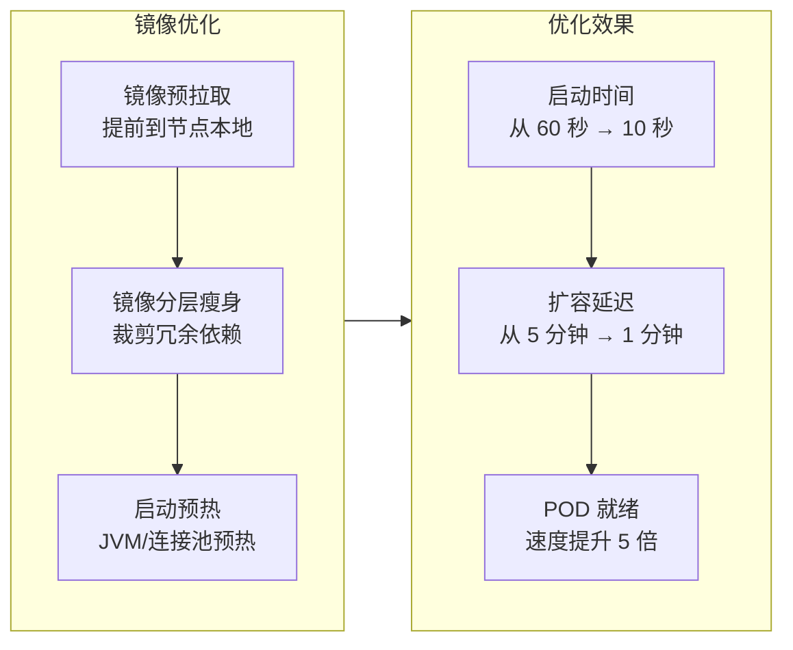
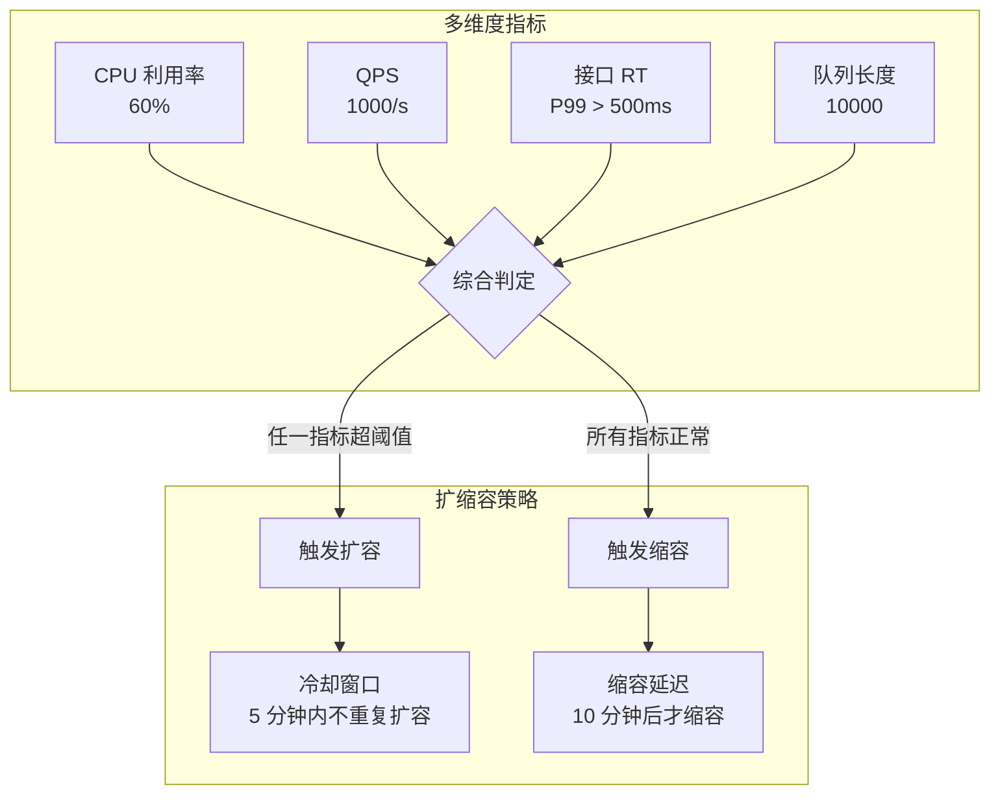
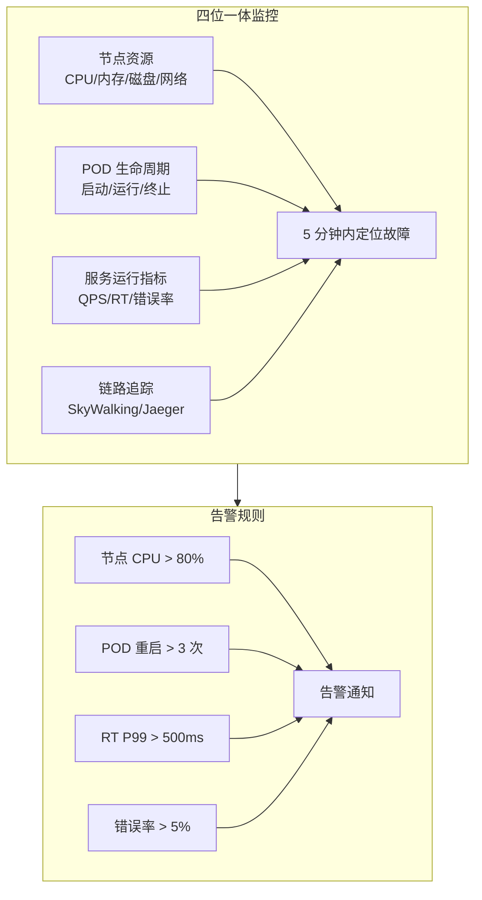
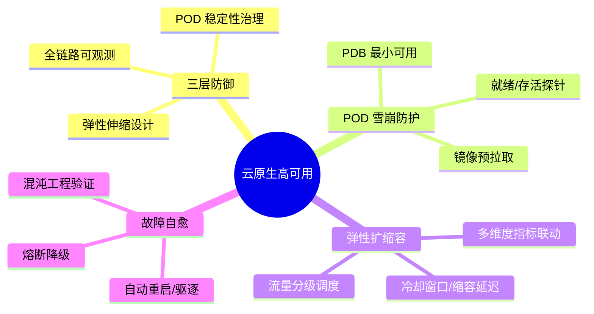
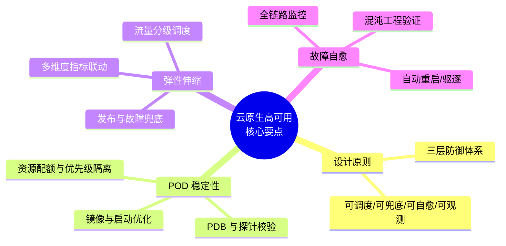

# 容器化与 K8s 编排

> **场景引入**：容器化与 Kubernetes 编排是云原生架构的核心基础设施。理解 POD 稳定性治理、弹性扩缩容和故障自愈机制，是保障生产环境高可用的关键。

---

## 🎯 一句话定位

**容器化 + K8s 编排解决什么？**
```
你以为用了 Docker + K8s 就是云原生高可用？
错！真实流量下，扩容滞后、POD 雪崩、发布故障、资源争抢，任何一个都能让你的系统崩盘。
```

**生活化比喻**：
就像开一家连锁餐厅：
- **Docker**：标准化厨房（环境一致，到哪都能用）
- **K8s**：总部调度系统（哪个店忙就调人支援）
- **弹性扩缩容**：高峰期多开店，低峰期关几家

**核心特点**：会堆组件不够，得解决**扩容滞后、POD 雪崩、发布故障、资源争抢**等连锁反应。

---

## 💎 核心要点概览

> **快速了解容器化与 K8s 编排的核心设计要点**

### 核心观点（5 个关键点）

**1. 三层防御体系**
```
第一层：POD 稳定性与资源治理
  - 资源配额与优先级隔离
  - POD 雪崩防护
  - 镜像与启动优化

第二层：弹性伸缩与流量调度
  - 多维度联动扩缩容
  - 流量分级调度
  - 发布与故障兜底

第三层：全链路可观测与故障自愈
  - 云原生全站监控
  - 故障自动自愈
  - 混沌工程验证
```

**2. POD 雪崩的五大诱因**
```
1. HPA 指标滞后：扩容赶不上流量洪峰
2. OOM 被杀：内存配置不合理
3. 镜像拉取风暴：打垮私有镜像仓库
4. 滚动发布故障：配置错误导致全量 POD 启动失败
5. 资源争抢：非核心服务抢占核心服务资源
```

**3. 弹性扩缩容的正确姿势**
```
❌ 错误：只依赖 CPU 指标
✅ 正确：多维度联动
  - CPU + QPS + 接口 RT + 队列长度
  - 配置扩容冷却窗口与缩容延迟
  - 避免频繁扩缩引发抖动
```

**4. 资源隔离三件套**
```
✅ QoS 等级划分：核心服务 Guaranteed，非核心 BestEffort
✅ Request/Limits 配置：避免非核心抢占核心资源
✅ 物理隔离：核心业务独立节点池
```

**5. 故障自愈三板斧**
```
✅ POD 异常自动重启重建
✅ 节点故障自动驱逐并重新调度
✅ 服务流量异常自动触发熔断降级
```

---

## 🚀 核心总结

> **云原生高可用 = POD 稳定性治理 + 弹性伸缩精准设计 + 全链路可观测与故障自愈**

---

## 一、经典故障场景：大促当天的连锁崩溃

### 1.1 故障时间线

**生活化比喻**：
```
就像双十一当天，连锁餐厅的灾难：
10:00 流量暴涨 3 倍（预期外）
10:05 HPA 指标滞后，扩容没跟上
10:10 POD 频繁 OOM 被杀，服务雪崩
10:15 镜像拉取风暴，打垮私有镜像仓库
10:20 滚动发布配置错误，全量 POD 启动失败
10:30 核心服务大面积不可用，用户投诉炸锅
```



### 1.2 深度追问

**Q: 这时候你作为技术负责人，问题出在哪？**

❌ **错误回答**：
```
"扩容阈值设高了，再加几个节点。"
"多设几个扩容指标，多备点机器。"
```

✅ **正确回答**：
```
问题出在五个方面：
1. HPA 指标滞后：只依赖 CPU 指标，没有结合 QPS、RT、队列长度
2. POD 雪崩防护不足：没有配置 PDB（Pod Disruption Budget）
3. 镜像拉取风暴：核心镜像没有预拉取到节点本地
4. 滚动发布故障：没有按批次灰度推进，配合就绪探针逐步切入流量
5. 资源争抢：核心与非核心服务没有做 QoS 等级隔离
```

---

## 二、第一层防御：POD 稳定性与资源治理

### 2.1 资源配额与优先级隔离

**生活化比喻**：
```
就像医院的分级制度：
- 急诊病人（核心服务）：优先救治，资源优先保障
- 普通门诊（非核心服务）：排队等待，资源配额限制
- 体检（非核心服务）：资源不足时可以直接取消

技术手段：
- QoS 等级划分：Guaranteed > Burstable > BestEffort
- Request/Limits 配置：保证核心服务资源
- 优先级调度：核心服务优先调度到健康节点
```



**YAML 示例**：
```yaml
# 核心服务：Guaranteed QoS
apiVersion: v1
kind: Pod
metadata:
  name: order-service
  labels:
    app: order
    priority: high
spec:
  containers:
  - name: order
    image: order-service:v1.0.0
    resources:
      requests:
        memory: "2Gi"
        cpu: "1000m"
      limits:
        memory: "2Gi"  # Request = Limits → Guaranteed
        cpu: "1000m"
  priorityClassName: high-priority
---
# 非核心服务：BestEffort QoS
apiVersion: v1
kind: Pod
metadata:
  name: log-sync
  labels:
    app: log
    priority: low
spec:
  containers:
  - name: log
    image: log-sync:v1.0.0
    # 不设置 resources → BestEffort
  priorityClassName: low-priority
```

### 2.2 POD 雪崩防护

**生活化比喻**：
```
就像医院的应急预案：
- PDB（Pod Disruption Budget）：保证至少有 3 个医生在岗
- 就绪探针：医生必须通过体检才能接诊
- 存活探针：医生必须保持清醒，否则强制休息

技术手段：
- PDB：守住最小可用实例数
- 就绪探针：避免不健康 POD 承接流量
- 存活探针：检测 POD 是否存活，不健康则重启
```

**YAML 示例**：
```yaml
apiVersion: policy/v1
kind: PodDisruptionBudget
metadata:
  name: order-pdb
spec:
  minAvailable: 3  # 至少保持 3 个 POD 可用
  selector:
    matchLabels:
      app: order
---
apiVersion: v1
kind: Pod
metadata:
  name: order-service
spec:
  containers:
  - name: order
    image: order-service:v1.0.0
    # 就绪探针：检查通过才承接流量
    readinessProbe:
      httpGet:
        path: /health/ready
        port: 8080
      initialDelaySeconds: 10
      periodSeconds: 5
      failureThreshold: 3
    # 存活探针：检查不通过则重启
    livenessProbe:
      httpGet:
        path: /health/live
        port: 8080
      initialDelaySeconds: 30
      periodSeconds: 10
      failureThreshold: 3
```

### 2.3 镜像与启动优化

**生活化比喻**：
```
就像餐厅的开业准备：
- 镜像预拉取：提前把食材放到厨房（不用等供应商送货）
- 镜像瘦身：只带必要的食材（减少搬运时间）
- 启动预热：提前热锅（缩短开业准备时间）

技术手段：
- 镜像预拉取：核心镜像提前拉取到节点本地
- 镜像分层瘦身：裁剪冗余依赖
- 启动预热：JVM 预热、连接池预热
```



**Dockerfile 示例**：
```dockerfile
# 多阶段构建，减少镜像体积
FROM golang:1.21-alpine AS builder
WORKDIR /app
COPY . .
RUN go build -o main .

# 最终镜像：只包含必要的运行时
FROM alpine:3.18
RUN apk --no-cache add ca-certificates tzdata
WORKDIR /root/
COPY --from=builder /app/main .
# 启动预热脚本
COPY start.sh .
RUN chmod +x start.sh
CMD ["./start.sh"]
```

**启动预热脚本**：
```bash
#!/bin/sh
# start.sh

# JVM 预热（Java 应用）
if [ -f "app.jar" ]; then
    java -XX:+UseG1GC -XX:MaxGCPauseMillis=200 \
         -XX:+ParallelRefProcEnabled -XX:+UseCompressedOops \
         -jar app.jar &
    
    # 等待应用启动
    sleep 10
    
    # 预热连接池
    curl -s http://localhost:8080/health/warmup
    
    # 等待就绪
    wait
fi

# Go 应用直接启动
if [ -f "main" ]; then
    ./main
fi
```

---

## 三、第二层防御：弹性伸缩与流量调度

### 3.1 多维度联动扩缩容

**生活化比喻**：
```
就像餐厅的人力调度：
- 只看 CPU：厨房温度高就加人（不准确）
- 多维度：结合订单量、等待时间、厨师忙碌程度（更精准）

技术手段：
- 不单一依赖 CPU 指标
- 结合 QPS、接口 RT、队列长度多维度联合判定
- 配置扩容冷却窗口与缩容延迟，避免频繁扩缩
```



**YAML 示例**（HPA 多维度指标）：
```yaml
apiVersion: autoscaling/v2
kind: HorizontalPodAutoscaler
metadata:
  name: order-hpa
spec:
  scaleTargetRef:
    apiVersion: apps/v1
    kind: Deployment
    name: order-service
  minReplicas: 3
  maxReplicas: 20
  metrics:
  - type: Resource
    resource:
      name: cpu
      target:
        type: Utilization
        averageUtilization: 60  # CPU 利用率 > 60% 触发扩容
  - type: Resource
    resource:
      name: memory
      target:
        type: Utilization
        averageUtilization: 70  # 内存利用率 > 70% 触发扩容
  - type: Pods
    pods:
      metric:
        name: http_requests_per_second
      target:
        type: AverageValue
        averageValue: "1000"  # QPS > 1000 触发扩容
  - type: Object
    object:
      metric:
        name: http_request_duration_seconds
      describedObject:
        apiVersion: networking.k8s.io/v1
        kind: Ingress
        name: order-ingress
      target:
        type: AverageValue
        averageValue: "500m"  # RT > 500ms 触发扩容
  behavior:
    scaleUp:
      stabilizationWindowSeconds: 60  # 扩容冷却窗口 60 秒
      policies:
      - type: Pods
        value: 2
        periodSeconds: 60  # 每分钟最多扩容 2 个 POD
    scaleDown:
      stabilizationWindowSeconds: 300  # 缩容延迟 300 秒
      policies:
      - type: Pods
        value: 1
        periodSeconds: 60  # 每分钟最多缩容 1 个 POD
```

### 3.2 流量分级调度

**生活化比喻**：
```
就像医院的分诊制度：
- 急诊病人：优先接诊，资源优先保障
- 普通门诊：排队等待，资源不足时转诊
- 体检：资源不足时直接取消

技术手段：
- 入口网关按业务优先级分流
- 核心流量优先调度到健康实例
- 非核心流量超额时直接快速失败
- 新扩容 POD 先做流量预热，再逐步切流
```

**代码示例**（Go 语言版）：
```go
// 流量分级调度
type TrafficScheduler struct {
    priorityQueues map[string]*PriorityQueue // 按优先级分队列
    healthChecker  *HealthChecker            // 健康检查
    warmupManager  *WarmupManager            // 预热管理
}

func (s *TrafficScheduler) Schedule(req *Request) (*Response, error) {
    // 1. 按业务优先级分流
    priority := s.getPriority(req)
    queue := s.priorityQueues[priority]
    
    // 2. 检查队列是否超载
    if queue.IsOverloaded() {
        if priority == PriorityLow {
            // 非核心流量超额时直接快速失败
            return nil, errors.New("service unavailable")
        }
        // 核心流量排队等待
        queue.Enqueue(req)
        return queue.Dequeue()
    }
    
    // 3. 选择健康实例
    instance := s.selectHealthyInstance(priority)
    if instance == nil {
        return nil, errors.New("no healthy instance")
    }
    
    // 4. 新实例先做预热，再切流
    if instance.IsNew() {
        s.warmupManager.Warmup(instance)
    }
    
    // 5. 转发请求
    return s.forward(instance, req)
}
```

### 3.3 发布与故障兜底

**生活化比喻**：
```
就像餐厅的新菜品试推：
- 灰度发布：先在 1 家店试推，没问题再推广
- 就绪探针：新菜品必须通过试吃才能上架
- 自动回滚：试推失败立即下架

技术手段：
- 滚动发布按批次灰度推进
- 配合就绪探针逐步切入流量
- 发布异常自动暂停并回滚
- 极端故障场景下一键冻结扩缩容
```

**YAML 示例**（滚动发布策略）：
```yaml
apiVersion: apps/v1
kind: Deployment
metadata:
  name: order-service
spec:
  replicas: 10
  strategy:
    type: RollingUpdate
    rollingUpdate:
      maxSurge: 2  # 最多多出 2 个 POD
      maxUnavailable: 1  # 最多 1 个 POD 不可用
  template:
    spec:
      containers:
      - name: order
        image: order-service:v1.0.1
        # 就绪探针：逐步切入流量
        readinessProbe:
          httpGet:
            path: /health/ready
            port: 8080
          initialDelaySeconds: 10
          periodSeconds: 5
          failureThreshold: 3
```

**故障兜底脚本**：
```bash
#!/bin/bash
# freeze.sh - 一键冻结扩缩容

# 冻结 HPA
kubectl scale hpa order-hpa --min=10 --max=10

# 固定实例数量
kubectl scale deployment order-service --replicas=10

# 暂停滚动发布
kubectl rollout pause deployment/order-service

# 告警通知
echo "已冻结扩缩容，固定实例数量：10" | mail -s "K8s 告警" ops@example.com
```

---

## 四、第三层防御：全链路可观测与故障自愈

### 4.1 云原生全站监控

**生活化比喻**：
```
就像医院的全方位监控：
- 节点资源：心电图、血压、体温
- POD 生命周期：医生值班记录
- 服务运行指标：接诊量、治愈率
- 链路追踪：病人就诊全流程

技术手段：
- 节点资源监控：CPU、内存、磁盘、网络
- POD 生命周期监控：启动、运行、终止
- 服务运行指标监控：QPS、RT、错误率
- 链路追踪：SkyWalking、Jaeger
```



**Prometheus 配置示例**：
```yaml
# prometheus.yml
global:
  scrape_interval: 15s

scrape_configs:
- job_name: 'kubernetes-nodes'
  kubernetes_sd_configs:
  - role: node
  relabel_configs:
  - source_labels: [__address__]
    regex: (.*)
    target_label: __address__
    replacement: ${1}:9100

- job_name: 'kubernetes-pods'
  kubernetes_sd_configs:
  - role: pod
  relabel_configs:
  - source_labels: [__meta_kubernetes_pod_annotation_prometheus_io_scrape]
    action: keep
    regex: true
```

### 4.2 故障自动自愈

**生活化比喻**：
```
就像医院的应急预案：
- POD 异常：自动重启（医生生病，换人顶替）
- 节点故障：自动驱逐并重新调度（医院停电，转移到其他医院）
- 流量异常：自动触发熔断降级（病人太多，限制接诊）

技术手段：
- POD 异常自动重启重建
- 节点故障自动驱逐并重新调度
- 服务流量异常自动触发熔断降级
```

**代码示例**（Go 语言版）：
```go
// 熔断降级
type CircuitBreaker struct {
    failureThreshold int           // 失败阈值
    timeout          time.Duration // 超时时间
    state            State         // 状态：Closed/Open/HalfOpen
    failureCount     int           // 失败计数
    lastFailureTime  time.Time     // 上次失败时间
}

func (cb *CircuitBreaker) Execute(req func() error) error {
    // 1. 检查熔断器状态
    if cb.state == Open {
        // 熔断器打开，直接失败
        return errors.New("circuit breaker is open")
    }
    
    // 2. 执行请求
    err := req()
    if err != nil {
        cb.failureCount++
        cb.lastFailureTime = time.Now()
        
        // 3. 失败次数超过阈值，打开熔断器
        if cb.failureCount >= cb.failureThreshold {
            cb.state = Open
            go func() {
                time.Sleep(cb.timeout)
                cb.state = HalfOpen // 超时后进入半开状态
            }()
        }
        
        return err
    }
    
    // 4. 请求成功，重置失败计数
    cb.failureCount = 0
    if cb.state == HalfOpen {
        cb.state = Closed // 半开状态成功，关闭熔断器
    }
    
    return nil
}
```

### 4.3 混沌工程常态化验证

**生活化比喻**：
```
就像医院的应急演练：
- 定期注入故障：模拟医生请假、设备故障
- 验证应急预案：检查应急流程是否有效
- 持续改进：发现问题，优化预案

技术手段：
- 定期注入节点宕机、POD 删除、网络延迟、镜像仓库故障
- 验证弹性伸缩与自愈机制的真实有效性
- 工具：Chaos Mesh、Litmus
```

**Chaos Mesh 示例**：
```yaml
apiVersion: chaos-mesh.org/v1alpha1
kind: PodChaos
metadata:
  name: pod-kill-test
spec:
  action: pod-kill  # 随机杀 POD
  mode: one  # 每次杀 1 个
  selector:
    labelSelectors:
      app: order
  schedule: "*/5 * * * *"  # 每 5 分钟执行一次
  duration: "1m"  # 持续 1 分钟
---
apiVersion: chaos-mesh.org/v1alpha1
kind: NetworkChaos
metadata:
  name: network-delay-test
spec:
  action: delay  # 网络延迟
  mode: all  # 所有 POD
  selector:
    labelSelectors:
      app: order
  delay:
    latency: "500ms"  # 延迟 500ms
  duration: "5m"  # 持续 5 分钟
```

---

## 五、核心设计要点

### Q1: 弹性扩缩容指标怎么选才不会出现扩容滞后？

**答**：
```
❌ 错误：只依赖 CPU 指标
✅ 正确：多维度联动
  1. CPU 利用率 > 60%
  2. QPS > 1000/s
  3. 接口 RT P99 > 500ms
  4. 队列长度 > 10000
  
配置扩容冷却窗口（60 秒）与缩容延迟（300 秒），避免频繁扩缩引发抖动。
```

### Q2: POD 雪崩怎么快速止损与自愈？

**答**：
```
1. PDB（Pod Disruption Budget）：守住最小可用实例数
2. 就绪探针与存活探针分级校验：避免不健康 POD 承接流量
3. 预设内存水位预警：触发时自动卸载非核心任务
4. 镜像预拉取与启动预热：缩短 POD 就绪时间
5. 故障自动自愈：POD 异常自动重启，节点故障自动驱逐
```

### Q3: 发布故障怎么秒级回滚才不会扩大影响？

**答**：
```
1. 滚动发布按批次灰度推进（maxSurge: 2, maxUnavailable: 1）
2. 配合就绪探针逐步切入流量
3. 发布异常自动暂停并回滚（kubectl rollout undo）
4. 极端故障场景下一键冻结扩缩容（固定实例数量）
```

### Q4: 多业务争抢场景下怎么保证核心服务优先级？

**答**：
```
1. QoS 等级划分：核心服务 Guaranteed，非核心 BestEffort
2. Request/Limits 配置：保证核心服务资源
3. 优先级调度：核心服务优先调度到健康节点
4. 物理隔离：核心业务独立节点池
5. 流量分级：核心流量优先承接，非核心流量快速失败
```

### Q5: 如何验证弹性伸缩与自愈机制的真实有效性？

**答**：
```
混沌工程常态化验证：
1. 定期注入节点宕机、POD 删除、网络延迟、镜像仓库故障
2. 验证弹性伸缩是否及时触发
3. 验证自愈机制是否正常工作
4. 工具：Chaos Mesh、Litmus
```

---

## 六、方案总结



**方案总结**：

> **三层防御**：POD 稳定性治理（资源配额、雪崩防护、镜像优化）、弹性伸缩精准设计（多维度指标、流量分级、发布兜底）、全链路可观测与故障自愈（监控、自愈、混沌工程）。
> 
> **POD 雪崩防护**：PDB 守住最小可用实例数，就绪探针与存活探针分级校验，镜像预拉取与启动预热缩短就绪时间。
> 
> **弹性扩缩容**：多维度指标联动（CPU + QPS + RT + 队列长度），配置扩容冷却窗口与缩容延迟，流量分级调度，核心流量优先承接。
> 
> **故障自愈**：POD 异常自动重启，节点故障自动驱逐，服务流量异常自动触发熔断降级，混沌工程常态化验证。

---

## 七、总结（一句话带走）



### 🎯 一句话总结

> **云原生高可用 = POD 稳定性治理 + 弹性伸缩精准设计 + 全链路可观测与故障自愈**

### 🧠 核心记忆点

1. **POD 雪崩五大诱因**：HPA 滞后、OOM 被杀、镜像拉取风暴、滚动发布故障、资源争抢。
2. **弹性扩缩容**：多维度指标联动（CPU + QPS + RT + 队列长度），冷却窗口 + 缩容延迟。
3. **资源隔离**：QoS 等级划分（Guaranteed > Burstable > BestEffort），核心业务独立节点池。
4. **故障自愈**：POD 异常自动重启，节点故障自动驱逐，流量异常自动熔断降级。
5. **混沌工程**：定期注入故障，验证弹性伸缩与自愈机制的真实有效性。

---
