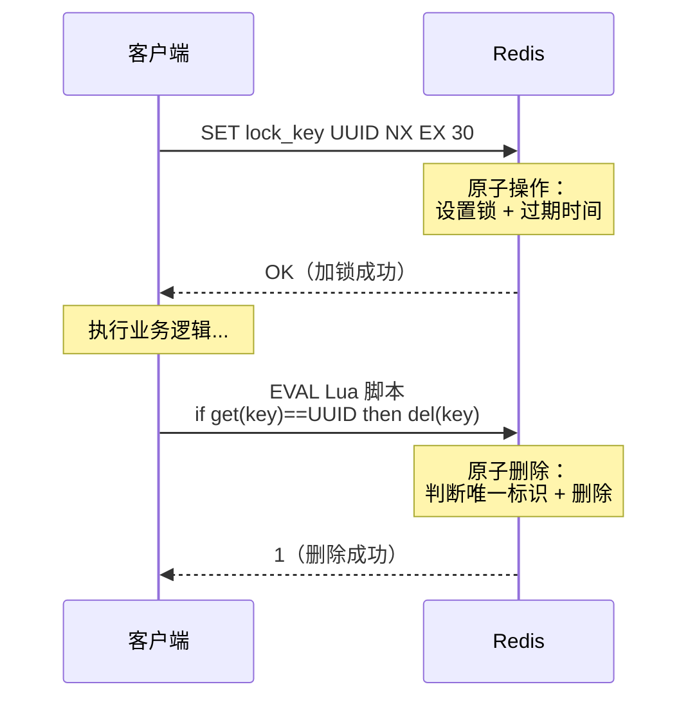
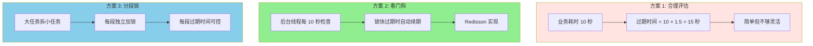
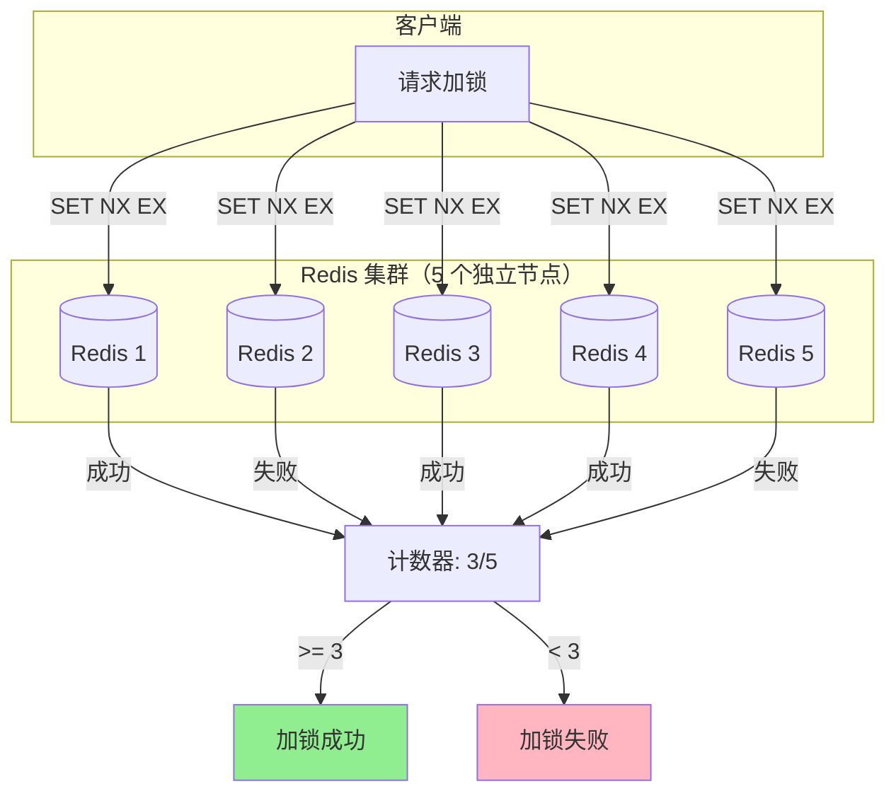
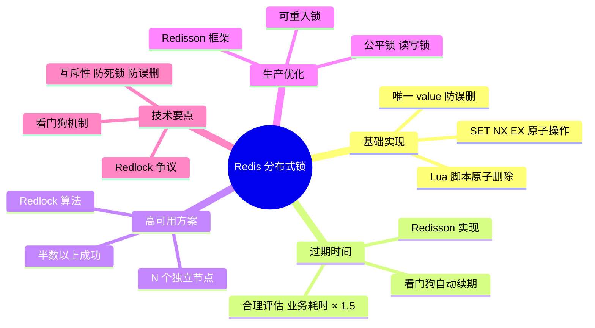
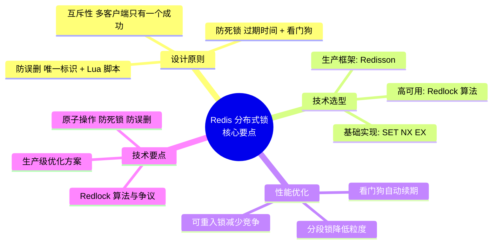

# Redis 分布式锁

> **场景引入**：分布式锁是微服务架构中保证资源互斥访问的核心组件。Redis 分布式锁因其高性能和易用性，成为最常用的实现方案之一。

---

## 🎯 一句话定位

**Redis 分布式锁解决什么问题？**
```
在分布式系统中，多个服务实例需要协调对共享资源的访问
就像多个收银员要同时操作同一个账本，需要一把"分布式锁"来保证操作互斥
```

**生活化比喻**：
就像公共厕所的门锁——进去后反锁，别人看到"有人"就等待；出来时开锁，下一个人才能进。分布式锁就是"跨多个服务器的厕所门锁"。

**核心特点**：互斥性、防死锁、可重入、高可用

---

## 💎 核心要点概览

> **快速了解 Redis 分布式锁的核心设计要点**

### 核心观点（5 个关键点）

**1. 基础实现：SET NX EX + 唯一 value**
```
❌ 错误实现：先 SETNX 再 EXPIRE（两条命令，中间崩溃就死锁）
✅ 正确实现：SET lock_key unique_value NX EX 30（原子操作）
   - NX：key 不存在才设置（互斥性）
   - EX：设置过期时间（防死锁）
   - unique_value：防误删（只能删自己的锁）
```

**2. 过期时间陷阱：业务没执行完锁就过期了**
```
问题：锁 30 秒过期，但业务执行了 40 秒
     → 30 秒时锁自动释放，其他线程拿到锁
     → 两个线程同时持有锁，互斥性失效

解决方案：
✅ 方案 1：合理评估过期时间（业务耗时 × 1.5）
✅ 方案 2：看门狗机制（自动续期，如 Redisson）
✅ 方案 3：分段锁（大任务拆小任务，每段加锁）
```

**3. 误删问题：A 线程删了 B 线程的锁**
```
场景：
线程 A 加锁 → 业务执行慢 → 锁过期自动释放
线程 B 加锁成功 → 线程 A 执行完删除锁（误删了 B 的锁）
→ 线程 C 又能加锁，B 和 C 同时持有锁

解决：value 存唯一标识（如 UUID + 线程 ID）
     删除时用 Lua 脚本：if get(key) == value then del(key)
```

**4. Redlock 算法：多节点高可用方案**
```
问题：单点 Redis 故障，锁服务不可用
方案：部署 N 个独立 Redis 节点（推荐 5 个）
     客户端向所有节点请求加锁
     超过半数（N/2+1）节点成功 = 加锁成功
     优势：单个节点故障不影响锁服务
```

**5. 生产级优化：Redisson + 看门狗 + 可重入**
```
✅ Redisson：开源分布式锁框架
✅ 看门狗：后台线程每 10 秒检查，锁快过期时自动续期
✅ 可重入：同一线程可多次获取同一把锁（hash 结构存储）
✅ 失败重试：加锁失败后自旋等待 + 指数退避
```

---

## 🚀 核心总结

> **Redis 分布式锁 = SET NX EX（原子加锁） + 唯一 value（防误删） + 看门狗（自动续期） + Lua 脚本（原子删除） + Redlock（高可用）**

---

## 一、为什么不能只用 SETNX？

### ❌ 错误实现（常见反例）

**思路**：先 SETNX 加锁，再 EXPIRE 设置过期时间

```go
// ❌ 错误示范
func lock(conn *redis.Conn, key string) bool {
    // 第一步：SETNX
    result, _ := conn.Do("SETNX", key, "1")
    if result == 0 {
        return false // 锁已存在
    }
    
    // ⚠️ 如果这里程序崩溃/网络断开...
    // EXPIRE 没有执行，锁永远不过期 → 死锁！
    
    // 第二步：EXPIRE
    conn.Do("EXPIRE", key, 30)
    return true
}
```

**三大致命缺陷**：

**1. 非原子操作（最致命）**
```
生活化比喻：
就像你进门后，先反锁门（SETNX），再设置闹钟（EXPIRE）。
如果反锁门后你突然晕倒了（程序崩溃），闹钟没设置，
你就永远锁在里面了（死锁）！

技术问题：
SETNX 和 EXPIRE 是两条命令，中间崩溃 → EXPIRE 未执行 → 锁永不过期
```

**2. 过期时间难评估**
```
设置 30 秒过期，但业务执行了 40 秒
→ 30 秒时锁自动释放，其他线程拿到锁
→ 两个线程同时操作共享资源，数据不一致

就像你预约了 30 分钟会议室，但会议开了 40 分钟
→ 30 分钟时下一拨人进来了，两拨人同时用会议室
```

**3. 误删问题**
```
线程 A 加锁后，业务执行慢，锁过期自动释放
线程 B 加锁成功
线程 A 执行完，删除锁（实际删了 B 的锁）
→ 线程 C 又能加锁，B 和 C 同时持有锁

就像 A 租了房间，超时没退房，B 又租给了 C
A 回来时把自己的行李扔了（误删了 B 的锁）
```

---

## 二、生产级方案：SET NX EX + 唯一 value

### ✅ 正确实现（30 秒版）

```go
// ✅ 正确示范：原子操作 + 唯一标识
func lock(conn *redis.Conn, key string, value string) bool {
    // 一条命令完成：SET key value NX EX 30
    // NX：key 不存在才设置（互斥）
    // EX 30：30 秒后自动过期（防死锁）
    // value：唯一标识（防误删）
    reply, _ := redis.String(conn.Do("SET", key, value, "NX", "EX", 30))
    return reply == "OK"
}

func unlock(conn *redis.Conn, key string, value string) bool {
    // Lua 脚本：原子删除（防误删）
    script := `
        if redis.call("get", KEYS[1]) == ARGV[1] then
            return redis.call("del", KEYS[1])
        else
            return 0
        end
    `
    result, _ := redis.Int(conn.Do("EVAL", script, 1, key, value))
    return result == 1
}
```

**生活化比喻**：
```
正确实现就像智能门锁：
1. 进门时：一次性完成"反锁 + 设置闹钟"（原子操作）
2. 闹钟时间：预估会议时间 × 1.5（留余量）
3. 门锁标识：只有你的指纹能开门（唯一 value）
4. 自动续期：快超时时，手机 APP 自动延长（看门狗）
```



### 2.1 唯一 value 的设计

**生活化比喻**：
```
唯一 value 就像门禁卡的卡号：
- 每张门禁卡有唯一编号（UUID + 线程 ID）
- 出门时，保安检查门禁卡编号（Lua 脚本判断）
- 只有卡号匹配才能开门（防误删）
```

**推荐方案**：
```go
// 唯一标识 = 机器标识 + 线程 ID + 时间戳
func generateUniqueValue() string {
    hostname, _ := os.Hostname()
    return fmt.Sprintf("%s:%d:%d", hostname, getThreadID(), time.Now().UnixNano())
}

// 示例输出：server1:12345:1729587230123456000
```

### 2.2 Lua 脚本的原子性

**为什么用 Lua 脚本？**
```
生活化比喻：
删除锁就像银行转账：
1. 检查余额（get key）
2. 扣款（del key）

如果这两步不是原子操作：
- 检查余额后，其他人改了账户（锁被其他线程删了）
- 你继续扣款（误删了别人的锁）

Lua 脚本 = 银行柜台一次性完成"检查 + 扣款"（原子操作）
```

**Lua 脚本示例**：
```lua
-- 原子删除锁
if redis.call("get", KEYS[1]) == ARGV[1] then
    return redis.call("del", KEYS[1])
else
    return 0
end
```

**执行逻辑**：
```
1. get key：获取锁的值
2. 判断是否等于我的唯一标识
3. 如果相等：del key（删除锁）
4. 如果不等：返回 0（不删除）

整个过程是原子操作，不会被其他命令打断
```

---

## 三、过期时间陷阱：业务没执行完锁就过期了

### 3.1 问题分析

**场景还原**：
```
线程 A：加锁（过期时间 30 秒）→ 执行业务（预计 10 秒，实际 40 秒）
时间线：
  0s:  A 加锁成功
  10s: 业务还没执行完...
  30s: ⚠️ 锁自动过期释放
  31s: 线程 B 加锁成功（此时 A 还在执行业务）
  40s: A 执行完，删除锁（实际删了 B 的锁）
  41s: 线程 C 加锁成功（B 和 C 同时持有锁）

结果：互斥性失效，两个线程同时操作共享资源
```

**生活化比喻**：
```
就像你预约了 30 分钟会议室：
- 你开了 40 分钟的会
- 30 分钟时，预约系统自动释放了会议室
- 另一拨人进来了，两拨人同时开会
- 你 40 分钟结束后，把会议室的预约取消了（误删了别人的预约）
```

### 3.2 解决方案对比



| 方案 | 原理 | 优点 | 缺点 | 推荐度 | 生活化比喻 |
|------|------|------|------|--------|------------|
| **合理评估** | 业务耗时 × 1.5 | 简单 | 不够灵活，可能浪费或不足 | ⭐⭐⭐ | 预估会议时间，多留 50% 余量 |
| **看门狗** | 后台线程自动续期 | 灵活，不会提前释放 | 实现复杂 | ⭐⭐⭐⭐⭐ | 快超时时，手机 APP 自动延长预约 |
| **分段锁** | 大任务拆小任务 | 每段可控 | 业务改造成本高 | ⭐⭐⭐⭐ | 长时间会议分多个 30 分钟预约 |

### 3.3 看门狗机制详解

**生活化比喻**：
```
看门狗就像会议室的智能助理：
- 每 10 秒检查一次：你的会议还剩多少时间？
- 如果快到期了（剩余 < 10 秒）：自动联系前台延长 30 秒
- 如果你提前结束：取消自动续期

这样你不用担心超时，也不用预估准确时间
```

**Redisson 实现原理**：
```go
// Redisson 看门狗伪代码
func lockWithWatchdog(key string) {
    // 1. 加锁（默认 30 秒过期）
    lockKey, value := SET NX EX 30
    
    // 2. 启动看门狗线程
    go func() {
        for {
            sleep(10秒) // 每 10 秒检查一次
            
            // 检查锁是否还持有
            if !isLocked(lockKey, value) {
                break // 锁已释放，退出看门狗
            }
            
            // 检查剩余时间
            ttl := TTL(lockKey)
            if ttl < 10 {
                // 剩余时间 < 10 秒，续期 30 秒
                EXPIRE(lockKey, 30)
            }
        }
    }()
}
```

**关键参数**：
- 默认锁超时：30 秒
- 看门狗检查间隔：10 秒（lockWatchdogTimeout / 3）
- 续期时间：30 秒

---

## 四、误删问题：A 线程删了 B 线程的锁

### 4.1 问题场景

**详细时间线**：
```
线程 A：加锁（value="A"，过期 30 秒）→ 执行业务（实际 40 秒）
线程 B：等待锁...

时间线：
  0s:  A 加锁成功（value="A"）
  30s: ⚠️ 锁自动过期释放
  31s: B 加锁成功（value="B"）
  40s: A 执行完，执行 DEL lock_key（没有检查 value）
       → 实际删除了 B 的锁！
  41s: C 加锁成功（此时 B 和 C 同时持有锁）

结果：B 和 C 同时操作共享资源，数据不一致
```

**生活化比喻**：
```
就像酒店房间：
- A 入住房间 101（房卡 A）
- A 超时没退房，酒店自动取消预约
- B 入住房间 101（房卡 B）
- A 回来时，用自己的房卡把门锁打开了（误删了 B 的锁）
- C 又能入住了，B 和 C 同时在房间里

解决：房卡必须匹配才能开门（value 唯一标识）
```

### 4.2 解决方案：Lua 脚本原子删除

**核心思路**：
```
删除锁时，先检查 value 是否匹配
匹配才删除，不匹配则不删除

就像退房时，前台检查房卡编号：
- 房卡编号匹配 → 退房成功
- 房卡编号不匹配 → 拒绝退房
```

**Lua 脚本实现**：
```lua
-- KEYS[1]: 锁的 key
-- ARGV[1]: 我的唯一标识
if redis.call("get", KEYS[1]) == ARGV[1] then
    -- value 匹配，删除锁
    return redis.call("del", KEYS[1])
else
    -- value 不匹配，不删除
    return 0
end
```

**Go 代码示例**：
```go
func unlock(conn *redis.Conn, key string, value string) bool {
    script := `
        if redis.call("get", KEYS[1]) == ARGV[1] then
            return redis.call("del", KEYS[1])
        else
            return 0
        end
    `
    result, _ := redis.Int(conn.Do("EVAL", script, 1, key, value))
    return result == 1
}
```

**原子性保证**：
```
Lua 脚本在 Redis 中是原子执行的
执行过程中不会被其他命令打断

就像银行柜台一次性完成"检查 + 扣款"
不会在检查后、扣款前，其他人插进来改账户
```

---

## 五、Redlock 算法：多节点高可用方案

### 5.1 单点故障问题

**问题**：
```
单点 Redis 架构：
客户端 → Redis 主节点 → Redis 从节点

如果主节点挂了：
1. 客户端加的锁还没同步到从节点
2. 主从切换，从节点升级为主
3. 新主节点没有这个锁
4. 其他客户端又能加锁成功
→ 多个客户端同时持有锁，互斥性失效
```

**生活化比喻**：
```
就像只有一个保安的小区：
- 保安记住了"101 房间已出租"
- 保安突然失忆了（主节点故障）
- 新保安上任，不知道 101 已出租
- 又把 101 租给了另一个人
→ 两个人都以为自己是 101 的租户
```

### 5.2 Redlock 算法原理

**核心思路**：
```
部署 N 个独立的 Redis 节点（推荐 5 个）
客户端向所有节点请求加锁
超过半数（N/2 + 1）节点成功 = 加锁成功

例如 5 个节点：
- 至少 3 个节点加锁成功 → 加锁成功
- 即使 2 个节点故障，锁服务仍可用
```

**生活化比喻**：
```
Redlock 就像投票决策：
- 5 个评委独立投票
- 至少 3 个评委同意 → 决策通过
- 即使 2 个评委缺席，决策仍有效

这样单个评委故障不影响整体决策
```



### 5.3 Redlock 实现步骤

**详细流程**：
```
1. 获取当前时间戳（毫秒）
2. 依次向 N 个节点请求加锁（SET NX EX）
   - 每个节点设置较短的超时（如 5-50ms）
   - 避免某个节点故障时长时间等待
3. 计算加锁成功数
   - 成功数 >= N/2 + 1 → 进入步骤 4
   - 否则 → 加锁失败，向所有节点发送解锁请求
4. 计算锁的实际有效时间
   - 有效时间 = 总超时时间 - 开始时间戳
   - 如果有效时间 > 0 → 加锁成功
   - 否则 → 加锁失败，向所有节点发送解锁请求
5. 客户端执行业务逻辑
6. 业务完成，向所有节点发送解锁请求
```

**Go 代码示例（简化版）**：
```go
type Redlock struct {
    nodes []*redis.Client
    quorum int // N/2 + 1
}

func (r *Redlock) Lock(key string, value string, ttl time.Duration) bool {
    successCount := 0
    start := time.Now()
    
    // 1. 向所有节点请求加锁
    for _, node := range r.nodes {
        ctx, cancel := context.WithTimeout(context.Background(), 5*time.Millisecond)
        reply, err := node.Do(ctx, "SET", key, value, "NX", "PX", ttl.Milliseconds())
        cancel()
        
        if err == nil && reply == "OK" {
            successCount++
        }
    }
    
    // 2. 判断是否达到法定人数
    elapsed := time.Since(start)
    validityTime := ttl - elapsed
    
    if successCount >= r.quorum && validityTime > 0 {
        return true // 加锁成功
    }
    
    // 3. 加锁失败，向所有节点发送解锁请求
    r.Unlock(key, value)
    return false
}

func (r *Redlock) Unlock(key string, value string) {
    for _, node := range r.nodes {
        script := `
            if redis.call("get", KEYS[1]) == ARGV[1] then
                return redis.call("del", KEYS[1])
            else
                return 0
            end
        `
        node.Do(context.Background(), "EVAL", script, 1, key, value)
    }
}
```

### 5.4 Redlock 的争议

**支持方**：
- ✅ 解决了单点故障问题
- ✅ 提供了高可用的分布式锁
- ✅ Redis 官方推荐

**反对方**：
- ❌ 依赖时钟同步（NTP 服务不准会影响）
- ❌ 网络延迟会导致误判
- ❌ 实现复杂，容易出错

**替代方案**：
```
1. ZooKeeper：强一致性，性能略低
2. etcd：Raft 协议，可靠性高
3. Consul：健康检查 + 分布式锁

选择建议：
- 高性能场景：Redis Redlock
- 高可靠场景：ZooKeeper/etcd
```

---

## 六、生产级方案：Redisson 框架

### 6.1 Redisson 核心特性

**特性列表**：
| 特性 | 说明 | 生活化比喻 |
|------|------|------------|
| **看门狗** | 后台线程自动续期 | 智能助理自动延长会议预约 |
| **可重入** | 同一线程可多次获取同一把锁 | 同一张房卡可以开同一个房间多次 |
| **公平锁** | 按请求顺序加锁 | 排队等候，先来先得 |
| **红锁** | 多节点高可用 | 5 个评委投票，3 个同意才通过 |
| **读写锁** | 读读共享，读写互斥 | 多人可同时看文件，但修改时要独占 |

### 6.2 Redisson 使用示例

**基础用法**：
```go
import "github.com/redis/go-redis/v9"

// 创建 Redisson 客户端
client := redis.NewClient(&redis.Options{
    Addr: "localhost:6379",
})

// 获取分布式锁
lock := client.NewLock("myLock")

// 加锁（自动续期）
err := lock.Lock(context.Background())
if err != nil {
    log.Fatal(err)
}
defer lock.Unlock(context.Background()) // 释放锁

// 执行业务逻辑
doBusiness()
```

**可重入锁**：
```go
// 可重入锁：同一线程可多次获取
lock := client.NewLock("myLock")

lock.Lock(context.Background())
{
    // 第一次获取
    doBusiness1()
    
    // 第二次获取（可重入）
    lock.Lock(context.Background())
    {
        doBusiness2()
    }
    lock.Unlock(context.Background())
}
lock.Unlock(context.Background())
```

**公平锁**：
```go
// 公平锁：按请求顺序加锁
fairLock := client.NewFairLock("myFairLock")

fairLock.Lock(context.Background())
defer fairLock.Unlock(context.Background())

doBusiness()
```

**红锁**：
```go
// 红锁：多节点高可用
redLock := client.NewRedLock(
    client.NewLock("node1:myLock"),
    client.NewLock("node2:myLock"),
    client.NewLock("node3:myLock"),
    client.NewLock("node4:myLock"),
    client.NewLock("node5:myLock"),
)

redLock.Lock(context.Background())
defer redLock.Unlock(context.Background())

doBusiness()
```

### 6.3 看门狗机制实现

**原理**：
```
1. 加锁成功后，启动看门狗线程
2. 看门狗每 10 秒检查一次
3. 如果锁还持有且剩余时间 < 10 秒，续期 30 秒
4. 如果锁已释放，看门狗退出
```

**伪代码**：
```go
func (l *Lock) Lock(ctx context.Context) error {
    // 1. 加锁（默认 30 秒过期）
    err := l.tryLock(ctx, 30*time.Second)
    if err != nil {
        return err
    }
    
    // 2. 启动看门狗
    go l.watchdog()
    
    return nil
}

func (l *Lock) watchdog() {
    ticker := time.NewTicker(10 * time.Second)
    defer ticker.Stop()
    
    for range ticker.C {
        // 检查锁是否还持有
        if !l.isLocked() {
            break // 锁已释放，退出看门狗
        }
        
        // 检查剩余时间
        ttl := l.getTTL()
        if ttl < 10*time.Second {
            // 续期 30 秒
            l.expire(30 * time.Second)
        }
    }
}
```

---

## 七、核心设计要点

```mermaid
graph TB
    subgraph Q1["Q1: 如何保证互斥性?"]
        A1[SET NX] --> A2[key 不存在才设置]
        A2 --> A3[多客户端只有一个成功]
    end
    
    subgraph Q2["Q2: 如何防死锁?"]
        B1[EXPIRE 过期时间] --> B2[锁自动释放]
        B2 --> B3[看门狗自动续期]
    end
    
    subgraph Q3["Q3: 如何防误删?"]
        C1[唯一 value] --> C2[Lua 脚本原子删除]
        C2 --> C3[只删自己的锁]
    end
    
    subgraph Q4["Q4: 如何高可用?"]
        D1[Redlock 算法] --> D2[N 个独立节点]
        D2 --> D3[半数以上成功 = 加锁成功]
    end
    
    subgraph Q5["Q5: 可重入如何实现?"]
        E1[hash 结构] --> E2[field = 线程 ID]
        E2 --> E3[value = 重入次数]
        E3 --> E4[HINCRBY 递增]
    end
    
    style Q1 fill:#FFE4E1
    style Q2 fill:#E0FFFF
    style Q3 fill:#F0E68C
    style Q4 fill:#DDA0DD
    style Q5 fill:#90EE90
```



### 详细回答

**Q1: 如何保证分布式锁的互斥性？**  
**答**：通过 Redis 的 SET NX 命令实现。NX 表示"key 不存在才设置"，当多个客户端同时请求加锁时，只有一个能成功设置，其他客户端的 key 已存在，SETNX 返回失败。这就保证了互斥性，就像公共厕所的门锁，进去后反锁，别人看到"有人"就等待。

**Q2: 如何防止死锁？**  
**答**：通过设置过期时间（EXPIRE）防止死锁。如果客户端加锁后崩溃，锁会在指定时间后自动释放，不会永久持有。但过期时间难以准确评估，业务没执行完锁就过期会导致互斥性失效。生产环境推荐使用看门狗机制（如 Redisson），后台线程每 10 秒检查，锁快过期时自动续期 30 秒，就像智能助理自动延长会议预约。

**Q3: 如何防止误删其他线程的锁？**  
**答**：通过唯一 value 和 Lua 脚本实现。加锁时 value 存唯一标识（如 UUID + 线程 ID），删除时用 Lua 脚本先检查 value 是否匹配，匹配才删除。Lua 脚本保证原子性，不会被其他命令打断。就像退房时前台检查房卡编号，只有卡号匹配才能退房。

**Q4: 单点 Redis 故障怎么办？**  
**答**：使用 Redlock 算法实现高可用。部署 N 个独立的 Redis 节点（推荐 5 个），客户端向所有节点请求加锁，超过半数（N/2+1）节点成功才算加锁成功。这样单个节点故障不影响锁服务。但 Redlock 依赖时钟同步，有争议。高可靠场景推荐 ZooKeeper/etcd。

**Q5: 可重入锁如何实现？**  
**答**：通过 hash 结构实现。key 是锁名，field 是线程 ID，value 是重入次数。同一线程每次获取锁，value 递增（HINCRBY）；每次释放锁，value 递减；value 为 0 时删除锁。就像同一张房卡可以开同一个房间多次，每次开门记录次数，最后一次关门时退房。

---

## 八、方案总结



**方案总结**：

> **基础实现**：用 SET NX EX 原子操作加锁，唯一 value 防误删，Lua 脚本原子删除。
> 
> **过期时间**：合理评估（业务耗时 × 1.5），或用看门狗自动续期（Redisson 实现）。
> 
> **高可用**：Redlock 算法，部署 N 个独立节点，半数以上成功才算加锁成功。
> 
> **生产优化**：推荐用 Redisson 框架，支持可重入、公平锁、读写锁、看门狗。
> 
> **技术要点**：互斥性（SET NX）、防死锁（EXPIRE + 看门狗）、防误删（唯一 value + Lua 脚本）。

---

## 九、总结（一句话带走）



### 🎯 一句话总结

> **Redis 分布式锁 = SET NX EX（原子加锁） + 唯一 value（防误删） + 看门狗（自动续期） + Lua 脚本（原子删除） + Redlock（高可用）**

### 🧠 核心记忆点

1. **为什么用 SET NX EX？** 原子操作，避免 SETNX 和 EXPIRE 分开执行导致的死锁。
2. **为什么用看门狗？** 业务执行时间不确定，看门狗自动续期，避免锁提前释放。
3. **如何防误删？** 唯一 value + Lua 脚本，只删自己的锁，就像房卡必须匹配才能开门。
4. **如何高可用？** Redlock 算法，N 个独立节点，半数以上成功才算加锁成功。
5. **生产用什么？** Redisson 框架，支持可重入、公平锁、读写锁、看门狗。

---
