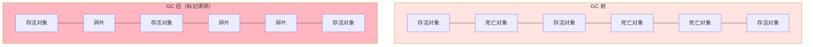
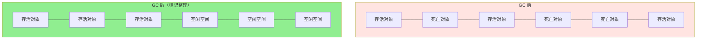
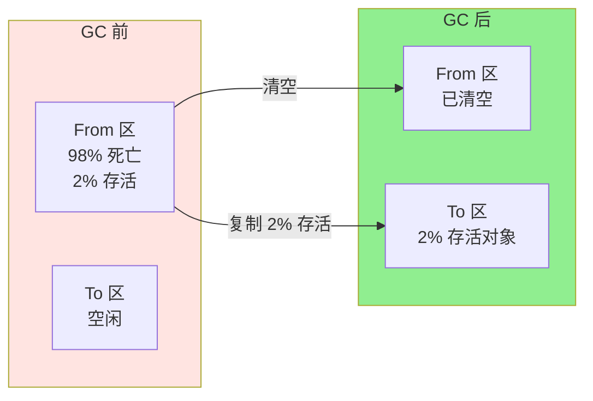
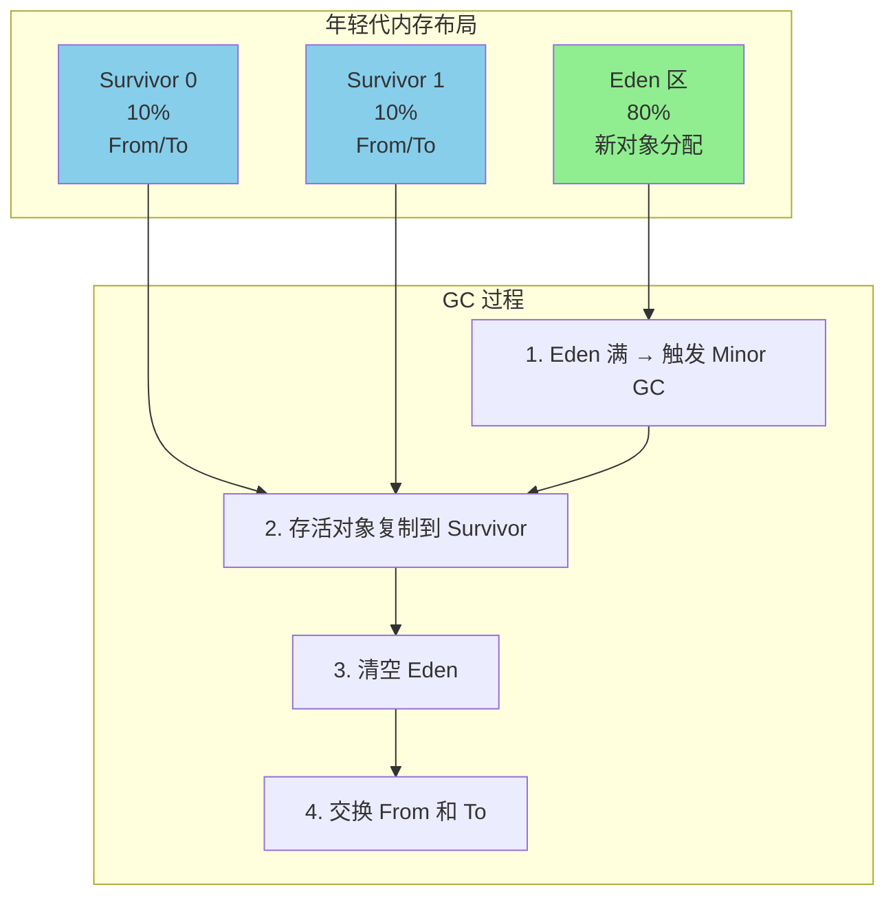
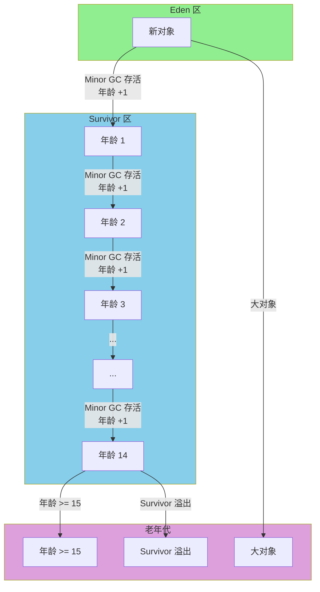
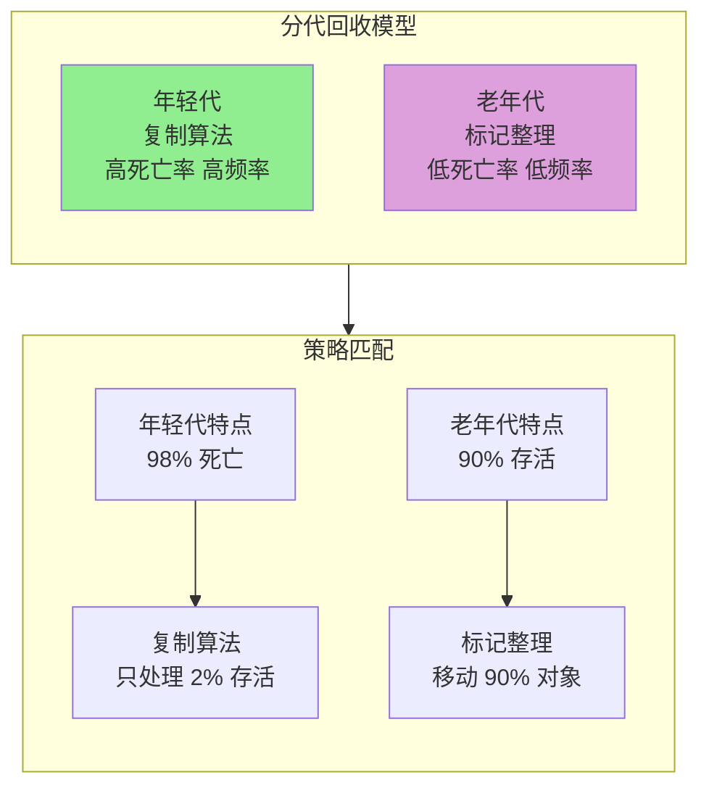
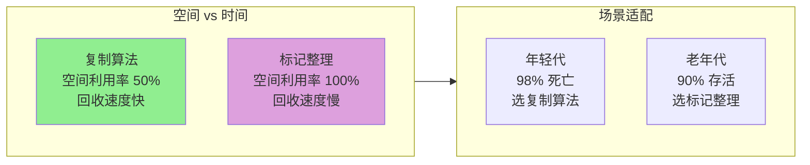
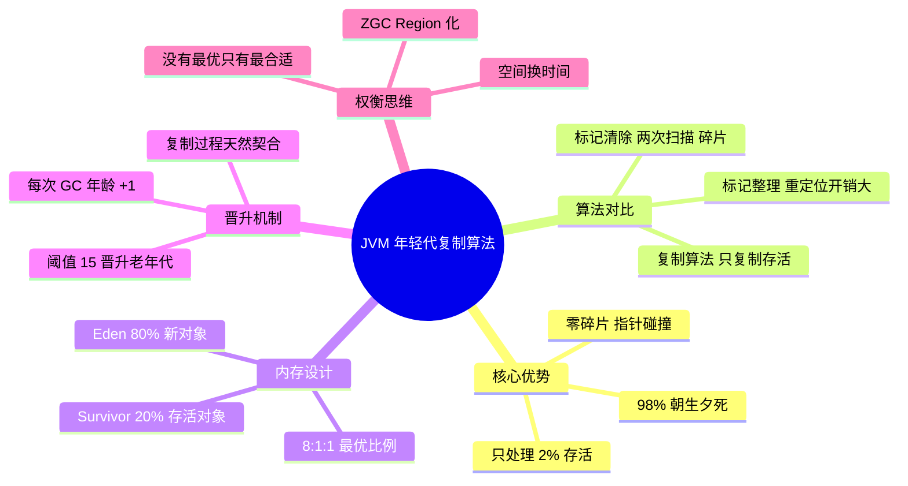
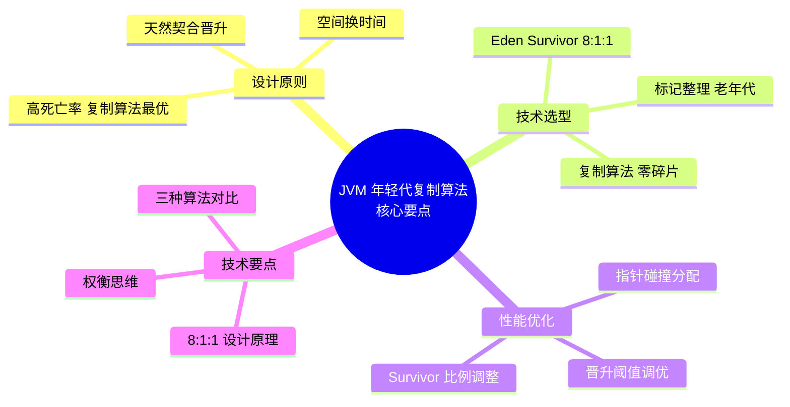

# JVM 年轻代复制算法

> **场景引入**：JVM 垃圾回收是 Java 应用性能调优的核心环节。年轻代采用复制算法是 JVM 设计中的经典权衡，理解其原理有助于 GC 调优和内存管理。

---

## 🎯 一句话定位

**JVM 年轻代为什么用复制算法？**
```
年轻代 98% 的对象"朝生夕死"，存活率极低
复制算法只复制少量存活对象，效率最高，且不产生内存碎片
```

**生活化比喻**：
就像餐厅的餐桌清理——客人吃完就走（对象死亡），服务员只需把还坐人的桌子擦干净（复制存活对象），不用管空桌子（死亡对象）。年轻代复制算法就是"只擦有人坐的桌子"。

**核心特点**：高死亡率场景效率最高、零内存碎片、指针碰撞分配

---

## 💎 核心要点概览

> **快速了解 JVM 年轻代复制算法的核心设计要点**

### 核心观点（5 个关键点）

**1. 复制算法的核心优势不是快，而是适配年轻代高死亡率**
```
❌ 错误认知：复制算法速度快
✅ 正确认知：年轻代 98% 对象朝生夕死，复制算法只处理 2% 存活对象
   - 标记清除：两次全量扫描（标记 + 清除），还产生碎片
   - 标记整理：移动所有存活对象，重定位开销大
   - 复制算法：只遍历一次存活对象，垃圾越多效率越高
```

**2. Eden 和 Survivor 的 8:1:1 设计**
```
年轻代分区：
- Eden 区（80%）：新对象优先分配
- Survivor 0 区（10%）：GC 后存活对象
- Survivor 1 区（10%）：GC 后存活对象

生活化比喻：
Eden = 餐厅大厅（80% 桌子）
Survivor = 包间（各 10%）
客人吃完（对象死亡）就离开大厅
还坐人的客人（存活对象）移到包间
```

**3. 复制算法是分代回收的架构核心**
```
分代回收 = 不同生命周期对象 + 不同回收策略
- 年轻代：高死亡率、高频率 → 复制算法（性价比最高）
- 老年代：低死亡率、低频率 → 标记整理（空间利用率高）

关键：复制过程天然契合对象晋升机制
- 每次 GC 存活对象年龄 +1
- 年龄达到阈值 → 晋升老年代
- 复制过程顺便完成年龄统计和晋升判断
```

**4. 标记清除的致命缺陷：内存碎片**
```
标记清除流程：
1. 标记所有存活对象
2. 清除所有死亡对象
问题：产生大量离散内存碎片

后果：
- 分配大对象时，找不到连续空间
- 触发 Full GC（全局回收，性能灾难）

生活化比喻：
就像电影院散场后，座位上散落着爆米花桶
虽然有空位，但不连续
想来的一家人（大对象）找不到连座
```

**5. 权衡思维：没有最优算法，只有最合适的场景**
```
复制算法优势建立在"存活率极低"前提下
- 年轻代：存活率 2% → 复制算法性价比最高
- 老年代：存活率 90% → 复制 90% 对象，开销太大 → 标记整理

延伸：ZGC 不再严格分代
- 内存拆分为多个 Region
- 只回收垃圾最多的 Region（局部复制）
- 保留复制的高效，避免整代复制的大开销
```

---

## 🚀 核心总结

> **年轻代复制算法 = 高死亡率场景（98% 朝生夕死） + 只处理 2% 存活对象 + 零碎片（指针碰撞分配） + 天然契合对象晋升机制**

---

## 一、三种垃圾回收算法对比

### 1.1 标记清除（Mark-Sweep）

**算法流程**：
```
1. 标记阶段：从 GC Roots 开始遍历，标记所有可达对象
2. 清除阶段：扫描整个堆空间，清除未标记的对象

生活化比喻：
就像老师批改作业：
1. 标记：把所有做对的题打勾（标记存活对象）
2. 清除：把打叉的题擦掉（清除死亡对象）
问题：擦掉后留下空白（内存碎片）
```



**三大缺陷**：

**1. 两次全量扫描（效率低）**
```
标记阶段：从 GC Roots 遍历所有对象（O(n)）
清除阶段：扫描整个堆空间（O(n)）
总开销：2 × O(n)

生活化比喻：
就像清洁工打扫教室：
1. 先把所有在座学生点名（标记）
2. 再把空座位上的垃圾扫掉（清除）
两次遍历，效率低
```

**2. 内存碎片（最致命）**
```
清除后，内存空间不连续
分配大对象时，找不到连续空间
即使总空间足够，也会触发 Full GC

生活化比喻：
就像电影院散场后：
虽然有空座位，但不连续
想来的一家人（大对象）找不到连座
只能清场重排（Full GC）
```

**3. 不适合年轻代**
```
年轻代特点：98% 对象朝生夕死
标记清除：扫描 100% 对象，只清除 98%
效率低，还产生碎片

就像：
教室 100 个座位，98 个学生走了
清洁工还要逐个检查 100 个座位（标记 + 清除）
而不是直接清理 98 个空座位
```

### 1.2 标记整理（Mark-Compact）

**算法流程**：
```
1. 标记阶段：从 GC Roots 遍历，标记所有存活对象
2. 整理阶段：将所有存活对象移动到一端，更新引用指针

生活化比喻：
就像整理书架：
1. 标记：把所有要保留的书做标记
2. 整理：把标记的书都移到左边，右边清空
问题：移动书很费时间（重定位开销）
```



**两大特点**：

**1. 无内存碎片（优点）**
```
整理后，存活对象连续排列
分配对象时，指针碰撞即可（高效）

生活化比喻：
整理后的书架，书都靠左排列
右边空出一大片，新书随便放
```

**2. 重定位开销大（缺点）**
```
移动对象需要：
1. 复制对象到新位置
2. 更新所有引用该对象的指针

开销：O(n) + 指针更新成本

生活化比喻：
就像搬家：
1. 把家具搬到新家（复制对象）
2. 告诉所有朋友新地址（更新指针）
费时费力
```

**为什么不适合年轻代？**
```
年轻代特点：每次 GC 都有大量对象死亡
标记整理：还要移动存活对象（虽然只有 2%）
问题：移动开销 > 复制开销

就像：
98 个学生走了，只剩 2 个
标记整理：还要把这 2 个学生搬到新教室（重定位）
复制算法：直接把这 2 个学生复制到新教室（更高效）
```

### 1.3 复制算法（Copying）

**算法流程**：
```
1. 将内存分为两块：From 区和 To 区
2. GC 时：将 From 区的存活对象复制到 To 区
3. 清空 From 区
4. 交换 From 和 To 区

生活化比喻：
就像两个教室（A 和 B）：
1. 学生在 A 教室上课
2. 考试结束后，还在校的学生移到 B 教室
3. A 教室清空（死亡对象消失）
4. 下次考试，从 B 移到 A
```



**三大优势**：

**1. 只处理存活对象（效率高）**
```
只遍历和复制存活对象（2%）
死亡对象直接忽略（98%）

开销：O(m)，m 为存活对象数
年轻代：m << n，效率极高

生活化比喻：
98 个学生走了，只剩 2 个
复制算法：直接把 2 个学生移到新教室
不用管 98 个空座位
```

**2. 零内存碎片（分配快）**
```
To 区是空的，复制后存活对象连续排列
分配对象时，指针碰撞即可（O(1)）

生活化比喻：
新教室的座位连续排列
新学生随便坐，不用找空位
```

**3. 天然契合对象晋升**
```
复制过程可以：
1. 统计对象年龄（每次 GC +1）
2. 判断是否达到晋升阈值
3. 达到阈值则复制到老年代

一个流程完成：复制 + 年龄统计 + 晋升判断

生活化比喻：
学生每次考试后：
1. 从 A 教室移到 B 教室（复制）
2. 学分 +1（年龄统计）
3. 学分满 18 分，搬到研究生教室（晋升）
```

---

## 二、Eden 和 Survivor 的 8:1:1 设计

### 2.1 分区结构

**年轻代内存布局**：
```
年轻代（Young Generation）
├── Eden 区（80%）
│   └── 新对象优先分配
├── Survivor 0 区（10%）
│   └── GC 后存活对象
└── Survivor 1 区（10%）
    └── GC 后存活对象

默认比例：8:1:1
可通过 -XX:SurvivorRatio=8 调整
```

**生活化比喻**：
```
年轻代就像一个餐厅：
- Eden 区（80%）= 大厅
  新客人（对象）优先坐在大厅
- Survivor 区（20%）= 两个包间（各 10%）
  吃完没走的客人（存活对象）移到包间
  两个包间轮流使用（From 和 To）
```



### 2.2 为什么是 8:1:1？

**设计原理**：
```
年轻代特点：98% 对象朝生夕死
假设年轻代 100MB：
- Eden 80MB：新对象分配
- Survivor 20MB（2 × 10MB）：存活对象

GC 场景：
- 80MB Eden 中的对象，98% 死亡 → 8MB 存活
- 8MB 存活对象复制到 Survivor（10MB 够用）

空间利用率：80MB / 100MB = 80%
浪费率：20MB / 100MB = 20%（Survivor 区）

生活化比喻：
餐厅 100 个座位：
- 大厅 80 个座位（Eden）
- 包间 20 个座位（2 × 10 个 Survivor）
每次 98% 客人吃完就走
剩 2% 客人（80 × 2% = 1.6 人）移到包间
包间 20 个座位绰绰有余
```

**为什么 Survivor 要分两个？**
```
如果只有一个 Survivor：
1. GC 后，存活对象放入 Survivor
2. 下次 GC，Survivor 中的对象还要再 GC
3. 需要复制到哪里？没有目标区域

两个 Survivor 轮流使用：
1. From 区 → To 区（复制存活对象）
2. 清空 From 区
3. 交换 From 和 To
4. 下次 GC：From（原 To）→ To（原 From）

生活化比喻：
两个教室（A 和 B）轮流用：
1. 学生在 A 上课 → 考试后还在校的移到 B
2. A 清空
3. 下次考试：B → A
4. 交替使用，不会冲突
```

### 2.3 对象晋升机制

**年龄统计**：
```
每次 Minor GC，存活对象年龄 +1
年龄达到阈值（默认 15）→ 晋升到老年代

可通过 -XX:MaxTenuringThreshold=15 调整
```

**晋升规则**：
```
1. 年龄达到阈值（默认 15）→ 晋升
2. Survivor 空间不足 → 提前晋升
3. 大对象直接进老年代（-XX:PretenureSizeThreshold）

生活化比喻：
学生每次考试后：
1. 学分 +1（年龄 +1）
2. 学分满 18 分 → 搬到研究生教室（老年代）
3. 本科教室（Survivor）满了 → 提前搬到研究生教室
4. 特别重的学生（大对象）直接坐研究生教室
```



---

## 三、复制算法是分代回收的架构核心

### 3.1 分代回收的设计思想

**核心思想**：
```
不同生命周期的对象，匹配不同的回收策略

年轻代：
- 特点：98% 朝生夕死，存活率低
- 策略：复制算法（性价比最高）
- 频率：高（每分钟多次）

老年代：
- 特点：90% 存活，空间利用率高
- 策略：标记整理（空间利用率高）
- 频率：低（每几分钟一次）

生活化比喻：
餐厅分两个区域：
- 快餐区（年轻代）：客人吃完就走，快速翻台
- 包间区（老年代）：客人待得久，定期清理
```



### 3.2 复制过程天然契合对象晋升

**关键洞察**：
```
复制算法的"复制"过程，顺便完成了：
1. 年龄统计（每次 GC +1）
2. 晋升判断（年龄 >= 阈值？）
3. 空间整理（To 区连续排列）

一个流程，三个目的！

生活化比喻：
学生从 A 教室移到 B 教室（复制）：
1. 学分 +1（年龄统计）
2. 学分满 18 分？搬到研究生教室（晋升判断）
3. B 教室座位连续（空间整理）

如果用标记清除：
- 碎片导致对象无法连续存放
- 晋升逻辑和空间管理变得极其复杂
```

**伪代码示例**：
```go
// 复制算法 GC 流程（简化版）
func minorGC(eden *Space, from *Space, to *Space) {
    // 1. 遍历 Eden 和 From 区的存活对象
    for _, obj := range eden.LiveObjects() {
        // 2. 年龄 +1
        obj.Age++
        
        // 3. 判断是否晋升
        if obj.Age >= MaxTenuringThreshold {
            // 晋升到老年代
            promoteToOld(obj)
        } else {
            // 复制到 To 区
            copyTo(obj, to)
        }
    }
    
    for _, obj := range from.LiveObjects() {
        obj.Age++
        if obj.Age >= MaxTenuringThreshold {
            promoteToOld(obj)
        } else {
            copyTo(obj, to)
        }
    }
    
    // 4. 清空 Eden 和 From
    eden.Clear()
    from.Clear()
    
    // 5. 交换 From 和 To
    swap(from, to)
}
```

---

## 四、内存碎片问题：标记清除的致命缺陷

### 4.1 碎片如何产生？

**场景模拟**：
```
堆内存布局（GC 前）：
[存活A][死亡B][存活C][死亡D][死亡E][存活F]

标记清除后：
[存活A][碎片  ][存活C][碎片  ][碎片  ][存活F]

问题：
- 总空闲空间：3 个单位
- 最大连续空间：1 个单位
- 分配 2 个单位的对象：失败！触发 Full GC
```

**生活化比喻**：
```
就像电影院散场后：
座位布局：[有人][空][有人][空][空][有人]
虽然 3 个空座位，但不连续
想来的一家 3 口（大对象）：找不到连座！
只能清场重排（Full GC，性能灾难）
```

### 4.2 碎片的代价

**三次 Full GC 对比**：
```
假设每天触发 100 次 GC：

复制算法（年轻代）：
- Minor GC：100 次，每次 10ms
- Full GC：0 次
- 总开销：100 × 10ms = 1000ms

标记清除（碎片多）：
- Minor GC：80 次，每次 10ms
- Full GC：20 次（碎片导致），每次 500ms
- 总开销：80 × 10ms + 20 × 500ms = 10800ms

差距：10.8 倍！

生活化比喻：
复制算法：快速翻台 100 次，每次 10 分钟
标记清除：翻台 80 次 + 清场重排 20 次
清场重排耗时是翻台的 50 倍！
```

### 4.3 为什么年轻代不用标记清除？

**对比分析**：
```
年轻代场景：98% 对象朝生夕死

标记清除：
1. 扫描 100% 对象（标记）
2. 清除 98% 死亡对象
3. 产生碎片 → 触发 Full GC
开销：O(n) + 碎片代价

复制算法：
1. 复制 2% 存活对象
2. 清空 From 区
3. 零碎片
开销：O(m)，m = 2% × n

效率对比：
- 标记清除：扫描 100%，只清除 98%
- 复制算法：只处理 2%，垃圾越多效率越高
```

---

## 五、权衡思维：没有最优算法，只有最合适的场景

### 5.1 空间与时间的权衡

**核心思想**：
```
复制算法：用空间换时间
- 浪费 50% 空间（Survivor 区）
- 换取高效回收（只处理存活对象）

标记整理：用时间换空间
- 空间利用率高（无碎片）
- 但移动对象开销大（重定位）

生活化比喻：
复制算法：租两个教室，只用一个
浪费 50% 租金，但整理速度快

标记整理：只租一个教室
节省租金，但整理时要搬家具，费时费力
```



### 5.2 新一代回收器的演进

**ZGC 的创新**：
```
传统分代：整代复制，开销大
ZGC：Region 化，局部复制

设计思想：
1. 堆内存拆分为多个 Region（1MB - 16MB）
2. 每个 Region 独立回收
3. 选择垃圾最多的 Region（收益最高）
4. 局部复制（保留复制的高效）

生活化比喻：
传统：整层楼打扫（整代复制）
ZGC：只打扫最脏的几个房间（Region）
保留复制的高效，避免整层楼的大开销
```

**Shenandoah 回收器**：
```
并发回收：应用线程和 GC 线程并发执行
避免 Stop-The-World（STW）

设计思想：
1. 并发标记（不停应用）
2. 并发复制（不停应用）
3. 并发引用更新（不停应用）

生活化比喻：
传统 GC：餐厅关门大扫除（STW）
Shenandoah：营业中打扫（并发）
客人正常用餐，服务员见缝插针打扫
```

### 5.3 生产环境调优建议

**常见问题**：
```
问题：Survivor 区溢出，对象提前晋升老年代
原因：年轻代比例太小，Survivor 装不下存活对象
后果：老年代快速填满，频繁 Full GC

调优建议：
1. 年轻代比例：堆的 1/3（-Xmn 参数）
2. Survivor 比例：Eden 的 1/4（-XX:SurvivorRatio=8）
3. 晋升阈值：根据对象生命周期调整（-XX:MaxTenuringThreshold）

生活化比喻：
包间太小（Survivor 不足）：
还坐着的客人（存活对象）没地方坐
只能搬到长期包间（老年代）
长期包间快速满员，只能清场（Full GC）
```

**调优参数**：
```bash
# 年轻代大小（堆的 1/3）
-Xmn2g

# Survivor 比例（8:1:1）
-XX:SurvivorRatio=8

# 晋升阈值（默认 15）
-XX:MaxTenuringThreshold=15

# 大对象阈值（直接进老年代）
-XX:PretenureSizeThreshold=1m
```

---

## 六、核心设计要点

```mermaid
graph TB
    subgraph Q1["Q1: 年轻代为什么用复制算法?"]
        A1[98% 朝生夕死] --> A2[只处理 2% 存活]
        A2 --> A3[效率最高]
        A3 --> A4[零碎片]
    end
    
    subgraph Q2["Q2: 为什么不用标记清除?"]
        B1[两次全量扫描] --> B2[效率低]
        B2 --> B3[内存碎片]
        B3 --> B4[触发 Full GC]
    end
    
    subgraph Q3["Q3: 为什么不用标记整理?"]
        C1[移动对象开销大] --> C2[重定位成本高]
        C2 --> C3[年轻代高频率 GC]
        C3 --> C4[累积开销大]
    end
    
    subgraph Q4["Q4: Eden 和 Survivor 8:1:1?"]
        D1[98% 死亡率] --> D2[80MB Eden → 1.6MB 存活]
        D2 --> D3[10MB Survivor 够用]
        D3 --> D4[空间利用率 80%]
    end
    
    subgraph Q5["Q5: 复制算法如何契合晋升?"]
        E1[复制过程] --> E2[年龄 +1]
        E2 --> E3[判断晋升阈值]
        E3 --> E4[一个流程三个目的]
    end
    
    style Q1 fill:#FFE4E1
    style Q2 fill:#E0FFFF
    style Q3 fill:#F0E68C
    style Q4 fill:#DDA0DD
    style Q5 fill:#90EE90
```



### 详细回答

**Q1: 年轻代为什么用复制算法？**  
**答**：年轻代的核心特征是 98% 以上的对象朝生夕死，每次 GC 存活对象占比极低。复制算法只遍历一次存活对象，直接复制到目标区域后一次性清空原空间，全程只处理少量存活对象，垃圾越多效率越高。两个 Survivor 区的设计本质是用 10% 的空间损耗换来零碎片和连续内存，对象分配直接用指针碰撞即可，分配效率拉满。

**Q2: 为什么不用标记清除？**  
**答**：标记清除有两大致命缺陷。第一，效率低：需要先全量扫描标记所有对象，再扫描一遍清除垃圾，两次全扫描开销大。第二，内存碎片：清除后产生大量离散内存碎片，后续分配大对象时找不到连续空间，很容易触发 Full GC。年轻代 98% 对象死亡，标记清除扫描 100% 对象只清除 98%，而复制算法只处理 2% 存活对象，效率差距明显。

**Q3: 为什么不用标记整理？**  
**答**：标记整理虽然无碎片，但移动对象的重定位开销极高。年轻代 GC 频率高（每分钟多次），每次都要移动存活对象并更新引用指针，累积开销大。而复制算法只复制 2% 存活对象，标记整理要移动所有存活对象（虽然也是 2%，但复制算法的 To 区是空的，效率更高）。更关键的是，复制过程天然契合对象晋升机制，一个流程完成复制、年龄统计、晋升判断。

**Q4: 为什么 Eden 和 Survivor 是 8:1:1？**  
**答**：年轻代 98% 对象朝生夕死。假设 Eden 80MB，GC 后存活对象 80MB × 2% = 1.6MB。Survivor 区 10MB 绰绰有余。空间利用率 80MB / 100MB = 80%，浪费率 20%（Survivor 区）。两个 Survivor 轮流使用，避免对象在同一个 Survivor 区多次 GC。这个比例是基于"高死亡率"场景的最优权衡。

**Q5: 复制算法如何契合对象晋升？**  
**答**：复制算法的"复制"过程，顺便完成了三个目的：1）年龄统计（每次 GC 年龄 +1）；2）晋升判断（年龄 >= 阈值则晋升老年代）；3）空间整理（To 区连续排列）。一个流程完成复制、统计、晋升，高度闭环。如果用标记清除，碎片会导致对象无法连续存放，晋升逻辑和空间管理都会变得极其复杂。

---

## 七、方案总结



**方案总结**：

> **核心优势**：年轻代 98% 对象朝生夕死，复制算法只处理 2% 存活对象，效率最高，且零碎片。
> 
> **算法对比**：标记清除两次全量扫描还产生碎片，标记整理重定位开销大，复制算法只复制存活对象，性价比最高。
> 
> **内存设计**：Eden 80%、Survivor 20%（2 × 10%），基于 98% 死亡率的最优比例，空间利用率 80%。
> 
> **晋升机制**：复制过程天然契合对象晋升，一个流程完成复制、年龄统计、晋升判断。
> 
> **权衡思维**：没有最优算法，只有最合适的场景。复制算法用空间换时间，适配年轻代高死亡率。

---

## 八、总结（一句话带走）



### 🎯 一句话总结

> **年轻代复制算法 = 高死亡率场景（98% 朝生夕死） + 只处理 2% 存活对象 + 零碎片（指针碰撞分配） + 天然契合对象晋升机制**

### 🧠 核心记忆点

1. **为什么用复制算法？** 年轻代 98% 对象朝生夕死，复制算法只处理 2% 存活对象，效率最高。
2. **为什么不用标记清除？** 两次全量扫描效率低，还产生内存碎片，触发 Full GC。
3. **为什么不用标记整理？** 重定位开销大，年轻代 GC 频率高，累积开销大。
4. **为什么 8:1:1？** 基于 98% 死亡率的最优比例，空间利用率 80%，Survivor 够用。
5. **复制算法如何契合晋升？** 复制过程顺便完成年龄统计、晋升判断、空间整理，一个流程三个目的。

---
