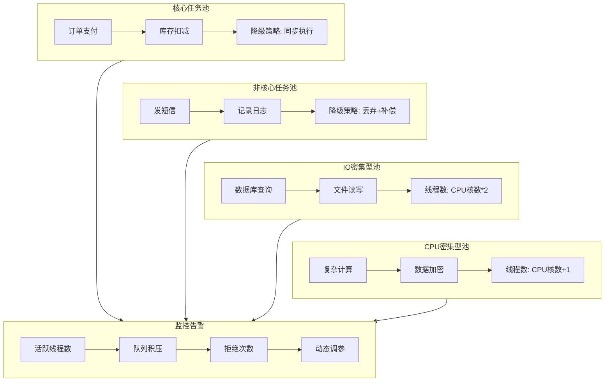
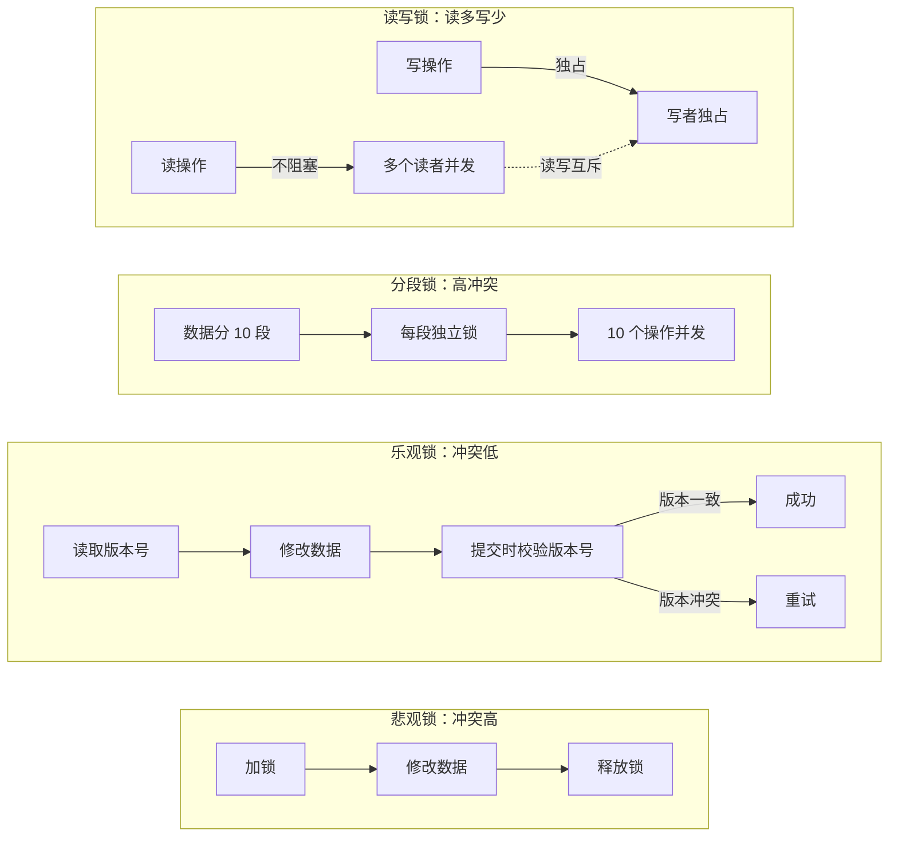
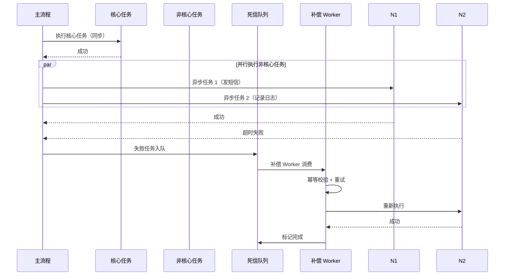
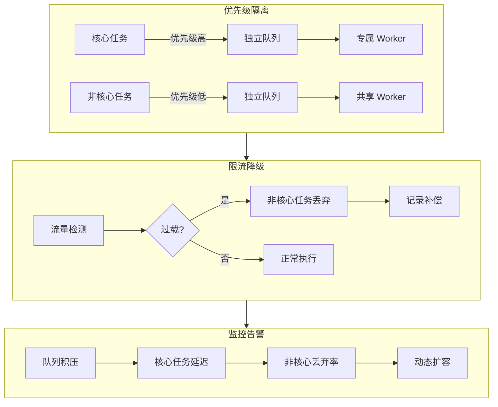
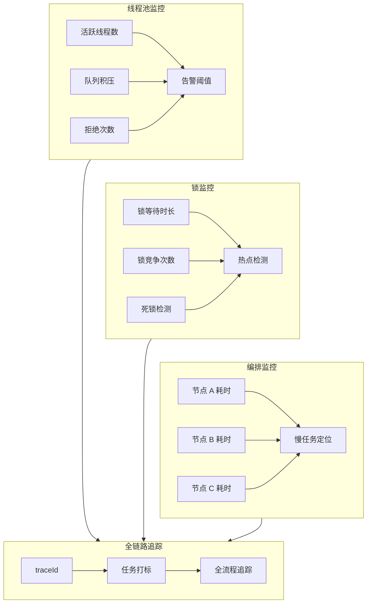
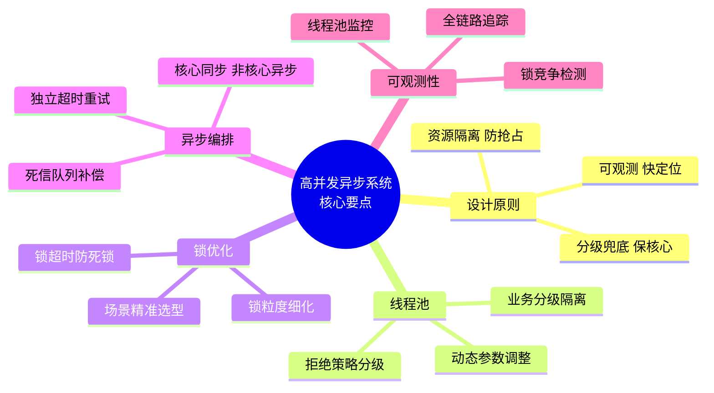

# 线程池 + 并发锁 + 异步编排：高并发系统的三层防御

---

## 🎯 场景引入

**这套组合拳解决什么问题？**
```
让高并发异步系统"扛得住、不崩盘、可恢复"
——线程池管资源、锁管安全、异步编排管流程
```

**生活化比喻**：
就像开一家大型快递公司：
- **线程池** = 快递员团队（人太多养不起，人太少送不完）
- **并发锁** = 仓库门禁（多人同时拿货会乱套，得排队）
- **异步编排** = 分拣流水线（一环扣一环，某环节卡住整条线停摆）

**核心痛点**：90% 的后端"会用 API"，但不懂"真实压力下的资源博弈与故障兜底"。

---

## 💎 核心设计要点速览

### 核心设计要点（5 个关键点）

**1. 线程池不是"设个大点就行"，要分级隔离 + 动态调参**
```
❌ 拍脑袋写死核心线程数
✅ 业务分级隔离：
   - 核心任务池（订单支付）：独立线程池，拒绝策略=降级同步执行
   - 非核心任务池（发短信）：独立线程池，拒绝策略=丢弃+记录补偿
   - IO 密集型 vs CPU 密集型：分开管理
✅ 动态参数调整：运行时可调，配合监控预警
```

**2. 锁不是"越细越好"，要场景精准选型**
```
❌ 不分场景一律用 synchronized
✅ 精准选型：
   - 读多写少：乐观锁 / 读写锁（像图书馆，看书不用排队，借书才排）
   - 高冲突场景：分段锁（像多开几个收银台，分散排队）
   - 锁超时强制：所有锁必须设超时，防死锁
✅ 锁降级策略：高并发下强一致→最终一致，分布式锁→本地锁
```

**3. 异步编排不是"串起来就行"，要分级容错 + 补偿机制**
```
❌ 整条链路过长，一环超时全链路挂起
✅ 链路分级：
   - 核心链路：短平快，同步执行
   - 非核心链路：异步化，失败不影响主流程
✅ 补偿机制：
   - 每个节点独立超时+重试
   - 失败任务进死信队列，人工+自动双补偿
   - 幂等校验，防重复执行
```

**4. 非核心任务必须隔离，不能抢占核心资源**
```
❌ 所有任务共用一个线程池，非核心任务把核心任务饿死
✅ 资源隔离：
   - 核心/非核心任务物理隔离（独立线程池）
   - 优先级队列：核心任务优先执行
   - 限流降级：非核心任务过载直接丢弃
```

**5. 全链路可观测：三分钟定位阻塞点**
```
❌ 出了问题逐台机器翻日志
✅ 三位一体监控：
   - 线程池指标：活跃线程数、队列积压、拒绝次数
   - 锁等待时长：锁竞争热点检测
   - 编排节点耗时：每个异步节点耗时追踪
✅ 全链路追踪：任务打标，traceId 贯穿全流程
```

---

## 🚀 一句话精华

> **高并发异步系统 = 线程池分级隔离（资源不抢占） + 锁场景精准选型（安全且高效） + 异步编排分级容错（失败可补偿） + 全链路可观测（三分钟定位）**

---

## 一、线程池参数选型：不是"设大点就行"

### ❌ 常见误区

**生活化比喻**：
```
就像开餐厅：
❌ 错误做法：拍脑袋雇 100 个服务员（人太多，工资发不起）
❌ 错误做法：只雇 2 个服务员（人太少，顾客等不及）
✅ 正确做法：根据桌数、翻台率、高峰期动态调整
```

**技术误区**：
- ❌ 核心线程数拍脑袋写死
- ❌ 所有任务共用一个线程池
- ❌ 拒绝策略一刀切（要么全丢弃，要么全同步）
- ❌ 没有监控预警，出问题了才发现线程池满了

### ✅ 生产级方案：分级隔离 + 动态调参

**生活化比喻**：
```
就像医院急诊室：
- 核心任务池（抢救室）：危重病人优先，资源独立
- 非核心任务池（普通门诊）：小病排队，资源受限
- IO 密集型（检查室）：设备有限，排队等待
- CPU 密集型（手术室）：医生宝贵，不能浪费

拒绝策略：
- 抢救室满了：降级同步执行（医生亲自上）
- 普通门诊满了：丢弃+记录补偿（明天再来，护士登记）
```



**线程池参数选型公式**：

| 任务类型 | 核心线程数 | 最大线程数 | 队列类型 | 拒绝策略 | 生活化比喻 |
|---------|-----------|-----------|---------|---------|------------|
| **CPU 密集型** | CPU 核数 + 1 | CPU 核数 * 2 | 有界队列（ArrayBlockingQueue） | CallerRunsPolicy | 厨师炒菜（人多了厨房挤不下） |
| **IO 密集型** | CPU 核数 * 2 | CPU 核数 * 4 | 有界队列 | CallerRunsPolicy + 降级 | 服务员端菜（可以多派人手） |
| **核心任务** | 业务 QPS × 响应时间 | 2× 核心 | 优先级队列 | CallerRunsPolicy（同步兜底） | 抢救室（资源优先保障） |
| **非核心任务** | 业务 QPS × 响应时间 × 0.5 | 核心 × 2 | 有界队列 | DiscardPolicy + 记录补偿 | 普通门诊（满了明天再来） |

**代码示例**（Go 语言版）：
```go
// 分级线程池管理（Go 用 goroutine + channel 模拟）
type TaskPriority int

const (
    PriorityHigh TaskPriority = iota // 核心任务
    PriorityNormal                     // 非核心任务
)

type IsolatedWorkerPool struct {
    corePool    chan Task // 核心任务通道
    normalPool  chan Task // 非核心任务通道
    ioPool      chan Task // IO 密集型通道
    cpuPool     chan Task // CPU 密集型通道
    monitor     *Monitor  // 监控组件
}

func NewIsolatedWorkerPool(cpuCores int) *IsolatedWorkerPool {
    return &IsolatedWorkerPool{
        corePool:   make(chan Task, 1000),  // 核心任务队列
        normalPool: make(chan Task, 500),   // 非核心任务队列
        ioPool:     make(chan Task, cpuCores*2),
        cpuPool:    make(chan Task, cpuCores+1),
        monitor:    NewMonitor(),
    }
}

func (p *IsolatedWorkerPool) Start() {
    // 核心任务 worker：永不放弃
    for i := 0; i < 20; i++ {
        go func() {
            for task := range p.corePool {
                if err := task.Execute(); err != nil {
                    // 降级同步执行
                    task.FallbackExecute()
                }
                p.monitor.RecordCoreTask(task)
            }
        }()
    }
    
    // 非核心任务 worker：满了就丢弃+记录
    for i := 0; i < 10; i++ {
        go func() {
            for task := range p.normalPool {
                select {
                case p.normalPool <- task:
                    task.Execute()
                default:
                    // 队列满，丢弃并记录补偿
                    p.monitor.RecordDiscard(task)
                    task.SaveToDeadLetterQueue()
                }
            }
        }()
    }
}

// 动态调参：运行时调整线程数
func (p *IsolatedWorkerPool) AdjustPoolSize(poolType string, newSize int) {
    // 根据监控指标动态调整
    p.monitor.Adjust(poolType, newSize)
}
```

---

## 二、锁粒度优化：不是"越细越好"

### ❌ 常见误区

**生活化比喻**：
```
就像图书馆借书：
❌ 错误做法：整个图书馆只有一把钥匙，每次只能进一个人（粒度太粗）
❌ 错误做法：每本书都有独立的锁，管理员累死（粒度太细）
✅ 正确做法：按区域分区，每个区域一把钥匙（分段锁）
```

**技术误区**：
- ❌ 不分场景一律用 `synchronized`（重量级锁）
- ❌ 锁粒度太大（锁整个对象，并发变串行）
- ❌ 没有超时机制（死锁导致线程永久挂起）
- ❌ 读多写少还用写锁（浪费并发性能）

### ✅ 生产级方案：场景精准选型 + 锁降级

**生活化比喻**：
```
场景 1：图书馆看书 vs 借书
- 看书（读操作）：不用排队，直接看（乐观锁/读写锁）
- 借书（写操作）：排队登记（悲观锁）

场景 2：超市收银
- 只开 1 个收银台：排队排到天荒地老（大对象锁）
- 开 10 个收银台：分散排队，速度快（分段锁）

场景 3：高峰期降级
- 平时：精确到分（分布式锁，强一致）
- 双十一：精确到秒就行（本地锁，最终一致）
```



**锁选型决策树**：

| 场景 | 推荐锁类型 | 理由 | 生活化比喻 |
|------|-----------|------|------------|
| **读多写少**（10:1） | 读写锁 / 乐观锁 | 读不阻塞，并发高 | 图书馆看书不用排队 |
| **写多读少** | 悲观锁 | 简单直接 | 收银台排队 |
| **高冲突**（热点数据） | 分段锁 | 分散竞争 | 多开收银台 |
| **低冲突** | 乐观锁 | 无锁开销 | 信任大家不抢同一本书 |
| **跨服务** | 分布式锁（Redis/ZK） | 全局唯一 | 多个图书馆联网 |
| **单服务** | 本地锁（sync.Mutex） | 性能好 | 单个图书馆内部管理 |

**代码示例**（Go 语言版）：
```go
// 分段锁：热点数据拆分
type SegmentedLock struct {
    locks    [16]sync.Mutex  // 16 个分段锁
    segments [16]map[string]interface{} // 16 个数据段
}

func NewSegmentedLock() *SegmentedLock {
    sl := &SegmentedLock{}
    for i := range sl.segments {
        sl.segments[i] = make(map[string]interface{})
    }
    return sl
}

func (sl *SegmentedLock) GetSegment(key string) int {
    // Hash 分段：按 key 的 hash 值选择锁
    hash := fnv32(key)
    return int(hash % 16)
}

func (sl *SegmentedLock) Set(key string, value interface{}) {
    seg := sl.GetSegment(key)
    sl.locks[seg].Lock()  // 只锁当前段
    defer sl.locks[seg].Unlock()
    sl.segments[seg][key] = value
}

func (sl *SegmentedLock) Get(key string) (interface{}, bool) {
    seg := sl.GetSegment(key)
    sl.locks[seg].Lock()
    defer sl.locks[seg].Unlock()
    val, ok := sl.segments[seg][key]
    return val, ok
}

// 乐观锁：版本号控制
type OptimisticLock struct {
    data    map[string]interface{}
    version map[string]int
    mu      sync.RWMutex
}

func (ol *OptimisticLock) Update(key string, newValue interface{}) bool {
    ol.mu.RLock()
    oldVersion := ol.version[key]
    ol.mu.RUnlock()
    
    // 模拟业务处理
    time.Sleep(10 * time.Millisecond)
    
    ol.mu.Lock()
    defer ol.mu.Unlock()
    
    // 提交时校验版本号
    if ol.version[key] != oldVersion {
        return false // 版本冲突，重试
    }
    ol.data[key] = newValue
    ol.version[key]++
    return true
}

// 锁超时 + 死锁检测
func LockWithTimeout(mu *sync.Mutex, timeout time.Duration) bool {
    done := make(chan struct{})
    go func() {
        mu.Lock()
        close(done)
    }()
    
    select {
    case <-done:
        return true // 加锁成功
    case <-time.After(timeout):
        return false // 超时，避免死锁
    }
}
```

---

## 三、异步编排容错：不是"串起来就行"

### ❌ 常见误区

**生活化比喻**：
```
就像工厂流水线：
❌ 错误做法：所有工序串在一起，一环卡住整条线停摆
❌ 错误做法：没有质检环节，次品流到下一步
✅ 正确做法：关键工序独立，非关键工序异步，失败可返工
```

**技术误区**：
- ❌ 整条链路过长（A→B→C→D→E，一环超时全挂）
- ❌ 没有独立超时（某一步卡死，整条链路挂起）
- ❌ 没有补偿机制（失败了就失败了，无法恢复）
- ❌ 核心/非核心混在一起（非核心失败拖垮核心）

### ✅ 生产级方案：链路分级 + 补偿机制

**生活化比喻**：
```
就像医院就诊流程：
- 核心链路（抢救）：挂号→急救→手术→ICU（短平快，同步执行）
- 非核心链路（康复）：理疗→复查→随访（异步化，失败不影响抢救）

补偿机制：
- 每个环节独立计时（超时报警）
- 失败可返工（重试机制）
- 返工多次失败→专家会诊（人工介入）
- 所有操作记录在案（幂等校验）
```



**异步编排三要素**：

| 要素 | 说明 | 实现方案 | 生活化比喻 |
|------|------|----------|------------|
| **独立超时** | 每个节点独立超时控制 | Context.WithTimeout | 每个工序独立计时 |
| **重试机制** | 失败自动重试（幂等） | 指数退避 + 幂等校验 | 失败返工 |
| **补偿机制** | 多次失败进死信队列 | 死信队列 + 人工/自动补偿 | 返工多次→专家会诊 |

#### 什么是死信队列（DLQ）

死信队列（Dead Letter Queue，DLQ）是专门接收“永远无法被正常消费”的消息的旁路队列。消息不会被反复投递，也不会被直接丢弃，而是转存到 DLQ，等待补偿或人工处理。

**消息进入 DLQ 的常见条件**：
- 重试次数耗尽，仍然消费失败
- 消息在队列中滞留时间超过 TTL
- 队列长度超过限制，无法再接纳新消息
- 消费者明确拒绝（nack/reject），且要求不重新入队

**生活化比喻**：
```
就像医院的"疑难病例登记处"：
- 门诊反复看不好（重试耗尽）→ 转登记处，不再占用门诊号源
- 登记处集中存档（保留现场）→ 专家会诊（人工排查）
- 会诊后能治的重新入院（重放）→ 治不了的归档（留痕）
```

**核心价值**：
- **隔离坏消息**：避免坏消息在原队列里无限重试，阻塞后面的正常消息
- **不丢数据**：不直接丢弃，保留现场，可回溯、可重放
- **集中补偿**：统一入口做人工排查或自动补偿

**落地注意**：
- 死信队列必须配监控告警（积压量、增长速度），否则会变成没人处理的“垃圾场”
- 补偿消费必须幂等，否则重放会造成重复执行

**代码示例**（Go 语言版）：
```go
// 异步编排 + 超时 + 重试 + 补偿
type AsyncOrchestrator struct {
    coreTasks    []Task      // 核心任务（同步）
    normalTasks  []Task      // 非核心任务（异步）
    deadLetterQ  *DeadLetterQueue // 死信队列
    retryPolicy  RetryPolicy     // 重试策略
}

func (o *AsyncOrchestrator) Execute(ctx context.Context) error {
    // 1. 执行核心任务（同步，短平快）
    for _, task := range o.coreTasks {
        taskCtx, cancel := context.WithTimeout(ctx, 500*time.Millisecond)
        if err := task.Execute(taskCtx); err != nil {
            cancel()
            return err // 核心任务失败，直接返回
        }
        cancel()
    }
    
    // 2. 并行执行非核心任务（异步）
    var wg sync.WaitGroup
    errChan := make(chan error, len(o.normalTasks))
    
    for _, task := range o.normalTasks {
        wg.Add(1)
        go func(t Task) {
            defer wg.Done()
            taskCtx, cancel := context.WithTimeout(ctx, 2*time.Second)
            defer cancel()
            
            if err := o.executeWithRetry(taskCtx, t); err != nil {
                errChan <- err
                // 失败任务入死信队列
                o.deadLetterQ.Push(t)
            }
        }(task)
    }
    
    wg.Wait()
    close(errChan)
    
    // 3. 收集非核心任务错误（不影响主流程）
    for err := range errChan {
        log.Printf("非核心任务失败: %v", err)
    }
    
    return nil // 核心任务成功即成功
}

// 重试机制：指数退避 + 幂等校验
func (o *AsyncOrchestrator) executeWithRetry(ctx context.Context, task Task) error {
    maxRetries := 3
    for i := 0; i < maxRetries; i++ {
        if err := task.Execute(ctx); err != nil {
            if i == maxRetries-1 {
                return err
            }
            // 指数退避：1s, 2s, 4s
            backoff := time.Duration(1<<uint(i)) * time.Second
            select {
            case <-time.After(backoff):
                continue
            case <-ctx.Done():
                return ctx.Err()
            }
        }
        return nil // 成功
    }
    return errors.New("重试次数耗尽")
}

// 死信队列 + 补偿 Worker
type DeadLetterQueue struct {
    queue chan Task
}

func (dlq *DeadLetterQueue) StartCompensationWorker() {
    go func() {
        for task := range dlq.queue {
            // 幂等校验 + 人工/自动补偿
            if task.IsIdempotent() {
                task.Execute(context.Background())
            } else {
                task.MarkForManualReview()
            }
        }
    }()
}
```

---

## 四、资源隔离：非核心任务不能抢占核心资源

### ❌ 常见误区

**生活化比喻**：
```
就像公司资源分配：
❌ 错误做法：所有项目共用一个会议室，小会议占着不放，重要会议开不了
✅ 正确做法：重要项目独立会议室，小项目用公共区域
```

**技术误区**：
- ❌ 所有任务共用一个线程池
- ❌ 非核心任务过载，把核心任务饿死
- ❌ 没有优先级队列
- ❌ 没有限流降级

### ✅ 生产级方案：物理隔离 + 优先级队列

**生活化比喻**：
```
就像机场安检：
- VIP 通道（核心任务）：优先安检，资源独立
- 普通通道（非核心任务）：排队等待，过载限流
- 紧急通道（降级任务）：特殊情况快速通过
```



**代码示例**（Go 语言版）：
```go
// 优先级队列 + 资源隔离
type PriorityTaskQueue struct {
    highPriority chan Task // 核心任务
    lowPriority  chan Task // 非核心任务
    limiter      *rate.Limiter // 限流器
}

func (q *PriorityTaskQueue) Push(task Task) error {
    // 限流检测
    if !q.limiter.Allow() {
        if task.Priority == PriorityLow {
            // 非核心任务过载，直接丢弃
            return errors.New("非核心任务限流丢弃")
        }
    }
    
    // 按优先级分发
    select {
    case q.highPriority <- task:
        return nil
    default:
        if task.Priority == PriorityHigh {
            // 核心任务队列满，降级同步执行
            return task.Execute(context.Background())
        }
        return errors.New("核心任务队列满")
    }
}

func (q *PriorityTaskQueue) StartWorkers(workerCount int) {
    // 核心任务 Worker：专属资源
    for i := 0; i < workerCount; i++ {
        go func() {
            for task := range q.highPriority {
                task.Execute(context.Background())
            }
        }()
    }
    
    // 非核心任务 Worker：共享资源
    for i := 0; i < workerCount/2; i++ {
        go func() {
            for task := range q.lowPriority {
                task.Execute(context.Background())
            }
        }()
    }
}
```

---

## 五、全链路可观测：三分钟定位阻塞点

### ❌ 常见误区

**生活化比喻**：
```
就像医院诊断：
❌ 错误做法：病人说头疼，医生从头到脚检查一遍
✅ 正确做法：先做 CT 定位问题区域，再针对性检查
```

**技术误区**：
- ❌ 出了问题逐台机器翻日志
- ❌ 不知道线程池是不是满了
- ❌ 不知道锁竞争有多激烈
- ❌ 不知道异步任务卡在哪一步

### ✅ 生产级方案：三位一体监控

**生活化比喻**：
```
就像汽车仪表盘：
- 线程池指标：发动机转速（活跃线程数）、油量（队列积压）
- 锁等待时长：堵车指数（锁竞争热点）
- 编排节点耗时：各段路程用时（异步任务耗时）
```



**监控指标清单**：

| 指标类型 | 监控项 | 告警阈值 | 排查方法 | 生活化比喻 |
|---------|--------|----------|----------|------------|
| **线程池** | 活跃线程数 | > 80% 最大线程数 | 扩容 or 优化任务 | 快递员快不够用了 |
| | 队列积压 | > 500 | 检查消费速度 | 包裹堆积如山 |
| | 拒绝次数 | > 0 | 检查拒绝策略 | 快递拒收 |
| **锁** | 锁等待时长 | > 100ms | 定位锁热点 | 收银台排队太长 |
| | 死锁检测 | 检测到死锁 | 分析锁顺序 | 交通死锁 |
| **编排** | 节点耗时 | > 2s | 定位慢任务 | 某工序太慢 |
| | 失败率 | > 5% | 检查下游服务 | 次品率太高 |

**代码示例**（Go 语言版）：
```go
// 全链路监控
type Monitor struct {
    threadPoolMetrics *ThreadPoolMetrics
    lockMetrics       *LockMetrics
    orchestratorMetrics *OrchestratorMetrics
    tracer            opentracing.Tracer
}

type ThreadPoolMetrics struct {
    activeThreads  prometheus.Gauge
    queueSize      prometheus.Gauge
    rejectCount    prometheus.Counter
}

func (m *Monitor) RecordTaskStart(task Task) opentracing.Span {
    span := m.tracer.StartSpan(task.Name)
    span.SetTag("task.priority", task.Priority)
    span.SetTag("task.type", task.Type)
    return span
}

func (m *Monitor) RecordTaskEnd(span opentracing.Span, err error) {
    if err != nil {
        span.SetTag("error", true)
        span.SetTag("error.message", err.Error())
    }
    span.Finish()
}

// 锁竞争检测
func (m *Monitor) RecordLockWait(lockName string, duration time.Duration) {
    m.lockMetrics.waitDuration.WithLabelValues(lockName).Observe(duration.Seconds())
    if duration > 100*time.Millisecond {
        log.Printf("锁竞争告警: %s 等待 %v", lockName, duration)
    }
}

// 线程池监控
func (m *Monitor) RecordThreadPool(poolName string, active, queueSize int) {
    m.threadPoolMetrics.activeThreads.WithLabelValues(poolName).Set(float64(active))
    m.threadPoolMetrics.queueSize.WithLabelValues(poolName).Set(float64(queueSize))
    
    if active > 80 {
        log.Printf("线程池告警: %s 活跃线程 %d", poolName, active)
    }
}
```

---

## 六、生产环境 Checklist

| 类别 | 检查项 | 状态 | 生活化比喻 |
|------|--------|------|------------|
| **线程池** | 业务分级隔离（核心/非核心独立池） | ⬜ | 抢救室 vs 普通门诊 |
| | 动态参数调整（运行时可调） | ⬜ | 根据客流量调整服务员 |
| | 拒绝策略分级兜底 | ⬜ | 满了降级/丢弃+补偿 |
| | 监控告警（活跃线程、队列积压） | ⬜ | 快递员数量监控 |
| **锁** | 场景精准选型（读写锁/分段锁/乐观锁） | ⬜ | 图书馆 vs 收银台 |
| | 锁超时机制（防死锁） | ⬜ | 排队超时机制 |
| | 锁降级策略（高并发降级） | ⬜ | 高峰期简化流程 |
| | 死锁检测 | ⬜ | 交通死锁检测 |
| **异步编排** | 核心/非核心分离 | ⬜ | 抢救 vs 康复 |
| | 独立超时+重试 | ⬜ | 每个工序独立计时 |
| | 死信队列+补偿 | ⬜ | 返工多次→专家会诊 |
| | 幂等校验 | ⬜ | 防重复执行 |
| **可观测** | 线程池指标监控 | ⬜ | 发动机转速表 |
| | 锁竞争热点检测 | ⬜ | 堵车指数 |
| | 编排节点耗时追踪 | ⬜ | 各段路程用时 |
| | 全链路追踪（traceId） | ⬜ | 病人全流程记录 |

---

## 七、总结



### 🎯 方案总结

> **高并发异步系统 = 线程池分级隔离（资源不抢占） + 锁场景精准选型（安全且高效） + 异步编排分级容错（失败可补偿） + 全链路可观测（三分钟定位）**

### 🧠 核心要点

1. **线程池不是"设大点就行"**：要分级隔离，核心/非核心独立池，拒绝策略分级兜底。
2. **锁不是"越细越好"**：要场景精准选型，读多写少用读写锁，高冲突用分段锁。
3. **异步编排不是"串起来就行"**：要分级容错，核心同步，非核心异步，失败可补偿。
4. **非核心任务必须隔离**：物理隔离 + 优先级队列，防止抢占核心资源。
5. **全链路可观测**：三位一体监控，三分钟定位阻塞点。
