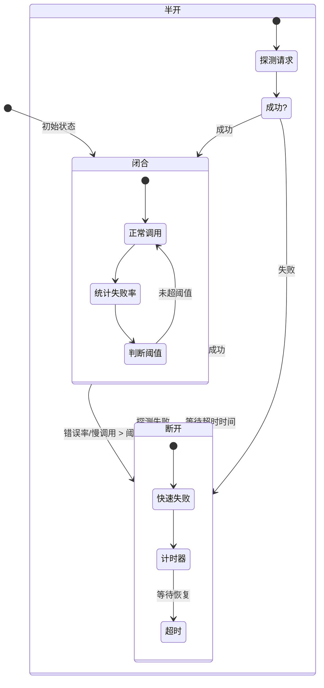
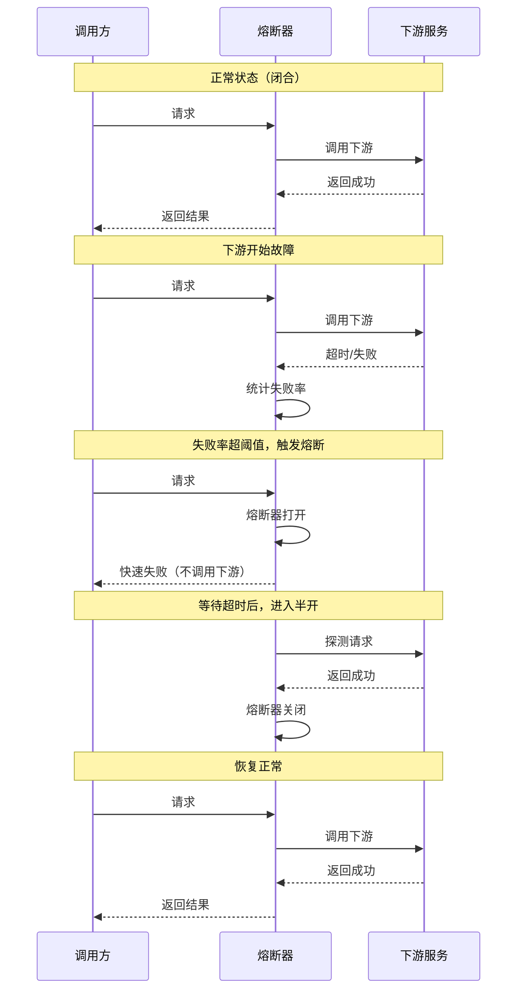
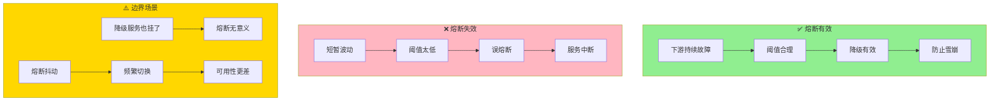
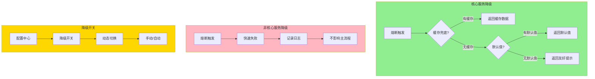
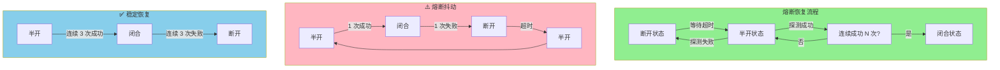
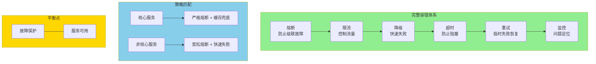
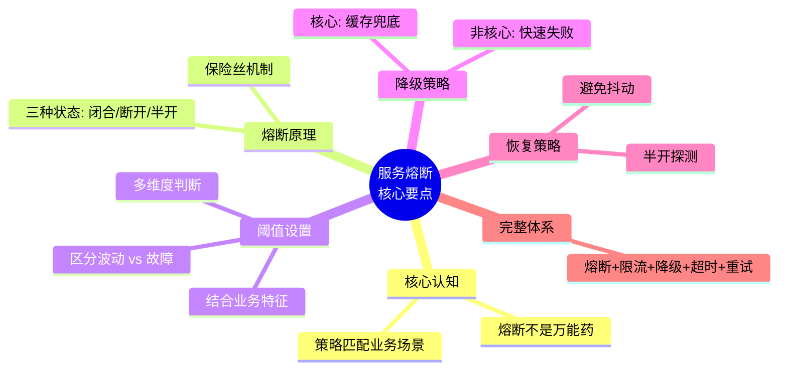

# 服务熔断与雪崩防护：熔断不是万能药

---

## 🎯 场景引入

**服务熔断解决什么问题？**
```
当下游服务持续故障时，及时切断调用，防止故障级联传导，避免系统雪崩
```

**生活化比喻**：
就像电路中的**保险丝**：
- 电流过大时，保险丝熔断，切断电路，保护整个电路不被烧毁
- 服务熔断同理：下游故障时，切断调用，保护上游服务不被拖垮

**核心观点**：熔断**不是万能药**，策略配错了反而会加剧系统崩溃！

---

## 💎 核心设计要点速览

### 核心观点（5 个关键点）

**1. 熔断能防雪崩，但有前提条件**
```
✅ 有效场景：
   - 下游服务持续故障（不是短暂波动）
   - 熔断阈值配置合理（不过于敏感）
   - 降级策略合理（快速失败，不阻塞）

❌ 失效场景：
   - 阈值太低：正常波动也触发熔断，反而造成服务中断
   - 降级逻辑有问题：熔断后降级服务也挂了
   - 恢复策略不对：熔断频繁开关（熔断抖动）
```

**2. 熔断阈值设置：不能"太灵敏"**
```
❌ 错误做法：错误率 > 10% 就熔断
   - 网络偶尔抖动，正常请求也被切断
   - 熔断变成了"服务杀手"

✅ 正确做法：
   - 错误率 > 50% 且持续 10 秒 → 熔断
   - 慢调用比例 > 70% 且平均响应时间 > 3s → 熔断
   - 结合业务特征，容忍正常波动
```

**3. 降级策略：熔断后的"Plan B"**
```
❌ 错误做法：熔断后直接抛异常，用户看到 500 错误
✅ 正确做法：
   - 核心服务：返回默认值 / 缓存兜底
   - 非核心服务：直接失败，不影响主流程
   - 降级开关：可配置，灵活控制
```

**4. 熔断恢复：半开状态的探测策略**
```
❌ 错误做法：熔断后永远不恢复，服务一直不可用
✅ 正确做法：
   - 半开状态：定时发送探测请求（如每 5 秒一个）
   - 探测成功：关闭熔断，恢复正常
   - 探测失败：继续熔断
   - 避免熔断抖动：探测间隔合理，不是频繁切换
```

**5. 熔断只是容错手段之一，不是全部**
```
❌ 错误认知：加了熔断就有容错保障
✅ 正确认知：
   - 熔断 + 限流 + 降级 + 超时 + 重试 = 完整容错体系
   - 熔断策略要匹配业务场景和流量特征
   - 核心是"故障保护"和"服务可用"的平衡
```

---

## 🚀 一句话精华

> **熔断能防雪崩，但前提是阈值合理、降级有效、恢复稳定；策略错了，熔断反而变成故障源。**

---

## 一、熔断的原理：保险丝机制

### 1.1 熔断的三种状态

**生活化比喻**：
```
就像保险丝：
- 闭合状态（正常）：电流正常通过
- 断开状态（熔断）：电流被切断
- 半开状态（探测）：试探性通电，看电路是否恢复
```



**三种状态说明**：

| 状态 | 行为 | 触发条件 | 生活化比喻 |
|------|------|----------|------------|
| **闭合（Closed）** | 正常调用，统计失败率 | 初始状态 / 探测成功 | 保险丝正常通电 |
| **断开（Open）** | 快速失败，不调用下游 | 失败率 > 阈值 | 保险丝熔断 |
| **半开（Half-Open）** | 定时探测，试探恢复 | 断开超时后 | 试探性通电 |

### 1.2 熔断的工作流程

**生活化比喻**：
```
就像你打电话给朋友：
1. 正常情况：打通了，聊天（闭合状态）
2. 连续 5 次打不通：判断朋友手机坏了，不再打了（断开状态）
3. 过了 10 分钟：试探性打一次，看能不能通（半开状态）
   - 打通了：恢复正常，继续聊天（闭合）
   - 还是打不通：继续挂断（断开）
```



---

## 二、熔断能防雪崩，但有前提

### ❌ 错误认知：加了熔断就一定能防雪崩

**生活化比喻**：
```
就像你装了烟雾报警器：
❌ 错误认知：装了报警器就一定能防火
✅ 正确认知：
   - 报警器灵敏度要合适（太灵敏，炒菜也报警）
   - 报警器要有用（电池没电，形同虚设）
   - 报警后要有行动（知道灭火器在哪）
```

**技术误区**：
- ❌ 阈值太低：正常波动也熔断，反而造成服务中断
- ❌ 降级策略失效：熔断后降级服务也挂了
- ❌ 恢复策略不对：熔断频繁开关（熔断抖动）
- ❌ 不分场景一律加熔断：非核心服务也加敏感熔断

### ✅ 熔断有效的三个前提

**前提 1：下游服务持续故障（不是短暂波动）**

**生活化比喻**：
```
朋友手机没电了：
- 暂时没电：等一会就有电了（短暂波动，不熔断）
- 手机坏了：一直打不通（持续故障，触发熔断）
```

**前提 2：熔断阈值配置合理**

**生活化比喻**：
```
烟雾报警器：
- 太灵敏：炒菜也报警（阈值太低，误熔断）
- 太迟钝：着火了也不报警（阈值太高，不熔断）
- 合适：真的着火了才报警（合理阈值）
```

**前提 3：降级策略合理**

**生活化比喻**：
```
朋友电话打不通：
- 有备选方案：发微信 / 发邮件（降级策略）
- 没有备选方案：干等着（降级失败）
```



---

## 三、熔断阈值设置：不能"太灵敏"

### ❌ 常见误区：阈值太低

**生活化比喻**：
```
就像你判断朋友是否靠谱：
❌ 错误做法：朋友一次迟到，就绝交（阈值太低）
✅ 正确做法：朋友连续 5 次迟到，才考虑绝交（合理阈值）
```

**技术误区**：
```
❌ 错误配置：
   - 错误率 > 10% 就熔断
   - 慢调用 > 1s 就熔断
   - 结果：网络偶尔抖动，正常请求也被切断

✅ 正确配置：
   - 错误率 > 50% 且持续 10 秒 → 熔断
   - 慢调用比例 > 70% 且平均响应时间 > 3s → 熔断
   - 结合业务特征，容忍正常波动
```

### ✅ 阈值设置原则

**原则 1：区分"短暂波动"和"持续故障"**

**生活化比喻**：
```
就像判断天气：
- 短暂波动：偶尔下雨（带伞就行，不熔断）
- 持续故障：连续暴雨（不出门，熔断）
```

**原则 2：结合业务特征**

| 业务场景 | 推荐阈值 | 理由 | 生活化比喻 |
|---------|---------|------|------------|
| **支付核心链路** | 错误率 > 30% 且持续 5s | 容忍度低，快速熔断 | 手术室，一点问题都不行 |
| **普通查询接口** | 错误率 > 50% 且持续 10s | 容忍正常波动 | 普通门诊，小波动正常 |
| **非核心服务** | 错误率 > 70% 且持续 15s | 高容忍度 | 体检中心，慢点没关系 |

**原则 3：多维度判断**

```
✅ 综合判断：
- 错误率 > 50%
- 慢调用比例 > 70%
- 平均响应时间 > 3s
- 持续 10 秒以上

❌ 单一指标：
- 只看错误率（可能误判）
```

**代码示例**（Go 语言版）：
```go
// 熔断器配置
type CircuitBreakerConfig struct {
    ErrorThreshold     float64       // 错误率阈值（如 0.5 = 50%）
    SlowThreshold      float64       // 慢调用比例阈值（如 0.7 = 70%）
    SlowDuration       time.Duration // 慢调用判定时间（如 3s）
    WindowSize         int           // 统计窗口大小（如 100 次请求）
    Timeout            time.Duration // 熔断超时时间（如 10s）
    HalfOpenMaxReqs    int           // 半开状态最大探测请求数
}

// 默认配置：核心服务
func DefaultCoreConfig() CircuitBreakerConfig {
    return CircuitBreakerConfig{
        ErrorThreshold:  0.3,        // 错误率 > 30%
        SlowThreshold:   0.5,        // 慢调用比例 > 50%
        SlowDuration:    2 * time.Second,
        WindowSize:      100,
        Timeout:         5 * time.Second,
        HalfOpenMaxReqs: 3,
    }
}

// 默认配置：非核心服务
func DefaultNonCoreConfig() CircuitBreakerConfig {
    return CircuitBreakerConfig{
        ErrorThreshold:  0.7,        // 错误率 > 70%
        SlowThreshold:   0.8,        // 慢调用比例 > 80%
        SlowDuration:    5 * time.Second,
        WindowSize:      200,
        Timeout:         15 * time.Second,
        HalfOpenMaxReqs: 5,
    }
}

// 熔断器状态判断
type CircuitBreaker struct {
    config    CircuitBreakerConfig
    state     State
    counter   *Counter
    mutex     sync.RWMutex
}

func (cb *CircuitBreaker) ShouldAllow() bool {
    cb.mutex.RLock()
    defer cb.mutex.RUnlock()
    
    switch cb.state {
    case StateClosed:
        // 闭合状态：检查是否触发熔断
        errorRate := cb.counter.ErrorRate()
        slowRate := cb.counter.SlowRate()
        
        if errorRate > cb.config.ErrorThreshold && 
           slowRate > cb.config.SlowThreshold {
            cb.trip() // 触发熔断
            return false
        }
        return true
        
    case StateOpen:
        // 断开状态：检查是否可以进入半开
        if time.Since(cb.lastTripTime) > cb.config.Timeout {
            cb.setState(StateHalfOpen)
            return true
        }
        return false
        
    case StateHalfOpen:
        // 半开状态：允许探测请求
        return cb.counter.CurrentReqs() < cb.config.HalfOpenMaxReqs
    }
    
    return true
}
```

---

## 四、降级策略：熔断后的"Plan B"

### ❌ 常见误区：熔断后直接抛异常

**生活化比喻**：
```
朋友电话打不通：
❌ 错误做法：直接挂断，什么都不做
✅ 正确做法：
   - 发短信告诉朋友（降级通知）
   - 找其他朋友帮忙（备用方案）
   - 记录朋友电话，稍后再打（异步补偿）
```

**技术误区**：
```
❌ 错误做法：熔断后直接返回 500 错误
   - 用户看到错误页面
   - 体验很差

✅ 正确做法：
   - 核心服务：返回默认值 / 缓存兜底
   - 非核心服务：直接失败，不影响主流程
   - 降级开关：可配置，灵活控制
```

### ✅ 降级策略分级

**策略 1：核心服务 - 缓存兜底 / 默认值**

**生活化比喻**：
```
外卖点不了餐：
- 缓存兜底：显示上次点过的菜单（缓存）
- 默认值：推荐热销菜品（默认值）
```

**策略 2：非核心服务 - 快速失败**

**生活化比喻**：
```
朋友电话打不通：
- 非核心：直接挂断，不影响其他事
- 核心：找其他联系方式（降级）
```

**策略 3：降级开关 - 灵活控制**

**生活化比喻**：
```
就像家里的电闸：
- 平时开着（正常调用）
- 紧急情况拉下（降级）
- 可手动控制（灵活切换）
```



**代码示例**（Go 语言版）：
```go
// 降级策略
type FallbackStrategy int

const (
    FallbackCache FallbackStrategy = iota // 缓存兜底
    FallbackDefault                        // 默认值
    FallbackFail                           // 快速失败
)

type CircuitBreakerWithFallback struct {
    breaker  *CircuitBreaker
    cache    *Cache
    fallback FallbackStrategy
}

func (cb *CircuitBreakerWithFallback) Call(ctx context.Context, req Request) (Response, error) {
    // 检查熔断器
    if !cb.breaker.ShouldAllow() {
        // 熔断触发，执行降级
        return cb.executeFallback(ctx, req)
    }
    
    // 正常调用
    resp, err := cb.callDownstream(ctx, req)
    if err != nil {
        cb.breaker.RecordError()
        return cb.executeFallback(ctx, req)
    }
    
    cb.breaker.RecordSuccess()
    return resp, nil
}

func (cb *CircuitBreakerWithFallback) executeFallback(ctx context.Context, req Request) (Response, error) {
    switch cb.fallback {
    case FallbackCache:
        // 缓存兜底
        if cached, ok := cb.cache.Get(req.Key); ok {
            return cached, nil
        }
        return Response{}, errors.New("no cache available")
        
    case FallbackDefault:
        // 返回默认值
        return DefaultResponse(req), nil
        
    case FallbackFail:
        // 快速失败
        return Response{}, errors.New("service degraded")
    }
    
    return Response{}, errors.New("unknown fallback strategy")
}
```

---

## 五、熔断恢复：半开状态的探测策略

### ❌ 常见误区：熔断后永远不恢复

**生活化比喻**：
```
朋友手机修好了：
❌ 错误做法：永远不打了（熔断后不恢复）
✅ 正确做法：试探性打一次，通了就恢复正常（半开探测）
```

**技术误区**：
- ❌ 熔断后永远不恢复，服务一直不可用
- ❌ 探测太频繁，熔断频繁开关（熔断抖动）
- ❌ 探测间隔太长，服务恢复慢

### ✅ 正确的恢复策略

**策略 1：定时探测**

**生活化比喻**：
```
每隔 10 分钟打一次电话：
- 通了：恢复正常
- 没通：继续等 10 分钟再打
```

**策略 2：避免熔断抖动**

**生活化比喻**：
```
朋友手机时好时坏：
❌ 错误做法：刚打通又挂了，反复切换（熔断抖动）
✅ 正确做法：连续 3 次打通，才认为恢复正常（稳定性判断）
```



**代码示例**（Go 语言版）：
```go
// 熔断恢复策略
type RecoveryStrategy struct {
    halfOpenTimeout time.Duration // 半开探测间隔
    successThreshold int          // 成功阈值（连续成功 N 次才恢复）
    failureThreshold int          // 失败阈值（连续失败 N 次才熔断）
}

type CircuitBreakerWithRecovery struct {
    breaker    *CircuitBreaker
    strategy   RecoveryStrategy
    successCount int
    failureCount int
}

func (cb *CircuitBreakerWithRecovery) OnSuccess() {
    cb.breaker.RecordSuccess()
    
    if cb.breaker.State() == StateHalfOpen {
        cb.successCount++
        cb.failureCount = 0
        
        // 连续成功 N 次，关闭熔断
        if cb.successCount >= cb.strategy.successThreshold {
            cb.breaker.Close()
            cb.successCount = 0
        }
    }
}

func (cb *CircuitBreakerWithRecovery) OnFailure() {
    cb.breaker.RecordFailure()
    
    if cb.breaker.State() == StateHalfOpen {
        cb.failureCount++
        cb.successCount = 0
        
        // 连续失败 N 次，重新熔断
        if cb.failureCount >= cb.strategy.failureThreshold {
            cb.breaker.Open()
            cb.failureCount = 0
        }
    }
}
```

---

## 六、完整容错体系：熔断只是其中一环

### ❌ 错误认知：加了熔断就有容错保障

**生活化比喻**：
```
就像保护身体健康：
❌ 错误认知：吃了保健品就一定能健康
✅ 正确认知：
   - 保健品（熔断）+ 锻炼（限流）+ 饮食（降级）+ 睡眠（超时）+ 体检（监控）
   - 综合治理才能健康
```

**技术误区**：
- ❌ 只加熔断，不做限流、降级、超时
- ❌ 不分场景一律加熔断
- ❌ 熔断策略不匹配业务特征

### ✅ 完整容错体系



**容错手段对比**：

| 手段 | 作用 | 适用场景 | 生活化比喻 |
|------|------|----------|------------|
| **熔断** | 切断故障调用 | 下游持续故障 | 保险丝 |
| **限流** | 控制流量 | 流量过载 | 水龙头 |
| **降级** | 快速失败 | 服务不可用 | 备用方案 |
| **超时** | 防止阻塞 | 响应慢 | 闹钟 |
| **重试** | 临时失败恢复 | 网络抖动 | 再打一次 |
| **监控** | 问题定位 | 所有场景 | 体检 |

**代码示例**（Go 语言版）：
```go
// 完整容错体系
type FaultTolerance struct {
    breaker    *CircuitBreaker    // 熔断
    limiter    *rate.Limiter      // 限流
    timeout    time.Duration      // 超时
    retryCount int                // 重试次数
    fallback   FallbackStrategy   // 降级策略
}

func (ft *FaultTolerance) Call(ctx context.Context, req Request) (Response, error) {
    // 1. 限流检查
    if !ft.limiter.Allow() {
        return Response{}, errors.New("rate limited")
    }
    
    // 2. 熔断检查
    if !ft.breaker.ShouldAllow() {
        return ft.executeFallback(ctx, req)
    }
    
    // 3. 超时控制 + 重试
    var lastErr error
    for i := 0; i < ft.retryCount; i++ {
        ctx, cancel := context.WithTimeout(ctx, ft.timeout)
        resp, err := ft.callDownstream(ctx, req)
        cancel()
        
        if err == nil {
            ft.breaker.RecordSuccess()
            return resp, nil
        }
        
        lastErr = err
        ft.breaker.RecordError()
        
        // 指数退避重试
        time.Sleep(time.Duration(1<<uint(i)) * time.Second)
    }
    
    // 4. 降级兜底
    return ft.executeFallback(ctx, req)
}
```

---


## 七、总结



### 🎯 方案总结

> **熔断能防雪崩，但前提是阈值合理、降级有效、恢复稳定；策略错了，熔断反而变成故障源。熔断只是容错的一环，完整体系 = 熔断 + 限流 + 降级 + 超时 + 重试 + 监控。**

### 🧠 核心要点

1. **熔断不是万能的**：策略错了反而加剧故障。
2. **阈值不能太低**：正常波动也熔断，变成"服务杀手"。
3. **降级策略要分级**：核心服务缓存兜底，非核心服务快速失败。
4. **恢复策略要稳定**：半开探测，连续成功 N 次才恢复，避免熔断抖动。
5. **完整容错体系**：熔断 + 限流 + 降级 + 超时 + 重试 + 监控，综合治理。

---

