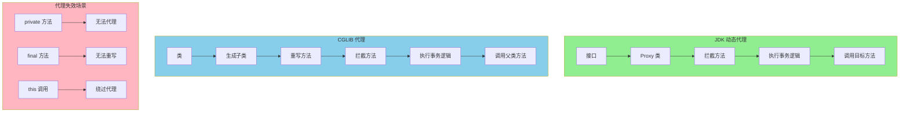
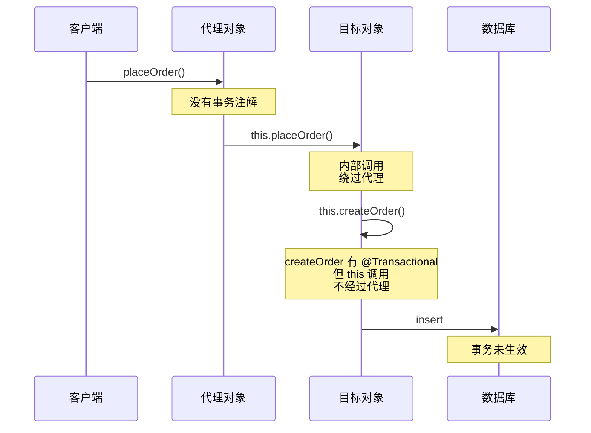
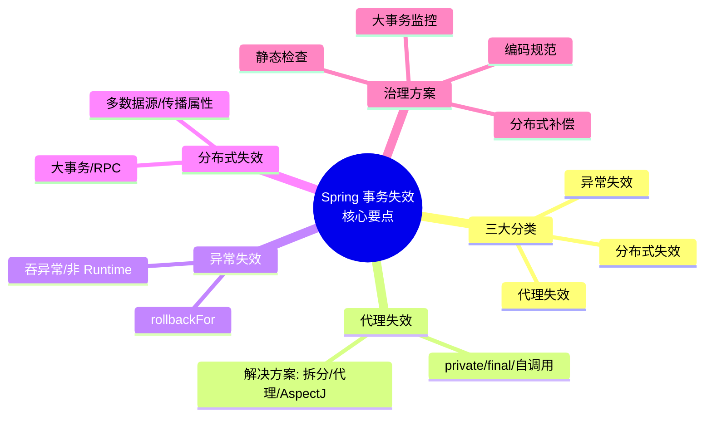

# Spring 事务失效：从注解到全链路治理

---

## 🎯 场景引入

**Spring 事务失效解决什么问题？**
```
为什么加了 @Transactional 注解，数据还是没回滚？
——从"会加注解"到"能治理全链路事务"的跃迁
```

**生活化比喻**：
就像给文件盖公章：
- **看似简单**：盖个章就行了
- **实际复杂**：公章被仿冒（代理失效）、盖错章（异常没抛出）、跨部门文件（多数据源）、章盖太久（大事务）、章的样式不统一（传播属性）

**核心观点**：会加 `@Transactional` 不等于会做事务，关键是能从代理机制识别失效场景，从规范和架构层面设计事务治理体系。

---

## 💎 核心设计要点速览

### 核心观点（5 个关键点）

**1. 事务失效三大类：代理失效、异常失效、分布式失效**
```
代理失效类：
  - 非 public 方法（private/protected）
  - final 方法（无法被代理）
  - 同类自调用（this 调用绕过代理）

异常失效类：
  - 手动 try-catch 吞了异常
  - 抛出非 RuntimeException（默认只回滚 RuntimeException）
  - 手动提交事务

分布式失效类：
  - 多数据源不匹配
  - 传播属性配置错误
  - 事务内混入 RPC 调用
  - 大事务超时回滚失败
```

**2. 自调用陷阱：同类方法 A 调方法 B，事务失效**
```
❌ 错误代码：
class OrderService {
    @Transactional
    public void createOrder() { ... }
    
    public void placeOrder() {
        this.createOrder(); // ❌ 事务失效！绕过了代理
    }
}

✅ 三种解决方案：
1. applicationContext.getBean() 获取代理对象调用
2. 引入 AspectJ 静态代理
3. 拆分业务类（A 类调 B 类）
```

**3. 多数据源：注解只在默认数据源生效**
```
❌ 错误认知：加了 @Transactional 所有库都回滚
✅ 正确认知：
   - 注解只在默认数据源生效
   - 第二个库的数据写进去了，根本不回滚

解决方案：
   - 核心链路：分布式事务（Seata / TCC / SAGA）
   - 非核心链路：拆成独立事务 + 手动补偿
```

**4. 大事务：执行十几秒不提交，连接池被打满**
```
❌ 错误做法：整个方法加事务（包含 RPC、批量查询等）
✅ 正确做法：
   - 事务拆分：大事务→短事务
   - 非核心逻辑移出事务（IO 操作、RPC 等）
   - 超时监控：超过阈值自动告警
   - 禁止事务内执行 RPC、批量查询等长耗时操作
```

**5. 生产级事务治理：规范 + 工具 + 监控**
```
基础编码层：
  - 强制 public
  - 禁止同类自调用
  - 异常统一抛出不私吞

工具层：
  - 静态代码检查：自动拦截非 public、自调用、吞异常
  - 大事务监控：超时告警

分布式事务：
  - 最终一致性兜底
  - 不强行追求强一致
  - 不一致自动触发对账任务补偿
```

---

## 🚀 一句话精华

> **事务失效 = 代理失效（自调用/private/final） + 异常失效（吞异常/非 Runtime） + 分布式失效（多数据源/大事务）；治理要从规范、工具、架构三层设计。**

---

## 一、事务失效三大分类

### 1.1 代理失效类：动态代理根本拦截不到

**生活化比喻**：
```
就像你找明星签名：
❌ 错误做法：直接找明星助理（绕过经纪人，代理失效）
✅ 正确做法：通过经纪人联系（走代理）

Spring 事务也是：
❌ 错误做法：this.method()（直接调用，绕过代理）
✅ 正确做法：通过代理对象调用
```

**Spring AOP 代理原理**：



**代理失效的四种场景**：

| 场景 | 原因 | 生活化比喻 | 解决方案 |
|------|------|------------|----------|
| **private 方法** | 代理无法访问私有方法 | 密室无法进入 | 改为 public |
| **protected 方法** | JDK 代理无法拦截 | 半公开房间 | 改为 public |
| **final 方法** | 无法被重写 | 焊死的门 | 去掉 final |
| **同类自调用** | this 调用绕过代理 | 自己找自己，不走经纪人 | 拆分业务类 / 获取代理对象 |

### 1.2 异常失效类：事务感知不到异常

**生活化比喻**：
```
就像你报告错误：
❌ 错误做法：出了问题自己扛，不上报（吞异常）
✅ 正确做法：出了问题立刻上报（抛出异常）

Spring 事务也是：
❌ 错误做法：try-catch 吞了异常
✅ 正确做法：异常抛出，事务感知并回滚
```

**异常失效的三种场景**：

```java
// ❌ 场景 1：手动 try-catch 吞了异常
@Transactional
public void createOrder() {
    try {
        orderDao.insert(order);
        userDao.decreaseBalance(userId, amount); // 这里抛异常
    } catch (Exception e) {
        // ❌ 异常被吞了，事务感知不到，不会回滚
        log.error("error", e);
    }
}

// ✅ 正确做法：抛出异常
@Transactional
public void createOrder() {
    orderDao.insert(order);
    userDao.decreaseBalance(userId, amount); // 异常抛出，事务回滚
}
```

```java
// ❌ 场景 2：抛出非 RuntimeException
@Transactional // 默认只回滚 RuntimeException
public void createOrder() throws IOException {
    orderDao.insert(order);
    throw new IOException("文件读取失败"); // ❌ 不会回滚
}

// ✅ 正确做法 1：指定回滚异常
@Transactional(rollbackFor = Exception.class)
public void createOrder() throws IOException {
    orderDao.insert(order);
    throw new IOException("文件读取失败"); // ✅ 会回滚
}

// ✅ 正确做法 2：包装为 RuntimeException
@Transactional
public void createOrder() {
    orderDao.insert(order);
    throw new RuntimeException(new IOException("文件读取失败")); // ✅ 会回滚
}
```

### 1.3 分布式失效类：跨库事务无法原子回滚

**生活化比喻**：
```
就像银行转账：
❌ 错误认知：加了 @Transactional，两个银行的数据都会回滚
✅ 正确认知：注解只在默认数据库生效，另一个银行的数据已经提交了

跨库事务就像跨国转账：
- 中国银行（数据源 1）：可以回滚
- 美国银行（数据源 2）：已经提交，无法回滚
```

**分布式失效的四种场景**：

| 场景 | 原因 | 生活化比喻 | 解决方案 |
|------|------|------------|----------|
| **多数据源不匹配** | 注解只在默认数据源生效 | 跨国转账 | 分布式事务（Seata） |
| **传播属性错误** | 内层回滚把外层也带滚了 | 父子连坐 | 明确指定传播属性 |
| **事务内 RPC** | 远程调用成功，本地回滚 | 快递发出收不回 | 移出事务 / TCC |
| **大事务超时** | 执行太久，连接池被打满 | 排队太久 | 事务拆分 / 超时监控 |

---

## 二、自调用陷阱：同类方法 A 调方法 B

### ❌ 问题现象

**生活化比喻**：
```
就像你让朋友帮忙：
❌ 错误做法：你自己写一封信，然后自己寄（自己调自己，绕过了代理）
✅ 正确做法：让朋友帮你寄（外部调用，走代理）

Spring 事务也是：
❌ 错误做法：this.method()（自己调自己）
✅ 正确做法：通过代理对象调用（让"朋友"帮忙）
```

**问题代码**：

```java
@Service
public class OrderService {
    
    @Transactional
    public void createOrder(Order order) {
        orderDao.insert(order);
    }
    
    public void placeOrder(Order order) {
        // ❌ 事务失效！this 调用绕过了代理
        this.createOrder(order);
    }
}
```

**为什么失效？**



### ✅ 三种解决方案

**方案 1：通过 ApplicationContext 获取代理对象**

**生活化比喻**：
```
就像你让经纪人帮你联系明星：
✅ 正确做法：通过经纪人（代理）联系，而不是直接找明星
```

```java
@Service
public class OrderService implements ApplicationContextAware {
    
    private ApplicationContext context;
    private OrderService self; // 代理对象
    
    @Override
    public void setApplicationContext(ApplicationContext context) {
        this.context = context;
    }
    
    @PostConstruct
    public void init() {
        this.self = context.getBean(OrderService.class); // 获取代理对象
    }
    
    @Transactional
    public void createOrder(Order order) {
        orderDao.insert(order);
    }
    
    public void placeOrder(Order order) {
        // ✅ 通过代理对象调用，事务生效
        self.createOrder(order);
    }
}
```

**方案 2：引入 AspectJ 静态代理**

**生活化比喻**：
```
就像用"替身"：
✅ 正确做法：让替身（AspectJ）帮你处理事务
```

```java
// AspectJ 静态代理（需要在编译时织入）
@Transactional
public void createOrder(Order order) {
    orderDao.insert(order);
}

public void placeOrder(Order order) {
    // AspectJ 编译时织入，this 调用也能拦截
    this.createOrder(order); // ✅ 事务生效
}
```

**方案 3：拆分业务类（推荐）**

**生活化比喻**：
```
就像分工合作：
✅ 正确做法：A 负责下单，B 负责创建订单，各司其职
```

```java
@Service
public class OrderPlacementService {
    
    @Autowired
    private OrderCreationService creationService;
    
    public void placeOrder(Order order) {
        // ✅ 外部类调用，走代理，事务生效
        creationService.createOrder(order);
    }
}

@Service
public class OrderCreationService {
    
    @Transactional
    public void createOrder(Order order) {
        orderDao.insert(order);
    }
}
```

---

## 三、多数据源事务：注解只在默认数据源生效

### ❌ 问题现象

**生活化比喻**：
```
就像跨国转账：
❌ 错误认知：加了 @Transactional，两个银行的数据都会回滚
✅ 正确认知：注解只在"中国银行"（默认数据源）生效，"美国银行"的数据已经提交了

多数据源事务就像"多国合作"：
- 每个国家有自己的法律（数据源）
- 一个法律管不了其他国家（注解不跨数据源）
```

**问题代码**：

```java
@Service
public class OrderService {
    
    @Autowired
    private OrderDao orderDao; // 数据源 1（默认）
    
    @Autowired
    private UserDao userDao;   // 数据源 2
    
    @Transactional // ❌ 只在数据源 1 生效
    public void createOrder(Order order) {
        orderDao.insert(order);    // ✅ 会回滚（数据源 1）
        userDao.decreaseBalance(); // ❌ 不会回滚（数据源 2）
    }
}
```

### ✅ 解决方案：分布式事务

**方案 1：Seata AT 模式（推荐）**

**生活化比喻**：
```
就像"联合国"协调多国合作：
✅ Seata 就像联合国，协调多个数据源的事务
```

```java
@Service
public class OrderService {
    
    @GlobalTransactional // ✅ Seata 全局事务
    public void createOrder(Order order) {
        orderDao.insert(order);    // 数据源 1
        userDao.decreaseBalance(); // 数据源 2
        // 任何一个失败，全部回滚
    }
}
```

**方案 2：TCC 模式（手动控制）**

**生活化比喻**：
```
就像"签订合同"：
- Try：预定资源（冻结库存）
- Confirm：确认执行（扣减库存）
- Cancel：取消执行（释放库存）
```

```java
@TwoPhaseBusinessAction
public boolean tryCreate(Order order) {
    // Try：预定资源
    orderDao.freeze(order);
    return true;
}

public boolean confirm(Order order) {
    // Confirm：确认执行
    orderDao.confirm(order);
    return true;
}

public boolean cancel(Order order) {
    // Cancel：取消执行
    orderDao.unfreeze(order);
    return true;
}
```

**方案 3：非核心链路：拆成独立事务 + 手动补偿**

**生活化比喻**：
```
就像"先付款后发货"：
- 核心链路：强一致性（分布式事务）
- 非核心链路：最终一致性（手动补偿）
```

```java
@Service
public class OrderService {
    
    @Transactional(transactionManager = "orderTxManager") // 数据源 1
    public void createOrder(Order order) {
        orderDao.insert(order);
    }
    
    @Transactional(transactionManager = "userTxManager") // 数据源 2
    public void decreaseBalance(Long userId, BigDecimal amount) {
        userDao.decreaseBalance(userId, amount);
    }
    
    public void placeOrder(Order order) {
        try {
            createOrder(order); // 数据源 1 事务
            decreaseBalance(order.getUserId(), order.getAmount()); // 数据源 2 事务
        } catch (Exception e) {
            // 补偿：手动回滚数据源 1
            cancelOrder(order.getId());
            throw e;
        }
    }
}
```

---

## 四、大事务治理：执行十几秒不提交

### ❌ 问题现象

**生活化比喻**：
```
就像餐厅排队：
❌ 错误做法：一个客人占着桌子吃 2 小时（大事务不提交）
✅ 正确做法：快速吃完，让位给下一位（短事务）

大事务就像"占着茅坑不拉屎"：
- 执行 15 秒不提交
- 一直占着数据库连接
- 高并发下连接池被打满
- 其他请求全部阻塞
```

**问题代码**：

```java
@Transactional
public void processOrder(Order order) {
    // ❌ 事务内包含 RPC 调用（耗时 5 秒）
    UserInfo user = userService.getUser(order.getUserId()); // RPC
    
    // ❌ 事务内包含批量查询（耗时 3 秒）
    List<Product> products = productDao.listByIds(order.getProductIds());
    
    // ❌ 事务内包含文件写入（耗时 2 秒）
    fileService.writeLog(order);
    
    // 真正的事务操作只有 1 秒
    orderDao.insert(order);
    inventoryDao.decrease(order);
}
```

### ✅ 治理方案：事务拆分 + 超时监控

**原则 1：事务拆分 - 大事务→短事务**

**生活化比喻**：
```
就像做菜：
❌ 错误做法：洗菜、切菜、炒菜、洗碗都在一个流程
✅ 正确做法：分工合作，洗菜的洗菜，炒菜的炒菜
```

```java
public void processOrder(Order order) {
    // ✅ 非事务操作：移到事务外
    UserInfo user = userService.getUser(order.getUserId()); // RPC
    List<Product> products = productDao.listByIds(order.getProductIds());
    
    // ✅ 事务操作：短事务
    doTransaction(order, user, products);
    
    // ✅ 非事务操作：移到事务外
    fileService.writeLog(order);
}

@Transactional
public void doTransaction(Order order, UserInfo user, List<Product> products) {
    // 只包含真正的数据库操作
    orderDao.insert(order);
    inventoryDao.decrease(order);
}
```

**原则 2：超时监控**

```java
@Transactional(timeout = 5) // ✅ 超时 5 秒自动回滚
public void createOrder(Order order) {
    orderDao.insert(order);
}
```

**原则 3：禁止事务内执行长耗时操作**

| 操作类型 | 是否允许在事务内 | 理由 | 生活化比喻 |
|---------|----------------|------|------------|
| **RPC 调用** | ❌ 禁止 | 网络延迟不可控 | 跨国电话 |
| **批量查询** | ❌ 禁止 | 查询时间长 | 翻遍整个图书馆 |
| **文件读写** | ❌ 禁止 | IO 操作慢 | 打印大量文件 |
| **复杂计算** | ❌ 禁止 | CPU 占用时间长 | 做复杂数学题 |
| **单表 CRUD** | ✅ 允许 | 快速操作 | 简单加减法 |

**代码示例**（完整的事务拆分）：

```java
@Service
public class OrderService {
    
    public void processOrder(Order order) {
        // 1. 非事务操作：移到事务外
        UserInfo user = userService.getUser(order.getUserId()); // RPC
        List<Product> products = productDao.listByIds(order.getProductIds());
        
        // 2. 事务操作：短事务
        try {
            doTransaction(order, user, products);
        } catch (Exception e) {
            log.error("订单处理失败", e);
            throw e;
        }
        
        // 3. 非事务操作：移到事务外
        fileService.writeLog(order); // 文件写入
        mqService.sendOrderCreatedEvent(order); // MQ 发送
    }
    
    @Transactional(timeout = 5) // 超时 5 秒
    public void doTransaction(Order order, UserInfo user, List<Product> products) {
        // 只包含数据库操作
        orderDao.insert(order);
        inventoryDao.decrease(order);
        userDao.addPoints(user.getId(), 100);
    }
}
```

---

## 五、生产级事务治理：规范 + 工具 + 监控

### 5.1 基础编码规范

**生活化比喻**：
```
就像交通规则：
- 红灯停，绿灯行（规范）
- 违规罚款（工具检查）
- 事故报警（监控）
```

**规范清单**：

| 规范项 | 说明 | 生活化比喻 |
|--------|------|------------|
| **强制 public** | 事务方法必须是 public | 公开透明 |
| **禁止自调用** | 禁止同类方法 this 调用 | 不走后门 |
| **异常统一抛出** | 禁止 try-catch 吞异常 | 有问题要上报 |
| **明确 rollbackFor** | 指定回滚异常类型 | 明确规则 |
| **事务方法短小** | 只包含必要的数据库操作 | 快速通过 |
| **禁止长耗时操作** | 事务内禁止 RPC、批量查询 | 不占着茅坑不拉屎 |

### 5.2 工具层：静态代码检查

**生活化比喻**：
```
就像"交通摄像头"：
✅ 自动检测违规行为
✅ 提前阻断，不等事故发生
```

```java
// 自定义注解处理器 / SonarQube 规则
// 检测以下违规行为：
// 1. 非 public 方法加 @Transactional
// 2. 同类自调用事务方法
// 3. 事务方法内 try-catch 吞异常
// 4. 事务方法内包含 RPC 调用
```

### 5.3 监控层：大事务告警

**生活化比喻**：
```
就像"超时提醒"：
✅ 事务执行超过 5 秒，自动告警
✅ 快速定位慢事务
```

```java
// 事务执行监控
@Component
public class TransactionMonitor implements ApplicationListener<TransactionApplicationEvent> {
    
    @Override
    public void onApplicationEvent(TransactionApplicationEvent event) {
        long duration = event.getDuration();
        if (duration > 5000) { // 超过 5 秒
            log.warn("大事务告警: {} 执行时间 {}ms", event.getMethodName(), duration);
            // 发送告警
            alertService.send("大事务告警", event.getMethodName());
        }
    }
}
```

### 5.4 分布式事务：最终一致性

**生活化比喻**：
```
就像"对账"：
- 不强求实时一致
- 定期对账，发现不一致就补偿
```

```java
// 最终一致性方案
@GlobalTransactional
public void placeOrder(Order order) {
    orderDao.insert(order);       // 数据源 1
    userDao.decreaseBalance();    // 数据源 2
}

// 对账任务
@Scheduled(cron = "0 0/5 * * * ?") // 每 5 分钟执行
public void reconcile() {
    // 查询订单和余额
    List<Order> orders = orderDao.listUnfinished();
    for (Order order : orders) {
        if (!userDao.checkBalance(order.getUserId(), order.getAmount())) {
            // 不一致，补偿
            compensate(order);
        }
    }
}
```

---
## 六、生产环境 Checklist

| 类别 | 检查项 | 状态 | 生活化比喻 |
|------|--------|------|------------|
| **代理失效** | 事务方法是否为 public | ⬜ | 公开透明 |
| | 是否有 final 方法 | ⬜ | 无法重写 |
| | 是否有同类自调用 | ⬜ | 不走后门 |
| **异常失效** | 是否 try-catch 吞异常 | ⬜ | 有问题要上报 |
| | rollbackFor 是否明确 | ⬜ | 明确规则 |
| **多数据源** | 是否跨数据源事务 | ⬜ | 跨国转账 |
| | 分布式事务方案 | ⬜ | 联合国协调 |
| **大事务** | 事务内是否有 RPC | ⬜ | 不占着茅坑 |
| | 事务内是否有批量查询 | ⬜ | 快速通过 |
| | 事务超时时间 | ⬜ | 超时提醒 |
| **监控** | 静态代码检查 | ⬜ | 交通摄像头 |
| | 大事务告警 | ⬜ | 超时提醒 |
| | 对账补偿任务 | ⬜ | 定期对账 |

---

## 七、总结



### 🎯 方案总结

> **事务失效 = 代理失效（自调用/private/final） + 异常失效（吞异常/非 Runtime） + 分布式失效（多数据源/大事务）；治理要从规范、工具、架构三层设计，核心链路用分布式事务，非核心链路用最终一致性。**

### 🧠 核心要点

1. **代理失效**：非 public、final、自调用（this 绕过代理）。
2. **异常失效**：吞异常不回滚，非 RuntimeException 不回滚（要指定 rollbackFor）。
3. **多数据源**：注解只在默认数据源生效，跨库要分布式事务。
4. **大事务**：事务拆分，非事务操作移出，超时监控。
5. **生产治理**：编码规范 + 静态检查 + 大事务监控 + 分布式补偿。

---

